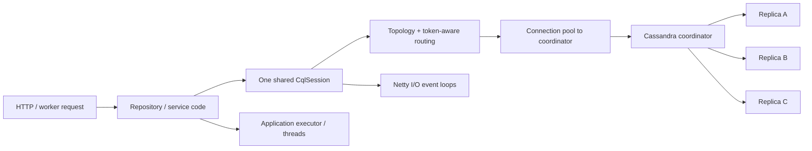
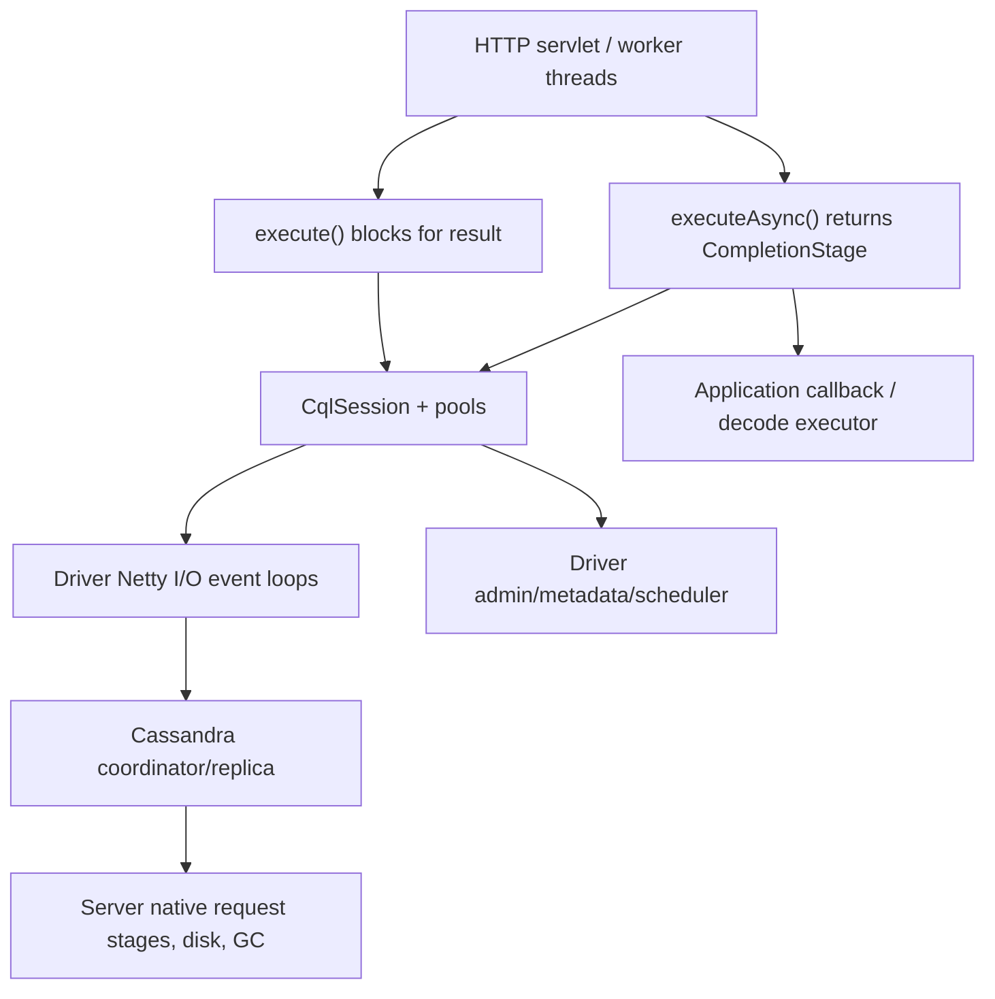
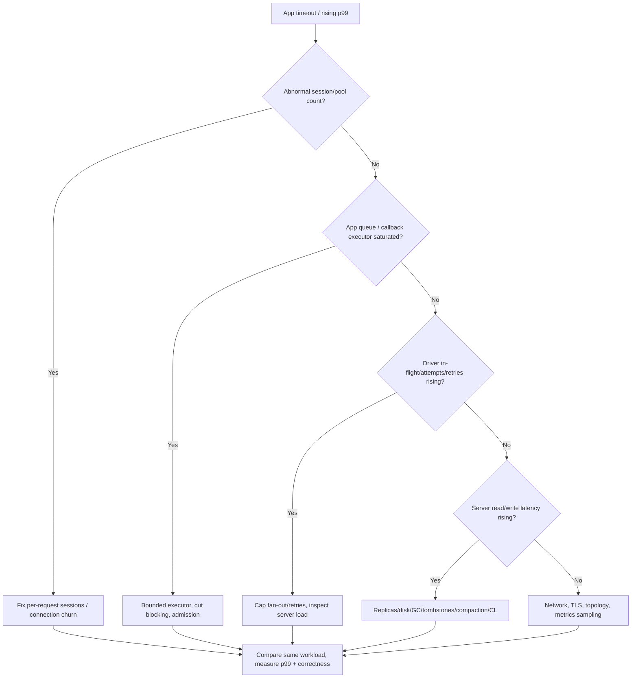

# Managing Session, Connection, and Thread Pool Lifecycles

A Java service sending 3,000 queries/second to Apache Cassandra should not open 3,000 new connections every second. In Java Driver 4.x, **`CqlSession` is a shared, thread-safe, long-lived object** holding topology metadata, prepared statements, connection pools, and driver execution resources. Creating a session per HTTP request, blocking thousands of threads waiting for results, or letting callbacks stall Netty I/O threads can all spike p99 even when CQL queries are well designed.

This lesson belongs to the **Java Driver Basics** chapter of the **DATABASE_ENGINE_WIDE_COLUMN_CASSANDRA** module. In a distributed wide-column model, a client must select a coordinator, locate partition keys/tokens, and communicate with replicas per consistency level. Proper **session – connection – thread pool** management exploits these mechanics without amplifying timeouts, retries, or cluster load. Examples use the Java Driver **4.x** API (packages remain prefixed `com.datastax.oss.driver.api`, including in the Apache branch); config/metric names may vary by minor version and environment.

> **Practical rule:** open a session **once per required logical connection to a cluster/identity**, reuse it across requests, and close it when the application stops; never create sessions inside DAO methods, never block a Netty I/O thread with `Future.join()`, and **never** equate async with "no load limits needed".

## 1. Learning Objectives

After this lesson, you will be able to:

1. Describe the `CqlSession` lifecycle: initialization, topology discovery, creating/maintaining connection pools, query execution, metadata refresh, and shutdown.
2. Explain the relationship among **session, node, connection, request stream, and coordinator**; distinguish a connection pool from a thread pool.
3. Choose the shared-session pattern in Java/Spring applications, identify exceptions requiring multiple identities/clusters, and understand the cost of creating too many sessions.
4. Distinguish blocking `execute()` from `executeAsync()` and identify which threads run callbacks/serialization.
5. Design **bounded concurrency, backpressure, deadlines, and retries** without saturating the driver or replicas.
6. Use prepared statements, partition-key routing, `LOCAL_QUORUM`, and sensible paging.
7. Close sessions and executors in the proper order during deploys, scale-in, or shutdown without cutting off critical requests mid-flight.
8. Monitor driver/OS/JVM/Cassandra metrics to diagnose timeouts, pool saturation, queues, and node state.
9. Complete the CQL lab and Java Driver 4.x example, then outline lifecycle, node failure, and graceful shutdown tests.

## 2. Architecture: Which Resources Does a Business Request Traverse?



This read path assumes `NetworkTopologyStrategy` RF=3 in `dc1` and `LOCAL_QUORUM`. The driver typically selects **one coordinator** to receive the request; the coordinator contacts the required replicas and returns the result. **The driver's connection pool to a coordinator is not a separate connection per replica.**

### Distinguishing the Components

| Component | Role | What It Is Not |
| --- | --- | --- |
| **`CqlSession`** | Represents one logical connection config; holds topology, pools, resources, and CQL APIs. | A single TCP socket. |
| **Node metadata** | Endpoint info, DC/rack, status, and token map known by the driver. | Proof that data on every replica is repaired. |
| **Connection pool** | Set of driver TCP connections to a node/coordinator, managing request capacity. | A Java thread pool or the replica count of a partition. |
| **Connection** | Native protocol channel multiplexing multiple requests via stream IDs when supported. | A fresh connection per `SELECT`. |
| **Netty I/O group** | Event loops handling network/driver I/O. | A place to run blocking or CPU-heavy business logic. |
| **Application executor** | App-managed threads running business logic or offloaded heavy callbacks. | A substitute for connection pools or server IOPS limits. |
| **Request throttler/admission** | Caps concurrent/queued requests before sending to the cluster. | A mechanism that makes a wide-scan query cheap. |

**Ratios are not 1:1:** one `CqlSession` may maintain multiple connections to multiple nodes; one connection handles multiple concurrent requests; one logical request may spawn multiple attempts via retries/speculative execution; and one request to a coordinator may require responses from multiple replicas.

## 3. Why Must `CqlSession` Be Long-Lived?

Creating a session is far more than instantiating a Java object. The driver may perform native protocol handshakes, authentication/TLS, node/topology discovery, control/pooled connection establishment, event loop/resource initialization, and internal bookkeeping. This consumes time, sockets, heap/native memory, and adds connection load on Cassandra.

### Three Models

| Model | Pros | Cost/Risk | Recommendation |
| --- | --- | --- | --- |
| **One app-lived session** per cluster/auth context | Reuses pools, metadata, prepared statements; low connection churn. | Requires clear lifecycle/shutdown management. | **Default for most services.** |
| **Session per HTTP/request** | Code looks "self-closing" at request end. | Continuous handshake/TLS/auth overhead, excessive sockets/event loops, startup latency, node overload. | **Avoid.** |
| **Multiple purposeful sessions** | Isolates clusters, security principals, keyspaces/config profiles, or failure domains. | Multiplies pools/threads/memory, complicates rotation and metrics. | Only with clear justification and bounded count. |

### Anti-Pattern Example to Avoid

```java
// DO NOT: build a separate session on every DAO call.
public void handleRequest() {
    try (CqlSession session = CqlSession.builder()
        .addContactPoint(new InetSocketAddress("127.0.0.1", 9042))
        .withLocalDatacenter("dc1")
        .build()) {
        session.execute("SELECT release_version FROM system.local");
    }
}
```

With hundreds of concurrent requests, this creates hundreds of sessions/pools, constant socket open/close churn, and repeated metadata discovery. Closing the session in `finally` **does not** make the per-request pattern cheap.

### Cases Genuinely Requiring More Than One Session

- Connecting to **two different clusters** during migration/DR.
- **Distinct identities/credentials** across security boundaries that cannot share a Cassandra role.
- Workloads needing separate configs not cleanly handled by statement execution profiles or driver config.
- A service running across multiple JVMs/pods: **each process** owns its own session; there is no Java object shared across pods.

A different keyspace **does not necessarily** need a new session; use fully qualified CQL table names and query-specific options/execution profiles where appropriate. Never create a session per tenant if all tenants share the same cluster/identity and differ only by partition key.

## 4. Initialize Session at Startup and Close at Shutdown

### Basic Java: `try-with-resources`

```java
import java.net.InetSocketAddress;
import com.datastax.oss.driver.api.core.CqlSession;
import com.datastax.oss.driver.api.core.cql.Row;

public final class CassandraLifecycleDemo {
    public static void main(String[] args) {
        // Lab: Cassandra listening for native protocol on 127.0.0.1:9042.
        // Production: TLS, auth, contact points, and dc come from config/secret provider.
        try (CqlSession session = CqlSession.builder()
                .addContactPoint(new InetSocketAddress("127.0.0.1", 9042))
                .withLocalDatacenter("dc1")
                .build()) {

            Row row = session.execute(
                "SELECT release_version FROM system.local").one();
            if (row != null) {
                System.out.println("Cassandra version: "
                    + row.getString("release_version"));
            }
        } // CqlSession.close() is invoked on exiting scope.
    }
}
```

This is a **short-lived CLI app** example where the entire program owns one session. In an HTTP service, never wrap `try-with-resources` around individual requests; place the session in **application scope** and let the framework/lifecycle owner close it when the process exits.

### Spring: Session Owned by the Application Context

```java
import java.net.InetSocketAddress;
import org.springframework.context.annotation.Bean;
import org.springframework.context.annotation.Configuration;
import com.datastax.oss.driver.api.core.CqlSession;

@Configuration
public class CassandraConfiguration {
    @Bean(destroyMethod = "close")
    public CqlSession cassandraSession() {
        return CqlSession.builder()
            .addContactPoint(new InetSocketAddress("127.0.0.1", 9042))
            .withLocalDatacenter("dc1")
            .build();
    }
}
```

This Spring example assumes required dependencies are present and **no** separate auto-configured framework session bean is running alongside it. In real production apps, never hardcode contact points/credentials; use configuration binding, SSL context, and secret managers, and check whether Spring Data Cassandra already creates a session bean to avoid duplicates.

**Clear ownership:** whichever component creates the session is responsible for closing it. Repositories/DAOs **receive the session via dependency injection** and never close the shared session themselves. In long-lived JVMs, prepare/cache prepared statements once after the session is ready.

## 5. Startup Readiness: Never Mask Connection Errors as "Ready"

A successful `build()` means the driver established a logical connection at that moment. It **does not prove** all nodes are `UN`, RF/CL are satisfied, schemas are migrated, repairs finished, or all read/write queries meet SLAs.

### Gate Before Serving Traffic

1. **Valid config:** contact points, local DC, TLS/truststore, credentials, driver version, and profiles.
2. **Session builds cleanly:** driver finds reachable nodes; auth/TLS succeed.
3. **Schema contract:** keyspaces/tables/UDTs have the expected structure; prepared statements compile.
4. **Sufficient permissions:** service role has `SELECT`/`MODIFY` on target tables; never use a Cassandra superuser routinely.
5. **Representative probe:** lightweight query by partition key and actual CL executes within bounds; never run wide scans as a health check.
6. **Availability:** service maintains dedicated readiness checks; transient Cassandra issues should surface as `NOT_READY` or controlled degradation without triggering restart storms.

### When Startup Fails

**Distinguish:** `AllNodesFailedException` when the driver cannot reach nodes; auth/TLS errors when credentials fail; CQL `UnauthorizedException` when a role lacks permissions; and `UnavailableException` when replicas cannot satisfy CL. These have different root causes—never "fix" them by raising session counts or lowering consistency.

If deployment policy permits startup retries, apply **backoff + jitter + total timeout cap**, log redacted error classes/endpoints, and let orchestration manage readiness/retries. Never launch hundreds of parallel session builders while the cluster is recovering.

## 6. Connection Pool: One Connection Serves Many Requests

Java Driver 4.x uses the native protocol and **request stream IDs**, multiplexing multiple concurrent requests over a single TCP connection within configured driver/protocol limits. Pools are typically managed **per node** with local/remote DC policies and connection/request limits. The driver can open or replace connections on network failures, topology changes, or pool rebalancing.

```text
Service process
  CqlSession
    ├── Metadata: nodes, DC/rack, tokens, schema
    ├── Connection pool -> n01 (local DC)
    │       ├── TCP connection #1: request streams A/B/C/...
    │       └── Additional TCP connection if config/demand requires
    ├── Connection pool -> n02 (local DC)
    ├── Connection pool -> n03 (local DC)
    └── Netty I/O/admin resources, throttling, metrics

Not true:
  1 request = 1 CqlSession
  1 request = 1 TCP connection
  1 connection = 1 Java thread
  1 partition = 1 connection to each replica
```

### Pool Size Differs from Concurrent Request Count

Because a single connection carries many stream IDs, increasing `local.size` from 1 to 8 **does not** multiply throughput by eight. Conversely, if bottlenecked by socket/stream capacity or network latency, tuning pool size may help **when verified by measurement**. Raising connection counts also consumes more TCP/TLS/memory/kernel resources and increases node load.

| Parameter/Concept | Impact | Risk of Unfounded Increase |
| --- | --- | --- |
| **Connections per node** | Number of TCP channels the driver keeps to each node. | More sockets/TLS/heap, churn, and node load. |
| **Max requests/streams per connection** | Multiplexing capacity per protocol/driver config. | Node queuing, memory, and in-flight pressure; cannot exceed protocol caps. |
| **Application concurrency** | Number of business operations issued simultaneously. | Multiplies across app instances; fuels timeout/retry storms. |
| **Driver throttler queue** | Wait queue before the driver dispatches or processes requests. | Long queues inflate tail latency, memory, and timeouts. |
| **Java worker pool** | Threads running blocking/CPU application logic. | Context switching, stack memory, queue buildup, CPU saturation. |

**Never size connection pools by HTTP thread count.** One session can serve many threads without a dedicated connection per thread. The driver handles multiplexing and selection automatically.

## 7. Local Datacenter, Contact Points, and Token-Aware Routing

A node listed as a **contact point** only helps the driver bootstrap cluster discovery; it **does not necessarily** serve as coordinator for subsequent requests. The driver requires an accurate **local datacenter** to select nodes under its load-balancing policy.

### Example DC with RF3

```text
Keyspace: NetworkTopologyStrategy, dc1=3, dc2=3
Java service running in dc1, localDatacenter = dc1
Query key: (tenant-a, 2026-11-21)
CL: LOCAL_QUORUM

  Driver selects coordinator via routing/load-balancing
  Coordinator locates replicas for the partition key's token
  LOCAL_QUORUM in dc1 requires floor(3/2)+1 = 2 dc1 replicas

Do not assume:
  - only 1 node in dc1 needs to be Up because 3 exist in dc2
  - every write was acknowledged by dc2 before returning success
  - one dc1 contact point always processes all queries
```

Prepared statements with full partition keys let the driver compute the routing key/token to prefer an optimal coordinator. `ALLOW FILTERING` queries or unbound partition keys negate token-aware routing. **Token-awareness does not replace data modeling and does not promise direct single-hop delivery to every replica.**

### Two Common Configuration Mistakes

1. **Wrong local DC:** a dc1 app configured with dc2 causes the policy to pick remote endpoints or fail to use expected nodes; p99 and WAN costs climb, and `LOCAL_QUORUM` semantics relative to coordinator/plan must be audited.
2. **Only one contact point:** if that contact point is down at startup, the app cannot discover the cluster even while other nodes are healthy; supply a few independent contact points per policy—no need to list every node if discovery works properly.

Never enable remote DC failover implicitly when the business requires local-only data or specific RPO/RTO; failover must be an explicit architectural decision tested for RF/CL, WAN latency, and authority.

## 8. Three Thread Groups: Application, Driver Netty, and Cassandra Server

A Java–Cassandra system involves several independent thread groups:



### Role of Each Group

| Group | Responsibility | Safe to Block? |
| --- | --- | --- |
| **HTTP/server worker** | Receives requests, orchestrates responses. | Depends on servlet/reactive model; never block event loops; thread-per-request needs bounds. |
| **Java business executor** | CPU-heavy transforms, serialization, validation, or app blocking I/O. | May block by design, but requires queue/concurrency caps. |
| **Driver Netty I/O group** | Socket reads/writes, completes stages, handles protocol events. | **Never** run `join()/get()`, sleep, or CPU-heavy work here. |
| **Driver admin/metadata group** | Manages cluster metadata, topology, and control tasks. | Never hijack for business callbacks. |
| **Cassandra server threads/stages** | Coordinator/replica CQL execution, mutations, read paths, disk/network. | Outside the app JVM; adding client worker threads does not scale this. |

**Critical:** callbacks in `CompletionStage.thenApply()/whenComplete()` may run on the **thread completing the stage**, often a Netty I/O thread. Parsing huge JSON payloads, making blocking HTTP calls, or calling `Thread.sleep()` inside that callback stalls the event loop, slowing down all requests on the session.

### Anti-Pattern: Blocking a Driver Callback

```java
// DO NOT: callback may execute on a driver I/O thread.
session.executeAsync(statement).thenApply(page -> {
    try {
        Thread.sleep(500); // Simulates blocking I/O in callback.
    } catch (InterruptedException error) {
        Thread.currentThread().interrupt();
        throw new RuntimeException(error);
    }
    return page;
});
```

This is **valid Java syntax with event-loop-unsafe runtime behavior**; never ship this to production. Instead, use `thenApplyAsync(..., applicationExecutor)` with a bounded executor, or do minimal work in the callback and offload heavy processing to the service layer.

## 9. Blocking API: Simple, Not Free

`CqlSession.execute()` returns a `ResultSet` and **blocks the calling thread** until the initial result arrives or fails. This is fine for batch CLIs, bounded worker pools, or bounded servlet threads; it is unsafe on Netty/reactive event loops.

```java
import java.time.LocalDate;
import com.datastax.oss.driver.api.core.ConsistencyLevel;
import com.datastax.oss.driver.api.core.cql.PreparedStatement;
import com.datastax.oss.driver.api.core.cql.BoundStatement;
import com.datastax.oss.driver.api.core.cql.ResultSet;
import com.datastax.oss.driver.api.core.cql.Row;

// Assumes shared CqlSession session is injected.
PreparedStatement select = session.prepare(
    "SELECT event_id, event_time, event_type " +
    "FROM driver_lab.events_by_tenant_day " +
    "WHERE tenant_id = ? AND event_day = ? LIMIT 25");

BoundStatement query = select.bind("tenant-a", LocalDate.of(2026, 11, 21))
    .setConsistencyLevel(ConsistencyLevel.LOCAL_QUORUM)
    .setPageSize(25)
    .setIdempotent(true);

ResultSet rs = session.execute(query);
for (Row row : rs) {
    // Do not tie up resources/worker threads with slow business logic inside the loop.
    System.out.println(row.getUuid("event_id"));
}
```

### Limitations

- `execute()` may only retrieve the **first page**; iterating `ResultSet` can trigger blocking fetches for subsequent pages.
- `LIMIT 25` caps **live rows returned**, not how many tombstones/SSTable entries the server scans.
- Prepare statements **once**, not `prepare()` per HTTP request; metadata may be cached, yet repeated prepare calls still add overhead.
- `BoundStatement` in Driver 4.x is **immutable**: always use the **return value** of `setPageSize`, `setConsistencyLevel`, and `setIdempotent` instead of assuming in-place mutation.

## 10. Async API: Frees Calling Threads, Still Consumes Resources

`executeAsync()` returns `CompletionStage<AsyncResultSet>`. While awaiting network I/O, the application thread can serve other work; however, the session still holds **in-flight requests, stream IDs, memory, and server work** per call.

```java
import java.time.LocalDate;
import java.util.concurrent.CompletionStage;
import java.util.concurrent.Executor;
import com.datastax.oss.driver.api.core.cql.AsyncResultSet;
import com.datastax.oss.driver.api.core.cql.BoundStatement;

// session/select prepared at startup; cpuExecutor is an application pool.
BoundStatement query = select.bind("tenant-a", LocalDate.of(2026, 11, 21))
    .setPageSize(25)
    .setIdempotent(true);

CompletionStage<AsyncResultSet> firstPage = session.executeAsync(query);
CompletionStage<Integer> rowCountInFirstPage =
    firstPage.thenApplyAsync(page -> {
        int count = 0;
        for (var row : page.currentPage()) {
            count++;
        }
        return count;
    }, cpuExecutor);
```

**Do not equate** `rowCountInFirstPage` with the total result count if more pages exist. `executeAsync()`'s initial stage completes only for the current page; reading all pages requires `hasMorePages()` and `fetchNextPage()` or an appropriate reactive API.

### Why `CompletableFuture.join()` Can Break Async

```java
// Never use on a Netty event-loop or Java reactive event-loop.
AsyncResultSet page = session.executeAsync(query)
    .toCompletableFuture()
    .join();
```

This call **blocks the current thread**. If invoked on a thread responsible for completing stages, it risks deadlock or starvation. In blocking applications, calling `execute()` from a **properly bounded worker pool** is cleaner than sprinkling `join()` inside async pipelines.

## 11. Bounded Concurrency: Preventing Pool and Node Saturation

Using `executeAsync()` alone does not stop an application from launching **1 million concurrent requests**. Unbounded loops of `for (...){executeAsync(...)}` over huge lists overflow in-flight streams, driver queues, heap, native socket buffers, and Cassandra coordinator queues—they require strict budgets.

### Example Repository Reading a Partition with a Semaphore

The Java 17 class below uses **one session and one prepared statement** across requests, capping active operations at 128 and offloading decoding to an application executor. The lab table `event_by_id` is created in Section 19.

```java
import java.time.Instant;
import java.util.Optional;
import java.util.UUID;
import java.util.concurrent.CompletableFuture;
import java.util.concurrent.CompletionStage;
import java.util.concurrent.Executor;
import java.util.concurrent.RejectedExecutionException;
import java.util.concurrent.Semaphore;
import com.datastax.oss.driver.api.core.CqlSession;
import com.datastax.oss.driver.api.core.ConsistencyLevel;
import com.datastax.oss.driver.api.core.cql.BoundStatement;
import com.datastax.oss.driver.api.core.cql.PreparedStatement;
import com.datastax.oss.driver.api.core.cql.Row;

public final class EventByIdRepository {
    public record Event(UUID id, Instant time, String type) {}

    private final CqlSession session;
    private final PreparedStatement byId;
    private final Executor decodeExecutor;
    private final Semaphore inFlight = new Semaphore(128);

    public EventByIdRepository(CqlSession session, Executor decodeExecutor) {
        this.session = session;
        this.decodeExecutor = decodeExecutor;
        this.byId = session.prepare(
            "SELECT event_id, event_time, event_type " +
            "FROM driver_lab.event_by_id " +
            "WHERE tenant_id = ? AND event_id = ?");
    }

    public CompletionStage<Optional<Event>> find(
            String tenantId, UUID eventId) {
        // Never block HTTP/Netty threads when budget is exhausted.
        if (!inFlight.tryAcquire()) {
            return CompletableFuture.failedFuture(
                new RejectedExecutionException("Cassandra budget exhausted"));
        }
        try {
            BoundStatement query = byId.bind(tenantId, eventId)
                .setConsistencyLevel(ConsistencyLevel.LOCAL_QUORUM)
                .setIdempotent(true);

            return session.executeAsync(query)
                .thenApplyAsync(page -> {
                    Row row = page.one(); // Full primary key -> at most 1 row.
                    if (row == null) return Optional.<Event>empty();
                    return Optional.of(new Event(
                        row.getUuid("event_id"),
                        row.getInstant("event_time"),
                        row.getString("event_type")));
                }, decodeExecutor)
                .whenComplete((ignored, error) -> inFlight.release());
        } catch (RuntimeException error) {
            inFlight.release();
            return CompletableFuture.failedFuture(error);
        }
    }
}
```

### Why Is This Example Well-Bounded?

1. **Shared session:** all calls reuse the same session/pools.
2. **Bounded query:** full partition key `(tenant_id, event_id)` returns at most one row.
3. **Application admission:** permit acquired **before** `executeAsync()` and released upon stage completion/failure.
4. **Non-blocking rejection:** `tryAcquire()` fails fast so the API layer can map to HTTP 429/503 per policy.
5. **Heavy callbacks offloaded:** `thenApplyAsync(..., decodeExecutor)` keeps decoding off Netty I/O threads.
6. **Errors stay errors:** exceptions are never converted into "row not found".

**Caution:** 128 is an **illustrative number**, not a guarantee every Cassandra cluster handles 128 concurrent requests per instance. Total load equals **service instances × per-instance budget**, plus retries/speculation. `whenComplete` here does only a tiny action (releasing the permit); if auditing, serialization, or remote I/O is needed, offload it too.

### Executors Also Need Bounded Queues

`Executors.newFixedThreadPool(4)` uses an unbounded queue that can grow without limit under sustained submission. To avoid "bounded threads with unbounded tasks", use `ThreadPoolExecutor` with a bounded queue and explicit rejection policy:

```java
import java.util.concurrent.ArrayBlockingQueue;
import java.util.concurrent.ExecutorService;
import java.util.concurrent.ThreadPoolExecutor;
import java.util.concurrent.TimeUnit;

ExecutorService decodePool = new ThreadPoolExecutor(
    4, 4, 0L, TimeUnit.MILLISECONDS,
    new ArrayBlockingQueue<>(64),
    new ThreadPoolExecutor.AbortPolicy());

// decodePool is managed by application lifecycle, never created per request.
// Do not choose CallerRunsPolicy if callers may be Netty I/O event loops:
// when the queue fills, it runs heavy work directly on the event loop.
```

When `decodePool` rejects a task, the stage completes exceptionally; monitor rejection rates and ensure permits are always released. In production, tie admission to HTTP/reactive backpressure and add a **global bulkhead** when multiple repositories share one cluster.

## 12. Driver Throttler and Application Backpressure Differ

Java Driver 4.x supports **request throttlers** in driver configuration to limit active and queued requests. This is a secondary defense layer, **not a substitute** for HTTP/gateway limits, worker queues, or fan-out bounds.

### Illustrative HOCON (Verify Against Driver Minor Version)

```hocon
datastax-java-driver {
  basic {
    contact-points = [ "127.0.0.1:9042" ]
    load-balancing-policy.local-datacenter = dc1
    request.timeout = 2 seconds
  }
  advanced {
    connection.pool.local.size = 1
    throttler.class = ConcurrencyLimitingRequestThrottler
    throttler.max-concurrent-requests = 256
    throttler.max-queue-size = 128
  }
}
```

**These numbers are learning examples for budgeting**, not production recommendations or driver defaults. Verify exact key names, profile precedence, throttler class, and version applicability in the config reference. Tune limits via benchmarks against real RF/CL/partition sizes/node counts.

### Where to Enforce Load Limits

| Layer | Mechanism | Why Needed |
| --- | --- | --- |
| **API/gateway** | Rate limits, request quotas, timeouts, load shedding. | Prevents unbounded user traffic from entering the system. |
| **Service business** | Semaphores/bulkheads, bounded threads/queues, partition read caps. | Controls total queries and fan-out per operation. |
| **Driver session** | Request throttler, connection pools, metrics, timeouts. | Prevents the driver from piling up in-flight/queued work before the cluster. |
| **Cluster/server** | Proper schema, RF/CL, capacity, compaction/repair schedules. | Sustains workload; client throttling cannot fix hot partitions. |

Never allow **deep queues at all three layers** blindly. Every queue adds end-to-end latency. It is better to **fail fast** under structured overload with clear metrics/HTTP statuses and caller backoff.

## 13. Managing Pages in an Async Pipeline

A `SELECT` can span multiple pages. `AsyncResultSet.currentPage()` contains only the **current page's** rows; reading further requires calling `fetchNextPage()`. Fetching additional pages adds driver/network work, affecting latency and in-flight concurrency.

### Example Draining a Query Already Capped with `LIMIT 50`

```java
import java.util.ArrayList;
import java.util.List;
import java.util.concurrent.CompletableFuture;
import java.util.concurrent.CompletionStage;
import com.datastax.oss.driver.api.core.cql.AsyncResultSet;
import com.datastax.oss.driver.api.core.cql.Row;

static CompletionStage<List<String>> collectBounded(
        AsyncResultSet page, List<String> acc) {
    for (Row row : page.currentPage()) {
        acc.add(row.getString("event_type"));
        if (acc.size() > 50) {
            return CompletableFuture.failedFuture(
                new IllegalStateException("Result budget exceeded"));
        }
    }
    if (page.hasMorePages()) {
        return page.fetchNextPage()
            .thenCompose(next -> collectBounded(next, acc));
    }
    return CompletableFuture.completedFuture(List.copyOf(acc));
}

// Caller: query must include LIMIT 50 and a specific partition/range.
// session.executeAsync(query).thenCompose(p -> collectBounded(p, new ArrayList<>()));
```

This illustrates **sequential fetch-next-page**. Even though the method does not block on network I/O, per-page callbacks can execute on driver I/O threads; keep work there minimal. Offload heavy parsing/validation to a bounded application executor. Never turn `acc` into an unbounded list and call it "async streaming"; prefer reactive/backpressure APIs or process and flush each page in batches.

### Paging Does Not Replace Partition Limits

`setPageSize(50)` caps **configured page transmission size**, not total query rows or tombstones scanned on the server. A `SELECT` lacking a partition key can still scan broadly across many pages; bound queries with proper data modeling, keyed `WHERE` clauses, clustering slices, and `LIMIT`.

## 14. Timeouts: Client Deadlines Differ from Server Timeouts

A request has at least three timing dimensions:

1. **Service-side wait time:** admission queues, task executors, HTTP processing.
2. **Driver request timeout:** response wait limit per driver/execution profile config, potentially spanning multiple attempts per API/policy.
3. **Server-side timeout/CL:** coordinator/replicas may return read/write timeouts or `Unavailable` depending on cluster health.

| Symptom | What to Check | What Not to Conclude |
| --- | --- | --- |
| `AllNodesFailedException` at bootstrap/session | Endpoints, auth/TLS, contact points, network, cluster down. | Merely a slow Cassandra query. |
| Driver request timeout | Pools/queues, network, coordinator, server latency, attempts. | Mutation definitely did not apply. |
| Cassandra `ReadTimeoutException` | CL, replica response/availability, disk/GC, tombstones. | `setPageSize` too small is the sole cause. |
| Cassandra `WriteTimeoutException` | CL, replica writes, commit log/disk, network, overload. | Write definitely failed on every replica. |
| `UnavailableException` | Too few live replicas for CL and token/replica set. | Simply raising request timeout will fix it. |
| Admission rejected | Semaphore/throttler/queue full. | Data missing or node down. |
| `UnauthorizedException` | CQL roles/grants, credential rotation. | Quorum or repair is broken. |

**Critical for writes:** a client timeout leaves outcome **uncertain**. Retrying with a new `UUID.randomUUID()` can create **two business entities**. Use idempotency keys, semantically valid statement idempotence, and outcome reconciliation/lookup flows.

## 15. Retries, Speculative Execution, and Request Multiplication

One logical operation can generate multiple attempts. When retry policies or speculative execution resend or issue backup requests:

```text
Logical HTTP operation: "GET latest events"
  attempt #1 -> coordinator A (slow)
  attempt #2 -> coordinator B (retry/speculation if policy allows)

HTTP operation count = 1
Driver attempts       = 1 or >1
Server request load   = potentially >1 query
```

**Separate in metrics** logical operations, attempts, retries, speculative executions, and in-flight requests. Under disk/GC/network saturation, broad retries trigger **retry storms**, preventing the cluster from recovering.

### Idempotency Classification

| Statement/Workflow | Safe to Mark Idempotent? | Explanation |
| --- | --- | --- |
| Keyed SELECT, no side effects | Usually **yes**. | Resending does not mutate data. |
| INSERT/UPDATE setting **identical values and entity key** | Possible, subject to TTL/timestamps, side effects, and ordering. | Rewriting with fresh timestamps/TTLs can alter semantics. |
| Counter `UPDATE c = c + 1` | **No** by default. | Retries increment multiple times. |
| Write generating a fresh ID per attempt | **No**. | Creates duplicate entities. |
| LWT/CAS with outcome-dependent flow | Design around conditions and unknown outcomes. | Never mark safe merely because `IF NOT EXISTS` is used. |
| Multi-table batch mutation | Not automatically idempotent via `LOGGED BATCH`. | Evaluate each mutation and business invariant. |

Calling `BoundStatement.setIdempotent(true)` **informs the driver's retry/speculation policy**; it does not ask Cassandra for exactly-once transactions. Raising timeout from 2 seconds to 30 seconds will not fix tombstone scans or slow replicas—it only ties up client resources longer.

## 16. Cancellation and Orphaned Responses

When an HTTP client disconnects or a service deadline expires, cancelling the app's `CompletableFuture`/stage **does not always cancel queries already started on Cassandra servers**. The coordinator/replicas may keep consuming CPU/I/O, returning responses after the client deadline passed.

### Consequences

- The driver may track **orphaned requests/responses** (metric names vary by version).
- Cancelling and immediately retrying doubles server load.
- Never measure Cassandra server QPS by HTTP success counts; cancelled queries still run past HTTP timeouts.
- Timed-out/cancelled writes still require idempotency/reconciliation rather than assuming rollback.

### How to Handle

1. Enforce an **end-to-end total timeout** in the service, not just per-attempt timeouts.
2. Apply admission before calling the driver; once past deadline, **stop issuing new requests** (especially fan-outs).
3. Treat cancellation propagation carefully per API/version; never promise "the server stopped working".
4. Correlate client timeouts, server read/write latency, attempts, and orphaned responses on one timeline.
5. When a node saturates, fix query/partition/CL/capacity instead of endlessly increasing retries.

## 17. Session Shutdown: Order Matters More Than One `close()` Call

An application often owns **HTTP listeners, background workers, producer queues, async callbacks, the session, and custom executors**. Calling `session.close()` immediately on `SIGTERM` while traffic still arrives breaks in-flight requests; shutting down executors before callbacks finish causes rejected callback tasks.

### Recommended Lifecycle

```mermaid
flowchart TD
  boot["Startup: config/secret/TLS"] --> session["Open CqlSession and prepare statements"]
  session --> ready["Readiness PASS, begin accepting traffic"]
  ready --> serve["Serve requests via shared session + admission"]
  serve --> stop["SIGTERM / scale-in / deploy"]
  stop --> reject["Stop accepting new HTTP/jobs, readiness=OFF"]
  reject --> drain["Wait for in-flight operations within deadline"]
  drain --> close["Close CqlSession to release driver resources"]
  close --> executor["Shutdown custom executors/callback pools"]
  executor --> end["Process exits; log unconfirmed work"]
```

### Steps

1. **Stop accepting new requests** at HTTP/gateway, halt background producers/schedulers, and flip readiness off so no new traffic arrives.
2. **Close the admission gate**: new work is rejected cleanly; no further `executeAsync()` calls start.
3. **Drain in-flight operations** within an SLA-aligned grace period; record unfinished work rather than waiting forever.
4. **Close the session** with `close()` or the version's async close API; accept that uncompleted calls may fail—never promise `close()` awaits every write commit.
5. **Shut down application-owned executors** after critical callbacks drain; call `shutdown()` then bounded `awaitTermination()`.
6. **Persist/log outcomes** of unconfirmed async writes; job queues/outboxes need idempotent resume after restart.
7. If the application supplies its own Netty event loop groups/executors to the driver, define **who owns** and closes them; never double-close shared groups.

### Lifecycle Owner Pseudocode

```java
// Framework-dependent pseudocode; not a standalone runnable class.
final class AppLifecycle {
    private final CqlSession session;
    private final ExecutorService decodePool;
    private final AtomicBoolean accepting = new AtomicBoolean(true);

    void stop() throws InterruptedException {
        accepting.set(false);
        httpServer.stopAcceptingNewRequests();
        producers.stop();

        // Wait for tracked in-flight business operations.
        // Production requires a hard deadline and handling for unknown outcomes.
        inFlightTracker.awaitQuiescence();

        session.close();
        decodePool.shutdown();
        if (!decodePool.awaitTermination(10, TimeUnit.SECONDS)) {
            // Per runbook: record incomplete tasks; never silently drop data.
        }
    }
}
```

**Never** mistake per-request `try-with-resources` for service-wide graceful shutdown. `close()` in application scope must follow stop-accepting and drain steps. If Kubernetes `terminationGracePeriodSeconds` is shorter than outstanding work, the process can be killed before flushing audits/checkpoints.

## 18. Thread Pool Tuning: More Threads Does Not Equal More Throughput

### Common Bottlenecks

| Situation | Signal | First Step |
| --- | --- | --- |
| **Client worker pool exhausted** | Service request queue grows; driver/server latency stays low. | Switch blocking I/O to async or increase bounded capacity; check CPU/network. |
| **Callback executor saturated** | `thenApplyAsync` queues/rejections climb; driver first-page latency is low. | Trim parsing, return smaller results, raise bounded capacity per CPU. |
| **Driver I/O event loop blocked** | Many requests stall together; event loop thread dumps show blocking callbacks. | Remove `join()/get()/sleep`, offload heavy work. |
| **Connection pool/streams saturated** | High in-flight, rising queues/dropping available streams, timeouts; multiple apps piling on. | Cap app concurrency, inspect driver metrics, pool config, and node capacity. |
| **Coordinator/replica CPU/GC/disk saturated** | Server read/write latency, queues, and GC/disk await rise together. | Optimize partition/clustering/TTL/tombstones and capacity; do not add client threads. |
| **Compaction/repair I/O contention** | p99 spikes alongside compaction/streaming; disk/network queues climb. | Schedule/throttle background work per runbook; never disable repair indefinitely. |
| **Multiple `CqlSession`s per instance** | Open connections/JVM threads/heap scale with replicas/pods. | Audit lifecycle and session counts; remove redundant sessions. |

If driver throughput rises initially and then p99 spikes past a concurrency cliff, suspect **saturation**. Tune `advanced.netty.io-group.size` or `connection.pool.local.size` only with **evidence of a driver-side bottleneck**; setting names/values vary by driver minor version.

### Do Virtual Threads Eliminate the Need for Backpressure?

On Java 21+, virtual threads make high-concurrency **blocking waits** far cheaper than platform threads in many cases. Yet Cassandra still has **CPU/disk/network/replica limits**, and the driver still has stream/connection caps. Virtual threads still require semaphores, deadlines, and bounded fan-out—never launch 100,000 concurrent queries simply because virtual-thread stacks are lightweight.

## 19. CQL Lab: Keyed Tables to Observe Sessions and Pooling

The lab requires a DC named `dc1` with at least three nodes if using `NetworkTopologyStrategy` RF=3 and `LOCAL_QUORUM`. If your lab has one node, adjust **lab** RF accordingly before running; never alter production replication for exercises.

### Step 1 — Create Keyspace and Two Tables

```sql
CREATE KEYSPACE IF NOT EXISTS driver_lab
WITH replication = {
  'class': 'NetworkTopologyStrategy',
  'dc1': 3
}
AND durable_writes = true;

CREATE TABLE IF NOT EXISTS driver_lab.events_by_tenant_day (
  tenant_id text,
  event_day date,
  event_time timestamp,
  event_id uuid,
  event_type text,
  PRIMARY KEY ((tenant_id, event_day), event_time, event_id)
) WITH CLUSTERING ORDER BY (event_time DESC, event_id DESC);

CREATE TABLE IF NOT EXISTS driver_lab.event_by_id (
  tenant_id text,
  event_id uuid,
  event_time timestamp,
  event_type text,
  PRIMARY KEY ((tenant_id, event_id))
);
```

These two tables demonstrate **query-driven denormalization**: one optimized for latest events by day, the other for ID lookup. Real applications need synchronization/reconciliation across projections; writing two separate tables does not provide cross-partition transaction isolation.

### Step 2 — Insert Sample Data

```sql
CONSISTENCY LOCAL_QUORUM;

INSERT INTO driver_lab.events_by_tenant_day
  (tenant_id, event_day, event_time, event_id, event_type)
VALUES ('tenant-a', '2026-11-21', '2026-11-21T08:05:00+0000',
        11111111-1111-4111-8111-111111111111, 'OPEN');

INSERT INTO driver_lab.event_by_id
  (tenant_id, event_id, event_time, event_type)
VALUES ('tenant-a', 11111111-1111-4111-8111-111111111111,
        '2026-11-21T08:05:00+0000', 'OPEN');

SELECT event_time, event_id, event_type
FROM driver_lab.events_by_tenant_day
WHERE tenant_id = 'tenant-a'
  AND event_day = '2026-11-21'
LIMIT 25;

SELECT event_time, event_type
FROM driver_lab.event_by_id
WHERE tenant_id = 'tenant-a'
  AND event_id = 11111111-1111-4111-8111-111111111111;
```

### Step 3 — Observe Cluster and Driver

```bash
nodetool status
nodetool tpstats
nodetool tablestats driver_lab.events_by_tenant_day
nodetool tablehistograms driver_lab events_by_tenant_day
```

Record topology/RF/CL, whether nodes remain `UN`, pending requests/tasks, and read latency. In parallel, enable driver metrics (per driver config) to observe connection counts/in-flight, timeouts, retries, throttler queues, and JVM threads/GC. **Never infer from an all-`UN` `nodetool status` snapshot that every request meets SLA.**

### Step 4 — Compare Two Session Patterns (Low-Load Lab Only)

1. **Long-lived:** one session at startup, running 1,000 lookups sequentially or with bounded concurrency 8.
2. **Per-operation anti-pattern:** open/close a session for a small number of lookups **in the lab** to compare startup cost, socket count, and threads; never run connection-storm tests against production.
3. Keep query/CL, dataset, network, and JVM environment identical; measure app p95/p99, time spent building sessions, open sockets, and CPU/GC.
4. Base conclusions on actual measurements, not hypothetical numbers.

### Step 5 — Test Bounded Async

Using `EventByIdRepository.find()` from Section 11, send lab request bursts of 8, 32, 128, and 256 (where bursts above 128 trigger rejections if all are in-flight). Measure **accepted/rejected**, driver attempts, p95/p99, threads/queues, and server read latency. The 128 cap is a single repository instance's quota, not a "hard" cluster quota; other repositories/instances still generate load.

## 20. Java: Inspecting Session State and Coordinators Properly

Driver metadata helps inspect endpoints known to the driver, yet a node showing `UP` in the driver does not prove replica data has converged or query p99 meets SLA.

```java
import com.datastax.oss.driver.api.core.metadata.Node;
import com.datastax.oss.driver.api.core.cql.ExecutionInfo;

// session is the shared session created at application startup.
for (Node node : session.getMetadata().getNodes().values()) {
    System.out.printf(
        "hostId=%s dc=%s rack=%s endpoint=%s state=%s%n",
        node.getHostId(), node.getDatacenter(), node.getRack(),
        node.getEndPoint(), node.getState());
}

ExecutionInfo info = session.execute(query).getExecutionInfo();
System.out.println(
    "coordinator=" + (info.getCoordinator() == null
        ? "unknown" : info.getCoordinator().getEndPoint()));
```

`ExecutionInfo.getCoordinator()` reports the coordinator that returned the successful response; it does **not** list all replicas. When a request times out, coordinator info may be absent. Driver node state updates asynchronously and may temporarily lag behind `nodetool status` after topology/network events.

### Recreate the Session on Cluster Topology Changes?

Normally you do **not** close/recreate a session just because a node briefly goes down or a new node joins. The driver handles discovery, metadata refresh, and reconnection. However, after TLS/credential/config rotation or prolonged incidents, understand your version's reload/reconnect capabilities and plan controlled session replacement—**never** rebuild a session on every timeout.

## 21. Monitoring: Client and Server Metrics Must Correlate

### Recommended Dashboard Groups

| Group | Metrics/Charts | Question Answered |
| --- | --- | --- |
| **Service** | Logical RPS, p50/p95/p99, error classes, HTTP in-flight/queues/rejections. | At which layer are users waiting? |
| **Driver request** | Attempt counts, retries, speculative executions, request timeouts, execution profiles. | How many attempts does one business op generate? |
| **Driver pools** | Per-node open connections, in-flight requests, available streams, connection failures/orphaned responses (if exposed). | Are pools starved or is the server slow? |
| **Throttler/admission** | Accepted/rejected/waiting queue, time-in-queue, semaphore permits. | Is the service shedding load before saturating the server? |
| **Application executors** | Active threads, bounded queue length/rejections, callback duration. | Is the callback pool or HTTP pool congested? |
| **JVM/process** | CPU, heap/RSS, GC pause/time, thread count, sockets/file descriptors. | Are there session leaks, native memory, or GC pressure? |
| **Server CQL** | Read/write latency, read/write timeouts, SSTables/read, tombstones scanned, pending tasks. | Are replicas/coordinators saturated by queries? |
| **Cluster/background** | Node UP/DOWN, compaction/repair/streaming, disk IOPS/latency, network RTT/retransmits. | Is background work or infra causing tail latency? |

Exact metric names depend on the Driver 4.x release and Micrometer/Dropwizard/exporter setup. **Do not assume** metrics like `pool.in-flight` or `pool.available-streams` are enabled out of the box; enable the required config metrics and verify units/labels.

### Correlate by `query_name`, Never by Raw Partition Keys

Structured logs should include a stable `query_name`, operation ID, driver attempt count (when available), CL, local DC, `elapsed_ms`, coordinator endpoint (if known), and `error_class`. Never place tenant/order/event IDs, CQL bind values, passwords, or TLS secrets into Prometheus labels. For p99 investigations, categorize hot-partition/large-row workloads via anonymized buckets in compliance with security policy.

## 22. 12-Step Runbook When a Java Service Times Out Against Cassandra

1. **Define scope:** endpoint, `query_name`, DC, consistency, p95/p99, RPS, timeout/rejection rates, and start time.
2. **Audit session ownership:** how many `CqlSession`s per process, are sessions created inside requests, when are they closed?
3. **Inspect driver topology/pools:** verify local DC, contact points, UP/DOWN nodes, open connections, in-flight/available streams, and connection errors.
4. **Inspect application queues:** HTTP thread pool, decode callback pool, semaphore rejections, and driver throttler queue.
5. **Compare client vs. server latency:** if server is fast while app is slow, inspect network/driver/queues; if server is also slow, inspect read paths/replicas.
6. **Check CL and replicas:** RF/DC, `UN/DN` nodes, coordinator, and replicas responsible for the partition key.
7. **Audit query scope:** full partition key, clustering range, `LIMIT`/page size, tombstones/SSTables per read, fan-out/queries per HTTP call.
8. **Check retries/cancellation:** attempts per logical operation; are timed-out writes creating duplicates?
9. **Check JVM/OS/server:** GC pauses, per-core CPU, thread stalls, disk await, network retransmits, compaction/repair/streaming overlap.
10. **Apply bounded mitigation:** tighten admission/fan-out, enforce backpressure, fix queries/schema, or scale capacity with data; never blindly raise connections/threads before finding the bottleneck.
11. **Verify post-change:** p95/p99, throughput, rejections, driver/server in-flight, pool queues, data correctness, and uncompromised CL.
12. **Close the incident:** document root cause with evidence, rollback steps, capacity tests, and alerts to catch session leaks/queues before p99 breaches SLA.

### Quick Triage Decision Tree



**An incident can involve multiple bottlenecks simultaneously**: high callback CPU from large rows alongside Cassandra scanning many tombstones. Use the tree to structure investigation, not to assume a single root cause.

## 23. Common Misconceptions

| Misconception | Accurate Understanding |
| --- | --- |
| "Each HTTP request needs its own session for thread safety." | `CqlSession` is **thread-safe** and built to be shared; opening sessions is expensive. |
| "A session is just one socket." | A session owns metadata, pools to multiple nodes, and background resources. |
| "Connection pool size 1 handles only one request at a time." | The native protocol multiplexes multiple request streams over one connection. |
| "For a `LOCAL_QUORUM` query, the driver opens two sockets to two replicas." | The driver typically sends to one coordinator; the coordinator handles replica requests. |
| "Increasing connection pool size always lowers p99." | When the server is already saturated, more connections/requests can worsen p99. |
| "Async consumes no threads or resources." | It still uses event loops, sockets, stream IDs, memory, and server work. |
| "`thenApply()` always runs on an HTTP thread." | It can run on a driver I/O thread; never do blocking/heavy work there. |
| "Calling `join()` on a Netty event loop is normal async usage." | It risks deadlock/starvation; use non-blocking continuations or offload. |
| "A fixed thread pool always has a bounded queue." | `Executors.newFixedThreadPool` uses an unbounded queue by default. |
| "Page size 100 means the query reads only 100 rows." | Paging does not alter query limits, partition scope, or tombstone scans. |
| "A timeout proves the mutation definitely failed." | Outcome may be unknown; retries require idempotency/business keys. |
| "Just retry aggressively when the cluster is slow." | Retry storms worsen load; enforce deadlines, backoff, and budgets. |
| "A contact point will always act as coordinator." | Contact points only bootstrap/discover; routing picks nodes per policy. |
| "Topology changes require creating a new session every minute." | The driver refreshes metadata/reconnects automatically; never recreate per error. |
| "Lowering `LOCAL_QUORUM` to `ONE` is just a driver speed tweak." | It weakens consistency guarantees; requires business analysis and approval. |
| "Calling `session.close()` immediately on `SIGTERM` is graceful." | Stop accepting and drain in-flight work first; `close()` can fail pending operations. |
| "All nodes `UN` guarantees fast requests." | Membership does not prove disk/GC/compaction/repair/query health. |
| "Virtual threads allow unlimited concurrent Cassandra requests." | They only make waits cheaper; server/driver still require bounded concurrency. |

## 24. Practice Exercises

### Exercise A — Counting Resources Properly

A service runs 12 pods, each with 40 HTTP worker threads. A developer creates a `CqlSession` per HTTP request and closes it after returning the response.

1. Explain why multiplying sessions by requests is harmful even though `close()` is called.
2. Design an application-scoped session for the 12 pods; who owns calling `close()`?
3. Which metrics for sockets/TLS handshakes/driver pools/node connections/GC should be compared before and after?
4. If each pod uses one session with 128 permits, why can the cluster still receive more than 128 concurrent requests?

### Exercise B — Is Concurrency Really Bounded?

A team writes `Executors.newFixedThreadPool(4)` and calls `submit()` for 1 million keys.

1. What is the maximum thread count? How large can the task queue grow?
2. How can `ArrayBlockingQueue` and `Semaphore.tryAcquire()` throttle the producer?
3. When no permit is available, what error or retry behavior should the system return?
4. Propose metrics for rejected tasks, in-flight count, p99, and retry attempts.

### Exercise C — Blocking on the Netty Event Loop

A service uses `executeAsync()`, yet `thenApply()` makes a blocking HTTP call to another service and `Thread.sleep(200)`.

1. Which thread might run the callback? Why does the entire session slow down?
2. Rewrite using `thenApplyAsync(..., boundedExecutor)` or an async HTTP client.
3. Why can `CallerRunsPolicy` be dangerous in this context?
4. Choose how to monitor event-loop stalls, executor queues, and app p99.

### Exercise D — Page Size Is Not Total Limit

Java calls `setPageSize(100)` and iterates a `SELECT` over a partition with millions of rows and no `LIMIT`.

1. How many pages might server/client fetch?
2. Why does `LIMIT 100` also fail to bound tombstones scanned?
3. Propose a partition + clustering slice query and an API max-rows cap.
4. For the async API, write a budgeted `hasMorePages()/fetchNextPage()` loop.

### Exercise E — Replicas and Local DC

A keyspace has `dc1:3, dc2:3`; the service runs in dc1, yet `localDatacenter` is set to `dc2`.

1. How do load balancing, coordinators, and latency change?
2. How many replicas in the coordinator's DC does `LOCAL_QUORUM` require under policy?
3. Why does merely adding a dc1 contact point fail to fix everything while `localDatacenter` remains wrong?
4. When dc2 WAN lags, what must the app check before promising RPO/consistency?

### Exercise F — Graceful Shutdown

A service has 200 active async writes; `SIGTERM` makes it call `session.close()` immediately, shut down the callback executor, and kill the process after 5 seconds.

1. What can happen to unconfirmed writes?
2. Design a stop-accepting → drain → close → executor-shutdown sequence with bounded deadlines.
3. Why must idempotency keys/unknown outcomes be recorded for resumption?
4. How do you test behavior when a node goes down mid-rolling-deploy?

### Exercise G — Distinguishing Client Bottlenecks from Cassandra Bottlenecks

Driver p99 rises from 20 ms to 700 ms. `nodetool status` shows all `UN`. The app callback queue grows rapidly, while server read latency stays near baseline.

1. Why shouldn't you conclude "Cassandra disks are slow"?
2. Which thread dumps and metrics should be inspected?
3. If the workload deserializes large rows, how can payload/callback cost be reduced?
4. When is changing `connection.pool.local.size` actually warranted?

### Exercise H — Timeouts and Duplicate Writes

`createEvent()` generates a fresh `UUID.randomUUID()` before every write attempt. One write times out and the client retries with a new UUID.

1. Why can two events end up stored even though the HTTP caller saw one operation?
2. Choose a stable idempotency key and an unknown-outcome verification flow.
3. When is `setIdempotent(true)` safe vs. wrong?
4. Why does raising timeouts not replace idempotency design?

### Passing Criteria

Learners must demonstrate:

1. **Proper lifecycle:** one session per cluster/auth context per process; clear startup/prepared-statement and shutdown ownership.
2. **Proper resource handling:** understanding node pools, multiplexing, Netty I/O vs. application executors, bounded queues/backpressure.
3. **Proper Cassandra semantics:** partition keys, DC/RF/CL, retries/idempotency, pagination, and topology.
4. **Proper operations:** baselines, client/server metrics, overload rejection, shutdown recovery, and failure testing.

## 25. Self-Check Questions

1. Why should `CqlSession` be shared across many requests and threads?
2. Is `CqlSession` equivalent to a single TCP connection?
3. Must a TCP connection handle only one CQL request at a time?
4. How does local datacenter differ from a contact point?
5. How does the driver picking a coordinator differ from the coordinator picking replicas?
6. Why should prepared statements be prepared/cached at startup?
7. Does `BoundStatement.setIdempotent()` turn a non-idempotent write into an idempotent one?
8. How do `execute()` and `executeAsync()` differ in blocking the calling thread?
9. When can `thenApply()` accidentally execute on a Netty I/O thread?
10. Why does `thenApplyAsync()` need an executor with a bounded queue?
11. Does a semaphore of 128 in one pod cap the whole cluster at 128?
12. How does a driver throttler differ from API rate limiting?
13. Why doesn't page size replace `LIMIT` or clustering ranges?
14. Does `fetchNextPage()` generate additional network/I/O traffic?
15. When a request times out, can you guarantee Cassandra did not write it?
16. How many server attempts can retries and speculative execution create for one logical operation?
17. At what layer does `AllNodesFailedException` differ from `UnavailableException`?
18. Why does a driver reporting a node `UP` not prove data is repaired?
19. Why shouldn't you recreate the session after every timeout?
20. What should the graceful shutdown order be?
21. Do Java virtual threads remove the need for admission limits?
22. Which metrics distinguish pool saturation from callback CPU saturation?

## 26. References and Version Lookup

- [Apache Cassandra Java Driver — Manual](https://apache.github.io/cassandra-java-driver/): `CqlSession`, synchronous/asynchronous/reactive APIs, preparing statements, paging, and lifecycle.
- [Apache Cassandra Java Driver — Core](https://apache.github.io/cassandra-java-driver/4.18.1/core/): sessions, connection pools, threading model, load balancing, and metrics for the corresponding 4.x line.
- [Apache Cassandra Java Driver — Configuration](https://apache.github.io/cassandra-java-driver/4.18.1/core/configuration/): HOCON, execution profiles, throttlers, request timeouts, Netty threads, and pool tuning.
- [Apache Cassandra — Data modeling](https://cassandra.apache.org/doc/latest/cassandra/developing/data-modeling/): partition keys, clustering keys, query-driven tables, and scan bounds.
- [Apache Cassandra — Consistency](https://cassandra.apache.org/doc/latest/cassandra/architecture/dynamo.html): replication, quorum/coordinators, failover, and consistency levels.
- [Apache Cassandra — Metrics](https://cassandra.apache.org/doc/latest/cassandra/managing/operating/metrics.html): server read/write latency, SSTable/tombstone scans, thread pools, GC, and background tasks.
- [Apache Cassandra — nodetool](https://cassandra.apache.org/doc/latest/cassandra/managing/tools/nodetool/): `status`, `tpstats`, `tablestats`, `tablehistograms`, and health inspection.

**Key takeaway:** Java Driver performance does not come from creating more sessions, threads, or connections. **A long-lived, thread-safe `CqlSession`**, per-node connection pools with request multiplexing, **non-blocking Netty I/O callbacks**, admission control/bounded executors, and semantically accurate timeouts/retries let applications handle load reliably. Monitor **both driver and server**, align queries with partition keys, DC, RF/CL, and close resources **only after stopping new traffic and draining in-flight work**. The goal is deliberate load bounding, meeting SLAs, and **never trading away data correctness**.
