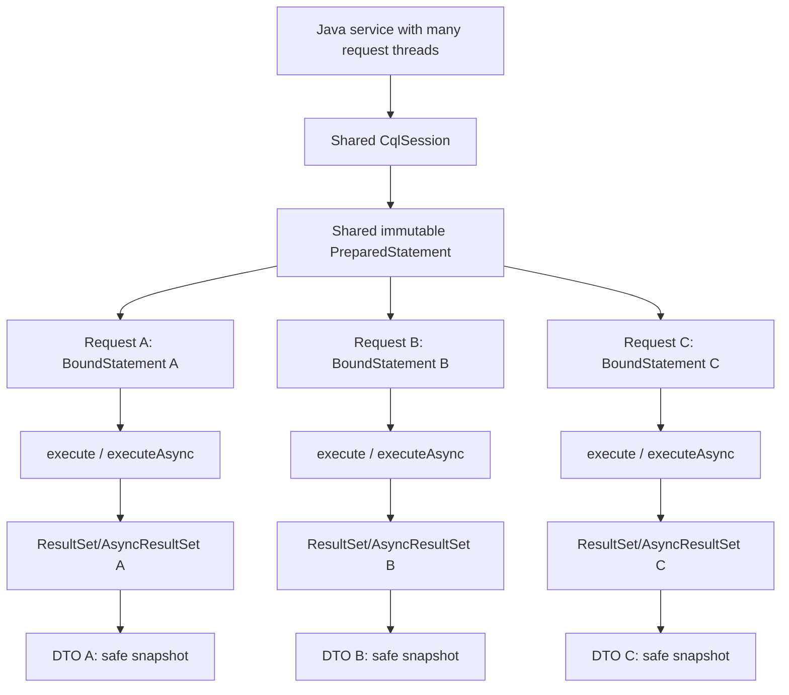
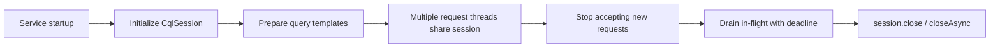
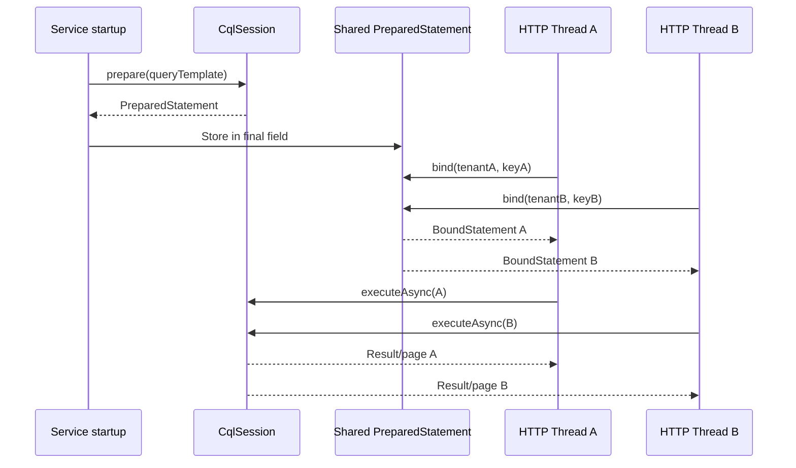

# Thread Safety of Sessions, Statements, and Data Objects

> **Chapter:** Java Driver Basics  
> **Module:** `DATABASE_ENGINE_WIDE_COLUMN_CASSANDRA` — Apache Cassandra

A Java service can simultaneously handle hundreds of HTTP requests, run event consumers, and execute many queries against Apache Cassandra. If every request builds its own `CqlSession`, connection and thread-pool costs skyrocket. Conversely, if multiple requests mutate the same `BoundStatementBuilder` or consume the same `ResultSet`, the program can pass the wrong parameters, drop rows, or trigger hard-to-reproduce bugs.

Java Driver **4.x** is built for high concurrent loads, yet **not every driver object is thread-safe**. The most important rules are:

- **Share** one active `CqlSession` and shared `PreparedStatement` instances for the service lifecycle.
- Built-in Driver 4.x `SimpleStatement`, `BoundStatement`, and `BatchStatement` implementations are **immutable** and can be shared when content and parameters are genuinely identical.
- **Create a bound statement with per-request values**; never accidentally reuse another user's `BoundStatement` variable.
- **Never share mutable builders** across requests or threads.
- **Never hand off iteration of a synchronous `ResultSet` across threads**; it is a single-use iterator.
- **Default `Row` is immutable**, yet **`UdtValue`, `TupleValue`, `ByteBuffer`, and some nested collections/custom objects follow different ownership rules**. Snapshot into DTOs if data crosses threads or application layers.
- With the async API, **never call synchronous APIs inside callbacks running on driver I/O threads**, and never run blocking/CPU-heavy work inside callbacks.

This lesson connects those rules to Cassandra's distributed wide-column architecture: partition keys, replication, read/write consistency levels, prepared statements, retries/idempotence, paging, in-flight limits, and observability via metrics. Examples target Java Driver 4.x (`com.datastax.oss.driver.api`), forming a solid foundation before applying Spring or reactive frameworks.

**Expected outcome:** ability to classify ownership of each object, write a thread-safe repository, use async without stalling event loops, prevent memory/backpressure failures, test concurrent requests, and recognize that client thread safety **does not imply** atomicity or data consistency inside Cassandra.

## 1. Mental Model: What to Share, What to Own?



The driver uses the shared `CqlSession` to manage connection pools, topology discovery, load balancing, token-aware routing, the prepared cache, and timeouts/retries. Session safety allows **multiple threads to call it concurrently**; it does not mean the application can freely mutate every object beneath the session.

### Practical Thread-Safety Matrix

| Object / API | Default Driver 4.x Implementation | Can Be Shared? | Rule |
| --- | --- | --- | --- |
| `CqlSession` | **Thread-safe**; manages connection pools and driver resources | **Yes**, one shared instance per cluster/connection config group | Create at startup, close at shutdown; avoid closing mid-request. |
| `PreparedStatement` | **Thread-safe**, prepared/cached | **Yes** | Prepare once per query template; each request calls `bind(...)` separately. |
| `SimpleStatement` | **Immutable** | Yes if query, bind values, and options fit all callers | Setters return a **new** statement; they never mutate the old instance. |
| `BoundStatement` | **Immutable** | Yes if bind values and options are identical, even async | Practically, create per request to avoid mixing user/partition keys. |
| `BatchStatement` | **Immutable** | Yes if mutations and options are identical | Batches do not provide multi-partition transaction isolation; never reuse mutable builders across requests. |
| `SimpleStatementBuilder`, `BoundStatementBuilder`, `BatchStatementBuilder` | **Mutable, not thread-safe** | **No** | Create a local builder per thread/build, call `build()`, then discard. |
| Synchronous `ResultSet` / `PagingIterable` | **Not thread-safe; single-use** | **No** across consumers | Iterate on the thread that called `session.execute(...)`; never parallel-stream it. |
| `AsyncResultSet` | **Current page + async `fetchNextPage`** model | Never share the same cursor/page across competing consumers | Each request owns its chain; fetch subsequent pages safely. |
| Default `Row` | **Immutable**, safe for concurrent reads per Javadoc | Conditionally | Do not assume all extracted child values are immutable; prefer DTOs. |
| Default `UdtValue`, `TupleValue` | **Mutable** | Never share if fields may be mutated | Copy/convert into immutable DTOs before handing across threads. |
| `ByteBuffer` and data via `getBytesUnsafe`/`setBytesUnsafe` | `ByteBuffer` has mutable position/limit/content; raw API may expose **internal buffer** | Never share for mutation | Use typed getters; deep-copy bytes when full isolation is needed. |
| Custom statement/codec/listener | No blanket guarantee like built-in defaults | Contract-dependent | Check Javadoc and avoid unsynchronized shared mutable state. |

**Version note:** unlike Java Driver **3.x**, built-in `BoundStatement` in **4.x is immutable**. Do not carry over the Driver 3.x habit of "mutating and reusing a `BoundStatement`", nor apply 3.x thread-safety warnings verbatim to 4.x.

## 2. `CqlSession`: One Shared Object, Many Threads, One Lifecycle

### 2.1. Why Share a Session?

`CqlSession` holds connection pools to nodes chosen by **local datacenter**, manages token metadata, in-flight requests, and driver executors. It is safe for concurrent `execute(...)`/`executeAsync(...)` calls across Java threads.

```java
import java.net.InetSocketAddress;
import com.datastax.oss.driver.api.core.CqlSession;

public final class CassandraSessionFactory {
    private CassandraSessionFactory() {}

    // Run once at startup; lifecycle managed by DI container.
    public static CqlSession open() {
        return CqlSession.builder()
            .addContactPoint(new InetSocketAddress("192.0.2.11", 9042))
            .addContactPoint(new InetSocketAddress("192.0.2.12", 9042))
            .withLocalDatacenter("dc1")
            .build();
    }
}
```

`192.0.2.x` addresses are illustrative only. Production requires real contact points, local DC, TLS, authentication, and a secret manager. Never put credentials in code. You may use `application.conf` instead of the builder; connection mechanics do not change session ownership rules.

**Recommended lifecycle:**

1. Create **one session** when the service starts cleanly.
2. Prepare needed query templates and construct repositories holding `final CqlSession` and `final PreparedStatement`.
3. Let all request/worker threads share those objects, with each request creating its own bound statements and results.
4. On shutdown, **stop accepting new requests**, and wait for in-flight requests to finish or hit a deadline.
5. Then call `close()` or `closeAsync()` per lifecycle to release connections and event-loop resources.



**Two opposite mistakes:**

- Calling `CqlSession.builder().build()` **inside every HTTP request**: connection churn, repeated prepare/metadata work, thread pools, memory, and socket/port pressure.
- Calling `session.close()` at the end of one request **while sharing the session**: other running requests fail unexpectedly.

For one-shot Java CLI commands, `try (CqlSession session = ...)` is right. For servers/services with dependency injection, use a singleton bean or equivalent component with shutdown hooks. Avoid unmanaged static global sessions lacking startup/shutdown controls, test isolation, or credential rotation support.

### 2.2. Thread-Safe Does Not Mean Unlimited Concurrency

A session safe for 1,000 callers does not mean the cluster can handle 1,000,000 in-flight requests. The driver still has stream ID, connection, and memory limits; replicas still have CPU, disk, commit log, memtable flush, compaction, GC, network, and RF/CL limits.

Apply **backpressure** at APIs/event consumers or use the driver request throttler. If incoming requests continuously exceed completion capacity, pending queues, timeouts/retries, and p99 climb even when Java code has zero data races.

### 2.3. Do Not Confuse Session Thread Safety with Consistency

Suppose two threads use the same session to write the same primary key:

```text
Thread A: UPDATE value = "A"  (write timestamp = 100)
Thread B: UPDATE value = "B"  (write timestamp = 200)
```

Even though `executeAsync` throws no error and both complete cleanly, Cassandra resolves conflicts by write timestamps/tombstones and consistency semantics. **Callback completion order** is not a guarantee of final mutation order. If business logic requires compare-and-set, use **LWT/CAS** appropriately and account for contention; a thread-safe session does not turn two updates into an isolated transaction.

## 3. Built-in 4.x Statements Are Immutable: Understand Setters Properly

### 3.1. Mistake: Calling a Setter and Discarding the Return Value

```java
PreparedStatement prepared = session.prepare(
    "SELECT payload FROM driver_threads.events_by_device_day " +
    "WHERE tenant_id=? AND device_id=? AND event_day=? AND event_id=?");

BoundStatement statement = prepared.bind("tenant-a", "sensor-07",
    LocalDate.of(2026, 11, 21),
    UUID.fromString("11111111-1111-4111-8111-111111111111"));

// WRONG: setConsistencyLevel returns a NEW statement,
// it does not mutate the existing object.
statement.setConsistencyLevel(DefaultConsistencyLevel.LOCAL_QUORUM);
session.execute(statement); // Still uses the original statement's options.
```

Right:

```java
BoundStatement statement = prepared.bind("tenant-a", "sensor-07",
        LocalDate.of(2026, 11, 21),
        UUID.fromString("11111111-1111-4111-8111-111111111111"))
    .setConsistencyLevel(DefaultConsistencyLevel.LOCAL_QUORUM)
    .setIdempotent(true)
    .setPageSize(50);

Row row = session.execute(statement).one();
```

Setters such as `setString`, `setPageSize`, `setConsistencyLevel`, `setIdempotent`, and `setTimeout` return a **new instance** on built-in statements. Many methods are annotated `@CheckReturnValue`; static analysis tools like Error Prone can catch **ignored return values**.

### 3.2. Immutability Enables Sharing, but Sharing Is Not Always Appropriate

A single `BoundStatement` with fixed values/CL can be sent concurrently, even via `executeAsync`, because the default implementation is immutable. However:

```java
// DO NOT: share a bound statement field across multiple users.
private static BoundStatement lastCustomerQuery; // Risks holding wrong tenant/key.

// Right: cache only PreparedStatement, create BoundStatement inside the method.
public String readForCustomer(String tenantId, String deviceId,
                              LocalDate day, UUID eventId) {
    BoundStatement oneRequest = prepared.bind(
        tenantId, deviceId, day, eventId);
    // Execute this query; never store oneRequest in a shared field.
    Row row = session.execute(oneRequest).one();
    return row == null ? null : row.getString("payload");
}
```

**Immutability does not make a statement's contents valid for every user.** Keeping a statement bound for tenant A and serving it to tenant B is a **data-scope leak bug**, even without a data race.

### 3.3. Things That Break Immutability Assumptions

- **Custom implementations** of `Statement` might be mutable; built-in Javadoc guarantees do not cover custom classes.
- A `ByteBuffer` passed via `setBytesUnsafe`/`getBytesUnsafe` may be the internal buffer itself. Mutating position/limit/content can yield unpredictable results in other statement/row uses.
- Mutable nested values or collections retained by the app can be mutated accidentally. Copy or encode via typed setters and avoid holding unsafe references.
- Built-in `BatchStatement` is immutable, but its **builder holds a mutable list of mutations**; never share builders.

## 4. `PreparedStatement`: Prepare Once, Bind per Request

Driver 4.x maintains a prepared-statement cache in the session. A query template is usually prepared **once at startup** or repository initialization, then shared across all requests.



### Why Avoid Preparing on the Hot Path?

- Even though Driver 4.x caches prepared queries, calling `prepare` repeatedly incurs cache/check overhead and impacts startup and maintenance.
- **Generating unbounded CQL variants** by concatenating literals/column names bloats caches, floods prepare requests, breaks token-aware routing, and invites injection risks.
- If schema changes, prepared metadata and result types must be watched/reconciled; never assume `SELECT *` stays valid across column changes.
- Keep bind values separate from query text. Filtering by fixed partition/tenant key parameters helps the driver compute token routing and keeps access boundaries clear.

**Repository design:** two `final` fields safely published from the constructor; request methods hold **no mutable shared request state**. This is why "shared session + shared prepared statement + per-request bind" works cleanly.

## 5. Statement Builders: Mutable but Handy

When setting many fields/options, chaining immutable `setXxx` calls allocates many intermediate objects. Builders construct one final statement:

```java
// A NEW and LOCAL builder for each construction.
BoundStatementBuilder builder = prepared.boundStatementBuilder()
    .setString(0, tenantId)
    .setString(1, deviceId)
    .setLocalDate(2, day)
    .setUuid(3, eventId)
    .setConsistencyLevel(DefaultConsistencyLevel.LOCAL_QUORUM)
    .setIdempotence(true)
    .setPageSize(50);

BoundStatement statement = builder.build();
session.execute(statement);
```

This snippet assumes `prepared`, `tenantId`, `deviceId`, `day`, `eventId`, and `session` exist. In Driver 4.x, the builder uses **`setIdempotence(boolean)`**, while immutable statements use **`setIdempotent(Boolean)`**; do not confuse the two method names.

**Wrong:**

```java
// WRONG: shared builder; concurrent requests overwrite each other's fields.
private final BoundStatementBuilder sharedBuilder =
    prepared.boundStatementBuilder();

public void handle(String tenantId, UUID eventId) {
    sharedBuilder.setString("tenant_id", tenantId)
                 .setUuid("event_id", eventId);
    session.execute(sharedBuilder.build());
}
```

A classic interleaving:

```text
Thread A: builder.setString("tenant_id", "tenant-A")
Thread B: builder.setString("tenant_id", "tenant-B")
Thread A: builder.setUuid("event_id", E1)
Thread A: builder.build()   => may contain tenant-B + E1 (WRONG)
```

Do not wrap a shared builder in `synchronized` just to "optimize" allocations. Creating a local builder is simple, contention-free, safe, and usually fast enough. Synchronizing requires locking across all setters and `build()` and never leaking the builder across callbacks—unnecessary complexity.

**Similarly:** `SimpleStatementBuilder` and `BatchStatementBuilder` are `@NotThreadSafe`. Only the built `BatchStatement` is an immutable snapshot for execution.

## 6. Synchronous `ResultSet`: One Owner, One-Way Consumption

`ResultSet` returned by `session.execute(...)` implements `PagingIterable<Row>`. It may issue additional queries transparently to fetch pages as code iterates past the current page boundary.

**Javadoc confirms:**

- `ResultSet` / `PagingIterable` implementations are **not thread-safe**.
- It should only be **iterated by the thread that called `session.execute`**.
- It is a **single-use iterator**: calling `iterator()` again does not create an independent copy.
- Calling `one()`, `iterator()`, `all()`, and `map()` on the same result all **consume shared state**.
- `all()` fetches all remaining pages, potentially pulling huge datasets into memory.

```java
// RIGHT: query and iterate result on the same worker thread.
ResultSet result = session.execute(bound);
List<UUID> eventIds = new ArrayList<>();
for (Row row : result) {
    eventIds.add(row.getUuid("event_id"));
}
List<UUID> snapshot = List.copyOf(eventIds);
```

```java
// WRONG: two threads consume one ResultSet simultaneously.
ResultSet result = session.execute(bound);
executorA.submit(() -> result.one());
executorB.submit(() -> result.one());  // No thread-safety contract.
```

Even if two threads only "read data", the **iterator is a stateful machine** advancing a cursor and possibly fetching pages. Sharing it is a data race and contract violation.

### 6.1. How to Pass Data to Another Thread

**Never pass the `ResultSet` or its iterator**. On the thread owning the result:

1. Iterate a bounded number of rows.
2. Convert each `Row` into an immutable DTO/snapshot containing only the needed columns.
3. Pass the DTO list via synchronized queues/futures or `List.copyOf(...)`.
4. Ensure you never call `result.all()` on a query returning millions of rows.

Example:

```java
List<EventView> views = new ArrayList<>();
for (Row row : result) {
    views.add(toView(row)); // Never retain result/iterator inside DTOs.
}
List<EventView> immutablePage = List.copyOf(views);
// Safe to pass immutablePage to another executor for processing.
```

`toView` must **deep-copy any mutable values** stored in the DTO; `List.copyOf` on the outer list does **not** make a nested `UdtValue` or `ByteBuffer` immutable.

### 6.2. Page Size Does Not Make Parallel Streaming Safe on One Result

`setPageSize(100)` is only a **rows-per-page hint**; it does not mean the server reads only 100 cells or replace partition-key access. Reading further can block to fetch the next page. Never pass `ResultSet` to `parallelStream()` to "use more CPU" and expect page fetching to stay thread-safe.

To process in parallel, split across **distinct partitions/buckets or independent tasks**, each with its own statement/result, bound total concurrency, and verify ordering/correctness per business rules.

## 7. `AsyncResultSet`: Chain per Page, Never Share a Competing Cursor

`session.executeAsync(statement)` returns `CompletionStage<AsyncResultSet>`. Unlike synchronous results, `AsyncResultSet` exposes only the **current page** via `currentPage()`; getting subsequent pages is **explicitly asynchronous** via `fetchNextPage()`.

```java
import java.util.concurrent.CompletableFuture;
import java.util.concurrent.CompletionStage;
import com.datastax.oss.driver.api.core.cql.AsyncResultSet;
import com.datastax.oss.driver.api.core.cql.Row;

public static CompletionStage<Long> countRowsAcrossPages(
        AsyncResultSet page, long prior) {
    long sum = prior;
    for (Row ignored : page.currentPage()) {
        sum++;
    }

    if (!page.hasMorePages()) {
        return CompletableFuture.completedFuture(sum);
    }
    long next = sum;
    return page.fetchNextPage()
        .thenCompose(more -> countRowsAcrossPages(more, next));
}
```

This example demonstrates the **chaining API**, not a recommendation to count whole tables in Cassandra. If a partition has millions of rows, enforce page/row caps, error budgets, and application-level counters; even async recursion over huge page counts should switch to a controlled async loop to prevent stack/memory pressure.

**Do not:**

- Pass **the same page/cursor** to two consumers that both call `fetchNextPage()` without coordination.
- Iterate `currentPage()` inside an I/O callback and run heavy CPU work per row.
- Mix an `AsyncResultSet` from query A with the paging state of query B.
- Assume the first page holds all rows matching `LIMIT` or page size.

If a service returns pages to an API caller, map the current page into **immutable DTOs**, then return the cursor/paging state per the exact statement contract. Paging state is opaque and **must stay paired with the exact same CQL and bind values**; never treat it as a general offset or share across tenants.

## 8. Default `Row` Is Immutable, but Child Values Might Not Be

### 8.1. `Row` Itself vs. Simple Data Types

Javadoc specifies the default `Row` implementation is **immutable** and serializable; custom implementations must at least ensure thread safety. Java types commonly safe to pass across threads when immutable themselves:

| CQL | Common Java Type | Notes |
| --- | --- | --- |
| `text`, `varchar` | `String` | Immutable; avoid logging PII. |
| `uuid`, `timeuuid` | `UUID` | Immutable. |
| `date` | `LocalDate` | Immutable. |
| `timestamp` | `Instant` | Immutable, though distinct from cell write timestamp. |
| `decimal` | `BigDecimal` | Immutable. |
| `int`, `bigint`, `boolean` | Primitive/wrapper | When CQL is NULL, check `row.isNull(...)` before primitive getters. |
| `blob` | `ByteBuffer` | **Mutable buffer state/content**; manage ownership carefully. |
| `list`/`set`/`map` | `List`/`Set`/`Map` | Do not assume every implementation or nested element is immutable. |
| `tuple`/UDT | `TupleValue`/`UdtValue` | Default implementations are **mutable**. |

**Critical distinction:** `Row` immutability does not mean every Java object **returned by a getter** is immutable. Passing a `UdtValue` or a collection of mutable elements elsewhere and mutating it breaks data stability in the application.

### 8.2. UDTs and Tuples Have Mutable Fields

Example CQL:

```sql
-- LAB only with local DC dc1 and matching RF.
CREATE KEYSPACE IF NOT EXISTS driver_threads
WITH replication = {'class':'NetworkTopologyStrategy','dc1':3};

CREATE TYPE IF NOT EXISTS driver_threads.event_location (
    city text,
    zone text
);

CREATE TABLE IF NOT EXISTS driver_threads.events_by_device_day (
    tenant_id text,
    device_id text,
    event_day date,
    event_id uuid,
    payload text,
    attributes map<text,text>,
    attachment blob,
    location frozen<driver_threads.event_location>,
    PRIMARY KEY ((tenant_id, device_id, event_day), event_id)
);
```

Driver 4.17 Javadoc for `UdtValue` and `TupleValue` explicitly notes that default implementations are **mutable**. Therefore:

```java
UdtValue location = row.getUdtValue("location");

// Never share location and let another thread call setString(...).
// Extract only the immutable values needed by the application:
String city = location == null ? null : location.getString("city");
String zone = location == null ? null : location.getString("zone");
```

This assumes `row` is present and `com.datastax.oss.driver.api.core.data.UdtValue` is imported. For tuples, call `getTupleValue(...)` and extract fields similarly.

For maps like `attributes`, when keys/values are known `String`s, create an immutable copy:

```java
Map<String, String> rawAttributes =
    row.getMap("attributes", String.class, String.class);
Map<String, String> snapshot =
    rawAttributes == null ? Map.of() : Map.copyOf(rawAttributes);
```

`Map.copyOf` is a **shallow copy**; here it is safe because keys/values are immutable `String`s. For `Map<String, UdtValue>` or custom mutable objects, deep-copy values into immutable Java DTOs rather than copying only the outer map.

### 8.3. Never Log `getFormattedContents()` Automatically

`Row.getFormattedContents()`, `UdtValue.getFormattedContents()`, and similar methods can render **entire values** as CQL literals without sanitization or size caps. Never invoke them in production error messages or metrics, especially when rows contain tokens, emails, payment/health records, or blobs.

Prefer logging **query template ID, error class, duration, DC/coordinator**, and a sanitized correlation ID. Never put unbounded tenant IDs, partition keys, or event IDs into metric labels.

## 9. `ByteBuffer` and `Unsafe` APIs: When Immutability Can Still Break

Java's `ByteBuffer` carries mutable position/limit cursors and sometimes a writable backing array. Javadoc for `getBytesUnsafe(...)`/`setBytesUnsafe(...)` warns the buffer may be the **driver's own internal instance** to avoid copying.

Mistake:

```java
// WRONG: grab raw internal bytes and mutate position/content.
ByteBuffer raw = row.getBytesUnsafe("attachment");
raw.get();           // Advances position of the shared buffer.
raw.put(0, (byte)0); // May overwrite content, causing nondeterministic bugs.
```

If you must read raw bytes via an unsafe API, call `duplicate()` to avoid mutating the original instance's position/limit, yet remember **duplicates still share the underlying bytes**. To fully separate ownership, make a **deep copy**:

```java
import java.nio.ByteBuffer;

public static byte[] copyBlob(Row row, String columnName) {
    ByteBuffer src = row.getByteBuffer(columnName); // Typed getter
    if (src == null) {
        return null;
    }

    ByteBuffer view = src.duplicate(); // Independent cursor/position.
    byte[] bytes = new byte[view.remaining()];
    view.get(bytes);                    // Copies actual contents.
    return bytes;
}
```

Never call `src.array()` directly because the buffer may be **direct, read-only, or sliced**, or have a non-zero offset/position. When storing a byte array inside a DTO, **never expose the mutable array directly**: clone on construction and/or retrieval per ownership contract.

Similarly when binding blobs, prefer typed APIs and ensure payloads are not mutated by another thread before/during serialization. Never pass buffers reused/mutated across requests into `setBytesUnsafe`. If extreme throughput is needed, benchmark copy vs. zero-copy and prove lifetime/ownership first—never optimize by sacrificing data safety.

## 10. Java 11+ Repository: Shared Session/Prepared, Isolated DTO Snapshots

Complete example using the Section 8.2 CQL table. To keep it focused, the method reads **one event** using the full partition key and clustering key, with no table scan. Each request creates its own bound statement and maps results into an immutable DTO. Code uses Java 11+ and Driver 4.x.

```java
import java.nio.ByteBuffer;
import java.time.LocalDate;
import java.util.Map;
import java.util.UUID;

import com.datastax.oss.driver.api.core.CqlSession;
import com.datastax.oss.driver.api.core.DefaultConsistencyLevel;
import com.datastax.oss.driver.api.core.cql.BoundStatement;
import com.datastax.oss.driver.api.core.cql.PreparedStatement;
import com.datastax.oss.driver.api.core.cql.Row;
import com.datastax.oss.driver.api.core.data.UdtValue;

public final class ThreadSafeEventRepository {
    private final CqlSession session;
    private final PreparedStatement select;

    public ThreadSafeEventRepository(CqlSession session) {
        this.session = session;
        this.select = session.prepare(
            "SELECT payload, attributes, attachment, location " +
            "FROM driver_threads.events_by_device_day " +
            "WHERE tenant_id=? AND device_id=? AND event_day=? AND event_id=?");
    }

    public EventView get(String tenantId, String deviceId,
                         LocalDate day, UUID eventId) {
        BoundStatement statement = select.bind(
                tenantId, deviceId, day, eventId)
            .setConsistencyLevel(DefaultConsistencyLevel.LOCAL_QUORUM)
            .setIdempotent(true);
        Row row = session.execute(statement).one();
        return map(row);
    }

    public static EventView map(Row row) {
        if (row == null) {
            return null;
        }
        Map<String, String> raw = row.getMap(
            "attributes", String.class, String.class);
        Map<String, String> attrs =
            raw == null ? Map.of() : Map.copyOf(raw);

        UdtValue location = row.getUdtValue("location");
        String city = location == null ? null : location.getString("city");
        String zone = location == null ? null : location.getString("zone");

        ByteBuffer buffer = row.getByteBuffer("attachment");
        byte[] attachment = null;
        if (buffer != null) {
            ByteBuffer readOnlyView = buffer.duplicate();
            attachment = new byte[readOnlyView.remaining()];
            readOnlyView.get(attachment);
        }
        return new EventView(row.getString("payload"), attrs,
                             city, zone, attachment);
    }

    public static final class EventView {
        private final String payload;
        private final Map<String, String> attributes;
        private final String city;
        private final String zone;
        private final byte[] attachment;

        private EventView(String payload, Map<String, String> attributes,
                          String city, String zone, byte[] attachment) {
            this.payload = payload;
            this.attributes = Map.copyOf(attributes);
            this.city = city;
            this.zone = zone;
            this.attachment =
                attachment == null ? null : attachment.clone();
        }

        public String payload() { return payload; }
        public Map<String, String> attributes() { return attributes; }
        public String city() { return city; }
        public String zone() { return zone; }
        public byte[] attachmentCopy() {
            return attachment == null ? null : attachment.clone();
        }
    }
}
```

**Thread-safety analysis:**

1. `session` and `select` are **`final` fields** initialized in the constructor, safely published via standard DI and never reassigned per request.
2. `select.bind(...)` produces a **fresh `BoundStatement`** with the current invocation's arguments, so requests A and B cannot collide.
3. `session.execute(...)` returns a per-request `ResultSet` consumed immediately on the calling thread.
4. `map(...)` extracts values and **copies** map/bytes without retaining references to `ResultSet`, `UdtValue`, or mutable buffers.
5. DTO `EventView` has no setters; its byte array is private and cloned on input/output. It can cross executors or HTTP serializers safely without post-creation mutation.
6. Thread safety does not make a query cheap if the partition key is wrong or tombstones/SSTables pile up; schema design and Cassandra latency/CL monitoring remain essential.

**Note on `null`:** CQL primitive getters return defaults (`0`/`false`) on NULL cells. For nullable primitive columns, check `row.isNull(...)` or use wrapper getters; this example reads nullable `String`/Map/UDT/`ByteBuffer` columns and checks them explicitly.

## 11. Async API: Thread Safety Does Not Permit Blocking in Callbacks

### 11.1. Two Important Thread Groups

Driver 4.x uses event-loop threads for **request I/O** and an **admin** thread group for metadata/topology events. When registering `thenApply`, `thenCompose`, or `whenComplete`, the callback may execute **directly on the thread completing the stage**; for CQL responses, that is typically a **driver I/O thread**. If the stage already completed before registration, the callback can also run on the **caller thread** per `CompletionStage` semantics. Never rely on a fixed thread name.

**Strictly avoid:**

```java
// WRONG: callback may be executing on a driver I/O thread.
session.executeAsync(selectStatement)
    .thenApply(rs -> {
        // Calling sync API inside a driver callback risks deadlock;
        // the driver detects this and usually throws IllegalStateException.
        Row second = session.execute(otherStatement).one();
        return second;
    });
```

**Right: compose asynchronous operations:**

```java
CompletionStage<String> nameStage =
    session.executeAsync(selectStatement)
        .thenCompose(first -> {
            Row row = first.one();
            if (row == null) {
                return CompletableFuture.completedFuture(null);
            }
            UUID secondId = row.getUuid("related_id");
            BoundStatement next = nextPrepared.bind(secondId)
                .setIdempotent(true);
            return session.executeAsync(next).thenApply(second -> {
                Row found = second.one();
                return found == null ? null : found.getString("name");
            });
        });
```

This snippet illustrates callbacks assuming `selectStatement`, `otherStatement`, `nextPrepared`, and `session` exist; it does **not** match the Section 8 lab schema and is not standalone runnable code. The key point is using `thenCompose` for the second async call instead of synchronous `execute(...)`.

### 11.2. CPU-Heavy Mapping: Use a Separate Bounded Executor

Even non-Cassandra processing can stall an I/O thread if CPU/serialization work is heavy:

```java
// Created outside the method, with executor lifecycle managed by the app.
ExecutorService cpuExecutor = Executors.newFixedThreadPool(4);

CompletionStage<MyDto> viewStage =
    session.executeAsync(statement)
        .thenApplyAsync(
            result -> expensiveMap(result.currentPage()),
            cpuExecutor);
```

This snippet uses placeholders `MyDto`/`expensiveMap` to illustrate offloading CPU work to a separate pool, not complete code. In production, the executor must have a **bounded queue or rejection/backpressure mechanism**, monitoring, and shutdown; `Executors.newFixedThreadPool` uses an **unbounded work queue** by default, unsuitable for unbounded workloads. Prefer `ThreadPoolExecutor` with `ArrayBlockingQueue`, an explicit rejection policy, and admission control.

**Never call `thenApplyAsync` without an executor blindly**: it uses the common `ForkJoinPool`, contending with unrelated JVM work. For trivial work, mapping a couple of columns directly in the callback is fine; for heavy processing, use a resource-budgeted executor.

### 11.3. Never Drop Errors in an Async Chain

```java
// WRONG: stage returned by thenAccept is discarded, so errors can go unnoticed.
session.executeAsync(statement)
    .thenAccept(result -> process(result.one()));

// RIGHT: retain the stage and propagate/handle failures.
CompletionStage<Void> stage =
    session.executeAsync(statement)
        .thenAccept(result -> process(result.one()));

stage.whenComplete((ignored, failure) -> {
    if (failure != null) {
        metrics.increment("cassandra_operation_failed");
        // Never log raw CQL or bind values.
    }
});
```

`process` and `metrics` are illustrative. If the `whenComplete` callback itself throws, **the returned stage also fails**; never leave chains unobserved. In real APIs, return the `CompletionStage` to the caller or attach a tested terminal observer that always handles errors.

## 12. In-Flight Limits: A Shared Session Is Not an Infinite Queue

If 50 workers each fire 1,000 `executeAsync` calls without waiting, the session receives **50,000 in-flight attempts**. If pools/replicas cannot keep up, timeouts and retries compound the load.

One way to cap concurrency at the **application layer** is a thread-safe `Semaphore` with non-blocking `tryAcquire`:

```java
import java.time.LocalDate;
import java.util.UUID;
import java.util.concurrent.CompletableFuture;
import java.util.concurrent.CompletionStage;
import java.util.concurrent.RejectedExecutionException;
import java.util.concurrent.Semaphore;

import com.datastax.oss.driver.api.core.CqlSession;
import com.datastax.oss.driver.api.core.DefaultConsistencyLevel;
import com.datastax.oss.driver.api.core.cql.BoundStatement;
import com.datastax.oss.driver.api.core.cql.PreparedStatement;
import com.datastax.oss.driver.api.core.cql.Row;

public final class BoundedAsyncEventReader {
    private final CqlSession session;
    private final PreparedStatement prepared;
    private final Semaphore permits;

    public BoundedAsyncEventReader(CqlSession session, int maxInFlight) {
        if (maxInFlight <= 0) {
            throw new IllegalArgumentException("maxInFlight must be > 0");
        }
        this.session = session;
        this.permits = new Semaphore(maxInFlight);
        this.prepared = session.prepare(
            "SELECT payload FROM driver_threads.events_by_device_day " +
            "WHERE tenant_id=? AND device_id=? AND event_day=? AND event_id=?");
    }

    public CompletionStage<String> find(
            String tenantId, String deviceId,
            LocalDate day, UUID eventId) {
        if (!permits.tryAcquire()) {
            CompletableFuture<String> rejected = new CompletableFuture<>();
            rejected.completeExceptionally(
                new RejectedExecutionException("In-flight limit reached"));
            return rejected;
        }

        try {
            BoundStatement statement = prepared.bind(
                    tenantId, deviceId, day, eventId)
                .setConsistencyLevel(DefaultConsistencyLevel.LOCAL_QUORUM)
                .setIdempotent(true);

            return session.executeAsync(statement)
                .thenApply(page -> {
                    Row row = page.one(); // Single row for full PK.
                    return row == null ? null : row.getString("payload");
                })
                .whenComplete((value, error) -> permits.release());
        } catch (RuntimeException e) {
            // In case bind or executeAsync throws synchronously before returning a stage.
            permits.release();
            throw e;
        }
    }
}
```

**Explanation:**

- `permits` is **properly synchronized** shared state because `Semaphore` is thread-safe. Each request holds one permit from submission until result mapping or error completion.
- `tryAcquire` fails fast instead of blocking Netty I/O/HTTP event loops. Callers can return `429`/`503` per contract, enqueue into a **bounded queue** with a deadline, or throttle producers.
- `whenComplete` releases the permit even if the query fails or mapping throws. If `bind`/`executeAsync` throws synchronously, `catch` also releases it.
- This method performs only **lightweight mapping** inside the callback. If heavy blob parsing is needed, offload to a separate executor and release the permit according to the designed scope.
- This caps **a single Java instance**, not the whole cluster. Total cluster concurrency depends on instance count, partition hotspots, RF/CL, retries, and speculative execution.
- `setIdempotent(true)` applies only to this `SELECT`. Never use it to justify retrying counter increments, LWTs, or side-effecting operations.

### 12.1. Driver 4.x Built-In Request Throttler

Beyond `Semaphore`, Driver 4.x provides throttlers to cap concurrent requests. This HOCON example is **illustrative only**—benchmark and check docs for your exact version:

```hocon
datastax-java-driver {
  advanced.throttler {
    class = ConcurrencyLimitingRequestThrottler
    max-concurrent-requests = 500
    max-queue-size = 1000
  }
}
```

These numbers are **not defaults or recommendations**. Requests exceeding the queue limit fail per throttler policy. Monitor `throttling.queue-size`, `throttling.errors`, latency, timeouts, available pool streams, and node load. Never configure a 100,000-request queue with a 2-second deadline if workers cannot drain it in time: queued work holds resources and turns timeouts into cascading failures.

## 13. Thread Safety, Idempotency, Ordering, and Consistency Are Four Different Things

| Property | Question | Who Is Responsible? |
| --- | --- | --- |
| **Thread safety** | Can two Java threads call the API without corrupting object state? | Driver contract + application ownership. |
| **Idempotency** | Does resending the same operation cause extra business effects? | CQL semantics + app event ID/timestamp/TTL/retry policy. |
| **Ordering** | Which mutation must apply before/after for the same key? | Application sequencer/fencing, timestamps, LWT when appropriate. |
| **Consistency level** | How many replicas must coordinator confirm/read? | Cassandra RF/CL and topology/DC. |

### 13.1. Counter Retries Do Not Become Safe Because Statements Are Immutable

A `BoundStatement` holding `UPDATE counters SET value=value+1` is immutable, yet **counter +1 is not idempotent**. If the client times out after the increment executed, retrying the same statement can add twice. Never set `setIdempotent(true)` simply because the Java object cannot be mutated.

### 13.2. Write Timestamps and TTLs Can Make "Identical Retries" Differ

For regular `INSERT`/`UPDATE`:

- If the server assigns a fresh timestamp on each attempt, attempts may reconcile differently than intended.
- With `USING TTL 3600` computed from write time, a delayed retry extends expiration beyond the original intent.
- On a write timeout, the outcome is **uncertain** even though the caller gets an exception.
- For event data, use stable event IDs, explicit timestamp/expiry policies, and reconciliation to preserve semantics.

**Therefore:** a thread-safe statement only means **no data race inside the Java object**, not "resending won't alter data". Mark idempotency per business query, not per Java class.

### 13.3. Logged Batches Are Not General SQL Transactions

An immutable `BatchStatement` can be shared for execution, yet a multi-partition Cassandra batch **does not provide multi-partition transaction isolation** like an RDBMS. Never use batches to fake "place order + decrement stock + write ledger" expecting full rollback under concurrent load. That requires distributed workflow patterns: LWT, event logs/outboxes, sagas, idempotent consumers, and reconciliation.

### 13.4. Choose CL and Local DC from Context

With `NetworkTopologyStrategy` RF=3 in dc1, `LOCAL_QUORUM` requires two local replica confirmations; a Java repository can issue many concurrent requests over one session, yet if a token range has only one healthy replica, requests still fail with `Unavailable`. **Adding threads or sessions** cannot replace restoring replicas, fixing partition hotspots, or running repairs.

## 14. Targeted Concurrency Testing

A single-threaded test will never catch a shared builder being overwritten by another request. When writing integration tests against a **lab cluster**:

1. Initialize **one `CqlSession`**, prepare one query, and instantiate one repository.
2. Create distinct keys across multiple tenants/partitions, with distinct payloads plus some **missing** keys.
3. Submit 8–32 parallel tasks via `ExecutorService`; each task invokes the same repository with **distinct bind values**.
4. Verify payload/tenant isolation, timeout errors, unexpected counts, stack traces, and concurrent resource metrics.
5. Repeat across many iterations, randomized delays, and mixed read/write workloads; race bugs often surface only under load.
6. Test service shutdown while in-flight requests are active; confirm admission halts before closing the session.
7. For pagination, test **single-consumer sync** and **async page chains** separately rather than relying on lucky timing in a single run.
8. Cross-check RF/CL and hot partitions to separate Java thread-safety bugs from consistency/network/server timeouts.

Example Java harness testing isolation on **the same repository**:

```java
import java.time.LocalDate;
import java.util.ArrayList;
import java.util.List;
import java.util.UUID;
import java.util.concurrent.CompletableFuture;
import java.util.concurrent.ExecutorService;
import java.util.concurrent.Executors;

public final class ParallelReadProbe {
    public static void verify(ThreadSafeEventRepository repository,
                              List<UUID> knownEventIds) {
        ExecutorService pool = Executors.newFixedThreadPool(8);
        try {
            List<CompletableFuture<String>> pending = new ArrayList<>();
            for (UUID id : knownEventIds) {
                pending.add(CompletableFuture.supplyAsync(() -> {
                    ThreadSafeEventRepository.EventView event =
                        repository.get("tenant-a", "sensor-07",
                            LocalDate.of(2026, 11, 21), id);
                    return event == null ? null : event.payload();
                }, pool));
            }
            // Compare each response against expected mapping per event ID.
            for (CompletableFuture<String> future : pending) {
                System.out.println(future.join());
            }
        } finally {
            pool.shutdown();
        }
    }
}
```

This is an **illustrative probe**, not a full test suite with assertions: production tests must verify against an expected per-ID map, enforce deadlines, measure elapsed times, classify failures, and guarantee cleanup. The code is thread-safe because each task calls `repository.get`, creating its own `BoundStatement` and `ResultSet` on its worker.

### Essential Test Cases

| Test | Expected Behavior |
| --- | --- |
| 100 tasks concurrently calling `PreparedStatement.bind` with different keys | Zero cross-request bind contamination. |
| Reusing **the same immutable `BoundStatement`** for two identical async reads | Object-concurrency safe; returns results per CQL semantics. |
| Attempting to share a mutable `BoundStatementBuilder` | **Negative test / anti-pattern**: forbidden in app code; detect races or enforce static analysis rules. |
| Attempting to share one `ResultSet` to call `one()` from two threads | Contract violation; **never implement**. |
| Sharing a `UdtValue` and mutating it in another worker | Requires DTO/deep copy; never assume immutable just because it came from `Row`. |
| Callback calling synchronous `session.execute` | Driver may detect and fail fast; forbidden on hot paths. |
| Client burst without backpressure | Timeouts, memory/pool pressure can rise despite thread-safe APIs. |
| Cluster loses one replica or DC network fails | Requests may fail per RF/CL; **not a `BoundStatement` race bug**. |

## 15. Common Error Troubleshooting Runbook

### RB-01 — Two Requests Receive Wrong Tenant/Key Data

**Symptom:** tenant A's event appears in tenant B's response, or queries intermittently use the wrong `device_id` under high load.

**Check first:** shared `BoundStatementBuilder`, mutable fields like `lastStatement`, static `Map`s holding request parameters, custom codecs, buffer reuse, and positional/named binding logic. Also verify query templates include full partition keys and tenant authorization checks.

**Action:** never patch with `synchronized` around a few setters; switch to **per-request bind/local builders**, immutable DTOs, and drop raw buffers; run multi-tenant concurrency tests and audit access boundaries. If data leakage occurred, trigger security incident procedures.

**Closure criteria:** zero cross-tenant mismatches in stress/integration tests, proper access controls, and zero shared mutable request state.

### RB-02 — Setter Has No Effect

**Symptom:** `setConsistencyLevel` or `setPageSize` was called, yet requests still use the old value.

**Common cause:** discarding the return value of an **immutable statement**.

```java
// WRONG:
bound.setConsistencyLevel(DefaultConsistencyLevel.LOCAL_QUORUM);

// RIGHT:
bound = bound.setConsistencyLevel(DefaultConsistencyLevel.LOCAL_QUORUM);
```

**Action:** enable `@CheckReturnValue` checks in your linter/static analyzer, use fluent chains or local builders, and assert `bound.getConsistencyLevel()` in unit tests. Never alter server configs to mask client-code bugs.

### RB-03 — Deadlock / IllegalStateException in Async Callback

**Symptom:** a callback handles the first request then calls sync `session.execute(...)`, and logs report a blocking operation on a driver thread.

**Action:** replace with `thenCompose(session.executeAsync(...))`, offload heavy CPU mapping to a bounded executor, and never call `join`/`get`/`sleep` inside Netty callbacks. Monitor I/O event-loop utilization and request latency.

**Closure criteria:** zero synchronous driver calls inside callbacks, lower p99/error rates, and clear callback queues.

### RB-04 — Missing Rows When Iterating or Sharing Results Concurrently

**Symptom:** calling `one()`/`iterator()`/`all()` from different components on the same `ResultSet` produces erratic row counts.

**Action:** keep each query's result/iterator owned by the calling thread; materialize into **size-bounded** immutable DTOs. For async pagination, one chain manages one page/cursor at a time with no competing consumers.

**Closure criteria:** pages are never double-consumed or skipped, every query template defines a pagination contract, and zero `ResultSet` instances are shared.

### RB-05 — Heap Grows After Enabling Async Processing

**Symptom:** thousands of pending `CompletionStage`s, growing mapping queues, longer GC pauses, and rising Cassandra timeouts.

**Action:** cap in-flight/queue limits, reject/throttle early, separate CPU executors, and avoid `result.all()` or retaining giant blobs/rows indefinitely. Inspect retry attempts, pool streams, disks, replicas, and CL.

**Closure criteria:** stable heap/queues, p99 and error rates within SLO, drained backlogs, and no retry storms.

### RB-06 — Service Errors During Shutdown or Deployment

**Symptom:** active requests fail because the session closed prematurely, or repeated session creations spike reconnects/CPU.

**Action:** verify DI scope is singleton rather than request-scoped, separate stop-admission/drain/close phases, ensure no repository uses a closed session, and track connection counts and close timing. Avoid lifecycle-free static global sessions.

**Closure criteria:** only one appropriate session per cluster/config per instance, bounded shutdown deadlines, and zero requests hitting a closed session.

## 16. Pre-Production Code Review Checklist

| Item | PASS Condition |
| --- | --- |
| **Session lifecycle** | One shared `CqlSession` per cluster; created at startup, drained before close. |
| **PreparedStatement** | Cached per query template, `final` fields, never prepared unboundedly from user literals. |
| **Immutable statements** | Every `setXxx` retains the returned value; no shared mutable bound state. |
| **Builders** | `BoundStatementBuilder`/`BatchStatementBuilder` always local per request, never shared across threads. |
| **ResultSet** | Sync results consumed on the calling thread; iterators never shared across consumers. |
| **AsyncResultSet** | Separate chain per request, explicit next-page fetches, bounded rows/pages. |
| **Row/DTO** | Primitives/immutable fields clear; UDT/tuples, collections, and blobs snapshotted when needed. |
| **Unsafe buffers** | Never mutate `getBytesUnsafe`/`setBytesUnsafe` buffers; deep-copy on ownership transfer. |
| **Callbacks** | No sync driver APIs, blocking, sleeps, or heavy CPU on I/O/admin callbacks. |
| **Executors** | CPU mapping uses a dedicated **bounded** executor, monitored and shut down cleanly. |
| **Backpressure** | Bounded in-flight/queues, deadlines, retry budgets, no unbounded futures. |
| **Idempotency** | Marked accurately per operation; never blindly retry counters/LWTs/side effects. |
| **CQL & consistency** | Full partition keys, matching local DC/CL/RF, no `ALLOW FILTERING` masking bad queries. |
| **Security** | Never log bind values/`getFormattedContents()` with PII; tenant isolation tested. |
| **Testing** | Concurrent requests with distinct values, race tests, pagination tests, load tests, and shutdown tests. |
| **Metrics** | p95/p99, timeouts, retries, in-flight, throttler/pools, server resources/replica health. |

## 17. Scenario Exercises

**Question 1.** 50 threads concurrently call `CqlSession.executeAsync(...)`. Must you create 50 sessions to avoid races? What limits should you enforce instead?

**Question 2.** A repository holds a `final PreparedStatement` and every HTTP request calls `prepared.bind(tenantId, key)`. Is this safe? What else must be verified?

**Question 3.** A developer writes `BoundStatement bound=prepared.bind(...); bound.setPageSize(20); session.execute(bound);`. Why might the page size not take effect?

**Question 4.** Can **the same default `BoundStatement`** bound with identical keys and options be shared across two `executeAsync` calls? Why shouldn't you cache it across tenants?

**Question 5.** Two worker threads share a mutable `BoundStatementBuilder` and sequentially set `tenant_id` and `device_id`. What kind of data bug can occur?

**Question 6.** `ResultSet` is an `Iterable<Row>`. Why can't two threads both call `one()` on it even though default `Row` is immutable?

**Question 7.** `Row.getUdtValue("location")` returns a UDT, and one thread calls `setString("city", "...")`. Is that safe for another thread reading that UDT? What is a better DTO design?

**Question 8.** `getBytesUnsafe(...)` returns a `ByteBuffer`. Does `duplicate()` create a completely independent byte copy?

**Question 9.** Inside an `executeAsync` callback, code calls `session.execute` and waits for a response. What is the risk and which API should replace it?

**Question 10.** A service calls `setIdempotent(true)` on a `value+1` counter because `BoundStatement` is immutable. Where is this reasoning right and where is it wrong?

**Question 11.** The Java Driver caps in-flight requests at 500, yet the service runs 40 instances. What is the theoretical service-tier ceiling? Why can Cassandra still overload?

**Question 12.** A `LOCAL_QUORUM` query times out after a replica goes down. Does that prove the Java code lacks thread safety?

**Question 13.** Why is `List.copyOf(rows)` insufficient for deep immutability if each row holds a mutable `UdtValue`?

**Question 14.** During a service deploy/stop, an async request may still be pending. What happens if `CqlSession` is closed before draining, and what is the proper procedure?

<details>
<summary>Suggested Answers</summary>

1. No. `CqlSession` is thread-safe and shared; enforce backpressure on in-flight counts, queues, pool streams, retries, and Cassandra resources.
2. Safe for Driver 4.x built-ins, provided session lifecycle is managed properly, binds happen per request, statement options/CL/partition keys are valid, and mutable nested data is not shared.
3. `setPageSize` returns a **new** statement; discarding the return value leaves the original `bound` unchanged.
4. Yes, built-in `BoundStatement` is immutable; however, bound values may belong to a different tenant/key than another caller needs. Bind per request to protect data scope.
5. A race can mix tenant A's `tenant_id` with tenant B's `device_id`, producing wrong queries or cross-tenant leaks.
6. `ResultSet` is a **stateful single-use iterator**, not thread-safe, and consumed on read; `Row` immutability does not make the iterator thread-safe.
7. Built-in `UdtValue` is **mutable** and must not be shared across concurrent reads/writes. Extract fields into a DTO with immutable `String`s/primitives.
8. No. `duplicate()` isolates position/limit cursors but **shares the backing bytes**; deep-copy into a new array for full independence.
9. Risks deadlock or driver detection throwing `IllegalStateException`. Use `thenCompose` + `session.executeAsync`; never block in callbacks.
10. Statement immutability holds for Java object state. Counter increments are not idempotent in **database effect**; retries can increment twice.
11. Up to roughly `500 × 40 = 20,000` concurrent requests (before retries/speculative executions and per-instance limits); hot replicas, disk/GC/network can still saturate.
12. No. Causes include lost quorum, slow network/replicas, disk/GC, or timeout policies; check CL/RF and server metrics.
13. List copy is **shallow**; nested `UdtValue` objects remain mutable. Convert each value into DTOs or deep-copy them.
14. Requests can fail, futures complete exceptionally, or callbacks abort. Stop admission, drain with a deadline, then `close/closeAsync` and shut down executors cleanly.

</details>

## Key Takeaways

- **`CqlSession` and `PreparedStatement` are safe to share** in Driver 4.x; scope sessions to the service lifecycle and prepared statements to query templates.
- **Built-in statements are immutable**: setters return new instances; **builders are mutable and not thread-safe**.
- **Synchronous `ResultSet` is not thread-safe and is single-consumer**, so iterate it on the calling thread. `AsyncResultSet` chains pages via callbacks/futures without sharing cursors across consumers.
- **Default `Row` is immutable**, yet `UdtValue`, `TupleValue`, `ByteBuffer`, and nested collections require explicit ownership/copy policies. Avoid `Unsafe` APIs unless strictly justified.
- **Async callbacks must never block I/O threads**; use `thenCompose` for chained async queries and a bounded executor for CPU-heavy work.
- **Thread safety ≠ idempotency ≠ consistency ≠ transaction isolation**. Counters, TTLs, write timestamps, CL, and LWT each carry distinct semantics.
- **Concurrent loads require backpressure**, p99/error/queue monitoring, and clean shutdown boundaries; firing more futures never makes Cassandra faster.

### Official References

- [Apache Cassandra Java Driver 4.18 — Overview: session thread safety and lifecycle](https://apache.github.io/cassandra-java-driver/4.18.0/core/)
- [Apache Cassandra Java Driver 4.18 — Prepared statements, immutable BoundStatement, and builders](https://apache.github.io/cassandra-java-driver/4.18.0/core/statements/prepared/)
- [Apache Cassandra Java Driver 4.18 — Asynchronous programming, I/O callbacks](https://apache.github.io/cassandra-java-driver/4.18.0/core/async/)
- [Apache Cassandra Java Driver 4.18 — Paging, sync vs async](https://apache.github.io/cassandra-java-driver/4.18.0/core/paging/)
- [DataStax Java Driver 4.17 — Statements and immutability](https://docs.datastax.com/en/developer/java-driver/4.17/manual/core/statements/index.html)
- [DataStax Java Driver 4.17 Javadoc — ResultSet/PagingIterable not thread-safe](https://docs.datastax.com/en/latest-java-driver-api/com/datastax/oss/driver/api/core/PagingIterable.html)
- [DataStax Java Driver 4.17 Javadoc — Row immutable](https://docs.datastax.com/en/latest-java-driver-api/com/datastax/oss/driver/api/core/cql/Row.html)
- [DataStax Java Driver 4.17 Javadoc — BoundStatementBuilder not thread-safe](https://docs.datastax.com/en/latest-java-driver-api/com/datastax/oss/driver/api/core/cql/BoundStatementBuilder.html)
- [DataStax Java Driver 4.17 Javadoc — UdtValue mutable](https://docs.datastax.com/en/latest-java-driver-api/com/datastax/oss/driver/api/core/data/UdtValue.html)
- [DataStax Java Driver 4.17 Javadoc — TupleValue mutable](https://docs.datastax.com/en/latest-java-driver-api/com/datastax/oss/driver/api/core/data/TupleValue.html)
- [DataStax Java Driver 4.17 Javadoc — raw ByteBuffer / getBytesUnsafe](https://docs.datastax.com/en/latest-java-driver-api/com/datastax/oss/driver/api/core/data/GettableByIndex.html)
- [Apache Cassandra Java Driver 4.18 — Driver throttling, in-flight, and queues](https://apache.github.io/cassandra-java-driver/4.18.0/core/throttling/)
