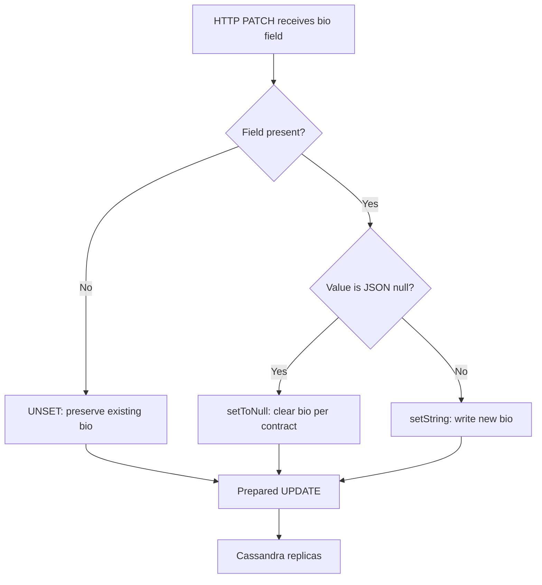

# NULL, UNSET, and Reading Missing-Value States

> **Chapter:** Java Driver Basics  
> **Scope:** Apache Cassandra, the *wide-column* model, CQL, and **Java Driver 4.x**. This lesson explains writing `NULL`, skipping bind variables with `UNSET`, reading cells with no live value, and preserving partial-update semantics from Java applications.
>
> **Objectives:** Distinguish **field omitted**, **explicit null**, **concrete value**, **row not found**, and **column omitted from `SELECT`**; write safe prepared statements; avoid accidentally generating tombstones or wiping data during PATCHes; and verify behavior with TTL, consistency levels, and edge cases.

## 1. Opening Scenario: A PATCH That Wipes a Profile Field

A Java application stores user profiles in Cassandra:

```text
user_id      = 11111111-1111-4111-8111-111111111111
display_name = "Mai"
bio          = "Loves Cassandra"
age          = 26
```

A client sends a request to change only the display name:

```json
{
  "display_name": "Mai Nguyen"
}
```

If the API layer maps the absent `bio` field to a Java `null` and binds it directly into:

```cql
UPDATE lab.profiles_by_user
SET display_name = ?, bio = ?
WHERE user_id = ?;
```

then the driver may send **CQL null** for `bio`. Cassandra interprets that as a request to **delete the column's value**, not "skip because the client omitted the field".

Desired result:

```text
display_name = "Mai Nguyen"
bio          = "Loves Cassandra"   <- preserved
```

Yet if `bio` is bound as `NULL`, the result becomes:

```text
display_name = "Mai Nguyen"
bio          = null                <- old value shadowed by tombstone
```

**Solution with prepared statements:** bind `display_name` with the new value, bind `bio` as **UNSET** (do not update), and bind `user_id` completely.

That is why `NULL` and `UNSET` must be treated as **two distinct write meanings**, not two ways of writing an "empty value".

## 2. Five States to Separate in the Application

In practice, at least five distinct situations get collapsed into Java `null`:

| Situation | Example | Exact Meaning |
| --- | --- | --- |
| **Field absent from request** | JSON lacks key `bio` | User **did not ask to change** `bio` |
| **Field present as JSON null** | `"bio": null` | Per PATCH contract, may be a **request to clear the value** |
| **Field has a value** | `"bio": "Engineer"` | Write the new value |
| **Row does not exist** | No matching `user_id` | Cannot equate with an existing row whose `bio` is null |
| **Row exists, column has no live value** | `bio` deleted, TTL expired, or never written | Cassandra returns `null` when reading the selected column |

There is also **column omitted from `SELECT` projection**: the app cannot read it from `Row` merely because the column exists in the schema.

**Design principle:** never use a single `Optional.empty()` or Java `null` and implicitly assume all the situations above mean the same thing.

### PATCH Intent Flowchart



This diagram shows a **hypothetical PATCH contract**. Some APIs reject `null` as invalid or only allow clearing via a dedicated `DELETE` endpoint. In those cases, reject `null` requests rather than turning them into tombstones.

## 3. `NULL` in Cassandra Is Not an Ordinary Stored Value

In CQL, `NULL` on a **regular column** during `INSERT`/`UPDATE` normally carries deletion semantics. Cassandra writes a deletion marker (*tombstone*) to shadow older versions across SSTables and replicas.

Example:

```cql
UPDATE lab.profiles_by_user
SET bio = null
WHERE user_id = 11111111-1111-4111-8111-111111111111;
```

This is **not** "storing a Java null object on disk" so it can later be distinguished from never-written cells. It represents a **column deletion mutation** governed by timestamps and reconciliation rules.

### Why Does Cassandra Need Tombstones?

Cassandra uses immutable LSM/SSTables:

1. Old values may already reside in one or more SSTables.
2. `UPDATE`/`DELETE` never edits old SSTables in place.
3. Tombstones record deletions with timestamps to suppress older versions on reads.
4. Compaction can reclaim dead data once safe conditions hold, accounting for tombstone age and other SSTables.
5. Repair helps replicas converge to prevent old values from resurrecting (*zombie data*) if a replica missed a delete.

**Do not equate** "`SELECT` returns `null`" with "physical data is gone from SSTables".

### Not Every `NULL` Is a Write Operation

- `SELECT` returns a column with no live value: client receives null.
- `UPDATE` sets a regular column to null: may create a tombstone.
- `INSERT` binds null for a regular column: deletes/shadows any older value.
- `WHERE` with a null primary key: invalid.
- Column absent from `SELECT`: not null, rather **absent from the result**.

Always ask: **is `NULL` in the mutation input, or in the query output?**

## 4. What Does `UNSET` Mean?

**UNSET** is a special marker at the **native protocol and driver binding** layer telling Cassandra that a bind variable is not supplied for this mutation.

In an `INSERT` or `UPDATE` supporting `UNSET`:

- **UNSET regular column:** leaves that column's value untouched.
- **NULL regular column:** clears/deletes the column's value.
- **Non-null value:** writes the new value per CQL mutation semantics.

`UNSET` **is not stored as a fourth data state** inside Cassandra. It is purely an execution-time instruction on a prepared statement.

### Direct Comparison

Assume `bio` currently holds `"Loves Cassandra"`:

| Bound for `bio` | Action | `bio` Value After Valid Mutation |
| --- | --- | --- |
| `"Learning Java"` | Overwrite value | `"Learning Java"` |
| **CQL null** | Clear existing value | `null` on read |
| **UNSET** | Do not update column | Preserves `"Loves Cassandra"` |
| Omit column from `UPDATE` | Do not update column | Preserves `"Loves Cassandra"` |

Important condition: each mutation is still subject to **concurrent writes, timestamps, and consistency levels**. The table assumes no competing writes.

### `UNSET` Is Not a CQL Literal to Store in a Column

Do not write:

```cql
-- WRONG: never use UNSET as an ordinary column literal.
UPDATE lab.profiles_by_user
SET bio = UNSET
WHERE user_id = 11111111-1111-4111-8111-111111111111;
```

In this lesson, `UNSET` is produced **via the Java Driver API**, such as `BoundStatementBuilder.unset(index)`. `UNSET` support depends on native protocol and server versions; on supported modern Cassandra/Java Driver releases, it is the standard way to perform partial updates.

If an older environment lacks unset binding, use **`UPDATE` statements containing only the columns actually changing**, rather than simulating omission with null.

## 5. Full Matrix: NULL, UNSET, Omitted Columns, and Real Values

| Action | On New Row | On Existing Row | Tombstone? | Can Reads Tell Which Action Occurred? |
| --- | --- | --- | --- | --- |
| `INSERT` listing only written columns | Unlisted columns have no value | Omitted columns usually remain untouched | Not merely from omission | **No** |
| `INSERT` binding regular column as `NULL` | Column has no live value; may write tombstone | May shadow older value | **May write tombstone** per mutation | **No** |
| `INSERT` binding regular column as `UNSET` | Skips column | Preserves current value | Not from the `UNSET` column | **No** |
| `UPDATE` regular column = value | Writes value, may create row/cell | Writes new value | Not a delete, though older versions exist | Sees live value |
| `UPDATE` regular column = `NULL` | Creates no live value for column | Deletes/shadows current value | **Yes** | Sees only null |
| `UPDATE` regular column = `UNSET` | Does not touch that column | Preserves that column | Not from the `UNSET` column | No "UNSET marker" in row |
| `DELETE` regular column | No live value after delete | Deletes/shadows current value | **Yes** | Sees only null |
| TTL expiration | Data no longer live | Data logically expired | Expiration/tombstone metadata in storage engine | Sees null or row vanishes |
| `SELECT` omits column from projection | N/A | N/A | No | Column **absent from `Row`** |

**Note on row liveness:** an `INSERT` can write row-liveness metadata even if several regular columns are omitted. An `UPDATE` writing only nulls/`UNSET` to a key with no live data may produce no visible row. Never deduce row existence solely from bind variable counts.

## 6. Primary Keys Cannot Be NULL or UNSET

In Cassandra, partition keys and clustering columns define **row identity and placement**. They cannot be omitted in mutations requiring the full primary key.

Example table:

```cql
CREATE TABLE IF NOT EXISTS lab.profiles_by_user (
    user_id uuid PRIMARY KEY,
    display_name text,
    bio text,
    age int,
    tags set<text>,
    updated_at timestamp
);
```

`user_id` is the sole partition key.

Invalid:

```cql
-- WRONG: missing primary key value
INSERT INTO lab.profiles_by_user (user_id, display_name)
VALUES (null, 'Mai');

-- WRONG: primary key predicate lacks a valid key value
UPDATE lab.profiles_by_user
SET bio = 'new bio'
WHERE user_id = null;
```

With a prepared statement, binding `user_id` as `NULL` or `UNSET` makes the request **invalid**. Driver/server may reject it at different stages depending on release and statement type.

A composite primary key `PRIMARY KEY ((customer_id, event_day), event_time, event_id)` likewise requires all key components dictated by the operation. Never use `UNSET` to "skip part of the partition key".

### Never Turn Client Key Values into Java Null

At the API layer:

```java
if (userId == null) {
    throw new IllegalArgumentException("userId is required");
}
```

Validating inputs before calling the driver produces clear errors and avoids sending invalid requests.

## 7. Lab Setup: Creating Initial Data

Assume keyspace `lab` already exists with a replication strategy and RF matching your test cluster topology.

```cql
CREATE TABLE IF NOT EXISTS lab.profiles_by_user (
    user_id uuid PRIMARY KEY,
    display_name text,
    bio text,
    age int,
    tags set<text>,
    updated_at timestamp
);
```

Create a populated profile:

```cql
INSERT INTO lab.profiles_by_user (
    user_id, display_name, bio, age, updated_at
) VALUES (
    11111111-1111-4111-8111-111111111111,
    'Mai',
    'Loves Cassandra',
    26,
    '2026-11-21T08:00:00Z'
);
```

Read by partition key:

```cql
SELECT user_id, display_name, bio, age, updated_at
FROM lab.profiles_by_user
WHERE user_id = 11111111-1111-4111-8111-111111111111;
```

Expect `bio` = `'Loves Cassandra'` and `age=26`. The timestamp is sample column data, not the mutation timestamp unless CQL specifies `USING TIMESTAMP`.

### Test Clearing a Column with NULL

```cql
UPDATE lab.profiles_by_user
SET bio = null
WHERE user_id = 11111111-1111-4111-8111-111111111111;
```

Read back:

```cql
SELECT user_id, display_name, bio, age
FROM lab.profiles_by_user
WHERE user_id = 11111111-1111-4111-8111-111111111111;
```

`bio` no longer has a live value; `display_name` and `age` remain intact on the same row.

Restore it:

```cql
UPDATE lab.profiles_by_user
SET bio = 'Loves Cassandra'
WHERE user_id = 11111111-1111-4111-8111-111111111111;
```

This restores lab data for further experiments. In production, if data was wiped accidentally, **never invent "guessed" values**—recover from a verified source of truth and reconcile timestamps/business effects.

## 8. Java Driver 4.x: Three APIs to Remember

When using `PreparedStatement` and `BoundStatementBuilder`, the three key operations are:

```java
builder.setString(index, "New value"); // Write value
builder.setToNull(index);              // Write CQL NULL -> clear column
builder.unset(index);                  // Skip updating column
```

`index` is the 0-based position of the **bind marker** in the prepared statement, not the column ordinal in the table schema.

Example:

```cql
UPDATE lab.profiles_by_user
SET display_name = ?, bio = ?
WHERE user_id = ?;
```

Bind marker order:

| Index | Variable to Bind | Type |
| --- | --- | --- |
| `0` | `display_name` | `text` |
| `1` | `bio` | `text` |
| `2` | `user_id` | `uuid` |

In production, reordering placeholders without updating Java code silently writes wrong columns or causes type errors. Use index constants, named bind APIs where appropriate, and integration tests.

### Never Use Java Null as Shorthand for UNSET

Misleading example:

```java
// Ambiguous intent: null can be bound as CQL NULL.
BoundStatement statement = prepared.bind(
    "Mai Nguyen", null, userId
);
```

To make intent unambiguous, prefer a builder and **explicitly** call `unset` or `setToNull`. Never rely implicitly on `bind(...)` overloads to preserve PATCH semantics.

## 9. Standard Example: PATCH Without Deleting Omitted Columns

A PATCH contract can model each field with two parts:

- `present`: did the client include the field?
- `value`: if included, what is its value? It may be null to request deletion.

`Optional<String>` **alone is insufficient**, because `Optional.empty()` conflates "omitted" with "explicit null".

Java 17 record example:

```java
import java.util.UUID;

public record ProfilePatch(
    UUID userId,
    boolean displayNamePresent,
    String displayName,
    boolean bioPresent,
    String bio
) {}
```

Contract definition:

| `present` | `value` | Meaning |
| --- | --- | --- |
| `false` | Any | Leave field unchanged |
| `true` | `null` | Clear field if contract allows |
| `true` | Non-null | Write new field value |

In code, ensure that when `present=false` you ignore `value`; the JSON DTO parser must preserve field presence.

### Prepared UPDATE with Two Optional Columns

```java
import java.util.UUID;

import com.datastax.oss.driver.api.core.CqlSession;
import com.datastax.oss.driver.api.core.DefaultConsistencyLevel;
import com.datastax.oss.driver.api.core.cql.BoundStatement;
import com.datastax.oss.driver.api.core.cql.BoundStatementBuilder;
import com.datastax.oss.driver.api.core.cql.PreparedStatement;

public final class ProfilePatchRepository {
    private final CqlSession session;
    private final PreparedStatement update;

    public ProfilePatchRepository(CqlSession session) {
        this.session = session;
        this.update = session.prepare(
            "UPDATE lab.profiles_by_user " +
            "SET display_name = ?, bio = ? " +
            "WHERE user_id = ?"
        );
    }

    public void patch(ProfilePatch patch) {
        UUID userId = patch.userId();
        if (userId == null) {
            throw new IllegalArgumentException("userId is required");
        }

        // Skip sending an empty mutation: nothing to update.
        if (!patch.displayNamePresent() && !patch.bioPresent()) {
            return;
        }

        BoundStatementBuilder b = update.boundStatementBuilder();
        b.setUuid(2, userId);

        if (!patch.displayNamePresent()) {
            b.unset(0);
        } else if (patch.displayName() == null) {
            b.setToNull(0);
        } else {
            b.setString(0, patch.displayName());
        }

        if (!patch.bioPresent()) {
            b.unset(1);
        } else if (patch.bio() == null) {
            b.setToNull(1);
        } else {
            b.setString(1, patch.bio());
        }

        BoundStatement statement = b.build()
            .setConsistencyLevel(
                DefaultConsistencyLevel.LOCAL_QUORUM);

        session.execute(statement);
    }
}
```

Assumptions:

- `CqlSession` is connected to the right cluster, schema, role, and local datacenter.
- Keyspace `lab` and the example table exist.
- Local DC RF supports `LOCAL_QUORUM`; in a single-replica lab, adjust CL accordingly.
- PATCH semantics permit `null` to clear these regular columns.
- No special concurrency control is required; if needed, see the LWT section below.
- The example uses Java 17 `record`; convert to a standard class for older Java versions.

**Primary effect:** `bioPresent=false` calls `unset(1)`, so **bio is not deleted** when a request updates only display name.

### Why Not Call `setIdempotent(true)` Carelessly?

An `UPDATE` setting identical literal values often has repeatable logical effect in simple cases. However, retries involve fresh timestamps, TTLs, concurrent writes, or app-level side effects. Confirm **business-level idempotency** before enabling retries/speculative execution via this flag.

## 10. Verifying Three States with Lab Data

Assume initial row state:

```text
display_name = "Mai"
bio          = "Loves Cassandra"
```

### Case A — Change Only `display_name`

```json
{
  "display_name": "Mai Nguyen"
}
```

DTO:

```text
displayNamePresent = true,  displayName = "Mai Nguyen"
bioPresent         = false, bio         = null (ignored)
```

Driver sends:

```text
bind(0) = "Mai Nguyen"
bind(1) = UNSET
bind(2) = user_id
```

Expected result:

```text
display_name = "Mai Nguyen"
bio          = "Loves Cassandra"
```

### Case B — Explicitly Clear `bio`

```json
{
  "bio": null
}
```

Driver sends:

```text
bind(0) = UNSET
bind(1) = NULL
bind(2) = user_id
```

Expected result:

```text
display_name = "Mai Nguyen"
bio          = null
```

### Case C — Set `bio` to an Empty String

```json
{
  "bio": ""
}
```

The driver sends an **empty string `""`** for `bio`, not CQL null. For `text`, an empty string is a live value distinct from no live value.

Expected result:

```text
display_name = "Mai Nguyen"
bio          = ""
```

**Three distinct intents ⇒ three distinct bindings.** A well-designed API may reject empty strings via validation; that is a domain rule, not automatic Cassandra behavior.

## 11. `INSERT` with NULL, UNSET, and Unlisted Columns

Cassandra `INSERT` has upsert semantics, unlike an RDBMS row-creation-only statement.

Suppose:

```cql
INSERT INTO lab.profiles_by_user (user_id, display_name)
VALUES (
    22222222-2222-4222-8222-222222222222,
    'Lan'
);
```

Columns `bio`, `age`, and `tags` are omitted, so no new values are written for them. On read, they return `null`.

For an **existing row**, an `INSERT`/upsert omitting `bio` normally **does not delete** `bio`. Keep this in mind when reusing one `INSERT` statement for repeated upserts.

### Prepared INSERT Case

```cql
INSERT INTO lab.profiles_by_user (
    user_id, display_name, bio
) VALUES (?, ?, ?);
```

Indices:

- `0`: `user_id` — required.
- `1`: `display_name` — may carry a value.
- `2`: `bio` — can be `UNSET` if not writing it.

Example:

```java
PreparedStatement insert = session.prepare(
    "INSERT INTO lab.profiles_by_user " +
    "(user_id, display_name, bio) VALUES (?, ?, ?)"
);

BoundStatementBuilder b = insert.boundStatementBuilder();
b.setUuid(0, userId);
b.setString(1, "Lan");
b.unset(2);                  // Leave bio untouched
session.execute(b.build());
```

**Warning:** even if every regular column is `UNSET`, an `INSERT` with a primary key can still write row-liveness metadata; never use `UNSET` to "cancel" an entire statement. If nothing needs writing, **do not send the mutation**.

### Does "INSERT NULL" Create a Tombstone?

On a regular column, passing CQL null carries deletion semantics. Exact tombstone/metadata emission depends on the write and version, but when tuning, **treat it as a tombstone source**. Never use null to mean "no new data".

## 12. Reading a Row: Distinguishing Missing Row from Null Column

In Java Driver 4.x, `ResultSet.one()` returns `null` if no row is returned. When a `Row` exists, a selected column may still hold **CQL null**.

Example:

```java
import java.util.UUID;

import com.datastax.oss.driver.api.core.CqlSession;
import com.datastax.oss.driver.api.core.cql.PreparedStatement;
import com.datastax.oss.driver.api.core.cql.Row;

public final class ProfileReader {
    private final CqlSession session;
    private final PreparedStatement select;

    public ProfileReader(CqlSession session) {
        this.session = session;
        this.select = session.prepare(
            "SELECT user_id, display_name, bio, age " +
            "FROM lab.profiles_by_user WHERE user_id = ?"
        );
    }

    public void print(UUID userId) {
        Row row = session.execute(select.bind(userId)).one();

        if (row == null) {
            System.out.println("ROW_NOT_FOUND");
            return;
        }

        System.out.println("ROW_FOUND");

        if (row.isNull("bio")) {
            System.out.println("BIO_HAS_NO_LIVE_VALUE");
        } else {
            String bio = row.getString("bio");
            System.out.println("BIO=" + bio);
        }

        if (row.isNull("age")) {
            System.out.println("AGE_HAS_NO_LIVE_VALUE");
        } else {
            int age = row.getInt("age");
            System.out.println("AGE=" + age);
        }
    }
}
```

### Rule for Primitive Getters

For nullable columns like `age int`, **check `row.isNull("age")` before calling `getInt`**. Relying on primitive default `0`, exceptions, or specific codec quirks to infer null is unsafe.

Never collapse:

```text
age = 0
age = NULL
row does not exist
```

into the same meaning. In business logic, age `0` (if valid) differs from unentered data.

### With Object Getters

`row.getString("bio")` returns Java `null` when the selected column has no live value. It still **does not** explain why (never written, deleted, or TTL expired).

## 13. Unselected Column Differs from Null Column

Compare two queries:

```cql
SELECT user_id, display_name
FROM lab.profiles_by_user
WHERE user_id = 11111111-1111-4111-8111-111111111111;
```

and:

```cql
SELECT user_id, display_name, bio
FROM lab.profiles_by_user
WHERE user_id = 11111111-1111-4111-8111-111111111111;
```

In the first query:

- `bio` **is absent from the result**.
- Calling `row.isNull("bio")` or `row.getString("bio")` when the column is omitted from the projection **is not a valid missing-value check**; the API fails because the column is missing from result metadata.

In the second query:

- `bio` is selected.
- If Cassandra has no live value, `row.isNull("bio")` returns `true`.
- If a text value exists, it returns `false`.

A DTO/mapper should distinguish:

```text
ROW_NOT_FOUND
ROW_FOUND, COLUMN_NOT_PROJECTED
ROW_FOUND, COLUMN_SELECTED_NULL
ROW_FOUND, COLUMN_SELECTED_WITH_VALUE
```

Depending on the API, **you do not necessarily expose all these states to end users**. Yet inside repositories/mappers, separating them prevents buggy update logic.

## 14. Can You Tell Why a Column Reads as Null?

Suppose `SELECT bio` returns CQL null. Cassandra **does not include a "reason for null" with the returned cell value**.

It could be because:

1. The column was never written.
2. The column was explicitly deleted via `DELETE`.
3. The column was cleared via `UPDATE ... SET bio = null`.
4. The column was written with a TTL that has expired.
5. The column was deleted by another mutation (range/row/partition tombstone).
6. The read CL observed a replica state yielding null.

### What Does CQL Metadata Help With?

For a **regular non-collection column** like `bio`, where supported:

```cql
SELECT bio, WRITETIME(bio), TTL(bio)
FROM lab.profiles_by_user
WHERE user_id = 11111111-1111-4111-8111-111111111111;
```

- `WRITETIME(bio)` shows the write timestamp of the evaluated cell when a live value exists.
- `TTL(bio)` shows remaining seconds to live when a TTL applies to the live cell.
- If the column has no live value, metadata results are typically null.
- If the column is live without a TTL, `TTL(bio)` is also null.

**Thus `TTL(bio)=null` cannot distinguish "no TTL set" from "no live value" without inspecting `bio` and other context.** `WRITETIME` also never provides a full history of past mutations.

Never use these functions as an audit log or proof that `DELETE` occurred. If the application needs **why** a field was cleared, store dedicated business metadata, an event log, or an audited source.

## 15. Designing Business State When NULL Is Not Enough

Consider three distinct business meanings:

- User **has never provided** `bio`.
- User **explicitly cleared** `bio`.
- `bio` is **not applicable** for this account type.

CQL null cannot capture that three-way distinction. Model explicit state if required:

```cql
CREATE TABLE IF NOT EXISTS lab.profile_bio_state_by_user (
    user_id uuid PRIMARY KEY,
    bio text,
    bio_status text,
    bio_changed_at timestamp
);
```

Example domain states:

```text
bio_status = 'NEVER_SET'
bio_status = 'CLEARED'
bio_status = 'PRESENT'
bio_status = 'NOT_APPLICABLE'
```

With such a model, ensure **updating `bio` and `bio_status` follows business consistency rules**. Cassandra lacks general multi-partition transactions, so co-locating related columns in the same partition/row allows updating multiple cells in one mutation—while still requiring concurrency and timestamp design.

### Never Use Arbitrary Sentinel Strings

Anti-pattern:

```text
bio = "<NULL>"
bio = "N/A"
bio = "(deleted)"
```

Those strings can collide with legitimate user text and complicate future migrations. When state is needed, use a **separate status column with enum/domain validation**.

### If Deletion Reason Must Be Stored

Append an event:

```text
event_id, user_id, field_name, action='CLEAR',
actor, occurred_at, request_id
```

Audit/event logs must enforce privacy and retention policies. **Never treat `WRITETIME` as an actor or deletion reason.**

## 16. JSON Requests: Absent, Null, and Empty Strings

Suppose a REST API exposes `PATCH /profiles/{id}`:

| JSON Body | Proposed Contract Meaning |
| --- | --- |
| `{}` | Leave all fields unchanged |
| `{"bio":"Hello"}` | Write new `bio` |
| `{"bio":null}` | Clear `bio` |
| `{"bio":""}` | Write empty string, or return validation error if forbidden |
| `{"bio":0}` | Reject type mismatch |
| `{"age":null}` | Clear age if domain allows; otherwise validation error |
| `{"age":0}` | Write `0` if valid |

Subtle trap: a plain Java DTO with `String bio` receives `null` for both **missing JSON key** and **explicit JSON null**. Before mapping to Cassandra, the parser/deserializer must preserve presence.

### Approach Using Jackson

With a JSON tree or DTO supporting presence tracking, check:

```java
// Conceptual pseudocode, independent of a specific Jackson version:
boolean present = json.has("bio");   // Is the key present?
boolean explicitNull = present && json.get("bio").isNull();
String value = explicitNull ? null : ...;
```

In Jackson, `has("bio")` on a `NullNode` reports key presence, whereas helpers like `hasNonNull` merge absent and null. Check your exact library version and mapper configuration before relying on it.

**Never use a bare `Optional<String>` as a tri-state** if the JSON layer already stripped the distinction between absent and explicit null.

### PUT Differs from PATCH

In API design, `PUT` normally replaces a resource while `PATCH` applies partial updates. However, **HTTP verbs do not automatically dictate CQL bindings**; each endpoint needs an explicit contract.

If a `PUT` endpoint requires the full payload, missing fields may be rejected rather than silently converted into CQL null deletions. Never invoke generic HTTP semantics to justify mass data deletion.

## 17. Why Updating Multiple Columns with UNSET Helps

A dynamic API may update any subset of columns. Creating a separate prepared statement for **every column combination** explodes exponentially.

With 10 optional columns, the number of non-empty subsets is:

```text
2^10 - 1 = 1023 column combinations
```

A single prepared `UPDATE` using `UNSET` bind variables is vastly more reusable:

```cql
UPDATE lab.profiles_by_user
SET display_name = ?,
    bio = ?,
    age = ?,
    updated_at = ?
WHERE user_id = ?;
```

The application:

- Binds values for fields being modified.
- Calls `setToNull` for fields explicitly cleared.
- Calls `unset` for fields left untouched.
- Binds all required key columns.
- Skips sending any mutation when no field changed.

### Conditions When Using a Fixed UPDATE Template

- Column count is modest enough to manage cleanly.
- Column names and bind marker positions are tightly controlled.
- Server/protocol supports `UNSET` in those positions.
- Logic never uses `unset` to bypass CQL constraints requiring mandatory values.
- Correctness under concurrent writes, TTLs, and timestamps is tested.

An `UPDATE` routinely binding hundreds of `UNSET` columns is not automatically optimal. For complex schemas/queries, a small set of business-aligned statement shapes may be cleaner.

## 18. NULL, DELETE, and Tombstones on the Read Path

Cassandra resolves live values by reconciling memtables, SSTables, and tombstones by timestamp. An `UPDATE` writing null emits a deletion marker that subsequent reads must evaluate.

```text
SSTable A:  bio = "Loves Cassandra"  @ t=100
Memtable:   bio = tombstone          @ t=200
                    |
                    v
SELECT bio -> null
                    |
             compaction/repair
                    |
            Old data reclaimed only
            when safe conditions hold
```

`t=100` and `t=200` only illustrate timestamp ordering. In a multi-replica cluster, consistency levels and in-flight mutations can cause reads close to a write to see differing states if consistency does not guarantee overlap.

### What Can a Null-Heavy PATCH Cost?

- Creates tombstones for unchanged columns when mappers turn missing fields into null.
- Increases SSTable versions/tombstones scanned on reads.
- Increases read amplification on hot partitions.
- Adds compaction/repair pressure and disk I/O.
- Can raise p95/p99 or trigger tombstone warnings at scale.

**`UNSET` does not erase existing tombstones**; it only stops the current mutation from touching unmodified columns. If `bio` was mistakenly cleared earlier, sending `UNSET` later **will not bring the old value back**.

## 19. TTL: Expired Values Look Like Null on Read

Try in the lab:

```cql
UPDATE lab.profiles_by_user
USING TTL 60
SET bio = 'Temporary value'
WHERE user_id = 11111111-1111-4111-8111-111111111111;
```

Read immediately:

```cql
SELECT bio, TTL(bio), WRITETIME(bio)
FROM lab.profiles_by_user
WHERE user_id = 11111111-1111-4111-8111-111111111111;
```

While `bio` is live, `TTL(bio)` reports remaining seconds per Cassandra mechanics. After expiration, `bio` has no live value and reads as null; other live columns keep the row visible.

### Two Pitfalls to Avoid

1. **Never use `TTL(bio)=null` to conclude `bio` was never written.** A live value written without a TTL also returns null `TTL`.
2. **Never issue an `UPDATE` with `NULL` to "refresh TTL".** `NULL` deletes, it never refreshes.

To extend a TTL, rewrite the live value with the new TTL per business contract, timestamp, and consistency requirements.

### Does Preserving a Field with UNSET Alter Its TTL?

For an `UNSET` column, the mutation does not touch that column, so it does not reset its TTL merely because another field in the same prepared statement changed. This is a major advantage when patching rows whose columns have independent retention windows.

If the app wants to **intentionally extend** `bio`'s TTL, rewrite `bio` with the desired TTL explicitly; that must never happen accidentally just because a client omitted `bio`.

## 20. Special Notes for Collections and UDTs

Cassandra supports `set`, `list`, `map`, UDTs, and `frozen` forms where supported by the release.

### A Null Collection Differs from Mutating Elements

Example:

```cql
CREATE TABLE IF NOT EXISTS lab.user_tags_by_id (
    user_id uuid PRIMARY KEY,
    tags set<text>,
    settings map<text, text>
);
```

Setting `tags = null` clears/shadows the entire collection per CQL semantics; it does not mean "leave `tags` unchanged".

To **add a tag**, use element update syntax:

```cql
UPDATE lab.user_tags_by_id
SET tags = tags + {'java'}
WHERE user_id = 11111111-1111-4111-8111-111111111111;
```

To **leave `tags` untouched**, omit the column or bind `UNSET` where supported; never write null.

### Empty Collections Should Not Default to Null

`[]`, `{}`, Java empty lists/sets/maps, and `null` should not be conflated blindly by mappers. Collection types, frozen vs. non-frozen, literal syntax, and empty representations follow release-specific Cassandra rules.

Test all three states explicitly against your target schema:

1. Collection has no live value.
2. Collection is explicitly set to empty.
3. Collection contains elements.

Never generalize "empty is always null" across all types and versions.

### UDTs and Null Fields

A UDT can contain unset/null fields; individual field updates behave differently between frozen and non-frozen UDTs. Setting the **whole bind variable** to `UNSET` does not mean "delete one nested field inside the UDT".

For nested structures, clarify the **unit of update**—whole column, collection element, or UDT field—and choose matching CQL/bindings tested on your exact release.

## 21. Concurrent Writes: UNSET Does Not Prevent Lost Updates

Suppose two requests arrive close together:

```text
Request A: UPDATE display_name = "Mai A", bio = UNSET
Request B: UPDATE display_name = "Mai B", bio = UNSET
```

Both still modify **the same `display_name` column**. Cassandra resolves conflicts via timestamps/tie-breaking; `UNSET` provides no optimistic locking on that column.

Another example:

```text
Request A: display_name = "Mai A", bio = UNSET
Request B: display_name = UNSET,    bio = "Content B"
```

Because the mutations touch disjoint columns, they avoid wiping each other's changes. Still, if the application enforces **cross-column invariants**, design concurrency/consistency explicitly.

### When Compare-and-Set Is Required

Cassandra supports Lightweight Transactions (LWT) for conditional updates like:

```cql
UPDATE lab.profiles_by_user
SET display_name = 'Mai Nguyen'
WHERE user_id = 11111111-1111-4111-8111-111111111111
IF display_name = 'Mai';
```

LWT carries higher Paxos coordination cost and latency than standard writes. Use it only when CAS is truly needed—never add it to every PATCH just out of fear of `NULL`/`UNSET`.

Never rely on `IF display_name = null` as a universal "never written" guard without testing version-specific null semantics, row liveness, and CQL conditions; model explicit business state if needed.

## 22. Consistency Levels When Writing Null and Reading Back

Cassandra places replicas by partition key and keyspace RF. A `DELETE` or null `UPDATE` is a **mutation requiring replication**, following the exact same consistency level rules as any other write.

Example with RF=3 in `dc1`:

| Operation | CL | Key Requirement |
| --- | --- | --- |
| `UPDATE bio = null` | `LOCAL_QUORUM` | Two local replicas respond per CL rules |
| `UPDATE bio = UNSET` and another field | `LOCAL_QUORUM` | `UNSET` field untouched; remaining mutation replicated |
| `SELECT bio` | `LOCAL_QUORUM` | Reads from local replicas per CL rules |
| `SELECT bio` | `LOCAL_ONE` | May read from a single local replica |

At RF=3, `LOCAL_QUORUM` requires two local responses when the coordinator is in the right DC. Reading and writing in the same DC with overlapping quorums gives stronger visibility of recent mutations than `LOCAL_ONE`, though concurrent writes, timeouts, and replica health still matter.

### Two DCs Differ

With RF=3 in `dc1` and RF=3 in `dc2`, a `LOCAL_QUORUM` write in `dc1` does not wait for two ACKs in `dc2`. Immediately after a delete in `dc1`, a `LOCAL_QUORUM` read in `dc2` may still observe the old value before cross-DC replication arrives.

**`UNSET`/`NULL` never change the quorum math.** They only control **which columns** the mutation modifies.

## 23. Retries, Timeouts, and Idempotency When Clearing Columns

A write timeout never proves a mutation failed on all replicas. If an application retries, you can hit:

- The original mutation already applied on some replicas.
- A retry arriving with a new timestamp.
- Concurrent writes from another request.
- Tombstone/TTL interactions making final state depend on timestamp order.

### Never Blindly Retry a Business PATCH

For `{"bio":null}`, intent might seem like "ensure `bio` is cleared". Yet:

- If another request just wrote a new `bio`, retrying the delete with a newer timestamp wipes that newer update.
- If clearing also emits an audit event or external side effect, retrying duplicates the action.
- With manual timestamps, ordering depends on timestamp logic.

Business-level safeguards:

- Use service-layer request IDs/idempotency keys when deduplication is needed.
- Use CAS/LWT when version checks are required.
- Never enable speculative execution on mutations not proven safe.
- Use appropriate write/read CLs and reconcile uncertain timeout outcomes.

**Setting the same value is not automatically idempotent in every dimension** once TTLs, timestamps, audits, and workflows are factored in.

## 24. Misreading Nulls in DTO Mappers

A flawed mapper:

```java
// SEMANTICALLY WRONG if 0 is a valid domain value:
int age = row.isNull("age") ? 0 : row.getInt("age");
```

If an API returns `age=0` for "unknown age", clients may treat `0` as a real age.

Better:

```java
Integer age = row.isNull("age")
    ? null
    : row.getInt("age");
```

Then domain validation/output rules decide whether to serialize:

```json
{"age":null}
```

or **omit `age` from the response**, or return an explicit status field. That is an **API contract choice**, not automatic Cassandra behavior.

### Distinguishing Row Not Found

Example result type:

```text
ProfileLookupResult =
    NotFound
  | Found {
        displayName: String?
        bio: String?
        age: Integer?
    }
```

Java can use a sealed hierarchy, record, or `Optional<Profile>` for **row existence**, while fields inside `Profile` stay nullable/`Optional` per contract.

**An empty `Optional<Profile>` should mean the row does not exist**, not that `bio` is null.

## 25. Thorough Testing: Input and State Matrix

Seed initial data and run each test on **its own `user_id`** or reset lab data between runs. In Cassandra, tight timestamps and TTLs can make back-to-back tests interfere; use test isolation and matching consistency levels.

| Case | Input for `bio` | Binding | Initial Data | Expected Outcome |
| --- | --- | --- | --- | --- |
| T1 | Field omitted | `UNSET` | `bio="A"` | Remains `"A"` |
| T2 | Explicit null | `NULL` | `bio="A"` | Reads as null |
| T3 | String `"B"` | Value | `bio="A"` | Reads `"B"` |
| T4 | Empty string | Empty value | `bio="A"` | Reads `""` if domain allows |
| T5 | Field omitted | `UNSET` | `bio=null` | Remains null |
| T6 | Explicit null | `NULL` | `bio=null` | Still no live value; may emit tombstone |
| T7 | First insert, field missing | `UNSET`/unlisted | Row absent | Field has no live value |
| T8 | `UPDATE` with `NULL` key | Invalid | Any | Rejected |
| T9 | `UPDATE` with `UNSET` key | Invalid | Any | Rejected |
| T10 | No fields present | Do not send mutation | Any | No data change |
| T11 | `bio` TTL expired | Unbound | `bio` was live | `bio` reads as null |
| T12 | `SELECT` omits `bio` | N/A | Any | `Row` lacks `bio` column |
| T13 | Row does not exist | N/A | Any | `ResultSet.one() == null` |
| T14 | `age = 0` | Numeric value `0` | `age` null | `age` equals `0` |
| T15 | `age` explicit null | `NULL` | `age` 27 | `age` reads as null |
| T16 | Two concurrent PATCHes | Mixed bindings | Same row | Resolves per timestamp/CL and invariants |

### Test with Integration Clusters, Not Mocks Alone

Unit tests verify JSON-to-DTO presence and that the builder calls `unset`/`setToNull`. However, tombstone/TTL effects, read-after-write, and consistency must be verified against a **real lab Cassandra cluster or compatible test environment**.

Never trigger mass deletes or forced compactions in production just to test these cases.

## 26. Monitoring Tombstones and Optimizing Queries

For continuous PATCH workloads, monitor:

- Total `UPDATE` count executed.
- Ratio of explicit `CLEAR` (column `NULL`) vs. `KEEP` (`UNSET`).
- Read/write p95/p99 and timeouts per operation.
- Tombstones scanned when reading affected partitions.
- SSTable counts, compaction backlogs, and disk I/O.
- Retry counts, write timeouts, and replica health.
- Validation error rates: PATCH missing key, type mismatch, or disallowed clear.

Observation commands on an authorized node:

```bash
nodetool tablestats lab.profiles_by_user
nodetool tablehistograms lab.profiles_by_user
nodetool compactionstats
nodetool tpstats
```

Exact `nodetool` metric/column names vary across Cassandra releases. `tombstones scanned` reflects server-side read cost, not a 1:1 count of JSON nulls sent by clients.

### Why Does UNSET Reduce Pressure?

Suppose a request only edits `display_name`, yet a mapper sends `NULL` for 12 other fields. Every request emits 12 useless tombstones. `UNSET` eliminates unintended deletion mutations.

Still:

- `UNSET` does not reduce **rows read** if queries scan huge partitions.
- `UNSET` does not remove existing tombstones.
- `UNSET` does not replace compaction or repair.
- `UNSET` does not replace query-first data modeling.

It solves the exact problem of **avoiding unintended column writes/deletes**.

## 27. When Errors Occur: Diagnostic Table

| Symptom | First Hypothesis | Check |
| --- | --- | --- |
| PATCHing one field wipes another | Mapper turns missing fields into `NULL` | Presence tracking and bind builder |
| `age=0` despite user never entering it | Primitive getter/default ambiguity | `row.isNull("age")` before `getInt` |
| `bio=null` after some time | TTL expired or `DELETE` | `TTL` while live, event history, retention policy |
| `getString("bio")` fails | Query did not `SELECT` `bio` | Projection and `ColumnDefinitions` |
| `UPDATE` reports invalid/null key | Primary key bound as `NULL`/`UNSET` | Input validation and bind indices |
| Statement still clears column despite KEEP | Calling `setToNull` instead of `unset` | Log binding semantics without leaking values |
| Empty "no-op" `UPDATE` still hits cluster | Missing empty-patch guard | Short-circuit before sending |
| Cleared `bio` in dc1, dc2 still sees it | Cross-DC replication/CL not converged | Local DC, RF, CL, replica health |
| Null `UPDATE` triggers tombstone warnings | Excessive `CLEAR`s or huge partitions | Workload, TTL/delete pattern, `tablestats` |
| Java fails reconnecting to one node | TLS/auth/driver issue, unrelated to `NULL` | Driver per-host errors and node config |
| Null getter and missing row conflated | Repository omits separate row state | Check `ResultSet.one()` before mapping columns |
| Concurrent PATCHes yield surprises | LWW timestamp race | Domain versioning, LWT, retry/idempotency |

Never "fix" disappearing fields by raising timeouts or running repair immediately. First prove **whether mutations accidentally sent `NULL` for those columns**.

## 28. Good and Bad Design Patterns

### Mistake 1 — Using Null for Every Absent DTO Field

```java
// When API omits bio, bio is also Java null:
// Wrong if bound directly as CQL NULL.
BoundStatement b = prepared.bind(
    request.displayName(),
    request.bio(),
    request.userId()
);
```

**Replace with:** DTO with presence flags, calling `unset` for absent fields.

### Mistake 2 — Storing the String `"null"` to Represent Missing Values

```text
bio = "null"
```

This is a **populated text string**, not CQL null. `row.isNull("bio")` will fail to detect missing data.

**Replace with:** real null when clearing, plus a separate business status column if reasons are needed.

### Mistake 3 — Converting NULL into Zero

```java
Integer age = row.isNull("age") ? 0 : row.getInt("age");
```

**Replace with:** `Integer age = null` when absent, letting the domain layer decide.

### Mistake 4 — Using UNSET to "Restore" a Cleared Column

After `UPDATE bio = null`, a later `bio = UNSET` merely **leaves `bio` untouched**—it does not bring back the old value.

**Replace with:** recovery from an authoritative data source via a policy-approved write.

### Mistake 5 — Allowing NULL in a Partition Key

`PRIMARY KEY` determines data placement; without a valid key value, Cassandra has no partition to read or write.

**Replace with:** mandatory validation at both API and repository boundaries.

### Mistake 6 — Assuming Read Null Explains the Cause

A single `SELECT` cannot tell "never written" from "deleted". `TTL`/`WRITETIME` expose limited live-cell metadata, not event history.

**Replace with:** controlled status/audit storage when business reasons matter.

### Mistake 7 — Using Multi-Column Null UPDATEs to "Reset a Row"

This emits numerous tombstones without immediately freeing disk space. To delete an entire row, issue a proper keyed `DELETE` and understand tombstones/repair.

**Replace with:** explicit domain operations accounting for retention.

### Mistake 8 — Creating a New Session per PATCH

Driver sessions own connection pools; recreating them constantly causes handshake/metadata churn.

**Replace with:** one shared `CqlSession` tied to service lifecycle, reusing prepared statements.

## 29. Runbook for Deploying PATCH Semantics to Production

### Pre-Deployment

1. Agree on API contracts for absent, null, empty string, zero, and false.
2. Audit schemas and which columns are **allowed to be cleared**.
3. Identify columns with TTLs, sensitive data, or coupling to other projections.
4. Verify Java Driver version and native protocol support `UNSET` per app usage.
5. Approve fixed prepared statements and query shapes.
6. Confirm RF/local DC and consistency levels for read-after-write.
7. Test positive/negative cases, including null/unset primary keys and missing rows.
8. Benchmark under representative load, watching tombstones, compaction, and p99.

### During Rollout

9. Enable canary on a subset of the API/service.
10. Emit metrics counting `KEEP`/`CLEAR`/`SET` fields **without logging private values**.
11. Cross-check before/after data on sample keys against an independent source of truth.
12. Monitor error rates, read/write latency, GC/disk, and tombstones scanned.
13. Halt rollout if `CLEAR` rates spike abnormally or omitted fields disappear.

### Post-Rollout

14. Verify consistency between canonical tables and business projections.
15. Confirm TTL-bearing fields are not accidentally refreshed.
16. Document API semantics and client PATCH guidelines.
17. Retain sanitized mutation/key/idempotency samples for troubleshooting without exposing PII.
18. Keep a recovery plan from trusted sources if accidental clears occur; never rely on repair to undo business tombstones.

## 30. Exercises and Review Questions

1. When a client omits `bio` in a PATCH, should you bind `NULL` or `UNSET`? Why?
2. When a client sends `{"bio":null}`, what happens if the API defines null as clear?
3. Why can writing CQL `NULL` to a regular column create a tombstone?
4. Is `UNSET` stored as a "special value" readable by `SELECT`?
5. Compare `UPDATE bio = null` vs. `DELETE bio` in column-deletion semantics.
6. Why can neither `NULL` nor `UNSET` be used for a partition key?
7. In a statement with three placeholders, which columns do indices 0/1/2 represent?
8. Explain why an `INSERT` omitting `bio` does not necessarily clear `bio` on an existing row.
9. Why does `Optional<String>` fail to preserve both JSON absent and explicit null?
10. When `row.isNull("age")` returns `true`, can you conclude age was never entered?
11. Distinguish `row == null` from `row.isNull("bio")`.
12. If a query selects only `user_id`, does `row.getString("bio")` return null? Why?
13. If `age` can validly be `0`, why shouldn't `0` be used as a missing-value sentinel?
14. How do you distinguish an empty string from CQL null?
15. Why is `TTL(bio)=null` insufficient to prove `bio` was deleted?
16. If a field has a TTL and is `UNSET` in a PATCH, does its TTL restart?
17. Why can repeated null `UPDATE`s increase read amplification?
18. A field is `SET`, then `CLEAR`ed, then `UNSET`. What is the expected final value assuming no concurrent writes?
19. Two concurrent requests edit `display_name`. Does `UNSET` on `bio` prevent lost updates on `display_name`?
20. When should LWT be used to protect PATCH invariants?
21. With RF=3 in `dc1`, how many local replicas does `LOCAL_QUORUM` require?
22. Why don't local quorums in `dc1` and `dc2` guarantee identical values instantaneously?
23. How do you prevent retrying a clearing PATCH from wiping a newer mutation?
24. If the business must distinguish "never provided", "cleared", and "not applicable", how should you model the data?
25. Why shouldn't you use the string `"null"` to simulate a missing column?
26. Write Java code using `BoundStatementBuilder` with `unset`, `setToNull`, and `setString` for the three states.
27. Design an integration test proving PATCH preserves existing values on omitted fields.
28. If an accidental deletion already occurred, why are sending `UNSET` or running repair not rollback fixes?
29. Explain why a `GET` JSON endpoint may omit null fields even when Cassandra `SELECT` returns null.
30. Which dashboard metrics reveal a mapper sending too many `NULL`s?

## 31. Summary Decision Diagram

```text
          API REQUEST TO UPDATE A PROFILE
                       |
                       v
              Valid primary key?
                  |         |
                 No        Yes
                  |         |
             Reject input   v
                     Field present in PATCH?
                                |           |
                               No          Yes
                                |           |
                            UNSET           v
                                    JSON null value?
                                       |          |
                                      Yes         No
                                       |          |
                                    setToNull     v
                                             Bind value
                                       |          |
                                       +-----+----+
                                             |
                                             v
                                   Any field changed?
                                       |          |
                                      No         Yes
                                       |          |
                                  Skip sending    v
                                  mutation     Prepared UPDATE
                                                  |
                                                  v
                                         Replicas per RF/CL
                                                  |
                                                  v
                                        SELECT by partition key
                                                  |
                                      +-----------+----------+
                                      |                      |
                                  row == null            row exists
                                      |                      |
                                 NOT_FOUND               isNull(col)?
                                                   |           |
                                                  Yes          No
                                                   |           |
                                               No live       Live value
                                                value         present
```

**Key takeaway:** With Java Driver 4.x, **`setToNull` writes CQL null (clearing the regular column), whereas `unset` skips the bind variable to leave the column unchanged**. On reads, Cassandra never returns an "UNSET" value: `row.isNull` simply tells you the selected column **has no live value**, regardless of whether it was never written, deleted, or TTL-expired. Always distinguish **missing row, unselected column, null column, and empty/`0` values**, preserve API field presence, bind full primary keys, monitor tombstones/latency, and handle concurrent writes per business requirements.
