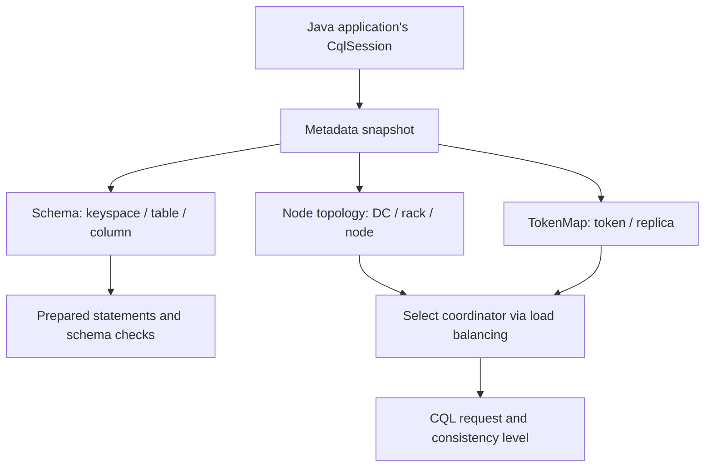
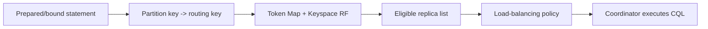

# Schema/Topology Metadata and Refresh Conditions in the Cassandra Java Driver

## 1. Why Must a Java Application Understand Cassandra Metadata?

In the **DATABASE_ENGINE_WIDE_COLUMN_CASSANDRA** module, Apache Cassandra is studied as a **distributed wide-column** DBMS: data placement is determined by **partition key**, replicated per **replication factor (RF)**, queried via CQL, and governed for read/write consistency via consistency levels. When a Java application connects to multiple nodes, the driver needs **schema**, **topology**, and **token map** metadata to know which tables/columns exist, which nodes belong to which datacenter, and how to route requests.

However, metadata inside the Java Driver is **not an instantaneously synchronized mirror of the entire cluster**. A node may have just joined or dropped; a table may have been created on coordinator A before coordinator B receives the new schema. If an application retains an old metadata object too long or assumes the driver always updates instantly, it risks `unconfigured table` errors, missing newly added tables, suboptimal routing, or flawed readiness checks.

This lesson answers:

1. **What does schema metadata contain**, where is it read, and how is it used to verify tables/columns?
2. **How does topology metadata** represent nodes, racks, DCs, and connection states?
3. **How does token metadata** relate to partition keys, replication, and token-aware routing?
4. **When is metadata refreshed?** What events trigger updates, how does async propagation work, and when must you wait for schema agreement?
5. **When should you not trust metadata blindly?** What else must be verified during migrations, failovers, rolling upgrades, or topology changes?

Examples use **Java Driver 4.x** with the `com.datastax.oss.driver.api.*` API. Depending on release, dependency coordinates may come from DataStax OSS or Apache; always verify APIs against your exact driver and Cassandra Server versions.

## 2. Three Metadata Layers: Schema, Node/Topology, and Token

`CqlSession.getMetadata()` returns a `Metadata` object representing what the **driver instance** currently knows about the cluster.

| Layer | Typical API | Question Answered | What It Does Not Prove |
| --- | --- | --- | --- |
| **Schema metadata** | `getKeyspaces()`, `getKeyspace(...)`, `KeyspaceMetadata`, `TableMetadata` | Keyspaces, tables, columns, primary keys, indexes/UDTs, and definitions known to the driver | Not a migration ledger; does not prove all nodes have agreed |
| **Node/topology metadata** | `getNodes()`, `Node.getDatacenter()`, `getRack()`, `getState()` | Which nodes the driver knows, in which DC/rack, and state from the driver's view | A node appearing in the map does not mean it is `UP` or has usable connections |
| **Token metadata** | `getTokenMap()`, `TokenMap` | Tokens/ranges and replica relationships for token-aware routing | Does not prove replica data is repaired/converged or writes completed |



**Separate the roles:** the partition key is part of the **schema**; the partition key's token and replica placement live in the **token map/topology**. Consistency levels like `LOCAL_QUORUM` govern how many replicas must respond—not keyspace selection or schema repair.

## 3. Core Principle: `Metadata` Is an Immutable Snapshot, Yet `Node` Has Dynamic State

In Java Driver 4.x, `Metadata` provides an **internally consistent** snapshot: the node list, schema, and token map within a single `Metadata` instance correspond to one another. The schema maps/objects themselves are immutable; when the driver receives updates, it publishes a new `Metadata` instance. However, **certain properties on `Node` objects update in place**, such as `getState()`.

Example:

```java
import com.datastax.oss.driver.api.core.CqlSession;
import com.datastax.oss.driver.api.core.metadata.Metadata;

Metadata earlier = session.getMetadata();

// ... the cluster may have created another table or added nodes ...
Metadata later = session.getMetadata();

// Do not hold "earlier" assuming it updates with new tables/nodes.
// "later" is the metadata snapshot the driver holds at this read.
```

Usage guidelines:

- **Fetch a fresh snapshot when you need a fresh view**: call `session.getMetadata()` again rather than caching an old `Metadata` in a singleton or app cache for hours.
- **Do not cache keyspace/table maps assuming they auto-mutate**: they are tied to the snapshot they were read from.
- **Do not equate "latest known by driver" with "latest across the whole cluster"**: notification/refresh delays, unreachable nodes, and schema agreement still apply.
- **Never poll metadata in a tight loop as real-time monitoring**: use driver listeners/metrics and cluster operational tools instead.
- **Read topology and token map from the same `Metadata` instance** when performing correlated calculations, rather than mixing values fetched at different times.

Timing matters:

```text
t0  Application calls getMetadata()           -> snapshot M0
t1  DBA creates a new table in Cassandra
t2  Server sends schema change notification
t3  Driver debounces/verifies agreement and refreshes
t4  Application calls getMetadata() again     -> snapshot M1
```

At `t1` or `t2`, `M0` does not turn into `M1`. Even calling `getMetadata()` fresh at `t2` may still see pre-refresh state. This is **client-side eventual visibility of metadata**, distinct from query consistency levels.

## 4. Reading Schema Metadata via Java Driver 4.x

### 4.1. Example CQL Schema for an Order Service

Assume the cluster has a real DC named `dc1` and keyspace:

```sql
CREATE KEYSPACE IF NOT EXISTS commerce
WITH replication = {
    'class': 'NetworkTopologyStrategy',
    'dc1': 3
};

CREATE TABLE IF NOT EXISTS commerce.orders_by_id (
    order_id uuid PRIMARY KEY,
    customer_id uuid,
    status text,
    updated_at timestamp
);
```

This is a **lab** schema: adjust RF/DC to your real topology; never copy RF=3 onto a single-node cluster. The table is designed for `WHERE order_id = ?`, with `order_id` as the partition key.

### 4.2. Inspecting Keyspace, Table, and Primary Key

```java
import com.datastax.oss.driver.api.core.CqlIdentifier;
import com.datastax.oss.driver.api.core.CqlSession;
import com.datastax.oss.driver.api.core.metadata.Metadata;
import com.datastax.oss.driver.api.core.metadata.schema.ColumnMetadata;
import com.datastax.oss.driver.api.core.metadata.schema.KeyspaceMetadata;
import com.datastax.oss.driver.api.core.metadata.schema.TableMetadata;

Metadata snapshot = session.getMetadata();

CqlIdentifier keyspaceName = CqlIdentifier.fromCql("commerce");
CqlIdentifier tableName = CqlIdentifier.fromCql("orders_by_id");

snapshot.getKeyspace(keyspaceName).ifPresentOrElse(
    (KeyspaceMetadata keyspace) ->
        keyspace.getTable(tableName).ifPresentOrElse(
            (TableMetadata table) -> {
                System.out.println("Table: " + table.getName().asCql(true));
                System.out.println("Columns: " + table.getColumns().size());
                System.out.println("Partition key:");
                for (ColumnMetadata column : table.getPartitionKey()) {
                    System.out.println(" - " + column.getName().asCql(true));
                }
            },
            () -> System.out.println("Table not yet present in metadata snapshot")
        ),
    () -> System.out.println("Keyspace not yet present in metadata snapshot")
);
```

This core snippet assumes `session` is validly initialized. `Optional.ifPresentOrElse` requires Java 9+; on JDK 8, use `isPresent()`/`get()` safely. The driver might omit a keyspace/table because the **schema does not exist yet**, **schema metadata is disabled/filtered**, **the driver hasn't refreshed yet**, or **metadata retrieval failed**. Never assume immediately that the table was dropped.

`CqlIdentifier.fromCql("commerce")` handles CQL identifier rules cleanly instead of ad-hoc string concatenation. Quoted or case-sensitive names must be represented accurately; printing via `asCql(true)` outputs exact CQL syntax.

### 4.3. Listing All Keyspaces and Checking Existence

A concise way to inspect multiple tables:

```java
import com.datastax.oss.driver.api.core.metadata.Metadata;
import com.datastax.oss.driver.api.core.metadata.schema.KeyspaceMetadata;
import com.datastax.oss.driver.api.core.metadata.schema.TableMetadata;

Metadata current = session.getMetadata();
for (KeyspaceMetadata keyspace : current.getKeyspaces().values()) {
    System.out.println("Keyspace: " + keyspace.getName().asCql(true));
    for (TableMetadata table : keyspace.getTables().values()) {
        System.out.println("  Table: " + table.getName().asCql(true));
    }
}
```

**Never treat a metadata dump as a migration ledger**: it shows the structure currently known to the driver, not who ran `ALTER TABLE`, whether migration `V004` ran, or why changes were made. Manage DDL in version control and verify schema agreement separately.

## 5. Reading Node and Topology Metadata

The driver maintains the list of nodes it knows through discovery, the control connection, and topology events. That list includes nodes with no open connections or currently marked unavailable.

```java
import com.datastax.oss.driver.api.core.metadata.Metadata;
import com.datastax.oss.driver.api.core.metadata.Node;

Metadata snapshot = session.getMetadata();
for (Node node : snapshot.getNodes().values()) {
    System.out.printf(
        "node=%s dc=%s rack=%s state=%s distance=%s connections=%d%n",
        node.getEndPoint(),
        node.getDatacenter(),
        node.getRack(),
        node.getState(),
        node.getDistance(),
        node.getOpenConnections()
    );
}
```

Key fields to understand:

| `Node` Property | Operational Meaning | Caution |
| --- | --- | --- |
| `getEndPoint()` | Endpoint the driver connects to | May differ from what an external script treats as node ID |
| `getHostId()` | Cassandra Host ID | Helpful for tracking nodes across IP replacements |
| `getDatacenter()` / `getRack()` | Node placement per server-side snitch | Wrong snitch/topology skews routing |
| `getState()` | Driver's view (`UP`/`DOWN`/`UNKNOWN`) | Client view; does not replace `nodetool status` or cluster monitoring |
| `getDistance()` | `LOCAL`, `REMOTE`, or `IGNORED` per load-balancing policy | Presence in metadata does not mean it serves as coordinator |
| `getOpenConnections()` | Open connections from this driver instance to the node | `0` does not mean the node is missing or data is lost |
| `getSchemaVersion()` | Node's schema version known to the driver | Not a Git migration version; mismatches warn of non-agreement |

**State-handling caveat:** `Node` objects hold dynamic fields. An older `Metadata` snapshot can still reference a `Node` whose `getState()` has changed, while the map itself **does not add/remove** nodes. Therefore, topology membership comparisons must re-call `getMetadata()`, and node-state checks must note capture time.

### Topology in Transition

When a node is **bootstrapped**, **decommissioned**, **replaced**, or changes IP:

1. Cassandra gossip/metadata signals the cluster is changing.
2. The driver discovers/observes updates asynchronously, not instantaneously.
3. A new node may appear in metadata before it is ready to coordinate requests.
4. Token placement and replicas shift as topology settles.
5. Applications must watch latency, errors, and available coordinators—never create a new `CqlSession` on every node event.

Distinguish **initial contact points** from the **discovered node list**. Contact points only bootstrap discovery; the driver routes across other known nodes when permitted by policy.

## 6. Token Metadata, Replica Placement, and Token-Aware Routing

Partition keys hash to tokens via the partitioner. Replication strategy, token ranges, and topology determine a partition's replicas. The driver can combine `TokenMap` with a statement's routing key to prefer an optimal coordinator, cutting network hops when conditions allow.

```java
import com.datastax.oss.driver.api.core.metadata.Metadata;
import com.datastax.oss.driver.api.core.metadata.token.TokenMap;

Metadata snapshot = session.getMetadata();

if (snapshot.getTokenMap().isPresent()) {
    TokenMap tokenMap = snapshot.getTokenMap().get();
    System.out.println("Token metadata present: " + tokenMap.getClass().getSimpleName());
} else {
    System.out.println("Token map not available or token metadata disabled");
}
```

With a prepared statement:

```sql
SELECT order_id, status
FROM commerce.orders_by_id
WHERE order_id = ?;
```

The driver computes the routing key from the bound partition key when metadata and statement info are complete. However:

- The token map is **routing information**, not proof replicas received every write or ran repair.
- Routing to a coordinator holding a replica does not guarantee low latency if the partition is huge, tombstone-heavy, or compacting.
- Arbitrary CQL strings lacking routing key info may bypass token-aware routing.
- With token metadata disabled, the driver still executes CQL, though optimal token-aware coordinator selection is limited.
- Per-keyspace token info depends on schema metadata; filtering out a keyspace can also make its token lookups unavailable.



Having **CQL aligned with partition keys and enough live replicas for the consistency level** matters far more than seeing a populated `TokenMap`. A complete `TokenMap` cannot fix a broken data model.

## 7. When Does Metadata Refresh?

Driver 4.x receives cluster changes via its connection management and Cassandra server notifications/events. Events may be **debounced** to avoid redundant metadata refreshes during bursts.

### 7.1. Common Refresh Triggers

| Trigger | Affected Metadata | Key Consideration |
| --- | --- | --- |
| `CqlSession` initialization succeeds | Nodes/topology, schema, token map per config | Initial metadata requires discovery via reachable nodes |
| `CREATE/ALTER/DROP TABLE` | Schema metadata | Schema must propagate across nodes; refresh does not prove data migrated |
| `CREATE/ALTER KEYSPACE` or RF change | Schema and replica/token mapping | DDL RF changes do not complete data streaming/repair automatically |
| Node join/leave, bootstrap/decommission | Node list and token placement | Events may arrive before the node is ready to serve |
| Node `UP`/`DOWN` from driver view | State and routing decisions | `NodeState` can mutate on the same `Node` object |
| Disconnect/reconnect, control connection switch | Discovery/metadata resynchronized | Account for events possibly missed while disconnected |
| Toggling metadata or changing filters | Tracked metadata scope | Metadata may appear empty/partial even though server schema exists |
| Calling `refreshSchemaAsync()` | Forces client-side schema refresh | Does not alter DDL or guarantee replica data convergence |

### 7.2. Why Is There Delay?

Cassandra distributes cluster state asynchronously. After a coordinator handles `ALTER TABLE`, other nodes take time to receive the change. The driver must also receive the event, check/wait for schema agreement when appropriate, and publish new metadata.

Example:

```text
DBA                  node A         node B         Java Driver
 | ALTER TABLE         |              |                |
 |-------------------->|              |                |
 |                    new metadata    |                |
 |                      |----gossip--->|                |
 |                      |              |                |
 |                      |--event----------------------->|
 |                      |              |         debounce/refresh
 |                      |              |                |
 |                      |        schema agree?          |
 |                      |              |                |
 |                      |              |         publish Metadata M1
```

This diagram is **conceptual**; exact messages, events, and timings vary by version. Never promise an SLA like "every Java session refreshes metadata in exactly N milliseconds" without measuring and verifying config.

## 8. Schema Agreement: When Is It Safe to Use a New Schema?

**Schema agreement** means all nodes inspected by the driver report matching schema versions under the driver's agreement checks. In Java Driver 4.x, the driver typically waits for agreement:

- **Before refreshing schema metadata**.
- **Before completing a schema-altering CQL statement** sent via the driver, per driver mechanics/timeouts.

Purpose: prevent an app from running `CREATE TABLE` on node A and immediately hitting `unconfigured table` on node B before B learns the new table.

In Java 4.x code, you can check explicitly when needed (on an app/runner thread allowed to block):

```java
import com.datastax.oss.driver.api.core.CqlSession;

boolean agreed = session.checkSchemaAgreement();
if (!agreed) {
    throw new IllegalStateException(
        "Schema agreement not reached; halt rollout reading new schema");
}
```

**Critical limitations:**

1. Agreement checks only nodes the driver can reach and considers **`UP`**; it does not prove isolated or `DOWN` nodes have the new schema.
2. Agreement only confirms **matching schema versions**, not that tables match **reviewed DDL** or that backfills finished.
3. In **mixed-version clusters during rolling upgrades**, differing schema-version calculations can cause agreement checks to fail; avoid DDL migrations mid-upgrade and follow version runbooks.
4. This check has a timeout and can return `false`; `false` does not mean the database lost its schema, yet it must block dependent steps for investigation.
5. Synchronous calls like `checkSchemaAgreement()` **must never run on internal driver threads**; avoid blocking event loops.

If a service simply reads/writes existing tables, never call `checkSchemaAgreement()` on **every HTTP request**. Use it at **deployment gates**, in migration runners, or in targeted checks with sensible timeouts.

### 8.1. Checking After Driver-Executed DDL

In a migration runner, a recommended sequence:

```java
// Example only inside a DDL-authorized migration runner, never in API requests.
ResultSet rs = session.execute(
    "ALTER TABLE commerce.orders_by_id ADD status_changed_at timestamp");

boolean agreedForStatement =
    rs.getExecutionInfo().isSchemaInAgreement();

if (!agreedForStatement) {
    // Do not proceed immediately to steps using the new column.
    // Inspect live schema, wait, or fail cleanly.
}
```

Here `ResultSet` is `com.datastax.oss.driver.api.core.cql.ResultSet`. A DDL statement can **succeed server-side** even if the client timed out or lacked agreement. Never **blindly retry DDL**: inspect actual schema, the migration ledger, and node states before proceeding.

### 8.2. Schema Agreement Differs from Data Consistency

| Mechanism | What It Confirms | What It Does Not Confirm |
| --- | --- | --- |
| `checkSchemaAgreement()` | Schema versions match across inspected nodes | SSTables/partitions hold matching data or backfills completed |
| `LOCAL_QUORUM` for SELECT/WRITE | Replicas satisfied the read/write in the local DC | Cluster-wide schema agreement or repaired replicas |
| `nodetool repair` per runbook | Synchronizes/reconciles data across replicas in repair scope | DDL migrations ran or data rolled back |
| `getKeyspace()` returns table | Driver snapshot knows that schema | Isolated nodes know it or all statements will succeed |
| Verified backup snapshot | Physical source exists to restore per manifest | Live schema agreement at app query time |

Never substitute one check for another.

## 9. Requesting a Schema Refresh Proactively

If the driver has not received an event yet or you need to verify state after a change, Java Driver 4.x provides:

- `session.refreshSchemaAsync()`: refreshes schema **asynchronously**, returning `CompletionStage<Metadata>`.
- `session.refreshSchema()`: synchronous variant, **blocks the calling thread**.
- `session.getMetadata()`: reads the current snapshot, **does not trigger a full refresh**.

Example for a post-migration verification tool:

```java
import java.util.concurrent.CompletionStage;
import com.datastax.oss.driver.api.core.metadata.Metadata;

CompletionStage<Metadata> updatedStage = session.refreshSchemaAsync();

updatedStage.thenAccept(updated -> {
    boolean exists = updated.getKeyspace("commerce")
        .flatMap(ks -> ks.getTable("orders_by_id"))
        .isPresent();
    System.out.println("Table visible after refresh? " + exists);
}).exceptionally(error -> {
    System.err.println("Metadata refresh failed: " + error.getMessage());
    return null;
});
```

This uses `String`-accepting helpers supported in 4.x overloads; for strictness, use `CqlIdentifier.fromCql(...)`. The `CompletionStage` snippet illustrates observing the result; real programs must **keep the session alive long enough** and propagate failures back to the migration runner rather than just logging and marking deploy successful.

**Never refresh continuously per request**: metadata refreshes issue system-table queries and coordination work, adding load and latency. Rely on events/listeners, targeted checks, and proper release gates.

### 9.1. Schema Metadata Can Be Disabled or Filtered

Driver 4.x HOCON config example:

```hocon
datastax-java-driver {
  advanced {
    metadata {
      schema {
        enabled = true
        refreshed-keyspaces = [ "commerce" ]
      }
      token-map {
        enabled = true
      }
    }
  }
}
```

Treat **this as a configuration example**, not the universal default. Disabling `advanced.metadata.schema.enabled` leaves `getKeyspaces()` empty (if disabled at startup) or frozen at the last snapshot (if disabled at runtime). When filtering keyspaces, unfiltered keyspaces **are not guaranteed to appear**, even though they exist on the server.

For runtime adjustments:

- `session.isSchemaMetadataEnabled()` reports whether it is enabled.
- `session.setSchemaMetadataEnabled(Boolean)` toggles it via API, returning a future for completion when triggering refresh.
- `session.refreshSchemaAsync()` can force an API refresh even while schema metadata is disabled; that **does not re-enable automatic background refreshes**.

Disable or filter metadata only for measured reasons: huge keyspace/table counts, startup/refresh latency, or apps touching only a few keyspaces. **Never disable metadata to hide schema migration errors**, as it impacts token-aware routing and metadata-dependent features.

## 10. Receiving Notifications via Listeners Instead of Polling

Java Driver 4.x lets you register listeners for schema changes and node state changes when building `CqlSession`:

```text
CqlSession.builder()
  .addSchemaChangeListener(schemaListener)
  .addNodeStateListener(nodeListener)
  .build()
```

This is structural pseudocode; `schemaListener` and `nodeListener` must implement the listener interfaces/classes for your project's driver version. Check exact APIs and callback signatures in your version's docs and Javadoc.

Listeners are useful to:

- Update internal dashboards when tables/keyspaces are added, altered, or dropped.
- Mark **application-level** metadata caches stale after schema changes.
- Log node UP/DOWN/add/remove events to improve connectivity observability.
- Trigger re-checks **after** the driver updates its metadata.

However, listeners are **not a durable event log**:

1. Apps that are shut down or disconnected miss notifications.
2. Events can be coalesced/debounced and do not mirror every individual CQL DDL statement.
3. Never issue automatic DDL from listeners; use a migration runner with history/checksums and locking.
4. Callbacks must stay **lightweight and non-blocking—never run sync CQL or heavy network I/O** on driver threads.
5. After reconnects or missed events, reconcile `session.getMetadata()` against expected schema sources.

**A "table changed" event does not mean table data is backfilled or all Java services deployed the matching release.**

## 11. Refresh Conditions: Not Every Change Behaves the Same

This matrix guides who updates what and when applications may safely proceed:

| Actual Change | What the Driver Does | Gate Before App Uses New State |
| --- | --- | --- |
| Add nullable column via `ALTER TABLE ADD` | Receives schema event, refreshes metadata | Schema agreement, valid DDL types, backward-compatible old code, old rows may be null |
| Add new query-driven table | Updates `TableMetadata` and token mapping | Table exists on required nodes; role granted permissions; backfill/dual-write verified |
| Change replication factor | Keyspace metadata and token placement may update | Streaming/rebuild/repair must finish per runbook; never rely on DDL alone |
| New node bootstraps | Sees node and token topology shift | Node ready, data streamed, replicas/CL healthy, monitoring stable |
| Node decommissioned | Removes/updates node per discovery | Ownership transferred cleanly, replicas healthy, routing stable |
| Node temporarily `DOWN` | State updates; load balancing avoids unusable node | Enough replicas for CL; no infinite retries or careless CL drops |
| Schema metadata disabled | Stops refreshing keyspaces as before | Accept impact on schema lookups and keyspace token-aware mapping |
| Schema migration during mixed-version | Agreement may fail | Avoid DDL; finish server rolling upgrade before running migrations |
| Driver loses control connection | Topology/schema events may lag | Watch reconnects, metadata freshness, and functional probes |
| Java app changes data model | Metadata does not fix CQL or read/write logic | Expand–migrate–contract compatibility and integration tests |

In Cassandra, **accurate metadata** is necessary for routing and discovery, yet **business data correctness** still depends on consistency levels, partition key models, query-driven tables, and migration/backfill discipline.

## 12. Runbook: Adding a Column and Deploying a Java Application

**Context:** `orders-api` reads `commerce.orders_by_id`. A new release adds column `status_changed_at`. The cluster has multiple nodes/DCs; schema migrations run from a dedicated runner, never inside HTTP instances.

### Phase A — Preflight

1. Confirm Cassandra/Driver compatibility and verify no mixed-version rolling upgrade is active.
2. Check `nodetool status` across the cluster, UP node counts, DC/RF, repair/streaming, and schema versions.
3. Confirm planned DDL is reviewed in Git and executed by a single schema-authorized migration runner.
4. Verify backups/recovery readiness for risky changes; adding a nullable column is safer than altering primary keys.
5. Verify old Java code tolerates the new column, and new code handles `null` on historical rows.

### Phase B — Controlled DDL Execution

```sql
ALTER TABLE commerce.orders_by_id
ADD status_changed_at timestamp;
```

Execute **once via the migration ledger**, rather than letting pods run `CREATE/ALTER TABLE IF NOT EXISTS` at startup. If DDL times out, inspect actual schema before retrying; the coordinator may have applied it despite the client timeout.

### Phase C — Wait for Agreement and Refresh Metadata

In the migration runner:

```java
// Run on a worker thread, never on an event loop or driver callback.
if (!session.checkSchemaAgreement()) {
    throw new IllegalStateException("Schema not in agreement");
}

Metadata refreshed = session.refreshSchema();
boolean columnVisible = refreshed.getKeyspace("commerce")
    .flatMap(ks -> ks.getTable("orders_by_id"))
    .map(table -> table.getColumns()
        .containsKey(CqlIdentifier.fromCql("status_changed_at")))
    .orElse(false);

if (!columnVisible) {
    throw new IllegalStateException("New column not yet visible in metadata");
}
```

This illustrates **two complementary checks**: agreement and expected column visibility. It requires importing `CqlIdentifier`, `Metadata`, and running with a valid `session`. In production, verification should also test real queries through relevant coordinators/network paths; client metadata alone does not prove isolated nodes received DDL.

### Phase D — Deploy and Validate

- Roll out the updated Java app in waves using prepared statements keyed by `order_id`.
- Tolerate missing `status_changed_at` on legacy rows; backfill if business contracts require it.
- Verify read/write logic, role permissions, CL, timeout/`Unavailable` rates, p95/p99, and driver errors.
- Record in ledger: migration ID, checksum, schema gate, Java build, operator, and outcome.
- If `unknown column` occurs, halt rollout and distinguish stale metadata, failed schema agreement, wrong app version, or load-balanced coordinators not yet ready.

**Never lower consistency levels** or "force-refresh metadata on every request" to mask incomplete schema rollouts.

## 13. Runbook: New Nodes and Topology Changes

**Context:** the cluster expands from three to four nodes in `dc1` to distribute load.

Before the change:

- Record node/host ID/DC/rack lists and operational status; check RF/CL and disk/network headroom.
- Capture `session.getMetadata().getNodes()` as a driver-side baseline.
- Verify driver local DC, contact points, and load-balancing/connection settings.
- Avoid running major schema changes, compaction strategy edits, RF changes, or overlapping backups mid-topology change unless planned.

During bootstrap:

1. The new node may appear in `getNodes()` before all token ranges finish streaming.
2. `Node.getState()`/`getDistance()` reflect driver policy and connectivity, not bootstrap/streaming completion.
3. The token map updates with new topology info; routing traffic to new nodes requires health checks.
4. If timeouts rise, inspect connections, coordinators, streaming, compaction, and hot partitions—never blindly raise concurrency.
5. After bootstrap finishes and the cluster stabilizes, re-read metadata snapshots and verify token-aware routing via authorized metrics/tracing.

**Declare scaling complete only** after server-side streaming, replica coverage, consistency, and driver health all pass criteria. `getNodes().size() == 4` alone does not prove readiness.

## 14. Common Mistakes When Working with Metadata

| Symptom | Possible Cause | Proper Investigation |
| --- | --- | --- |
| `getKeyspace("commerce")` empty despite table existing on cluster | Schema metadata disabled/filtered, unrefreshed, node lacks schema | Check config/filters, migrations, agreement, controlled refresh |
| Code still sees old schema after DDL | Retained pre-migration `Metadata`/`KeyspaceMetadata` | Re-call `session.getMetadata()` or gated `refreshSchemaAsync()` |
| Schema agreement returns false | Nodes still out of sync, timeout, or mixed-version | Check status/versions, DDL logs; never forge ahead blindly |
| `getNodes()` lists node yet no requests reach it | Node `DOWN`/`IGNORED`, local DC policy, no open pool | Check `getState()`, `getDistance()`, connectivity, and topology |
| `TokenMap` empty | Token metadata disabled, undiscovered, or missing schema | Check `advanced.metadata.token-map.enabled`, discovery, and schema |
| Token-aware routing inactive for one table | Missing keyspace schema or bound partition/routing key | Inspect prepared statement, keyspace metadata, and filter settings |
| `unknown table` right after creation | Schema propagation lag or coordinator hasn't seen DDL | Wait for agreement, verify expected schema, gate rollout |
| New node gets no traffic despite being in metadata | Bootstrap incomplete, ignored by policy, or pool unready | Check streaming/server readiness and driver connections |
| App sees batched DDL events at once | Driver debouncing/refresh coalesces events | Never treat listeners as audit logs; read current metadata |
| Missed schema events after reconnect | App offline when event occurred | Refresh/reconcile schema against migration history |
| Schema metadata matches yet replica data differs | Repair/replication or consistency issue | Check RF, CL, repair, tombstones/TTL, and actual data |
| Driver 3.x snippet fails to compile on 4.x | Different APIs/packages | Match artifacts, imports, and version migration guides |

### Metadata Bug or Data Bug?

Diagnose by layer:

```text
Missing package/class?
  -> Maven/Gradle dependency, Java Driver version, imports/API.
Cannot connect?
  -> contact points, DNS, network, native protocol, TLS/auth.
Unknown keyspace/table/column?
  -> actual schema, metadata filters, refresh, schema agreement.
Node absent/DOWN?
  -> discovery, control connection, topology, network, server health.
Unavailable/ReadTimeout/WriteTimeout?
  -> RF/CL, replica health, overload, compaction, hot partitions.
Stale/inconsistent rows?
  -> application model, timestamps, write semantics, repair, CL.
```

Never turn every CQL error into "metadata cache is stale". When a table exists yet a query lacks its partition key, refreshing metadata a thousand times will never conjure an index or alter the primary key.

## 15. Hands-On Exercise: Observing a Migration and a Node Event

In a lab with keyspace `commerce`, table `orders_by_id`, and a Java Driver 4.x app:

**Exercise 1 — Schema metadata:**

1. Initialize `CqlSession` with the cluster's contact points and local DC.
2. Record keyspaces/tables and partition keys using `getMetadata()`.
3. Save metadata `before`, then add column `status_changed_at` via a separate migration.
4. Compare reading from `before` vs. a fresh `getMetadata()` after refresh and agreement.
5. If the column is still absent, list three distinct possible causes.

**Exercise 2 — Topology metadata:**

1. Print endpoint, DC, rack, `NodeState`, and `NodeDistance` for all nodes known to the driver.
2. If a node is `DOWN`, explain why the map may still contain it.
3. Identify which local DC the driver prefers and distinguish contact points from the discovered node list.
4. After the node recovers, compare old vs. new metadata and server logs/monitoring.

**Exercise 3 — Refresh conditions:**

1. Write the gate conditions allowing the updated app to query the newly added column.
2. Why does passing schema agreement not guarantee legacy rows contain `status_changed_at`?
3. If keyspace `commerce` is excluded from `refreshed-keyspaces`, how can token-aware routing for it be affected?
4. When should `refreshSchemaAsync()` be called, and why not on every HTTP request?
5. If the cluster is mid-rolling-upgrade (mixed-version Cassandra), what should you do regarding DDL migrations?

**Suggested answers:**

- Re-call `session.getMetadata()` after refresh rather than reading `before` expecting updates.
- Verify `checkSchemaAgreement()`, actual schema/columns, and coordinator visibility; block rollout if unmet.
- A `DOWN` node can still remain in the discovery map; `getNodes()` is not the same as active connections.
- Filtered metadata omits keyspace details and token maps tied to that keyspace; check config.
- New columns exist in the schema while old rows keep `null` until written or backfilled.
- During mixed-version phases, avoid schema changes and finish server upgrades per runbook before running DDL.

## 16. Production Metadata Checklist

- [ ] Verified Cassandra Server/Java Driver/JDK and metadata API compatibility.
- [ ] Reused `CqlSession`; never created a fresh session per request just to inspect metadata.
- [ ] Distinguished immutable `Metadata` snapshots from dynamic `Node` properties.
- [ ] Re-read `session.getMetadata()` when fresh state is needed; never cached schema indefinitely.
- [ ] Understood `getNodes()` includes `DOWN`/`IGNORED` nodes and does not prove active connections.
- [ ] Verified local DC, rack, discovery, and token-aware routing match actual topology.
- [ ] Kept metadata enabled/unfiltered for required keyspaces when schema lookups are needed.
- [ ] Never used `TokenMap` to infer replica data convergence.
- [ ] Separate migration runner with DDL review, ledger/checksums, schema agreement, and expected-schema checks.
- [ ] Avoided DDL migrations in mixed-version clusters unless explicitly supported and approved.
- [ ] Used `refreshSchemaAsync()` deliberately; never polled/refreshed continuously.
- [ ] Kept listener callbacks lightweight without replacing audit logs, monitoring, or migration history.
- [ ] Verified node readiness after bootstrap/repair/streaming using both server metrics and driver state.
- [ ] Smoke-tested CQL by partition key, role permissions, RF/CL, and latency after migrations/topology changes.
- [ ] Defined procedures for false schema agreement, stale metadata, `Unavailable`, and client reconnects.

## 17. Technical References by Version

- [Apache Cassandra Java Driver — Metadata overview](https://apache.github.io/cassandra-java-driver/4.18.1/core/metadata/): immutability of metadata snapshots and schema–token–node relationships.
- [Apache Cassandra Java Driver — Schema metadata](https://apache.github.io/cassandra-java-driver/4.18.1/core/metadata/schema/): refreshes, listeners, filtering, schema agreement, and mixed-version behavior.
- [Apache Cassandra Java Driver — Node metadata](https://apache.github.io/cassandra-java-driver/4.18.0/core/metadata/node/): node discovery, dynamic state, listeners, and routing.
- [Apache Cassandra Java Driver — Token metadata](https://apache.github.io/cassandra-java-driver/4.18.1/core/metadata/token/): token map and relationship to keyspace schemas.
- [Apache Cassandra Java Driver — Session API](https://apache.github.io/cassandra-java-driver/4.18.1/api/com/datastax/oss/driver/api/core/session/Session.html): `getMetadata()`, `refreshSchemaAsync()`, `checkSchemaAgreementAsync()`, and synchronous variants.

These references target the **Driver 4.x line**; when a project uses another version—especially 3.x or vendor-specific distributions—consult the matching docs and adjust classes/configs accordingly.

**Key takeaway:** `getMetadata()` provides an **internally consistent snapshot from the Java Driver's perspective**, not an instant guarantee of cluster-wide schema/topology synchronization. **Schema agreement**, **expected schema structure**, **node/replica readiness**, and **post-migration business data** are four distinct conditions. Proceed with rollouts or failover only after verifying the relevant conditions, rather than trusting a single metadata read or isolated event.
