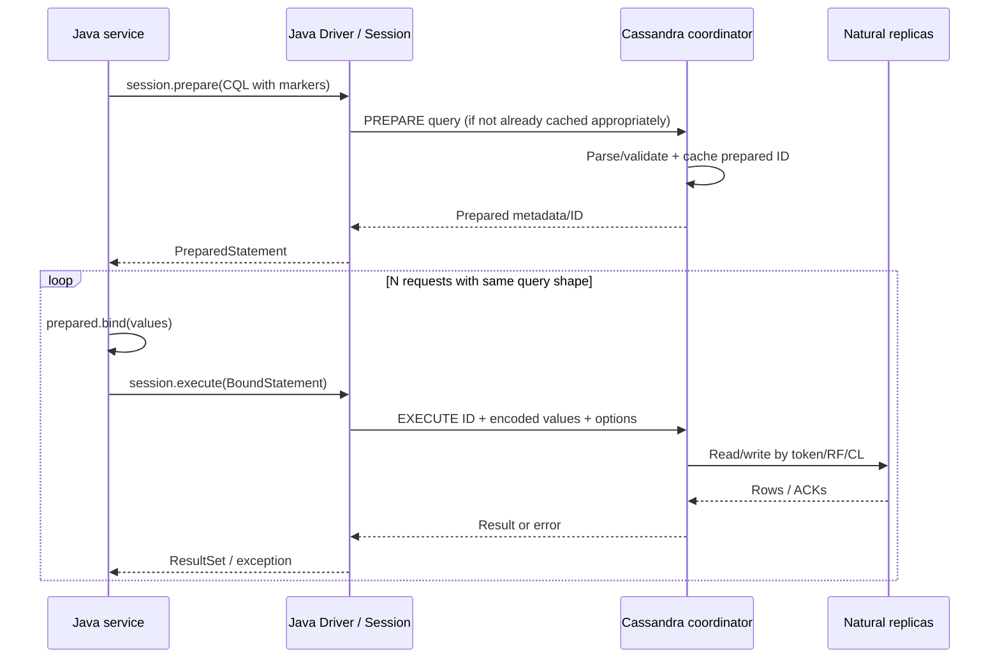

# PreparedStatement, BoundStatement, and the Prepare/Bind/Execute Steps

## 1. Why does a CQL query in Java typically have two phases?

In Apache Cassandra, each CQL operation is sent to a **coordinator**; the coordinator determines the partition key/token, selects replicas according to the replication factor (RF), and collects responses according to the consistency level (CL). For a Java application with thousands of requests sharing the same query shape but differing in key values, concatenating a new CQL string and sending it on every request both makes data types hard to control and repeats the query-parsing work.

**Java Driver 4.x** provides three objects you need to understand:

- `PreparedStatement`: **a prepared query template**, along with parameter metadata and the prepared query's server-side identifier.
- `BoundStatement`: **a single binding of concrete values** to the query template, along with execution attributes such as CL, timeout, and page size.
- `ResultSet`/`AsyncResultSet`: the result returned when executing a statement; it may be paginated or include information for a conditional write.

Typical workflow:

```java
PreparedStatement prepared = session.prepare(
    "SELECT order_id, status FROM java_query_lab_ks.orders_by_id " +
    "WHERE order_id = ?");

BoundStatement bound = prepared.bind(
    UUID.fromString("11111111-2222-4333-8444-555555555555"));

ResultSet results = session.execute(bound);
Row row = results.one();
```

**Lesson goal:** explicitly explain **prepare → bind → execute**, write Java code with proper CQL types, choose request attributes according to consistency requirements, distinguish null from UNSET, use sync/async and paging properly, handle errors/idempotence, and avoid unbounded dynamic preparation.

This lesson belongs to the **Query Execution from Java** chapter in the `DATABASE_ENGINE_WIDE_COLUMN_CASSANDRA` module: distributed/wide-column architecture, partition keys, query-driven tables, read/write CL, CQL, replication, compaction, repair, error handling, and Java connectivity are all directly applicable contexts.

## 2. Lifecycle diagram from driver to replica



**Prepare does not run a SELECT query or write data.** It lets the server inspect and parse the CQL statement, determine marker types, and store the identifier/metadata. **Bind does not touch the network**: it is a client-side operation to fill in parameters and build an executable statement. **Execute is what sends the request**, going through routing, the coordinator, replicas, consistency, and the network, and it can encounter timeouts.

| Step | Primary API | Produces | Cost and notes |
| --- | --- | --- | --- |
| Prepare | `session.prepare(cql)` or `prepare(SimpleStatement)` | `PreparedStatement` | May incur a round trip and server parse/cache on cache miss; prepare at the appropriate time |
| Bind | `prepared.bind(...)`; `boundStatementBuilder()`; `setXxx(...)` | `BoundStatement` | Serializes values according to CQL type/codec; markers must be populated properly |
| Execute sync | `session.execute(bound)` | `ResultSet` | Blocks the calling thread until initial results arrive; iteration may fetch subsequent pages |
| Execute async | `session.executeAsync(bound)` | `CompletionStage<AsyncResultSet>` | Does not block the calling thread; must handle CompletionStage/errors and fetch subsequent pages |

## 3. How does SimpleStatement differ from PreparedStatement?

```java
// Fixed literal CQL string: convenient for DDL or a rare query.
SimpleStatement simple = SimpleStatement.newInstance(
    "SELECT release_version FROM system.local");
ResultSet version = session.execute(simple);

// Same query shape, substituting key values many times.
PreparedStatement getOrder = session.prepare(
    "SELECT status FROM java_query_lab_ks.orders_by_id WHERE order_id = ?");

BoundStatement order1 = getOrder.bind(
    UUID.fromString("11111111-2222-4333-8444-555555555555"));
BoundStatement order2 = getOrder.bind(
    UUID.fromString("22222222-3333-4444-8555-666666666666"));
```

**Prepared** fits repeated queries because the parser/metadata is reused. **Simple** can fit DDL statements, rare admin queries, or genuinely dynamic SQL/CQL. However, “simple” **does not mean** concatenating user input into strings: the Java Driver also supports binding values to a `SimpleStatement` in appropriate cases. For OLTP services, preparing **stable query shapes** and passing values separately is the standard approach.

**A prepared statement does not cache returned data.** It does not turn a `SELECT` that scans many SSTables/tombstones into a fast query just by preparing it; partition key design and query patterns still govern the read path. Nor is it a transaction, a full-result server-side cursor, or a CQL statement pre-executed at prepare time.

### What should be a marker? What should not?

```sql
-- Valid: markers represent values.
SELECT status FROM java_query_lab_ks.orders_by_id WHERE order_id = ?;

-- Valid: named markers, the driver binds by name.
SELECT status FROM java_query_lab_ks.orders_by_id WHERE order_id = :id;

-- NOT a valid way to bind table/column names as values:
-- SELECT status FROM :table_name WHERE order_id = ?;
-- SELECT :column_name FROM java_query_lab_ks.orders_by_id WHERE order_id = ?;
```

**Keyspace, table, and column names and CQL statement structure are not bind values.** If business logic genuinely chooses among multiple tables, you must use an **allowlist** of valid names rather than concatenating strings directly from API input. Dynamic queries with many table names/`ORDER BY`/filter shapes create additional prepared IDs and complicate access control.

## 4. Preparing the CQL lab

These examples run only in a **lab cluster** with one datacenter named `dc1` and enough nodes for RF = 3. For other clusters, adjust DC/RF accordingly. All data is synthetic, using no real customer IDs.

```sql
CREATE KEYSPACE java_query_lab_ks
WITH replication = {'class': 'NetworkTopologyStrategy', 'dc1': 3}
AND durable_writes = true;

-- One partition per order; queries look up by order_id.
CREATE TABLE java_query_lab_ks.orders_by_id (
    order_id uuid PRIMARY KEY,
    customer_id text,
    status text,
    total decimal,
    created_at timestamp,
    note text
);

-- One partition per (customer_id, bucket_day); rows are ordered by time.
CREATE TABLE java_query_lab_ks.events_by_customer_day (
    customer_id text,
    bucket_day date,
    event_ts timestamp,
    event_id uuid,
    event_type text,
    PRIMARY KEY ((customer_id, bucket_day), event_ts, event_id)
) WITH CLUSTERING ORDER BY (event_ts DESC, event_id DESC);

INSERT INTO java_query_lab_ks.orders_by_id
    (order_id, customer_id, status, total, created_at, note)
VALUES
    (11111111-2222-4333-8444-555555555555,
     'synthetic-customer-1', 'CREATED', 125.50,
     '2026-11-21T08:00:00+0000', 'fixture');

INSERT INTO java_query_lab_ks.events_by_customer_day
    (customer_id, bucket_day, event_ts, event_id, event_type)
VALUES
    ('synthetic-customer-1', '2026-11-21',
     '2026-11-21T08:00:00+0000',
     22222222-3333-4444-8555-666666666666, 'CREATED');

INSERT INTO java_query_lab_ks.events_by_customer_day
    (customer_id, bucket_day, event_ts, event_id, event_type)
VALUES
    ('synthetic-customer-1', '2026-11-21',
     '2026-11-21T08:05:00+0000',
     33333333-4444-4555-8666-777777777777, 'PAID');

INSERT INTO java_query_lab_ks.events_by_customer_day
    (customer_id, bucket_day, event_ts, event_id, event_type)
VALUES
    ('synthetic-customer-1', '2026-11-21',
     '2026-11-21T08:10:00+0000',
     44444444-5555-4666-8777-888888888888, 'SHIPPED');
```

**Data design note:** `orders_by_id` optimizes `WHERE order_id = ?`. `events_by_customer_day` uses a compound partition key `(customer_id, bucket_day)`; you must bind **both parts** to route to a single partition. The clustering key `(event_ts, event_id)` determines ordering. If a query omits the partition key and requires `ALLOW FILTERING`, using a prepared statement **will not fix a flawed data model**.

## 5. Create CqlSession once, not per request

Java code is illustrated with Driver 4.x, Java 11+ (`java.time` APIs and `var` if used), and a placeholder contact point from the TEST-NET range. TLS/secrets handling is configured per environment; never hardcode real passwords into source code.

```java
import java.net.InetSocketAddress;
import java.time.*;
import java.util.*;
import java.math.BigDecimal;
import java.util.concurrent.*;

import com.datastax.oss.driver.api.core.CqlSession;
import com.datastax.oss.driver.api.core.DefaultConsistencyLevel;
import com.datastax.oss.driver.api.core.cql.*;

// Application main/lifecycle startup; do not call on every HTTP request.
String password = System.getenv("CASSANDRA_LAB_PASSWORD");
if (password == null || password.isBlank()) {
    throw new IllegalStateException("Missing CASSANDRA_LAB_PASSWORD");
}

try (CqlSession session = CqlSession.builder()
        .addContactPoint(new InetSocketAddress("192.0.2.10", 9042))
        .withLocalDatacenter("dc1")
        .withAuthCredentials("app_orders", password)
        .build()) {
    // Prepare once on the session, then share the query template.
    PreparedStatement byId = session.prepare(
        "SELECT order_id, status, total " +
        "FROM java_query_lab_ks.orders_by_id WHERE order_id = ?");

    UUID id = UUID.fromString("11111111-2222-4333-8444-555555555555");
    BoundStatement stmt = byId.bind(id)
        .setConsistencyLevel(DefaultConsistencyLevel.LOCAL_QUORUM)
        .setIdempotent(true);

    Row row = session.execute(stmt).one();
    if (row != null) {
        System.out.printf("status=%s total=%s%n",
            row.getString("status"), row.getBigDecimal("total"));
    }
}
```

**Do not use `192.0.2.10` as a real host**: it is an illustrative IP. Production typically requires multiple contact points for discovery, TLS/truststore, a secrets manager, authentication/authorization, connection limits, and a local-DC routing policy. The `app_orders` role must have the corresponding `SELECT` permission; an `Unauthorized` error is distinct from an unavailable-replica error.

A single `CqlSession` manages connections, topology metadata, routing, request processing, and caching; keep **one shared session tied to the application lifecycle** rather than creating and closing one per query. Both the session and prepared statements are designed to be shared across requests/threads; `BoundStatement` is also immutable, so it is safe when constructed per request.

### Avoid `USE keyspace` in Java

Prefer fully qualified CQL names `keyspace.table` in prepared queries. Unqualified names depend on the active keyspace and can make caching, migrations, and permissions harder to reason about. If a default keyspace is configured on the session, keep it consistent and tested; do not switch it with `USE` interleaved between concurrent requests.

## 6. Step one — prepare: what happens on the client and server?

```java
String cql =
    "SELECT order_id, status, total " +
    "FROM java_query_lab_ks.orders_by_id WHERE order_id = ?";

PreparedStatement prepared = session.prepare(cql);
// PreparedStatement can be reused for thousands of UUIDs.
```

When there is no cached entry in the driver, the prepare step sends PREPARE to a node so Cassandra parses the CQL, determines **bind variable types and positions**, generates an identifier, and returns metadata. The driver maintains a **client-side cache** and may prepare on other nodes to prevent errors when the coordinator changes. Exact behavior is configurable by version.

### Three caches not to conflate

| Memory / object | Where? | What does it store? | Invalidation scenarios |
| --- | --- | --- | --- |
| Java `PreparedStatement` | In session/driver | Query template, execution defaults, metadata/ID | Session closed, cache evicted, schema changed |
| Prepared cache on a Cassandra node | Per server node | Parsed statement bound to a prepared ID | Node restart, eviction, schema invalidation |
| Page/row/key cache (if enabled) | Database/server and OS | Assists data/read path | Memory pressure, cache policy, and data changes |

**Prepare once** means a query shape is prepared and reused over the session lifecycle, not that a single PREPARE lives forever on every node even across node restarts.

### Is repeated prepare okay?

Driver 4.x maintains a **client-side prepared statement cache** keyed by the query string and the execution parameters supplied at prepare time. Calling prepare repeatedly with the same query shape and matching settings usually returns the cached object rather than sending PREPARE every time. Even so:

1. You should still **prepare at startup or cache by query shape** in the repository layer; avoid lookup/cache overhead and unexpected errors on the request path.
2. Avoid generating CQL containing literals or per-user varying keyspace/table names — this multiplies query shapes/IDs and consumes driver/server memory.
3. If preparing from a `SimpleStatement`, **execution attributes** such as CL are propagated to the BoundStatement and participate in the cache identity; do not assume two templates with different defaults are identical.
4. Prepare can fail immediately if a table/column does not exist, the role lacks permissions, or CQL is invalid; do not retry indefinitely.

### Schema changes and `UNPREPARED`

A server may return `UNPREPARED` when it lacks a prepared ID, for example due to a restart or eviction; the driver usually re-prepares automatically. This does **not** guarantee the query remains valid if the schema dropped a column, changed types, or removed the table. During rolling migrations, deploy DDL first, wait for schema agreement, avoid `SELECT *` on queries whose result metadata can change, and test both old and new app versions.

## 7. Step two — positional binding: order determines meaning

Question-mark `?` markers are 0-indexed (`0` onward). Binding order follows the order markers appear in the CQL statement, **not** the column definition order in the schema.

```java
PreparedStatement insert = session.prepare(
    "INSERT INTO java_query_lab_ks.orders_by_id " +
    "(order_id, customer_id, status, total, created_at) " +
    "VALUES (?, ?, ?, ?, ?)");

UUID id = UUID.fromString("55555555-6666-4777-8888-999999999999");
BoundStatement bound = insert.bind(
    id,                                // marker 0: order_id (uuid)
    "synthetic-customer-2",            // marker 1: customer_id (text)
    "CREATED",                         // marker 2: status (text)
    new BigDecimal("75.20"),          // marker 3: total (decimal)
    Instant.parse("2026-11-21T10:00:00Z") // marker 4: created_at (timestamp)
);
session.execute(bound);
```

Java arguments must match the **CQL type/codec** known to the driver from prepare. If you accidentally swap `customer_id` and `status` (both type `text`), the codec **cannot catch the business error**; only input/output tests will catch it. Therefore, with multiple markers of the same type, named markers or a builder are usually easier to review.

### Binding with setters

```java
BoundStatement s = insert.bind()
    .setUuid(0, id)
    .setString(1, "synthetic-customer-2")
    .setString(2, "CREATED")
    .setBigDecimal(3, new BigDecimal("75.20"))
    .setInstant(4, Instant.parse("2026-11-21T10:00:00Z"));
```

**Crucially in Java Driver 4.x, setters return a new statement.** Never discard the return value:

```java
BoundStatement wrong = insert.bind();
wrong.setUuid(0, id); // WRONG: return value is discarded.

BoundStatement correct = insert.bind();
correct = correct.setUuid(0, id); // CORRECT: capture the new instance.
```

This keeps statements **immutable and thread-safe**; another request cannot accidentally mutate the parameters of an in-flight request.

## 8. Named binding: clearer readability and fewer ordering mistakes

Named CQL markers use `:name` syntax. The name is the **bind marker name**, which does not have to match the column name, though matching it improves readability.

```java
PreparedStatement named = session.prepare(
    "INSERT INTO java_query_lab_ks.orders_by_id " +
    "(order_id, customer_id, status, total, created_at) " +
    "VALUES (:order_id, :customer_id, :status, :total, :created_at)");

BoundStatement request = named.bind()
    .setUuid("order_id", id)
    .setString("customer_id", "synthetic-customer-2")
    .setString("status", "CREATED")
    .setBigDecimal("total", new BigDecimal("75.20"))
    .setInstant("created_at", Instant.parse("2026-11-21T10:00:00Z"));
```

Driver 4.x offers `PreparedStatement.boundStatementBuilder()`, which is helpful when setting multiple attributes together:

```java
BoundStatement built = named.boundStatementBuilder()
    .setUuid("order_id", id)
    .setString("customer_id", "synthetic-customer-2")
    .setString("status", "CREATED")
    .setBigDecimal("total", new BigDecimal("75.20"))
    .setInstant("created_at", Instant.parse("2026-11-21T10:00:00Z"))
    .setConsistencyLevel(DefaultConsistencyLevel.LOCAL_QUORUM)
    .build();
```

**Named markers are especially useful** when an UPDATE modifies multiple `text` or `int` columns. If the same marker name appears in multiple places, make sure you understand how the driver/server interpret it; ideally give each business position a **clear, unambiguous** name and verify the metadata.

## 9. CQL ↔ Java data types and codecs

The driver chooses a codec based on the **prepared CQL type** and the Java type used in the setter/getter. Common mappings in Driver 4.x:

| CQL | Java/Driver 4.x | API example | Pitfall |
| --- | --- | --- | --- |
| `uuid`, `timeuuid` | `java.util.UUID` | `setUuid`, `getUuid` | Do not bind a String UUID directly when a UUID type is expected |
| `text`, `varchar`, `ascii` | `String` | `setString`, `getString` | Standardize encoding/casing per contract |
| `int` | `int`/`Integer` | `setInt`, `getInt` | Primitive getters return default values on NULL; check `isNull` |
| `bigint`, `counter` | `long`/`Long` | `setLong`, `getLong` | `counter` has dedicated update semantics, not a normal incrementing int |
| `decimal` | `java.math.BigDecimal` | `setBigDecimal`, `getBigDecimal` | Avoid `double` for money due to binary floating-point representation |
| `timestamp` | `java.time.Instant` | `setInstant`, `getInstant` | Treat all instants in UTC/Instant; avoid silent timezone conversions |
| `date` | `java.time.LocalDate` | `setLocalDate`, `getLocalDate` | Calendar date, not a timezone-bearing timestamp |
| `time` | `java.time.LocalTime` | `setLocalTime`, `getLocalTime` | Time of day without a date |
| `boolean` | `boolean`/`Boolean` | `setBoolean`, `getBoolean` | Distinguish NULL from false if the schema allows nulls |
| `blob` | `java.nio.ByteBuffer` | `setByteBuffer`, `getByteBuffer` | Manage byte limits/position; avoid logging binary/PII |
| `list<text>` | `List<String>` | `setList`, `getList` | Must supply element class/type token per API and version |

For UDTs, tuples, nested collections, custom codecs, or application-level encryption, register the appropriate codec. If the Java type does not match, the driver may throw `CodecNotFoundException` or a binding/serialization error **before sending the request**; do not “fix” this by turning everything into literal strings.

### Distinguishing NULL and UNSET

**NULL** and **UNSET** are especially important for `INSERT`/`UPDATE`. Cassandra supports UNSET values on compatible versions/protocols:

```java
PreparedStatement change = session.prepare(
    "UPDATE java_query_lab_ks.orders_by_id " +
    "SET status = :status, note = :note WHERE order_id = :id");

BoundStatement preserveNote = change.bind()
    .setString("status", "PAID")
    .unset("note") // Leaves the existing note column untouched.
    .setUuid("id", id);

BoundStatement clearNote = change.bind()
    .setString("status", "PAID")
    .setToNull("note") // Writes NULL per CQL semantics; typically creates a tombstone.
    .setUuid("id", id);
```

| Marker state | For regular write columns | Notes |
| --- | --- | --- |
| Concrete value | Writes that value | Carries timestamp/TTL per the mutation |
| `setToNull("note")` | Deletes/writes null per CQL; may generate a tombstone | Do not use casually when existing data must be preserved |
| `unset("note")` | **Skips the marker**, does not update that column | Version/statement dependent; not valid in every position |

**Do not UNSET or NULL a primary key in `WHERE`**: Cassandra needs the partition key/routing key; requests missing a key are typically rejected. Do not assume Java NULL means UNSET: use the explicit API and test the semantics.

## 10. Step three — synchronous execute: reading one row, reading multiple rows

### 10.1. Reading by partition key

```java
PreparedStatement getById = session.prepare(
    "SELECT order_id, customer_id, status, total, created_at " +
    "FROM java_query_lab_ks.orders_by_id WHERE order_id = ?");

UUID id = UUID.fromString("11111111-2222-4333-8444-555555555555");
BoundStatement query = getById.bind(id)
    .setConsistencyLevel(DefaultConsistencyLevel.LOCAL_QUORUM)
    .setTimeout(Duration.ofSeconds(2))
    .setIdempotent(true);

ResultSet rs = session.execute(query);
Row row = rs.one();
if (row == null) {
    // No row found: distinguish from timeout or Unauthorized exception.
    System.out.println("Order not found");
} else {
    UUID orderId = row.getUuid("order_id");
    String status = row.getString("status");
    BigDecimal total = row.getBigDecimal("total");
    System.out.printf("%s %s %s%n", orderId, status, total);
}
```

**A SELECT that returns no row** is not a query or timeout error. Define your API to return 404/null per business rules, while connection failures, insufficient replicas, or unauthorized errors follow separate handling paths.

### 10.2. Reading by compound partition key and clustering order

```java
PreparedStatement events = session.prepare(
    "SELECT event_ts, event_id, event_type " +
    "FROM java_query_lab_ks.events_by_customer_day " +
    "WHERE customer_id = ? AND bucket_day = ? LIMIT 10");

BoundStatement pageQuery = events.bind(
    "synthetic-customer-1", LocalDate.of(2026, 11, 21))
    .setConsistencyLevel(DefaultConsistencyLevel.LOCAL_QUORUM)
    .setPageSize(2)
    .setIdempotent(true);

ResultSet result = session.execute(pageQuery);
int rows = 0;
for (Row event : result) {
    rows++;
    System.out.println(event.getInstant("event_ts") + " " +
        event.getString("event_type"));
}
System.out.println("Total rows consumed=" + rows);
```

Here `LIMIT 10` is the **maximum total rows returned by the query**, whereas `setPageSize(2)` is a **page-size hint**. If the data has 3 rows, the synchronous driver can fetch additional pages as the iterator crosses the first page boundary. **Do not** mistake a fast `session.execute()` return for the time required to read the entire result.

## 11. Executing writes, LWT, and unknown outcomes

```java
PreparedStatement update = session.prepare(
    "UPDATE java_query_lab_ks.orders_by_id " +
    "SET status = ? WHERE order_id = ?");

BoundStatement mutation = update.bind(
    "PAID", UUID.fromString("11111111-2222-4333-8444-555555555555"))
    .setConsistencyLevel(DefaultConsistencyLevel.LOCAL_QUORUM);

session.execute(mutation);
```

Cassandra ACKs according to CL, not “every replica across every DC is synchronized”. A write timeout can have an **unknown outcome**: the mutation may have been written to some replicas while the client did not receive enough ACKs. Never blindly retry a non-idempotent operation.

### Conditional write: `[applied]` result

```java
PreparedStatement advance = session.prepare(
    "UPDATE java_query_lab_ks.orders_by_id SET status = ? " +
    "WHERE order_id = ? IF status = ?");

BoundStatement guarded = advance.bind(
    "PAID",
    UUID.fromString("11111111-2222-4333-8444-555555555555"),
    "CREATED")
    .setConsistencyLevel(DefaultConsistencyLevel.LOCAL_QUORUM)
    .setSerialConsistencyLevel(DefaultConsistencyLevel.LOCAL_SERIAL);

ResultSet conditionalResult = session.execute(guarded);
boolean applied = conditionalResult.wasApplied();
if (!applied) {
    // Another session updated the status or the condition did not match.
    System.out.println("Transition not applied");
}
```

**LWT/IF** uses Paxos with serial consistency based on conditions/topology; its cost is higher than a regular write. `wasApplied() = false` is a **condition failure**, not by default a network error. `LOCAL_SERIAL` must match the application's consistency/replication requirements; do not change it arbitrarily to boost throughput. LWT can still have an **unknown outcome on timeout**, so handle retries and business verification accordingly.

## 12. Statement attributes: where should each be set?

```java
BoundStatement withOptions = getById.bind(id)
    .setConsistencyLevel(DefaultConsistencyLevel.LOCAL_QUORUM)
    .setTimeout(Duration.ofSeconds(2))
    .setPageSize(200)
    .setIdempotent(true)
    .setTracing(false);
```

| Attribute | Meaning | Notes |
| --- | --- | --- |
| `setConsistencyLevel(LOCAL_QUORUM)` | Requires ACKs/read responses from a quorum **within the local DC** | RF, DC, and consistency requirements must align; do not pick `ONE` merely to “lower latency” |
| `setSerialConsistencyLevel(LOCAL_SERIAL)` | CL used for the serial phase of LWT | Do not apply indiscriminately to regular SELECT/UPDATE |
| `setTimeout(Duration)` | Driver-side request time limit | Does not guarantee the mutation did not happen on timeout |
| `setPageSize(N)` | Hint for rows per page | Not `LIMIT`; does not enforce an exact total byte cap |
| `setIdempotent(true/false)` | Tells the driver whether retry/speculative execution is safe | **Must be based on semantics**; do not mark every write true |
| `setTracing(true)` | Enables CQL tracing selectively on a request | Adds overhead and may expose CQL/partition keys; do not enable 100% in production |
| Execution profile | Groups defaults for a workload class | Keeps config consistent instead of scattering settings everywhere |
| Query timestamp | Controls write timestamp when used intentionally | Can cause older writes to win or break tombstones/TTL if misused |

**Set defaults in configuration/Execution Profiles** for workload groups, and override on individual statements only with clear justification. If preparing from a `SimpleStatement` with options, some options are copied onto the bound statement — read and verify the defaults rather than assuming every request uses the global default CL.

### Idempotence and retry

| CQL statement | Idempotent? | Reason |
| --- | --- | --- |
| `SELECT ... WHERE pk = ?` | Usually **yes** | Re-reading does not modify data |
| `UPDATE ... SET status = 'PAID'` | Conditionally | Writing the same value may be state-idempotent, though timestamps/TTL/side effects must be evaluated |
| `UPDATE ... SET list_col = ['x'] + list_col` | **No** | Retries can prepend multiple times |
| `UPDATE counter SET c = c + 1` | **No** | Retries can increment more than once |
| `INSERT ... USING TTL ...` | Requires review | Late retries can shift expiration if write time/TTL changes |
| Conditional update `IF ...` | **Not by default** | Requires analyzing state/semantics, timeouts, and Paxos responses |

Driver 4.x does not assume every statement is idempotent by default. **Do not set `setIdempotent(true)` just “to get retries” unless you have proven repeated execution is safe.** Retry policy, speculative execution, request timeout, and acknowledged write state must be designed together.

### Token-aware routing requires binding the full partition key

From the prepared statement's metadata and the bound partition key values, the driver computes the routing key/token to select the appropriate node per its policy. When a **partition key is missing or UNSET**, the query cannot execute properly and the driver lacks the information needed to route it.

A prepared statement **does not guarantee** every request automatically hits an optimal replica if a custom policy/proxy is used, the local DC is misconfigured, schema metadata is missing, or the partition key is undetermined. Inspect per-node coordinator requests/traces when debugging.

## 13. Paging: sync and async execute differ markedly

### Sync: the iterator can fetch subsequent pages automatically

```java
ResultSet rs = session.execute(pageQuery);
long count = 0;
for (Row row : rs) {
    count++;
}
// On a synchronous ResultSet, iterating over rows may trigger
// additional requests to fetch new pages. Never do this on an I/O event loop.
```

### Async: explicit currentPage and fetchNextPage

```java
CompletionStage<AsyncResultSet> firstPageStage =
    session.executeAsync(pageQuery);

CompletionStage<Integer> countStage =
    firstPageStage.thenCompose(page -> countEveryPage(page, 0));

// Helper method inside the repository/service class:
static CompletionStage<Integer> countEveryPage(
        AsyncResultSet page, int countSoFar) {
    int count = countSoFar;
    for (Row row : page.currentPage()) {
        count++;
    }
    if (!page.hasMorePages()) {
        return CompletableFuture.completedFuture(count);
    }
    final int nextCount = count;
    return page.fetchNextPage()
        .thenCompose(nextPage -> countEveryPage(nextPage, nextCount));
}
```

**Note:** `AsyncResultSet` only iterates over the **current page**; a `for` loop will not automatically load all data. You must handle `hasMorePages()` and `fetchNextPage()`. Do not call `session.execute()` or other blocking I/O **inside a callback running on a driver I/O thread**. CPU-heavy work such as hashing all rows, JSON serialization, or business processing should be offloaded to an appropriate executor with backpressure.

### Paging state for multi-page APIs

Paging state is an opaque token describing the continuation position for the same query and bind values, **not an arbitrary numeric offset you can jump around with**. When building a cursor API:

1. Reuse it only with the same query shape and matching bind values.
2. Treat paging state as **untrusted** client input; use the safe paging-state API/validation where applicable, and encrypt/sign or keep it server-side if needed.
3. Avoid logging cursors/raw partition keys or leaking internal topology/parameters.
4. Do not expect paging to provide a multi-request snapshot while data is concurrently undergoing UPDATE/DELETE/TTL.

## 14. Async prepare and asynchronous error handling

A repository can prepare during startup via `prepareAsync`, then execute non-blockingly:

```java
CompletionStage<PreparedStatement> preparedStage =
    session.prepareAsync(
        "SELECT status FROM java_query_lab_ks.orders_by_id " +
        "WHERE order_id = ?");

UUID orderId = UUID.fromString(
    "11111111-2222-4333-8444-555555555555");

CompletionStage<AsyncResultSet> responseStage =
    preparedStage.thenCompose(prepared ->
        session.executeAsync(
            prepared.bind(orderId)
                .setConsistencyLevel(DefaultConsistencyLevel.LOCAL_QUORUM)
                .setIdempotent(true)));

CompletionStage<String> statusStage = responseStage.thenApply(rs -> {
    Row row = rs.one(); // On a primary-key query, at most one row.
    return row == null ? null : row.getString("status");
});
```

You must **observe exceptional completion** of the final stage rather than ignoring it. If a callback throws an exception, that stage completes exceptionally; caller code must map it to response/error handling. In real services, `preparedStage` is typically a field created **once**, not recreated per HTTP request.

### Errors to distinguish

| Error / symptom | Possible source | Action |
| --- | --- | --- |
| `CodecNotFoundException` / bind type mismatch | Java type differs from CQL type, missing custom codec | Fix mapping/codec; inspect variable metadata |
| CQL InvalidQuery / UndefinedColumn | Invalid CQL, schema not yet applied | Check DDL/schema agreement and query shape |
| Authentication / Unauthorized | Missing credentials, role, or SELECT/MODIFY grant | Check auth/permissions; do not change CL as a “fix” |
| `UnavailableException` | Not enough available replicas for the requested CL | Check RF, DC, node status, network |
| `ReadTimeoutException` | Insufficient read responses received within timeout | Check coordinator/replicas, tombstones, compaction, CL |
| `WriteTimeoutException` | Insufficient write ACKs received within timeout | **Outcome may be unknown**; check idempotence before retrying |
| Client-side request timeout | Driver/callback/queue/network exceeded timeout | Distinguish from server timeouts; check pool/in-flight requests |
| `UNPREPARED` transient | Server cache lacks the ID | Driver usually re-prepares; check restarts/evictions and schema changes |
| NoNodeAvailable / AllNodesFailed | No suitable endpoint or every attempt failed | Check topology discovery, TLS/ports, DC, and health |

**Never catch generic Exception and blindly retry.** Retrying a counter increment, list append, or partially applied write can corrupt business state. For LWT, read the applied state by key and establish business idempotency rules before deciding.

## 15. Security: binding values helps, but is not enough

Bind markers and prepared statements prevent **concatenating literal user input into CQL**, reducing injection risk in **value positions** and avoiding quoting/escaping bugs. However:

- CQL identifiers (table/column/keyspace) **cannot be bound via markers**: use an allowlist if querying across multiple resources.
- Prepared queries and bound values can appear in **driver debug logs, full query logging, CQL tracing, exceptions, or request trackers**; do not log raw customer IDs/tokens/PII.
- Passwords/truststores/TLS must use a secrets manager and ACLs; prepared statements **do not encrypt** bytes on the wire.
- The Java role only needs `SELECT`/`MODIFY` on the specific tables, never `SUPERUSER` or `ALL PERMISSIONS ON ALL KEYSPACES`.
- Prepared statements **do not provide row-level security**: a role with `SELECT` on a table can read other partitions if it knows the keys and there is no higher-level authorization check.

### Safe logging example

```java
long started = System.nanoTime();
try {
    ResultSet rs = session.execute(query);
    double ms = (System.nanoTime() - started) / 1_000_000.0;
    logger.info("cql_shape=orders_by_id_lookup cl=LOCAL_QUORUM duration_ms={}", ms);
} catch (RuntimeException e) {
    // Do not print the bound object or raw query params.
    logger.warn("cql_shape=orders_by_id_lookup failure_class={}",
        e.getClass().getSimpleName());
    throw e;
}
```

In application environments, tracing raw UUIDs/bind values should only be allowed under dedicated collection and retention controls. Query shape and error class are usually enough to spot trends; full auditing requires RBAC and proper data masking.

## 16. Performance: prepare once, measure end-to-end many times

When optimizing the Java → Cassandra path, separate **prepare cost**, **bind cost**, **execute cost**, and **full-result iteration cost**:

| Phase | What consumes resources? | How to observe |
| --- | --- | --- |
| App/session startup | Session handshake, auth, discovery, prepare cache warmup | Startup duration and initial prepare calls |
| Prepare miss | Round trip + parse/validate/server cache + propagation | Prepare timing, relevant server logs/metrics |
| Bind | Client allocation, codec serialization, key extraction | Java profiling, allocation/CPU |
| Execute | Pool, network, coordinator, replica, CL, retries/timeouts | Driver metrics, sampled tracing, `nodetool proxyhistograms` |
| Fetch subsequent pages | Multiple network requests, server read path, deserialization | First-page vs full-result latency, page count |

**Do not call `prepare()` inside every iteration of a load test** and report the whole thing as “query latency” unless the benchmark explicitly aims to measure prepare overhead. Warm up the session and prepared cache, keep the query shape/CL/page size constant, verify correctness, and measure p50/p95/p99 alongside error rates as load increases.

### Key metrics

- **Client:** successful ops/s, timeouts/errors, retries, in-flight/pool usage, p95/p99, and page counts.
- **Coordinator:** client request latency/timeouts, pending tasks, dropped messages per version.
- **Replica/table:** read/write latency, SSTables per read, tombstones scanned, compaction backlog.
- **Host:** CPU/GC, disk await, network, and memory.

A CQL request at CL `LOCAL_QUORUM` waits on two local replicas (with RF3), plus network and Java processing. `PreparedStatement` does not eliminate these costs; when p99 spikes, distinguish bad query design, hot partitions, compaction/repair, or client pool exhaustion — **do not blindly increase the number of prepared statements**.

### An illustrative measurement

```java
long t0 = System.nanoTime();
ResultSet rs = session.execute(pageQuery);
long tFirst = System.nanoTime();
int count = 0;
for (Row row : rs) {
    count++; // May fetch multiple pages.
}
long tDone = System.nanoTime();
System.out.printf("rows=%d firstPageMs=%.2f fullResultMs=%.2f%n",
    count,
    (tFirst - t0) / 1_000_000.0,
    (tDone - t0) / 1_000_000.0);
```

This is just **a single sample**; never call it p99. For before/after benchmarks, run many requests against representative data at the same offered load, account for failures and paging, and avoid letting warmup/GC/tracing skew the results.

## 17. Real-world scenarios and diagnosis

### Scenario A — misbound positional parameters of the same type

Query:

```java
PreparedStatement ps = session.prepare(
    "INSERT INTO java_query_lab_ks.orders_by_id " +
    "(order_id, customer_id, status) VALUES (?, ?, ?)");

// Both 'status' and 'customerId' are Strings.
BoundStatement wrong = ps.bind(id, "PAID", "synthetic-customer-1");
```

The CQL statement succeeds because both columns are `text`, yet the status lands in `customer_id` and vice versa. **Fix:** use named markers or a typed repository, and write tests asserting values by primary key and business semantics rather than merely checking for no exceptions.

### Scenario B — discarding the setter's return value

```java
BoundStatement original = ps.bind();
original.setUuid(0, id);
session.execute(original); // May miss the key binding because setters do not mutate in place.
```

Fix with `original = original.setUuid(0, id)` or use `BoundStatementBuilder`. Test against fixtures to confirm all required markers/values are populated.

### Scenario C — preparing hundreds of thousands of query shapes

A service interpolates literal customer IDs and table names into CQL, then calls `prepare()` on every request. Result: prepared cache pressure, excessive IDs/metadata, parse/prepare traffic, and frequent evictions/re-prepares. **Fix:** keep query shapes fixed, use markers for values, allowlist resources, and prepare only the valid templates. Never create a prepared query per partition key.

### Scenario D — write timeout and doubled retries

A service runs `UPDATE counter ... c=c+1`, the client misses the ACK, and it retries three times. The counter may increment more than once. **Fix:** never mark counters with `setIdempotent(true)`; define event IDs, business deduplication/idempotency, or an alternative design that does not rely on blind retries.

### Scenario E — async reads only the first page

Code iterates `AsyncResultSet.currentPage()` and returns 10 rows even though the query has 100 rows. This is a **completeness** bug, not Cassandra data loss. Fix using `hasMorePages()/fetchNextPage()` or an explicit cursor API; test with a fixture spanning more than one page.

### Scenario F — schema rollback and cached metadata

After dropping an old column, Java code still prepares `SELECT *`, and some coordinators still have unconverged schema metadata. Errors or mis-mapped columns may appear only on certain nodes. **Fix:** follow expand/contract ordering, list explicit columns, wait for schema agreement, monitor cache/re-prepare activity, and do not contract while older app versions remain live.

## 18. Checklist for implementing a repository using prepared statements

1. **Schema/query:** Valid partition key, needed projection only, no reliance on uncontrolled `ALLOW FILTERING`; ensure RF/DC/CL match.
2. **Session:** Create within application lifecycle with contact points/local DC/TLS/auth configured; never create a session per request.
3. **Prepare:** Stable query shapes prepared at startup or cached by query; avoid literal interpolation and `SELECT *` on evolving schemas.
4. **Bind:** Correct marker order or names, matching CQL types/codecs, intentional null/UNSET handling; never discard setter return values.
5. **Execute:** Choose sync or async appropriately; configure timeout/CL/serial CL/idempotence per business rules; never retry indefinitely.
6. **Results:** Handle null/missing rows intentionally, iterate completely when required by the contract; distinguish `LIMIT`/`pageSize` and LWT `wasApplied`.
7. **Error path:** Separate auth, availability, timeout, unprepared, codec, and invalid-query errors; confirm write outcome before retrying.
8. **Observability:** Track p95/p99, successful QPS, errors, page counts, coordinator/replica metrics, GC/disk; sample traces and keep logs safe.
9. **Testing:** Unit test types/null/unset/bind order; integration test against a matching Cassandra version, RF/CL, and multi-page fixtures; add negative permission tests.
10. **Operational safety:** Additive migrations, schema agreement, least privilege, secrets management, compatible rollbacks, and load canaries.

## 19. Self-check exercises

1. Explain the difference between `PreparedStatement`, `BoundStatement`, and `ResultSet`. Which step sends PREPARE, and which sends EXECUTE?
2. Why is calling `prepare()` once usually better than calling `prepare()` with a CQL string embedding a different UUID on each request?
3. Write a prepared SELECT for `orders_by_id` with `WHERE order_id = ?`, bind a UUID, and read `status`/`total`.
4. Write the same query using the `:id` marker. When do named markers prevent mistakes better than positional markers?
5. How can `stmt.setString(0, "x"); session.execute(stmt);` fail in Driver 4.x? How do you fix it?
6. What difference do `setToNull("note")` and `unset("note")` make in an UPDATE? Why must you not UNSET a partition key?
7. If CQL defines `decimal` and `timestamp`, which Java types should you use to avoid precision or timezone loss?
8. Why does a prepared statement not replace a well-designed partition key or guarantee CL?
9. With `setPageSize(2)` and a query returning 3 rows, what is the difference between sync iteration and async `currentPage()`?
10. An UPDATE throws `WriteTimeoutException`. Should you immediately resend it by default if the statement is not idempotent?
11. An LWT `IF status = 'CREATED'` returns `wasApplied() = false`: what happened, and is it the same as a timeout?
12. Why must `setIdempotent(true)` not be set blindly on counter increments or list appends?
13. How does the driver's prepared cache differ from each Cassandra node's prepared cache? What happens when a node restarts?
14. Why does a `SELECT *` prepared before a schema migration risk mapping errors?
15. Propose three metrics and three test cases to verify the prepare/bind/execute path behaves properly in a production canary.

### Capstone exercise

Build a Java repository with two query templates: `getOrder(UUID)` and `listEvents(customerId, LocalDate)`. The repository must:

- share a single `CqlSession` and prepare each query shape once;
- bind all primary-key variables accurately;
- run with `LOCAL_QUORUM` and an explicit timeout;
- return an `Optional` when an order does not exist and distinguish timeouts;
- consume all pages when the API requires full results, or return a cursor when pagination is needed;
- log query shape and latency without printing raw customer IDs;
- include integration tests verifying row counts, ordering, type mapping, idempotence, and access permissions.

**Completion criteria:** the learner can explain both layers of prepared statement caching, write a correct and safe `prepare → bind → execute` flow in Java Driver 4.x, distinguish positional/named binding, null/UNSET, and sync/async paging, and choose CL/idempotence/timeout based on business requirements. At the same time, the learner understands that prepared statements **do not** by themselves solve query modeling, consistency, data corruption, or security.

## 20. References

- [Apache Cassandra Java Driver 4.x — Prepared Statements](https://apache.github.io/cassandra-java-driver/4.19.0/core/statements/prepared/): prepare mechanism, client/server caching, markers, binding, and reprepare.
- [Apache Cassandra Java Driver 4.x — Statement options](https://apache.github.io/cassandra-java-driver/4.18.1/core/statements/): consistency, paging, timeout, idempotence, and immutable statements.
- [Apache Cassandra Java Driver 4.x — Paging](https://apache.github.io/cassandra-java-driver/4.18.0/core/paging/): sync iteration, async fetch, paging state.
- [Apache Cassandra Java Driver 4.x — Async programming](https://apache.github.io/cassandra-java-driver/4.18.0/core/async/): CompletionStage and avoiding blocking I/O threads.
- [Apache Cassandra Java Driver 4.x — Idempotence](https://apache.github.io/cassandra-java-driver/4.18.1/core/idempotence/): retry/speculative execution and request semantics.
- [Apache Cassandra Java Driver 4.x — Data types](https://apache.github.io/cassandra-java-driver/4.18.1/core/custom_codecs/): codecs and data types.
- [Apache Cassandra — CQL SELECT/UPDATE](https://cassandra.apache.org/doc/stable/cassandra/developing/cql/dml.html): partition key conditions, LWT, TTL/timestamp, and statements.
- [Apache Cassandra — Data Modeling](https://cassandra.apache.org/doc/stable/cassandra/data_modeling/): query-driven table design and partition keys.

**Conclusion:** With Java Driver 4.x, **prepare a stable query shape, bind properly typed values, and execute with well-defined CL/timeout/idempotence**. Share a single session, cache prepared queries, never concatenate customer literals into CQL, never discard `BoundStatement.setXxx` return values, distinguish NULL from UNSET, and read all pages when required. Prepared statements make repeated queries more efficient and safer at the binding layer, yet **final correctness still depends on schema, partition keys, replication, consistency, and how the application handles errors and business transactions**.
