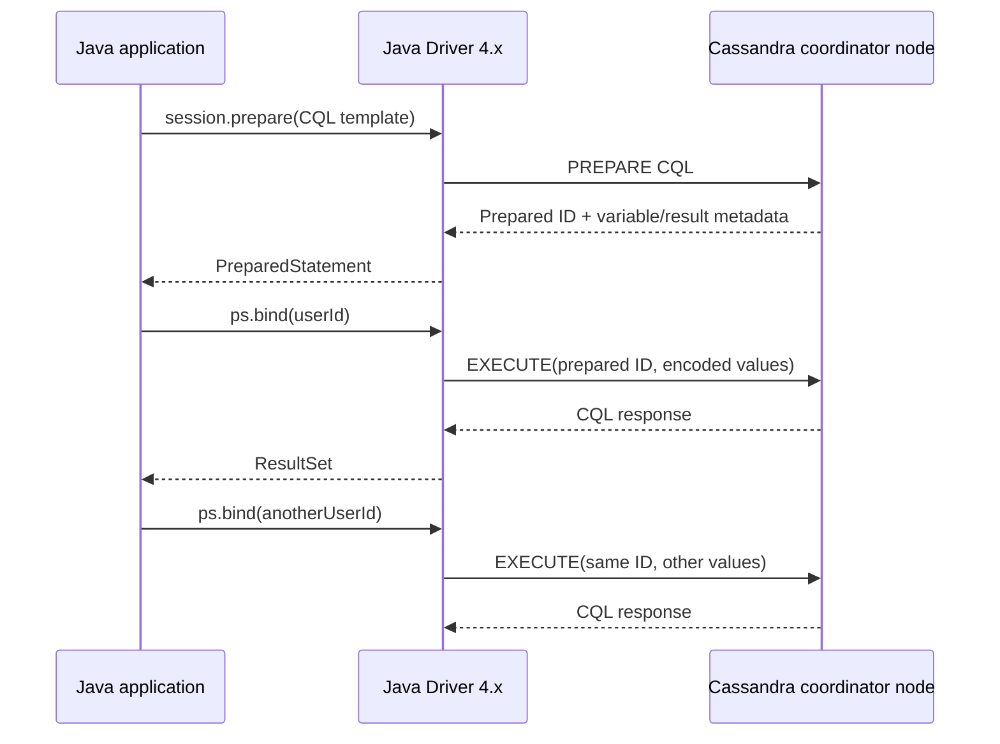
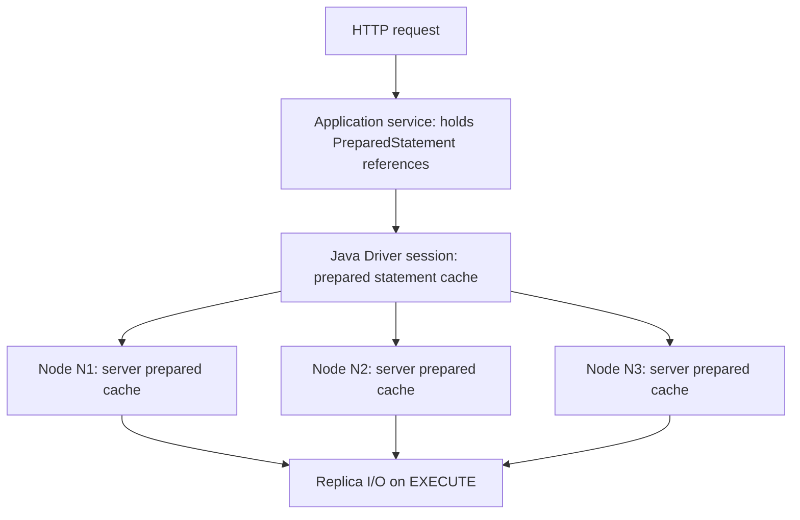
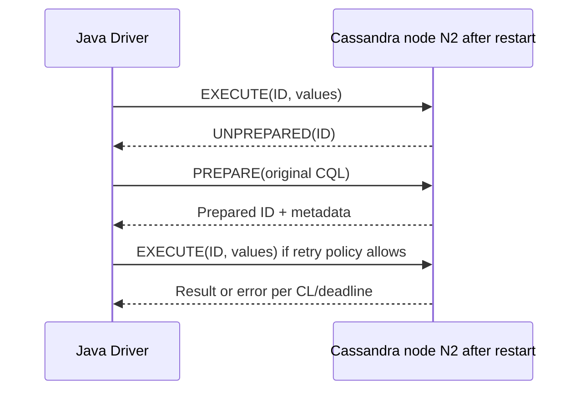

# Prepared Statement Caching and Repeated Preparation Cost When Querying Apache Cassandra from Java

## 1. Scenario: the same SELECT statement, yet the application keeps calling PREPARE

A Java service handles 3,000 requests/second and frequently executes the query:

```sql
SELECT display_name, updated_at
FROM java_query_lab.profile_by_user
WHERE user_id = ?;
```

The development team wants to avoid concatenating `user_id` values into CQL, so they use a prepared statement. However, inside every HTTP request, they call `session.prepare(...)` and then `session.execute(...)`. After scaling up pods or restarting Cassandra nodes, CPU, request latency, and `PREPARE` events can spike. When the application also builds a fresh CQL string per user, the number of query shapes explodes and the server has to store many prepared entries.

**Three questions to separate:**

1. Does calling `session.prepare(...)` on every request actually send **PREPARE over the network** every time? That depends on the driver's cache, the CQL string, and the session in use.
2. Why can the same CQL be **prepared on multiple Cassandra nodes** or need re-preparation after a restart or eviction?
3. How do you organize PreparedStatement, BoundStatement, query templates, and tests to **reduce overhead** without breaking partition routing, consistency, schema, or security?

This lesson belongs to the **Query Execution from Java** chapter of the `DATABASE_ENGINE_WIDE_COLUMN_CASSANDRA` module: distributed architecture, wide-column model, partition keys, query-driven table design, read/write CL, CQL, replication, compaction/repair, error handling, and Java application connectivity. The focus is on the **prepared statement lifecycle, client/server caching, and repeated preparation cost**, not just writing a `SELECT`.

### Learning objectives

After this lesson, you will be able to:

- Explain `PREPARE`, `EXECUTE`, **query IDs**, bind markers, and prepared statement metadata.
- Distinguish caching **in the application**, caching in the **Java Driver**, and caching **on each Cassandra node**.
- Write Java Driver 4.x code that prepares once, binds many times, and reuses templates safely across threads.
- Understand cache misses, node up/restart, `UNPREPARED`, reprepare, and topology/rolling upgrade effects.
- Identify **dynamic CQL/query shape explosion** and bound variants safely.
- Design benchmarks/monitoring to measure **prepare rate, distinct query count, p95/p99, error rate, and memory**.
- Handle schema migrations, LWT/paging, retries, and security when using prepared statements.

## 2. Lifecycle: PREPARE → BIND → EXECUTE

In the CQL native protocol, a client can send a query as **PREPARE** so the server parses the CQL, validates the schema, and returns the information needed for binding/execution. Subsequent runs send the **prepared statement identifier** and **encoded bind values** instead of resending the full CQL text as a simple query.



The diagram shows a **simplified logical flow**: the Java Driver may serve from a local cache, prepare on multiple nodes, or handle `UNPREPARED`; therefore there is no rule that “every call to `prepare` always corresponds to exactly one PREPARE packet”.

### 2.1. Three distinct Java objects

| Object | Role | Recommended lifecycle |
| --- | --- | --- |
| `CqlSession` | Manages connections, node discovery, routing, prepared cache, and request execution | Create **few**, share long-term, close on application shutdown |
| `PreparedStatement` | Represents a **prepared CQL template**, bind definitions, metadata, and identifier | Prepare **once per query template/session** and reuse |
| `BoundStatement` | CQL template + **bind values and execution options** for a single call | Create/derive **per request**; do not hold sensitive values in a singleton |

`PreparedStatement` can be shared across multiple threads because it is immutable at the API level; `BoundStatement` in Driver 4.x is also immutable, but a **builder holding values being assembled** must not be shared mutably across concurrent requests.

### 2.2. PreparedStatement is **not** a query result cache

A prepared statement does not store `display_name` or previously read rows. It caches **execution structure and metadata** on the client/server; every `EXECUTE` still has to locate replicas, perform reads/writes per RF/CL, read memtables/SSTables, and build a response.

If a query is slow due to hot partitions, tombstones, disk I/O, or consistency level, preparing once reduces parse/metadata overhead but **will not fix data-path bottlenecks**.

## 3. Three cache layers not to confuse



| Layer | Scope | When can it be lost? | How to protect |
| --- | --- | --- | --- |
| **Application references** | A single service/JVM, e.g. repository fields | Pod restart, references dropped | Initialize/reuse from `CqlSession`, keep lifecycle consistent |
| **Driver prepared cache** | Typically tied to `CqlSession` with driver-defined cache keys | Session closed, JVM restart, release-specific cache/GC/eviction behavior | Do not create sessions per request; do not generate excessive query shapes |
| **Server prepared cache** | **Each Cassandra node** that may receive EXECUTE | Node restart, node replacement, eviction/memory limits, or related schema changes | Driver reprepares as needed; tune cache/query inventory per version |

There is no **single cluster-wide prepared cache** replicated like regular table data. Node N2 cannot automatically execute a prepared ID merely because N1 prepared it; the driver's prepare-on-all-nodes behavior can proactively reduce misses, though it also creates more preparation work.

### 3.1. The driver cache is neither free nor unconditionally immutable

Java Driver 4.x includes an in-session prepared statement reuse/cache mechanism. With the **same template and matching preparation context**, repeated `session.prepare(...)` calls can be a **client-side cache hit** without sending a new PREPARE over the network. Still, there is method-call overhead, key lookup/comparison, concurrency/data-structure cost, and cache misses whenever the session differs or the CQL changes.

Because exact cache keys, retention/weak references, and options depend on the **Java Driver version**, verify the documentation and `reference.conf` for the exact version deployed. **Do not claim** that every `session.prepare` call produces a network RTT; equally, do not rely on the cache to excuse sloppy query or session management.

### 3.2. Why should the application still hold PreparedStatement references?

With a fixed set of CQL templates, holding `PreparedStatement` references in a repository/service:

- Avoids redundant `prepare` calls on the hot path.
- Centralizes template definitions and bind indices.
- Prevents each request from assembling a new query string that accidentally differs in whitespace, comments, or columns.
- Lets you control the number of query shapes and prepare at startup or lazily on first use.
- Simplifies testing correctness, error handling, and schema changes.

**Condition:** prepared objects must originate from the **matching session/cluster/schema context**; never store process-global static prepared objects and blindly reuse them on a new `CqlSession` connected to a different cluster.

## 4. Cache keys, CQL templates, and “one query per user”

These two CQL statements differ in **query text**:

```sql
-- Anti-pattern: embedding values into the CQL text.
SELECT display_name FROM java_query_lab.profile_by_user
WHERE user_id = 11111111-1111-1111-1111-111111111111;

SELECT display_name FROM java_query_lab.profile_by_user
WHERE user_id = 22222222-2222-2222-2222-222222222222;
```

Whereas a fixed template only swaps **bind values**:

```sql
SELECT display_name
FROM java_query_lab.profile_by_user
WHERE user_id = ?;
```

**Key point:** the prepared cache keys on **CQL statement shape and preparation context**, not on “queries that look semantically similar”. If an application builds different query strings per user ID, timestamp, tenant, column selection, request-ID comment, or literal list, it can create **many prepared identities** and increase pressure on both client and server caches.

### 4.1. What can and cannot be bound

| Component | Should use a bind marker? | Explanation |
| --- | --- | --- |
| Partition key values | **Yes** | Reduces query shapes; metadata lets the driver compute routing keys when eligible |
| Clustering range values | **Yes** | One query shape works across many time ranges |
| UPDATE/INSERT values | **Yes** | Encoded by CQL type; avoids literal concatenation |
| `LIMIT`/`TTL` where syntax/version supports markers | **Possibly** | Verify CQL syntax and type rules for your running version |
| Keyspace/table/column names | **No** (in the SQL/CQL identifier sense) | Use fixed schema or an allowlist of valid names |
| Completely different `WHERE` clauses | Usually needs separate templates | Each query shape is a distinct query with its own semantics/routing |
| Dynamic clustering order/`ORDER BY` | Do not assume identifiers/keywords can be bound | Maintain a vetted set of templates |

Never construct CQL by concatenating `user_id.toString()` into `WHERE`, even if the value looks like a safe UUID. For free-form text values, string concatenation also introduces syntax and injection risks. **Bind values** are the right mechanism for data values, yet they **do not automatically** protect dynamically concatenated identifiers.

### 4.2. Whitespace, comments, and normalization

If code generates two different CQL strings (extra spaces, comments containing a request ID, reordered columns or aliases), the driver/server **may** treat them as distinct prepared entries. Avoid homegrown “canonicalizers” that might alter semantics; a safer approach is to **define a small set of reviewed static templates** and use bind markers.

## 5. The cost of repeated preparation: looking accurately at two scenarios

### Scenario A — calling `prepare` repeatedly with the **same CQL, same session**

```java
// Not recommended: calling on the hot path even though the driver may cache.
PreparedStatement ps = session.prepare(
    "SELECT display_name FROM java_query_lab.profile_by_user WHERE user_id = ?");
Row row = session.execute(ps.bind(userId)).one();
```

In Java Driver 4.x, on a cache hit this code **does not necessarily** send another network PREPARE. However, it places prepared-entry lookup/creation on the hot path and makes it easy for future changes to introduce literals or new sessions, triggering cache churn.

### Scenario B — creating a **new session** or **different CQL per request**

```java
// Severe anti-pattern: neither the session nor the query shape is reused.
try (CqlSession session = newSessionForEveryRequest()) {
    String cql = "SELECT display_name FROM java_query_lab.profile_by_user " +
        "WHERE user_id = " + userId;
    PreparedStatement ps = session.prepare(cql);
    session.execute(ps.bind());
}
```

`newSessionForEveryRequest()` here is only an illustrative placeholder for a broken design, **not a built-in Java Driver method**. This pattern can cause:

- Repeated connection establishment, TLS/auth handshakes, and cluster topology discovery.
- Cold client caches because sessions are never reused.
- Excessive PREPARE/query identities on servers as literals vary.
- CPU/heap/GC pressure, request latency spikes, authentication load, and reconnect storms.

**Never benchmark Scenario B in production.** It is a failure-mode example, not a recommended API pattern.

## 6. CQL lab: tables by partition key and a small template set

The lab examples assume at least three nodes in `dc1` when using RF=3; adjust RF to match your actual topology if different:

```sql
CREATE KEYSPACE IF NOT EXISTS java_query_lab
WITH replication = {
    'class': 'NetworkTopologyStrategy',
    'dc1': 3
};

CREATE TABLE IF NOT EXISTS java_query_lab.profile_by_user (
    user_id uuid PRIMARY KEY,
    display_name text,
    updated_at timestamp
);

CREATE TABLE IF NOT EXISTS java_query_lab.events_by_tenant_day (
    tenant_id text,
    event_day date,
    event_time timestamp,
    event_id uuid,
    status text,
    PRIMARY KEY ((tenant_id, event_day), event_time, event_id)
) WITH CLUSTERING ORDER BY (event_time DESC, event_id ASC);

INSERT INTO java_query_lab.profile_by_user
    (user_id, display_name, updated_at)
VALUES (
    11111111-1111-1111-1111-111111111111,
    'User A',
    '2026-11-21T08:00:00Z'
);

INSERT INTO java_query_lab.events_by_tenant_day
    (tenant_id, event_day, event_time, event_id, status)
VALUES (
    'tenant_lab', '2026-11-21', '2026-11-21T08:30:00Z',
    22222222-2222-2222-2222-222222222222,
    'CREATED'
);
```

Three typical **CQL templates**:

```sql
-- Template 1: look up a profile by single partition key.
SELECT display_name, updated_at
FROM java_query_lab.profile_by_user
WHERE user_id = ?;

-- Template 2: update a single partition key.
UPDATE java_query_lab.profile_by_user
SET display_name = ?, updated_at = ?
WHERE user_id = ?;

-- Template 3: read a time range within a complete partition.
SELECT event_time, event_id, status
FROM java_query_lab.events_by_tenant_day
WHERE tenant_id = ?
  AND event_day = ?
  AND event_time >= ?
  AND event_time < ?
LIMIT 100;
```

The set of query shapes is defined **by query access patterns**. Prepared statements cut parse/metadata work and aid routing when the full partition key is supplied, yet they **do not** turn a query missing its partition key into an efficient local lookup.

## 7. Java Driver 4.x: prepare once, bind many times

The Java 17+ example below uses a single `CqlSession` created by the application configuration layer. `ProfileRepository` holds strong references to two `PreparedStatement` instances for the service lifetime.

```java
import com.datastax.oss.driver.api.core.CqlSession;
import com.datastax.oss.driver.api.core.DefaultConsistencyLevel;
import com.datastax.oss.driver.api.core.cql.BoundStatement;
import com.datastax.oss.driver.api.core.cql.PreparedStatement;
import com.datastax.oss.driver.api.core.cql.Row;
import java.time.Instant;
import java.util.Optional;
import java.util.UUID;

public final class ProfileRepository {
    private final CqlSession session;
    private final PreparedStatement selectProfile;
    private final PreparedStatement updateProfile;

    public ProfileRepository(CqlSession session) {
        this.session = session;
        this.selectProfile = session.prepare("""
            SELECT display_name, updated_at
            FROM java_query_lab.profile_by_user
            WHERE user_id = ?
            """);
        this.updateProfile = session.prepare("""
            UPDATE java_query_lab.profile_by_user
            SET display_name = ?, updated_at = ?
            WHERE user_id = ?
            """);
    }

    public Optional<String> findDisplayName(UUID userId) {
        BoundStatement bound = selectProfile.boundStatementBuilder()
            .setUuid(0, userId)
            .setConsistencyLevel(DefaultConsistencyLevel.LOCAL_QUORUM)
            .build();
        Row row = session.execute(bound).one();
        return row == null
            ? Optional.empty()
            : Optional.ofNullable(row.getString("display_name"));
    }

    public void updateDisplayName(UUID userId, String name, Instant when) {
        BoundStatement bound = updateProfile.boundStatementBuilder()
            .setString(0, name)
            .setInstant(1, when)
            .setUuid(2, userId)
            .setConsistencyLevel(DefaultConsistencyLevel.LOCAL_QUORUM)
            .build();
        session.execute(bound);
    }
}
```

### 7.1. Lifecycle analysis

1. `ProfileRepository` is instantiated once **per session/application instance**, not inside every HTTP handler.
2. `session.prepare` runs when the repository initializes. On session/node cache misses, PREPARE runs per driver policy.
3. Each `findDisplayName` and `updateDisplayName` call creates a fresh `BoundStatement`: **no mutable binding state is shared across threads**.
4. `LOCAL_QUORUM` is set **per execution**, so there is no need to re-prepare CQL when CL changes under controlled policy.
5. `CqlSession` is owned by the bootstrap/DI layer; the repository **does not** close it after each query.
6. If the schema changes, code and prepared statements must be managed via a **schema version/migration plan**; never keep using old objects across incompatible changes assuming the driver will fix everything.

### 7.2. PreparedStatement does not create transactions across commands

Two consecutive `UPDATE` calls remain two separate CQL requests. If you need CAS, use `IF`/LWT appropriately; if you maintain multi-table denormalizations, you need a reconciliation/consistency strategy. **Preparing** optimizes request formatting/metadata; it **is not** a transaction commit or lock.

## 8. Async Java: reusing prepared statements and bounding concurrency

Java Driver 4.x supports asynchronous execution. This avoids tying up a blocking thread per request, yet it **does not** permit pushing unbounded requests to Cassandra.

```java
import com.datastax.oss.driver.api.core.CqlSession;
import com.datastax.oss.driver.api.core.DefaultConsistencyLevel;
import com.datastax.oss.driver.api.core.cql.AsyncResultSet;
import com.datastax.oss.driver.api.core.cql.BoundStatement;
import com.datastax.oss.driver.api.core.cql.PreparedStatement;
import java.util.UUID;
import java.util.concurrent.CompletableFuture;
import java.util.concurrent.CompletionStage;
import java.util.concurrent.RejectedExecutionException;
import java.util.concurrent.Semaphore;

public final class AsyncProfileReader {
    private final CqlSession session;
    private final PreparedStatement select;
    private final Semaphore slots = new Semaphore(128);

    public AsyncProfileReader(CqlSession session) {
        this.session = session;
        this.select = session.prepare("""
            SELECT display_name, updated_at
            FROM java_query_lab.profile_by_user
            WHERE user_id = ?
            """);
    }

    public CompletionStage<AsyncResultSet> read(UUID userId) {
        if (!slots.tryAcquire()) {
            return CompletableFuture.failedFuture(
                new RejectedExecutionException("Cassandra requests at capacity"));
        }
        try {
            BoundStatement bound = select.boundStatementBuilder()
                .setUuid(0, userId)
                .setConsistencyLevel(DefaultConsistencyLevel.LOCAL_QUORUM)
                .build();

            return session.executeAsync(bound).whenComplete((result, error) -> {
                slots.release();
                // Metrics: latency/error/success, do not log real userId.
            });
        } catch (RuntimeException error) {
            slots.release();
            return CompletableFuture.failedFuture(error);
        }
    }
}
```

`Semaphore(128)` only bounds concurrent **logical operations** passing through this `AsyncProfileReader` instance. It is not a limit across the whole JVM, across multiple pods, or on a Cassandra node. When servers are saturated, increasing connections or in-flight limits may just add queuing/retries and worsen p99.

**Paging note:** `AsyncResultSet` represents a single returned **page**. For multi-page queries, the caller must use `hasMorePages()` and `fetchNextPage()` with backpressure; the snippet above only illustrates fetching the first page, not a full scan. `PreparedStatement` is still reused across pages/attempts, though each page may trigger a separate server request.

## 9. Eager initialization or lazy prepare?

Two common strategies:

| Strategy | How it works | Pros | Risks |
| --- | --- | --- | --- |
| **Eager / warm-up** | Prepares critical CQL templates at application startup | Catches syntax/schema errors early, reduces first-request latency | Increases startup latency; PREPARE burst when many pods start simultaneously |
| **Lazy / on-demand** | Prepares a query shape the first time it is used | Pays cost only for queries actually invoked | First request incurs a cache miss; requires concurrency-safe initialization |

For a **small set of 10–100 core query shapes**, bounded eager preparation per `CqlSession` is usually straightforward to operate. With thousands of optional queries, consider lazy or categorized warm-up so autoscaling does not hit the cluster with a **PREPARE storm**.

### 9.1. Must startup preparation succeed on every node?

Not by default. `prepare-on-all-nodes` and `reprepare-on-up` (configuration names/capabilities vary by Java Driver version) govern how the driver distributes PREPARE. A successful prepare call may reflect the response from the node contacted; never assume **every node has already cached the entry** and no `UNPREPARED` can happen afterward.

Startup readiness design should distinguish:

- **Schema missing:** fail fast or keep the service not ready.
- **One node temporarily down:** bounded retries may suffice without blocking every service indefinitely if SLAs allow.
- **Driver session creation failure:** diagnose DNS/contact points/TLS/auth/local DC, not just CQL preparation.
- **Unused optional queries:** prepare lazily instead of forcing every pod to register unnecessary query metadata.

## 10. Server cache is per-node: node restarts and `UNPREPARED`

On the server side, prepared statements live in an **in-node cache**, not a replicated table. A node may not recognize a prepared ID when:

- It just restarted and its server cache was cleared.
- It is a newly bootstrapped/replaced node or was just selected by the load-balancing policy.
- The entry was evicted or hit memory limits.
- The query/metadata changed due to a schema migration, or that node never received PREPARE.

Upon receiving `EXECUTE` with an unknown ID, the server can return `UNPREPARED`. Java Driver 4.x typically **automatically re-sends PREPARE and retries execution** depending on policy and version, but that still adds latency and can fail if the schema is incompatible, the node is unavailable, or the deadline expires.



**Do not** catch every `ReadTimeoutException` and call `prepare` in an infinite loop: timeouts may stem from replicas or disk, not a cache miss. Distinguish **UNPREPARED**, invalid CQL/schema, unavailable, request timeout, authentication, and transport failures.

### 10.1. When does reprepare become an incident?

If servers lose many prepared entries every minute, or hundreds of pods reconnect at once:

- PREPARE traffic can surge on coordinators.
- First-request latency on affected nodes can rise.
- Server/driver CPU and memory rise, causing p99 spikes.
- Reprepare-on-up can create a preparation burst when a node rejoins.
- If the schema has not converged or a query is no longer valid, automatic reprepare **cannot** save the application.

Collect **node restart logs, distinct query counts, PREPARE/UNPREPARED metrics/logs, heap/cache usage, and latency** to pinpoint the cause rather than blindly enlarging cache sizes.

## 11. `prepare-on-all-nodes` and `reprepare-on-up`: benefits and costs

Depending on your Java Driver 4.x configuration, policies may include:

| Mechanism | Meaning | Trade-off |
| --- | --- | --- |
| **Prepare on all nodes** | Proactively sends PREPARE to nodes managed by the driver when preparing a statement | Reduces misses after routing changes, but increases traffic/CPU with many templates × nodes × pods |
| **Reprepare on node UP** | Reprepares relevant statements when a node comes back up | Reduces request-time `UNPREPARED`, but can create a startup burst |
| **On-demand reprepare** | When the server returns `UNPREPARED`, the driver reprepares | Less upfront work, but higher first-hit latency |

Never **flip these options wholesale** without checking the defaults and exact behavior of your Java Driver 4.x release. Some driver releases and modes only prepare a subset of actively used statements or target a scoped node set; accurate cost modeling must come from real metrics.

### 11.1. The “potential PREPARE count” calculation

Suppose:

- 40 Java pods;
- each pod initializes one `CqlSession`;
- 60 distinct query templates;
- 6 Cassandra nodes able to receive prepared statements.

In a simplified model where **every pod prepares every template on all 6 nodes**, potential server-side preparations during a cold start are:

\[
40 \times 60 \times 6 = 14\,400
\]

This is an **illustrative fan-out estimate**, not a guarantee that the driver will always send exactly 14,400 PREPARE requests. Driver caching/policies, concurrency, node selection, and staggered startup times can change the actual number. It illustrates how **pod autoscaling + prepare-on-all-nodes + many query shapes** can create a substantial load spike.

More effective remedies than blindly adding resources: reduce query shapes, stagger startup, reuse sessions, warm up only essential templates, and measure cold-start latency.

## 12. Query shape explosion: what floods the cache

Sources of excessive prepared entries:

1. **Concatenating literals:** user/tenant/order/timestamp/UUID values embedded straight into CQL.
2. **Per-tenant table names:** `tenant_001.orders`, `tenant_002.orders`, ... make every table name a different CQL string and complicate schema and operations.
3. **Dynamic projections:** each request picks an arbitrary column subset and order.
4. **Dynamic `IN`:** generating strings with varying numbers of `?` placeholders even though the logic queries the same key type.
5. **Dynamic comments:** embedding trace IDs/request IDs/tenant IDs inside CQL comments.
6. **Dynamic keyspaces:** calling `USE` or switching keyspaces haphazardly across sessions; identities and metadata can diverge.
7. **Accidental duplicate templates:** different repositories writing the same query with different aliases or whitespace.
8. **Per-request sessions:** the session cache stays perpetually cold.
9. **Accumulated schema/index experiments:** each deployment leaves hundreds of uncleaned query shapes.

### 12.1. Bounding cardinality with a controlled template set

Instead of generating arbitrary column combinations freely:

```text
ProfileSummaryById
ProfileDetailsById
EventsByTenantDayAndTime
EventsByTenantDayAndStatus (only when supported by the data model)
UpdateProfile
InsertEvent
```

Bind each shape to **a repository method, query fingerprint, unit test, and SLO**. If dynamic identifiers are truly unavoidable, enforce a valid schema/column **allowlist** and cap combinations; bind markers are strictly for **values**, not table or column names.

### 12.2. Handling `IN` and sets of bind markers

Where schema and Cassandra version support a marker for a collection in `IN` syntax, consider binding a properly typed collection rather than concatenating literal lists. When varying placeholder counts are unavoidable, **cap the variant set** and measure fan-out/partition counts; an `IN` over thousands of keys triggers heavy replica work even though it uses a single prepared statement.

**Preparing does not make multi-partition queries cheap.** Partition key design and the data model remain decisive.

## 13. BoundStatement and execution options: no need to re-prepare just for a different CL

`PreparedStatement` describes the query and bind/result metadata. `BoundStatement` carries the **values and execution attributes** such as:

- Consistency level (`ONE`, `LOCAL_QUORUM`, etc.);
- serial consistency for LWT when applicable;
- page size, request timeout override, tracing, idempotence flag;
- profile/routing context per API/version.

Example:

```java
PreparedStatement ps = session.prepare("""
    SELECT display_name
    FROM java_query_lab.profile_by_user
    WHERE user_id = ?
    """);

BoundStatement fastLocal = ps.boundStatementBuilder()
    .setUuid(0, userId)
    .setConsistencyLevel(DefaultConsistencyLevel.LOCAL_ONE)
    .build();

BoundStatement quorumLocal = ps.boundStatementBuilder()
    .setUuid(0, userId)
    .setConsistencyLevel(DefaultConsistencyLevel.LOCAL_QUORUM)
    .build();
```

The example assumes the same imports and `session`/`userId` variables as earlier; these are **two execution options**, not a recommendation to lower CL for business logic. You do not need two distinct CQL query strings just to select a different CL on a bound statement.

**Condition:** CL is a business read/write guarantee, not an arbitrary knob to tweak cache hits or p99. Under a given RF and replica reliability, changing CL alters stale-read risk, node-down tolerance, and timeout behavior.

## 14. When does prepared metadata enable token-aware routing?

With a **prepared statement**, the server/driver knows the **partition key columns** from metadata, allowing it to derive the routing key and token from bound values. When token metadata and the routing policy align, the Java Driver can prefer a coordinator close to the replicas, cutting unnecessary hops.

Query with clear routing:

```sql
SELECT display_name
FROM java_query_lab.profile_by_user
WHERE user_id = ?;
```

Another example with a composite partition key:

```sql
SELECT event_time, event_id, status
FROM java_query_lab.events_by_tenant_day
WHERE tenant_id = ?
  AND event_day = ?
  AND event_time >= ?
  AND event_time < ?;
```

**You must bind the full partition key** to compute a single partition's token. If a key is missing or the query forces a fan-out/range scan, a prepared statement cannot always route cleanly to one replica set. Token-aware routing also relies on topology metadata, local datacenter configuration, load-balancing policy, and node health.

A prepared statement can make **routing more efficient** and lower network overhead, yet a hot key still lands on the same replica set whether prepared once or 1,000 times. Do not treat prepare caching as a cure for hot partitions.

## 15. Prepared cache after schema migrations

A prepared statement is bound to the **schema structure known to the server/driver at prepare time**. When the schema changes:

- `ALTER TABLE` adding, dropping, or altering column types;
- Dropping/recreating a table with the same name but a **different table ID**;
- Keyspace/table changes or temporary schema disagreement;
- Rolling upgrades with metadata/protocol differences;

cached queries can become invalid or their result/variable metadata can go out of sync. The server/driver can reprepare in supported cases, yet **reprepare cannot fix a semantically broken CQL statement**.

### 15.1. The expand → migrate → contract workflow

1. **Expand:** add schema elements compatible with both old and new application versions (where the release permits), and wait for schema agreement.
2. **Deploy/canary Java:** update CQL templates, prepare the new queries; log fingerprints/versions, and test bind/result types.
3. **Backfill:** if changing partition keys or query-driven tables, run a dedicated job with checkpoints/deltas/validation; the prepared cache does not migrate old data.
4. **Switch:** roll out the new query behind a feature flag and measure correctness and SLOs.
5. **Contract:** drop old columns/tables/indexes only after traffic using old templates has drained and the rollback window is closed.

Never edit repository CQL text mid-flight without accounting for prepared references, type codecs, query fingerprints, and migration versions. If `InvalidQueryException` or metadata mismatches appear after a schema change, investigate deployment/schema history rather than increasing server cache size.

### 15.2. `SELECT *` with prepared statements

`SELECT *` causes result metadata to shift whenever columns are added or dropped, risking application mapping failures and cache metadata mismatches. Prefer **listing explicit columns**. When a query's result shape intentionally changes, deploy compatible code/prepared statements and test both old and new binaries during the rollout.

## 16. Node restarts, bootstrap, rolling upgrades, and reprepare storms

A multi-DC cluster often has dozens of Java pods holding many prepared objects. After maintenance, a node rejoins:

```text
T0: Cassandra node N4 restarts -> server prepared cache is cold.
T1: N4 is marked UP; the driver can route requests back to N4.
T2: Driver proactively reprepares or hits UNPREPARED on EXECUTE.
T3: Many pods × many query shapes produce a PREPARE burst.
T4: PREPARE work competes for CPU/network with CQL reads/writes.
T5: Once the cache warms up, p99 may settle back down.
```

This is a **diagnostic hypothesis**, not a claim that every restart inevitably causes an incident. To verify it, correlate:

- Node startup/UP timestamps;
- actual `prepare-on-all-nodes`/`reprepare-on-up` settings;
- number of distinct templates, Java pods, and sessions;
- per-node PREPARE/UNPREPARED/reprepare events;
- CPU/GC/connection pool/in-flight counts and Java p95/p99 in the same window.

**Do not** blindly disable reprepare “to reduce load”: doing so shifts work onto the first EXECUTE and can raise errors/latency. Instead, stagger application startup, reduce template counts, and check cache/headroom ahead of time.

## 17. Distinguishing prepared cache issues from consistency/retry issues

A cache-miss error occurs **before or while establishing the execution plan**, whereas consistency errors occur when replicas fail to satisfy CL:

| Symptom | Causes to check | Do not jump to conclusions |
| --- | --- | --- |
| `UNPREPARED` spikes after restart | Server cache cleared/evicted; node not yet prepared | “Data on the replica was lost” |
| `ReadTimeoutException` on a prepared query | Replicas/coordinator/WAN/disk/queues, CL | “Prepared cache ran out” without evidence |
| `UnavailableException` | Not enough live replicas for the requested CL in scope | “Just re-prepare” |
| `InvalidQueryException` after schema change | Incompatible query/table/type/index | “Increasing cache size will fix it” |
| Driver queue/in-flight growing | Offered load > capacity, connection stream pressure | “PREPARE is the sole cause” |
| High query p99 despite cache hits | Data model, partition size/tombstones, CL, read amplification | “Suboptimal bind values” |

### 17.1. Retries and idempotency

When the driver sees `UNPREPARED`, its internal handling can be **reprepare + execute**; this differs from the application retrying a mutation whose outcome is unknown. For `INSERT`/`UPDATE`, a timed-out operation **may already have been applied** on enough replicas; replaying it can affect TTLs, timestamps, counters, and LWT business invariants.

**Never** mark every statement `idempotent=true` merely because it is prepared. Conditional `IF` writes, counter increments, and business side effects require dedicated retry/unknown-outcome policies.

## 18. Prepared LWT: optimizes parsing, does not eliminate Paxos

LWT queries using `IF` (CAS/Paxos) can be prepared:

```sql
UPDATE java_query_lab.profile_by_user
SET display_name = ?
WHERE user_id = ?
IF display_name = ?;
```

Java Driver 4.x:

```java
PreparedStatement cas = session.prepare("""
    UPDATE java_query_lab.profile_by_user
    SET display_name = ?
    WHERE user_id = ?
    IF display_name = ?
    """);

BoundStatement bound = cas.boundStatementBuilder()
    .setString(0, "New name")
    .setUuid(1, userId)
    .setString(2, "Old name")
    .setConsistencyLevel(DefaultConsistencyLevel.LOCAL_QUORUM)
    .setSerialConsistencyLevel(DefaultConsistencyLevel.SERIAL)
    .build();

Row result = session.execute(bound).one();
if (result != null && result.getBoolean("[applied]")) {
    // Conditional update succeeded.
} else {
    // Condition evaluated false: valid business outcome, not a parse/cache error.
}
```

The code uses `session`/`userId` declared in the application context. Preparing reuses query metadata, yet the statement **still runs the Paxos phases**, incurring contention and serial consistency overhead. On timeout, the `[applied]` outcome may be **unknown**; do not automatically retry an unconditional UPDATE to “compensate”.

In multi-DC deployments, `SERIAL` and `LOCAL_SERIAL` carry different semantic scopes; the choice depends on business invariants, not on prepared-cache entry counts.

## 19. Observability: measure both “prepare API calls” and “PREPARE traffic”

To avoid false conclusions, separate **four counters**:

| Metric | Scope | Question answered |
| --- | --- | --- |
| `session.prepare()` calls/s | Application/JVM | Is code calling prepare on the hot path? |
| **Distinct CQL fingerprints** | Service/version/session | How many unique query shapes are being generated? |
| PREPARE requests/s or server prepared-cache metrics | Driver/native transport/server node depending on instrumentation | How many network preparations/cache misses actually occur? |
| EXECUTE requests/s and Java end-to-end latency | Driver/server + business app | Is execution load rising, or only preparation overhead? |

An application can invoke `prepare` 3,000 times/second yet generate **very few network PREPARE requests** thanks to client caching. Conversely, a service with 100 `session.prepare` calls at startup across 200 pods × many nodes can generate heavy server PREPARE traffic in a brief window.

### 19.1. Metric set to combine

| Group | Observations | Benefit |
| --- | --- | --- |
| **Java** | API p50/p95/p99, accepted/successful RPS, error rate | Assesses user-facing impact |
| **App instrumentation** | Prepare calls, distinct normalized CQL shapes, startup warm-up time | Spots anti-patterns and bursts |
| **Driver 4.x** | Per-node request latency, in-flight, connection pools, retries, throttling, prepare/reprepare if exporter supports | Separates client vs server |
| **Cassandra** | Query request rates, prepared-cache usage/evictions if version exposes them, CPU/heap/GC | Verifies server-side overhead |
| **System** | Network bytes/RTT, disk I/O, compaction, node restarts | Rules out non-cache bottlenecks |
| **Correctness** | Query results, CL, row counts, pagination, LWT `[applied]` | Prevents “fast” runs that return incomplete data |

Exact **JMX/driver exporter metric names** vary by release. Never hardcode an “official” metric name without verifying it on the running Cassandra and Java Driver 4.x versions. When exporting to Micrometer/Prometheus, tag with **service, cluster, DC, node, and query fingerprint**; never use raw partition keys or SQL literals as metric labels, which creates massive cardinality and leaks PII.

### 19.2. Why measure cold and warm separately?

- **Cold start:** new session, cold driver prepared cache; server cache may be warm or cold.
- **Warm steady-state:** requests mostly EXECUTE against already-prepared templates.
- **Node restart:** that node's server cache is cold while app caches may remain warm.
- **Application restart:** app/driver caches are cold while server caches may remain populated.
- **Schema migration:** new templates/metadata, with some prior entries invalidated.

Never take warm steady-state p99 as proof that **no startup latency exists**. Split dashboards and benchmarks by phase under identical load and query shapes.

## 20. Estimating cost by requests and node count

A simple model to reason with:

\[
T_{\text{first-use}} \approx T_{\text{prepare}} + T_{\text{execute}}
\]

\[
T_{\text{warm}} \approx T_{\text{execute}}
\]

This is a **conceptual model**, not a strict formula: the driver may prepare concurrently across nodes, hit caches, or pipeline requests, with queuing and network RTT overlapping.

Suppose an application runs a fixed query at 2,000 RPS for one minute:

- If **caching is ineffective**, network prepares can scale on the same order as the request rate, adding CPU and network cost.
- If the query is cached in both driver and server, most requests only send EXECUTE.
- If **500 distinct CQL variants** exist due to embedded literals/table names, cache warm-up and evictions cost far more than 10 templates.

**Do not assume** “if prepare takes 5 ms, p99 will drop by exactly 5 ms” without measuring. At high RPS, the main gain may be lower CPU or better tail latencies during cold starts/restarts; for heavy data reads, SSTable/replica costs dominate.

### 20.1. Estimating cache cardinality

| Scenario | Templates/app session | Sessions/pods | Nodes eligible to prepare | Assessment |
| --- | ---: | ---: | ---: | --- |
| Static templates | 12 | 40 | 6 | Initial preparation fan-out is predictable |
| One CQL per user | 100,000+ | 40 | 6 | Heavy cache churn; impossible to keep bounded warm-up |
| New session per request | 12 | Very high | 6 | Driver cache stays cold, plus connection storm |
| Lazy 12 templates | 12 | 40 | 6 | Spreads PREPARE by actual demand; first hit pays latency |

This is **qualitative analysis**; actual memory/cache footprint must be measured on your target release and configuration. Do not estimate query-shape count simply by counting HTTP endpoints.

## 21. Controlled benchmarks to prove cache value

### 21.1. Four test cases

| Scenario | How to run | Expected result if caching works |
| --- | --- | --- |
| **A — prepare once** | One session, repository holds prepared references, binds many user IDs | Low PREPARE in warm steady-state, stable latency |
| **B — prepare on every request** | Same session and **same CQL text**, calling prepare repeatedly | May hit cache; difference smaller than expected |
| **C — dynamic CQL** | Same session, but template embeds varying literals/comments | Many query identities/PREPARE calls, higher memory and latency |
| **D — session per request** | Open/close a session per request **in staging** | Heavy connection/auth/topology/prepare overhead |

Run A/B/C/D with the **same workload source**, RPS/CL/page size, and data distribution, with separate warm-up and measurement windows for each case. Use **controlled load limits** so benchmark D does not exhaust connections and take down staging.

### 21.2. Variables to hold constant

1. **Cassandra version**, node count/RF/DC/rack, and node health.
2. **Java Driver version**, execution profile, retry/speculation settings, and local DC.
3. **CQL query shape** (except the tested variable), bind types, and result columns.
4. **Dataset:** partition count, hot-key distribution, table size, TTL/tombstone/SSTable counts.
5. **Offered RPS/concurrency**, pod count, and cold/warm cache state.
6. **CL**, request timeout, page size, and payload size.
7. **Compaction/repair/streaming** and network conditions during the test.

### 21.3. PASS criteria

- Zero CQL result discrepancies against the golden dataset.
- Distinct query fingerprints match the design.
- PREPARE traffic in warm steady-state drops, not just Java method calls.
- p95/p99, CPU/heap/GC, and errors remain stable or improve at equivalent RPS.
- After node or app restarts, reprepare completes within budget without causing a storm.
- No significant growth in client in-flight/queues or unbounded cache memory.

**Never** declare an optimization successful if p99 improved only because successful RPS dropped or timeout/rejection rates rose.

## 22. Runbook: investigating a “prepare storm” in the first 15 minutes

### Step 1 — Scope the incident

Record the **UTC incident window**, app build, driver version, cluster/DC/nodes, query fingerprints, and timestamps of any deploy/autoscale/restart.

### Step 2 — Inspect live symptoms

```bash
nodetool status
nodetool tpstats
nodetool proxyhistograms
nodetool clientstats
nodetool compactionstats
```

These commands show node status, native connections, latency/queues, and background load, though they **do not directly list every cached query**. Driver/server instrumentation and logs are required to confirm a PREPARE storm.

### Step 3 — Audit Java lifecycle

- Is `CqlSession` created inside an HTTP request, scheduled job, or per tenant?
- Is `prepare` called on every read/write even for static templates?
- Are strong references kept for frequently used prepared objects?
- Does CQL concatenate literals, request IDs/comments, or dynamic table names?
- Are hundreds of pods warming up thousands of query shapes within a few seconds?

### Step 4 — Distinguish valid cache misses from churn

| Observation | Hypothesis | First action |
| --- | --- | --- |
| PREPARE spikes only right after deploy, then subsides | Cold app cache | Stagger warm-up, compare startup latency |
| PREPARE spikes after N2 restart, only on N2 | Cold server cache / reprepare | Check reprepare settings and node return policy |
| PREPARE stays high continuously, huge distinct CQL | Dynamic query shapes, eviction | Consolidate templates, use bind markers |
| Connections and PREPARE rise together per request | Broken session lifecycle | Reuse `CqlSession`, bound startup |
| Heavy `UNPREPARED` on one newly added node | Node not yet prepared or cache evicted | Inspect node logs, cache pressure, driver behavior |
| Queries fail after ALTER TABLE | Invalid schema/metadata | Fix CQL/schema compatibility, not just cache size |
| Latency rises while PREPARE is near zero | Replica/partition/CL/IO bottleneck | Check `tablestats`/`tablehistograms`, query model |

### Step 5 — Apply small reversible changes

1. Cap offered load/prepare warm-up concurrency to dampen bursts.
2. Move `CqlSession` to a singleton/service-scoped lifecycle.
3. Promote static CQL strings to repository fields and bind values.
4. Remove literal/request-ID concatenation from query text.
5. If tuning server cache config, evaluate **memory budget, node/release semantics, and restart plan**; avoid unbounded increases.
6. Re-measure **PREPARE/EXECUTE, p99, successful RPS, and memory**.

Do not run `repair`, `cleanup`, change RF, or trigger compaction just because of prepared-cache misses. Those address different problems and add heavy I/O load.

## 23. Common design misconceptions

| Misconception | Why is it wrong? | How to fix |
| --- | --- | --- |
| “Every `session.prepare` call sends PREPARE over the network” | Driver 4.x has a local cache depending on query/session | Separate API calls from network PREPARE |
| “Driver cache means no need to reuse PreparedStatement” | Makes dynamic CQL easy to slip in and causes lookup/GC churn | Keep references for fixed query shapes |
| “One node preparing means every node knows the ID” | Prepared cache is **per node** | Review driver prepare-on-all-nodes/reprepare behavior |
| “Prepared IDs are durable on disk” | Server cache is lost on restart/eviction | Implement reprepare handling and monitoring |
| “Prepared cache is a query result cache” | Caches metadata/plan, not rows | Evaluate data model/read caches separately |
| “Concatenating tenant ID/UUID into text equals binding” | Creates query variants and injection risk | Use bind markers |
| “Prepared statements can bind table names” | Identifiers are not data values | Use fixed tables or an allowlist |
| “Increasing cache size fixes every query timeout” | Replicas/disk/CL still govern execution | Diagnose errors layer by layer |
| “Enabling prepare-on-all-nodes always lowers load” | Can amplify PREPARE fan-out across many pods | Measure startup/restart and actual demand |
| “Opening a CqlSession per request avoids stale state” | Causes connection/cache churn, auth/TLS overhead | Use long-lived, thread-safe sessions |
| “New schemas auto-update every prepared object” | Metadata/types/query semantics may change | Migrate CQL templates and test |
| “Retry CAS/counters freely because they are prepared” | Idempotence differs from parse caching | Handle unknown outcomes per business logic |
| “Preparing makes queries without a partition key fast” | Does not fix fan-out or hot partitions | Design tables around queries |
| “Improved p99 alone is enough; ignore error rate” | Success latency looks good when errors drop slow work | Report offered/successful RPS + errors |

## 24. Security: what bind markers help with and what they do not

Prepared statements work with **typed bind values**, avoiding arbitrary CQL literal concatenation. This reduces escaping bugs and injection risk **in value positions**, while also curbing query-shape cardinality.

However:

- Arbitrary **keyspace/table/column identifiers** cannot be bound; dynamic names still require an allowlist and permission checks.
- `PreparedStatement` does not replace authentication, authorization, TLS, or least-privilege roles.
- Driver/server prepared caches may retain **query text** in memory; never embed passwords, PII, or user IDs into query text.
- When logging slow queries, record **fingerprint + bind type + anonymized size/range**, avoiding raw tokens, emails, payloads, or secrets.
- For `system_auth` and sensitive tables, never query credential tables directly just to “test the prepared cache”; use supported role/permission paths.

Never treat prepared statements as a standalone authorization layer: Cassandra still authenticates/authorizes every request and enforces the configured CL.

## 25. Pre-deployment Java code review checklist

### Code

- [ ] `CqlSession` is shared over the application lifecycle, not initialized per request.
- [ ] Every frequently executed query has a **static CQL template** and a retained `PreparedStatement` reference.
- [ ] Each request creates a new `BoundStatement`; mutable builders are never shared.
- [ ] Bind markers are used for **data values**, and query identifiers are strictly controlled.
- [ ] Queries include full partition keys and target tables matching real access patterns.
- [ ] CL, page size, timeout, idempotence, and serial CL (for LWT) match the contract.
- [ ] Driver retry/`UNPREPARED` handling cannot cause infinite retry loops.
- [ ] No unbounded dynamic CQL variants or per-tenant `CqlSession` instances.

### Operations

- [ ] Tested cold start, warm load, node restart, and schema migration.
- [ ] Verified client prepared-cache and server-side cache behavior for the target versions.
- [ ] Recorded distinct query fingerprints, Java PREPARE calls, and server PREPARE/UNPREPARED (if instrumented).
- [ ] Benchmarked p50/p95/p99, successful RPS, timeouts, and CPU/heap/network.
- [ ] Rolling upgrade plan avoids CQL features unsupported by older nodes.
- [ ] Cache/warm-up limits and a feature-flag rollback path exist for prepare storms.

## 26. Hands-on exercises

### Exercise A — two prepare patterns

Create a Java service reading `profile_by_user` with a PreparedStatement. Compare:

1. Preparing once in the repository constructor.
2. Calling `session.prepare` repeatedly with the **same text and same session** on every request.

Measure API calls, PREPARE network traffic, p95/p99, and memory. Why can `prepare` method calls differ by thousands of times while network PREPARE packets do not match that ratio?

### Exercise B — 50,000 query shapes

A worker concatenates `user_id` into CQL so 50,000 UUIDs produce 50,000 CQL texts. The cluster has 6 nodes and 20 pods.

1. Why do template count and cache pressure climb?
2. Rewrite the query using `WHERE user_id = ?` and a shared `PreparedStatement`.
3. If you add a `/* req_id=... */` comment to the same template, why can it break cache reuse?
4. How do you measure “distinct fingerprints” without exposing raw UUIDs?

### Exercise C — restarting one Cassandra node

After node N4 restarts, app p99 spikes for 30 seconds and `UNPREPARED` errors appear. Other nodes remain healthy.

1. Why do Java prepared objects still exist while server N4 does not recognize the ID?
2. Through which mechanisms can the driver reprepare?
3. How do you distinguish a reprepare storm from disk/GC saturation?
4. How should you bound startup load, prepared shapes, and request concurrency?

### Exercise D — schema migration and prepared SELECT *

The team runs `ALTER TABLE` while the application holds an older prepared `SELECT *`.

1. How can result metadata and application mapping be affected?
2. Why does schema agreement not guarantee the old Java CQL remains correct?
3. Design an expand → migrate → contract plan with golden queries.
4. When must you roll out a new PreparedStatement instead of relying on automatic driver reprepare?

### Exercise E — prepared LWT and retries

Two Java writers concurrently execute `UPDATE ... IF status='NEW'`. One receives `[applied]=true`, while the other times out.

1. Does prepared statement caching disable Paxos/serial consistency?
2. Does a timeout guarantee the condition was not applied?
3. What can go wrong if you retry an UPDATE **without `IF`**?
4. How should you record the application operation ID, result, and regular/serial CL?

## 27. Self-check questions

1. How do `PREPARE` and `EXECUTE` differ?
2. Does `PreparedStatement` cache `SELECT` results so subsequent requests read faster?
3. What cache layers exist across the Java application, Java Driver, and Cassandra nodes?
4. Does calling `session.prepare` on every request with the same CQL and session always send a PREPARE packet?
5. Why is retaining a `PreparedStatement` reference in the repository still good design?
6. Why is one `PreparedStatement` safe across threads while a mutable builder must not be shared?
7. How does CQL with varying literal values affect cache cardinality?
8. What can cause the server to return `UNPREPARED`?
9. What does `prepare-on-all-nodes` improve, and what is its cost?
10. Why can node restarts or pod autoscaling trigger PREPARE bursts?
11. You can bind `user_id`, but can you bind a table name?
12. When does prepared metadata assist token-aware routing?
13. Why does a prepared query not fix hot partitions or tombstones?
14. After `ALTER TABLE`, what may need updating in CQL templates or bind types?
15. Why does a cache hit not by itself guarantee consistency, idempotence, or transaction semantics?
16. Which metrics prove real overhead reduction rather than merely fewer method calls?
17. Why should you test both cold startup and warm steady-state?
18. When should concurrency limits take priority over increasing server cache size?

## 28. Prepared cache optimization report template

```yaml
incident_or_change_id: java-prepared-20261121
service: DATABASE_ENGINE_WIDE_COLUMN_CASSANDRA
language: vi
environment: staging
java_driver_version: "RECORD_ACTUAL_DRIVER_VERSION"
cassandra_version: "RECORD_PER_NODE_VERSION"
cluster:
  dc: dc1
  nodes: 6
application:
  pods: 40
  cql_sessions_per_pod: 1
query_inventory:
  expected_distinct_templates: 12
  observed_distinct_fingerprints: "RECORD_MEASURED"
  binds_values_instead_of_literals: true
  retained_prepared_references: true
driver_prepare_policy:
  prepare_on_all_nodes: "CHECK_EFFECTIVE_CONFIG"
  reprepare_on_up: "CHECK_EFFECTIVE_CONFIG"
observations:
  prepare_api_calls_per_second: "MEASURE"
  server_prepare_requests_per_second: "MEASURE_IF_AVAILABLE"
  unprepared_errors_per_minute: "MEASURE_IF_AVAILABLE"
  execute_requests_per_second: "MEASURE"
  p99_client_ms: "MEASURE"
  successful_rps: "MEASURE"
  request_error_rate: "MEASURE"
tests:
  warm_steady_state: "PENDING"
  cold_app_start: "PENDING"
  cassandra_node_restart: "PENDING"
  schema_change: "PENDING"
decision: NO_GO
reason: "No actual benchmark and validation yet"
```

This template only illustrates structure. In a real report, record measurements by **UTC window**, workload, and release; never enter placeholder numbers into measured fields. Fingerprints must avoid PII/keys; current cache configuration must be verified against the documentation and measurements of the running version.

## 29. References and version caveats

- [Apache Cassandra Java Driver 4.x — Prepared statements](https://docs.datastax.com/en/developer/java-driver/4.17/manual/core/statements/prepared/): prepare/bind, caching, reprepare, and execution options.
- [Apache Cassandra Java Driver 4.x — Core statements](https://docs.datastax.com/en/developer/java-driver/4.17/manual/core/statements/): SimpleStatement, PreparedStatement, BoundStatement.
- [Apache Cassandra Java Driver 4.x — Configuration](https://docs.datastax.com/en/developer/java-driver/4.17/manual/core/configuration/): prepared statement policies, execution profiles, and local datacenter.
- [Apache Cassandra — CQL SELECT](https://cassandra.apache.org/doc/latest/cassandra/developing/cql/dml.html): CQL semantics, partition keys, bind markers, and consistency.
- [Apache Cassandra — Monitoring](https://cassandra.apache.org/doc/latest/cassandra/managing/operating/metrics.html): server metrics, latency, caching, and request observability.

These URLs are starting points; **exact cache policies and metric names depend on the specific Java Driver/Cassandra release** and distribution. When upgrading from Driver 4.1x/4.17 or Cassandra 3.x/4.x/5.x, check release notes, actual `reference.conf`/`cassandra.yaml` settings, and cluster behavior, especially during rolling upgrades.

## 30. Conclusion

**A prepared statement is a mechanism to reuse CQL templates and metadata, not a row cache or a guarantee that queries will always be fast.** In Java Driver 4.x, prepared statements can be cached in the session; Cassandra nodes hold prepared state **per node**. Therefore, repeated `session.prepare` calls do not automatically send PREPARE over the network, yet **dynamic query shapes, constantly recreated sessions, restarts/evictions, and reprepare-on-up** can still generate CPU/network/cache overhead and elevate tail latency.

The sound design is **one long-lived `CqlSession`, a controlled set of CQL templates, retained PreparedStatement references, per-request BoundStatements, and bound values instead of concatenated literals**. Then measure **prepare calls, actual network PREPARE traffic, query identities, p95/p99, successful RPS, memory, and node restart behavior**. When schema, topology, or releases change, verify reprepare, query correctness, CL, LWT, and driver compatibility; never run `repair` or downgrade consistency to mask cache issues. **Only consider an optimization successful when it reduces preparation overhead while preserving data correctness and business SLOs.**
