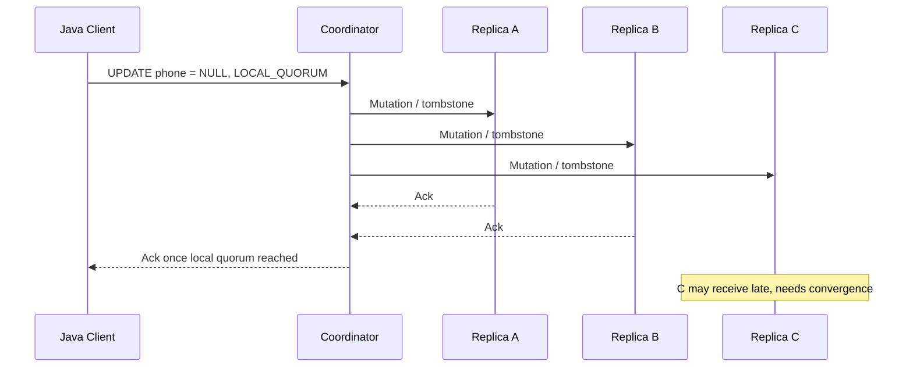

# Choosing NULL or UNSET When Updating Columns

A Java API receives a PATCH `{"city":"Hà Nội"}` for a profile that currently has `phone="0900000000"`. If the DTO maps omitted properties to Java `null` and the binder writes `NULL` to Apache Cassandra, **the phone number can be accidentally deleted**. Conversely, when a user explicitly sends `{"phone":null}` under the PATCH contract, if the binder skips `phone`, the old phone number is **not cleared** as requested.

The issue lies in the three states of a write parameter: **a concrete value**, **CQL `NULL`**, and **`UNSET`**. In Java Driver 4.x, a `NULL` parameter represents a cell-deletion mutation, typically generating a tombstone; an `UNSET` parameter means **do not touch that cell**. They can produce identical read results when the cell was already absent, yet they do not share the same semantics. You must decide from **business intent**, not merely from a Java value.

This lesson belongs to the **Query Execution from Java** chapter of the **DATABASE_ENGINE_WIDE_COLUMN_CASSANDRA** module: exploring distributed architecture, partition keys/wide-columns, keyed queries, read/write consistency, CQL, replication, compaction, repair, timeout errors, and Java application connectivity. Choosing `NULL`/`UNSET` accurately prevents data loss, avoids unnecessary tombstones, and preserves proper PATCH, TTL, last-write-wins (LWW), and read-model semantics.

> **Default rule for a PATCH with a three-state contract:** **absent → KEEP/UNSET**; **explicit JSON null → CLEAR/CQL NULL**; **valid value → SET/value**. HTTP PUT/replace, bulk imports, required fields, and data with special rules need different contracts; never force PATCH semantics onto every workflow.

## 1. Learning objectives

After this lesson, you will be able to:

1. Distinguish `UNSET`, `NULL`, a regular value, an empty string, and an omitted JSON field.
2. Explain tombstones, TTL, timestamps, and the read-amplification consequences of accidentally binding `NULL` in bulk.
3. Use `PreparedStatement.bind()`, `BoundStatement.setToNull()`, `unset()`, `isSet()`, and `BoundStatementBuilder` in Java Driver 4.x.
4. Understand that `BoundStatement` is immutable in Driver 4.x while the builder is mutable, and distinguish positional vs named parameters.
5. Design a three-state KEEP/CLEAR/SET DTO and REST PATCH contract with domain-level field validation.
6. Distinguish behavior across `INSERT`, `UPDATE`, `DELETE`, `INSERT JSON DEFAULT NULL/UNSET`, and Mapper `NullSavingStrategy`.
7. Handle primary keys, conditional/LWT writes, TTLs, collections, counters, static columns, retries, and concurrency.
8. Run the CQL/Java lab and build a test matrix, readback checks, and monitoring to prove data correctness.

## 2. Decision table: NULL, UNSET, SET(value)

Assume a row in `profiles_by_id` currently holds:

```text
tenant_id    = "tenant-a"
profile_id   = 11111111-1111-4111-8111-111111111111
display_name = "Minh"
phone        = "0900000000"
city         = "Đà Nẵng"
status       = "ACTIVE"
```

| Operation on `phone` marker | Intent | After valid UPDATE, no concurrent writers | Creates a tombstone for `phone` from this op? |
| --- | --- | --- | --- |
| `setString("phone", "0911111111")` | **SET** new value. | `0911111111` | No, because a live value is written. |
| `setToNull("phone")` | **CLEAR** value. | Querying `phone` normally returns null. | **Yes**, represents a timestamped deletion. |
| `unset("phone")` or leave marker unbound | **KEEP**, do not modify column. | `0900000000` remains intact. | **No** tombstone created merely by UNSET. |

**UNSET is not a “lighter” NULL.** It produces no mutation for that column; if a value already exists it stays intact, and if the column is absent it remains absent. By contrast, NULL is a deletion intent that supersedes older value versions under Cassandra's timestamp rules.

### Four layers to separate

| Layer | Concept | Who decides? |
| --- | --- | --- |
| HTTP/JSON | Absent `phone`, `"phone":null`, `"phone":"091..."`. | API contract and presence-preserving parser. |
| Java/domain | KEEP, CLEAR, SET(value). | Three-state typed DTO and validation. |
| Driver | UNSET, CQL NULL, typed value. | Prepared/bound statement binder. |
| Cassandra | Skip column, tombstone, live cell/timestamp/TTL. | Mutation/storage semantics and replication. |

## 3. Why does Cassandra write a tombstone on NULL?

Cassandra distributes mutations to replicas according to token/replication strategy. When deleting data, immediately erasing bytes on a single replica is insufficient: another replica might be down and still hold the old value. Cassandra writes a **tombstone (deletion marker)** so catching-up replicas also learn the value was deleted.



This diagram is explanatory; not all RPC paths occur in this exact sequence. With RF=3 in a DC, `LOCAL_QUORUM` requires two local responses for a regular request; it does not prove every replica or remote DC has received and persisted the mutation. `gc_grace_seconds`, compaction, and repair directly govern safe tombstone purging to prevent **zombie data**.

### Signs of “unintentional” NULLs

An ETL job or mapper updates dozens of optional columns per row even though most fields are absent from the input. If the binder turns them into NULLs, massive numbers of unnecessary tombstones accumulate, causing:

- SSTables to store extra deletion markers and the read path to scan tombstones.
- Queries to return few live rows while processing many deleted/expired cells, raising p95/p99.
- Compaction/repair to consume extra I/O, and snapshots to retain old SSTables longer.
- Disk, heap/GC, or CPU pressure when workloads suffer read amplification.

**Never skip legitimate deletions just to reduce tombstones.** When fulfilling a personal-data erasure request, NULL/DELETE is the right operation; optimization aims to eliminate **unnecessary** tombstones caused by broken mapping.

## 4. UNSET lives at the protocol layer, not as a stored table value

In Cassandra, UNSET is a **bind-variable state** supported starting in native protocol **v4** (Cassandra 2.2+), not a text or numeric value you can `SELECT`. Any parameter left unbound or passed to `unset()` becomes UNSET. When used in valid regular assignments within `INSERT`/`UPDATE`, the server skips that assignment.

Key distinctions:

- Do not type `UPDATE ... SET phone = UNSET` as an ordinary CQL scalar literal; use a **prepared statement** with an UNSET marker. Separately, `INSERT JSON ... DEFAULT UNSET` is valid CQL syntax.
- `UPDATE ... SET phone = null` is valid CQL to delete a value.
- Primary keys and WHERE conditions are not optional regular columns; you cannot leave them UNSET/NULL to skip a required key condition automatically.
- On native protocol v3 or older, clients must supply values for bind variables; **do not** assume unset is supported on older servers.
- UNSET does not make Cassandra “add a null column” and cannot be read back as a stored schema state.

### NULL differs from absent on read

If SELECT returns `phone = null`, at least four possibilities exist: the column was never written, a previous value was deleted, its TTL expired, or the read response has not yet converged with the latest mutation per CL/replicas. **From a single SELECT alone, you cannot deduce** whether the writer used `setToNull` or `unset`.

## 5. Scope of each state

| Statement / context | UNSET or omitted column | Explicit NULL | Notes |
| --- | --- | --- | --- |
| `INSERT` with column/VALUES, non-key | Leaves column untouched. | Clears existing cell / may create tombstone. | Cassandra INSERT is an upsert. |
| `UPDATE SET regular = ?` | Skips updating that column. | Deletes column at mutation timestamp. | Reject a PATCH with zero changed fields. |
| `DELETE phone FROM ...` | Not UNSET; active deletion. | Properly scoped deletion. | Do not confuse with deleting the entire row. |
| `INSERT JSON` | Must specify `DEFAULT UNSET` to preserve missing fields. | **Default** turns missing JSON fields into NULL. | Major ETL trap. |
| Primary key | Cannot omit required component. | Cannot use NULL to locate a row. | Validate in API and binder. |
| `IF status = ?` / LWT | Cannot use UNSET to drop a predicate. | NULL in IF has specific conditional semantics. | Query shape/condition must be explicit. |
| Collection/UDT/counter | Depends on statement/marker type. | Can clear entire value/element. | Distinguish whole collection vs item. |

No single rule `javaValue == null ? UNSET : SET` is always right. For CLEAR, that mapping **retains data** the user asked to delete. Nor is `javaValue == null ? NULL : SET` always right, because a sparse PATCH lacking a field will **delete unintended data**.

## 6. CQL lab: creating a table with a full partition key

Examples assume a Cassandra lab with DC `dc1` and at least three nodes if using RF=3 and CL `LOCAL_QUORUM`. If running a single-node lab, **adjust lab RF accordingly** rather than changing production RF to experiment. UUIDs and values below are synthetic test data.

```sql
CREATE KEYSPACE IF NOT EXISTS java_null_unset_lab
WITH replication = {
  'class': 'NetworkTopologyStrategy',
  'dc1': 3
}
AND durable_writes = true;

CREATE TABLE IF NOT EXISTS java_null_unset_lab.profiles_by_id (
  tenant_id text,
  profile_id uuid,
  display_name text,
  phone text,
  city text,
  status text,
  labels map<text, text>,
  updated_at timestamp,
  PRIMARY KEY ((tenant_id, profile_id))
);

CONSISTENCY LOCAL_QUORUM;

INSERT INTO java_null_unset_lab.profiles_by_id
  (tenant_id, profile_id, display_name, phone, city, status, updated_at)
VALUES (
  'tenant-a',
  11111111-1111-4111-8111-111111111111,
  'Minh', '0900000000', 'Đà Nẵng', 'ACTIVE',
  '2026-11-21T08:00:00+0000'
);

SELECT display_name, phone, city, status
FROM java_null_unset_lab.profiles_by_id
WHERE tenant_id = 'tenant-a'
  AND profile_id = 11111111-1111-4111-8111-111111111111;
```

The partition key `(tenant_id, profile_id)` addresses one partition per profile, fitting a lesson on column mutations without `ALLOW FILTERING` or full scans. If business logic needs to list all profiles for a tenant, a separate access pattern/data model is required; do not assume this table supports that query.

## 7. Hand-written CQL: omitting a column vs deleting a column

### A. UPDATE only city

```sql
UPDATE java_null_unset_lab.profiles_by_id
SET city = 'Hà Nội'
WHERE tenant_id = 'tenant-a'
  AND profile_id = 11111111-1111-4111-8111-111111111111;

SELECT display_name, phone, city, status
FROM java_null_unset_lab.profiles_by_id
WHERE tenant_id = 'tenant-a'
  AND profile_id = 11111111-1111-4111-8111-111111111111;
```

Expected: only `city` changes to `Hà Nội`, while `phone` keeps its old number. Because the statement does not mention other columns, it matches the **intent** of KEEP/UNSET for those columns in a multi-marker prepared UPDATE.

### B. Delete phone using NULL

```sql
UPDATE java_null_unset_lab.profiles_by_id
SET phone = null
WHERE tenant_id = 'tenant-a'
  AND profile_id = 11111111-1111-4111-8111-111111111111;

SELECT display_name, phone, city, status
FROM java_null_unset_lab.profiles_by_id
WHERE tenant_id = 'tenant-a'
  AND profile_id = 11111111-1111-4111-8111-111111111111;
```

Expected: `phone` reads back as null. The mutation writes a timestamped deletion marker; it does not mean the old bytes vanished physically across every replica, SSTable, and backup immediately.

### C. DELETE a single column

```sql
DELETE phone
FROM java_null_unset_lab.profiles_by_id
WHERE tenant_id = 'tenant-a'
  AND profile_id = 11111111-1111-4111-8111-111111111111;
```

`DELETE phone` expresses intentional column deletion, unlike UNSET. Never run `DELETE FROM ...` when you only intend to clear one column, because omitting the column list deletes at a broader scope.

## 8. Prepared statement with six markers

Prepare the query once and reuse it:

```sql
UPDATE java_null_unset_lab.profiles_by_id
SET display_name = ?,  -- index 0
    phone        = ?,  -- index 1
    city         = ?,  -- index 2
    status       = ?   -- index 3
WHERE tenant_id  = ?   -- index 4
  AND profile_id = ?;  -- index 5
```

Java Driver 4.x provides:

- `ps.bind()`: creates a bound statement with all markers **unset**, after which keys must be bound.
- `ps.bind(Object... values)`: binds sequentially; fewer arguments than markers leave the tail **UNSET**. Avoid confusing Java varargs with `null`.
- `bound.setToNull(index/name)`: assigns CQL NULL, **not** UNSET.
- `bound.unset(index/name)`: clears a marker back to UNSET, even if previously set.
- `bound.setString()/setUuid()/setLong()`: assigns typed values.
- `ps.boundStatementBuilder()`: mutable builder to cut intermediate bound objects, followed by `build()`.

### Java: KEEP name/status, CLEAR phone, SET city

```java
import java.util.UUID;
import com.datastax.oss.driver.api.core.ConsistencyLevel;
import com.datastax.oss.driver.api.core.cql.PreparedStatement;
import com.datastax.oss.driver.api.core.cql.BoundStatement;

// Assumes CqlSession session was created at application startup.
PreparedStatement ps = session.prepare(
    "UPDATE java_null_unset_lab.profiles_by_id " +
    "SET display_name = ?, phone = ?, city = ?, status = ? " +
    "WHERE tenant_id = ? AND profile_id = ?");

UUID profileId = UUID.fromString(
    "11111111-1111-4111-8111-111111111111");

BoundStatement bound = ps.bind()
    .unset(0)                 // KEEP display_name
    .setToNull(1)             // CLEAR phone
    .setString(2, "Hà Nội")   // SET city
    .unset(3)                 // KEEP status
    .setString(4, "tenant-a")
    .setUuid(5, profileId)
    .setConsistencyLevel(ConsistencyLevel.LOCAL_QUORUM);

session.execute(bound);
```

With no concurrent writers, `display_name="Minh"` and `status="ACTIVE"` stay intact, `phone` is deleted, and `city="Hà Nội"` is written. Do not blindly set `setIdempotent(true)` on every UPDATE without analyzing retries, TTL/LWW, and business side effects.

## 9. BoundStatement is immutable in Driver 4.x

Setters on `BoundStatement` in Java Driver 4.x return **a new statement**, leaving the original unchanged. If you discard the return value, you may submit a query missing primary keys or missing a deletion intent.

**Wrong:**

```java
BoundStatement b = ps.bind();
b.setString(4, "tenant-a"); // Return value discarded; b is unchanged.
b.setUuid(5, profileId);
b.setToNull(1);
// Do not execute b: markers 4 and 5 are still unset!
```

**Correct:**

```java
BoundStatement b = ps.bind();
b = b.setString(4, "tenant-a");
b = b.setUuid(5, profileId);
b = b.setToNull(1);
b = b.unset(0);
b = b.unset(2);
b = b.unset(3);
session.execute(b);
```

Or chain calls as in Section 8. An **immutable statement** can be shared for executions with the exact same bindings, whereas changing a column requires a new statement. Never cache a mutable builder and mutate it concurrently across HTTP threads.

### Checking markers before execution

```java
BoundStatement check = ps.bind()
    .setToNull(1)
    .setString(4, "tenant-a")
    .setUuid(5, profileId);

System.out.println(check.isSet(0));  // false = UNSET.
System.out.println(check.isSet(1));  // true = bound, even though NULL.
System.out.println(check.isNull(1)); // true = CQL NULL.
System.out.println(check.isSet(4));  // true = tenant_id bound.
```

`isSet()` reliably distinguishes an **unset marker** from an assigned marker. Before calling `isNull()`, check `isSet()` so an unset slot is not mistaken for null during introspection; bound statement metadata does not replace verifying CQL execution results.

## 10. Mutable BoundStatementBuilder and allocation safety

If a PATCH updates 15 optional fields, chaining immutable setters allocates many intermediate instances. `BoundStatementBuilder` saves allocations and simplifies conditional branching, though the builder is **not thread-safe**:

```java
import com.datastax.oss.driver.api.core.cql.BoundStatementBuilder;

BoundStatementBuilder builder = ps.boundStatementBuilder();
builder.setString(4, "tenant-a");
builder.setUuid(5, profileId);
builder.unset(0);
builder.setToNull(1);
builder.setString(2, "Hà Nội");
builder.unset(3);

BoundStatement statement = builder
    .setConsistencyLevel(ConsistencyLevel.LOCAL_QUORUM)
    .build();
session.execute(statement);
```

Proper lifecycle: **shared PreparedStatement**, **per-operation BoundStatementBuilder**, `build()`, then execute the immutable statement. Never reuse a builder across requests to avoid leaking prior values or race conditions.

### Named setters vs positional setters

`builder.setToNull("phone")` and `builder.unset("city")` work by name when marker metadata resolves unambiguously. However, if a query repeats **the same column name multiple times** (such as the same timestamp in two predicates), named setters may not behave as expected. For such queries, use **indices** or explicit named markers, and keep tests updated when query order changes.

## 11. From HTTP PATCH to three states: never use Java null as a single sentinel

Two payloads:

```json
{"city":"Hà Nội"}
```

```json
{"phone":null,"city":"Hà Nội"}
```

If a Java DTO simply has `String phone`, both payloads deserialize with `phone == null`. Writing `builder.setString("phone", dto.phone())` turns **absent into CLEAR**; conversely, `if (dto.phone() != null) ...` turns **explicit CLEAR into KEEP**.

| JSON `phone` | Model | Binder | Decision |
| --- | --- | --- | --- |
| Absent | KEEP | UNSET | Leave column untouched. |
| `null` | CLEAR | setToNull | Delete as requested. |
| `"0911111111"` | SET(value) | setString | Write value. |
| `""` | SET empty or reject | Strictly per contract. | Never default to NULL. |
| `123` | INVALID | Do not call Cassandra. | Type/validation error. |

This requires an **explicit API contract**: HTTP PUT/replace may demand different rules, and sensitive fields may disallow CLEAR. `Optional.empty()` alone cannot represent both **KEEP and CLEAR** simultaneously.

## 12. Java 17: type-safe PATCH to preserve intent

Example using an `enum` and a generic `record`. `SET(null)` is disallowed because clearing must be expressed explicitly via `CLEAR`; `KEEP` cannot carry an unused value.

```java
import java.util.Objects;

public final class PatchTypes {
    public enum Action { KEEP, CLEAR, SET }

    public record FieldPatch<T>(Action action, T value) {
        public FieldPatch {
            Objects.requireNonNull(action, "action");
            if (action == Action.SET && value == null) {
                throw new IllegalArgumentException("SET needs value");
            }
            if (action != Action.SET && value != null) {
                throw new IllegalArgumentException(
                    "KEEP/CLEAR must not carry value");
            }
        }
        public static <T> FieldPatch<T> keep() {
            return new FieldPatch<>(Action.KEEP, null);
        }
        public static <T> FieldPatch<T> clear() {
            return new FieldPatch<>(Action.CLEAR, null);
        }
        public static <T> FieldPatch<T> set(T value) {
            return new FieldPatch<>(Action.SET,
                Objects.requireNonNull(value));
        }
    }

    public record ProfilePatch(
        FieldPatch<String> displayName,
        FieldPatch<String> phone,
        FieldPatch<String> city,
        FieldPatch<String> status) {
        public ProfilePatch {
            Objects.requireNonNull(displayName);
            Objects.requireNonNull(phone);
            Objects.requireNonNull(city);
            Objects.requireNonNull(status);
        }
    }
}
```

This uses Java **17+** syntax; Java 8/11 can use immutable classes with identical semantics. `FieldPatch` provides three explicit states so you never rely on magic strings like `"__DELETE__"` or overloaded `null`. That makes per-column intent easy to test and audit.

### Jackson parser must preserve field presence

```java
import com.fasterxml.jackson.databind.JsonNode;
import com.example.cassandra.PatchTypes.FieldPatch;

static FieldPatch<String> parseTextField(JsonNode root, String key) {
    if (root == null || !root.isObject()) {
        throw new IllegalArgumentException("JSON object required");
    }
    if (!root.has(key)) {
        return FieldPatch.keep();
    }
    JsonNode node = root.get(key);
    if (node.isNull()) {
        return FieldPatch.clear();
    }
    if (!node.isTextual()) {
        throw new IllegalArgumentException(key + " must be text or null");
    }
    return FieldPatch.set(node.textValue());
}
```

Replace `com.example.cassandra` with your real package when integrating and place `PatchTypes` in that package. `root.has(key)` returns true for a field whose JSON value is `null`; `hasNonNull(key)` **fails** to distinguish absent from explicit-null. Jackson is used as an example; any other HTTP/serialization library must preserve this same distinction.

**Additional validation needed:** body size limits, field allowlists, phone format checks, tenant authorization, distinguishing `""` from null, preventing `status` from being cleared, and audited deletion logs. Never let clients supply a `tenant_id` outside their authorization context.

## 13. Java Driver 4.x repository: three-state binder

The example below uses a long-lived application `CqlSession`, prepares the query once, and creates a builder per request. Here `status` can only change via a separate state-machine workflow, `display_name` cannot be cleared, and `phone`/`city` may be cleared if business rules permit.

```java
import java.util.Objects;
import java.util.UUID;
import java.util.concurrent.CompletionStage;
import java.util.concurrent.CompletableFuture;
import com.datastax.oss.driver.api.core.CqlSession;
import com.datastax.oss.driver.api.core.ConsistencyLevel;
import com.datastax.oss.driver.api.core.cql.BoundStatement;
import com.datastax.oss.driver.api.core.cql.BoundStatementBuilder;
import com.datastax.oss.driver.api.core.cql.PreparedStatement;
import com.example.cassandra.PatchTypes.Action;
import com.example.cassandra.PatchTypes.FieldPatch;
import com.example.cassandra.PatchTypes.ProfilePatch;

public final class ProfilePatchRepository {
    private final CqlSession session;
    private final PreparedStatement update;

    public ProfilePatchRepository(CqlSession session) {
        this.session = Objects.requireNonNull(session);
        this.update = session.prepare(
            "UPDATE java_null_unset_lab.profiles_by_id " +
            "SET display_name = ?, phone = ?, city = ?, status = ? " +
            "WHERE tenant_id = ? AND profile_id = ?");
    }

    private static void apply(BoundStatementBuilder builder,
                              int marker,
                              FieldPatch<String> patch) {
        switch (patch.action()) {
            case KEEP -> builder.unset(marker);
            case CLEAR -> builder.setToNull(marker);
            case SET -> builder.setString(marker, patch.value());
        }
    }

    public CompletionStage<Boolean> patch(
            String tenantId, UUID profileId, ProfilePatch patch) {
        Objects.requireNonNull(tenantId);
        Objects.requireNonNull(profileId);
        Objects.requireNonNull(patch);
        if (tenantId.isBlank()) {
            throw new IllegalArgumentException("empty tenant");
        }
        if (patch.status().action() != Action.KEEP) {
            throw new IllegalArgumentException(
                "status must use a separate state-machine API");
        }
        if (patch.displayName().action() == Action.CLEAR) {
            throw new IllegalArgumentException(
                "display_name may not be cleared");
        }
        if (patch.displayName().action() == Action.KEEP
                && patch.phone().action() == Action.KEEP
                && patch.city().action() == Action.KEEP) {
            return CompletableFuture.completedFuture(false); // No-op.
        }

        BoundStatementBuilder b = update.boundStatementBuilder();
        b.setString(4, tenantId);
        b.setUuid(5, profileId);
        apply(b, 0, patch.displayName());
        apply(b, 1, patch.phone());
        apply(b, 2, patch.city());
        apply(b, 3, patch.status());

        BoundStatement statement = b
            .setConsistencyLevel(ConsistencyLevel.LOCAL_QUORUM)
            .build();
        return session.executeAsync(statement)
            .thenApply(ignored -> true);
    }
}
```

This is a starting example, not a complete production service with auditing, deadlines, rate limiting, and idempotency. A `true` response from a plain UPDATE **does not prove the row previously existed**: Cassandra UPDATE is an upsert. Requiring “update only if row exists” needs an explicit contract, such as LWT `IF EXISTS` with its associated cost. If an API requires erasing PII across multiple tables/projections, updating this single table does not fulfill that whole obligation.

### Four repository invariants

1. Primary keys `tenant_id`/`profile_id` **always carry values**, never sourced from optional PATCH fields.
2. CQL is only sent when real changes exist; an empty PATCH produces no mutation.
3. KEEP → `unset()`, CLEAR → `setToNull()`, SET → typed setter; never pass implicit Java null.
4. `PreparedStatement` and session are shared, while `BoundStatementBuilder` is **per operation**.

## 14. Marker tests: verify intent before touching storage

Inspecting bound-statement state catches mapping bugs that SELECT result comparisons alone can miss.

```java
BoundStatement candidate = ps.bind()
    .unset(0)                 // display_name = KEEP
    .setToNull(1)             // phone = CLEAR
    .setString(2, "Hà Nội")   // city = SET
    .unset(3)                 // status = KEEP
    .setString(4, "tenant-a")
    .setUuid(5, profileId);

assert !candidate.isSet(0);
assert candidate.isSet(1) && candidate.isNull(1);
assert candidate.isSet(2) && !candidate.isNull(2);
assert !candidate.isSet(3);
assert candidate.isSet(4) && candidate.isSet(5);
```

These illustrate assertions; Java `assert` only runs with `-ea`. Use JUnit/AssertJ in real tests. Each test should cover **JSON input → DTO → bound marker**, not just call `unset()` in isolation and treat that as business logic coverage.

### Mandatory test matrix

| JSON PATCH | display_name | phone | city | Expected |
| --- | --- | --- | --- | --- |
| `{"city":"Hà Nội"}` | UNSET | UNSET | VALUE | Does not delete name/phone. |
| `{"phone":null}` | UNSET | NULL | UNSET | Deletes phone. |
| `{"phone":"0911111111"}` | UNSET | VALUE | UNSET | Updates phone. |
| `{"phone":""}` | UNSET | Empty VALUE or reject | UNSET | Strictly per contract. |
| `{}` | UNSET | UNSET | UNSET | Sends no mutation. |
| `{"display_name":null}` | Reject | — | — | Does not violate field constraint. |
| `{"status":null}` | — | — | — | Reject; status uses separate workflow. |
| `{"city":42}` | — | — | — | Reject type mismatch before CQL. |

### Lab integration tests

1. Seed a row with **all non-key values populated** before each test.
2. Call repository PATCH for `city`; read back with full primary key at `LOCAL_QUORUM` and confirm `phone/name/status` are unchanged.
3. PATCH `phone=null`; confirm `phone` is absent while other columns stay intact.
4. PATCH `phone=value`; confirm the new value.
5. PATCH `{}` sends no CQL per repository contract.
6. Test two concurrent writers on the same field and verify LWW behavior; never claim UNSET solves every race.
7. Separately test behavior on timeouts/retries and when one replica is temporarily unavailable.

If you already ran the CQL statement deleting `phone` in Section 7, **re-seed the initial phone number** before testing KEEP; otherwise the test cannot prove “KEEP does not delete”.

## 15. Regular INSERT: omitted columns are not written

Cassandra `INSERT` is an **upsert** by primary key: if the row already exists, only the specified/written cells change at the mutation timestamp. An `INSERT INTO ... (tenant_id, profile_id, city) VALUES (...)` does not erase `phone` merely because it was omitted from the column list.

```sql
INSERT INTO java_null_unset_lab.profiles_by_id
  (tenant_id, profile_id, city)
VALUES (
  'tenant-a',
  11111111-1111-4111-8111-111111111111,
  'Huế'
);
```

A prepared INSERT can contain markers for many columns:

```java
PreparedStatement insert = session.prepare(
    "INSERT INTO java_null_unset_lab.profiles_by_id " +
    "(tenant_id, profile_id, display_name, phone, city) " +
    "VALUES (?, ?, ?, ?, ?)");

BoundStatement b = insert.bind()
    .setString(0, "tenant-a")
    .setUuid(1, profileId)
    .unset(2)
    .unset(3)
    .setString(4, "Huế");
session.execute(b);
```

Here markers 2 and 3 are UNSET, so `display_name` and `phone` remain untouched by this mutation. Changing `unset(3)` to `setToNull(3)` deletes `phone`. Both primary-key markers **must have values**.

Calling `PreparedStatement.bind(Object... values)` with **fewer** arguments than markers to leave trailing markers UNSET can be handy, yet it also makes it easy to accidentally **leave trailing WHERE primary keys unbound**. `bind()` + typed setters or an explicit builder is safer and easier to review for flexible PATCH operations.

## 16. The INSERT JSON trap: defaults to DEFAULT NULL

**Important:** `INSERT JSON` treats omitted columns **differently** from omitting a column in `INSERT INTO (...)`.

```sql
-- JSON payload only contains keys and city.
-- Unless specified otherwise, Cassandra applies DEFAULT NULL for
-- columns missing from INSERT JSON.
INSERT INTO java_null_unset_lab.profiles_by_id
JSON '{"tenant_id":"tenant-a","profile_id":"11111111-1111-4111-8111-111111111111","city":"Nha Trang"}';

-- To preserve omitted columns:
INSERT INTO java_null_unset_lab.profiles_by_id
JSON '{"tenant_id":"tenant-a","profile_id":"11111111-1111-4111-8111-111111111111","city":"Nha Trang"}'
DEFAULT UNSET;
```

Per Apache Cassandra's CQL JSON documentation, `INSERT JSON` by default (or `DEFAULT NULL`) assigns NULL to columns **absent** from the JSON, which can delete old values and generate tombstones. `DEFAULT UNSET` preserves absent columns. This is a **major source of data loss** when an ETL pipeline sends sparse JSON into a table with existing rows.

| Write style | `phone` missing in payload | Expected on existing row with `phone` |
| --- | --- | --- |
| `INSERT INTO ... (pk, city) VALUES ...` | `phone` not specified. | Keeps `phone`. |
| Prepared INSERT with `phone=UNSET` | Skips `phone`. | Keeps `phone`. |
| Prepared INSERT with `phone=NULL` | Deletes `phone`. | `phone` absent on read. |
| Default `INSERT JSON ...` | Missing JSON field = NULL. | Can delete `phone`. |
| `INSERT JSON ... DEFAULT UNSET` | Missing field = UNSET. | Keeps `phone`. |

**Never apply `DEFAULT UNSET` indiscriminately to UPDATE**: it is syntax specific to `INSERT JSON`. Test exact behavior on your Cassandra and driver versions, and avoid hiding all INSERT variants behind a generic “save” abstraction without understanding their semantics.

## 17. Cassandra Java Driver Mapper and NullSavingStrategy

Mapper 4.x generates DAOs/statements from entities. When a Java entity property is null, **NullSavingStrategy** determines whether to skip it or write NULL:

| Strategy | Approximate Mapper behavior | When useful | Risk |
| --- | --- | --- | --- |
| **`DO_NOT_SET`** | Does not call setter for null property; leaves marker UNSET. | Partial entity writes, avoids unintended tombstones. | Cannot clear an existing value merely by setting property to null. |
| **`SET_TO_NULL`** | Calls setter with null / CQL NULL. | Explicit clearing or full replacement per contract. | Sparse PATCH can wipe out many omitted columns. |

Apache Java Driver 4.19 documentation describes `DO_NOT_SET` as the default on DAOs/methods when no override is present. However, `@DefaultNullSavingStrategy` on the DAO or `nullSavingStrategy` on `@Update`/`@Insert` can override it. Always verify generated code and your exact version.

```java
import com.datastax.oss.driver.api.mapper.annotations.Dao;
import com.datastax.oss.driver.api.mapper.annotations.Update;
import com.datastax.oss.driver.api.mapper.annotations.DefaultNullSavingStrategy;
import static com.datastax.oss.driver.api.mapper.entity.saving.NullSavingStrategy.DO_NOT_SET;
import static com.datastax.oss.driver.api.mapper.entity.saving.NullSavingStrategy.SET_TO_NULL;

@Dao
@DefaultNullSavingStrategy(DO_NOT_SET)
public interface ProfileDao {
    @Update
    void updateIgnoringNulls(ProfileEntity entity);

    @Update(nullSavingStrategy = SET_TO_NULL)
    void updateClearingNulls(ProfileEntity entity);
}
```

This is an annotation example; it requires a `ProfileEntity` with `@Entity` and proper primary-key mapping, plus configured annotation processing, to compile. **Never** flip an entire DAO to `SET_TO_NULL` just to support clearing `phone` in one case: every other absent field on the DTO can cause tombstones and data loss. When three states are needed **in the same PATCH**, prefer a presence-aware DTO with a custom bound statement or a dedicated DAO method.

### Never conflate a Java entity with a JSON payload

The Mapper only sees Java properties on the entity; it does not inherently know which JSON fields were present. Updating a full entity loaded from the database differs from directly deserializing a **sparse PATCH**. Separate **command DTOs** from **storage entities**, control per-field mapping explicitly, and never rely on framework defaults to guess deletion intent.

## 18. TTL: UNSET preserves the old cell, SET can reset expiration

TTL belongs to each written value per CQL/table policy:

| Action on `phone` | Effect on active TTL |
| --- | --- |
| **UNSET** | Does not rewrite the cell; existing TTL keeps counting down normally. |
| **SET(value)** | Writes a new cell with new timestamp/TTL; can shift expiration time. |
| **NULL/DELETE** | Writes a tombstone; `phone` is no longer read as a live value. |
| **SET same value with new TTL** | Can extend/alter expiration even though the business value looks unchanged. |

### TTL lab

```sql
UPDATE java_null_unset_lab.profiles_by_id USING TTL 3600
SET phone = '0912345678'
WHERE tenant_id = 'tenant-a'
  AND profile_id = 11111111-1111-4111-8111-111111111111;

SELECT phone, TTL(phone), WRITETIME(phone)
FROM java_null_unset_lab.profiles_by_id
WHERE tenant_id = 'tenant-a'
  AND profile_id = 11111111-1111-4111-8111-111111111111;

-- Change only city; phone is not rewritten:
UPDATE java_null_unset_lab.profiles_by_id
SET city = 'Cần Thơ'
WHERE tenant_id = 'tenant-a'
  AND profile_id = 11111111-1111-4111-8111-111111111111;
```

`TTL(phone)` returns remaining seconds, so two reads separated in time will differ; `WRITETIME(phone)` returns the storage write timestamp (microseconds), which is **distinct** from business `updated_at`. For absent/deleted cells, these functions are not a history log of tombstones.

**Interaction with `USING TTL`:** in a multi-marker UPDATE, the statement's TTL applies to values actually written and **does not refresh UNSET cells**. In CQL, `USING TTL 0` disables TTL for newly written values (or overrides a table default TTL per rules); it is **not** a column deletion command.

## 19. LWW: UNSET avoids needless races, without creating transactions

Cassandra resolves competing cell versions using **write timestamps**. If PATCH A only intends to change `city` yet resends an older `phone` as a SET with a newer timestamp, it can overwrite a `phone` deletion just executed by PATCH B.

```text
T0: phone = "0900000000", timestamp 100
T1: writer B deletes phone: NULL, timestamp 200
T2: writer A read stale data, sends phone = "0900000000",
    city = "Hà Nội", timestamp 300

If A sends phone too: the old value can resurrect.
If A uses phone = UNSET: A only writes city,
so B's phone deletion is not accidentally overwritten.
```

**However**, if A and B intentionally SET/CLEAR the **same `phone` column**, UNSET does not resolve the conflict. You need business versioning, an ordered projector, or partition-scoped LWT/CAS where appropriate, while also checking clock skew, TTL, and idempotency. Never force a far-future timestamp to make a mutation win, as that can block subsequent valid writes.

### Multi-table impact

If a profile is denormalized into `profiles_by_id` and `profiles_by_city`, an accurate PATCH on one table **does not** automatically update the other. Logged batches across partitions do not provide RDBMS transactional isolation; you need clear mutation ownership, idempotent projectors, CDC/outbox, or reconciliation to keep read models consistent.

## 20. LWT and conditions: never UNSET an IF marker

If business logic requires “delete phone only while profile is still ACTIVE”:

```sql
UPDATE java_null_unset_lab.profiles_by_id
SET phone = null
WHERE tenant_id = 'tenant-a'
  AND profile_id = 11111111-1111-4111-8111-111111111111
IF status = 'ACTIVE';
```

This is an LWT/conditional update and carries Paxos overhead. `[applied]=false` means the condition failed; executing the statement in Java Driver without an exception **does not** mean the mutation was applied.

In prepared form:

```sql
UPDATE java_null_unset_lab.profiles_by_id
SET phone = ?
WHERE tenant_id = ? AND profile_id = ?
IF status = ?;
```

- The `phone` marker in `SET` can take a value or NULL when genuinely clearing.
- `WHERE` key markers must be fully bound.
- `IF status = ?` is a **condition**; never try to “disable the condition” with `UNSET`. If a request is unconditional, use a separate query shape/authorization path.
- `IF status = null`, where supported, checks for a null state under Cassandra semantics; it **does not** mean UNSET.
- CAS protects conditions within its supported scope; it does not turn cross-table or cross-entity workflows into ACID transactions.

## 21. Primary keys, static columns, collections, UDTs, and counters

### A. Primary key

Partition key and clustering key components identify a row. `NULL`/`UNSET` cannot “skip part of the WHERE clause”. Changing a key generally requires **inserting the new row, deleting the old row, and reconciling**, not setting the key to NULL.

### B. Static columns

A static column stores data at the **partition** level rather than per clustering row. Calling CLEAR on a static column affects every query in that partition; generic binders must understand that scope and enforce business authorization.

### C. Collections / UDTs

Setting `NULL` on an entire `map<text,text>` differs from deleting **a single entry**. CQL provides type-specific element add/update/remove operations:

```sql
UPDATE java_null_unset_lab.profiles_by_id
SET labels['segment'] = 'trial'
WHERE tenant_id = 'tenant-a'
  AND profile_id = 11111111-1111-4111-8111-111111111111;

DELETE labels
FROM java_null_unset_lab.profiles_by_id
WHERE tenant_id = 'tenant-a'
  AND profile_id = 11111111-1111-4111-8111-111111111111;
```

The first updates one map entry; the second deletes the whole `labels` column. On frozen collections/UDTs, modifying one field effectively replaces the whole value; on non-frozen ones, partial updates apply per type. **Do not** conflate `setToNull("labels")`, `DELETE labels['segment']`, and unsetting an assignment marker without checking schema and version.

### D. Counter

Counters use `c = c + delta`; never use a generic scalar `NULL`/`UNSET` mapper to represent deleting or incrementing counters. Retrying a counter increment can execute it multiple times and requires different idempotency semantics; “skipping a counter field” does not undo or roll back increments that already happened.

### E. Empty string, empty map, and null

`""` is a text value distinct from CQL NULL; depending on the domain, it may be accepted or rejected. Empty collections carry different semantics depending on type/frozen/schema; JSON `{"labels":{}}` does not automatically mean CLEAR or KEEP. Define exact behavior per type instead of applying an untested generic mapper.

## 22. Readback: verify business outcomes, since “UNSET history” cannot be read

After each mutation, reading back with the **full partition key** verifies final row values at an appropriate consistency level:

```sql
CONSISTENCY LOCAL_QUORUM;

SELECT display_name, phone, city, status,
       TTL(phone), WRITETIME(phone)
FROM java_null_unset_lab.profiles_by_id
WHERE tenant_id = 'tenant-a'
  AND profile_id = 11111111-1111-4111-8111-111111111111;
```

**Important limitations:**

- A query returning `phone=null` **does not distinguish** never-written, deleted, expired via TTL, or not yet converged across CL/DC.
- `WRITETIME(phone)` reports metadata for a live value if present; it is **not an audit log of deletion markers**.
- Reading at `LOCAL_QUORUM` checks the required local-DC replicas at read time; it does not prove every replica or remote DC is synchronized.
- If you must audit who deleted which field, maintain an **application audit/event log** with retention rather than relying on plain CQL SELECTs.
- UNSET fields **do not store an “UNSET flag” in the table** to query later.

### Three kinds of tests not to conflate

| Type | How measured | Valid conclusion |
| --- | --- | --- |
| **Intent test** | Inspect DTO presence and `BoundStatement.isSet/isNull`. | Binder intends KEEP/CLEAR/SET accurately. |
| **Data outcome test** | SELECT by key, compare business values and CL. | Current state is right for the tested scope/timing. |
| **Storage/performance test** | Table tombstone metrics, SSTables/read, compaction, p95/p99 under load. | Load/tombstone behavior under test conditions. |

A passing intent test does not prove Cassandra applied the mutation; conversely, a passing data-outcome test does not prove the binder avoids generating excess tombstones across other requests.

## 23. Monitoring: measure CLEAR and KEEP to catch bugs early

If a deployment suddenly causes `CLEAR` operations to jump tenfold, you likely introduced a bug mapping absent JSON fields to null. Measure this immediately at the **application semantic layer**, rather than waiting until tombstone pressure slows down Cassandra reads.

| Group | Metric / chart | Question |
| --- | --- | --- |
| **API mutation intent** | SET/CLEAR/KEEP rates by `query_name` and bounded field category. | Did CLEAR spike after a DTO/mapper change? |
| **Validation** | Invalid fields, null-forbidden, empty PATCH, type errors. | Are clients sending out-of-contract payloads? |
| **Driver** | Request rate, retries, timeouts/unavailable, pool/in-flight, CL. | How many attempts does one logical PATCH generate? |
| **Table read path** | TombstoneScannedHistogram, SSTablesPerReadHistogram, read latency/p99. | Are tombstones hurting reads? |
| **Storage** | Disk IOPS/latency, compaction backlog, SSTable count, snapshot retention. | Are retained deletion markers increasing I/O pressure? |
| **Replica maintenance** | Repair progress/hints, DC/rack/node health. | Are deletions converging as targeted? |
| **Business audit** | Valid clear requests vs observed deletion outcomes. | Was sensitive data erased across full scope? |

Never put phone numbers, raw partition keys, tenant IDs, or full JSON payloads into Prometheus labels. `field_name`/`query_name` labels must come from a small allowlist; hashed operation IDs and entity locators belong in access-controlled structured logs, not unbounded time-series labels.

### Reference Cassandra tools

```bash
nodetool status
nodetool tablestats java_null_unset_lab.profiles_by_id
nodetool tablehistograms java_null_unset_lab profiles_by_id
nodetool tpstats
nodetool compactionstats
```

Command/histogram names vary by Cassandra release. `tablestats` reports table-level tombstones scanned per read, **not the number of tombstones produced by each `setToNull` call**. Never treat a tiny snapshot after a single UPDATE as a meaningful benchmark; use representative datasets and offered load with consistent CL, TTL, and compaction state.

## 24. Timeouts, retries, and uncertain write outcomes

A DELETE/NULL mutation may have reached one or more replicas before the driver receives `WriteTimeoutException`. **A timeout does not guarantee the mutation was not applied.** Uncontrolled retries with fresh timestamps can affect LWW, while retrying a business operation that generates a new UUID can duplicate entities.

### Checklist when a PATCH times out

1. Keep the **business key and operation/idempotency key** stable; never generate a new profile ID for the same PATCH.
2. Separate HTTP retries from driver retries/speculative execution; track total attempts and overall deadline.
3. When SET and CLEAR target the same cell, evaluate concurrent writes, TTL, and write timestamps before declaring retries safe.
4. Inspect RF/CL, coordinator/replicas, disk/GC/network, and compaction/repair; do not merely raise `request.timeout`.
5. Read back by key/CL and cross-check versions or an event ledger when the outcome is unclear; never treat readback as tombstone history.
6. When the result cannot be determined, record `UNKNOWN_OUTCOME` and route to reconciliation instead of faking `SUCCESS`/`FAIL`.

### Error triage

| Signal | Investigation path | What not to do |
| --- | --- | --- |
| Key marker NULL/UNSET | Request validation, binding indices, profile ID. | Retry CQL with identical input. |
| CQL `UnauthorizedException` | Role/permissions, secret rotation. | Lower consistency level. |
| `UnavailableException` | RF/CL, live replicas for partition/DC. | Increase timeout infinitely. |
| `WriteTimeoutException` | Replica acks, disk/network, unknown outcome. | Create a new request with a different business ID. |
| LWT `[applied]=false` | Business condition not met. | Treat it as mutation success. |
| Tombstone scans/p99 rising | NULL mapping, TTL/DELETE, SSTables/compaction. | Blindly shrink `gc_grace_seconds`. |

## 25. Common misconceptions and anti-patterns

| Misconception | Problem | Solution |
| --- | --- | --- |
| “Java null means do not update.” | May send CQL NULL and delete accidentally. | Explicit three-state intent. |
| “Java null always means clear.” | Omitted fields can mean PATCH absent. | Parser preserving field presence. |
| “UNSET deletes a field without tombstones.” | It does not delete old values. | Use NULL/DELETE when clearing is intended. |
| “NULL and UNSET read the same, so they are equivalent.” | Same read output does not mean same write mutation. | Test both binder state and stored values. |
| “Turn every NULL into UNSET to fix p99.” | Breaks legitimate deletion requirements. | Eliminate only **unnecessary** tombstones. |
| “BoundStatement setters mutate in place.” | Driver 4.x statements are immutable. | Reassign/chain or use a builder. |
| “A builder can be shared across HTTP requests.” | Mutable; causes races and leaked values. | Create a builder per operation. |
| “Primary key markers can be omitted if ID is unknown.” | Cannot locate the row. | Validate keys before hitting DB. |
| “An `INSERT` always replaces the whole row.” | Cassandra INSERT upserts only written columns. | Specify replacement semantics explicitly. |
| “`INSERT JSON` keeps old values for missing fields.” | Defaults to `DEFAULT NULL`. | Use `DEFAULT UNSET` when preserving fields. |
| “Mapper DO_NOT_SET deletes Java null columns.” | It keeps old cells. | Provide a dedicated clear method. |
| “Mapper SET_TO_NULL is safe for every API.” | Sparse PATCH wipes out omitted cells. | Use an intent-preserving DTO/binder. |
| “`USING TTL 0` deletes the cell.” | TTL 0 is not CQL NULL. | Use NULL/DELETE per semantics. |
| “UNSET handles races and versioning automatically.” | It merely skips writing that cell. | Use LWT/ordering for concurrent SET/CLEAR. |
| “A successful UPDATE proves the row existed.” | UPDATE is an upsert. | Use LWT or ownership contracts when needed. |
| “Repair restores accidentally deleted fields.” | Repair converges replicas to current data. | Use verified backups, event logs, or reconciliation. |
| “Lowering grace to purge tombstones early is always safe.” | Risks zombie data if a replica missed a deletion. | Respect repair schedules and compaction conditions. |

## 26. Runbook when a deployment wipes an optional column

**Scenario:** After a new API release, thousands of users lose `phone` even though they only updated `city`; CLEAR metrics spike and tombstone read scans worsen.

1. **Scope the incident:** identify deployment SHA, `query_name`, service instances, DC/RF/CL, UTC window, and affected fields.
2. **Stop further deletions:** roll back the binder or toggle a feature flag per change plan so no more bad mutations are emitted.
3. **Confirm root cause:** inspect redacted sample requests, comparing JSON absent vs explicit null, DTO/parser behavior, and bound marker states.
4. **Assess data blast radius:** list affected entity keys, count unexpected CLEARs, bound the time window, and identify downstream projections.
5. **Assess storage/maintenance:** check repair/compaction status, TTLs, and generated tombstones; never delete SSTables manually.
6. **Preserve evidence:** retain audits, logs, backups, and schema/driver versions sufficient to reproduce request inputs and bindings.
7. **Find a trusted recovery source:** snapshots, CDC, event logs, or reconciliation; identify legitimate user deletions so you **do not resurrect intentionally deleted data**.
8. **Repair with version/authority checks:** restore only still-valid prior values, accounting for `updated_at`, TTL, LWW, and newer writers.
9. **Validate in lab/canary:** test absent, clear, set, empty, invalid, UPDATE/INSERT JSON, concurrency, and unknown outcomes.
10. **Roll out gradually:** monitor CLEAR/KEEP ratios, p95/p99, tombstone scans, errors, and user feedback.
11. **Verify consistency:** spot-check partition keys and CL across DCs; run repair if needed, without mistaking repair for data restoration.
12. **Postmortem:** document the PATCH contract, add regression tests and alerts, and assign owners and due dates.

Once newer-timestamp tombstones have been written, **never** load an old SSTable snapshot directly into production alongside live mutations. Timestamps and tombstones can hide restored rows or resurrect stale ones improperly; test recovery in an isolated environment per runbook.

## 27. Hands-on exercises

### Exercise A — Choosing among the three states

The initial row has `name='An'`, `phone='090...'`, `city='Huế'`. Choose `KEEP/UNSET`, `CLEAR/NULL`, or `SET(value)` for each column when receiving:

1. `{"city":"Hà Nội"}`.
2. `{"phone":null}`.
3. `{"phone":""}` when the domain forbids blank numbers.
4. `{}`.
5. `{"name":null}` when the domain forbids clearing names.

Explain which cases must be **rejected** rather than sending an all-UNSET UPDATE or an invalid SET NULL.

### Exercise B — Driver 4.x immutability

Fix the snippet below to bind all keys and clear `phone`:

```java
BoundStatement b = ps.bind();
b.setString(4, "tenant-a");
b.setUuid(5, profileId);
b.setToNull(1);
session.execute(b);
```

Rewrite it using chaining, reassignment, and a builder; add `isSet()`/`isNull()` checks for markers 0–5. Contrast `BoundStatement` and `BoundStatementBuilder` on thread safety.

### Exercise C — CQL and Java lab

1. Create the schema and seed the row from Section 6.
2. UPDATE `city` and confirm `phone` stays unchanged.
3. Run a prepared UPDATE with `phone=UNSET` and check the result.
4. Run a prepared UPDATE with `phone=NULL` and check the result.
5. Compare CQL `DELETE phone` and explain tombstones/replicas.
6. Why does `SELECT` returning `phone=null` not prove the write used `NULL`?

### Exercise D — INSERT JSON

1. Seed a row with `name`, `phone`, and `city`.
2. Run `INSERT JSON` with only keys and `city`, **without** `DEFAULT UNSET`; inspect the other columns.
3. Re-seed; run the same JSON with `DEFAULT UNSET`.
4. Compare with `INSERT INTO (pk, city) VALUES ...`.
5. Design an ETL policy to prevent bulk erasure of optional columns.

### Exercise E — Cassandra Mapper

A DAO uses `@DefaultNullSavingStrategy(DO_NOT_SET)` yet a user explicitly sends `phone:null`. Where can the outcome fail? Why is switching the entire DAO to `SET_TO_NULL` dangerous for sparse PATCHes? Propose a dedicated clear method or tri-state binder with positive/negative tests.

### Exercise F — TTL and expiration

`phone` currently has `TTL(phone)=2400` seconds remaining.

1. If a PATCH changes only `city` with `phone=UNSET`, how does `phone`'s TTL change?
2. If you re-SET the exact same `phone` value with TTL 3600, what is the retention risk?
3. If `phone=NULL`, what is written and why is it not physically removed immediately?
4. Why is `USING TTL 0` not equivalent to `DELETE`?

### Exercise G — Concurrent writers

Writer B deletes `phone`, while writer A holds a stale copy of the profile, updates `city`, and also re-writes the old `phone`. A has a newer storage timestamp than B.

1. Why can `phone` reappear?
2. How does changing A to `phone=UNSET` help?
3. If A and B **both** modify `phone`, what business versioning or LWT mechanism is still required?
4. Why must you not set an arbitrarily huge future timestamp just to “always win”?

### Exercise H — Erasing PII on user request

An API erasing sensitive data requires auditing and deletion across multiple projection tables. A team proposes using `UNSET` to avoid tombstones.

1. Explain the semantic mistake.
2. Propose a `CLEAR` workflow with authorization, event IDs, CDC/reconciliation, and retention.
3. Distinguish writing a tombstone, replica convergence, and physical byte removal.
4. Define `DONE` vs `INCOMPLETE` criteria when one DC is lagging.

### Exercise I — Diagnosing p99 after a Mapper deployment

An app updates 12 optional columns, with only 1 column sent per request on average. After switching from `DO_NOT_SET` to `SET_TO_NULL`, tombstones scanned per read and p99 climb.

1. Form hypotheses covering null mapping, TTL, GC/disk, and compaction.
2. Design a canary comparing CLEAR/KEEP ratio, read p99, and `tablestats` under identical workload.
3. Why must you not blindly flip every `NULL` back to `UNSET`?
4. Draft a rollback and recovery plan if optional data was erased.

### Completion criteria

Learners must demonstrate all five pillars simultaneously:

1. **Intent fidelity:** JSON absent, explicit null, and values are preserved through DTO and binder.
2. **Java Driver mastery:** immutable statements, mutable builders, primary keys, and marker indices/names.
3. **Cassandra semantics:** TTL/LWW/LWT, tombstones/repair, and collection/counter scope.
4. **Business correctness:** intentional deletes, no accidental deletes from absent fields, domain validation/PII rules.
5. **Operational readiness:** tests, metrics, CL, retry/unknown-outcome handling, and incident runbooks.

## 28. Self-check questions

1. How do `NULL` and `UNSET` differ when updating a regular column that already holds data?
2. Why can `NULL` create a tombstone, and how does that relate to repair and `gc_grace_seconds`?
3. Why does `SELECT` returning `null` not prove the column was written with `setToNull`?
4. What is the minimum native protocol version supporting UNSET bind variables?
5. When calling `PreparedStatement.bind()` with no arguments, what state are the markers in?
6. Why must you retain the return value from `BoundStatement.setToNull()/unset()`?
7. How does a builder differ from `BoundStatement` in mutability and thread safety?
8. When are positional setters clearer than named setters?
9. Why is Java `String phone = null` insufficient to represent PATCH requests?
10. What states do an absent JSON `phone` and `"phone":null` map to?
11. Is an empty string by default equivalent to CQL NULL?
12. Can a primary-key marker be left UNSET or NULL?
13. Does a regular Cassandra `INSERT` automatically delete unlisted columns?
14. How does `INSERT JSON` handle missing fields by default?
15. Can `DEFAULT UNSET` be used with every `UPDATE` statement?
16. Does Mapper `DO_NOT_SET` delete null columns?
17. What risk does Mapper `SET_TO_NULL` introduce for sparse DTOs?
18. When a column with an active TTL is left UNSET, how does its expiration change?
19. Why is `TTL 0` not a deletion command?
20. Does UNSET prevent lost updates when two writers concurrently edit `phone`?
21. Can `IF status = ?` be skipped by leaving the `status` marker UNSET?
22. How does deleting an entire map differ from deleting a single map entry?
23. Why does a write timeout not mean the mutation definitely did not apply?
24. Which metrics help detect tombstone read pressure?
25. Why can repair not restore business values erased by an unintended valid deletion?
26. Which test cases must pass before enabling a generic PATCH binder in production?

## 29. References and version notes

- [Apache Cassandra Java Driver 4.19 — Prepared Statements](https://apache.github.io/cassandra-java-driver/4.19.0/core/statements/prepared/): `bind()`, UNSET state, immutable `BoundStatement`, builders, and named/positional binding.
- [Apache Cassandra Java Driver 4.19 — Bindable API](https://apache.github.io/cassandra-java-driver/4.19.0/api/com/datastax/oss/driver/api/core/cql/Bindable.html): `isSet()`, `unset()`, and container state.
- [Apache Cassandra Java Driver 4.19 — SettableByName API](https://apache.github.io/cassandra-java-driver/4.19.0/api/com/datastax/oss/driver/api/core/data/SettableByName.html): `setToNull()` and typed setters.
- [Apache Cassandra Java Driver 4.19 — Mapper Null Saving](https://apache.github.io/cassandra-java-driver/4.19.0/mapper/daos/null_saving/): `DO_NOT_SET`, `SET_TO_NULL`, and DAO/method annotations.
- [Apache Cassandra — CQL Data Manipulation](https://cassandra.apache.org/doc/latest/cassandra/developing/cql/dml.html): INSERT/UPDATE/DELETE, TTL, LWT, and mutation timestamps.
- [Apache Cassandra — CQL JSON Support](https://cassandra.apache.org/doc/latest/cassandra/developing/cql/json.html): `INSERT JSON` with `DEFAULT NULL`/`DEFAULT UNSET`.
- [Apache Cassandra — Tombstones](https://cassandra.apache.org/doc/latest/cassandra/managing/operating/compaction/tombstones.html): deletion markers, compaction, grace periods, and zombie risk.
- [Apache Cassandra — Repair](https://cassandra.apache.org/doc/latest/cassandra/managing/operating/repair.html): replica convergence vs logical value recovery.
- [Apache Cassandra — Monitoring/Metrics](https://cassandra.apache.org/doc/latest/cassandra/managing/operating/metrics.html): tombstones scanned, SSTables per read, and latency/compaction metrics.

**Remember:** **`UNSET` = do not update the column**, whereas **`NULL` = request deletion via a mutation/tombstone**. Both can produce identical SELECT results when the column is absent, yet they **do not share the same write semantics**. Preserve all three intents — **KEEP / CLEAR / SET** — from the API through the Java Driver, use immutable `BoundStatement` or per-operation builders properly, distinguish `INSERT JSON DEFAULT NULL/UNSET`, verify primary keys/TTL/LWW/LWT, and validate with **data tests, tombstone/read-path metrics, consistency checks, and audits**. Never erase a column simply because JSON omitted it, and never use UNSET to bypass a genuine deletion request.
