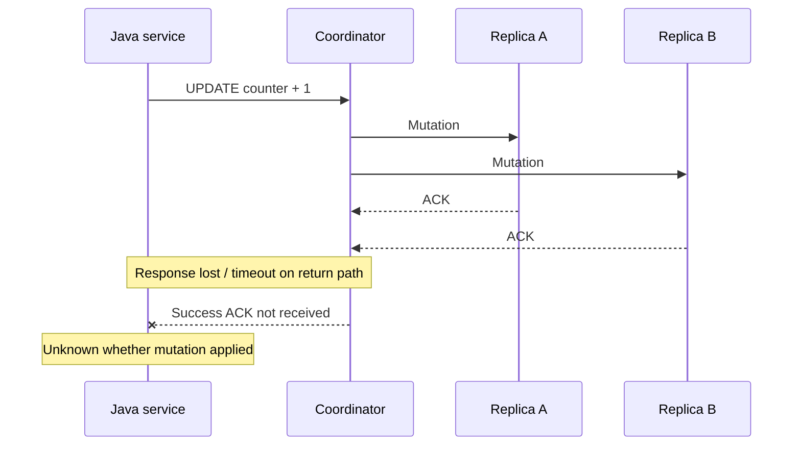
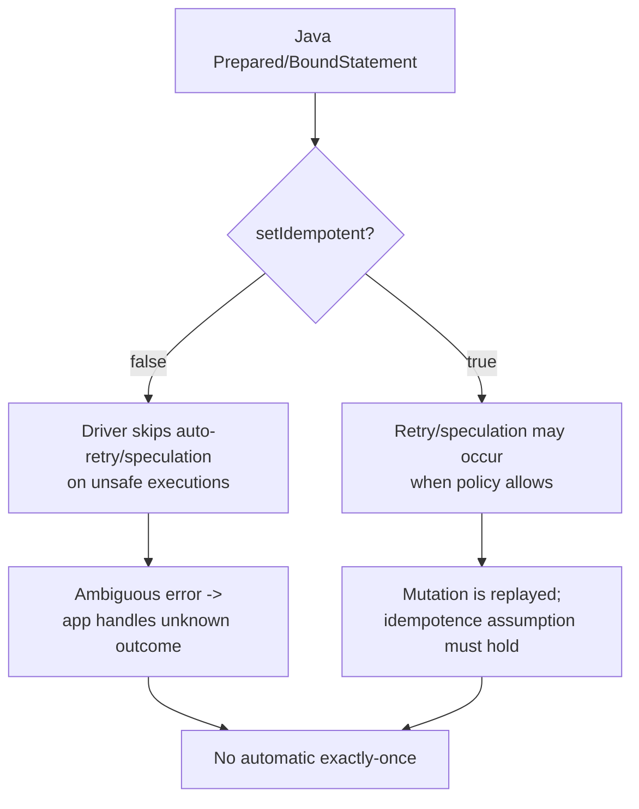

# Updating Counters, Collections, and Evaluating Idempotence

**Chapter:** Query Execution from Java  
**Module:** `DATABASE_ENGINE_WIDE_COLUMN_CASSANDRA` — Apache Cassandra

A Java service sends an `UPDATE` to Cassandra, hits a timeout, and retries. If the statement writes a fixed value to the same key, the end state may still match executing once. Yet if the statement **increments a counter by 1** or **appends an element to a list**, retrying can introduce an unintended extra change. In distributed systems, a timeout normally means **the outcome is unknown**, not that the server did nothing.

This topic connects Apache Cassandra's wide-column model and query-driven table design to **CQL syntax, replication/consistency levels, Java Driver 4.x retries and speculative execution, error handling, compaction/tombstones, and business correctness**. The focus is knowing **which operations can safely be re-run**, which cannot, and when you must change the data model instead of tweaking retry policies.

> **Scope:** Examples target Apache Cassandra 4.1/5.x and Apache Cassandra Java Driver 4.x (`com.datastax.oss.driver.api.*`). Option names, retry policies, CQL features, and collection behaviors must be verified against your exact version/distribution. Run CQL/Java experiments only on a lab cluster; never test “uncertain retries” against financial or production data.

## 1. Learning outcomes

After this lesson, you will be able to:

1. Explain **idempotence** in terms of resulting data state and distinguish it from exactly-once, atomicity, durability, and linearizability.
2. Recognize `UPDATE counter = counter + delta` as **non-idempotent**, even under `LOCAL_QUORUM` or `COUNTER BATCH`.
3. Distinguish `set`, `map`, and `list` collections: full replacement, element add/remove, and index-based updates.
4. Evaluate a CQL statement **across its full context**: keys, values, random functions, timestamps, TTLs, concurrency, and external side effects.
5. Set `setIdempotent(true/false)` **per `BoundStatement`**; never flip it true globally.
6. Understand that Java Driver retry policies and speculative execution rely on idempotence metadata, yet **never** turn counters into exactly-once operations.
7. Propose stable event IDs, fact tables, or read models to replace unbounded lists or counters requiring exact business accuracy.
8. Design repeatable CQL labs to observe list duplicates, set uniqueness, map overwrites, and doubled counter increments.
9. Implement **acknowledged / confirmed failure / unknown outcome** state handling for Java requests.
10. Draft a controlled fault-injection plan, metrics, reconciliation, and alerts for non-idempotent operations.

## 2. What is idempotence?

An update `f` is idempotent on state if:

\[
f(f(S)) = f(S)
\]

In other words, applying the **same operation** multiple times toward the **same target state** leaves the same observable state as applying it once.

### 2.1. Three easy-to-contrast updates

```text
Assume initial state:
  state = "CREATED"
  counter = 5
  events = ["created"]

A. Assign status:
  state := "PAID"
  run 1 time  -> "PAID"
  run 2 times -> "PAID"                 (value-idempotent)

B. Increment counter:
  counter := counter + 1
  run 1 time  -> 6
  run 2 times -> 7                      (non-idempotent)

C. List append:
  events := events + ["paid"]
  run 1 time  -> ["created","paid"]
  run 2 times -> ["created","paid","paid"]   (non-idempotent)
```

This definition suffices for single-threaded examples; in production you must also ask: **“what constitutes the ‘same request’, could other writers interleave, and are timestamps or TTLs recomputed?”** A second run with the same CQL text yet a **new UUID or timestamp** is no longer guaranteed to be the same mutation.

### 2.2. Idempotence differs from exactly-once

| Concept | Question addressed | Example |
| --- | --- | --- |
| **Idempotence** | Does running the same operation twice change state more than once? | `SET state='PAID'` on the exact key |
| **At-least-once delivery** | Can a request be resent and processed more than once? | Client/gateway retry after timeout |
| **At-most-once attempt** | Client intentionally avoids resending an unsafe operation | Run `counter + 1` once; investigate on error |
| **Exactly-once effect** | A business event takes effect strictly once despite retries/crashes | Requires deduplication + transactional/workflow design |
| **Atomicity** | Within what scope are changes treated as one unit? | Cassandra batch atomicity has narrow, specific limits |
| **Consistency level** | How many replicas must respond to satisfy the request? | `LOCAL_QUORUM` in an RF=3 DC |
| **Durability** | Which failures can an acknowledged mutation survive? | Commit log and replica ACKs |
| **Business correctness** | Do balances, view counts, or statuses obey product rules? | Never double-charge a customer |

**Key point:** `LOCAL_QUORUM` and prepared statements **do not** provide exactly-once semantics for `counter + 1`. `setIdempotent(false)` only governs **driver** behavior; it cannot stop an upstream HTTP retry layer or another worker from resending the same operation.

## 3. Why does Cassandra experience “unknown outcomes”?

In distributed Cassandra, an update flows through a coordinator to replicas per the replication strategy:



This is an explanatory scenario, not a guarantee that every counter write follows this exact internal sequence. What matters is that **server success with an undelivered client reply** is a real failure mode.

Suppose Java hits `WriteTimeoutException`, `DriverTimeoutException`, or a dropped connection:

- Case A: mutation was never applied.
- Case B: mutation reached some replicas, not enough for CL.
- Case C: CL was satisfied, yet the response was lost in transit.
- Case D: coordinator/driver routed via an alternate path before surfacing an error.

There is no general way to tell from the exception alone whether the counter incremented. Reading the counter back yields a number, yet **cannot prove which specific request** caused the change when concurrent writers exist or replication has not converged.

### 3.1. Why retrying after a timeout is dangerous

```text
Initial counter = 100

Request #A: +1
  Server executes -> counter = 101
  Client times out -> client receives no ACK

Client retries Request #A:
  Server executes -> counter = 102

Business expected 101; actual state may be 102.
```

If the product only needs **approximate** view counts, this risk may be acceptable under a documented policy. For exact inventory, account balances, strict quotas, or payments, never use Cassandra counters + blind retries as an exactly-once mechanism.

## 4. Mutation types and idempotence

| CQL operation | State if repeated on same key | Default assessment | Notes |
| --- | --- | --- | --- |
| Pure `SELECT` | Does not mutate database | Safe to set `true` | Do not assume external side effects are absent |
| `UPDATE ... SET state='PAID'` | Final value stays `PAID` | Conditionally `true` | Requires fixed key/value; check timestamps/TTLs and other writers |
| `INSERT` with **fixed PK and values** | Writes same row | Conditionally `true` | Never generate a new UUID per retry |
| `DELETE` deterministic on exact key | Logical row remains deleted | Conditionally `true` | Timestamps/tombstones and interleaved writes still matter |
| `UPDATE ... SET n=n+1` on `counter` | +1 per execution | **False** | Inherently non-idempotent |
| `UPDATE ... SET history=history+['x']` | Appends `'x'` each time | **False** | Lists allow duplicates |
| `UPDATE ... SET history=['x']+history` | Prepends `'x'` each time | **False** | Still duplicates values |
| `UPDATE ... SET tags=tags+{'vip'}` | Set holds unique elements | Conditionally **true** | TTL/timestamp/concurrent deletes can alter outcome |
| `UPDATE ... SET tags=tags-{'vip'}` | Removes same element | Conditionally **true** | Watch interactions with concurrent adds |
| `UPDATE ... SET attrs['region']='VN'` | Sets same key/value | Conditionally **true** | Concurrent writes of another value can be overwritten |
| `UPDATE ... SET history=['x']` | Replaces whole list with fixed value | Conditionally **true** | Distinct from append/prepend |
| `DELETE history[0]` | Element at index 0 shifts after deletion | **False / unsafe** | Retries delete subsequent elements |
| `UPDATE ... USING TTL 60` | Expiration shifts on replay | Review needed; conservative false | Replay extends data lifetime |
| `INSERT ... VALUES (now(), ...)` | Function generates fresh value | **False** | Generate ID once outside and bind for retries |

**Never blindly set `true` on every row labeled “conditional”.** Correct behavior in a single-writer model is insufficient for multi-step workflows or strict business invariants.

### 4.1. Logical replay vs physical mutation replay

Even when two `SET state='PAID'` statements leave the same logical value, they write distinct timestamps and interact with tombstones, TTLs, compaction, and concurrent writes. That is why “idempotent” in driver terms means **safe to replay with respect to expected data state under stated assumptions**, not identical SSTable bytes, logs, metrics, or GC timing.

## 5. Counters are a special data type

### 5.1. Dedicated counter tables

CQL supports `counter` columns — 64-bit integers updated via deltas. Counters **cannot** be part of a primary key, and a counter table cannot mix regular non-primary-key columns with counter columns.

Example:

```sql
CREATE KEYSPACE IF NOT EXISTS lab_java_update
WITH replication = {
  'class': 'NetworkTopologyStrategy',
  'datacenter1': 1
}
AND durable_writes = true;

CREATE TABLE IF NOT EXISTS lab_java_update.views_by_tenant_day (
    tenant_id text,
    bucket_day date,
    metric text,
    views counter,
    PRIMARY KEY ((tenant_id, bucket_day), metric)
);
```

`(tenant_id, bucket_day)` is the partition key controlling replica placement; `metric` is the clustering key. This is a **lab** schema; in production, a very hot tenant/day or metric creates a **hot partition / hot counter**. Measure traffic distribution by partition key.

### 5.2. Counters update only by delta

```sql
CONSISTENCY ONE

UPDATE lab_java_update.views_by_tenant_day
SET views = views + 1
WHERE tenant_id = 'tenant-a'
  AND bucket_day = '2026-11-21'
  AND metric = 'page_view';

SELECT views
FROM lab_java_update.views_by_tenant_day
WHERE tenant_id = 'tenant-a'
  AND bucket_day = '2026-11-21'
  AND metric = 'page_view';
```

On a fresh test table, the first UPDATE yields `1` and a repeat yields `2` if both complete without other writers. Never write:

```sql
-- INVALID FOR COUNTERS: shown only to recognize anti-patterns.
-- UPDATE lab_java_update.views_by_tenant_day
-- SET views = 10 WHERE ...;

-- Counter UPDATEs cannot use USING TTL or USING TIMESTAMP
-- under CQL counter semantics.
```

Counters do not support per-cell TTL like regular columns. Never use counters for data requiring automatic expiration or try setting `USING TIMESTAMP` to simulate exactly-once.

### 5.3. Counters and deletions

Some versions permit deleting counters, yet deleting and re-incrementing has serious caveats; Cassandra docs warn against treating deleted-then-re-incremented counters as a clean reset. When you need to “reset a counter to 0”, **never** assume `DELETE` followed by `+1` behaves reliably like a normal integer.

Instead:

- For daily counts: create a **new bucket key** per period.
- To rebuild from events: store an **event facts table** and run controlled aggregations.
- For exact transactional totals: use a dedicated transactional source of truth or idempotency keys + conditional invariants.
- For approximate metrics: document acceptable drift and run periodic reconciliation.

### 5.4. `COUNTER BATCH` does not provide exactly-once

Cassandra provides `BEGIN COUNTER BATCH` to group counter updates:

```sql
BEGIN COUNTER BATCH
  UPDATE lab_java_update.views_by_tenant_day
  SET views = views + 1
  WHERE tenant_id = 'tenant-a'
    AND bucket_day = '2026-11-21'
    AND metric = 'page_view';

  UPDATE lab_java_update.views_by_tenant_day
  SET views = views + 2
  WHERE tenant_id = 'tenant-a'
    AND bucket_day = '2026-11-21'
    AND metric = 'video_view';
APPLY BATCH;
```

If the whole batch is **resent**, the deltas can be applied **again**. A counter batch is not a transaction-ID deduplicator and does not turn multi-partition updates into an isolated exactly-once SQL transaction. Never mix counter mutations and regular DML in one batch.

### 5.5. RF/CL do not solve count-once semantics

RF=3 / `LOCAL_QUORUM` tunes availability and local-DC replica acknowledgments; it does not attach an event ID to an increment. Sending the same `+1` request twice to different coordinators still increments twice.

| Setting | Purpose | Does NOT provide |
| --- | --- | --- |
| RF=3 | Three replicas per replication strategy | Deduplication of business events |
| `LOCAL_QUORUM` | Requires local replica quorum response | Exactly-once or multi-partition transactions |
| `ALL` | Requires all involved replicas to respond | Protection against duplicate retries |
| Prepared statement | Reuses parse/metadata/query binding | Business event identity |
| `setIdempotent(false)` | Prevents driver auto-retry/speculation on unsafe mutations | Blocking HTTP gateway or app-level resends |
| `COUNTER BATCH` | Groups counter updates per Cassandra rules | Protection against re-adding a replayed batch |

## 6. Collections: set, map, and list

### 6.1. DDL for one table with all three collections

```sql
CREATE TABLE IF NOT EXISTS lab_java_update.profiles_by_id (
    profile_id uuid PRIMARY KEY,
    owner text,
    tags set<text>,
    attributes map<text, text>,
    history list<text>,
    updated_at timestamp
);
```

These collections are **non-frozen**, so individual elements can be updated. Frozen collections are stored and treated as a single value per CQL semantics; updates generally replace the whole value and disallow element-level mutations.

Insert a profile with a known key:

```sql
INSERT INTO lab_java_update.profiles_by_id
    (profile_id, owner, tags, attributes, history, updated_at)
VALUES (
    10000000-0000-4000-8000-000000000011,
    'alice',
    {'basic'},
    {'region': 'VN'},
    ['created'],
    '2026-11-21T00:00:00Z'
);

SELECT profile_id, tags, attributes, history
FROM lab_java_update.profiles_by_id
WHERE profile_id = 10000000-0000-4000-8000-000000000011;
```

This is **disposable** test data. Run on a clean table or use a fresh `profile_id` per run so old state does not confuse results.

### 6.2. Set: unique elements

```sql
UPDATE lab_java_update.profiles_by_id
SET tags = tags + {'vip'}
WHERE profile_id = 10000000-0000-4000-8000-000000000011;

-- Run the exact same command a second time:
UPDATE lab_java_update.profiles_by_id
SET tags = tags + {'vip'}
WHERE profile_id = 10000000-0000-4000-8000-000000000011;

SELECT tags FROM lab_java_update.profiles_by_id
WHERE profile_id = 10000000-0000-4000-8000-000000000011;
```

Logical expectation is `{'basic', 'vip'}`, with no duplicate `'vip'`. Set semantics prevent **duplicate elements**. Yet if another writer removed `'vip'` between the two attempts, the retry with a newer timestamp re-adds it. Thus “add fixed element” idempotence **does not justify blind retries under concurrent modifications**.

Removing a specific element:

```sql
UPDATE lab_java_update.profiles_by_id
SET tags = tags - {'vip'}
WHERE profile_id = 10000000-0000-4000-8000-000000000011;
```

Removing an element from a set is idempotent when considering that operation in isolation, though concurrent adds, TTLs, and timestamps govern the real outcome.

### 6.3. Map: unique keys, replaceable values

```sql
UPDATE lab_java_update.profiles_by_id
SET attributes['region'] = 'APAC'
WHERE profile_id = 10000000-0000-4000-8000-000000000011;

-- Repeating the same key/value generally leaves the same map state:
UPDATE lab_java_update.profiles_by_id
SET attributes['region'] = 'APAC'
WHERE profile_id = 10000000-0000-4000-8000-000000000011;

SELECT attributes FROM lab_java_update.profiles_by_id
WHERE profile_id = 10000000-0000-4000-8000-000000000011;
```

Deterministic map assignment is safer than list append. Still, if attempt 1 writes `APAC`, another writer writes `EU`, and attempt 1's retry writes `APAC` with a newer timestamp, the newer business update gets **overwritten**. When you need “update only if version equals X”, use concurrency control (such as LWT on a regular table where appropriate), not bare idempotence.

Deleting a map entry:

```sql
DELETE attributes['region']
FROM lab_java_update.profiles_by_id
WHERE profile_id = 10000000-0000-4000-8000-000000000011;
```

To update or delete a single key-value entry, replacing the whole map is suboptimal: full replacement rewrites every entry and generates extra tombstones. Choose syntax matching the semantics needed.

### 6.4. List: ordered, **allows duplicates**

```sql
UPDATE lab_java_update.profiles_by_id
SET history = history + ['reviewed']
WHERE profile_id = 10000000-0000-4000-8000-000000000011;

-- Second run simulating application replay:
UPDATE lab_java_update.profiles_by_id
SET history = history + ['reviewed']
WHERE profile_id = 10000000-0000-4000-8000-000000000011;

SELECT history FROM lab_java_update.profiles_by_id
WHERE profile_id = 10000000-0000-4000-8000-000000000011;
```

Starting from `['created']`, the list ends up holding **`'reviewed'` twice** (in single-stream append order). This directly demonstrates that `list = list + [...]` is **non-idempotent**.

Prepending is also non-idempotent:

```sql
UPDATE lab_java_update.profiles_by_id
SET history = ['urgent'] + history
WHERE profile_id = 10000000-0000-4000-8000-000000000011;
```

### 6.5. Full list replacement vs append

```sql
-- Repeating the exact same full assignment can leave the same logical list.
UPDATE lab_java_update.profiles_by_id
SET history = ['created', 'reviewed']
WHERE profile_id = 10000000-0000-4000-8000-000000000011;
```

Overwriting the entire list is a completely different mutation from appending. However, it can **clobber** elements added by concurrent writers, generate collection tombstones, and raise write amplification. Never convert appends into “read list → overwrite full list” when concurrent writers exist: non-transactional read-modify-write loses updates.

### 6.6. List operations by index or value

CQL supports operations such as:

```sql
-- Replace element at index 0; index positions shift when other writers edit the list.
UPDATE lab_java_update.profiles_by_id
SET history[0] = 'opened'
WHERE profile_id = 10000000-0000-4000-8000-000000000011;

-- Delete by index (LAB ONLY): a replay can hit a different element.
DELETE history[0]
FROM lab_java_update.profiles_by_id
WHERE profile_id = 10000000-0000-4000-8000-000000000011;

-- Remove all occurrences of a specific value.
UPDATE lab_java_update.profiles_by_id
SET history = history - ['reviewed']
WHERE profile_id = 10000000-0000-4000-8000-000000000011;
```

Several list mutations (set/delete by index, remove by value) trigger internal **read-before-write** and can be slow. Remove-by-value can be **content-idempotent** assuming no interleaved additions of that value, and QueryBuilder may classify known value removals as safe; still, that never proves safety under concurrent writers. For delete-by-**index**, shifting indices mean a replay deletes a different item — always mark it non-idempotent.

### 6.7. Never use a collection as an unbounded event table

Apache Cassandra recommends keeping collections **small and bounded**. Non-frozen collections cannot be paged element-by-element like clustering rows in a table; reading a large collection pulls the entire collection in one query.

When you need unbounded history:

```sql
CREATE TABLE IF NOT EXISTS lab_java_update.events_by_profile_day (
    profile_id uuid,
    bucket_day date,
    event_id uuid,
    event_ts timestamp,
    event_type text,
    payload text,
    PRIMARY KEY ((profile_id, bucket_day), event_id)
);
```

`event_id` is a **stable** event identifier (generated once before any retries). If reads need chronological order, change the clustering key to sort by `event_ts` with `event_id` breaking timestamp ties. Design tables **query-first**, picking partition keys/buckets that avoid hot or oversized partitions.

Inserting an event twice with the same PK and deterministic payload will not create **two distinct rows** like list append. Yet if the app generates a new event ID per retry, you still get duplicate rows; a stable key is mandatory.

## 7. Functional comparison of collections

| Criterion | `set<text>` | `map<text,text>` | `list<text>` |
| --- | --- | --- | --- |
| Data model | Unique membership | Key–value pairs | Ordered elements, duplicates allowed |
| Common update | Add/remove element | Put/remove entry | Append/prepend/index/remove |
| Repeating same add | Does not duplicate element | Putting same key can overwrite | **Duplicates** element |
| Read-before-write risk | Usually avoided on regular add/remove | Usually avoided on entry put/remove | Required by several operations |
| Suitability for append-only log | Drops duplicates and insertion order | Small keyed attributes | Ordered, yet **must not grow unboundedly** |
| Access by individual key | Whole collection and query model | By entry key, still bounded as a collection | Not an event table with internal paging |
| TTL caution | Per-written-element TTL | Per-written-entry TTL | Per-element TTL and ordering |
| Retry caution | `true` only when semantics allow | `true` only when key/value deterministic | Append/prepend `false` |

**Never equate the “uniqueness” of a set/map with workflow-wide exactly-once.** If a request also sends an email, charges a payment gateway, or updates another table, the fact that `tags + {'vip'}` does not duplicate elements **does not** make the whole workflow idempotent.

## 8. TTL, timestamps, tombstones, and concurrency

### 8.1. TTL can change replay semantics

```sql
-- Lab only: set a fresh TTL on the region entry.
UPDATE lab_java_update.profiles_by_id
USING TTL 60
SET attributes['region'] = 'VN'
WHERE profile_id = 10000000-0000-4000-8000-000000000011;
```

If replayed 30 seconds later, the entry's expiration shifts relative to a single write. In terms of **current value**, repeating `'VN'` looks idempotent; in terms of **when it expires**, it is not. Requests with strict retention semantics must account for TTL/timestamps and dedicated idempotency instead of defaulting `setIdempotent(true)`.

### 8.2. Timestamps and Last-Write-Wins

Cassandra reconciles cells/mutations by timestamp along with version-specific tombstone/tie-breaking rules. With two writers:

```text
T1: Worker A sets state = "PAID".
T2: Worker B sets state = "REFUNDED".
T3: Worker A's retry sets state = "PAID" with a newer timestamp.

Final state can revert to "PAID" even though the business already refunded.
```

A fixed assignment is only “idempotent” when **repeated in isolation**. It does not protect **state-transition ordering** when concurrent updates interleave.

For ordered business updates, consider:

- Versioning / CAS via **lightweight transactions** where scope and throughput fit.
- A single owner/writer per aggregate/partition.
- Event IDs and a deduplication store with strong semantics.
- A transactional source of truth projected into Cassandra.
- Never expecting multi-partition updates to act as general ACID transactions.

### 8.3. Non-deterministic functions produce different outcomes

```sql
-- NEVER mark idempotent if each retry generates a new UUID.
-- UPDATE lab_java_update.profiles_by_id
-- SET updated_at = toTimestamp(now()) WHERE profile_id = ...;
```

To make replays produce identical values, **generate one UUID/timestamp before the retry loop and reuse it**, rather than calling `UUID.randomUUID()` or `Instant.now()` per attempt. Still, holding the timestamp fixed does not solve counters or list appends.

### 8.4. Tombstones and DELETE

Repeating `DELETE` on the same key leaves the same logical state in isolation, yet each DELETE can write a tombstone with a newer timestamp. Under interleaved writes, a late retried DELETE can hide a newer valid write. Never mark every DELETE safe in multi-writer systems; check versioning, TTLs, and business rules.

## 9. Java Driver 4.x: idempotence metadata

### 9.1. The driver must be told which operations are safe

Apache Java Driver 4.x cannot parse every CQL string to deduce all side effects; by default `basic.request.default-idempotence` is `false`. You can override per statement:

```java
SimpleStatement read = SimpleStatement
    .newInstance("SELECT tags FROM lab_java_update.profiles_by_id WHERE profile_id = ?",
                 profileId)
    .setIdempotent(true);
```

With prepared statements, mark **each bound statement**:

```java
BoundStatement increment = counterPrepared.bind(delta, tenantId, day, metric)
    .setIdempotent(false);

BoundStatement replace = replacePrepared.bind("PAID", profileId)
    .setIdempotent(true);
```

The second snippet assumes `counterPrepared` and `replacePrepared` are defined with matching types; full runnable code appears in Section 11.

**Never enable `basic.request.default-idempotence = true` service-wide just to get more retries.** If the service runs any counter or list append, global `true` exposes unsafe operations to automatic replay. Classify per query and method.

### 9.2. What does `setIdempotent(true)` actually do?

In Java Driver 4.x, **retry** and **speculative execution** policies inspect this flag to decide whether a request may be resent when policy conditions trigger.



**`true` does not mean “retry always happens”**: it still depends on the retry policy, error class, request timeout, attempt limits, and speculative execution policy. **`false` likewise does not block application retries**, HTTP client replays, queue redeliveries, or another session running CQL.

### 9.3. What is speculative execution?

When a request stalls, speculative execution (if enabled) can send the **same request** to another coordinator before the first finishes to trim tail latency. For pure `SELECT`s or genuinely idempotent mutations, it may fit your SLA. For `counter + 1` or `list append`, two coordinators can both apply the mutation, causing **double increments or duplicate appends**.

By default, the driver **disables speculative execution** (default policy launches no speculative requests). Never mark a non-idempotent mutation `true` just to chase lower p99.

### 9.4. Retries and errors do not equal outcomes

| Event | Could it have applied on server? | Recommended action for counter / list append |
| --- | --- | --- |
| Success and ACK arrives | Mutation accepted per CL | Record success; do not resend |
| Timeout before ACK | Unknown if executed | **No blind retry**; record unknown outcome |
| Disconnect between request/response | Request may have processed | **No blind retry** |
| `UnavailableException` | Insufficient replicas for CL | Check availability; do not assume zero external side effects across workflow |
| Client shutdown / cancellation | Request may still be in flight | Track and reconcile; do not auto-replay |
| Gateway resends HTTP request | CQL may run a second time from upstream | Enforce request/event IDs, dedup, or API idempotency |
| Queue redelivery | Worker may have succeeded before crash | Build idempotent consumers and reconciliation |

## 10. Java lab: setting up environment and schema

### 10.1. Assumptions

- A lab cluster with DC `datacenter1`, possibly single-node RF=1; production requires RF/CL matching fault-tolerance goals.
- Cassandra 4.1/5.x and compatible Java Driver 4.x.
- `cqlsh` and a Java process able to reach the native transport port.
- Never use superuser/admin accounts in production apps; lab uses least-sufficient credentials.
- Experiments intentionally **run certain mutations twice** on **disposable data** to observe duplication—this is not a performance benchmark.

Create the keyspace and both tables from Sections 5 and 6. You can add an immutable events table for comparison:

```sql
CREATE TABLE IF NOT EXISTS lab_java_update.event_facts_by_id (
    event_id uuid PRIMARY KEY,
    tenant_id text,
    event_type text,
    occurred_at timestamp,
    payload text
);
```

**Note:** `event_facts_by_id` supports lookups by `event_id`. If the app frequently reads events by tenant and day, add a projection table `events_by_tenant_day` keyed accordingly; never use `ALLOW FILTERING` to scan the table from an endpoint.

### 10.2. Repeatable baseline

In `cqlsh`, use a fresh `profile_id` for each run; no `TRUNCATE` needed:

```sql
INSERT INTO lab_java_update.profiles_by_id
    (profile_id, owner, tags, attributes, history, updated_at)
VALUES (
    10000000-0000-4000-8000-000000000012,
    'lab-run-012',
    {'basic'},
    {'region': 'VN'},
    ['created'],
    '2026-11-21T00:00:00Z'
);
```

Use a dedicated counter `metric` key (such as `metric='run-012-views'`) so runs never collide. Never try resetting counters by deleting and rewriting the same key.

## 11. Java Driver: complete code for counters and collections

The example below sets `BoundStatement.setIdempotent(...)` **per operation** and contains no retry loop on unsafe mutations. `CqlSession` is provided and reused by the application; the snippet embeds no passwords.

```java
import com.datastax.oss.driver.api.core.CqlSession;
import com.datastax.oss.driver.api.core.DefaultConsistencyLevel;
import com.datastax.oss.driver.api.core.cql.BoundStatement;
import com.datastax.oss.driver.api.core.cql.PreparedStatement;
import com.datastax.oss.driver.api.core.cql.ResultSet;
import com.datastax.oss.driver.api.core.cql.Row;
import com.datastax.oss.driver.api.core.data.CqlDate;

import java.time.LocalDate;
import java.util.Collections;
import java.util.List;
import java.util.UUID;

public final class SafeMutationExamples {
    private final CqlSession session;
    private final PreparedStatement incrementCounter;
    private final PreparedStatement addTag;
    private final PreparedStatement putRegion;
    private final PreparedStatement appendHistory;
    private final PreparedStatement readProfile;
    private final PreparedStatement readCounter;

    public SafeMutationExamples(CqlSession session) {
        this.session = session;
        incrementCounter = session.prepare(
            "UPDATE lab_java_update.views_by_tenant_day " +
            "SET views = views + ? " +
            "WHERE tenant_id = ? AND bucket_day = ? AND metric = ?"
        );
        addTag = session.prepare(
            "UPDATE lab_java_update.profiles_by_id " +
            "SET tags = tags + ? WHERE profile_id = ?"
        );
        putRegion = session.prepare(
            "UPDATE lab_java_update.profiles_by_id " +
            "SET attributes['region'] = ? WHERE profile_id = ?"
        );
        appendHistory = session.prepare(
            "UPDATE lab_java_update.profiles_by_id " +
            "SET history = history + ? WHERE profile_id = ?"
        );
        readProfile = session.prepare(
            "SELECT tags, attributes, history " +
            "FROM lab_java_update.profiles_by_id WHERE profile_id = ?"
        );
        readCounter = session.prepare(
            "SELECT views FROM lab_java_update.views_by_tenant_day " +
            "WHERE tenant_id = ? AND bucket_day = ? AND metric = ?"
        );
    }

    public void incrementOnce(String tenantId, LocalDate day, String metric) {
        CqlDate cqlDay = CqlDate.fromDaysSinceEpoch(
            (int) day.toEpochDay()
        );

        BoundStatement statement = incrementCounter.bind(
                1L, tenantId, cqlDay, metric
            )
            .setConsistencyLevel(DefaultConsistencyLevel.LOCAL_QUORUM)
            .setIdempotent(false);

        try {
            session.execute(statement);
            System.out.println("Counter update ACK at selected CL");
        } catch (RuntimeException ex) {
            // Outcome unknown: delta may or may not have applied.
            // NEVER call session.execute(statement) again here.
            System.err.println("COUNTER_UNKNOWN_OUTCOME: " +
                ex.getClass().getSimpleName());
            // Real system: persist event/request ID and reconcile.
        }
    }

    public void addTag(String profileIdText) {
        UUID profileId = UUID.fromString(profileIdText);
        BoundStatement statement = addTag.bind(
                Collections.singleton("vip"), profileId
            )
            .setConsistencyLevel(DefaultConsistencyLevel.LOCAL_QUORUM)
            // Valid only in this example: no TTL and no concurrent writer
            // removing/adding the same tag while order matters.
            .setIdempotent(true);
        session.execute(statement);
    }

    public void setRegion(String profileIdText) {
        UUID profileId = UUID.fromString(profileIdText);
        BoundStatement statement = putRegion.bind("APAC", profileId)
            .setConsistencyLevel(DefaultConsistencyLevel.LOCAL_QUORUM)
            // Fixed key/value assignment; example assumes no competing writer.
            .setIdempotent(true);
        session.execute(statement);
    }

    public void appendHistoryOnce(String profileIdText) {
        UUID profileId = UUID.fromString(profileIdText);
        BoundStatement statement = appendHistory.bind(
                Collections.singletonList("reviewed"), profileId
            )
            .setConsistencyLevel(DefaultConsistencyLevel.LOCAL_QUORUM)
            .setIdempotent(false);

        try {
            session.execute(statement);
        } catch (RuntimeException ex) {
            System.err.println("LIST_APPEND_UNKNOWN_OUTCOME: " +
                ex.getClass().getSimpleName());
            // Do not auto-retry append because it can create duplicates.
        }
    }

    public void showProfile(String profileIdText) {
        UUID profileId = UUID.fromString(profileIdText);
        BoundStatement statement = readProfile.bind(profileId)
            .setConsistencyLevel(DefaultConsistencyLevel.LOCAL_QUORUM)
            .setIdempotent(true);

        Row row = session.execute(statement).one();
        if (row == null) {
            System.out.println("No profile for " + profileId);
            return;
        }
        System.out.println(
            "tags=" + row.getSet("tags", String.class) +
            ", attrs=" + row.getMap(
                "attributes", String.class, String.class) +
            ", history=" + row.getList("history", String.class)
        );
    }

    public Long readViews(String tenantId, LocalDate day, String metric) {
        CqlDate cqlDay = CqlDate.fromDaysSinceEpoch(
            (int) day.toEpochDay()
        );
        ResultSet result = session.execute(
            readCounter.bind(tenantId, cqlDay, metric)
                .setConsistencyLevel(DefaultConsistencyLevel.LOCAL_QUORUM)
                .setIdempotent(true)
        );
        Row row = result.one();
        return row == null || row.isNull("views")
            ? null : row.getLong("views");
    }
}
```

### 11.1. Why does `incrementOnce` have no retry loop?

The code acknowledges **unknown outcomes** instead of assuming “exception = write never happened”. Neither counter nor list-append catch blocks **auto-replay**. This is the baseline rule; production must also persist **business event IDs, processing status, and reconciliation** to finish work safely.

### 11.2. Caution when marking set/map `setIdempotent(true)`

In `addTag` and `setRegion`, assumptions are stated explicitly: no TTL and no competing writers deleting/updating the same element. Whenever an app must preserve the ordering of distinct writes to the same key, use versioning/conditional writes or a single-owner stream per aggregate rather than assuming every assignment is always safe to replay.

### 11.3. Java mechanics do not check business rules for you

The driver only sees `BoundStatement`, CL, and the idempotence flag. It does not know:

- Whether a “payment captured” event already settled in the payment system.
- Whether `'reviewed'` in history must be unique or can repeat.
- Whether the client generated a new request ID for the retry.
- Whether another writer changed `state` or `attributes`.
- Whether data has TTLs, tombstones, or fixed retention rules.
- Whether an email, Kafka message, or push notification was emitted outside the database.

Therefore never write a Java helper named `safeRetry()` that blindly sets `true` on every UPDATE.

## 12. Creating `CqlSession` and configuring controlled retries

In a single-DC lab, create the session once:

```java
import com.datastax.oss.driver.api.core.CqlSession;
import java.net.InetSocketAddress;

public final class LabSession {
    public static CqlSession open() {
        return CqlSession.builder()
            .addContactPoint(new InetSocketAddress("127.0.0.1", 9042))
            .withLocalDatacenter("datacenter1")
            .build();
    }
}
```

This shows a **no-auth/no-TLS lab**; production must load credentials from a secrets manager, verify TLS certificates, configure multiple contact points, and set the proper local datacenter. Never create a session per HTTP request.

### 12.1. Never set global default idempotence to true

Relevant Java Driver 4.x config:

```hocon
datastax-java-driver {
  basic.request.default-idempotence = false
}
```

In practice the default is `false` when untouched. Flipping it to `true` exposes every unclassified CQL statement to retries and speculation under configured policies. If a service runs any counters or list appends, that is an easy-to-miss hazard during global config edits.

### 12.2. Retry policy and speculative execution

- **Retry policy** governs which errors and how many attempts/paths to retry when a mutation is safe.
- **Speculative execution policy** can issue parallel backup executions on slow requests; usually disabled by default.
- Both **must honor** idempotence metadata; never write a custom policy to bypass safety checks.
- `setIdempotent(true)` **allows** policies to consider retries; it does not force retrying every error.
- `setIdempotent(false)` **does not** stop applications or gateways from resending requests.
- Never downgrade CL on retry just to meet latency if business rules cannot tolerate weaker read/write guarantees.

## 13. Stable event IDs: redesign instead of retrying counters

When business rules require “count every event strictly once”, a better design stores **immutable facts** with unique IDs instead of mutating an untracked counter directly.

### 13.1. Generate the event ID once

Suppose a trusted client supplies an `event_id` preserved across retries:

```sql
INSERT INTO lab_java_update.event_facts_by_id (
    event_id, tenant_id, event_type, occurred_at, payload
) VALUES (
    20000000-0000-4000-8000-000000000011,
    'tenant-a',
    'PAGE_VIEW',
    '2026-11-21T01:00:00Z',
    'landing-page'
) IF NOT EXISTS;
```

On first application, LWT returns `[applied]=true`. If the ID already exists, it returns `false`; the app must compare payload/version rather than blindly treating every `false` as business success. LWT carries higher cost than regular writes and has its own semantics/limits.

**Important:** `IF NOT EXISTS` **does not turn a separate counter update into an exactly-once transaction**. It only conditions the mutation on that specific row/key.

### 13.2. Why “mark processed then +1” is insufficient

Consider two separate tables:

```text
Step 1: INSERT processed_events[event_id] IF NOT EXISTS
Step 2: UPDATE counters SET count = count + 1

Crash between steps 1 and 2:
  event is marked processed
  counter was never incremented
  replay sees event already processed -> skips -> undercount

Reverse order:
Step 1: counter +1
Step 2: mark processed

Crash in between:
  counter already incremented
  replay sees event not processed -> increments again -> overcount
```

Cassandra does not provide **general cross-partition ACID transactions** to fuse both steps into exactly-once counter updates. A `LOGGED BATCH` does not add deduplication or make increments idempotent either; re-sending a counter batch still double-adds deltas.

### 13.3. Alternative design patterns

| Need | Design to consider | What to verify |
| --- | --- | --- |
| Approximate view counts | Counter with documented acceptable drift | Retry semantics, reconciliation, hot keys |
| Exact event counts | Event facts with stable IDs + rebuildable aggregates | Deduplication, source of truth, windowing, throughput |
| Exact balances / quotas | Transactional source of truth or guarded CAS model | Invariants, contention, failure recovery |
| Ordered event history | Table clustered by timestamp/event ID | Partition bucketing, query pattern, paging |
| Small tag set | `set<text>` | Concurrent add/remove, TTL, size bounds |
| Small attribute set | `map<text,text>` | Concurrent puts, retention, sensitive data |
| Small list allowing duplicates | `list<text>` only when semantics need it | Duplicates, read-before-write, replay behavior |
| All changes auditable | Append-only facts plus external audit logs if needed | Write/retry correlation, retention, GDPR |

**No single structure fits all workloads.** Design for query patterns, business accuracy, event replayability, and hot-partition avoidance.

## 14. Can Lightweight Transactions (LWT) solve it?

CQL supports conditional updates:

```sql
CREATE TABLE IF NOT EXISTS lab_java_update.order_state_by_id (
    order_id uuid PRIMARY KEY,
    state text,
    version int
);

INSERT INTO lab_java_update.order_state_by_id
    (order_id, state, version)
VALUES (
    30000000-0000-4000-8000-000000000011,
    'CREATED',
    1
);

UPDATE lab_java_update.order_state_by_id
SET state = 'PAID', version = 2
WHERE order_id = 30000000-0000-4000-8000-000000000011
IF version = 1;
```

With no competing writers and the initial state above, the first run returns `[applied]=true`, and a repeat returns `[applied]=false` because `version` is now `2`. This prevents the same **transition** from running twice on a **single conditional row/partition**.

**However:**

- LWT uses Paxos/CAS, bringing extra overhead and distinct consistency semantics.
- If the client loses the reply, it may not know whether the first CAS succeeded; read/reconcile state and event IDs.
- LWT does not automatically enforce transition ordering across multi-partition workflows or external side effects.
- Counter tables **cannot** use conditional increments like `UPDATE counter + 1 IF ...` to manufacture exactly-once.
- Checking `state` by name alone without a version or event owner can still invite unintended races.

### 14.1. `[applied]` is not a business commit log either

If a client times out after CAS commits yet before receiving the response, retrying the same condition sees `[applied]=false`. That does not prove failure, since the prior attempt may have applied. Reconcile state, request/event IDs, and expected versions.

## 15. Designing Java APIs properly for unknown outcomes

### 15.1. Three separate states

Instead of returning a bare boolean “write succeeded”, classify into:

```text
ACKNOWLEDGED
  -> CQL request was ACKed at the chosen CL.

REJECTED / NOT_APPLIED (with clear evidence)
  -> e.g. conditional update returned [applied]=false.
  -> Does NOT automatically mean the event was handled properly.

UNKNOWN_OUTCOME
  -> Timeout, connection drop, worker crash before ACK.
  -> Mutation may or may not have applied.
  -> Never auto-retry counters or list appends.
```

Specific exception types add diagnostic clues, yet **never build business logic assuming all timeout errors behave identically**. With Kafka or queues, consumers must preserve correlation IDs and implement platform-appropriate retry, dead-letter, and reconciliation strategies.

### 15.2. Implementation pseudocode

```text
handle(event):
    validate(event.id, event.payload)
    determine mutation semantics

    if mutation is counter increment or list append:
        mark driver statement idempotent = false
        submit once per controlled application attempt

        if ACK:
            record acknowledged
        if timeout/disconnect:
            record unknown outcome with event.id
            DO NOT blindly resubmit
            reconcile from authoritative facts/workflow

    else if mutation is proven idempotent:
        bind exact same key + payload per retry
        mark statement idempotent = true
        rely on bounded retry policy with observability

    never assume "CQL idempotent" means external email/payment
    was executed exactly once.
```

In production, tracking processed status must itself be durable with crash recovery; merely logging `UNKNOWN_OUTCOME` and losing local state if the process dies is not enough to fulfill business guarantees.

## 16. Fault injection in a disposable cluster

The goal of the lab is **understanding replays**. First execute the same statement **twice intentionally** on fresh data; you do not even need real network faults to observe non-idempotence.

### 16.1. Experiment matrix

| Scenario | Execution 1 | Execution 2 | Expected result |
| --- | --- | --- | --- |
| Counter `views + 1` | +1 | +1 | Value increases by two |
| List append `['reviewed']` | Appends one item | Appends same item | Two identical items |
| Set add `{'vip'}` | Adds `vip` | Adds `vip` | Logically one `vip` |
| Map assignment `region='APAC'` | Sets `APAC` | Sets `APAC` | Single `APAC` value |
| List replace `['created','reviewed']` | Replaces list | Replaces list | Same logical contents |
| Event fact with same `event_id` | INSERT row | INSERT row same PK | One logical row (with stable payload) |
| LWT `IF version=1` | May apply | Condition no longer true | Second run usually `applied=false` |

In these tests, **use a fresh key per run** and record operation counts. Never use `TRUNCATE` or `DELETE counter` to reset production data. Keep cases isolated so results never bleed together.

### 16.2. If you need to simulate real timeouts

Only in a test cluster with backups/rollback and environment owner approval:

1. Record baseline RF, CL, timestamps, and IDs.
2. Observe requests in client/driver and server logs/metrics.
3. Induce slow/dropped ACKs using an approved network fault-injection tool.
4. Record app state: exception class, event ID, attempt, coordinator, and timestamp.
5. **Do not resend** counters or list appends on unknown outcomes.
6. After stabilization, read data at the defined CL and reconcile against the source of truth and other writers.
7. Revert fault injection and verify nodes are `UN` with healthy replication/repair.

Never lower RF/CL, disable authentication, or corrupt SSTables as a lab fault-injection method.

### 16.3. “Readback shows +1” does not prove request A succeeded

If three workers all increment a metric in the same second, a jump from 100 to 103 does not tell you whether request A applied. Counters do not store per-delta event IDs. Accurate reconciliation requires an **independent facts source** compared per window/tenant, or a different data model.

## 17. Observability and alerting

### 17.1. Separate client and server metrics

| Signal | What to collect | Why |
| --- | --- | --- |
| App request attempts | Event ID, attempt ID, query/type, idempotence flag | Detects app/gateway self-replays |
| Driver retries / speculation | Attempt counts, retry decisions, speculative executions | Shows whether multiple coordinators were hit |
| Write ACKs / timeouts / unavailable | By CL, DC, and table | Quantifies unknown outcomes |
| Counter/list divergence | Compare event facts vs aggregates | Detects overcounts or undercounts |
| Read/write p95/p99 | App + server | Checks if policy changes hurt SLOs |
| Hot partitions / large collections | Partition key spread, `tablehistograms`, memory | Prevents one key taking all increments/appends |
| Tombstones / live cells scanned | Table/read metrics | Tracks read amplification from deletes/TTLs |
| Repair / hints / streaming | Per node/DC | Avoids mistaking replica convergence for dedup |
| CPU / GC / disk I/O | Node | Spots oversized collections or expensive read-before-write |
| Audit / business logs | Event ID, source request, version/watermark | Reconstructs business decisions |

Never put sensitive data, PII, or raw partition keys into Prometheus labels (causing high cardinality). Hash IDs in general logs with proper access controls, keeping raw event IDs in protected audit stores.

### 17.2. Useful `nodetool` checks

```bash
nodetool status
nodetool tpstats
nodetool tablestats lab_java_update.views_by_tenant_day
nodetool tablestats lab_java_update.profiles_by_id
nodetool tablehistograms lab_java_update profiles_by_id
nodetool compactionstats
nodetool netstats
```

Run against the relevant replicas/nodes. Node metrics are **local**; a single `SELECT` at `LOCAL_QUORUM` does not reflect every physical replica. Counters and collections have their own tombstones, compactions, and I/O profiles; never conclude “counter is slow because of retries” from one p99 sample.

### 17.3. Warnings and timeouts in Java

In Java Driver, you can read server warnings from `ExecutionInfo` for an execution, though the absence of warnings does not prove no duplicates occurred. Explicitly log **idempotence decisions** by operation kind:

```text
event_id=... type=COUNTER_INCREMENT idempotent=false attempt=1
event_id=... outcome=UNKNOWN_OUTCOME reason=driver_timeout
event_id=... reconciliation_required=true

event_id=... type=SET_ADD idempotent=true attempt=1
event_id=... outcome=ACKNOWLEDGED
```

This is an illustrative log format, not built-in driver output. Never log passwords, tokens, or raw payloads.

## 18. Common mistakes and remedies

### A. Setting `setIdempotent(true)` on every prepared statement

The driver may retry or speculate `counter + 1` or list appends. **Fix:** classify per query, keep non-idempotent mutations `false`, and audit custom retry policies and speculative execution settings.

### B. Wrapping every `session.execute()` in a three-attempt retry loop

When a timeout happens after server execution, counters increment multiple times. **Fix:** separate safe vs unsafe mutations, use event IDs, and allow bounded retries only for proven-idempotent operations.

### C. Assuming `LOCAL_QUORUM` prevents duplicates

Quorum counts replica ACKs; it knows nothing about HTTP retries. **Fix:** treat consistency and deduplication as separate problems.

### D. Using `list<text>` to store all user activity

Lists can grow unboundedly, appends are non-idempotent, and index/value operations trigger read-before-write. **Fix:** build an event table with deterministic primary keys, time clustering, and sensible partition buckets.

### E. Using `set<text>` and claiming retries are unconditionally safe

Elements do not duplicate in simple isolation, yet concurrent deletes, TTLs, and external side effects can still drift. **Fix:** define invariants, owners, and versioning/conditional updates where needed.

### F. Replaying a map assignment after another writer changed the value

Writing the same `region` with a newer timestamp clobbers newer updates. **Fix:** for conditional updates, use versioning/CAS or serialize writes per aggregate.

### G. Resetting a counter with DELETE then counting again

Cassandra counters carry caveats on delete/re-insert; resetting is not like an ordinary integer. **Fix:** rotate bucket/key per period or rebuild totals from a fact table.

### H. Using `COUNTER BATCH` as an exactly-once transaction

Resending the batch still re-adds deltas. **Fix:** use event IDs, fact/aggregation models, or transactional designs matching business requirements.

### I. Running `INSERT ... IF NOT EXISTS` before a counter and assuming safety

Crashing between the dedup marker and the increment causes undercounts or overcounts. **Fix:** manage state transactionally or aggregate from facts rather than chaining two non-atomic steps.

### J. Generating a fresh UUID on every retry

Each retry hits a different key, so `INSERT` creates multiple rows. **Fix:** generate the UUID once and preserve request ID and payload across attempts.

### K. Recording timeouts as “confirmed failure”

The server may have applied the mutation. **Fix:** record unknown outcome, run reconciliation, and never manually compensate a counter without proof.

### L. Enabling TTL on maps/sets and blindly marking `true`

Replaying mutations shifts entry expiration times, breaking retention rules. **Fix:** analyze time semantics and test separately; keep conservatively `false` when unsure.

### M. Reading a counter at `ONE` after timeout to deduce who incremented

One replica may lag temporarily while multiple writers increment concurrently. **Fix:** use matching CL and event facts; never treat one read as a transaction log.

### N. Enabling speculative execution to cure every read/write p99

For non-idempotent mutations, duplicate speculative requests cause double effects and extra load. **Fix:** classify mutations and optimize only with evidence and SLO bounds.

### O. Switching huge collections to `frozen`

Frozen collections rewrite the entire collection on change and do not magically become paginated or unbounded. **Fix:** use an event table with partition bucketing designed around queries.

## 19. Runbook for designing and reviewing a new mutation

Before merging any Java method that writes to Cassandra:

1. **Identify the mutation:** exact CQL, keyspace/table, partition key, and columns.
2. **Classify the operation:** fixed assignment, increment, append/prepend, set/map element, delete/index, LWT, or batch.
3. **Define “same request”:** are event/request IDs, values, and timestamps held fixed across retries?
4. **Assess concurrency:** can another writer modify the same key or element?
5. **Assess TTL/tombstones:** can a replay shift expiration or resurrect over a delete?
6. **Classify idempotence:** document `true`/`false` and **rationale** in code review.
7. **Choose RF/CL:** based on SLAs, DCs, and durability—**never** to fix duplicates.
8. **Configure retry/speculation:** allow only when genuinely safe, with bounded attempts and timeouts.
9. **Design timeout handling:** ACK, known rejection, unknown outcome; never blindly replay counters or list appends.
10. **Add observability:** idempotence flag, attempt count, outcome, request correlation, and metrics.
11. **Test execution #2:** run twice on disposable data to verify resulting state.
12. **Run controlled fault injection:** only with an isolated environment, rollback plan, and reconciliation.
13. **Review data model:** could collections grow unboundedly? Is a counter holding exact financial/business counts?
14. **Sign-off:** assign an owner accountable for duplicate/loss risk and recovery plans.

### 19.1. Review template

```text
MUTATION_NAME:
OWNER:
CQL_QUERY:
PARTITION_KEY / CLUSTERING_KEY:
RF / DC / READ_CL / WRITE_CL:
REQUEST_ID_GENERATED_ONCE:
PAYLOAD_DETERMINISTIC:
USES_COUNTER:
USES_LIST_APPEND_OR_PREPEND:
USES_COLLECTION_INDEX:
USES_SET_OR_MAP_ELEMENT_UPDATE:
USES_TTL_OR_SERVER_GENERATED_VALUE:
HAS_CONCURRENT_WRITERS:
USES_LWT:
EXTERNAL_SIDE_EFFECTS:
IS_IDEMPOTENT:
WHY:
DRIVER_SET_IDEMPOTENT:
RETRY_POLICY / SPECULATIVE_EXECUTION:
UNKNOWN_OUTCOME_HANDLING:
DEDUPE_OR_RECONCILIATION_SOURCE:
TEST_FIRST_ATTEMPT:
TEST_SECOND_ATTEMPT:
FAULT_INJECTION_RESULT:
METRICS_AND_ALERTS:
REMAINING_RISKS:
```

Never treat blank fields as “false / no risk”. In particular, `IS_IDEMPOTENT=true` must rest on design proof and verified assumptions, not merely because CQL starts with `UPDATE`.

## 20. Scenario exercises

### Scenario 1 — “Likes” counter

An app receives “user X liked post Y” and executes `likes = likes + 1`. The gateway retries after a timeout. If the goal is unique likers, a counter alone is insufficient. One design stores `(post_id, user_id)` as a unique primary key and builds a rebuildable likes aggregate/read model, accounting for unlikes and concurrency per business rules.

### Scenario 2 — View counts tolerating small drift

If a dashboard metric “page views per minute” only needs approximate counts, per-minute counter buckets with bounded retries (or `idempotent=false`) and periodic reconciliation can work. Acceptable error bounds must be documented; never apply this pattern to billing or quotas.

### Scenario 3 — Order status history

Appending `'PAID'` to a list can duplicate statuses on retries and grow the collection unboundedly. Use an events table with a stable `event_id`, `order_id`, and timestamp, partitioned to serve “order history” queries, serializing or conditioning transitions where needed.

### Scenario 4 — Setting a “reviewed” tag

`tags + {'reviewed'}` looks idempotent in the lab. Yet if writer B “unreviews” between the first add and a retry, the retried add corrupts state. When unreview carries business meaning, use versioning/CAS or a single owning writer.

### Scenario 5 — Retrying LWT after timeout

The first LWT may have advanced version 1→2; retrying `IF version=1` returns `applied=false`. That may mean the **prior command succeeded**, not failed. Read version/current state and event ID to distinguish.

### Scenario 6 — Three events in the same second

A counter jumps from 10 to 13 while the service saw one timeout. From `13` alone, you cannot prove whether request A succeeded when multiple workers increment concurrently. You need durable event IDs/facts or processing logs.

### Scenario 7 — Setting the same map entry across two regions

Two DCs run `LOCAL_QUORUM` independently. Writing the same value to a map entry avoids element duplication, yet cross-DC read-after-write and concurrent writes with differing timestamps can still observe stale or overwritten values. CL does not substitute for idempotency analysis.

### Scenario 8 — Counter batch updating two metrics

Retrying the same `BEGIN COUNTER BATCH` can increment both metrics again; on an unknown outcome, reconcile instead of resending the entire batch.

## 21. Self-check questions

1. Write the mathematical equation for idempotence. Why does `counter + 1` fail it?
2. Why is `SET state='PAID'` usually value-idempotent yet unable to guarantee state-transition order?
3. What is an unknown outcome? Why does a timeout not prove a mutation never ran?
4. Does `LOCAL_QUORUM` at RF=3 provide exactly-once for counters?
5. Why should a counter table not mix regular non-primary-key columns?
6. Do counters support `USING TTL` or `USING TIMESTAMP` like regular columns?
7. Why should deleting and reusing the same counter key be avoided?
8. Does `COUNTER BATCH` prevent duplicate replays?
9. Why does running `set + {'vip'}` twice normally leave one element yet still carry risk with concurrent removes?
10. How does map `attributes['region']='VN'` differ from list `history=history+['VN']`?
11. Why are list append and prepend non-idempotent?
12. Why can `DELETE history[0]` hit a different element on retry?
13. What performance and concurrency limits apply to list remove-by-value?
14. When should you pick an events table with clustering columns instead of a collection?
15. Why can `USING TTL 60` cause a replay to alter expiration time?
16. If you call `now()` or `UUID.randomUUID()` on every attempt, how can results diverge?
17. How does `setIdempotent(true)` in Java Driver 4.x affect retries and speculative execution?
18. What is the default of `basic.request.default-idempotence`, and why must you not flip it globally to `true` carelessly?
19. Does `setIdempotent(false)` prevent an HTTP gateway from resending a request?
20. Should you resend a counter increment on `DriverTimeoutException`? What should you do instead?
21. Why can “INSERT dedup event IF NOT EXISTS; UPDATE counter +1” still undercount or overcount on crash?
22. What does LWT `IF version = 1` help with, and what does it not solve in multi-partition workflows?
23. When retrying an event-fact `INSERT`, which values must stay fixed?
24. Which metrics and logs distinguish double increments caused by app retries from replica lag?
25. Build a table classifying Cassandra operations in your service as `safe replay` vs `unsafe replay` with explanations.

### Pre-merge checklist for Java code writing counters/collections

- [ ] Documented data semantics, partition keys, and exact CQL statements.
- [ ] Marked counter increments/decrements `setIdempotent(false)`.
- [ ] Marked list appends/prepends `setIdempotent(false)`.
- [ ] Reviewed read-before-write and concurrency impacts for list index operations.
- [ ] Documented TTL, concurrent writer, and timestamp assumptions for set/map updates.
- [ ] Kept global `default-idempotence` `false` wherever unsafe mutations exist.
- [ ] Bounded retry policies and speculative execution without bypassing metadata.
- [ ] Removed blind retry loops on unknown outcomes for counters and list appends.
- [ ] Generated event/request IDs **once** and preserved them across attempts.
- [ ] Never treated RF, CL, or prepared statements as deduplication mechanisms.
- [ ] Never mixed counters with regular columns or TTLs.
- [ ] Never used counters for financial figures requiring exactly-once accuracy.
- [ ] Never used lists, sets, or maps as unboundedly growing collections.
- [ ] Tested duplicate execution on disposable keys without touching production data.
- [ ] Implemented ACK / known-rejected / unknown-outcome handling and reconciliation plans.
- [ ] Measured overhead and handled `[applied]` and timeouts if using LWTs.
- [ ] Added metrics for retries/speculation, errors, counter drift, p95/p99, and hot partitions.
- [ ] Enforced policies excluding sensitive data from logs and high-cardinality IDs from metric labels.
- [ ] Explained in code review why each mutation carries `setIdempotent(true)` or `false`.

**Remember:** **Counter + delta and list append/prepend are not idempotent.** Sets and maps with deterministic keys/values may replay cleanly in isolation, yet still require checking TTLs, timestamps, concurrent writers, and the full workflow. The Java Driver uses `setIdempotent` to gate retries and speculative execution; **it never provides exactly-once**. When business logic requires each event to take effect strictly once, prefer **stable event IDs, immutable facts, conditional checks, and reconciliation** over resending an increment whose prior outcome is unknown.

## Versioned references

- [Apache Cassandra — Java Driver 4.x, query idempotence](https://apache.github.io/cassandra-java-driver/4.18.1/core/idempotence/).
- [Apache Cassandra — Java Driver 4.x, retries](https://apache.github.io/cassandra-java-driver/4.18.1/core/retries/).
- [Apache Cassandra — Java Driver 4.x, Query Builder idempotence](https://apache.github.io/cassandra-java-driver/4.18.1/query_builder/idempotence/).
- [Apache Cassandra — CQL counter column](https://cassandra.apache.org/doc/latest/cassandra/developing/cql/counter-column.html).
- [Apache Cassandra — CQL collection types and caveats](https://cassandra.apache.org/doc/stable/cassandra/developing/cql/types.html).
- [Apache Cassandra — Using collections](https://cassandra.apache.org/doc/latest/cassandra/developing/cql/collections/collection-create.html).
- [Apache Cassandra — CQL Data Manipulation and counter batch](https://cassandra.apache.org/doc/stable/cassandra/developing/cql/dml.html).

**Documentation note:** Select Cassandra, JDK, and driver versions matching your environment and test queries against your target schema. These examples illustrate semantics and safety evaluation; they **do not** certify data correctness or retry behavior on an unmeasured cluster.
