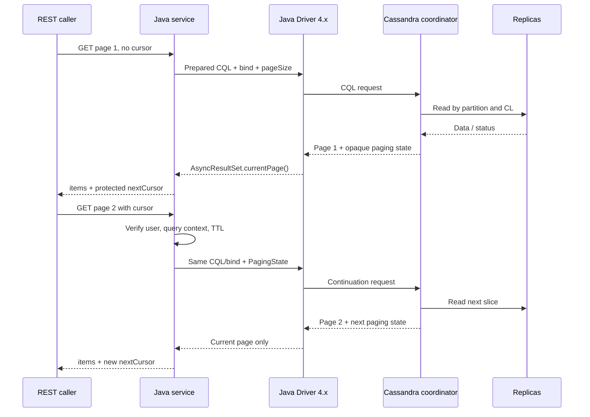
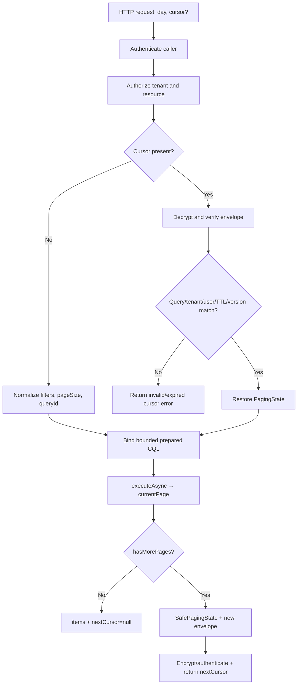

# `PagingState`, Resuming Pages, and Binding to the Original Query in the Cassandra Java Driver

## 1. Problem: fetching the next page without restarting from scratch

Apache Cassandra is a **distributed wide-column** database. When a Java application sends CQL, the **partition key** locates replicas, **clustering columns** order rows within a partition, and the coordinator collects responses per **replication factor (RF)** and **consistency level (CL)**. For large result sets, reading everything in one request spikes memory, network traffic, wait times, and timeout risk.

Suppose an orders API needs:

```text
GET /tenants/tenant-01/orders?day=2026-11-20&pageSize=20
→ first 20 orders + nextCursor

GET /tenants/tenant-01/orders?day=2026-11-20&pageSize=20&cursor=...
→ next page + new nextCursor
```

Java Driver 4.x provides **Cassandra paging** and **`PagingState`** to resume a query from where the previous page stopped. However:

- `PagingState` is an **internal, opaque continuation state**, not “offset = 20”.
- This state must remain bound to the **original query and matching parameter values**.
- A valid state **does not guarantee data stayed unchanged** between two calls.
- The state **carries no access rights** and does not replace tenant authorization.
- The state **has no built-in business TTL, security signature, or cross-upgrade stability guarantee**.

Lesson goal: design queries with clear partition keys, fetch one page with Java Driver 4.x, store/restore `PagingState` safely, and handle common bugs in multi-request paginated APIs.

## 2. Distinguishing three concepts: page size, LIMIT, and cursor

| Concept | Effect | Does NOT mean |
| --- | --- | --- |
| `setPageSize(20)` | Asks driver/server to process pages targeting roughly 20 rows each | Every page always has 20 rows, or the whole query reads only 20 rows |
| `LIMIT 100` | Caps total CQL rows returned across one logical query execution | Automatically produces an API with 5 pages or tells you the current page |
| `PagingState` | Holds the continuation position for a specific query/page | SQL `OFFSET`, an arbitrarily editable last key, or a data snapshot |
| `hasMorePages()` | Driver knows another page may be fetchable | The next page definitely has business rows or unchanged data |
| REST API `nextCursor` | Application string given to callers to resume the exact query | An auth/authorization token, login session, or backup |

**A page can hold fewer rows than `pageSize` even while more pages remain**, depending on how the server builds pages, tombstones, and protocol/version rules. Never infer from `rows.size() < pageSize` that no more data exists; rely on the continuation signal from the driver.

### `LIMIT` and page size are two separate bounds

With `LIMIT 100` and `setPageSize(20)`:

```text
Logical query: return at most 100 rows.
Fetch target: roughly 20 rows per round trip.
Actual page count: depends on data and server page boundaries.
```

If page 1 returned 20 rows, **never change `LIMIT 100` to `LIMIT 80` on page 2** and reuse the old `PagingState`. That would be a different query under the contract. Keep CQL text and parameters identical across the cursor's entire lifecycle.

If an endpoint must paginate across millions of rows, cap total `LIMIT` and max pages in the API. A huge `LIMIT` does not make scanning massive data cheap merely because `pageSize` is small.

## 3. Queries must be sound even without pagination

Cassandra works best when the **partition key** is known and reads a bounded clustering range. Paging only throttles data transfer; it **never fixes a bad data model**.

### Lab schema: orders by tenant and day

The lab assumes datacenter `dc1` has at least three replicas for RF=3. On smaller labs, align RF/CL with your lab infrastructure:

```sql
CREATE KEYSPACE IF NOT EXISTS paging_lab
WITH replication = {
    'class': 'NetworkTopologyStrategy',
    'dc1': 3
}
AND durable_writes = true;

CREATE TABLE IF NOT EXISTS paging_lab.orders_by_tenant_day (
    tenant_id text,
    order_day date,
    created_at timestamp,
    order_id uuid,
    status text,
    total_cents bigint,
    PRIMARY KEY ((tenant_id, order_day), created_at, order_id)
) WITH CLUSTERING ORDER BY (
    created_at DESC,
    order_id ASC
);
```

Partition key `(tenant_id, order_day)` locates **one tenant's orders on one day**. `created_at DESC` puts newest orders first within the partition; `order_id` breaks timestamp ties. A single-day bucket works only when **partition size** stays bounded; high-volume tenants may require sharding or smaller buckets per query design.

Paginated query:

```sql
SELECT created_at, order_id, status, total_cents
FROM paging_lab.orders_by_tenant_day
WHERE tenant_id = 'tenant-01'
  AND order_day = '2026-11-20'
LIMIT 100;
```

No `ALLOW FILTERING` is needed because the full partition key is present. Each page returns rows in clustering order **within that partition**; never assume global ordering across different tenants or days.

### When is a query still dangerous despite paging?

```sql
-- DO NOT use as an optimized pattern: lacks a clear partition key.
-- Query may be rejected or incur heavy scans/fan-out depending on index/schema.
SELECT created_at, order_id
FROM paging_lab.orders_by_tenant_day
WHERE status = 'PAID'
ALLOW FILTERING;
```

`setPageSize(20)` does not shrink the replicas/token ranges touched, nor make index/tracing/compaction work cheap. Fix the query-first table, partitioning/bucketing, or indexing before adding cursors.

## 4. How paging works across coordinator and driver



This diagram is conceptual, not a guarantee that every Cassandra release contacts identical replica sets or wire frames. **Each API call is an independent request**; Cassandra does not hold a transactional snapshot of the full list waiting for the user to click “Next”.

If coordinator/driver encounters data mutations, different replicas, or different caches/SSTables between calls, subsequent pages reflect those changes. Paging does not mean **snapshot isolation**.

## 5. Java Driver 4.x: sync iteration auto-fetches subsequent pages

In Java Driver 4.x, `session.execute(statement)` returns a synchronous `ResultSet`. Iterating over `ResultSet` can **automatically fetch subsequent pages**:

```java
ResultSet rs = session.execute(boundStatement);
for (Row row : rs) {
    process(row);
}
// May have fetched multiple pages, not just the first page.
```

If a service wants “one HTTP request = one Cassandra page”, never iterate casually over `ResultSet` assuming you can grab `PagingState` for page 1 alone. You could track `getAvailableWithoutFetching()` carefully, yet the cleaner way to **control paging explicitly** is the async API.

### `AsyncResultSet` isolates each page cleanly

Java Driver 4.x provides:

- `session.executeAsync(statement)`: returns `CompletionStage<AsyncResultSet>`.
- `asyncResultSet.currentPage()`: iterates rows **in the current page only**, never auto-fetching all pages.
- `asyncResultSet.hasMorePages()`: checks whether another page remains.
- `asyncResultSet.fetchNextPage()`: explicitly fetches the next page within the same flow.
- `asyncResultSet.getExecutionInfo()`: execution metadata, including the page's paging state.

Two usage patterns:

| Goal | Choice |
| --- | --- |
| Job/batch processing **all** rows with load bounds | Sync iteration or async fetch loop with backpressure |
| REST API returning **one** page + cursor per call | `executeAsync` + `currentPage` + safe paging state |
| Long-running worker streaming many pages | Controlled `fetchNextPage` with bounded concurrency |
| Resuming in a later HTTP request | Build **matching statement** and apply protected state |

**Never call `fetchNextPage()` just to compute the cursor for the page you just read**; when an API returns one page, extract the state from `ExecutionInfo` if more pages remain.

## 6. Safe `PagingState` vs raw state

In Java Driver 4.x releases supporting it, `ExecutionInfo` exposes:

- `getPagingState()`: lower-level paging state (typically `ByteBuffer`), following driver/protocol contracts.
- `getSafePagingState()`: a `PagingState` object with **validation binding it to the corresponding statement** when reapplied via the safe API.

Pattern:

```java
import com.datastax.oss.driver.api.core.cql.PagingState;

PagingState safeState =
    result.getExecutionInfo().getSafePagingState();

String serialized = safeState == null
    ? null
    : safeState.toString();
```

`PagingState` can be serialized to a string between requests and restored with `PagingState.fromString(...)` where supported. **Serialized format and compatibility must be verified for your exact driver minor version/distribution.**

### Why prefer safe paging state?

Applying an arbitrary paging state to a different query can yield wrong results, protocol errors, or broken continuation. Safe paging state catches certain mismatches (such as an incompatible statement) before sending the request.

Still, **“safe” does not mean encrypted, signed, user-bound, or expiring**. The REST layer must still:

- Authenticate the caller and verify tenant authorization.
- Confirm the token matches the endpoint, query shape, and filters.
- Reject tampered tokens, tokens copied to another user/tenant, or expired tokens.
- Protect token contents in transit and storage.
- Cap page sizes, continuation counts, and query load.

**Never accept raw `getPagingState()` from an untrusted caller and apply it blindly to any statement.** Never edit bytes, guess internal layouts, or decode internal fields: treat paging state strictly as opaque.

## 7. Binding to the original query: what must stay invariant?

To resume a page, the service must reconstruct the **exact logical context** of the previous page.

| Component | Page 1 example | What must Page 2 do? |
| --- | --- | --- |
| CQL text / query ID | `SELECT ... WHERE tenant_id=? AND order_day=? LIMIT 100` | Use the exact same prepared query |
| Bound tenant value | `tenant-01` | **Never** swap to `tenant-02` |
| Bound day value | `2026-11-20` | Keep identical |
| Other filters | `status` if part of a supported query/index | Keep all identical |
| Clustering order | `created_at DESC, order_id ASC` | Never change active schema/order |
| `LIMIT` | `100` | Never shrink to `80` based on rows already read |
| Page size | `20` | Keep fixed per cursor/API contract |
| Consistency level | `LOCAL_QUORUM` | Keep consistent for semantics; token does not enforce CL |
| Local DC / cluster | `dc1` / cluster A | Never send cluster A's state to cluster B |
| Identity / authorization | User authorized for `tenant-01` | Re-verify on every request |
| Schema / driver / protocol | Version when token was issued | Resume only within tested compatibility windows |

**Core rule:** `PagingState` is not “row #20” independent of the query. If the caller changes day, tenant, or predicate, **start a new query from page 1** instead of reusing the old state.

### Why keep page size and CL fixed even though safe state validates the statement?

Never assume `getSafePagingState()` validates **every** business option. The driver checks the bindings defined by its API, not your service policy. Bind `queryVersion`, `pageSize`, `CL`, `tenant`, and query parameters inside your cursor envelope so semantics never shift mid-stream.

### Never reuse `PagingState` across textually similar queries

Two queries fetching orders with different `SELECT` projections, `LIMIT`, predicates, or clustering schemas are distinct requests. Never take state from:

```sql
SELECT order_id
FROM paging_lab.orders_by_tenant_day
WHERE tenant_id = 'tenant-01'
  AND order_day = '2026-11-20'
LIMIT 100;
```

to resume:

```sql
SELECT order_id, status, total_cents
FROM paging_lab.orders_by_tenant_day
WHERE tenant_id = 'tenant-01'
  AND order_day = '2026-11-20'
LIMIT 100;
```

Even when both queries would match the same rows, **serialized paging state is not meant to be shared across different statements**.

## 8. Java Driver 4.x example: one API method returning one page

The example below uses Java 8+ and Java Driver 4.x. It assumes the Section 3 CQL table exists and TLS/auth and `CqlSession` are configured externally. **The plain string cursor here is for repository/lab use only; never expose it directly over the Internet without the protections in Section 9.**

```java
import java.time.Instant;
import java.time.LocalDate;
import java.util.ArrayList;
import java.util.Collections;
import java.util.List;
import java.util.UUID;
import java.util.concurrent.CompletionStage;

import com.datastax.oss.driver.api.core.CqlSession;
import com.datastax.oss.driver.api.core.DefaultConsistencyLevel;
import com.datastax.oss.driver.api.core.cql.AsyncResultSet;
import com.datastax.oss.driver.api.core.cql.BoundStatement;
import com.datastax.oss.driver.api.core.cql.PagingState;
import com.datastax.oss.driver.api.core.cql.PreparedStatement;
import com.datastax.oss.driver.api.core.cql.Row;

public final class OrdersPageRepository {
    private static final int PAGE_SIZE = 20;
    private final CqlSession session;
    private final PreparedStatement query;

    public OrdersPageRepository(CqlSession session) {
        this.session = session;
        this.query = session.prepare(
            "SELECT created_at, order_id, status, total_cents " +
            "FROM paging_lab.orders_by_tenant_day " +
            "WHERE tenant_id = ? AND order_day = ? LIMIT 100"
        );
    }

    public CompletionStage<Page> readPage(
            String authorizedTenant,
            LocalDate day,
            String safePagingStateString) {

        BoundStatement stmt = query.bind(authorizedTenant, day)
            .setConsistencyLevel(DefaultConsistencyLevel.LOCAL_QUORUM)
            .setPageSize(PAGE_SIZE)
            .setIdempotent(true);

        if (safePagingStateString != null) {
            PagingState state =
                PagingState.fromString(safePagingStateString);
            // Reuse the exact original statement query and bound values.
            stmt = stmt.setPagingState(state);
        }

        return session.executeAsync(stmt).thenApply(result -> {
            List<OrderItem> items = new ArrayList<>();
            for (Row row : result.currentPage()) {
                items.add(new OrderItem(
                    row.getInstant("created_at"),
                    row.getUuid("order_id"),
                    row.getString("status"),
                    row.getLong("total_cents")
                ));
            }

            String next = null;
            if (result.hasMorePages()) {
                PagingState safeState =
                    result.getExecutionInfo().getSafePagingState();
                if (safeState == null) {
                    throw new IllegalStateException(
                        "Server has more pages but no safe paging state");
                }
                next = safeState.toString();
            }
            return new Page(items, next);
        });
    }

    public static final class OrderItem {
        public final Instant createdAt;
        public final UUID orderId;
        public final String status;
        public final long totalCents;

        public OrderItem(
                Instant createdAt, UUID orderId,
                String status, long totalCents) {
            this.createdAt = createdAt;
            this.orderId = orderId;
            this.status = status;
            this.totalCents = totalCents;
        }
    }

    public static final class Page {
        public final List<OrderItem> items;
        public final String nextPagingStateString;

        public Page(
                List<OrderItem> items, String nextPagingStateString) {
            this.items = Collections.unmodifiableList(
                new ArrayList<>(items));
            this.nextPagingStateString = nextPagingStateString;
        }
    }
}
```

### Walk through each step carefully

1. `authorizedTenant` must come from **verified authorization**, never directly from an unvalidated user query parameter.
2. `query` is prepared **once** and reused; every request binds `tenant_id` and `order_day` in exact order.
3. `LOCAL_QUORUM` preserves service CL; RF=3 in `dc1` requires two healthy local replicas.
4. `PAGE_SIZE=20` and `LIMIT 100` remain constant across the entire query chain.
5. `PagingState.fromString(...)` only **deserializes the state**, not REST cursor validation.
6. `result.currentPage()` iterates only the current page, preventing fetching all pages.
7. Emit next state only when `hasMorePages()`; once exhausted, `nextPagingStateString=null`.
8. `setIdempotent(true)` fits pure `SELECT` reads; never apply blindly to counters/LWTs/writes.

This sample omits exception/cancellation handling, timeouts, token protection, and tracing; implement those in the service/HTTP layer and operations setup.

### Never create a new session per page

`CqlSession` manages connections, topology discovery, metadata, and prepared statements. Reuse one session across the application lifecycle instead of calling `CqlSession.builder().build()` inside `readPage`; recreating sessions adds latency and undermines pool/credential governance.

## 9. Designing `nextCursor` for REST APIs

**Never treat `safePagingStateString` from Section 8 as a production-ready public cursor.** Public APIs need an application-controlled **cursor envelope**, for example:

```json
{
  "version": 1,
  "queryId": "orders-by-tenant-day-v1",
  "tenantId": "tenant-01",
  "orderDay": "2026-11-20",
  "pageSize": 20,
  "consistency": "LOCAL_QUORUM",
  "issuedAt": "2026-11-20T10:00:00Z",
  "expiresAt": "2026-11-20T10:15:00Z",
  "driverPagingState": "<opaque-serialized-state>"
}
```

This is **illustrative data**, not a usable security token. In production:

- The envelope must be **authenticated and encrypted** (e.g., AEAD) or stored server-side behind an unguessable random token ID.
- Signing/encryption keys must live in a secrets manager with `keyId` and key rotation.
- Bind the caller's tenant and authorization scope; if needed, bind user/session/role and query fingerprint.
- Enforce short TTLs, versioned formats, and invalidation policies on schema/query upgrades.
- Validate `issuedAt`/`expiresAt`, `pageSize`, `queryId`, tenant, user, and parameter hashes **before** passing raw state to the driver.
- Cap token length, allowed characters, call counts, and per-caller load.
- Never log full tokens: tokens can contain internal metadata and grant continuation within their scope.

**Plain base64 JSON is not security.** Base64 is trivially decoded and forged, and the driver's `PagingState` never replaces HTTP authorization.

### What should clients send?

Two patterns:

**A — Self-contained cursor:** the client sends only `cursor` on subsequent calls; the server decrypts/verifies it and re-checks authorization against the token's scope.

**B — Cursor + query parameters:** the client resends `day`, `pageSize`, and `cursor`; the server matches them against the envelope and rejects mismatches.

Both are sound when designed explicitly. Avoid the broken pattern where a client sends `tenantId=tenant-B` with `tenant-A`'s cursor and the server assumes the state adapts automatically.

### Use server-side cursors when immediate revocation is needed

If you must **revoke cursors immediately** or keep all internal state off clients, store `PagingState` and query context in a TTL-backed server cache and return an opaque random ID. The trade-off is stateful cache infrastructure, cleanup, and cache availability; if cache entries expire or evict, clients must restart from page 1.

## 10. From REST endpoint to repository: validating in the right order

A sound request pipeline:



### Example endpoint contract

```text
GET /orders?day=2026-11-20&pageSize=20
Authorization: Bearer <access-token>

200 OK
{
  "items": [
    {"orderId": "11111111-1111-4111-8111-111111111111",
     "status": "PAID",
     "totalCents": 125000}
  ],
  "nextCursor": "<opaque-protected-cursor>"
}
```

When no more pages remain:

```json
{
  "items": [],
  "nextCursor": null
}
```

Showing an empty array on the final response merely illustrates **no remaining cursor**, not a claim that every last page is empty.

### Separating HTTP error handling

| Failure | Suggested handling | What NOT to do |
| --- | --- | --- |
| Malformed, tampered, or mismatched cursor | `400 Bad Request` or explicit cursor error code | Silently drop the cursor and return page 1 as success |
| Expired cursor or unsupported version | Dedicated error code instructing client to restart | Resume with state from an untested older version |
| Caller lost tenant permission | `403 Forbidden` / auth error | Trust tenant inside cursor and skip authorization |
| Insufficient RF/CL | Service error + Cassandra metrics | Auto-downgrade `LOCAL_QUORUM` to `ONE` |
| Transient timeout | Bounded conditional retry with backoff | Infinite retry or uncoordinated page duplication |
| Schema/query changed | Invalidate old tokens by `queryId`/version | Apply old state to new CQL and hope it works |

These are **API design suggestions**, not universal HTTP mandates. For expired cursors, `400`, `409`, or a domain error code may fit your contract, provided clients clearly know to restart pagination.

## 11. Data mutating between pages: no snapshot isolation

Suppose a partition holds four orders ordered by `created_at DESC`:

```text
Page 1 at T1:  O4, O3  | cursor after O3
Data at T2:    O5 inserted newer than O4; O2 deleted
Page 2 at T3:  resumed with old cursor
```

`PagingState` locates the next read position per Cassandra's read path, **without locking the partition into a stable snapshot**. When writes occur between T1 and T3:

- Rows inserted **ahead of the cursor** may never appear in the ongoing traversal.
- Deleted rows vanish; row counts per page can shift.
- Updating a clustering key is effectively **deleting the old key and inserting the new key**, shifting position.
- Expired TTLs produce tombstones and shrink results.
- Replicas answering at varying CLs or catching up can expose different rows.
- In some scenarios, callers may observe **skipped or duplicated items** if they assume an immutable list.

**Never promise “exactly-once, zero gaps, zero duplicates across pages” from `PagingState` alone.** Delivering that requires snapshots, versioned datasets, event logs, or a dedicated export pipeline.

### What should user interfaces do?

For live changing lists, accept **best-effort / read-time pagination** semantics, inform users that data may have changed, and let them refresh from page 1 when cursors expire.

When a stable search view is required:

- Capture result IDs in a bounded TTL snapshot store for that query.
- Or use **seek/keyset pagination** with clustering bounds and business-controlled ranges.
- Or build reports/exports on frozen or versioned datasets.

Keyset pagination anchors a logical boundary yet **still does not freeze live writes into a snapshot**. When seeking on clustering keys, include tie-breakers `(created_at, order_id)` and respect ordering; never use `created_at < lastTime` alone and drop rows sharing a timestamp.

## 12. Tokens carry no eternal stability guarantee

A token can fail or yield unexpected semantics when:

- Query text, filters, bound values, or `LIMIT` change.
- Schema changes: adding/dropping/altering columns, changing partition/clustering keys, or changing query strategy.
- Cassandra, driver, or protocol versions upgrade and state representations become incompatible.
- A token from cluster A is sent to cluster B or across staging/production.
- TTLs, deletes, compactions, or repairs alter the read path since the token was issued.
- The token is truncated, corrupted, tampered with, expired, or replayed by another caller.

Always version `queryId`, enforce reasonable TTLs, and support **restarting from page 1**. Never persist paging tokens in a database expecting “resume six months later” without verified compatibility and retention policies.

### Note on coordinators and replicas

Clients do not have to hit the **exact same physical coordinator** across pages when driver/protocol support state portability, yet that **does not** mean tokens can hop arbitrarily across clusters. Test routing, topology, protocol, and CL; never hardcode a node IP to “preserve cursor locality”.

## 13. Paging across multiple partitions, multiple DCs, or with ORDER BY

Cassandra only orders by clustering columns **within one partition** per valid schema/query. Suppose an app wants the 20 latest orders for a tenant across seven days:

```text
Partition 1: (tenant-01, 2026-11-20)
Partition 2: (tenant-01, 2026-11-19)
...
Partition 7: (tenant-01, 2026-11-14)
```

No `PagingState` from the Nov 20 query knows **Nov 19** is the next partition. If an API merges across partitions:

1. Maintain **one independent cursor/query per partition**, or build a dedicated query-first table.
2. Merge results by clustering/time key and tie-breaker for global ordering.
3. Cap concurrency, partition count, pages/bytes, and latency.
4. Protect the composite cursor in a versioned, authenticated, expiring envelope just like a single cursor.
5. On partial failures or continuation, preserve exact merge watermarks returned to clients to avoid gaps/duplicates.

**Never substitute one paging state for multiple independent queries.** Queries using `IN`, indexes/SAI, or multi-token ranges have distinct result-distribution semantics; benchmark and keep the original CQL fixed.

### DCs and consistency

With `NetworkTopologyStrategy` RF=3 in `dc1` and `dc2`:

- `LOCAL_QUORUM` in `dc1` checks two local replicas; a request in `dc2` may see slightly different data until WAN replication converges.
- Global `QUORUM` spans a different replica scope and must not be swapped silently mid-pagination.
- `PagingState` neither upgrades consistency nor forces replica synchronization.

Never fail over an active `dc1` paging session into another DC **without evaluating CL semantics and data freshness**. During cross-DC failovers, restarting pagination from page 1 or applying dedicated dedup/versioning may be necessary.

## 14. Resource limits and backpressure

Paging trims rows returned per trip, yet servers and drivers still locate, read, filter, and reconcile data. Control every knob:

| Control | Goal | Risk if misconfigured |
| --- | --- | --- |
| Page size | Balance round trips vs payload/page | Too large: memory/network/latency spikes; too small: excessive round trips |
| `LIMIT` | Cap total logical rows | Too large: API still permits long scans |
| Concurrent requests | Protect nodes and driver pools | Retry/fetch storms overload the cluster |
| Request timeout | Bound deadlines | Too low triggers excess retries; too high holds resources |
| Retry policy | Retry only when safe | Can multiply load and duplicate page fetches |
| Cursor TTL | Bound resume window | Too long: stale schema/state and hard revocation |
| Response size | Cap HTTP response bytes | Wide rows blow budgets even at low row counts |
| Rate limits | Curb per-user/tenant queries | One caller runs many cursors to scrape data |

**Never measure cost by row count per page alone.** A row with large collections or blobs makes even a 20-row page heavy; oversized partitions, tombstones, and SSTables/read drive latency.

### Avoid unbounded `fetchNextPage` loops

In backend workers, an unbounded `fetchNextPage` loop can drain an entire partition for hours and exhaust connection pools. Enforce:

- Total page, row, byte, and elapsed-time caps.
- Cancellation and deadline checks.
- Backpressure matched to downstream processing capacity.
- Checking `hasMorePages()`, plus guards against endless empty pages.
- Stopping immediately when the caller disconnects or work is complete.

Never fire thousands of parallel `session.executeAsync` calls hoping to “speed through all pages” of one query; that breaks sequential paging and ordering.

## 15. Observability and diagnosing resume failures

In Java apps, track separately:

- `queryId` and version, without logging full CQL containing data/secrets.
- Page index or continuation count in the chain (never trusting client-supplied counters blindly).
- Page size, rows returned, serialized bytes, and latency.
- Cassandra request count, attempt/retry counts, timeouts, and auth/TLS errors.
- Cursor invalid/mismatch/expired rates aggregated by reason.
- `hasMorePages` and cursor expiration times, without logging raw tokens.
- Tenant tags with bounded cardinality or anonymized IDs, avoiding high-cardinality sensitive labels.

### Cassandra diagnostic commands

```bash
nodetool status
nodetool tpstats
nodetool compactionstats
nodetool tablestats paging_lab.orders_by_tenant_day
nodetool tablehistograms paging_lab orders_by_tenant_day
```

`nodetool` figures are **local to the queried node**, not end-to-end Java latency. Distinguish paging-state bugs from load bottlenecks:

| Symptom | Hypothesis to test | First action |
| --- | --- | --- |
| `PagingState.fromString` fails | Corrupted, tampered, or truncated string | Reject cursor; never fall back silently |
| `setPagingState` rejects state | Different query/values or incompatible state | Compare `queryId`, bound values, driver version |
| Page 2 repeats page 1 | Client omitted state or server ignored cursor | Inspect request/repository flow and token version |
| Page returns fewer rows than page size | End of data, tombstones, server paging behavior | Check `hasMorePages`, not just row count |
| `hasMorePages` true yet page is empty | Paging/filtering/tombstones per query | Bound consecutive empty fetches; avoid infinite loops |
| Slow around page 10+ | Partition size, tombstones, SSTables/read, disk | Inspect `tablehistograms` and selective tracing |
| Resumes fail after rollout | Query text/schema/driver/protocol changed | Invalidate prior-version tokens and restart |
| `Unavailable` / timeout | Replica/CL/DC issue, not just cursor | Check RF, CL, nodes, network, deadlines |
| Duplicate or missing IDs after edits | List mutated mid-pagination | Clarify snapshot vs dedup contract |

Never rush to enable `TRACING ON` for all production traffic. Tracing adds overhead; sample selectively and correlate with Java p95/p99 and coordinator/replica metrics.

## 16. Step-by-step lab: verifying continuation state matches the query

### Step 1 — Load ordered test data

After creating `paging_lab` from Section 3:

```sql
INSERT INTO paging_lab.orders_by_tenant_day (
    tenant_id, order_day, created_at, order_id, status, total_cents
) VALUES (
    'tenant-01', '2026-11-20',
    '2026-11-20 09:00:00+0000',
    11111111-1111-4111-8111-111111111111, 'PAID', 125000
);

INSERT INTO paging_lab.orders_by_tenant_day (
    tenant_id, order_day, created_at, order_id, status, total_cents
) VALUES (
    'tenant-01', '2026-11-20',
    '2026-11-20 08:00:00+0000',
    22222222-2222-4222-8222-222222222222, 'CREATED', 48000
);

INSERT INTO paging_lab.orders_by_tenant_day (
    tenant_id, order_day, created_at, order_id, status, total_cents
) VALUES (
    'tenant-01', '2026-11-20',
    '2026-11-20 07:00:00+0000',
    33333333-3333-4333-8333-333333333333, 'CANCELLED', 99000
);
```

Three rows are not enough to exercise `PAGE_SIZE = 20`, so insert extra rows with distinct timestamps and unique `order_id`s, or temporarily set `PAGE_SIZE` in **lab code** to 2. Never alter page size between **two requests in the same cursor chain**.

### Step 2 — Call repository for page 1

```text
readPage("tenant-01", 2026-11-20, null)
→ [O1, O2], nextPagingStateString = "..."
```

`O1, O2` are illustrative labels. With page size 2 and three rows, a continuation state is usually produced; remember page size is a target, so **never write tests assuming every page always has exactly two rows**.

### Step 3 — Resume the next page

```text
readPage("tenant-01", 2026-11-20, state-1)
→ [O3], nextPagingStateString = null
```

Verify **exact ID set and clustering order**. If mutations happen between calls, tests must account for the Section 11 non-snapshot behavior.

### Step 4 — Test mismatched query context

Using state issued for `tenant-01`, call:

```text
readPage("tenant-02", 2026-11-20, state-1)
```

**Security expectation:** the API layer rejects **before** calling the repository when the token envelope mismatches the authorized tenant; when calling the repository directly with safe paging state, the driver can catch statement mismatches per its API. Never treat driver exceptions as your authorization layer.

### Step 5 — Test invalid and versioned tokens

Test garbage tokens, truncated tokens, expired tokens, `queryId` v1 used against query v2, and tokens from another cluster. Expected outcome is a **controlled cursor error**, with no server crash, no cross-tenant leak, and no silent fallback to page 1.

### Step 6 — Load testing

Measure page latency at page sizes 20, 50, and 100 across **independent query chains** without changing size mid-chain. Compare:

- API p95/p99, response bytes, and driver attempts.
- `currentPage` counts and `hasMorePages`.
- Service CPU and memory usage.
- Cassandra read latency, SSTables/read, and tombstone metrics.

Pick the page size from SLOs and representative datasets, never from a three-row toy test.

## 17. Self-assessment scenarios

### Scenario A — Swapping tenant when reusing a cursor

Page 1 queries `tenant-A` and returns a state; on page 2 the caller switches to `tenant-B`. Can you rely on safe paging state alone to guarantee no cross-tenant read?

**Guiding answer:** No. Enforce API authorization and an authenticated/encrypted envelope; safe state only checks statement bindings and never replaces tenant permissions.

### Scenario B — Starting with `LIMIT 100` then shrinking to 80

Page 1 reads 20 rows from a `LIMIT 100` query. For page 2, the developer sets `LIMIT 80` because “80 rows remain”. Is this right?

**Guiding answer:** No. Query text/parameters changed. Keep `LIMIT 100` and the continuation state constant; the server/driver tracks progress.

### Scenario C — Page returns 12 rows instead of 20

A client receives 12 rows and concludes “end of list” even though `hasMorePages() == true`. Why is that wrong?

**Guiding answer:** Page size is a target, not a fixed row-count guarantee. Check state and `hasMorePages()`, never row count alone.

### Scenario D — A new order arrives after page 1

Page 1 returned `O4, O3`; before page 2, `O5` is inserted newer than `O4`. Is `O5` guaranteed to appear on a later page?

**Guiding answer:** No. Paging does not lock a snapshot; `O5` sorts ahead of the already-scanned cursor and will likely be missed in the current traversal. Clients should refresh or use a snapshot/versioned design if stability is required.

### Scenario E — App deploy changes query projection

A cursor was issued by `SELECT order_id`. A new deployment changes the query to `SELECT order_id, status` and replays old state. Should it retry forever?

**Guiding answer:** No. Tokens are tied to the original query; version `queryId`, invalidate old cursors, and require restarting pagination on incompatible query changes.

### Scenario F — Returning raw state over the Internet

An API returns `safePagingState.toString()` directly without checking user or expiry. Can this be called a “safe cursor”?

**Guiding answer:** No. Driver “safe” does not mean encrypted, authenticated, expiring, or authorized. Use a protected cursor envelope or server-side cursor ID.

### Scenario G — One page across seven days

An API queries seven daily partitions, one query per day. A developer saves only day 1's `PagingState` expecting to resume all seven days. What is wrong?

**Guiding answer:** Each query has its own state; you need a composite cursor or a different query/table design, plus merge ordering, deduplication, and request bounds.

### Scenario H — A node goes down between pages

RF=3, `LOCAL_QUORUM`. Page 1 succeeds; before page 2, one replica goes down. Can pagination continue?

**Guiding answer:** If the remaining two local replicas are healthy and serve the data, local quorum can still succeed. However, p99 and timeout risk may rise; `PagingState` neither adds replicas nor alters CL.

## 18. Production paging implementation checklist

**Queries and data**

- [ ] Partition key / clustering key match query shape; never use paging to mask `ALLOW FILTERING` or full scans.
- [ ] Separated total `LIMIT` from `setPageSize` and enforced row/byte/time caps in the API.
- [ ] Kept CQL, bound values, filters, `LIMIT`, and page size constant across a cursor chain.
- [ ] Verified in-partition clustering order and any multi-partition merge logic.
- [ ] Documented explicitly that paging **does not provide snapshot isolation** for mutating data.

**Java Driver 4.x**

- [ ] Used `PreparedStatement` and `BoundStatement`, reusing `CqlSession`.
- [ ] Used `AsyncResultSet.currentPage()` whenever one HTTP request should return one page.
- [ ] Never iterated a synchronous `ResultSet` assuming only one page was fetched.
- [ ] Extracted `getSafePagingState()` only when `hasMorePages()` is true and encoded per supported API.
- [ ] Resumed with `PagingState.fromString(...)` and `setPagingState(...)` on an identical statement.
- [ ] Never modified, fabricated, or inferred numeric offsets from raw paging bytes.
- [ ] Maintained consistent CL, local DC, driver/protocol compatibility, and cursor TTLs.

**Security, operations, and compatibility**

- [ ] Checked tenant authorization and scope **on every HTTP request**, including resumes.
- [ ] Encrypted/authenticated cursors or used server-side IDs with versions, TTLs, and size limits.
- [ ] Excluded raw paging state, bearer tokens, and sensitive data from logs and metric labels.
- [ ] Returned explicit errors on invalid/mismatched/expired tokens instead of silently restarting at page 1.
- [ ] Planned cursor invalidation across incompatible schema, query, or driver upgrades.
- [ ] Enforced rate limits, backpressure, and monitoring for page counts, latency, timeouts, and retries.
- [ ] Tested inserts, deletes, TTLs, and repairs between pages and handled duplicates/gaps per business rules.
- [ ] Designed dedicated snapshot/version mechanisms whenever strict point-in-time consistency is required.

**Remember:** Cassandra Java Driver's `PagingState` is an **opaque pointer for resuming the exact same query**, not a SQL offset, snapshot, auth token, or permanent compatibility contract. Use `AsyncResultSet.currentPage()`, `hasMorePages()`, and safe state with the **exact same CQL, parameters, and context**; wrap it in an authenticated, expiring cursor bound to tenant and query version. Proper pagination controls how results are streamed, while **partition design, RF/CL, concurrent mutations, and authorization** govern API correctness and availability.
