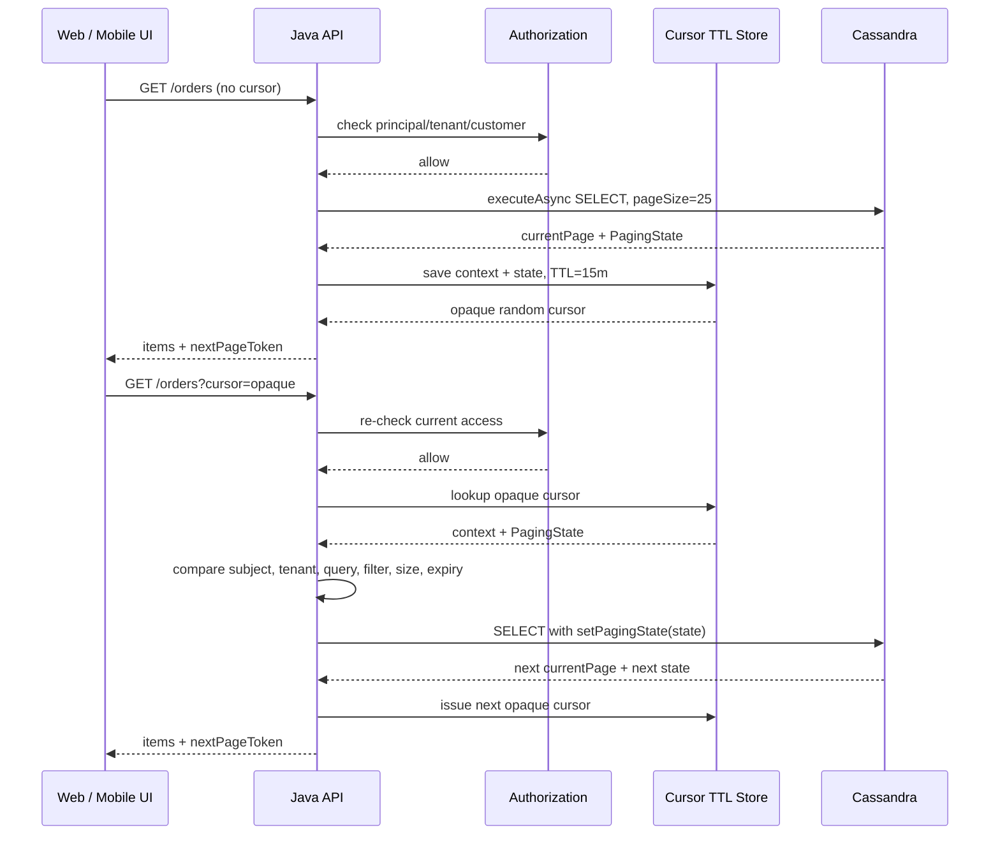

# Protecting Paging Tokens When Exposing Them to Application UIs

> **Chapter:** Query Execution from Java  
> **Scope:** Apache Cassandra and **Java Driver 4.x**, focusing on turning **internal paging state** into a **secure pagination cursor** for REST APIs, web/mobile UIs, or multi-tenant services.
>
> **Learning objectives:** Understand how Cassandra paging state differs from partition tokens and offsets; distinguish `AsyncResultSet.currentPage()` from auto-fetching all pages; never leak raw paging state to clients; design unguessable, expiring opaque cursors bound to identity, tenant, and query; know when to use AEAD authenticated encryption; test against token leakage/swapping; and understand why Cassandra paging **is not an immutable snapshot**.

## 1. Scenario: functionally working pagination that leaks data

A Java API serves a list of orders by customer and day:

```http
GET /api/orders?customerId=11111111-1111-4111-8111-111111111111&day=2026-11-21&pageSize=25
Authorization: Bearer <access-token>
```

The app queries Cassandra with `setPageSize(25)`. After page 1, the Java Driver returns a **paging state** to continue. One developer takes the shortest path: converting the paging state to a string and returning it verbatim to the browser:

```json
{
  "items": [
    {"orderId": "aaaaaaaa-aaaa-4aaa-8aaa-aaaaaaaaaaaa", "status": "PAID"}
  ],
  "nextPageToken": "<raw-cassandra-paging-state>"
}
```

The UI sends that string back on the next request. Functionally, the API appears to work. Yet it introduces major risks:

- **Internal structure leakage:** paging state can contain positioning metadata such as partition/clustering keys or protocol internals; it was never designed for public consumption.
- **Context swapping:** a client sends customer A's token alongside customer B's parameters.
- **Cross-tenant or cross-user reuse:** a token is copied from one account and replayed under another.
- **Tampering or malformed strings:** the API passes untrusted bytes directly into the driver/server.
- **Excessive lifetime:** tokens linger in browser history, analytics, logs, or URLs for days.
- **Data drift:** when inserts, deletes, or TTL expirations happen between pages, users do not see a frozen snapshot.

**Sound design:** clients only ever see an **application cursor**, while Cassandra's paging state stays protected server-side or sealed inside an **authenticated, encrypted envelope**.

## 2. First, distinguish three kinds of “tokens”

In Cassandra ecosystems, the word *token* refers to very different things:

| Name | What is it for? | Created / managed by? | Should it go straight to UI? |
| --- | --- | --- | --- |
| **Partition token** | Locates a partition on the token ring via the partitioner | Cassandra from the partition key | Not an API pagination mechanism |
| **Paging state** | Resumes reading a CQL result set where the prior query paused | Server/driver native protocol | **Should not be exposed directly** |
| **Application cursor / `nextPageToken`** | Application's pagination protocol | Backend API | Yes, **when properly protected** |

For example, `token(customer_id)` in Cassandra describes ring placement and **cannot substitute for paging state** to fetch the next 25 rows within a partition.

Conversely, the Java Driver's `PagingState` is neither a login JWT nor a user session cookie. It carries zero guarantee that the bearer is authorized to read the data.

### A helpful comparison

```text
Partition token:
  "Which region of the ring owns this partition?"

Cassandra paging state:
  "Where did the previous CQL query stop?"

API cursor:
  "Which authorized user may request which page
   of which query, under what limits and expiration?"
```

A secure API adds the **third layer**, instead of merely Base64-encoding the second.

## 3. How does Cassandra paginate?

Cassandra distributes data by **partition key**, orders rows inside a partition by **clustering key**, and executes CQL per query. When results are large, server and driver split them into **protocol-level pages** rather than sending every row at once.

Query-driven table example:

```cql
CREATE TABLE IF NOT EXISTS lab.orders_by_customer_day (
    tenant_id text,
    customer_id uuid,
    day_bucket date,
    created_at timestamp,
    order_id uuid,
    status text,
    total decimal,
    PRIMARY KEY ((tenant_id, customer_id, day_bucket),
                 created_at, order_id)
) WITH CLUSTERING ORDER BY (created_at DESC, order_id ASC);
```

Assume keyspace `lab` exists with `NetworkTopologyStrategy` and RF matching your lab cluster.

Reading by the **full partition key**:

```cql
SELECT created_at, order_id, status, total
FROM lab.orders_by_customer_day
WHERE tenant_id = 'tenant-a'
  AND customer_id = 11111111-1111-4111-8111-111111111111
  AND day_bucket = '2026-11-21';
```

Rows inside the partition sort by `created_at DESC`, then `order_id ASC`. In Java Driver, requesting page size 25 streams chunks of this result set.

### `setPageSize(25)` is not `LIMIT 25`

| Concept | Function |
| --- | --- |
| `setPageSize(25)` | Hints target rows/size per **protocol page**; does not cap the total query at 25 rows |
| CQL `LIMIT 25` | Caps the **total rows** returned by that query execution |
| API `nextPageToken` | Lets clients request the next slice if more remain |
| SQL `OFFSET 25` | Row-skipping model; **not how Cassandra normally paginates** |

Never set `LIMIT 25` expecting a paging token to resume beyond row 25. For protocol-page API pagination, keep a **stable query shape** with an appropriate `setPageSize`.

**Nor is page size a promise of always receiving 25 rows.** Byte caps, tombstones, server responses, and execution state can return fewer rows than requested.

## 4. What is `PagingState` in Java Driver 4.x?

In Java Driver 4.x, `PagingState` encapsulates continuation metadata supplied by the server/driver to resume a query from its last position.

Standard flow:

```text
Prepared SELECT + bound values + page size
                  |
                  v
         session.executeAsync()
                  |
                  v
             AsyncResultSet
                  |
         +--------+---------+
         |                  |
    currentPage()       hasMorePages()
    rows of current       |
    page                  |
                       if true
                          |
                 ExecutionInfo paging state
                          |
                   next page request
```

Keep in mind:

- Paging state belongs to a **specific query**, bound values, and protocol context.
- It **does not prove** the sender is authenticated or authorized for that partition.
- It **does not provide snapshot isolation** across page flips.
- It can break across schema, query, protocol, version, or data changes.
- Never treat it as a stable public storage format or a self-protecting secret.

Some driver APIs/versions check whether a paging state matches the statement. That check is only **functional validity**, never a substitute for backend authentication and authorization.

## 5. Why does `AsyncResultSet` fit REST pagination?

The Java Driver offers both synchronous and asynchronous APIs.

With synchronous `ResultSet`, iterating its rows can **automatically fetch subsequent pages** behind the scenes. If an app writes:

```java
// Do NOT use to satisfy "one HTTP request = one Cassandra page".
ResultSet rs = session.execute(statement);
List<Row> everyRow = rs.all();
```

it can pull **every page** of the result set, bloating responses, exhausting RAM, and defeating lazy pagination.

With `AsyncResultSet`:

- `currentPage()` iterates only rows in the current page.
- `hasMorePages()` indicates whether another page exists in the current context.
- `fetchNextPage()` requests the next page **only if the app explicitly chooses to fetch it**.
- `getExecutionInfo().getPagingState()` returns the continuation position to attach to the next request's statement.

Using `AsyncResultSet` lets the backend deliberately return **one Cassandra page per API call**, instead of draining the whole result set.

### Never call `fetchNextPage()` just to grab a cursor

Once the current page exposes a paging state in `ExecutionInfo`, the backend can issue its cursor and finish the HTTP response. Calling `fetchNextPage()` immediately just to obtain the next token triggers an extra network round trip and can blow resource budgets.

Only chain fetches inside one request when **deliberately justified** (e.g., filtering rows post-read) and enforce strict total page and time budgets.

## 6. Minimal example: obtaining paging state on the backend

Illustrative Java Driver 4.x snippet—**not yet a secure public API**:

```java
import java.time.LocalDate;
import java.util.UUID;
import java.util.concurrent.CompletionStage;

import com.datastax.oss.driver.api.core.CqlSession;
import com.datastax.oss.driver.api.core.DefaultConsistencyLevel;
import com.datastax.oss.driver.api.core.cql.AsyncResultSet;
import com.datastax.oss.driver.api.core.cql.BoundStatement;
import com.datastax.oss.driver.api.core.cql.PagingState;
import com.datastax.oss.driver.api.core.cql.PreparedStatement;

public final class InternalPagingProbe {
    private final CqlSession session;
    private final PreparedStatement prepared;

    public InternalPagingProbe(CqlSession session) {
        this.session = session;
        prepared = session.prepare(
            "SELECT created_at, order_id, status, total " +
            "FROM lab.orders_by_customer_day " +
            "WHERE tenant_id = ? AND customer_id = ? " +
            "AND day_bucket = ?"
        );
    }

    public CompletionStage<AsyncResultSet> firstPage(
            String tenant, UUID customerId, LocalDate day) {
        BoundStatement statement =
            prepared.bind(tenant, customerId, day)
                .setPageSize(25)
                .setConsistencyLevel(
                    DefaultConsistencyLevel.LOCAL_QUORUM)
                .setIdempotent(true);

        return session.executeAsync(statement)
            .thenApply(result -> {
                for (var row : result.currentPage()) {
                    // Process rows of this page.
                    UUID orderId = row.getUuid("order_id");
                    System.out.println(orderId);
                }

                if (result.hasMorePages()) {
                    PagingState state =
                        result.getExecutionInfo().getPagingState();

                    // Keep state on the backend or in a cursor store only.
                    // NEVER return raw state straight to the UI.
                    if (state == null) {
                        throw new IllegalStateException(
                            "Expected a paging state");
                    }
                }
                return result;
            });
    }
}
```

The snippet uses **Java 10+** for `var` alongside Java Driver 4.x. Replace `var` with `Row` if targeting Java 8.

**Note:** this illustrates accessing a page and paging state. Production requires identity verification, page-size bounds, scope/query validation, timeouts, TLS, and DTO mapping. Never log sensitive order details.

## 7. Threats when returning raw paging state

### Internal information disclosure

Paging state can embed internal positioning bytes, key values, or query metadata. Even when it does not contain full business payloads, it **was never built as a public client-facing token**.

### Query swapping

A client captures paging state from:

```text
tenant = tenant-a
customer = C1
day = 2026-11-21
```

and replays it with:

```text
tenant = tenant-b
customer = C2
day = 2026-11-22
```

If the backend applies the token without verifying original parameters and authorization, it risks querying out-of-scope data or triggering obscure errors. **Never rely on the driver as a multi-tenant authorization boundary.**

### Token tampering attacks

Clients can truncate strings, flip bytes, submit megabyte-long strings, or send incompatible states. Passing raw untrusted strings straight to the driver triggers parsing errors, invalid queries, or wasted server work.

### URL / log leakage

When cursors travel in query strings:

```http
GET /api/orders?cursor=<secret-cursor>
```

they get captured by access logs, APMs, browser histories, analytics, and shared links. Because a cursor grants continuation access to read data, it acts as a **sensitive bearer reference**, even though it is not a login credential.

### Replay and stale usage

A token without expiration can be replayed days later after permissions or data changed. Even structurally valid tokens must not blindly grant read access.

## 8. Security goals for an application cursor

A public cursor should guarantee:

1. **Unguessability:** never sequential counters or enumerable IDs.
2. **Opaque paging state:** clients cannot inspect internal bytes.
3. **Immutable context:** backend detects any change in tenant, user, query/filters, or page size.
4. **Expiration:** rejected once expired or when schema/query contracts become incompatible.
5. **Per-use authorization:** permission revocations take effect immediately even if a cursor has remaining TTL.
6. **Resource caps:** page size, request rate, page count, and token length are bounded.
7. **Clean failure modes:** tampered/expired/mismatched tokens never leak unintended rows.
8. **Zero Cassandra coupling in clients:** the UI holds only an opaque string.

### Separate user authentication from pagination

Applications authenticate users via an **access token** from an IdP or auth service—that proves identity.

An application cursor merely represents a **continuation point for an already-authorized query**. The API must still verify the access token/session, resource access, tenant ownership, and data policies on **every request**.

**A cursor must never replace authorization.**

## 9. Two cursor protection models

| Model | Token sent to UI | Pros | Trade-offs |
| --- | --- | --- | --- |
| **Stateful opaque reference** | Meaningless random string used as a server-side lookup key | Hides raw state trivially; instant revocation/TTL; simpler crypto | Needs shared TTL store and capacity management |
| **Stateless encrypted envelope** | Authenticated-encrypted cursor payload via AEAD (e.g., AES-GCM) | No per-cursor storage in Redis/DB | Needs key/nonce/AAD/rotation governance; immediate revocation is hard |

**Recommendation for new systems:** start with **opaque random cursors + a server-side TTL store**, especially when you need revocation, session quotas, and smooth multi-environment rollouts.

Choose stateless only when your team has strong key management and has thoroughly designed expiry, replay protection, schema/version compatibility, and encryption tests.

### Approaches that are NOT secure enough

- `Base64(rawPagingState)`: encoding only, **zero confidentiality or integrity**.
- `Base64(JSON with tenant and state)`: anyone can decode and forge it.
- `Signed but unencrypted JWT`: protects integrity, **still exposes payload contents**.
- `HMAC(rawPagingState)` alongside plaintext state: checks integrity if done right, yet **leaks internal bytes**.
- One-way hash of paging state without a store: cannot reconstruct continuation state from a hash.
- Relying solely on `PagingState.matches(statement)`: does not handle authorization, expiry, or leakage.

## 10. Endpoint design with a fixed contract

API example:

```http
GET /api/v1/orders?customerId=11111111-1111-4111-8111-111111111111&day=2026-11-21&pageSize=25
Authorization: Bearer <access-token>
```

Response:

```json
{
  "items": [
    {
      "orderId": "aaaaaaaa-aaaa-4aaa-8aaa-aaaaaaaaaaaa",
      "createdAt": "2026-11-21T10:00:00Z",
      "status": "PAID"
    }
  ],
  "nextPageToken": "uZ-n2p4Pz3J....<opaque-random-string>....",
  "hasMore": true
}
```

Next request:

```http
GET /api/v1/orders?customerId=11111111-1111-4111-8111-111111111111&day=2026-11-21&pageSize=25&cursor=<opaque-random-string>
Authorization: Bearer <access-token>
```

The sample token illustrates structure only; it is not a real token.

### API rules

- `customerId`, `day`, and `pageSize` on follow-up requests must **match the context bound to the token**.
- Derive tenant strictly from the **authenticated principal**, never trusting browser-supplied tenant IDs.
- Re-check permission to read `customerId` on **every request**.
- Bound `pageSize` (e.g. `1..100`) on both initial and resumed requests.
- Return `nextPageToken = null` when no pages remain.
- Issue a fresh cursor per page; never let the UI parse or modify cursors.
- Return `Cache-Control: private, no-store` for sensitive data/tokens.
- Ensure access logs, APM, analytics, and client error reporters **never record raw cursors**.

When query-string logging cannot be prevented in your stack, consider `POST /api/v1/orders/search-page` with the cursor in a JSON body; this **still requires TLS and log redaction**, because POST bodies are not automatically exempt from logging.

## 11. Which facts must bind to the cursor?

A server-side cursor entry should capture at minimum:

| Field | Why needed |
| --- | --- |
| `subjectId` | Prevents reuse by another user account |
| `tenantId` | Prevents cross-tenant reuse |
| `queryId` / query contract version | Prevents applying state to a different prepared query |
| `customerId` | Pins the partition scope |
| `dayBucket` | Pins the remainder of the partition key |
| `pageSize` | Stops clients from altering page size mid-chain |
| `PagingState` | Internal continuation position, never returned to UI |
| `issuedAt` and `expiresAt` | Enforces lifetime |
| `schema/driver compatibility version` (if needed) | Rejects stale state across breaking query/schema/protocol upgrades |

Any filters, sort modes, or feature flags altering query results must also be **part of the query contract identity**.

### Canonicalization matters

If an API accepts:

```text
status=PAID,SHIPPED
sort=createdAtDesc
locale=vi-VN
```

define canonical normalization (set ordering, casing, timezone, date formatting, sort mode) before comparing against the cursor. Never let two semantically different queries look identical because a hash omitted a parameter.

In this lesson's example, the query uses **one partition key and fixed clustering order**, keeping binding straightforward.

## 12. Stateful cursor sequence diagram



**The cursor store holds sensitive state:** enforce ACLs, TLS, TTLs, quotas, and encryption at rest. Just because clients only hold a random string does not mean the backend can store raw state unprotected.

## 13. Java Driver 4.x: opaque cursor implementation example

The complete example below uses **Java 17** (records), **Java Driver 4.x**, and an **in-memory map** to make the algorithm crystal clear. It is for **lab / single-process demonstration**; production must replace the map with a distributed TTL store featuring encryption, quotas, and shared cross-instance access.

The schema uses `lab.orders_by_customer_day` from Section 3. Tenant ID comes strictly from the authenticated principal, never from client query strings.

### Java code

```java
import java.security.SecureRandom;
import java.time.Clock;
import java.time.Duration;
import java.time.Instant;
import java.time.LocalDate;
import java.util.ArrayList;
import java.util.Base64;
import java.util.List;
import java.util.UUID;
import java.util.concurrent.CompletableFuture;
import java.util.concurrent.CompletionStage;
import java.util.concurrent.ConcurrentHashMap;
import java.util.concurrent.ConcurrentMap;

import com.datastax.oss.driver.api.core.CqlSession;
import com.datastax.oss.driver.api.core.DefaultConsistencyLevel;
import com.datastax.oss.driver.api.core.cql.AsyncResultSet;
import com.datastax.oss.driver.api.core.cql.BoundStatement;
import com.datastax.oss.driver.api.core.cql.PagingState;
import com.datastax.oss.driver.api.core.cql.PreparedStatement;
import com.datastax.oss.driver.api.core.cql.Row;

public final class SafeOrdersPager {
    private static final int MAX_PAGE_SIZE = 100;
    private static final Duration CURSOR_TTL =
        Duration.ofMinutes(15);
    private static final String QUERY_ID =
        "orders-by-customer-day-v1";

    public record Principal(String subjectId, String tenantId) {}
    public record OrderView(
        UUID orderId, Instant createdAt, String status) {}
    public record Page(
        List<OrderView> items, String nextPageToken) {}

    // Backend must enforce real business authorization:
    // is this principal allowed to read this customer?
    @FunctionalInterface
    public interface AccessPolicy {
        boolean canRead(Principal principal, UUID customerId);
    }

    private record CursorEntry(
        String subjectId,
        String tenantId,
        String queryId,
        UUID customerId,
        LocalDate dayBucket,
        int pageSize,
        PagingState state,
        Instant expiresAt
    ) {}

    private final CqlSession session;
    private final PreparedStatement select;
    private final AccessPolicy accessPolicy;
    private final Clock clock;
    private final SecureRandom random = new SecureRandom();

    // LAB ONLY: single-instance, no background eviction,
    // tokens do not survive restarts. Production uses Redis
    // or a distributed TTL store with encryption/quotas/ACLs.
    private final ConcurrentMap<String, CursorEntry> demoStore =
        new ConcurrentHashMap<>();

    public SafeOrdersPager(
            CqlSession session, AccessPolicy accessPolicy,
            Clock clock) {
        this.session = session;
        this.accessPolicy = accessPolicy;
        this.clock = clock;
        this.select = session.prepare(
            "SELECT created_at, order_id, status " +
            "FROM lab.orders_by_customer_day " +
            "WHERE tenant_id = ? AND customer_id = ? " +
            "AND day_bucket = ?"
        );
    }

    private static CompletionStage<Page> rejected(String reason) {
        return CompletableFuture.failedFuture(
            new IllegalArgumentException(reason));
    }

    private String issueCursor(CursorEntry entry) {
        for (int attempt = 0; attempt < 5; attempt++) {
            byte[] bytes = new byte[32]; // 256-bit random
            random.nextBytes(bytes);
            String token = Base64.getUrlEncoder()
                .withoutPadding().encodeToString(bytes);

            if (demoStore.putIfAbsent(token, entry) == null) {
                return token;
            }
        }
        throw new IllegalStateException(
            "Unable to issue a unique cursor");
    }

    public CompletionStage<Page> page(
            Principal principal,
            UUID customerId,
            LocalDate dayBucket,
            int requestedPageSize,
            String cursorToken) {

        if (principal == null ||
            principal.subjectId() == null ||
            principal.tenantId() == null ||
            customerId == null ||
            dayBucket == null) {
            return rejected("Invalid request");
        }

        if (requestedPageSize < 1 ||
            requestedPageSize > MAX_PAGE_SIZE) {
            return rejected("Invalid page size");
        }

        // MANDATORY authorization check on EVERY request,
        // both initial and resumed pages.
        if (!accessPolicy.canRead(principal, customerId)) {
            return CompletableFuture.failedFuture(
                new SecurityException("Access denied"));
        }

        Instant now = clock.instant();
        CursorEntry previous = null;
        Instant deadline = now.plus(CURSOR_TTL);

        if (cursorToken != null) {
            if (cursorToken.isEmpty() ||
                cursorToken.length() > 128) {
                return rejected("Invalid or expired cursor");
            }

            previous = demoStore.get(cursorToken);

            if (previous == null ||
                !now.isBefore(previous.expiresAt()) ||
                !previous.subjectId().equals(principal.subjectId()) ||
                !previous.tenantId().equals(principal.tenantId()) ||
                !QUERY_ID.equals(previous.queryId()) ||
                !previous.customerId().equals(customerId) ||
                !previous.dayBucket().equals(dayBucket) ||
                previous.pageSize() != requestedPageSize) {

                // Never disclose which field mismatched over public API.
                return rejected("Invalid or expired cursor");
            }

            // Cap the lifetime of the pagination chain: do not extend indefinitely.
            deadline = previous.expiresAt();
        }

        BoundStatement statement = select.bind(
                principal.tenantId(), customerId, dayBucket)
            .setConsistencyLevel(
                DefaultConsistencyLevel.LOCAL_QUORUM)
            .setPageSize(requestedPageSize)
            .setIdempotent(true);

        if (previous != null) {
            statement = statement.setPagingState(previous.state());
        }

        final Instant finalDeadline = deadline;

        return session.executeAsync(statement)
            .thenApply(result -> {
                List<OrderView> items = new ArrayList<>();

                // currentPage() ONLY; never auto-fetch everything.
                for (Row row : result.currentPage()) {
                    items.add(new OrderView(
                        row.getUuid("order_id"),
                        row.getInstant("created_at"),
                        row.getString("status")
                    ));
                }

                String nextToken = null;

                if (result.hasMorePages()) {
                    PagingState state =
                        result.getExecutionInfo().getPagingState();

                    if (state == null) {
                        throw new IllegalStateException(
                            "Missing server paging state");
                    }

                    CursorEntry next = new CursorEntry(
                        principal.subjectId(),
                        principal.tenantId(),
                        QUERY_ID,
                        customerId,
                        dayBucket,
                        requestedPageSize,
                        state,
                        finalDeadline
                    );

                    nextToken = issueCursor(next);
                }

                return new Page(List.copyOf(items), nextToken);
            });
    }
}
```

### Usage from a controller

After authenticating the bearer token/JWT or session, the controller builds a trusted `Principal`:

```java
// HTTP layer pseudocode: principal must come from auth middleware.
SafeOrdersPager.Principal principal =
    new SafeOrdersPager.Principal(
        authenticatedUserId,
        authenticatedTenantId
    );

// AccessPolicy must enforce real customer permissions;
// never return true unconditionally in production.
return pager.page(
    principal,
    customerId,
    LocalDate.parse(dayString),
    pageSize,
    cursorFromHttpRequest
);
```

No passwords, private keys, or raw paging state ever reach the UI response.

## 14. Why does the example use 32-byte `SecureRandom`?

Cursors such as:

```text
cursor=1
cursor=2
cursor=3
```

are trivially guessed and enumerated. UUID v4 provides substantial randomness, yet a 32-byte opaque token from `SecureRandom` cleanly delivers a **large, non-sequential keyspace**.

With 32 bytes:

```text
32 bytes × 8 = 256 bits of random entropy
Unpadded Base64url -> URL-safe string
```

**Base64url here merely encodes random bytes**, rather than “hiding data with Base64”. Security rests on the **unguessable random value** combined with server-side context checks.

### Operational notes for stateful cursors

- The store must enforce **automatic TTL** and quotas to avoid unbounded growth.
- With multiple API instances ⇒ use a **shared store**, never relying on sticky sessions.
- Store restart/eviction ⇒ old cursors expire; the API should signal the frontend to restart.
- **Never log raw cursors**; correlate with independent request IDs.
- Consider **one-time consumption** when strict anti-replay is required, while handling network retries and browser Back buttons.
- Encrypt and restrict access to store entries, as they contain paging state and query scope.
- Bump `QUERY_ID` and reject old cursors whenever the query contract changes.

**Important demo caveat:** `ConcurrentHashMap` in the sample **does not evict expired entries automatically**; expiry checks only block usage. Production requires real TTL eviction, quotas, and memory caps, such as a distributed cache configured with TTLs.

## 15. Cursors bind to access scope, yet permissions must still be re-checked

Suppose user U1 has permission to view customer C1 and receives a cursor at 10:00. At 10:05, U1's access to C1 is revoked. With a 15-minute cursor TTL:

- **Never** let U1 keep reading until 10:15 merely because the cursor has not expired.
- The backend must **re-evaluate `AccessPolicy`** against live permissions.
- The Cassandra DB role used for connections does not necessarily reflect end-user permissions in multi-tenant systems. When the backend reads through a shared service account, **application authorization is mandatory**.

Even when a cursor binds `subjectId`, if users can switch active tenants, the backend must verify the **current active tenant context**.

### Why never take tenant from the UI?

Example request:

```http
GET /api/orders?tenantId=tenant-admin&customerId=...
```

If the backend uses that query-string `tenantId` instead of the tenant from the verified access token, a caller can probe other tenants. Cursor encryption cannot fix that authorization bug.

**Always derive tenant scope from server-side verified identity/membership**; if an endpoint allows switching tenants, verify membership in the chosen tenant.

## 16. Cursor state must bind to a query fingerprint

The same `PagingState` cannot be transferred across these queries:

```cql
-- Query A
SELECT created_at, order_id, status
FROM lab.orders_by_customer_day
WHERE tenant_id = ? AND customer_id = ? AND day_bucket = ?;

-- Query B: different projection and fields
SELECT created_at, order_id, status, total
FROM lab.orders_by_customer_day
WHERE tenant_id = ? AND customer_id = ? AND day_bucket = ?;
```

Even with the same partition key, query shape and result metadata differ. Changing CQL queries, clustering projections, schema, paging settings, or filters can invalidate prior paging states or yield unexpected rows.

**Use explicit query contract identifiers**, such as:

```text
orders-by-customer-day-v1
orders-by-customer-day-v2
```

When deploying v2 with a changed query, you have two clean choices:

1. Keep the v1 handler/query alive during the cursor TTL window; or
2. Reject v1 cursors cleanly, instructing the client to **restart from page 1**.

Never try patching v1 token bytes to force compatibility with v2.

### Query fingerprints are more than CQL strings

For complex APIs, a fingerprint should also cover:

- Query/endpoint version.
- Keyspace and table names.
- Partition/clustering key parameters.
- Normalized sort and filter parameters.
- Required page size and consistency policy.
- Schema/driver/protocol compatibility version when changes affect state.

Never build a hash omitting tenant, customer, or filters and assume token swapping is prevented.

## 17. Stateless cursors: when to use AES-GCM?

When you want to avoid storing millions of cursors in Redis, the backend can seal paging state inside an **authenticated encrypted envelope**.

Illustrative payload **inside the envelope before encryption** (explanatory only):

```json
{
  "version": 1,
  "queryId": "orders-by-customer-day-v1",
  "subjectId": "user-42",
  "tenantId": "tenant-a",
  "customerId": "11111111-1111-4111-8111-111111111111",
  "dayBucket": "2026-11-21",
  "pageSize": 25,
  "issuedAt": "2026-11-21T10:00:00Z",
  "expiresAt": "2026-11-21T10:15:00Z",
  "pagingStateBytes": "<internal-encoding>"
}
```

**This payload must never be sent as plaintext JSON to the UI.** It must be ciphertext produced by **AEAD**, such as AES-256-GCM with server-managed keys.

Conceptual envelope:

```text
base64url(
    version || key-id || random-unique-nonce ||
    ciphertext || authentication-tag
)
```

On the cursor-consuming endpoint:

1. Enforce outer length and format bounds before decrypting.
2. Look up the active key by `key-id`; never accept keys from client input.
3. Verify the AEAD authentication tag **before trusting the payload**.
4. Parse the payload with strict size and schema bounds.
5. Check `expiresAt`, version, and query contract.
6. Match subject, tenant, customer, filters, sort, and page size.
7. **Evaluate live authorization** for the authenticated request.
8. Only then restore `PagingState` and query Cassandra.

### Why not use HMAC alone?

Properly implemented HMAC detects tampering yet **does not hide contents**. If paging state holds keys or internal metadata, signing a plaintext Base64 payload still leaks information.

**AEAD = confidentiality + integrity**, making it right when hiding state. Prefer your organization's audited token/envelope library over rolling custom cryptography.

### Mandatory key management

- Load keys from KMS / a secrets manager; never hardcode in source.
- AES-GCM requires **never reusing a nonce with the same key**; use a CSPRNG and sound nonce management.
- Include `key-id` for rotation; retain old decryption keys only across the cursor TTL window per policy.
- Never use deterministic encryption with fixed nonces.
- Optionally bind API version/context via AAD, ensuring AAD is canonicalized identically on encrypt and decrypt.
- Reject tokens whenever tag verification fails; **never fall back to raw Base64 paging state**.
- When immediate revocation or strict anti-replay is required, pure stateless tokens are insufficient; add a denylist/state store or very short TTLs.

This lesson omits hand-rolled Java crypto code because nonce and key-rotation pitfalls carry high risk and belong in vetted security libraries.

## 18. A cursor is neither an access token nor a snapshot

Three concepts never to conflate:

| Concept | What does it guarantee? | What does it NOT guarantee? |
| --- | --- | --- |
| Login access token | Identity/scope per auth scheme | Cassandra pagination position |
| Application cursor | Continuation within a backend-approved query context | Live identity or current permissions |
| Paging state | Position in a CQL result stream | Consistent snapshot of the entire result set |

**Cassandra does not provide snapshot isolation across multiple CQL requests merely because you hold a paging state.**

Suppose page 1 returns rows with the newest `created_at`. Afterward:

- A new order is written at the front of the partition.
- A mid-page order is deleted.
- A cell expires via TTL.
- A row's status updates.
- Replicas undergo repair or compaction.

Page 2 runs at a **different point in time**. The underlying dataset may have changed; rows may be skipped or shift depending on clustering order, replica state, and continuation mechanics.

### How to achieve stable business pagination

Options depending on requirements:

1. **Accept an eventual live view:** the UI shows near-real-time lists that may shift as pages turn.
2. **Apply a business watermark:** filter `created_at <= T` or a verified checkpoint/sequence.
3. **Use a dedicated snapshot/export/search index:** when an exact fixed set must be walked, materialize an immutable result or batch snapshot.
4. **Application-managed keyset cursor:** store the last key seen and query by clustering order if data and queries fit—still protecting the cursor and handling concurrent writes.

Even `created_at <= T` does not create a full multi-row snapshot if older records can be updated or deleted; true immutability requires domain design.

## 19. Why avoid offset / `pageNumber`?

A UI might ask for:

```http
GET /api/orders?page=100&pageSize=25
```

Cassandra lacks cheap general-purpose `OFFSET`. Jumping to “page 100” without saved state/snapshots forces the backend to read and discard 99 prior pages.

Problems:

- Cost grows linearly with page number.
- Hot partitions and tombstones amplify read I/O.
- Result ordering can shift between requests.
- Attackers can trigger DoS by requesting huge `pageNumber`s.

**Better model:** forward cursors (`nextPageToken`) stepping from the current page to the next. If direct page-N jumps are truly required by the product, evaluate a search index or materialized view.

### How should the “Back” button work?

Options:

- The UI caches **already-fetched pages** and prior cursors briefly in memory.
- The backend keeps bounded cursor history per user session.
- Query by keyset in reverse clustering order if supported, handling boundaries carefully.
- Never assume paging state supports arbitrary backward seeking.

Standard paging state supports **forward continuation**, not a general bidirectional bookmark.

## 20. Can valid cursors be replayed to generate load?

Yes. A valid token can be re-submitted repeatedly within its TTL:

```text
GET /orders?cursor=X
GET /orders?cursor=X
GET /orders?cursor=X
...
```

Each call can trigger a Cassandra read. Binding a cursor to a user does not prevent a valid user from hammering QPS.

Add controls:

- Per-principal and per-tenant rate limits.
- Concurrency limits and page-size caps.
- Request timeouts and overall time budgets.
- Max pages per browsing session where appropriate.
- Monitoring of cursor reuse and error rates **without logging raw tokens**.
- Revocation or one-time consumption when business rules demand it.

### One-time cursors and retries

If token X can be used only once, consider what happens when:

1. Client sends X.
2. Server executes and marks X consumed.
3. Network drops the response.
4. Client retries X.

X is now spent, so the API errors even though the client never received the page. Design retry/idempotency or bounded replay tolerance; **never flip on one-time consumption blindly** without handling lost responses.

## 21. Cursor expiration and deployment versions

The 15-minute cursor TTL example is **illustrative**, not a Cassandra rule. Choose lifetimes based on:

- UX: how long do users pause between scrolling pages?
- Access control: how quickly must cursors expire after role changes?
- Resources: how many active cursors stay in cache?
- Schema/query evolution and multi-version app rollouts.
- Data retention, security, and audit policies.

### Never confuse cursor TTL with Cassandra column TTL

- **Cursor TTL:** how long a pagination token may be used.
- **Data TTL:** when Cassandra expires stored cells after write time.

A live cursor can point to data that expired via Cassandra TTL, yielding shorter pages. Conversely, an expired cursor does not mean CQL rows were deleted.

### Rolling deployments

During an API v2 rollout:

- UIs may still submit v1 tokens.
- If query, schema, or protocol changed, v1 tokens may no longer match.
- With server-side cursors, either keep v1 handlers alive during the TTL window or reject cleanly so clients restart.
- With AEAD, deploy matching key rings and policies across all servers before issuing new tokens.
- Never let one region issue cursors that another region cannot decrypt or look up if load balancers route across regions.

**Never change internal token structure silently without versioning.**

## 22. CQL consistency level and cursors

In Cassandra, paginated queries still honor the **consistency level** set on the statement:

```java
BoundStatement statement = prepared.bind(
        tenantId, customerId, dayBucket)
    .setConsistencyLevel(
        DefaultConsistencyLevel.LOCAL_QUORUM)
    .setPageSize(25);
```

With `NetworkTopologyStrategy` RF=3 in the local DC and a local coordinator, `LOCAL_QUORUM` requires responses from two local replicas.

Still:

- Quorum **does not lock data** over the 10 minutes a user flips pages.
- Page 2 may hit a different coordinator or replica subset.
- In multi-DC setups, `LOCAL_QUORUM` in `dc1` does not wait for `dc2` quorum.
- Concurrent writes, DELETEs/TTLs, and repairs can alter results between pages.
- Switching CL mid-pagination shifts read semantics; **bind CL inside the query/cursor policy** to prevent surprises.

**Consistency level governs per-request replica responses, not a multi-page point-in-time guarantee.**

## 23. Query-first modeling makes pagination safer and faster

Oversized partitions burn CPU, SSTable reads, and tombstone scans during pagination; securing the cursor cannot cure schema bottlenecks.

Model:

```cql
PRIMARY KEY ((tenant_id, customer_id, day_bucket),
             created_at, order_id)
```

enables:

- Targeted lookups by tenant + customer + day without full keyspace scans.
- Deterministic clustering order inside each bucket.
- Time-bounded partition sizes when traffic is predictable.
- Aligning partition keys / tenant IDs with authorization scope.

If one customer places millions of orders per day, daily buckets remain too big. Use hourly buckets or sharding designed around access patterns—while ensuring UI cursors track **valid multi-bucket context** and clean merge logic.

### What if you must paginate across multiple partitions?

A single Cassandra paging state tracks **one CQL query**, not progress merged across multiple queries. When fanning out across buckets/partitions and merging:

- Track state for **each source** and the merge position.
- Cap fan-out and total bytes/CPU.
- Define a deterministic global sort order with tie-breaker keys.
- Protect the **entire composite state** in the cursor; one bare paging state is insufficient.

Never build an “all orders across the tenant” API using unbounded `ALLOW FILTERING` and hope cursors make it cheap.

## 24. Page size and resource bounds

Choosing `1..100` rows/page in the API is illustrative. Optimal limits depend on:

- Payload/column size per row.
- SSTable count, tombstones, and partition size.
- Network latency and response payload size.
- Backend memory and request time budgets.
- Cassandra and API p95/p99 under load.
- Mobile/web client UX and infinite-scroll behavior.

### Fewer rows than `pageSize` does not always mean end of results

Scenario:

```text
requested pageSize = 25
currentPage() returns 9 rows
hasMorePages() = true
```

Servers can return fewer rows than `pageSize` while more data remains. **Never use `items.size() < pageSize` as the stopping condition.** Rely on `hasMorePages()` and paging state from `ExecutionInfo`.

### Empty page yet more pages remain?

Under heavy tombstones, server-side filters, or byte limits, a page can return few or zero live rows while continuation state remains. Frontends must trust **`nextPageToken` / `hasMore`**, not item counts alone.

If UX demands full 25-item pages, the backend may stitch multiple Cassandra pages—only within strict **page, byte, and time budgets** so malicious requests cannot trigger runaway scans.

## 25. Keep tokens out of leaky places

Never treat a public cursor as harmless data. Lock down every channel:

| Channel | Risk | Mitigation |
| --- | --- | --- |
| URL query string | Access logs, history, copied links, `Referer` | Redact logs, short TTLs, `Referrer-Policy`, consider POST bodies |
| Browser `localStorage` | XSS/scripts can read it; persists too long | Prefer in-memory state, CSP, avoid long-term storage |
| Analytics / APM | Auto-captures full URLs/bodies/headers | Mask cursors; exclude sensitive payloads |
| Error reports | Exception messages embed tokens | Log error category and request ID, never raw tokens |
| CDN / proxy caches | Responses cached and served to other users | `Cache-Control: private, no-store` and proper cache rules |
| Mobile crash logs | URLs and state captured in dumps | Redact and enforce retention limits |
| Redis / shared store | Unauthorized reads of paging state/tenant metadata | ACLs, TLS, TTLs, encryption at rest, quotas |
| Distributed tracing | Span tags carry raw cursors | Never attach tokens to trace tags/spans |

**HTTPS/TLS is mandatory for APIs**, yet insufficient if tokens leak into logs or insecure browser storage.

### Suggested response headers

```http
HTTP/1.1 200 OK
Cache-Control: private, no-store
Referrer-Policy: no-referrer
Content-Type: application/json
```

Verify gateway, CDN, and telemetry collector behavior as well—never rely solely on response headers while pipelines still log raw URLs.

## 26. Error handling and HTTP status codes

| Scenario | Backend handling | Suggested response |
| --- | --- | --- |
| Missing cursor on page 1 | Start a fresh query | `200` |
| Expired cursor | Do not query DB with stale state | `400`/`410` per API contract |
| Missing or malformed cursor | Reject without leaking internals | `400` |
| Cursor belongs to another user/tenant | Reject and re-check live auth | `403` or generic error revealing no ownership |
| Filters/customer/pageSize mismatch cursor | Reject and require restart | `400` |
| Invalid AEAD tag | Reject **before touching state** | `400` |
| Query/schema/protocol changed | Reject old cursor; serve page 1 on fresh request | `400`/`409`/`410` per contract |
| Cassandra timeout | Evaluate retry/CL/request budget | `503`/`504` per policy |
| Invalid/unsupported paging state | Never retry endlessly with same state | Cursor error instructing restart |
| Customer permission revoked | Reject even if cursor has not expired | `403` |
| No more pages | `nextPageToken = null` | `200` |
| Rate limit exceeded | Throttle abuse | `429` |

**Never expose details like “this token belongs to user X in tenant Y”** in error responses. A generic code such as `INVALID_OR_EXPIRED_CURSOR` lets the UI restart cleanly from page 1.

Exact HTTP status codes follow your API contract; what matters is **never executing a mismatched-scope query when a token is altered**.

## 27. Cursor security test matrix (mandatory)

| Case | Test action | Expected result |
| --- | --- | --- |
| T1 | Fetch page 1 with no cursor | Returns in-scope data + cursor if more pages exist |
| T2 | Reuse valid cursor with same user and query | Returns next page |
| T3 | Change `customerId`, keep cursor | Rejected |
| T4 | Change `day` bucket, keep cursor | Rejected |
| T5 | Change `pageSize`, keep cursor | Rejected |
| T6 | Another user uses cursor | Rejected |
| T7 | Another tenant uses cursor | Rejected |
| T8 | Revoke access after page 1 | Page 2 rejected |
| T9 | Flip 1 character in cursor | Rejected; zero unintended DB queries |
| T10 | Multi-MB cursor string | Rejected early by length cap |
| T11 | Cursor past TTL | Rejected without using stale state |
| T12 | Unknown cursor missing from store | Rejected |
| T13 | Deploy query v2, send v1 cursor | Migrates or restarts cleanly per contract |
| T14 | Two concurrent requests with same cursor | Obeys replay/concurrency policy |
| T15 | Cassandra page returns fewer rows than `pageSize` | Continues if `hasMorePages` is true |
| T16 | Empty page yet state remains | Backend/UI handles within bounded limits |
| T17 | Multi-page data where someone accidentally calls `all()` | Test catches unbounded auto-fetch |
| T18 | Token appears in URL/access log | Log redaction verified |
| T19 | Browser refresh / Back button | UX handles valid vs expired tokens cleanly |
| T20 | Auth/TLS fails on page 2 | Never falls back to unauthenticated access |
| T21 | Data expires/deletes between pages | UI tolerates live drift or warns user |
| T22 | Same user, different sort or filter | Rejected |
| T23 | Issued by API instance A, used on instance B | Shared store / key ring works |
| T24 | Rotate AEAD key (if stateless) | Active tokens within TTL work per policy |
| T25 | Client submits raw Cassandra paging state | Rejected as an invalid application cursor |

### Must you test against real Cassandra?

Yes. Unit tests cover token stores, tenant bindings, and expiration; **integration tests** against a lab Cassandra cluster are essential to verify paging, prepared statements, clustering order, tombstones/TTLs, and incompatible-state errors.

Never run tests generating millions of tokens against production to “verify security”. Use lab/staging with load limits and synthetic data.

## 28. Java test: proving cursors cannot cross contexts

Framework-agnostic test pseudocode:

```java
// principalA: tenant-a/user-A, permitted to view customer-A
// principalB: tenant-b/user-B, NOT permitted to view customer-A

var first = pager.page(
    principalA, customerA, day, 10, null
).toCompletableFuture().join();

String cursor = first.nextPageToken();

// A continues in the same scope -> succeeds if more pages exist.
var next = pager.page(
    principalA, customerA, day, 10, cursor
).toCompletableFuture().join();

// A changes pageSize or customerId -> rejected.
assertFails(() -> pager.page(
    principalA, customerA, day, 20, cursor
).toCompletableFuture().join());

// B tries A's cursor -> rejected.
assertFails(() -> pager.page(
    principalB, customerA, day, 10, cursor
).toCompletableFuture().join());

// Cursor tampered by 1 character -> rejected.
assertFails(() -> pager.page(
    principalA, customerA, day, 10, cursor + "X"
).toCompletableFuture().join());
```

`assertFails` represents a test-framework helper, **not a standard Java API**; it simply expresses the assertions. Seed enough rows (`> pageSize`) so a real cursor is issued, and wire `AccessPolicy` to enforce per-principal permissions.

### Checking thrown exceptions alone is not enough

For T3–T9, also verify:

- The backend **never queries Cassandra** once context validation fails.
- Logs never leak raw cursors or other tenants' data.
- Rejected requests never issue a new cursor.
- Rate limits and metrics record the exact error category.
- Previous pages and stored data remain unmutated by GET requests.

## 29. Operational metrics to measure

An API + Cassandra pagination dashboard should include:

| Metric | Purpose |
| --- | --- |
| Per-endpoint API latency p50/p95/p99 | Spots pagination slowing user experience |
| Cursor issuance rate | Tracks active pagination flows |
| Cursor valid/expired/mismatch/tamper counts | Reveals UX issues, client bugs, or abuse |
| Active cursor count and TTL store memory | Ensures cache stays bounded |
| Average pages per browsing session | Evaluates UX and read amplification |
| Requested page size vs returned row count | Reveals sparse data, tombstones, or server caps |
| Cassandra read p95/p99 and timeouts | Pinpoints database bottlenecks |
| Driver in-flight, retries, coordinator/DC | Separates client routing from server load |
| Replica SSTable/tombstone/compaction metrics | Explains short pages or slow reads |
| `401`/`403`/`429` rates per API | Confirms auth/ACL/rate limits are firing |
| Cursor store hit/miss/latency | Checks whether the shared store is a bottleneck |

Never attach raw cursors, partition keys, or order IDs as **metric labels**—those cause high cardinality and leak data. Group by endpoint, DC, error category, and query contract version.

### Watch internal read work, not just bytes returned

An API may return 25 orders while Cassandra scans dozens of SSTables and tombstones to find 25 live rows. If p99 climbs by page 20, the culprit may be a **hot partition and read amplification**, not cursor encryption.

Place API metrics alongside `nodetool tablestats`, `tablehistograms`, `tpstats`, compaction, and GC metrics for your Cassandra version.

## 30. Pagination incident runbook

### A — Customer A's token submitted with Customer B

**Symptom:** request carries a valid cursor alongside mismatched query parameters.

**Action:** authenticate caller; inspect cursor context; verify tenant/customer/day/query/page size; reject before touching DB. Check whether the frontend stored tokens in the wrong scope or reused stale state.

### B — Raw cursor leaked in gateway logs

**Symptom:** access logs capture query strings containing full state.

**Action:** stop logging tokens, audit log retention and access, assess exposure scope, switch to opaque cursors, and revoke active tokens if needed. Never assume Base64 hides contents.

### C — Cursor expires when user returns to a tab

**Symptom:** API returns `INVALID_OR_EXPIRED_CURSOR` after 15 minutes.

**Action:** UI discards the cursor and requests page 1. Never extend cursor expiration indefinitely just to preserve “Back” convenience.

### D — Deployment breaks all existing cursors

**Symptom:** after rolling out v2, invalid-state errors spike.

**Check:** query fingerprint, key ring/store, schema/driver protocol, and routing to leftover v1 instances.

**Action:** keep compatibility across the TTL window if possible; otherwise return a clean error telling the UI to restart. Never hand-parse paging state bytes to force compatibility.

### E — Pagination request stalls and OOMs backend

**Symptom:** endpoint called `ResultSet.all()` or an unbounded `fetchNextPage()` loop.

**Action:** switch to `AsyncResultSet.currentPage()`, cap total pages/bytes/time, and enforce rate limits. Review partition sizing.

### F — Subsequent page returns fewer than 25 items

**Symptom:** `items.size()=9` while `hasMorePages()=true`.

**Action:** do not assume end of list; return the cursor while pages remain. Measure tombstones/read amplification. If the UI strictly requires 25 items, stitch pages only inside strict resource budgets.

### G — Data changes while flipping pages

**Symptom:** new orders appear or rows vanish between pages.

**Explanation:** paging state is not a snapshot. If immutable views are required, design watermarks, snapshots, or an export pipeline rather than hacking paging tokens.

### H — Cursor issued by one API node fails on another

**Symptom:** intermittent errors whenever the load balancer switches backend instances.

**Action:** use a shared stateful store or synchronized AEAD key ring; inspect key IDs, clock skew, deploy versions, and TTLs.

### I — Authorization changed yet old cursor still reads

**Symptom:** revoked user keeps paging with an old token.

**Action:** enforce `AccessPolicy` on **every request** before querying; never treat previously granted scope as permanent. Audit ACL/auth caches for stale entries.

### J — Cursors fail during a Cassandra upgrade

**Symptom:** incompatible state after upgrading driver, server, or query.

**Action:** verify upgrade path compatibility, use cursor versioning and short TTLs, and reject old states cleanly instead of undocumented “byte translation”.

## 31. Protection in multi-datacenter architectures

A Cassandra cluster may run `NetworkTopologyStrategy` with distinct RFs in `dc1` and `dc2`. The Java Driver picks coordinators via its local DC.

When backends run in both regions:

- An **app cursor** issued in region A may reach region B if load balancers fail over.
- With a stateful store, decide whether the store is **replicated cross-region** or cursors are region-scoped.
- With stateless AEAD, synchronize key rings and query contracts across regions that must decrypt.
- Cassandra paging state continues a query, yet **consistency and observed rows** can differ when reading in another DC before WAN replication converges.
- During disaster recovery, old tokens may need invalidation if topology, queries, schemas, or clusters changed.

### Bind region metadata when needed

If the app **does not** support cross-region cursor continuation, bind into the cursor:

```text
region = "ap-southeast-1"
clusterId = "cassandra-primary"
queryContractVersion = "v1"
```

and reject whenever region or cluster mismatches. Still, this is an API routing boundary—never treat region metadata as an authorization control. Tenant and user permissions must still be checked independently.

## 32. Testing correctness under concurrent mutations

A thorough test walks through:

1. Seed 60 rows in one partition with a deterministic clustering order.
2. Request page size 20 to obtain page 1 and a cursor.
3. While awaiting page 2, **insert a new row** whose timestamp sorts ahead of page 1.
4. Fetch page 2 and record the observed keys.
5. Repeat while **deleting** a row in the unread tail.
6. Repeat with short TTLs on a subset of rows.
7. Repeat across two datacenters under controlled CLs.
8. Verify whether the API promises a **stable snapshot**. If it does, plain paging is insufficient.

Do not insist on “every run must total exactly 60 rows across pages” if the app permits live mutations. Conversely, for financial reports requiring the exact 60 rows as of a checkpoint, **use a provable snapshot or watermark source**.

### Reading does not lock records

Prepared SELECTs and paging states do not block writers from updating rows. Even `LOCAL_QUORUM` reads do not create a multi-request transaction snapshot.

To prevent writes from shifting an export, use business mechanisms such as checkpoint freezing, immutable snapshots, or watermarked append-only event tables.

## 33. Common misconceptions to avoid

**“Paging state is a Cassandra partition token.”** False. Partition tokens locate partitions on the ring; paging state resumes a query result.

**“Base64-encoding paging state makes a token secure.”** False. Base64 is encoding, neither encryption nor authentication.

**“Random cursors don't need authorization checks.”** False. Anyone obtaining a leaked token can replay it; check identity, tenant, and resource on every call.

**“HMAC hides raw paging state.”** False. HMAC protects integrity, not confidentiality.

**“A signed JWT is encrypted.”** False. Standard signed JWTs carry readable payloads.

**“Binding `customerId` alone is enough; skip checking query context.”** False. Bind tenant, subject, filters, page size, and version.

**“The driver always rejects tampered state, so the API needs no protection.”** Never rely on that. Driver checks verify compatibility, not authorization.

**“`setPageSize(25)` means the query has `LIMIT 25`.”** False. One sets page size; the other caps total rows.

**“A page with fewer than 25 rows means end of data.”** False. Check `hasMorePages()`.

**“`ResultSet.all()` returns only the current page.”** Unsafe assumption. With synchronous paging, it can fetch every remaining page.

**“A paging state lets you jump to any arbitrary page.”** False. It is a forward continuation state, not a numeric offset.

**“Cassandra paginates over a frozen snapshot.”** False. Inserts, deletes, and TTLs between calls alter results.

**“`LOCAL_QUORUM` gives multi-page transaction snapshots.”** False. CL applies per individual request.

**“Cursor lifetime equals Cassandra data TTL.”** False. The two lifetimes are unrelated.

**“Simply not logging response bodies protects cursors.”** False. URLs, APMs, crash logs, analytics, and browser history still capture them.

**“One-time tokens are always better.”** Not necessarily. They break retries, Back buttons, and lost-response recovery.

**“A token issued by one backend instance works on every instance.”** Not if stored in local memory or with mismatched key rings.

**“If a token expires, retry using raw paging state.”** False. That bypasses controls; make the client restart.

**“Only encryption works; stateful cursors are impossible.”** False. Opaque random references backed by a TTL store are simple and practical.

## 34. Exercises and review questions

1. Distinguish partition token, `PagingState`, and application cursor.
2. Why should raw paging state never be returned to a browser?
3. How does `setPageSize(25)` differ from CQL `LIMIT 25`?
4. Why does synchronous `ResultSet.all()` risk auto-fetching too much data?
5. What do `AsyncResultSet.currentPage()` and `hasMorePages()` do?
6. When `hasMorePages()=true` yet `items` has only 9 rows, should the API return `nextPageToken`?
7. Which attributes should a cursor bind to stop users from replaying tokens across tenants?
8. Why is checking only a signature/fingerprint without checking authorization broken?
9. When a user loses permissions between two API calls, what must happen to their cursor?
10. Compare stateful opaque cursors vs stateless AEAD cursors.
11. Why can a Base64url random token be safer than Base64url of raw paging state?
12. If HMAC protects plaintext JSON, who can still read the payload?
13. Why must AES-GCM never reuse a nonce with the same key?
14. In a stateless model, how can you revoke a specific cursor before its expiry?
15. List query-context fields that require canonicalization.
16. When a client changes `pageSize` between two pages while reusing a cursor, how should the backend respond?
17. When a CQL query upgrades from v1 to v2, why can v1 cursors fail?
18. When running multiple API instances, what must replace `ConcurrentHashMap` from the demo?
19. Explain why leaking a token in a URL remains risky even over HTTPS.
20. A one-time cursor is consumed before the response reaches the UI. What happens on retry?
21. Why can paging state not guarantee snapshot isolation?
22. Test inserting a new row between two pages; what is the right expectation for a live-view API?
23. When Cassandra TTL expires rows between two pages, how can row counts change?
24. Why does `LOCAL_QUORUM` not freeze data while scrolling pages?
25. A service reads multiple buckets and merges results. Is one paging state sufficient as the cursor?
26. Why should you avoid `pageNumber=10000` on Cassandra without supporting indexes?
27. Design a negative test for token tampering proving the DB is never called on bad tokens.
28. Which logs or metrics can accidentally expose raw tokens?
29. When region A issues a cursor and region B receives it, what must you check?
30. On a table with hot partitions and heavy tombstones, does protecting the cursor reduce I/O?
31. Explain how to enforce replay/rate limits so valid cursors cannot become a DoS vector.
32. Outline a runbook for handling legacy-token failures after a schema or driver upgrade.
33. Why does a TTL store need quotas and eviction rather than checking `expiresAt` only on read?
34. If business rules require exact results as of 13:00 UTC, can paging state act as a snapshot? Propose a fitting design.
35. Why must an API never treat `nextPageToken` as an authentication credential replacing an access token?

## 35. Production deployment runbook

### Before deployment

1. Design queries around partition keys, clustering order, and realistic page sizes.
2. Choose **stateful** vs **stateless AEAD** cursors; never expose raw paging state.
3. Define authenticated principal, tenant scope, and per-request authorization checks.
4. List all filters, sort options, page sizes, and query versions that must bind to cursors.
5. Set TTLs, quotas, max token lengths, rate limits, and replay handling.
6. Secure the cursor store or key ring; define backup and key-rotation policies.
7. Write Java Driver 4.x integration tests using `AsyncResultSet.currentPage()`.
8. Test cross-user, cross-tenant, tampering, expiry, mismatches, and schema upgrades.
9. Audit logging, URL handling, APMs, analytics, CORS, and cache headers.
10. Clarify whether the API promises **live pagination** or **snapshot pagination**.

### During canary

11. Bound traffic and page size; monitor p99 and API timeouts.
12. Verify tokens issued for A cannot access B.
13. Verify cursors work across all intended API instances.
14. Test filter changes and token expiration live.
15. Compare returned rows against `hasMorePages()`, never inferring completion from row count alone.
16. Verify logs and metrics contain zero raw tokens or PII.
17. Monitor Redis/store capacity or AEAD decryption/key-ID health.

### After deployment

18. Track invalid/expired rates, cursor reuse, rate limiting, and read amplification.
19. Ensure all new endpoints use the same query contract and versioning discipline.
20. Regularly verify ACL changes revoke subsequent page reads immediately.
21. Drill secret/key rotation and API region failovers.
22. Ensure frontends can **restart from page 1** cleanly on cursor errors.
23. Keep rollback paths across driver/schema changes without forcing old state compatibility.
24. Update API docs: opaque tokens, lifetimes, context binding, non-snapshot semantics, and Back/refresh behavior.

## 36. Final decision flowchart

```text
                UI REQUESTS ORDER LIST
                          |
                          v
                 Valid authentication?
                    |             |
                   No            Yes
                    |             |
                   401            v
                    Authorized for tenant/customer?
                           |             |
                          No            Yes
                           |             |
                          403            v
                              Cursor supplied?
                               |           |
                              No          Yes
                               |           |
                          First page       v
                               |     Valid token, within TTL?
                               |           |        |
                               |          No       Yes
                               |           |        |
                               |        400/410     v
                               |     Context matches user,
                               |     tenant, query, filters,
                               |     pageSize, version?
                               |           |        |
                               |          No       Yes
                               |           |        |
                               |        Reject      v
                               |            setPagingState()
                               |                 |
                               +-----------------+
                                        |
                                        v
                            session.executeAsync()
                                        |
                                        v
                             currentPage() only
                                        |
                               hasMorePages()?
                                 |        |
                                No       Yes
                                 |        |
                            next=null     v
                                     Securely store
                                     paging state /
                                     AEAD envelope
                                        |
                                        v
                                  nextPageToken
                                        |
                                        v
                         UI receives items + opaque cursor
```

**Remember:** **`PagingState` is Cassandra's internal continuation state, not a public authorization token or data snapshot.** With Java Driver 4.x, read **only the current page** via `AsyncResultSet.currentPage()`, check `hasMorePages()`, and **never send raw paging state to the UI**. Return either an **opaque random cursor looked up in a TTL store** or an **authenticated, encrypted AEAD cursor**, bound to user/tenant/query/filters/pageSize/expiry, and **enforce authorization on every request**. Bound load, keep tokens out of URLs and logs, handle expirations cleanly, and remember that **Cassandra data can mutate between pages**.
