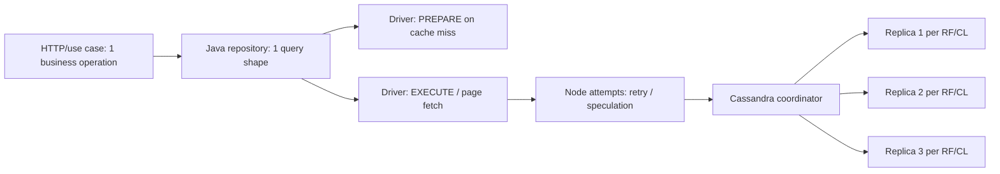
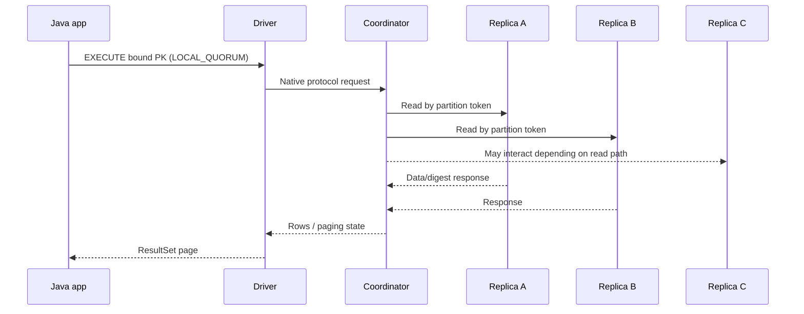

# Verifying Generated CQL, Returned Data, and Network Round Trips

## 1. A single Java call can hide substantial work

In a Java application connected to Apache Cassandra, a single line like `session.execute(boundStatement)` looks like one query. Behind it, however, may lie **preparing** the query, choosing a token-aware coordinator, executing multiple result pages, retries or speculative executions, coordinator–replica exchanges, and client-side decoding. Counting `SELECT` statements in source code makes it far too easy to misjudge both cost and correctness.

For example, an API fetching **five events** might execute one `PreparedStatement` and receive all five rows across three pages with a suggested page size of two. To the API, that is **one business operation**. To the driver, it may be **three page requests**. If one page requires a retry, there may be **more than three node attempts**. Each coordinator also communicates with replicas per RF and CL; therefore, the number of TCP packets or inter-node messages **never equals** the number of business operations.

This lesson belongs to the **Querying from Java** chapter of module `DATABASE_ENGINE_WIDE_COLUMN_CASSANDRA`. These verification techniques tie directly to **partition-key** bucketing, query-driven wide-column table design, read/write consistency, replication, compaction, repair, troubleshooting, and Java Driver 4.x.

After completing this lesson, you will be able to:

1. Verify the **actual CQL shape built and sent by the application**, distinguishing the CQL template with bind markers from bound values in the native protocol.
2. Validate returned data: correct partition, row set, cardinality, ordering, data types, pagination, nulls, and write conditions.
3. Separate **business operations**, logical CQL requests, network attempts, coordinator/replica messages, and TCP packets.
4. Use `ExecutionInfo`, `ResultSet.getExecutionInfos()`, `RequestTracker`, metrics, and selective tracing to gather concrete evidence.
5. Measure before and after Java/CQL changes without mistaking truncated result sets for successful optimizations, and without leaking sensitive data in logs.

## 2. Five observation layers: name the units accurately



| Layer | Unit to count | Example | Trap when drawing conclusions |
| --- | --- | --- | --- |
| **Business** | One API call fulfilling its contract | "Fetch all events for today" | One API may touch two tables, multiple buckets, or multiple pages. |
| **Logical CQL / shape** | Prepared `SELECT ... WHERE pk=?` template and executions | One template reused across many keys | The template alone does not show invocation count or bound keys. |
| **Client–coordinator request** | PREPARE, EXECUTE, BATCH, page fetch requests | Page 1, page 2, page 3 | Initial `execute()` may fetch only the first page. |
| **Node attempt** | Attempted send of a request to a specific coordinator | Retry on another node; speculative execution | Attempts can exceed logical requests; not every attempt succeeds. |
| **Coordinator–replica / wire** | Read/write messages between nodes; protocol frames/TCP segments | RF3, `LOCAL_QUORUM` | CL alone does not yield a packet formula due to read optimizations, speculation, compression, and multiplexing. |

### The term "round trip"

A **client-to-coordinator round trip** is one request/response pair at the CQL/native protocol level that yields a response. It does **not** mean "one TCP packet," because the transport may split or coalesce bytes, apply TLS/compression, and multiplex requests over shared connections. Nor does it mean "waiting on exactly two replicas," even though `LOCAL_QUORUM` with RF3 in one DC typically requires two replica responses to satisfy quorum.

**In reports, avoid vague labels like "3 network calls."** State explicitly "3 client→coordinator page requests," "4 node attempts due to one retry," "replica messages not measured," or "protocol bytes received." Different metrics answer different questions.

## 3. Before counting, lock down the data contract

A query is only efficient when it returns the **exact data the API contract requires**. A change that cuts p99 by 70% because it only reads page one when the contract requires all rows is a **correctness regression**, not an optimization.

Minimum contract details to record:

| Verification dimension | Clear contract example |
| --- | --- |
| Keyspace/table | `java_verify_ks.events_by_device_day` |
| Partition key | `(device_id, bucket_day)` must be fully bound |
| Range | `event_ts >= start AND event_ts < end` |
| Projection | `event_ts, event_id, event_type, payload` |
| Ordering | Clustering order `event_ts DESC, event_id DESC` **within one partition** |
| Cardinality | Return **all N rows**, not just the first `LIMIT`/page |
| Types and nulls | Timestamp is `Instant`; UUID matches type; null `payload` is handled |
| Consistency | `LOCAL_QUORUM` in the driver's local DC, matching RF |
| Errors | Timeouts, unavailable, and unauthorized are never turned into "not found" |
| SLO | Full-result p99, error rate, successful operations/s, and freshness expectations |

For **denormalized tables** holding mirrored data under different partition keys, never assume Cassandra automatically synchronizes two tables. Verify by **business ID and observation cutoff time**, accounting for backfill, repair, or concurrent writes during comparison.

## 4. CQL fixture to observe every page and row

Run labs in a single-DC cluster named `dc1` with at least three nodes for RF3; if your topology differs, adjust the replication strategy and RF to match your environment. All fixture data is synthetic—never post real partition keys or payloads to tickets or logs.

```sql
CREATE KEYSPACE java_verify_ks
WITH replication = {'class': 'NetworkTopologyStrategy', 'dc1': 3}
AND durable_writes = true;

CREATE TABLE java_verify_ks.events_by_device_day (
    device_id text,
    bucket_day date,
    event_ts timestamp,
    event_id uuid,
    event_type text,
    payload text,
    PRIMARY KEY ((device_id, bucket_day), event_ts, event_id)
) WITH CLUSTERING ORDER BY (event_ts DESC, event_id DESC);

INSERT INTO java_verify_ks.events_by_device_day
    (device_id, bucket_day, event_ts, event_id, event_type, payload)
VALUES ('device-007', '2026-11-21', '2026-11-21T08:01:00+0000',
        11111111-2222-4333-8444-555555555555, 'E1', 'alpha');

INSERT INTO java_verify_ks.events_by_device_day
    (device_id, bucket_day, event_ts, event_id, event_type, payload)
VALUES ('device-007', '2026-11-21', '2026-11-21T08:02:00+0000',
        22222222-3333-4444-8555-666666666666, 'E2', 'beta');

INSERT INTO java_verify_ks.events_by_device_day
    (device_id, bucket_day, event_ts, event_id, event_type, payload)
VALUES ('device-007', '2026-11-21', '2026-11-21T08:03:00+0000',
        33333333-4444-4555-8666-777777777777, 'E3', 'gamma');

INSERT INTO java_verify_ks.events_by_device_day
    (device_id, bucket_day, event_ts, event_id, event_type, payload)
VALUES ('device-007', '2026-11-21', '2026-11-21T08:04:00+0000',
        44444444-5555-4666-8777-888888888888, 'E4', 'delta');

INSERT INTO java_verify_ks.events_by_device_day
    (device_id, bucket_day, event_ts, event_id, event_type, payload)
VALUES ('device-007', '2026-11-21', '2026-11-21T08:05:00+0000',
        55555555-6666-4777-8888-999999999999, 'E5', 'epsilon');

-- Second partition to detect bugs that bind the wrong device_id:
INSERT INTO java_verify_ks.events_by_device_day
    (device_id, bucket_day, event_ts, event_id, event_type, payload)
VALUES ('device-008', '2026-11-21', '2026-11-21T08:06:00+0000',
        66666666-7777-4888-8999-aaaaaaaaaaaa, 'OTHER', 'sentinel');
```

**Schema explanation:** the composite partition key is `(device_id, bucket_day)`; timestamp and UUID are clustering columns. When querying a fixed partition, descending timestamp order is enforced by the schema. The fixture contains exactly **five rows** under `device-007` and **one row** in another partition to catch missing or mismatched filter predicates. Because timestamps are distinct, the expected order in this fixture is `E5, E4, E3, E2, E1`.

### Oracle query from `cqlsh`

```sql
CONSISTENCY LOCAL_QUORUM
PAGING 2

SELECT event_ts, event_id, event_type, payload
FROM java_verify_ks.events_by_device_day
WHERE device_id = 'device-007'
  AND bucket_day = '2026-11-21'
  AND event_ts >= '2026-11-21T08:00:00+0000'
  AND event_ts < '2026-11-21T09:00:00+0000'
LIMIT 20;
```

Consume **all** pages in `cqlsh`, not just the first screen. Expected output on the fixture with no concurrent writes:

| Position | event_type | Cumulative row count |
| ---: | --- | ---: |
| 1 | E5 | 1 |
| 2 | E4 | 2 |
| 3 | E3 | 3 |
| 4 | E2 | 4 |
| 5 | E1 | 5 |

Both `PAGING 2` and driver `setPageSize(2)` request small pages, yet **page size is a hint**, not a hard guarantee that every response holds exactly two rows. Actual page count must be observed empirically. `LIMIT 20` bounds the total query result, not "20 rows per page."

## 5. What is "generated CQL" in a `PreparedStatement`?

### A prepared query is not a string concatenated with literals

Java code:

```java
PreparedStatement read = session.prepare(
    "SELECT event_ts, event_id, event_type, payload " +
    "FROM java_verify_ks.events_by_device_day " +
    "WHERE device_id = ? AND bucket_day = ? " +
    "AND event_ts >= ? AND event_ts < ? LIMIT 20");

BoundStatement request = read.bind(
    "device-007",
    LocalDate.of(2026, 11, 21),
    Instant.parse("2026-11-21T08:00:00Z"),
    Instant.parse("2026-11-21T09:00:00Z")
);
```

The **prepared CQL form** is a query template with four bind markers. When binding, the driver **encodes values by CQL type**; on the native protocol wire, executing a prepared statement typically transmits **prepared ID + encoded bound values + execution options**, rather than building a string like `SELECT ... 'device-007' ...` for the server parser to re-parse as literal CQL.

Therefore, verify each facet separately:

- **Query shape:** columns, table, `WHERE`, `LIMIT`, marker names/order, and statement type.
- **Bound values:** all four variables present, in the right order and codecs (`text`, `date`, `timestamp`).
- **Request options:** `LOCAL_QUORUM`, timeout, page size, idempotence, and local-DC routing.
- **Actual execution:** number of `execute` calls, pages fetched, retries/speculation, and contacted nodes.

Never rely on `BoundStatement.toString()` or logs printing raw bound values as your "final CQL" audit trail in production. Log only **shape IDs** and marker categories or statistical lengths if needed; verify concrete bind values against synthetic lab fixtures.

### Using QueryBuilder or an ORM/mapper

When a repository uses a query builder or object mapper:

```text
Java endpoint / repository
    -> query builder / mapper mapping
    -> CQL query string with markers + statement options
    -> BoundStatement or SimpleStatement
    -> driver native protocol frame
    -> coordinator
```

Place tests at the **repository–driver boundary**, rather than asserting method names alone. A query-builder chain can silently drop `bucket_day`, inject `ALLOW FILTERING`, alter projections, override CL, or generate a distinct query shape per request.

### A binding mistake codecs cannot catch

When two markers share the `text` type:

```java
// Both status and customer_id are text: swapped arguments remain type-valid!
BoundStatement wrong = preparedInsert.bind(
    orderId, "PAID", "synthetic-customer-1");
```

The driver cannot tell that `"PAID"` is an invalid business `customer_id`. Only verifying the **persisted/returned row** catches this bug. When multiple markers share types, use named bind markers or named builder setters and test edge cases thoroughly.

## 6. Java Driver 4.x: read every row and measure pages accurately

The example below assumes an initialized lab `CqlSession session`, with `java.time.*`, `java.util.*`, and Driver 4.x imports:

```java
import java.time.*;
import java.util.*;
import com.datastax.oss.driver.api.core.DefaultConsistencyLevel;
import com.datastax.oss.driver.api.core.cql.*;

PreparedStatement ps = session.prepare(
    "SELECT event_ts, event_id, event_type, payload " +
    "FROM java_verify_ks.events_by_device_day " +
    "WHERE device_id = ? AND bucket_day = ? " +
    "AND event_ts >= ? AND event_ts < ? LIMIT 20");

BoundStatement stmt = ps.bind(
    "device-007",
    LocalDate.of(2026, 11, 21),
    Instant.parse("2026-11-21T08:00:00Z"),
    Instant.parse("2026-11-21T09:00:00Z")
).setConsistencyLevel(DefaultConsistencyLevel.LOCAL_QUORUM)
 .setPageSize(2)      // Intentionally small in lab to trigger multiple pages.
 .setIdempotent(true);

long started = System.nanoTime();
ResultSet result = session.execute(stmt);
long firstPageReady = System.nanoTime();

List<String> actualTypes = new ArrayList<>();
Set<UUID> seenIds = new HashSet<>();
for (Row row : result) {
    // Synchronous: iterating may transparently fetch subsequent pages.
    UUID id = Objects.requireNonNull(row.getUuid("event_id"));
    if (!seenIds.add(id)) {
        throw new IllegalStateException("Duplicate event_id");
    }
    Objects.requireNonNull(row.getInstant("event_ts"));
    actualTypes.add(row.getString("event_type"));
}
long fullyConsumed = System.nanoTime();

List<String> expected = Arrays.asList("E5", "E4", "E3", "E2", "E1");
if (!actualTypes.equals(expected)) {
    throw new AssertionError(
        "Wrong order/contents: expected " + expected.size() +
        " events, got " + actualTypes.size());
}

List<ExecutionInfo> pages = result.getExecutionInfos();
System.out.printf(
    "rows=%d pageResponses=%d firstPageMs=%.2f fullMs=%.2f%n",
    actualTypes.size(), pages.size(),
    (firstPageReady - started) / 1_000_000.0,
    (fullyConsumed - started) / 1_000_000.0);

for (int i = 0; i < pages.size(); i++) {
    ExecutionInfo info = pages.get(i);
    System.out.printf(
        "pageIndex=%d previousCoordinatorErrors=%d speculativeStarts=%d%n",
        i + 1,
        info.getErrors().size(),
        info.getSpeculativeExecutionCount());
}
```

### What exactly do these measurements prove?

1. `actualTypes.equals(expected)` proves the **exact five labels in order** against the immutable fixture; `seenIds` catches duplicate event IDs among returned rows.
2. `result.getExecutionInfos()` returns execution metadata for every **page request executed** while iterating the result. It measures at the **client–coordinator request** layer, not TCP packet count.
3. `getErrors().size()` reports **errors encountered on prior coordinator attempts** recorded in that `ExecutionInfo`. It is **not** total node attempts or business-operation errors.
4. `getSpeculativeExecutionCount()` tracks **how many speculative executions were started**, excluding the initial attempt; never add it directly to page count and call the sum "replica messages."
5. `firstPageMs` captures time until the first page arrives; `fullMs` includes subsequent page fetches and Java iteration. Their scopes differ—when an API contract requires all rows, report **full-operation latency**.
6. This code intentionally prints only summary counts, never raw `device_id`, `payload`, or sensitive trace details. Use synthetic lab fixtures when inspecting actual rows during debugging.

**Never assert `pages.size() == 3` as a Cassandra invariant.** With five rows and a page size hint of two, you will normally observe three pages when idle, yet the server makes no strict row-count guarantee per page. Assert what truly matters—**exact row set and order**—and then **record the observed page count**.

### Synchronous does not mean one request

`session.execute(stmt)` normally returns once the first page is ready. As the `for (Row row : result)` loop advances past buffered rows, the driver issues additional requests to fetch remaining pages. That is why benchmarks timing only `execute()` and assuming "one query = one round trip" underestimate actual cost.

## 7. `AsyncResultSet`: pages are explicit, yet attempts still need tracking

In the async API, `executeAsync` returns `CompletionStage<AsyncResultSet>`. Iterating `currentPage()` **processes only the current page**. Fetching subsequent pages requires calling `fetchNextPage()` explicitly:

```java
// Helper method suitable for a repository class.
static CompletionStage<PageAudit> auditPages(
        AsyncResultSet page,
        List<String> collected,
        int pageCount,
        int speculativeCount) {

    for (Row row : page.currentPage()) {
        collected.add(row.getString("event_type"));
    }

    int pages = pageCount + 1;
    int speculative = speculativeCount +
        page.getExecutionInfo().getSpeculativeExecutionCount();

    if (!page.hasMorePages()) {
        return CompletableFuture.completedFuture(
            new PageAudit(List.copyOf(collected), pages, speculative));
    }
    return page.fetchNextPage()
        .thenCompose(next ->
            auditPages(next, collected, pages, speculative));
}

// Java 16+ record; on Java 11 use an equivalent class with fields/getters.
record PageAudit(List<String> types, int pages, int speculativeStarts) {}

CompletionStage<PageAudit> auditStage =
    session.executeAsync(stmt).thenCompose(
        page -> auditPages(page, new ArrayList<>(), 0, 0));
```

On Java 11, replace `record` with a plain class; otherwise the snippet uses standard `java.util.concurrent.*`, `java.util.*`, and Driver 4.x APIs. The example **does not block inside callbacks**. Production code must also handle `CompletionStage` failures and offload heavy CPU work to an appropriate executor.

**Page count does not equal attempt count.** If a `fetchNextPage()` call retries on another node or triggers speculative execution, it remains **one logical page** while generating multiple network attempts.

## 8. Correctness: far more than row count

| Test case | Oracle / condition | Commonly missed bug |
| --- | --- | --- |
| Single partition with 5 rows | 5 event IDs, E5→E1, across all pages | Code reads only page 1 and stops at 2 rows |
| Empty partition | Valid empty result, never converted to timeout | Catching an exception and returning an empty list |
| Another partition | `device-008` returns only `OTHER` | Wrong `device_id` bound while query still succeeds |
| Boundary timestamps | Inclusive `start`, exclusive `end` | Using `<= end` leaks an extra event |
| Rows with identical timestamps | Include `event_id` per clustering comparator | Relying on timestamp alone drops or duplicates rows |
| Null payload | Distinguish null from empty string | Deserializer alters null semantics |
| With `DELETE`/tombstones | Deleted rows stay absent after repair/restore | Comparing stale snapshots against mutating data |
| With TTL | Identical cutoff/observation point across compared queries | TTL expires mid-comparison |
| Projection changes | Verify all columns still required by the API | Dropping columns while claiming "identical results" |
| `LIMIT` vs. page size | Keep max total rows distinct from rows/page | Lowering `LIMIT` improves p99 by silently truncating data |
| LWT `IF ...` | Check both `wasApplied()` and resulting state | CQL ACK succeeds even though the condition failed |
| Multiple partitions/buckets | Compare key sets; assume no cluster-wide order | Merging results without sorting or deduplication |

### Queries do not share an automatic snapshot

Cassandra does not create a **transactional snapshot across two separate `SELECT` calls** executed while writes, deletes, or TTL expirations occur concurrently. To keep verification tests meaningful, run against an immutable non-TTL fixture or an engineered time cutoff; otherwise, account for **legitimate concurrent mutations** before blaming a query rewrite.

For migrated or denormalized tables, verify **backfills, live writes, delete events, and identity mapping**; a clean read at high CL proves neither that every replica nor that both tables agree.

## 9. Result fingerprinting: helpful when you know its limits

When row counts are large, you can hash a **deterministic serialization** of business columns to compare before and after:

```java
// Standalone example for a single-partition, non-null lab fixture.
// ResultSet is single-pass: execute a fresh query to compute the fingerprint.
MessageDigest sha = MessageDigest.getInstance("SHA-256");
ResultSet freshResult = session.execute(stmt);
for (Row r : freshResult) {
    String canonical =
        r.getInstant("event_ts").toString() + "|" +
        r.getUuid("event_id") + "|" +
        r.getString("event_type") + "|" +
        r.getString("payload") + "\n";
    sha.update(canonical.getBytes(StandardCharsets.UTF_8));
}
byte[] digest = sha.digest();
```

This snippet uses `java.security.MessageDigest`, `java.nio.charset.StandardCharsets`, and checked-exception handling matching your method; executing `stmt` again **issues extra query/page requests**, so never include this verification pass's network counts in the primary measurement. This is strictly a **lab normalization helper**, not general-purpose canonicalization: if data permits nulls, delimiter characters, binary values, decimals, UDTs, or multiple partitions, you need type-tagged, length-prefixed/null-marked encoding and deterministic key ordering. Never hash raw PII and treat it as anonymized: low-entropy domains remain trivially guessable under unsalted hashes.

Digests are valid only when:

1. Before and after queries read the **exact same range, target projection, and source data**.
2. **All pages** are consumed.
3. Rows are **deterministically ordered** by primary key when combining multiple partitions.
4. Encoding, null handling, and the underlying dataset remain unchanged (no writes/TTL expirations during comparison).

Matching digests do **not** verify **p99**, healthy replication, or full tenant coverage; mismatching digests call for inspecting keys, values, ranges, and timestamps rather than assuming a "network glitch."

## 10. From `ExecutionInfo` to real coordination details

Java Driver 4.x exposes `ExecutionInfo` per execution/page. Useful methods include:

| API | Question answered | What cannot be inferred directly |
| --- | --- | --- |
| `getCoordinator()` | Which node returned the response for this request/page? | Which replicas participated or how many messages crossed nodes |
| `getErrors()` | Did prior coordinator attempts fail with errors? | Every attempt (successful or canceled in-flight attempts are absent) |
| `getSpeculativeExecutionCount()` | How many speculative executions started? | Total retry count or network bytes |
| `getSuccessfulExecutionIndex()` | Which execution index delivered the winning response? | Total requests or replica messages |
| `getResponseSizeInBytes()` | Uncompressed protocol response size if available | Total TCP/TLS traffic across both request and response |
| `getCompressedResponseSizeInBytes()` | Compressed response bytes if available | Round-trip count or total disk I/O |
| `getWarnings()` | Server-side warnings attached to this request | Silent errors hidden inside data semantics |
| `getTracingId()` | Trace UUID when tracing is enabled | Absent if tracing is off; not a latency measurement |

```java
ExecutionInfo info = result.getExecutionInfo();
String coordinator = info.getCoordinator() == null
    ? "none" : "present"; // Never print node addresses/topology to public logs.

int spec = info.getSpeculativeExecutionCount();
int priorErrors = info.getErrors().size();
int responseBytes = info.getResponseSizeInBytes(); // -1 if unavailable.

System.out.printf(
    "coordinator=%s speculative=%d priorErrors=%d responseBytes=%d%n",
    coordinator, spec, priorErrors, responseBytes);
```

On synchronous `ResultSet`, `getExecutionInfo()` reflects the **most recent execution** when called; iterate all rows first and inspect `getExecutionInfos()` to audit every page. On async `AsyncResultSet`, capture `getExecutionInfo()` from each page before calling `fetchNextPage()`.

**Exception limitation:** `DriverException.getExecutionInfo()` may be null or partially populated when failure occurs before transmission to a node. Never interpret a `null` coordinator as proof that no network activity happened in every case.

## 11. `RequestTracker`: separating request success/error from node attempts

Driver 4.x provides `RequestTracker`: callbacks invoked when an **overall request** succeeds/fails and when an individual **node attempt** succeeds/fails. It counts client-level activity without packet captures.

### Simple tracker example for prepared `EXECUTE`

Illustrative API based on Java Driver 4.18.x. Standalone class with explicit imports:

```java
import java.util.concurrent.atomic.LongAdder;
import com.datastax.oss.driver.api.core.config.DriverExecutionProfile;
import com.datastax.oss.driver.api.core.metadata.Node;
import com.datastax.oss.driver.api.core.session.Request;
import com.datastax.oss.driver.api.core.tracker.RequestTracker;
import com.datastax.oss.driver.api.core.cql.BoundStatement;

public final class SafeAttemptTracker implements RequestTracker {
    public final LongAdder completed = new LongAdder();
    public final LongAdder failed = new LongAdder();
    public final LongAdder nodeSuccess = new LongAdder();
    public final LongAdder nodeError = new LongAdder();

    private boolean isPreparedExecute(Request request) {
        return request instanceof BoundStatement;
    }

    @Override
    public void onSuccess(Request req, long latencyNanos,
            DriverExecutionProfile profile, Node node, String prefix) {
        if (isPreparedExecute(req)) completed.increment();
    }

    @Override
    public void onError(Request req, Throwable error, long latencyNanos,
            DriverExecutionProfile profile, Node node, String prefix) {
        if (isPreparedExecute(req)) failed.increment();
    }

    @Override
    public void onNodeSuccess(Request req, long latencyNanos,
            DriverExecutionProfile profile, Node node, String prefix) {
        if (isPreparedExecute(req)) nodeSuccess.increment();
    }

    @Override
    public void onNodeError(Request req, Throwable error, long latencyNanos,
            DriverExecutionProfile profile, Node node, String prefix) {
        if (isPreparedExecute(req)) nodeError.increment();
    }

    @Override
    public void close() {
        // No dedicated resources held in this illustrative tracker.
    }
}
```

Register **once when building the session**:

```java
SafeAttemptTracker tracker = new SafeAttemptTracker();
try (CqlSession session = CqlSession.builder()
        .addContactPoint(new InetSocketAddress("192.0.2.10", 9042))
        .withLocalDatacenter("dc1")
        .addRequestTracker(tracker)
        .build()) {
    // Warm up / prepare statements before the measurement window.
    // Then execute the fixture scenario, exhaust the ResultSet,
    // and read counter DELTAS over the observation window.
}
```

**Critical clarifications:**

- `onSuccess`/`onError` track **request-level outcomes**; `onNodeSuccess`/`onNodeError` track **node-level outcomes**. **Never sum the two groups together**—that double-counts distinct layers.
- A tracker attached to **one session** receives concurrent callbacks from **multiple threads** and queries. Use `LongAdder` and compute **before/after deltas** with no background traffic when isolating a single flow.
- `isPreparedExecute` intentionally filters to `BoundStatement` so unrelated traffic is not mixed in; that means it **excludes** `SimpleStatement`, `PREPARE`, schema/metadata/control calls, and activity outside the tracker layer.
- Node-level callbacks record attempts **reported by the tracker**, not an exact counter of every native-protocol frame or TCP segment. A canceled or unfinished speculative attempt may not emit a completion callback during the measurement window.
- Page-level `onSuccess` does not mean the **business operation** succeeded if a subsequent page fails. Maintain separate **business success/failure** counters at the API layer.
- Never call `session.execute()` or perform blocking I/O inside tracker callbacks: doing so risks recursion, thread starvation on driver I/O loops, and skewed latency.

### A stronger measurement plan

Track three distinct counter groups:

1. **Application counters:** business operations started/succeeded/failed, actual rows returned, and full-operation duration.
2. **Driver counters:** request-level successes/errors, node-level successes/errors, retry/speculative metrics, response bytes, and page executions.
3. **Cluster/host counters:** coordinator/replica request rates, client request timeouts, SSTables/read, tombstones scanned, and CPU/disk/network metrics.

If totals across layers diverge slightly, inspect **measurement boundaries**, sampling intervals, warm-up, concurrency, retries, and request types. Never force unrelated tables of numbers to reconcile artificially.

## 12. Counting requests: sample math with paging and retries

Assume one operation fetches five rows from the fixture with `pageSize = 2`, no concurrent writes, and the server returns 2 + 2 + 1 rows. All figures below are **illustrative only**:

| Scenario | Business operations | Logical page requests | Observed node attempts | Notes |
| --- | ---: | ---: | ---: | --- |
| A. Normal | 1 | 3 | 3 | One successful attempt per page |
| B. Page two retries once then succeeds | 1 | 3 | 4 | One failed attempt plus retry; business op succeeds |
| C. Page one fires one speculative execution | 1 | 3 | May be ≥ 4 | One attempt may cancel; interpret metrics carefully |
| D. Page three times out, no API fallback | 1 failed | 3 scheduled | ≥ 3 or missing callbacks due to timeout/cancel | Two succeeded pages still **fail** the contract |
| E. Broken v1 reads 1 page and stops | 1 incomplete | 1 | 1 (no retry) | p99 looks great while dropping 3 rows |

**`PREPARE` and control traffic are omitted from the logical page requests column.** Unprepared templates trigger `PREPARE`, which may also re-prepare on coordinators after restarts or cache eviction. Fetching traces from `system_traces` generates extra requests as well.

### Multi-layer accounting formulas

\[
\text{Business operations} \ne \text{CQL page requests}
\]

\[
\text{Node attempts} =
\text{initial attempts} + \text{retry attempts}
+ \text{speculative attempts (actually started)}
\]

This is a **classification framework**, not a packet-counting formula. The coordinator–replica layer depends on RF/CL, digest vs. full data reads, coordinator choice, speculation, and read repair behavior in your version. Never multiply page requests by RF and call that wire message count.

## 13. Why do RF/CL, partition keys, and driver routing change cost?

Cassandra hashes the partition key to locate the token and target replica set. With token-aware routing, the driver prefers an owning replica as coordinator. Queries omitting the partition key or fanning out across many partitions alter that path significantly.



**This diagram is conceptual**; it does not imply Cassandra sends identical messages to every replica every time. With RF3 in one DC and `LOCAL_QUORUM`, the quorum response threshold is typically 2—not that only two replicas store the data or that the coordinator never contacts the third replica.

What to hold constant in experiments:

- `device_id`/`bucket_day` are bound completely so reads stay single-partition rather than scanning the cluster.
- Java Driver local DC, RF/CL, and cluster topology match before and after.
- Hot-key distribution and rows per partition match; one hot partition can saturate a single replica set.
- Query-driven tables return required bytes and fields; shrinking `SELECT *` to a smaller projection is valid only if no contract-required column is dropped.
- Repair, compaction, streaming, or backpressure does not shift mid-test.

## 14. Inspecting coordinator tracing: use selectively

When driver telemetry reveals elevated p99 or unexpected node attempts, trace a **tiny sample** to inspect Cassandra internals:

```java
BoundStatement diagnostic = stmt.setTracing(true);
ResultSet rs = session.execute(diagnostic);
ExecutionInfo info = rs.getExecutionInfo();
UUID tracingId = info.getTracingId(); // null if tracing is disabled.

// Store tracingId only inside access-controlled diagnostic tools.
// info.getQueryTraceAsync() triggers extra queries against system_traces.
```

From `cqlsh` against the **lab fixture**:

```sql
CONSISTENCY LOCAL_QUORUM
TRACING ON

SELECT event_ts, event_id, event_type, payload
FROM java_verify_ks.events_by_device_day
WHERE device_id = 'device-007'
  AND bucket_day = '2026-11-21'
LIMIT 20;

TRACING OFF
```

Traces expose coordinator identity, contacted replicas, SSTable read timings, and internal events; however:

1. **Tracing adds overhead** and may record sensitive CQL, partition keys, bind values, or topology depending on execution path and version.
2. `getQueryTraceAsync()` reads from `system_traces.sessions` and `system_traces.events`—those are **additional diagnostic CQL requests**, not part of the untraced query's cost.
3. Trace duration is **not** full end-to-end Java latency (pool queueing, network RTT, client decoding, multi-page loop).
4. A trace on one page **does not cover all 5 rows** when remaining pages arrive in separate requests.
5. Tracing full benchmark traffic skews measurements and can overload the cluster; enable only in labs or tightly scoped sampling, then disable promptly.

**Rule of thumb:** use metrics and `RequestTracker` for **steady-state cost accounting**; reserve tracing to answer "why" on specific sampled slow paths.

## 15. Layered metric suite: never treat one metric as a proxy for everything

| Source | Signals to collect | How to use |
| --- | --- | --- |
| App/use case | Successful operations/s, full-operation latency, returned rows, errors/timeouts | Proof of API contract and SLO |
| Driver RequestTracker | Request outcomes, node-attempt callbacks by query class | Bounded client request and attempt counting |
| Driver ExecutionInfo | Coordinator, prior errors, spec starts, response bytes/page | Page-by-page diagnostics |
| Driver session metrics | `cql-requests`, retries/speculation/timeouts (if enabled) | Session-wide trends; not isolated per endpoint |
| Driver node metrics | `cql-messages`, connections/in-flight, bytes sent/received | Node distribution and near-wire attempt volume |
| Cassandra coordinator | `ClientRequest.Read/Write` latency, timeouts, pending tasks | Identify slow or overloaded coordinators |
| Cassandra table/replica | SSTables per read, tombstones scanned, disk usage, table read/write stats | Explain data-path read/write cost |
| Host/process | CPU, GC, disk await/IOPS, network bytes | Detect server or load-generator saturation |
| Tracing | Internal events keyed by trace ID | Sampled root-cause investigation, never fleet counters |

**Handle histograms carefully:** per-instance p99 values cannot be arithmetically averaged into fleet p99. Use mergeable histograms or aggregate raw samples over matching intervals and definitions. Long-lived cumulative counters must be converted into **windowed deltas or rates** before comparing.

### Read-only commands for diagnostics

```bash
nodetool status
nodetool proxyhistograms
nodetool tablestats java_verify_ks.events_by_device_day
nodetool tablehistograms java_verify_ks events_by_device_day
nodetool tpstats
nodetool compactionstats
```

These commands execute **on the queried node** rather than yielding instant cluster-wide averages. Coordinator `proxyhistograms` is not full-operation Java latency; inspect metrics across **all involved nodes** alongside client telemetry for the same time window.

## 16. Verifying writes: persisted or merely sent?

On the write path, "query dispatched" differs from "mutation ACKed at CL" and even further from "every replica in every DC holds the data." Example:

```java
PreparedStatement update = session.prepare(
    "UPDATE java_verify_ks.events_by_device_day " +
    "SET payload = ? WHERE device_id = ? AND bucket_day = ? " +
    "AND event_ts = ? AND event_id = ?");

BoundStatement write = update.bind(
    "verified",
    "device-007",
    LocalDate.of(2026, 11, 21),
    Instant.parse("2026-11-21T08:01:00Z"),
    UUID.fromString("11111111-2222-4333-8444-555555555555")
).setConsistencyLevel(DefaultConsistencyLevel.LOCAL_QUORUM);

session.execute(write); // ACK per CL, not a cluster-wide transaction.
```

To verify writes properly:

- Execute a **read-after-write** check using the same partition key and matching CL in controlled tests; verify exact fields, timestamp/TTL, and business ID.
- On a write **timeout**, the outcome is uncertain: the mutation may have reached a subset of replicas without gathering enough ACKs. Never blindly retry non-idempotent mutations.
- For LWT `IF ...`, inspect `ResultSet.wasApplied()`; it returns `false` when the condition fails even though the CQL request itself completed normally.
- Cassandra does **not** provide arbitrary multi-partition atomic transactions; a logged batch cannot replace reconciliation or domain event logs across denormalized tables.

### Reading after deletes

`DELETE` writes tombstones; observing "row absent" in one read does not prove all replicas are repaired or that stale data cannot resurrect via restores or misordered timestamps. When verifying deletes, factor in TTLs, tombstone retention, repair coverage, and CL; never mass-delete production rows just to stage benchmark fixtures.

## 17. Before/after benchmarks doing equal work

A rigorous report requires **two distinct gates**:

1. **Correctness gate:** validates matching key sets, fields, ordering, row counts, and full pagination.
2. **Performance gate:** measures requests/pages/attempts, successful ops/s, p50/p95/p99 latency, timeouts, and CPU/disk/network at identical load.

### Control variables to hold constant

| Variable | Hold equivalent before/after |
| --- | --- |
| Data | Total partitions, rows/partition, TTL/tombstones, payload sizes, and hot keys |
| Query | Projection, partition key, time range, `LIMIT`, expected ordering |
| Client | Java Driver version, connection pooling, retry policy, speculative policy, page size |
| Topology | Cassandra version, RF, CL, local DC, node health, racks |
| Load | Offered operations/s, concurrency, query mix, key sequence/seed |
| Warmup | Session startup, prepared cache, JIT/OS page cache, schema metadata |
| Measurement | UTC window, successes/failures, full-result vs. first-page scope, units, sample counts |
| Background tasks | Compaction, repair, streaming, backups, unusual GC |

### Sample report (hypothetical numbers, not an actual benchmark run)

Suppose identical workloads read five rows at an offered rate of 400 business operations/s, where every row must be returned:

| Trial | Page size | Rows/operation | Logical page requests/op (observed) | Node attempts/op (observed) | Full p99 (ms) | Success ops/s | Error |
| --- | ---: | ---: | ---: | ---: | ---: | ---: | ---: |
| Before | 2 | 5 | 3.0 | 3.1 | 95 | 399 | 0.25% |
| After A | 5 | 5 | 1.0 | 1.1 | 70 | 399 | 0.25% |
| After B | 5 | **2** | 1.0 | 1.0 | 40 | 400 | 0% |

**Correct interpretation:**

- **After A** looks like a genuine win: fewer page requests and lower p99 while **still returning all five rows**. Still verify per-page memory/bytes, GC, and larger-row partitions.
- **After B** **fails the correctness gate** because it returns only two rows. Lower p99 and zero errors **never excuse missing data**.
- `3.1 attempts/operation` is an average across many operations, **not** a single operation sending 0.1 attempts.
- Do not infer reduced wire bytes from this table alone: larger pages can raise bytes per response while cutting protocol framing and round trips; measure actual bytes and CPU directly.

### Coordinated omission and load generators

If a client waits for each request to finish **before** issuing the next, slowdowns in Cassandra automatically throttle the offered rate and mask real user queueing latency. Always report whether your test is **open-loop or closed-loop**, offered vs. successful ops/s, concurrency, failures/timeouts, and saturation thresholds. Never compare before p99 at 400 ops/s against after p99 at 100 ops/s and call it a speedup.

## 18. Protecting sensitive data when auditing CQL and network traffic

**Measuring more never justifies logging more customer data.**

| Data at risk | Common exposure points | Mitigation |
| --- | --- | --- |
| Partition keys / customer IDs | Bound values, CQL traces, query loggers | Record query shape/ID only; omit raw marker values |
| Payload / PII content | Result previews, debug logs, full query logs | Test on synthetic fixtures; use keyed hashes if ID correlation is required |
| Credentials | Driver configs, exceptions, shell history | Secret managers, redaction, least-privilege access |
| Topology / node IPs | `ExecutionInfo`/coordinator logs | Keep internal-only; strip from public reports |
| Paging state / cursors | API responses and logs | Never treat cursors as harmless; encrypt/sign if exposed externally |
| Trace / session IDs | `system_traces`, support tickets | Short retention, strict ACLs, scheduled deletion |

The driver ships an optional **`RequestLogger`** capable of logging bound values. Never leave `show-values=true` enabled by default on production workloads; when diagnostics strictly demand values, enforce approval, masking, and restricted log storage. Never dump entire `BoundStatement` objects just to prove "CQL was generated."

**CQL tracing and packet capture are expensive and risky tools**: sample deliberately rather than capturing cluster-wide. TLS encrypts network traffic anyway, so packet capture is not a clean or safe production query inspection method.

## 19. Verification runbook from Java to Cassandra

### P0 — Define contract and scope

Document the endpoint/use case, query shape, keyspace/table, primary key, projection, expected row set, TTL/cutoff, CL/RF/DC, expected pages, and SLO. State clearly whether metrics count **business operations**, **page requests**, or **node attempts**.

### P1 — Prepare fixtures and baseline

Seed synthetic fixtures spanning multiple pages, an empty partition, a neighbor partition, nulls, and edge timestamps. Warm up session and prepared statements; record successes/errors, row counts, p50/p95/p99, and driver/host metrics. Keep tracing disabled during baseline performance runs.

### P2 — Verify CQL shape and bindings

Inspect templates emitted by repositories or mappers, bind markers, parameter order and types, `LIMIT`, `WHERE`, page size, CL, timeouts, and idempotence flags. Separate query template names from raw bound values. For dynamic query builders, test every branch generating CQL variants.

### P3 — Consume full results and capture execution info

With sync APIs, iterate `ResultSet` completely; with async APIs, recurse through `currentPage`/`fetchNextPage`. Validate keys, values, and ordering, and count actual pages via `getExecutionInfos` or each `AsyncResultSet`. Never treat the first page as complete when the contract expects all rows.

### P4 — Collect driver attempts and inspect coordinators

Enable `RequestTracker`/driver metrics safely and measure **counter deltas** over a clean window. Compare request-level vs. node-level counts, and inspect `getSpeculativeExecutionCount()`, `getErrors()`, and coordinator distribution. Investigate retries, speculation, or background traffic if numbers diverge from expectations.

### P5 — Cross-check cluster telemetry

Review `nodetool status`, `tpstats`, `compactionstats`, `proxyhistograms`, table metrics, disk await, CPU, GC, and network stats. Factor in RF/CL to see which replicas carry load. If a node lags, run **tightly sampled** tracing (then disable immediately) to inspect read paths, tombstones, or compaction.

### P6 — Decide in order: correctness → latency/throughput → cost

Halt any rollout on result mismatches even if latency improves. When correctness passes yet p99, errors, or attempts rise, check page sizes, hot partitions, driver pools, network paths, and retry behavior. Once all gates pass, canary gradually while monitoring p99 and error budgets.

### P7 — Clean up diagnostic instrumentation

Turn off verbose tracing and detailed request logging, purge or expire traces and bound payloads per retention policy, and keep only **aggregated** reports and query shape IDs. Document measurement limitations: concurrent load, unobserved retries, lack of wire-level packet captures, or single-DC scope.

## 20. Common telemetry misinterpretations

| Misconception | Reality | Correction |
| --- | --- | --- |
| "One `session.execute` equals one network trip." | Iterating `ResultSet` can trigger follow-up page fetches. | Count `getExecutionInfos()` after full iteration. |
| "Page size 100 always returns 100 rows per page." | Page size is only a hint. | Inspect actual page counts and verify total rows. |
| "Preparing CQL means executing it." | `PREPARE` only registers the template and metadata. | Track `PREPARE` vs. `EXECUTE` separately and inspect results. |
| "Prepared statements send literal SQL over the wire." | `EXECUTE` sends a prepared ID plus encoded bind values. | Inspect templates, bindings, and native protocol behavior. |
| "3 pages means 3 TCP packets." | Protocol frames, TLS records, and TCP segments differ. | Name the layer accurately; track bytes and attempts instead. |
| "2 quorum ACKs means exactly 2 network messages." | Coordinator–replica exchanges vary with read paths. | Check traces/metrics; never multiply CL into packet counts. |
| "Zero prior errors implies one attempt." | Canceled speculative attempts may not appear in errors. | Combine spec counts, node tracking, and metrics. |
| "Trace duration equals full API latency." | Excludes client pools, network RTT, decoding, and multi-page loops. | Measure end-to-end duration in Java. |
| "Lower p99 from reading only page 1 is an optimization." | Returning partial data breaks the contract. | Enforce the correctness gate first. |
| "`SELECT` passing at `ONE` proves `LOCAL_QUORUM` is healthy." | Different CLs require different replica availability. | Test using production RF and CL. |
| "Tracker `nodeSuccess + onSuccess` equals total requests." | They represent different callback layers and double-count. | Report requests/pages separately from node attempts. |
| "Matching result hashes proves all data is valid." | Valid only within the tested scope and canonical encoding. | Cover all key/range edge cases and mutation sources. |
| "Debugging requires logging every bound value." | Risks PII/credential exposure and overhead. | Log query shapes, metrics, and controlled samples. |

## 21. Practice exercises and review questions

1. Given five rows, `pageSize=2`, and zero retries, distinguish business operations, page requests, node attempts, and replica messages. Which counts are deterministic, and which must be measured?
2. Why does `PreparedStatement` avoid sending literal string SQL like `SELECT ... 'device-007'` the way string-concatenated `SimpleStatement` queries do?
3. Write a test confirming `WHERE device_id=? AND bucket_day=?` never leaks rows belonging to `device-008`.
4. Explain the difference between `LIMIT 20` and `setPageSize(2)`; why is each page not guaranteed to carry exactly two rows?
5. In the Driver 4.x synchronous API, at what point can extra network requests fire while iterating a `ResultSet`?
6. An async endpoint currently reads only `currentPage()`. How must it change to return the complete result set?
7. Which layer does `getExecutionInfos()` measure? Does it include coordinator→replica messages or TCP segments?
8. Does an empty `getErrors()` list guarantee no speculative executions ran? Why or why not?
9. In `RequestTracker`, how do `onSuccess` and `onNodeSuccess` differ, and why must their counters never be summed?
10. Why should `PREPARE`, trace fetching, and topology/control requests be accounted for separately?
11. If page three times out after two pages succeeded, can an API return 4 of 5 rows as a successful response? Describe proper contract and error handling.
12. How does verifying `wasApplied()` on an LWT differ from checking an ACK on a `LOCAL_QUORUM` write?
13. Why can full-operation latency remain high even when first-page latency is low?
14. Name three reasons node attempts can rise while business operations stay flat.
15. Design an A/B report comparing `pageSize` 2 → 5 while holding partition, dataset, and CL constant under a strict correctness gate.
16. Describe situations where tracing and `RequestLogger` must stay off, and how to safeguard bound values containing PII.
17. A table is read across two DCs with different replication factors. Why cannot packet counts observed in DC1 be extrapolated directly to DC2?
18. If a change shrinks bytes per response while doubling page requests, which additional metrics do you need before deciding?

### Capstone exercise: verifying a Java repository

Implement a repository exposing two APIs: `findEventsByDeviceDay(deviceId, date, start, end)` and `updatePayload(eventKey, value)`. Requirements:

- Two fixed prepared query shapes; bind full partition and clustering keys; run with `LOCAL_QUORUM` matching the fixture.
- Test expected keys, 5 rows `E5→E1`, 0 rows, another partition, null/empty strings, and date boundaries.
- Implement one full-pagination synchronous read and one full-pagination async read; record the **actual page count** rather than hard-coding `3`.
- Collect `ExecutionInfo` per page and measure request/node-attempt deltas via `RequestTracker` without background load.
- Measure full-operation duration, successful ops/s, and errors/timeouts under identical offered load.
- Mark idempotence accurately by semantics; treat write timeouts as potentially ambiguous outcomes.
- Log only query shapes and aggregates—never raw customer/device keys or payloads.
- Present a table separating **logical operations, page requests, node attempts, and replica messages**, explicitly noting any unmeasured layers.

**Completion criteria:** learners stop confusing a CQL statement in source code with a single network round trip; know how to prove query shapes and bound values, detect and exhaust pagination, verify keys/values/order, read `ExecutionInfo`, and apply `RequestTracker` at the proper layer. Measurements must reveal genuine optimizations **without sacrificing correctness, consistency, fault tolerance, or security**.

## 22. References

- [Apache Cassandra Java Driver 4.18.x — Paging](https://apache.github.io/cassandra-java-driver/4.18.0/core/paging/): synchronous iteration, async `currentPage`/`fetchNextPage`, and page-size hints.
- [Apache Cassandra Java Driver 4.18.x — Request Tracker](https://apache.github.io/cassandra-java-driver/4.18.0/core/request_tracker/): request-level/node-level callbacks and request logging.
- [Apache Cassandra Java Driver 4.18.x — ExecutionInfo API](https://apache.github.io/cassandra-java-driver/4.18.1/api/com/datastax/oss/driver/api/core/cql/ExecutionInfo.html): coordinator, errors, speculative starts, paging state, response size, and trace ID.
- [Apache Cassandra Java Driver 4.18.x — ResultSet API](https://apache.github.io/cassandra-java-driver/4.18.1/api/com/datastax/oss/driver/api/core/cql/ResultSet.html): iterating rows, `getExecutionInfos`, `wasApplied`.
- [Apache Cassandra Java Driver 4.18.x — Query Tracing](https://apache.github.io/cassandra-java-driver/4.18.0/core/tracing/): enabling tracing, retrieving trace IDs, and `system_traces` query overhead.
- [Apache Cassandra Java Driver 4.18.x — Metrics](https://apache.github.io/cassandra-java-driver/4.18.0/core/metrics/): session/node metrics, latency distributions, and request counters.
- [Apache Cassandra Java Driver 4.18.x — Prepared Statements](https://apache.github.io/cassandra-java-driver/4.18.0/core/statements/prepared/): `PREPARE`/`EXECUTE` protocol, bind values, caching, and re-prepare.
- [Apache Cassandra Java Driver 4.18.x — Retries](https://apache.github.io/cassandra-java-driver/4.18.0/core/retries/): retry policy, idempotence, and node attempts.
- [Apache Cassandra — CQL SELECT](https://cassandra.apache.org/doc/stable/cassandra/developing/cql/dml.html): partition keys, `LIMIT`, `ORDER BY`, and result sets.
- [Apache Cassandra — Metrics](https://cassandra.apache.org/doc/stable/cassandra/managing/operating/metrics.html): coordinator/table read paths and observability.

**Conclusion:** Verifying that Java executes CQL accurately and uses the network efficiently requires following the chain **query shape → bound values → complete rows → page requests → node attempts → coordinator/replica behavior**. A single `execute()` is not always one network request, a single page is not always one TCP packet, and a successful first page never proves the API returned the complete result. Combine **immutable fixtures, `ExecutionInfo`, `RequestTracker`, layered metrics, and selective tracing**, while preserving RF/CL, safeguarding sensitive data, and accepting optimizations only when correctness, p99, error rates, and successful throughput all meet your contract.
