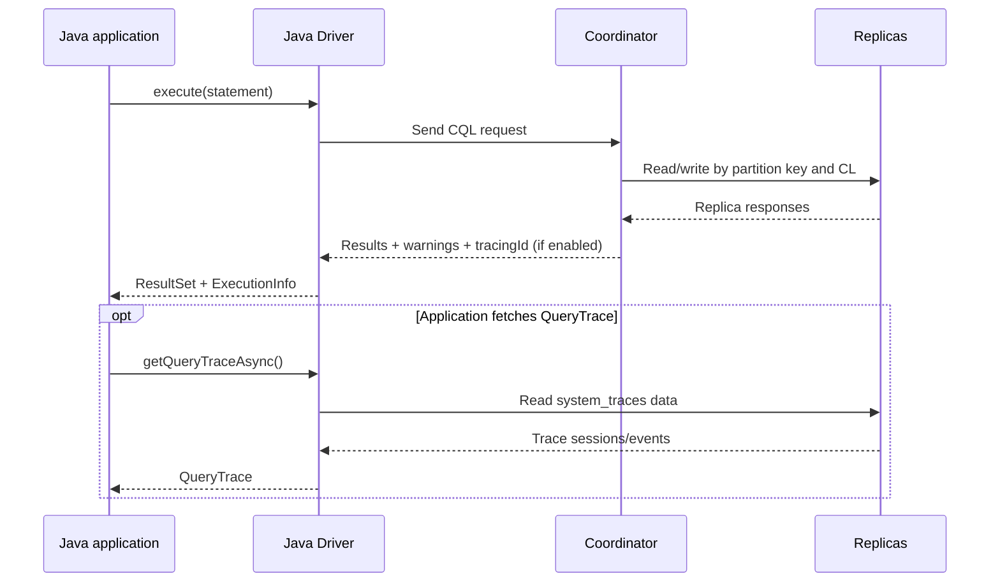

# `ExecutionInfo`, Coordinators, Warnings, and `QueryTrace` from the Java Driver

## 1. Why inspect execution metadata?

In Apache Cassandra, a CQL query sent from a Java application is received by a **coordinator**, coordinated across the relevant replicas, and returned to the client. An application may receive accurate results while still experiencing anomalies: slow queries, driver retries on another node, server warnings about scanning too many tombstones, or a sluggish replica. Looking strictly at row values in `Row` hides all of those signals.

Java Driver 4.x provides `ExecutionInfo` to inspect **the execution of a CQL request**, including the coordinator, server warnings, errors encountered prior to completion, speculative execution counts, and the tracing identifier. When you need visibility inside the server, enable tracing selectively and fetch `QueryTrace` from `ExecutionInfo`.

After completing this lesson, you will be able to:

- Read `ExecutionInfo` from a `ResultSet` or driver exception, understanding the meaning and boundaries of each field.
- Distinguish a **coordinator** from a **replica**, and explain why the coordinator can change between requests or result pages.
- Use `getWarnings()` to spot queries or tables needing attention.
- Enable tracing for a **single statement**, retrieve `tracingId`, fetch `QueryTrace`, and analyze trace events.
- Gather diagnostic telemetry in a Java application without placing continuous tracing load on the cluster.

> **Scope:** Examples use Apache Cassandra and the `com.datastax.oss.driver.api.*` APIs from Java Driver **4.x** (including the Apache-maintained 4.18+ branch). This API structure differs from Java Driver 3.x. Examples assume an open `CqlSession session` connected to the target cluster and keyspace with query permissions.

## 2. Execution flow: driver, coordinator, and replicas



The coordinator is simply the **node receiving and orchestrating the query**, not a fixed "leader" for the partition. Cassandra distributes data by token/partition key, while replicas store copies according to the replication strategy. On a `LOCAL_QUORUM` read, the coordinator waits for the required responses per consistency level, yet `ExecutionInfo.getCoordinator()` reports only the coordinating node that answered the driver—**not a list of all participating replicas**.

The driver picks a coordinator based on cluster topology, load-balancing policy, and routing metadata when present; retries or speculative executions can let another attempt win the response. Consequently, consecutive calls with the same CQL **do not necessarily** hit the same coordinator. To inspect server-side execution steps, use tracing (or node-level telemetry), rather than guessing from the coordinator address.

## 3. What does `ExecutionInfo` contain?

On the success path, retrieve `ExecutionInfo` from `ResultSet`. For paged results, `ResultSet.getExecutionInfo()` returns metadata for the **most recently executed fetch/query**; `ResultSet.getExecutionInfos()` holds metadata for every fetch already executed on that `ResultSet`. Unfetched pages do not appear yet. In the async API, `AsyncResultSet.getExecutionInfo()` describes the **current page**.

| API (`ExecutionInfo`) | Meaning | Diagnostic note |
| --- | --- | --- |
| `getCoordinator()` | `Node` that coordinated the received response | Does not imply it owns the data replica; may be `null` if failure occurred before contacting any node. |
| `getWarnings()` | List of warnings returned by Cassandra | A query can **succeed even with warnings**; an empty list does not prove a query is optimal. |
| `getErrors()` | Errors encountered on prior coordinators/attempts | May be non-empty even when the overall request succeeded via retry/speculation; not a cluster-wide error log. |
| `getSpeculativeExecutionCount()` | Number of **additional speculative executions** started | Excludes the initial attempt; `1` means one extra speculative attempt started. |
| `getSuccessfulExecutionIndex()` | Index of the attempt returning the winning result (`0` is initial) | Combine with speculative count to see which attempt won. |
| `getTracingId()` | Trace UUID when tracing was enabled | Returns `null` when tracing was not enabled on the statement. |
| `getQueryTrace()` / `getQueryTraceAsync()` | Fetches Cassandra server trace details | Issues extra CQL reads against `system_traces`; not embedded in the original response. |
| `getResponseSizeInBytes()` | Uncompressed protocol response size | May be `-1` if unavailable; not business payload byte size. |
| `isSchemaInAgreement()` | Schema agreement check result after schema-altering statements | For ordinary queries this is `true`; do not use as a general cluster health check. |

`getErrors()` returns `List<Map.Entry<Node, Throwable>>`, capturing errors handled on earlier attempts. Under speculative execution, attempts run concurrently, so error order need not reflect selection order. When a CQL operation fails, `DriverException.getExecutionInfo()` can expose similar details, though fields may be absent if failure occurred before reaching a coordinator.

### Java example: reading metadata after a successful query

Suppose table `shop.orders_by_customer` is modeled to query orders by partition key `customer_id`:

```cql
CREATE TABLE IF NOT EXISTS shop.orders_by_customer (
    customer_id uuid,
    ordered_at timestamp,
    order_id timeuuid,
    status text,
    total_cents bigint,
    PRIMARY KEY ((customer_id), ordered_at, order_id)
) WITH CLUSTERING ORDER BY (ordered_at DESC, order_id DESC);
```

```java
import com.datastax.oss.driver.api.core.CqlSession;
import com.datastax.oss.driver.api.core.cql.BoundStatement;
import com.datastax.oss.driver.api.core.cql.ExecutionInfo;
import com.datastax.oss.driver.api.core.cql.PreparedStatement;
import com.datastax.oss.driver.api.core.cql.ResultSet;
import com.datastax.oss.driver.api.core.metadata.Node;
import java.util.Map;
import java.util.UUID;

// session is an open CqlSession; customerId is a UUID supplied by the application.
PreparedStatement prepared = session.prepare(
    "SELECT order_id, status FROM shop.orders_by_customer " +
    "WHERE customer_id = ? LIMIT 20");
BoundStatement statement = prepared.bind(customerId);

ResultSet result = session.execute(statement);
ExecutionInfo info = result.getExecutionInfo();

Node coordinator = info.getCoordinator();
System.out.println("Coordinator: " +
    (coordinator == null ? "unknown" : coordinator.getEndPoint()));
System.out.println("Speculative executions: " +
    info.getSpeculativeExecutionCount());
System.out.println("Successful execution index: " +
    info.getSuccessfulExecutionIndex());

for (String warning : info.getWarnings()) {
    System.out.println("Server warning: " + warning);
}
for (Map.Entry<Node, Throwable> previousError : info.getErrors()) {
    System.out.println("Previous attempt failed on " + previousError.getKey()
        + " with " + previousError.getValue().getClass().getSimpleName());
}
```

This is an **illustrative snippet** meant to live inside a method holding `session` and `customerId`; the `import` statements show the exact API types used. The query binds its parameter cleanly and filters directly by partition key to avoid unnecessary scans. A customer with huge history can still grow an oversized partition; in that case, consider time-bucketing aligned with actual access patterns.

**Paging note:** reading metadata right after `execute` inspects only the first page. If the application iterates far enough for the driver to fetch additional pages, subsequent `getExecutionInfo()` calls may report a different coordinator or warnings, and `getExecutionInfos()` will grow. Never assume page one's coordinator handled every page.

## 4. Coordinators: interpret signals without false conclusions

For instance, observing three consecutive requests hit coordinators A, B, and A is **not evidence** that data migrated between nodes. It only reflects that the driver or cluster routed to different coordinators. Patterns worth deeper investigation include:

1. **One coordinator repeatedly correlates with high latency:** compare client latency, host metrics, and sampled traces; there may be CPU, disk, network saturation, or a slow replica.
2. **`getErrors()` shows prior failures before success:** examine exception types, nodes, retry policies, timeouts, and speculation; a winning request does not mean the path was error-free.
3. **Rising `getSpeculativeExecutionCount()`:** extra attempts fired to curb tail latency. On non-idempotent writes, misconfigured retries or speculation can cause unintended side effects; ensure statement idempotence settings match semantics before enabling them.
4. **Differences across consistency levels:** `LOCAL_ONE` and `LOCAL_QUORUM` require different replica confirmations, yet the coordinator remains only the orchestration point; never conclude a query "met quorum" solely from the returned `Node`.

In production, correlate execution metadata with application request/correlation IDs, client-measured timings, query type, and configured consistency level. Avoid logging sensitive parameter values, full dynamic CQL strings, or raw trace dumps into default logs.

## 5. Server warnings: a successful query can still carry risks

Cassandra can attach **warnings** to responses when execution encounters notable conditions—for example, scanning high tombstone counts or resource-heavy data patterns (exact conditions vary by Cassandra version and query). The Java Driver surfaces these via `ExecutionInfo.getWarnings()`. Warnings are **not** `Throwable` exceptions and usually **do not fail the query**.

```java
ExecutionInfo info = session.execute(statement).getExecutionInfo();
if (!info.getWarnings().isEmpty()) {
    for (String warning : info.getWarnings()) {
        // In production, log through a rate-limited logger.
        System.out.println("Cassandra warning: " + warning);
    }
}
```

Practical investigation steps when warnings appear:

| Signal | Investigation questions | Sensible action |
| --- | --- | --- |
| Heavy tombstone reads | Dense deletes or short TTLs? Clustering slice too wide? | Inspect data model, TTLs, query slice bounds, compaction, and repair state; never "fix" solely by raising thresholds. |
| Query touching excessive data | Missing partition key, `ALLOW FILTERING`, or oversized partitions? | Design query-specific tables and access paths; minimize server-side filtering. |
| Repeated warnings on a query group | Specific CQL shape/partition issue or one misbehaving node? | Group by query template and correlate request IDs, server metrics, and selective traces. |

Warning text **does not follow a single fixed catalog** across all Cassandra versions; capture the exact warning strings and cross-reference your version's docs and metrics. `getWarnings()` is populated only on native protocol **V4** or newer; older protocols always return an empty list. The driver can also log server warnings automatically depending on configuration (`advanced.request.log-warnings`), so avoid duplicate logging and log storms.

## 6. Query tracing: from `tracingId` to `QueryTrace`

`ExecutionInfo` tells you **where the request went** from the driver's perspective; `QueryTrace` exposes server-recorded events explaining **how it was processed**. When tracing is enabled on a statement, Cassandra writes rows into `system_traces.sessions` and `system_traces.events`. Trace writes happen **asynchronously**, so trace rows may not be immediately ready the instant the query finishes.

### Step 1 — Enable tracing only for targeted diagnostic requests

```java
import com.datastax.oss.driver.api.core.cql.BoundStatement;
import com.datastax.oss.driver.api.core.cql.ResultSet;
import com.datastax.oss.driver.api.core.cql.ExecutionInfo;
import java.util.UUID;

BoundStatement tracedStatement = prepared.bind(customerId).setTracing(true);
ResultSet tracedResult = session.execute(tracedStatement);
ExecutionInfo tracedInfo = tracedResult.getExecutionInfo();

UUID tracingId = tracedInfo.getTracingId();
System.out.println("Trace ID: " + tracingId);
```

`getTracingId()` links the client execution to the server trace record; **`null`** means no trace ID exists (for instance, tracing was disabled). Tracing is off by default. Never call `.setTracing(true)` on every production request: trace writes and reads add substantial cluster overhead.

### Step 2 — Fetch the trace and inspect events

```java
import com.datastax.oss.driver.api.core.cql.QueryTrace;
import com.datastax.oss.driver.api.core.cql.TraceEvent;

if (tracingId != null) {
    // Suitable only for diagnostic utilities running on application threads.
    // getQueryTrace() blocks the calling thread until trace retrieval finishes.
    QueryTrace trace = tracedInfo.getQueryTrace();

    System.out.printf("Type=%s, server coordinator=%s, duration=%d µs%n",
        trace.getRequestType(),
        trace.getCoordinator(),
        trace.getDurationMicros());

    for (TraceEvent event : trace.getEvents()) {
        System.out.printf("+%d µs | source=%s | activity=%s%n",
            event.getSourceElapsedMicros(),
            event.getSource(),
            event.getActivity());
    }
}
```

Inside async services or driver callbacks, **never call `getQueryTrace()`**, as it blocks and must not execute on driver I/O threads. Use the non-blocking variant instead:

```java
if (tracingId != null) {
    tracedInfo.getQueryTraceAsync().whenComplete((trace, error) -> {
        if (error != null) {
            System.err.println("Failed to load trace " + tracingId + ": " + error);
        } else {
            System.out.println("Trace " + tracingId + " has "
                + trace.getEvents().size() + " events");
        }
    });
}
```

Keep `CqlSession` open until async trace fetching completes. On synchronous paths, `getQueryTrace()` throws if tracing was disabled; always **check for a non-null `tracingId` first** and handle errors when querying `system_traces`.

### Step 3 — Understand what the trace actually measures

`QueryTrace` provides the following core properties:

- `getRequestType()`: request type recorded in the trace.
- `getCoordinator()`: coordinator address as seen by Cassandra.
- `getDurationMicros()`: **server-side** execution duration in microseconds.
- `getParameters()`: trace session parameters recorded by the server.
- `getEvents()`: list of `TraceEvent` items, each recording activity, source node, and relative offset (`getSourceElapsedMicros()`).

For a read query, a trace typically shows coordinator receipt, replica dispatch, waiting for replica replies, and result assembly. Exact events vary by Cassandra version, statement, workload, and cluster state. Use events to form **hypotheses** about bottlenecks, then validate against node metrics and logs.

**Do not conflate the two timers:** `getDurationMicros()` captures only the server's recorded span; application-perceived duration also includes queueing, network RTT, encode/decode, retries, additional page fetches, and application logic. Traces can appear incomplete if async `system_traces` writes lag. Each `getQueryTraceAsync()` call executes a fresh read, so bounded retries can recover late events—strictly cap retry attempts.

### Step 4 — Configuring trace retrieval

Illustrative HOCON configuration for Java Driver 4.x:

```hocon
datastax-java-driver.advanced.request.trace {
  attempts = 5
  interval = 3 milliseconds
  consistency = ONE
}
```

The driver uses these settings to poll `system_traces` when Cassandra's async trace flush hasn't finished yet. `consistency = ONE` sets the **consistency of the trace-fetch query**, not your application's business CQL. Depending on `system_traces` replication and topology, setting `LOCAL_ONE` for trace fetches may fail to locate an eligible replica; verify how `system_traces` is replicated before tuning it.

## 7. Real-world scenario: an order-lookup API suffers intermittent slowdowns

Suppose `GET /customers/{id}/orders` queries `orders_by_customer` and p99 spikes while most responses still return HTTP 200.

1. **Observe outside the driver:** track full request latency, Cassandra call duration, timeouts, result sizes, and query frequencies. Never base performance conclusions on a single trace.
2. **Inspect `ExecutionInfo`:** on sampled slow calls, capture coordinator, speculative execution count, prior errors, and warnings (controlling volume and sensitive fields). Rising speculative counts or prior errors point toward network, node, or retry-policy checks.
3. **Inspect warnings:** tombstone warnings warrant checking TTL/delete patterns, partition modeling, row scan depth, compaction, repair state, and metrics on involved nodes. `LIMIT 20` never caps how many tombstones Cassandra scans to find 20 live rows.
4. **Enable selective tracing:** trace reproducible requests in staging or a tiny production sample; link `tracingId` to the application request ID.
5. **Analyze `QueryTrace`:** examine replica read/wait events alongside node disk, CPU, network, and tombstone metrics. For multi-page queries, trace **per fetch** rather than generalizing page one's metadata to the whole operation.
6. **Fix root causes:** tighten clustering bounds, introduce bucketing, adjust TTL/compaction strategies, or remediate a degraded node; then verify p95/p99 and warning rates before vs. after.

Solid conclusions require **corroborating evidence**. Seeing "slow request with coordinator N1" does not prove N1 caused the slowdown; a replica N1 waited on, network congestion, or a tombstone-heavy partition could be responsible.

## 8. Common pitfalls and operational principles

| Misconception | Accurate understanding |
| --- | --- |
| "The coordinator owns the partition." | The coordinator orchestrates the request; replicas are determined by token and replication strategy. |
| "`getWarnings().isEmpty()` means the query is healthy." | It only means no server warnings came back over the protocol; still check latency, table design, and metrics. |
| "The request succeeded, so zero retries or errors occurred." | `getErrors()` may contain failed prior attempts; speculative executions may have fired. |
| "`getTracingId()` carries all trace events inside it." | Only the UUID arrives in the response; `getQueryTrace*()` issues extra queries to `system_traces`. |
| "`getQueryTrace()` works in any callback." | It blocks the calling thread; use `getQueryTraceAsync()` in async flows and driver threads. |
| "Trace duration equals full end-to-end latency." | Traces capture server duration only; client-side measurement is needed for total latency. |
| "One `ExecutionInfo` covers every result page." | Paged queries execute multiple fetches, each potentially hitting a different coordinator and trace ID. |

### Self-practice exercises

1. Using a table with an explicit partition key, execute a `SELECT` via `PreparedStatement`; print coordinator, warnings, speculative count, and errors. Record what changes across repeated runs.
2. Enable tracing on a **single** sample query; capture `tracingId`, `QueryTrace`, and the first three events (if present). Compare server duration with client-measured Java latency.
3. Explain why tombstone warnings require inspecting query design, TTLs, and compaction together, and why the coordinator alone cannot explain the cause.
4. On a paged query, iterate across several pages and compare `getExecutionInfos().size()` before and after. Explain why the list grows.

## References

- [Apache Cassandra Java Driver 4.18 — Tracing](https://apache.github.io/cassandra-java-driver/4.18.1/core/tracing/): enabling tracing, retrieving `QueryTrace`, and tuning trace polling.
- [Apache Cassandra Java Driver 4.18 — `ExecutionInfo` API](https://apache.github.io/cassandra-java-driver/4.18.1/api/com/datastax/oss/driver/api/core/cql/ExecutionInfo.html): coordinator, errors, warnings, tracing ID, and related methods.
- [Apache Cassandra Java Driver 4.18 — Paging](https://apache.github.io/cassandra-java-driver/4.18.0/core/paging/): paging mechanics and paging state.
- [Apache Cassandra Java Driver 4.19 — `PagingIterable` API](https://apache.github.io/cassandra-java-driver/4.19.0/api/com/datastax/oss/driver/api/core/PagingIterable.html): semantics of `getExecutionInfo()` and `getExecutionInfos()`.
