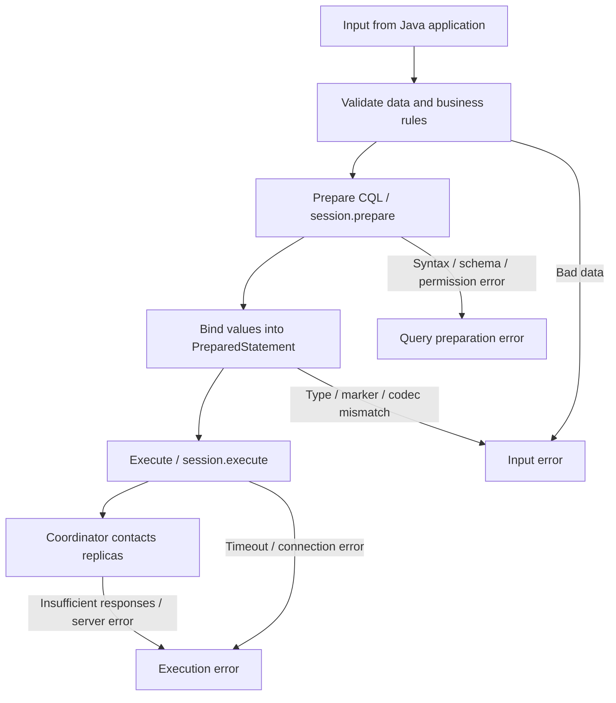

# Classifying Query Preparation, Input, and Execution Errors in Java with Cassandra

When a Java application accesses **Apache Cassandra**, the same `SELECT` or `INSERT` operation can fail for three very different categories of reasons: **an invalid CQL statement or schema**, **bad input data or parameter binding**, or **a request that fails to complete during execution**. Accurate classification helps choose the right remediation: fixing code or schema, rejecting invalid input, or handling transient cluster issues. Not every exception should be treated as a signal to retry.

This lesson belongs to the **Java Retries and Errors** chapter of the `DATABASE_ENGINE_WIDE_COLUMN_CASSANDRA` module. The context is that Cassandra has a distributed, **wide-column** storage architecture that distributes data by **partition key** and models tables around queries. Therefore, partition key selection, replication, consistency level, Java connectivity, and replica health all affect the errors the application sees.

## 1. The Three-Stage Model



| Category | Common symptoms | Where detected | Primary handling |
| --- | --- | --- | --- |
| **Query preparation** | Invalid CQL syntax, nonexistent column, query predicates violating key rules, missing permissions | During `prepare()` or when the server parses a CQL string sent directly via `execute()` | Fix the query/schema/permissions; do not retry blindly |
| **Input / binding** | Empty ID, Java–CQL type mismatch, missing required parameter, business validation failure | In the application, before sending the query or during binding | Return a validation error, normalize values, or fix mapping; do not retry |
| **Execution** | Insufficient replicas, read/write timeout, disconnected node, overload | While sending the request, waiting for a response, or processing on coordinator/replicas | Check operation type, consistency level, idempotence, and blast radius before retrying |

**Important note:** This classification is based on *root cause and stage*, not three independent driver exception superclasses. For example, `InvalidQueryException` can appear when `session.execute()` sends a **simple statement** because Cassandra only parses the CQL at that point. Record both the **phase** (`prepare`, `bind`, `execute`) and the exception type, rather than categorizing solely by class name.

## 2. Running Example: Querying by Partition Key

Assume the `app` keyspace already exists and has the following table:

```sql
CREATE TABLE app.orders_by_customer (
    customer_id uuid,
    created_at timestamp,
    order_id uuid,
    total decimal,
    PRIMARY KEY ((customer_id), created_at, order_id)
) WITH CLUSTERING ORDER BY (created_at DESC, order_id ASC);
```

- `customer_id` is the **partition key**: orders for the same customer are stored within the same logical partition.
- `created_at` and `order_id` are **clustering columns**: they support scanning orders chronologically within a partition.
- A read query aligned with the data model is `WHERE customer_id = ? AND created_at >= ?`. Cassandra can locate the partition from `customer_id`.

```sql
SELECT order_id, created_at, total
FROM app.orders_by_customer
WHERE customer_id = :customer_id
  AND created_at >= :since;
```

Alongside this, compare two CQL statements with different errors:

```sql
-- Syntax error: SELECT is misspelled.
SELEC order_id FROM app.orders_by_customer WHERE customer_id = ?;

-- Query incompatible with the table's primary key:
SELECT order_id FROM app.orders_by_customer WHERE order_id = ?;
```

The second statement filters only by `order_id` without `customer_id` to locate the partition; Cassandra normally rejects such queries unless an appropriate query mechanism is in place. **Do not** treat `ALLOW FILTERING` as a default fix: it can lead to multi-partition scans and unpredictable latency. Design tables and queries around the required access patterns; if you need to look up orders by ID, consider a dedicated table with an appropriate partition key.

## 3. Category A — Query Preparation and CQL Validation Errors

With Java driver 4.x, `session.prepare(cql)` sends a prepare request to Cassandra and receives metadata for the bind markers. If the CQL is invalid, an error can surface **before** a `PreparedStatement` is created.

| Exception / symptom | Typical meaning | First check |
| --- | --- | --- |
| `SyntaxError` | Malformed CQL grammar, punctuation, or keyword | Actual CQL string sent, brackets, placeholders, keywords |
| `InvalidQueryException` | Semantically invalid query: nonexistent column/table, unsupported key predicate, CQL type mismatch | Active keyspace, deployed schema, partition/clustering keys, column types |
| `UnauthorizedException` | The connected account lacks required permissions | Role, `GRANT`, target keyspace/table; check authorization policy |
| Connection/timeout error during `prepare()` | Node unreachable or preparation request did not complete | Node health, network, session connectivity, timeouts; this is an **execution failure of the prepare operation**, not proof that the CQL is invalid |

Do not treat every error during `prepare()` as a permanent query defect. Inspect the **root exception**. `SyntaxError` and `InvalidQueryException` usually require fixing code or schema; a timeout during prepare requires infrastructure diagnostics.

**Checklist when encountering `InvalidQueryException`:**

1. Identify the keyspace and table name the session is targeting; verify against executed migrations.
2. Check the `PRIMARY KEY` to confirm the `WHERE` clause satisfies partition/clustering key rules.
3. Verify column names and data types in both the CQL statement and bind markers.
4. If the schema changed recently, check deployment status and schema agreement across nodes before concluding the code is wrong.

Prepared statements avoid repeated parsing/preparation overhead and enable typed parameter binding, but they **do not make an invalid CQL statement valid**. Never concatenate user input directly into CQL strings to work around binding errors.

## 4. Category B — Input and Parameter Binding Errors

These errors should be caught as early as possible at the application boundary. For example: the API receives `customer_id` as a string that cannot be parsed into a UUID; `since` is missing; or `total` violates business rules.

| Scenario | Problem | Handling |
| --- | --- | --- |
| `UUID.fromString(rawCustomerId)` fails | Input value is not a valid UUID | Return a validation error to the caller; do not send the query |
| `customerId == null` for `WHERE customer_id = ?` | Missing partition key to locate the partition | Require the mandatory field; do not attempt to query with null |
| Binding the wrong type, e.g., using `setString` for a `uuid` column/marker | Java type does not match CQL type | Use the matching setter such as `setUuid`, `setInstant`, `setBigDecimal`, etc. |
| `CodecNotFoundException` or codec error | Driver cannot find a suitable codec between the Java and CQL types | Check column type, parameter type, and custom codecs if genuinely needed |
| Wrong bind marker name or position | Query and binding code do not match | Cross-check marker names `:customer_id`, `:since` against the prepared statement |

In driver 4.x, some violations may surface as `IllegalArgumentException`, `NullPointerException`, or codec exceptions depending on the API called. Do not use generic exception types to infer a Cassandra failure without knowing which call threw them.

### Java driver 4.x: separating validation, prepare, and bind

```java
import com.datastax.oss.driver.api.core.CqlSession;
import com.datastax.oss.driver.api.core.cql.BoundStatement;
import com.datastax.oss.driver.api.core.cql.PreparedStatement;
import com.datastax.oss.driver.api.core.cql.ResultSet;
import com.datastax.oss.driver.api.core.DefaultConsistencyLevel;
import com.datastax.oss.driver.api.core.servererrors.InvalidQueryException;
import com.datastax.oss.driver.api.core.servererrors.SyntaxError;
import java.time.Instant;
import java.util.UUID;

public final class OrderReader {
    private static final String FIND_BY_CUSTOMER =
        "SELECT order_id, created_at, total " +
        "FROM app.orders_by_customer " +
        "WHERE customer_id = :customer_id AND created_at >= :since";

    private final CqlSession session;
    private final PreparedStatement prepared;

    public OrderReader(CqlSession session) {
        if (session == null) {
            throw new IllegalArgumentException("session is required");
        }
        this.session = session;

        // Preparation stage: syntax / schema errors require fixing the query.
        try {
            this.prepared = session.prepare(FIND_BY_CUSTOMER);
        } catch (SyntaxError e) {
            throw new IllegalStateException("CQL syntax is invalid", e);
        } catch (InvalidQueryException e) {
            throw new IllegalStateException("CQL does not match schema", e);
        }
    }

    public ResultSet find(UUID customerId, Instant since) {
        // Input stage: return an error to the caller before calling Cassandra.
        if (customerId == null || since == null) {
            throw new IllegalArgumentException(
                "customerId and since are required");
        }

        // Binding stage: use the matching setter for each marker's CQL type.
        BoundStatement statement = prepared.boundStatementBuilder()
            .setUuid("customer_id", customerId)
            .setInstant("since", since)
            .setConsistencyLevel(DefaultConsistencyLevel.LOCAL_QUORUM)
            .setIdempotent(true) // This SELECT is safe to retry.
            .build();

        // Execution stage: timeouts, insufficient replicas, or network errors
        // can occur even when the query and parameters are completely valid.
        return session.execute(statement);
    }
}
```

`LOCAL_QUORUM` in this example only makes sense if the keyspace replication, datacenter topology, and business requirements support that consistency level. It is an illustrative choice, not a fixed setting for every application. `ResultSet` must also be consumed or paged appropriately; partitions with many rows can make loading all data into memory expensive.

**Note:** The `catch` block in the constructor identifies two common CQL errors. Other errors during `prepare`, such as connection loss or timeouts, propagate to the caller and must be classified separately. If the application sends a `SimpleStatement` via `execute()` without calling `prepare()`, syntax/semantic errors will surface at the execute step.

## 5. Category C — Distributed Execution Errors

A Cassandra request typically goes to a **coordinator**, which then communicates with the appropriate replicas based on the partition key and consistency level. Valid CQL and valid input **do not guarantee** request success if nodes, the network, or cluster resources experience issues.

| Exception in Java driver 4.x | What is happening | Diagnostic direction |
| --- | --- | --- |
| `UnavailableException` | At processing time, not enough replicas are available to satisfy the consistency level | Replication factor, datacenter, live replica count, chosen CL |
| `ReadTimeoutException` | Not enough read responses received before the server-side timeout | Slow nodes, network, overly heavy read query, large table/partition, CL |
| `WriteTimeoutException` | Not enough write acknowledgments received before the server-side timeout | Slow/disconnected replicas, write load, compaction, CL; write outcome **may be indeterminate** |
| `ReadFailureException` / `WriteFailureException` | Replicas reported an execution failure rather than simply timing out | Server logs, node resources, failure reason, succeeded/failed replica counts |
| `OverloadedException` | Node is overloaded and rejecting or unable to accept requests | Throughput, queues, CPU, GC, compaction, and concurrency limits |
| `DriverTimeoutException` | Client-side driver did not receive a result within the request timeout | `basic.request.timeout`, network, latency, overload; distinguish from server timeout |
| `AllNodesFailedException` | Driver tried eligible nodes and none completed the request; holds per-node errors | Inspect **underlying per-node errors**, DNS, TLS, authentication, connectivity, node state |

The class names above follow **Java driver 4.x** (`com.datastax.oss.driver.api.core...`). Older examples for driver 3.x may reference `NoHostAvailableException` or different APIs; do not copy 3.x exception-handling code directly into 4.x.

### Server timeouts vs. client timeouts

- `ReadTimeoutException` / `WriteTimeoutException`: the server/coordinator reports that the read/write request did not meet its requirements in time. You may need to inspect the number of responses received versus the required consistency level.
- `DriverTimeoutException`: the timeout clock on the **driver/client** side expired. The application lacks sufficient information to conclude that the server did not execute the operation, especially for writes.
- A timeout does not mean the data was definitely not read or written. With a **write timeout**, a subset of replicas may already have persisted the write before the caller received the error.

For example: a keyspace has replication factor 3 in one datacenter, and the query uses `LOCAL_QUORUM`. Normally 2 replicas in that datacenter must respond. If only 1 replica is available, `UnavailableException` may occur. If enough replicas appear available but respond slowly, a read/write timeout may occur. The exact outcome also depends on timing and node state.

### Do not log only the message of `AllNodesFailedException`

This is a **composite** error: one node might have failed to connect while another timed out. Inspect the per-node error map (driver 4.x provides `getAllErrors()`), and correlate with Cassandra metrics/logs. Logging only `e.getMessage()` easily hides critical root causes.

## 6. Retry Decisions by Error Type and Idempotence

**Idempotent** means resending the same operation does not alter the intended outcome in unexpected ways. A read-only `SELECT` is normally idempotent. An `UPDATE` that increments a counter, appends to a `list`, or triggers side effects may **not** be idempotent. For writes with TTL or server-generated timestamps, safe repeatability requires careful evaluation; never blindly call `setIdempotent(true)` on every write statement.

| Error category | Should it be auto-retried? | Rationale and action |
| --- | --- | --- |
| Syntax error, schema mismatch, missing permissions | **No** | The same request will still fail; fix CQL, migrations, or permissions |
| Missing/mistyped/invalid input | **No** | Caller data or mapping must be fixed |
| `UnavailableException` | **Usually do not retry immediately with the same CL** | Insufficient replicas; wait for recovery or apply a business-approved fallback decision |
| Read timeout / transient connection drop | **Conditionally yes** | Only when the operation is idempotent, with bounded retries, backoff/jitter, and within deadline |
| Write timeout / client timeout on write | **Very cautiously** | Uncertain whether write succeeded partially or fully; design idempotent writes or verify state before retrying |
| Overload (`OverloadedException`) | **Controlled delay possible** | Immediate mass retries amplify load; use backoff, concurrency limits, and appropriate circuit breakers |

The Java driver has a built-in **retry policy** and may retry according to its configuration. Before adding retry loops in the service layer, determine how many attempts the driver already made so the application does not unintentionally multiply requests. `setIdempotent(true)` signals intent to the driver; it **does not** turn an inherently unsafe write into an idempotent operation.

Lowering the consistency level to avoid timeouts or `UnavailableException` is a **data consistency** decision, not merely exception handling. Especially with replication, repair, and read/write consistency, falling back from `LOCAL_QUORUM` to `LOCAL_ONE` can change the visibility of newly written data. Only do so when business requirements allow, with logging/metrics and explicit design.

## 7. Practical Error-Handling Workflow

When receiving an error from a Cassandra call:

1. **Record the current stage:** validation, `prepare`, `bind`, or `execute`. When using async APIs, ensure you unwrap the actual cause instead of only looking at the future wrapper.
2. **Identify the root exception:** distinguish CQL errors (`SyntaxError`, `InvalidQueryException`), codec/input errors, server consistency errors, driver timeouts, and multi-node failures.
3. **Capture safe context:** operation name / query template, keyspace/table, partition-key category (without logging sensitive values directly), consistency level, datacenter, timestamp, latency, retry count, and trace/request correlation ID.
4. **Choose the action:** permanent error → fix code/schema or report invalid input; transient error → evaluate idempotence, deadline, backoff, and cluster health.
5. **Correlate with Cassandra metrics:** read/write latency, dropped requests, CPU/GC, compaction backlog, replica status, network health, and repair status when the issue involves data/consistency.
6. **Contain cascading failures:** set sensible request timeouts, bound concurrency, monitor error rates; return appropriate API status codes without leaking schema details or tokens in user-facing responses.

Do not log bound parameter values that may contain personal data or secrets. For reproducible errors, logging the **query template** and error classification code is usually enough for investigation. Avoid logging duplicate stack traces at every layer.

### Quick verification scenarios

| Test case | Expected observation | Conclusion |
| --- | --- | --- |
| Change `SELECT` to `SELEC` in a prepared query | `SyntaxError` during prepare | Fix CQL; do not retry |
| Filter only by `order_id` when the table is partitioned by `customer_id` | `InvalidQueryException` (depending on query and schema) | Review access pattern and primary key |
| Pass a `customerId` string that cannot be parsed as a UUID | Parse/validation exception in Java | Fix input; do not send to Cassandra |
| Bind a Java type incompatible with the CQL marker | Codec/argument exception at bind step | Fix Java–CQL mapping |
| Stop enough replicas to miss `LOCAL_QUORUM` | `UnavailableException` may occur | Check RF, nodes, and CL |
| Replicas respond slowly while still connected | Server read/write timeout or driver timeout may occur | Compare both timeouts and inspect latency |
| Lose connectivity to multiple nodes | `AllNodesFailedException` may occur | Inspect per-node causes |

Tests involving nodes or network failures should only be run in **development/testing environments**, as outcomes also depend on cluster topology and driver policies.

## 8. Common Misconceptions

- **“An error thrown by `execute()` is definitely an infrastructure error.”** False. A `SimpleStatement` can throw `SyntaxError` or `InvalidQueryException` right inside `execute()`.
- **“Having a `PreparedStatement` means every bind will succeed.”** False. Wrong marker types or names still fail during binding; input values must also pass business validation.
- **“A write timeout means the write failed completely.”** False. Cassandra may have already applied the write on some replicas; retrying a non-idempotent operation can cause unintended side effects.
- **“Retrying more times will resolve `UnavailableException`.”** Not necessarily. If the cluster lacks enough replicas for the CL, extra requests only add load.
- **“All timeout errors come from the Cassandra server.”** False. The driver has its own timeout; you need to know which side expired first.
- **“Lowering CL fixes the error.”** Reducing CL changes consistency guarantees and data freshness; it is a deliberate trade-off.

## 9. Self-Check After the Lesson

1. `session.prepare()` throws `InvalidQueryException` after a schema change. What should you verify before modifying code?
2. Why should the application validate `customerId` and data types **before** binding into a `PreparedStatement`?
3. A write operation receives `WriteTimeoutException` while using `LOCAL_QUORUM`. Can you assert that the data was not written? Why or why not?
4. When `AllNodesFailedException` occurs, why do you need to inspect the per-node errors?
5. Under what conditions is a `SELECT` safe to retry? When can an `UPDATE` be unsafe to retry?

**Key takeaway:** Before deciding to retry, determine **which stage the error belongs to**, **whether it is permanent or transient**, **whether the request is idempotent**, and **what the consistency level and replication require**. This is the foundation for handling Cassandra errors in Java applications in a controlled manner.
