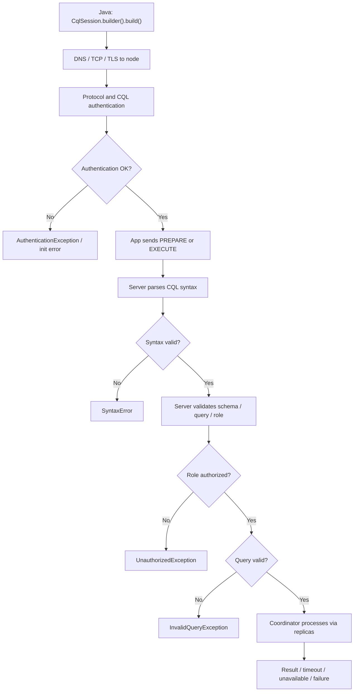
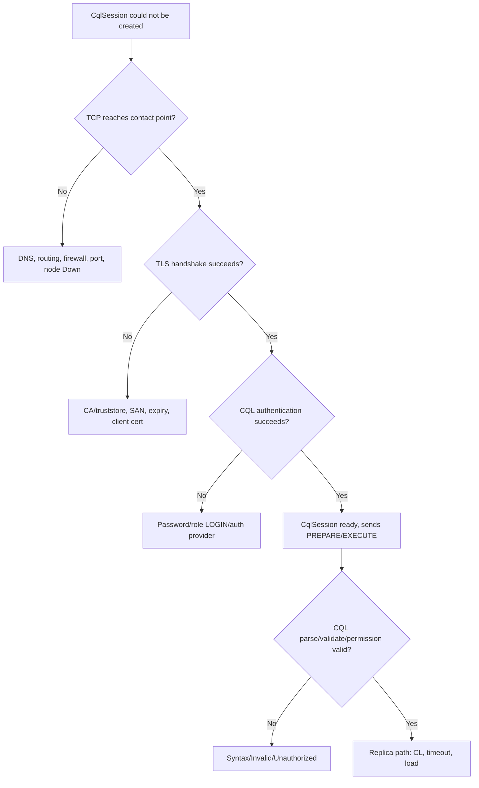

# Authentication/Unauthorized, SyntaxError, and InvalidQuery

> **Chapter:** Java Retries and Errors  
> **Module:** `DATABASE_ENGINE_WIDE_COLUMN_CASSANDRA` — covering Apache Cassandra, distributed wide-column architecture, partition keys and query-driven tables, CQL, replication, read/write consistency levels, compaction, repair, error handling, and Java application connectivity.  
> **Focus:** Distinguish **authentication**, **authorization**, **syntax validation**, and **semantic query validation** in Apache Cassandra Java Driver 4.x, so you can pinpoint root causes, classify incidents, decide when **not to retry**, write controlled CQL/Java code, and recover safely.

In a Java application, the following four symptoms might all be logged generically as “Cassandra query failed”:

- Failure to build `CqlSession` due to wrong credentials.
- Connection and login succeed, but the role lacks `SELECT` permission.
- The query has a syntax typo: `SELEC` instead of `SELECT`.
- The query is syntactically valid but violates Cassandra rules, such as filtering on a regular column without a partition key and without a suitable query path.

The fixes are **not the same**. Changing the password will not fix `InvalidQuery`. Granting `SELECT` will not fix a CQL syntax error. And **retrying 50 more times** will not make a syntactically invalid statement valid. This lesson uses the exception hierarchy of **Apache Cassandra Java Driver 4.19.0** to build a concrete diagnostic workflow.

**Core principle:** First determine **at which stage the error occurred**, **which component detected it**, and **what data may have changed**; only then decide how to handle or retry.

## 1. Learning Outcomes

After completing this lesson, you will be able to:

1. Distinguish failures during **initialization/connection**, **authentication**, **query authorization**, and **CQL syntax/semantic validation**.
2. Identify the exact Java classes and packages: `AuthenticationException`, `UnauthorizedException`, `SyntaxError`, `InvalidQueryException`.
3. Understand why `AuthenticationException` often appears **inside `AllNodesFailedException`** during session initialization, rather than being caught directly at `session.execute(...)`.
4. Understand the `QueryValidationException` hierarchy and why those three query-validation errors do not go through the driver's `RetryPolicy`.
5. Use roles, `LOGIN`, `GRANT SELECT`, `GRANT MODIFY`, and `LIST PERMISSIONS` to establish and fix least-privilege access.
6. Distinguish queries that are **syntactically invalid** from queries that are **syntactically valid but invalid against the schema/data model**.
7. Use prepared statements, typed bind values, and a shared `CqlSession` to prevent avoidable errors.
8. Distinguish validation errors from `UnavailableException`, `ReadTimeoutException`, `WriteTimeoutException`, `DriverTimeoutException`, and TLS errors.
9. Design error mappings to HTTP/gRPC and logs without leaking CQL, secrets, or topology.
10. Write lab exercises, Java code, and tests to **fail fast** on permanent errors and retry under strict control for transient, idempotent errors.
11. Execute an incident runbook using driver telemetry, Cassandra logs, schema/permissions, and metrics.

## 2. A CQL Request Has Multiple Failure Points

### 2.1. Pipeline from application to replica



**Note:** This diagram is simplified for learning. The exact ordering between schema and permission checks can vary by query, version, and implementation. Do not rely on this diagram to predict which error is thrown first if **a single query simultaneously has syntax, permission, and schema errors**.

### 2.2. Four cases to classify

| Error class | Typical phase | Primary Java class | Examples | Retry with same input/config? |
|---|---|---|---|---|
| **Authentication** | Connection / CQL authentication | `com.datastax.oss.driver.api.core.auth.AuthenticationException` | Wrong username/password, role cannot log in | **No**, fix identity/credentials/config |
| **Authorization** | Server-side CQL validation/execution | `servererrors.UnauthorizedException` | Logged in but missing `SELECT` | **No**, fix permissions or query |
| **Syntax** | Server-side CQL parsing | `servererrors.SyntaxError` | `SELEC`, missing syntax tokens | **No**, fix CQL |
| **Invalid query** | Schema/query-shape validation | `servererrors.InvalidQueryException` | Missing PK / unsupported filter, wrong column | **No**, fix schema/query/types |
| **Availability/timeout** | Coordinator/replica selection/execution | `UnavailableException`/timeouts/driver errors | RF/CL missing replicas, slow node | Depends on **idempotency, policy, and specific error** |

In the *Authentication* row, the package name is `com.datastax.oss.driver.api.core.auth`, **not** `core.servererrors`. In the next three rows, the full package is `com.datastax.oss.driver.api.core.servererrors`.

### 2.3. Authentication and Authorization are two distinct checks

```text
Authentication:   "Who are you? Are you allowed to open a connection?"
Authorization:    "Is the authenticated identity allowed to SELECT/INSERT/ALTER this resource?"
Syntax:           "Does the CQL follow Cassandra's grammar?"
Invalid query:    "The CQL parsed, but can it execute against this schema and these rules?"
```

TLS certificate validation is a layer **below** CQL authentication. A TLS handshake failure due to CA/SAN does not mean the CQL password is wrong. Conversely, successful TLS encryption does not grant permission to read a table.

## 3. Exception Hierarchy in Java Driver 4.x

### 3.1. Query-validation is a branch of server errors

In Driver 4.19:

```text
java.lang.RuntimeException
└── DriverException
    └── CoordinatorException
        └── QueryValidationException
            ├── SyntaxError
            ├── InvalidQueryException
            ├── UnauthorizedException
            ├── AlreadyExistsException
            └── InvalidConfigurationInQueryException
```

The three focus exceptions are **sibling classes**, all inheriting from `QueryValidationException`. Neither `SyntaxError extends InvalidQueryException` nor the reverse exists.

Example imports:

```java
import com.datastax.oss.driver.api.core.servererrors.QueryValidationException;
import com.datastax.oss.driver.api.core.servererrors.SyntaxError;
import com.datastax.oss.driver.api.core.servererrors.InvalidQueryException;
import com.datastax.oss.driver.api.core.servererrors.UnauthorizedException;
```

Each exception originates from the **coordinator node** responding to the query. You can use `getCoordinator()` (from `CoordinatorException`) to attach an endpoint identifier to controlled logs/metrics. That does not by itself prove the coordinator caused the bad query; syntax, schema, and permission issues usually stem from **the statement and context**.

### 3.2. AuthenticationException sits on a different branch

```text
java.lang.RuntimeException
└── com.datastax.oss.driver.api.core.auth.AuthenticationException

com.datastax.oss.driver.api.core.DriverException
└── AllNodesFailedException
    └── (contains per-node errors from bootstrap/query execution)
```

Driver 4.19's `AuthenticationException` **extends RuntimeException**; it does not extend `QueryValidationException` and is not a `DriverException`. Authentication runs when **opening a connection** to a Cassandra node. At startup, the error may be wrapped inside **`AllNodesFailedException`** because the driver tried multiple endpoints without success.

Example:

```text
CqlSession.builder().build()
  └── AllNodesFailedException
       ├── node A: AuthenticationException (bad credentials)
       └── node B: AuthenticationException (bad credentials)
```

This is a logical structure example, not a literal full stack trace. A node can also fail due to `ConnectionInitException`, TLS, network, or other protocol errors; inspect **all per-node errors** rather than concluding from the `AllNodesFailedException` name alone.

### 3.3. Key error types to recognize

| Exception | Primary package | Meaning |
|---|---|---|
| `AuthenticationException` | `core.auth` | Failure during the authentication phase when initializing a connection |
| `AllNodesFailedException` | `core` | All tried coordinators/contact points failed; exposes `getAllErrors()` |
| `NoNodeAvailableException` | `core` | No coordinator was even tried; subclass of `AllNodesFailedException` |
| `UnauthorizedException` | `core.servererrors` | Authenticated user/role is not permitted to execute the CQL |
| `SyntaxError` | `core.servererrors` | Query has invalid CQL syntax |
| `InvalidQueryException` | `core.servererrors` | Query parsed successfully but is semantically invalid |
| `UnavailableException` | `core.servererrors` | Coordinator knows insufficient replicas are up for the requested CL |
| `ReadTimeoutException` | `core.servererrors` | Replicas did not respond sufficiently/in time during a read |
| `WriteTimeoutException` | `core.servererrors` | Write timed out; mutation **may already have been applied** |
| `DriverTimeoutException` | `core` | Client-side driver deadline expired; not the same as a server timeout |
| `ClosedConnectionException` | `core.connection` | An in-flight connection closed due to another event |

**Do not** catch every `DriverException` and treat it as a “transient error”. In the driver, `SyntaxError`, `UnauthorizedException`, and `InvalidQueryException` are all subclasses of `DriverException` and belong to non-retryable errors.

## 4. Authentication: Identity Errors on Connection

### 4.1. What components does authentication involve?

A Cassandra cluster can be configured with:

- `authenticator` (e.g., `PasswordAuthenticator`) to authenticate logins.
- `authorizer` (e.g., `CassandraAuthorizer`) to enforce CQL permissions.
- `role_manager` and role metadata to manage users/roles.
- `client_encryption_options` for native protocol TLS encryption.
- `network_authorizer` / role restrictions (depending on version) to restrict DCs/CIDRs.

Never assume Cassandra **requires username/password by default**. Many test environments use `AllowAllAuthenticator` and `AllowAllAuthorizer`. Permission labs are only meaningful when the cluster **actually enables authentication and authorization** with the corresponding settings.

### 4.2. Example: building a session with credentials

```java
import com.datastax.oss.driver.api.core.CqlSession;
import java.net.InetSocketAddress;

String username = System.getenv("CASSANDRA_USERNAME");
String password = System.getenv("CASSANDRA_PASSWORD");

if (username == null || password == null) {
    throw new IllegalStateException(
        "Missing Cassandra service credentials");
}

try (CqlSession session = CqlSession.builder()
        .addContactPoint(new InetSocketAddress(
            "node-a.dc1.internal", 9042))
        .withLocalDatacenter("dc1")
        .withAuthCredentials(username, password)
        .build()) {
    // Only execute CQL after the session builds successfully.
}
```

These credentials represent the **CQL service identity** and should not be taken directly from an HTTP caller. Use a secret manager or config injection, and never hardcode passwords in repositories or logs. If the cluster uses another SASL/AuthProvider, configure the appropriate provider instead of `withAuthCredentials(...)`.

### 4.3. Why does startup fail?

Possible causes:

- Incorrect username or password.
- The secret was rotated in Cassandra, but the application container still holds the old secret.
- Role does not exist, `LOGIN = false`, or it was disabled by policy.
- Server uses an authenticator incompatible with `PlainTextAuthProvider`.
- Driver has no AuthProvider configured while the server requires one.
- Some nodes have unsynchronized auth/role metadata or are experiencing issues.
- Role is restricted by datacenter/CIDR under a network authorizer on supported versions.
- TLS handshake, certificate/SAN, or network failure occurred before authentication (a different failure—**do not assume a wrong password**).

### 4.4. Why might it only be detected after the app has been running?

The Cassandra Driver authenticates **whenever it opens a new connection**. A session can run for hours over existing connections; when a node restarts or the pool opens a new connection, **stale credentials** or a rotated secret can cause the new authentication attempt to fail.

Scenario:

```text
T0  App already opened connections with old password; queries still succeed
T1  CQL role password is rotated
T2  A node restarts; driver opens a new connection
T3  AuthenticationException appears in driver connection logs
T4  Requests may fail if no valid connection path remains
```

**Do not** conclude a new password took effect merely because a query succeeds on an existing connection. Test with a **new connection** in staging/canary using updated secrets and certificates.

### 4.5. Proper remediation steps

1. Identify the **service account** and the authorized secret source.
2. Verify username, login permission, authenticator, and cluster address.
3. Check the secret version currently loaded by the app without printing secret values to logs or tickets.
4. Check TLS/transport and endpoint reachability separately.
5. If the secret is stale, update the secret/config per the change plan and reload/restart application sessions cleanly.
6. Monitor nodes/DCs after rotation to avoid a connection storm.
7. Distinguish login failures due to invalid roles from connection failures due to SSL/TCP.

**Do not** fix this by enabling `AllowAllAuthenticator` in production, defaulting to a superuser, or broadening database privileges. Also do not retry connections infinitely per request; rely on driver reconnection/startup policies with controlled backoff.

## 5. Unauthorized: Logged In, Missing Permissions

### 5.1. Role of the Authorizer

`UnauthorizedException` indicates that **the query was rejected due to authorization constraints on the authenticated role**. For example:

- Role only has `SELECT` but attempts `INSERT`.
- Role only has `MODIFY` but attempts `SELECT`.
- Role lacks `CREATE` and runs `CREATE TABLE`.
- Role lacks the required permission on a keyspace/table/function.
- Role lacks `AUTHORIZE` and attempts to `GRANT` to another role.
- Role inheritance rules or resource scopes differ from intent.

**A successful login does not automatically grant access to every table**. With `CassandraAuthorizer`, specific privileges are normally granted with `GRANT` at the narrowest scope needed for the workload.

### 5.2. CQL example: read-only role attempting a write

Assume the lab admin has created the table:

```sql
CREATE KEYSPACE IF NOT EXISTS lab_java_errors
WITH replication = {
    'class': 'NetworkTopologyStrategy',
    'dc1': 3
};

CREATE TABLE IF NOT EXISTS lab_java_errors.accounts_by_id (
    account_id text PRIMARY KEY,
    display_name text,
    account_state text,
    updated_at timestamp
);
```

Create the role **only in a lab with PasswordAuthenticator and CassandraAuthorizer enabled**:

```sql
-- Executed by an admin account with CREATE ROLE privilege.
-- Replace the placeholder with a lab password from the secret store;
-- never commit real values to Git, transcripts, or tickets.
CREATE ROLE IF NOT EXISTS lab_read_only
WITH PASSWORD = '<LAB_PASSWORD_FROM_SECRET_STORE>'
AND LOGIN = true
AND SUPERUSER = false;

GRANT SELECT
ON TABLE lab_java_errors.accounts_by_id
TO lab_read_only;
```

This role is granted `SELECT` on one table and **does not** have `MODIFY` under the intended lab setup. When logged in as `lab_read_only`:

```sql
-- Permitted if the table exists and no extra role restrictions apply.
SELECT account_id, display_name
FROM lab_java_errors.accounts_by_id
WHERE account_id = 'user-001';

-- Rejected when MODIFY is missing:
INSERT INTO lab_java_errors.accounts_by_id (
    account_id, display_name, account_state
) VALUES ('user-002', 'Demo', 'ACTIVE');
```

On the second query, Cassandra can return `UnauthorizedException` in Java Driver 4.x. Conditions: **the authorizer is actually enforcing** and the role does not inherit broader privileges from another role. If the role holds `MODIFY` at the keyspace or `ALL KEYSPACES` scope, the query will succeed—always check effective permissions.

### 5.3. Grant only the needed permission, not broad privileges

If the service genuinely needs write access:

```sql
-- Run by admin/security approval; NEVER let the app escalate itself.
GRANT MODIFY
ON TABLE lab_java_errors.accounts_by_id
TO lab_read_only;
```

The command above illustrates changing permissions, **not a recommendation to expand a read-only role** without a business need. Using a separate write role is better when separation of duties is required.

Key permissions to know:

| CQL permission | Typical purpose |
|---|---|
| `SELECT` | Read data from the target table/resource |
| `MODIFY` | Write/update/delete data operations within scope |
| `CREATE` | Create keyspaces/tables and applicable resources |
| `ALTER` | Modify schema |
| `DROP` | Drop resources |
| `AUTHORIZE` | Grant/revoke permissions on applicable resources |
| `DESCRIBE` | View certain metadata/permissions depending on version |
| `EXECUTE` | Execute corresponding UDFs/functions where applicable |

Exact permissions and resource scopes vary in detail across Cassandra versions. Do not assume `MODIFY` implies `SELECT`. Administrative role/table privileges should remain separate from the service identity serving application requests.

### 5.4. Checking effective permissions

From an appropriately privileged admin session:

```sql
LIST ALL PERMISSIONS OF lab_read_only;
LIST ALL PERMISSIONS ON lab_java_errors.accounts_by_id OF lab_read_only;
LIST ROLES OF lab_read_only;
```

These commands belong to Cassandra administrative CQL. The goal is to inspect **effective permissions** and role inheritance, not just the most recent `GRANT` statement. Syntax and metadata visibility may vary by version. Do not assume an application role has permission to run `LIST ALL PERMISSIONS`.

### 5.5. Unauthorized must not be retried

Once you know the role lacks `MODIFY`, resending the same `INSERT` 100 times only:

- Increases network, CPU, and log pressure.
- Triggers security alerts and obscures the root cause.
- May cause security systems to classify the traffic as abuse.
- Cannot create permissions through retry logic.

**Proper handling:** stop the operation and check business requirements and the service-role-to-resource mapping. If permissions are missing due to deployment/migration, grant least-privilege access through an admin change and re-verify afterward. Never turn this error into an excuse to disable `CassandraAuthorizer`.

### 5.6. A service account's permission error differs from a user's HTTP 403

Suppose an app has authenticated end-user Alice and uses a **service account** to query Cassandra. If the service account lacks `SELECT`, Alice herself is not necessarily unauthorized.

Appropriate mapping:

- End-user blocked by **application-level authorization** → HTTP 403.
- End-user unauthenticated → HTTP 401, per API semantics.
- Cassandra service account missing `SELECT` due to server/app misconfiguration → typically **internal error / service unavailable** for the caller, alerting operations while hiding schema/role details.
- Never return raw Cassandra exception messages to HTTP clients; messages can expose sensitive table/keyspace/user metadata.

**Do not mechanically map every Cassandra `UnauthorizedException` to HTTP 403.** Understand **who was denied and at which layer**.

## 6. SyntaxError: Invalid CQL Grammar

### 6.1. Characteristics

`SyntaxError` means the CQL **could not be parsed according to grammar**. For example:

```sql
-- Misspelled keyword:
SELEC account_id
FROM lab_java_errors.accounts_by_id
WHERE account_id = 'user-001';
```

Another example:

```sql
-- Invalid: missing valid syntax after SELECT.
SELECT FROM lab_java_errors.accounts_by_id;
```

The server may return information about where the parser failed. Driver 4.19 surfaces this as `com.datastax.oss.driver.api.core.servererrors.SyntaxError`. This error **bypasses `RetryPolicy`** and is returned directly to the caller.

### 6.2. Common causes

- Misspelled keywords, missing `FROM`, trailing commas, unclosed parentheses.
- Dynamic string concatenation where a single quote in a value breaks the literal.
- Passing `cqlsh`-specific commands like `CONSISTENCY LOCAL_QUORUM;` into `session.prepare(...)` (`cqlsh` shell directive, not a server CQL query).
- Using SQL syntax unsupported by Cassandra, such as arbitrary `JOIN`, SQL-style `OFFSET`, or another database's statement syntax.
- Misusing reserved keywords or case-sensitive identifiers.
- Using newer CQL syntax on an older server version that does not support it.
- Generating query text from a template with broken `?` placeholders or incomplete clauses.

### 6.3. Bind markers prevent quoting bugs

**Wrong:**

```java
String raw = "SELECT account_id FROM "
    + "lab_java_errors.accounts_by_id "
    + "WHERE account_id = '" + inputFromApi + "'";
session.execute(raw);
```

**Right:**

```java
PreparedStatement find = session.prepare(
    "SELECT account_id FROM lab_java_errors.accounts_by_id "
    + "WHERE account_id = ?");

session.execute(find.bind(inputFromApi));
```

If `inputFromApi` contains `'` or `;`, it remains a **bound value**, not part of the syntax. Binding **does not** automatically enforce tenant authorization or prevent callers from supplying out-of-scope keys; identity verification and input validation are still required.

### 6.4. Validate syntax in deployment/CI, not via production retries

- Keep CQL statements fixed and verify them against the corresponding schema.
- `session.prepare(...)` critical queries in staging or during controlled startup.
- For dynamic queries, enumerate valid variants and run integration tests.
- Use `QueryBuilder` when query structure varies, while still binding values and validating inputs.
- Deploy only after syntax is verified rather than waiting for production traffic to uncover typos.
- If a code release changed CQL and all requests fail with `SyntaxError`, **roll back or fix the release**; do not increase retry counts.

## 7. InvalidQuery: Valid Syntax, Rejected by Cassandra

### 7.1. Characteristics

`InvalidQueryException` represents a statement that **parsed successfully** but failed semantic, schema, or query-type validation. It does not mean “Cassandra is down”.

Example on the table:

```sql
CREATE TABLE lab_java_errors.accounts_by_id (
    account_id text PRIMARY KEY,
    display_name text,
    account_state text,
    updated_at timestamp
);
```

Normal query:

```sql
SELECT account_id, display_name
FROM lab_java_errors.accounts_by_id
WHERE account_id = 'user-001';
```

Meanwhile, the query below lacks an efficient lookup path via the primary key:

```sql
-- Parses cleanly, but lacks a partition-key restriction
-- and has no supporting table/index:
SELECT account_id, display_name
FROM lab_java_errors.accounts_by_id
WHERE display_name = 'Demo';
```

In standard Cassandra versions, the server rejects this or requires a different predicate/query strategy (e.g., filtering/index where appropriate), and Java receives `InvalidQueryException`. Do not add `ALLOW FILTERING` to production APIs just to silence the error: Cassandra may have to scan massive amounts of data.

### 7.2. Typical root-cause categories

| Category | Examples | Remediation |
|---|---|---|
| Wrong/missing schema object | Table/column does not exist in current version | Verify keyspace/table, schema agreement, and migrations |
| Invalid PK restriction | `WHERE` missing partition key or invalid clustering restriction | Design query-first schema; supply full PK predicates |
| Unsupported filtering | Filtering a regular column with no query path | Add an appropriate denormalized table, index, or search path |
| Invalid type semantics | Comparing predicates with unsupported types or operations | Use typed binds and verify CQL column types |
| Clustering/`ORDER BY` | `ORDER BY` on a regular column or incompatible sort order | Align with clustering key order or redesign table |
| Data model/rule constraints | Creating a table or query with invalid options | Fix CQL, options, or schema |
| Version/API incompatibility | Server version does not support the statement/feature | Verify server version and feature rollout |
| Recent schema change | App prepared query against an older schema | Expand/contract, verify schema agreement, re-prepare at the right time |

Not every Java type error becomes `InvalidQueryException`. Some wrong Java type bindings are caught by the driver **before sending CQL** as `IllegalArgumentException` or codec-related exceptions; always inspect the stack trace and cause.

### 7.3. Missing partition key requires fixing the data model

Suppose you need to query events by tenant and day:

```sql
CREATE TABLE lab_java_errors.events_by_tenant_day (
    tenant_id uuid,
    event_day date,
    event_time timestamp,
    event_id uuid,
    event_type text,
    PRIMARY KEY ((tenant_id, event_day), event_time, event_id)
) WITH CLUSTERING ORDER BY (event_time DESC, event_id DESC);
```

Valid query:

```sql
SELECT event_time, event_id, event_type
FROM lab_java_errors.events_by_tenant_day
WHERE tenant_id = 11111111-1111-1111-1111-111111111111
  AND event_day = '2026-11-21';
```

Incompatible with the data model:

```sql
-- Attempting to query all events by event_type without tenant/day:
SELECT event_time, event_id
FROM lab_java_errors.events_by_tenant_day
WHERE event_type = 'LOGIN';
```

If a real use case needs lookups by event type, create a **query-driven table** (e.g., `events_by_tenant_type_day`) or an appropriate index/search solution and load-test it. Do not treat every `InvalidQueryException` as “just add ALLOW FILTERING”.

### 7.4. Schema agreement and multi-DC rollouts

A rollout involving `ALTER TABLE` or a new table can cause new app instances to send queries to nodes that have not yet converged metadata/schema. Depending on the Cassandra version and deployment workflow, the app may see transient `InvalidQueryException` or schema-related errors.

Correct runbook:

1. Use a migration tool to deploy schema changes **before** application code that depends on the new schema.
2. Verify schema agreement across all relevant nodes and DCs.
3. Use **expand → migrate → contract** so old and new app versions can coexist.
4. Prepare queries and run health checks in staging.
5. If a release is faulty, roll back the app or fix the migration; **do not** use infinite retries to mask schema drift.

**Do not confuse** a schema convergence window (solved by deployment orchestration) with retrying `InvalidQueryException` as a general strategy. By default, the driver **does not retry** this exception.

## 8. Classification Traps: Same Symptom, Different Stage

### 8.1. “Access denied” has two layers

```text
CqlSession.build() failed:
  AllNodesFailedException
    └── AuthenticationException
         → identity failed to authenticate with the node

session.execute(SELECT) failed:
  UnauthorizedException
         → identity authenticated, but lacks permission for the query
```

If logs only say `"Access to Cassandra denied"`, that is not enough to decide:
- Do we need to rotate/fix a secret?
- Do we need `GRANT SELECT`?
- Is it a TLS/mTLS failure?
- Or is the app connecting to the wrong cluster/DC?

### 8.2. “Invalid request” is too vague

Compare two queries:

```sql
-- 1. Syntax error:
SELEC * FROM lab_java_errors.accounts_by_id;

-- 2. Valid syntax, invalid query predicate:
SELECT account_id
FROM lab_java_errors.accounts_by_id
WHERE account_state = 'ACTIVE';
```

The first throws `SyntaxError`, while the second typically throws `InvalidQueryException`. Both require fixing the query, source code, or schema—**not** backoff retries. Mapping both to “database unavailable” sends SREs to the wrong runbook.

### 8.3. CQL query validation differs from server capacity

```text
QueryValidationException (Syntax/Invalid/Unauthorized)
   └── Fix syntax, query design, or permissions

UnavailableException / ReadTimeout / WriteTimeout
   └── Investigate RF, CL, replicas, load, network;
       retry only when semantics/idempotence allow

DriverTimeoutException / AllNodesFailedException
   └── Investigate deadlines, nodes, pool, TLS, authentication;
       do not assume a single uniform cause
```

## 9. RetryPolicy: Three Query-Validation Errors Are Not Retried

### 9.1. How does the driver handle them by default?

According to the Apache Cassandra Java Driver 4.19 documentation:

- `QueryValidationException` **and all of its subclasses** (including `UnauthorizedException`, `SyntaxError`, and `InvalidQueryException`) are **rethrown directly**.
- They **do not pass through** `RetryPolicy` for retry decisions.
- `FunctionFailureException` and `ProtocolError` also belong to this hard-coded rethrow group.
- The default retry policy only retries **certain execution errors** under specific conditions when a retry is likely to succeed and safe enough.
- For non-idempotent writes, many retry paths are blocked by the driver; marking statements idempotent indiscriminately can corrupt data.

This is why handling exceptions by **error class** matters more than “enabling default retries”.

### 9.2. Application-level retries can still do damage

A loop like:

```java
// ANTI-PATTERN: retrying indiscriminately regardless of exception type.
for (int attempt = 1; attempt <= 50; attempt++) {
    try {
        session.execute(statement);
        break;
    } catch (RuntimeException anyError) {
        // sleep then retry...
    }
}
```

**bypasses the driver's `RetryPolicy`**. For `UnauthorizedException`, it turns a missing-permission error into dozens of rejected requests. For `SyntaxError`, it generates useless traffic. For `InvalidQueryException` caused by a missing partition key, it cannot fix the data model.

**Correct approach:** classify and **fail fast** on validation errors; retry selected transient errors according to dedicated policy/idempotency rules with retry budgets and observability.

### 9.3. Decision matrix

| Scenario | Driver retry? | What the application should do |
|---|---|---|
| Bad CQL password (Authentication) | Should not retry queries endlessly; connection reconnection follows its own policy | Fix secret, TLS, authenticator, session lifecycle |
| `UnauthorizedException` | **Not** passed to retry policy | Check role, permissions, scope; fail fast |
| `SyntaxError` | **Not** passed to retry policy | Fix query/version/parser; fail fast |
| `InvalidQueryException` | **Not** passed to retry policy | Fix schema/data model/types/query; fail fast |
| `UnavailableException` | Policy may retry next node once if appropriate | Check RF/CL, node health, idempotency, error budget |
| `ReadTimeoutException` | Depends on data response/CL and policy | May do bounded retries for safe reads; measure load |
| `WriteTimeoutException` | Mutation may already be applied; default typically avoids retrying SIMPLE writes | Retry only when truly idempotent; reconcile |
| `DriverTimeoutException` | Client deadline expired; write state may be uncertain | Determine outcome, bound retries |
| TLS certificate failure | Usually trust/SAN/cert configuration error | Fix certificate/endpoint; never disable verification |
| Schema convergence during deploy | Not a reason to blanket-retry InvalidQuery | Pause rollout / wait for valid schema, then proceed per process |

### 9.4. Never lower consistency level to mask query validation

`LOCAL_QUORUM`, `QUORUM`, or `ONE` only change the **consistency/availability requirements** of a valid request. They do not fix:

- Wrong passwords.
- Missing permissions.
- Syntax parser errors.
- Missing columns or tables.
- Queries without valid partition-key restrictions.

Even for availability errors, blindly downgrading CL can break read-your-write invariants or RPO. Never enable `ConsistencyDowngradingRetryPolicy` without thoroughly evaluating the consequences.

## 10. Preparing a CQL Lab to Distinguish the Four Error Types

### 10.1. Safety requirements

Use a **lab Cassandra cluster**; never alter production authenticators or authorizers for experiments. The lab needs:

- Compatible Cassandra 4.x/5.x and Java Driver 4.x.
- Local DC named `dc1`, with at least 3 full replicas if using RF=3.
- `PasswordAuthenticator` and `CassandraAuthorizer` enabled/configured on the nodes per version docs if testing `AuthenticationException` and `UnauthorizedException`.
- An admin role with privileges to create keyspaces/tables/roles and grant permissions.
- Proper Java Driver TLS, credentials, and contact point configuration; never log real passwords.
- `cqlsh` / Java Driver tooling, plus access to logs and node status.
- You may set keyspace RF=1 on a **single-node** cluster if the goal is solely syntax/exception testing, but do not treat that as an RF=3 quorum lab.

### 10.2. Admin creates schema and sample data

```sql
CREATE KEYSPACE IF NOT EXISTS lab_java_errors
WITH replication = {
    'class': 'NetworkTopologyStrategy',
    'dc1': 3
};

CREATE TABLE IF NOT EXISTS lab_java_errors.accounts_by_id (
    account_id text PRIMARY KEY,
    display_name text,
    account_state text,
    updated_at timestamp
);

INSERT INTO lab_java_errors.accounts_by_id (
    account_id, display_name, account_state, updated_at
) VALUES (
    'user-001', 'Test User',
    'ACTIVE', '2026-11-21 08:00:00+0000'
);
```

This table is designed for `WHERE account_id = ?`. The `account_state` column is a regular column; filtering directly on it does not use the table's partition key.

### 10.3. Admin creates role and grants SELECT

```sql
-- Execute only when the lab authenticator and authorizer
-- are properly configured, using an admin identity.
CREATE ROLE IF NOT EXISTS lab_reader
WITH PASSWORD = '<LAB_PASSWORD_FROM_SECRET_STORE>'
AND LOGIN = true
AND SUPERUSER = false;

GRANT SELECT
ON TABLE lab_java_errors.accounts_by_id
TO lab_reader;
```

If the role already exists with broader privileges from an earlier lab, use an admin account to check effective permissions before testing `Unauthorized`; do not run `REVOKE` arbitrarily in a shared environment.

### 10.4. Four verification tests

| Test | How to run | Primary expectation |
|---|---|---|
| A — Authentication | Java session with a role using the wrong password | Bootstrap/connection auth fails; `AllNodesFailedException` may contain `AuthenticationException` |
| B — Unauthorized | Log in properly as `lab_reader` and run `INSERT` | `UnauthorizedException` if the role lacks `MODIFY` |
| C — SyntaxError | Valid login, run `SELEC ...` | `SyntaxError` |
| D — InvalidQuery | Role with `SELECT` queries `WHERE account_state = 'ACTIVE'` without PK | `InvalidQueryException` / server query-shape rejection depending on version |

**Do not conclude Test A failed as intended if the app could not reach the node due to TLS/network issues.** The expected event is an authentication rejection; inspect per-node causes. Test B requires the authorizer to be actively enforcing and no inherited `MODIFY` permission.

### 10.5. Concrete CQL commands for B/C/D

```sql
-- B: logged in as lab_reader (granted SELECT,
-- without MODIFY). This query must fail authorization.
INSERT INTO lab_java_errors.accounts_by_id (
    account_id, display_name, account_state
) VALUES ('user-002', 'Write Not Allowed', 'ACTIVE');

-- C: intentional syntax typo to observe parser error.
SELEC account_id
FROM lab_java_errors.accounts_by_id
WHERE account_id = 'user-001';

-- D: syntactically valid query lacking a valid access path.
SELECT account_id, display_name
FROM lab_java_errors.accounts_by_id
WHERE account_state = 'ACTIVE';
```

Run these only in a lab to avoid polluting real tables. Do not use an admin superuser when testing `Unauthorized`; a superuser normally holds full permissions and will not trigger the expected error.

## 11. Java: Handling by Error Type at CQL Runtime

### 11.1. Repository using prepared statements

```java
import com.datastax.oss.driver.api.core.CqlSession;
import com.datastax.oss.driver.api.core.DefaultConsistencyLevel;
import com.datastax.oss.driver.api.core.cql.PreparedStatement;
import com.datastax.oss.driver.api.core.cql.Row;

public final class AccountReader {
    private final CqlSession session;
    private final PreparedStatement find;

    public AccountReader(CqlSession session) {
        this.session = session;
        this.find = session.prepare(
            "SELECT account_id, display_name " +
            "FROM lab_java_errors.accounts_by_id " +
            "WHERE account_id = ?");
    }

    public String findDisplayName(String accountId) {
        Row row = session.execute(
            find.bind(accountId)
                .setConsistencyLevel(
                    DefaultConsistencyLevel.LOCAL_QUORUM)
        ).one();
        return row == null ? null : row.getString("display_name");
    }
}
```

The table and keyspace must exist before preparing queries. `session.prepare(...)` can also throw `UnauthorizedException`, `SyntaxError`, or `InvalidQueryException` depending on the CQL and permissions; do not place `catch` blocks only around `session.execute(...)` if queries are prepared at startup.

### 11.2. Catching the three validation exceptions separately

```java
import com.datastax.oss.driver.api.core.servererrors.SyntaxError;
import com.datastax.oss.driver.api.core.servererrors.InvalidQueryException;
import com.datastax.oss.driver.api.core.servererrors.UnauthorizedException;
import com.datastax.oss.driver.api.core.servererrors.QueryValidationException;

public final class QueryFailureClassifier {
    public enum Category {
        ACCESS_DENIED,
        BAD_CQL_SYNTAX,
        BAD_CQL_SEMANTICS,
        OTHER_QUERY_VALIDATION,
        NONE
    }

    public static Category classify(Throwable error) {
        if (error instanceof UnauthorizedException) {
            return Category.ACCESS_DENIED;
        }
        if (error instanceof SyntaxError) {
            return Category.BAD_CQL_SYNTAX;
        }
        if (error instanceof InvalidQueryException) {
            return Category.BAD_CQL_SEMANTICS;
        }
        if (error instanceof QueryValidationException) {
            return Category.OTHER_QUERY_VALIDATION;
        }
        return Category.NONE;
    }
}
```

**Note:** `QueryValidationException` is the supertype, so catch or check it **after** the three subtypes if you want separate metrics/handling for each. The code above **does not retry** any query; it only classifies.

### 11.3. Fail-fast example

```java
try {
    session.execute(statement);
} catch (UnauthorizedException e) {
    // Permission error on DB service identity or query path.
    // Do not retry; do not log passwords or raw input.
    alertSecurityConfiguration("db.unauthorized");
    throw new IllegalStateException(
        "Database operation is not permitted", e);

} catch (SyntaxError e) {
    // Error in query text or version/CQL template.
    alertDeployment("db.syntax_error");
    throw new IllegalStateException(
        "Database statement is invalid", e);

} catch (InvalidQueryException e) {
    // Schema, PK restriction, query shape, or data type error...
    alertDeployment("db.invalid_query");
    throw new IllegalStateException(
        "Database query does not match schema", e);
}
```

`alertSecurityConfiguration(...)` and `alertDeployment(...)` are **illustrative helper methods**, not Java Driver APIs. In a real application, emit corresponding metrics/alerts or log a controlled error category.

Never send `e.getMessage()` directly in an HTTP response. Exception messages can expose table/column names, CQL fragments, or role details that should not be public.

## 12. Java: Unwrapping Authentication Errors Inside AllNodesFailedException

### 12.1. Why not catch only AuthenticationException?

`AuthenticationException` typically occurs when the driver attempts to open a new connection. During `CqlSession.builder().build()`, the driver tries contact points; if all options fail, the application-level exception is normally `AllNodesFailedException` holding **per-node errors**.

Therefore, the following snippet may **miss auth root causes at startup**:

```java
// Insufficient for startup diagnostics:
try (CqlSession session = CqlSession.builder()
        .addContactPoint(new InetSocketAddress(
            "127.0.0.1", 9042))
        .withLocalDatacenter("dc1")
        .withAuthCredentials(user, password)
        .build()) {
    // ...
} catch (AuthenticationException e) {
    // The error may be wrapped inside AllNodesFailedException.
}
```

You must inspect `AllNodesFailedException.getAllErrors()`, which in Driver 4.19 returns `Map<Node, List<Throwable>>`. **Each node can have multiple errors.** Do not use the deprecated `getErrors()` method when `getAllErrors()` is available.

### 12.2. Safe bootstrap diagnostic pattern

```java
import com.datastax.oss.driver.api.core.AllNodesFailedException;
import com.datastax.oss.driver.api.core.CqlSession;
import com.datastax.oss.driver.api.core.auth.AuthenticationException;
import com.datastax.oss.driver.api.core.metadata.Node;

import java.net.InetSocketAddress;
import java.util.List;
import java.util.Map;

public final class SessionBootstrapDiagnostics {

    public static CqlSession open(String username, String password) {
        try {
            return CqlSession.builder()
                .addContactPoint(
                    new InetSocketAddress("127.0.0.1", 9042))
                .withLocalDatacenter("dc1")
                .withAuthCredentials(username, password)
                .build();

        } catch (AllNodesFailedException failure) {
            boolean foundAuthFailure = false;

            for (Map.Entry<Node, List<Throwable>> entry
                    : failure.getAllErrors().entrySet()) {

                for (Throwable root : entry.getValue()) {
                    // Inspect causes at the TYPE level; avoid logging raw messages
                    // because they may expose config or sensitive details.
                    if (hasCause(root, AuthenticationException.class)) {
                        foundAuthFailure = true;
                    }

                    System.err.println(
                        "Cassandra bootstrap category="
                        + root.getClass().getSimpleName());
                }
            }

            if (foundAuthFailure) {
                System.err.println(
                    "At least one node rejected authentication");
            }

            // Do not recursively call open() infinitely inside catch.
            throw failure;
        }
    }

    private static boolean hasCause(
            Throwable error,
            Class<? extends Throwable> kind) {

        for (Throwable current = error;
                current != null;
                current = current.getCause()) {
            if (kind.isInstance(current)) return true;
        }
        return false;
    }
}
```

**Pattern limitations:** `hasCause` assumes a non-cyclic cause chain, which holds for standard Driver/JDK exceptions. Production code can use a depth-bounded utility that also checks suppressed causes and emits bounded-cardinality metrics. This snippet only **classifies exception types** and does not prove credentials are wrong; a network or TLS error on a node can also cause session failure. If both auth and network failures occur, resolve each node individually.

### 12.3. What can `getAllErrors()` contain?

Example interpretation:

```text
node-A  AuthenticationException : login rejected
node-B  ConnectionInitException : TLS handshake failed
node-C  ClosedConnectionException : network disconnected
```

You cannot claim “only the password is wrong” when there are **three distinct causes**. Check:

1. Actual credentials/secret version used on each app instance.
2. Authentication config and role login flags on each Cassandra node.
3. TLS keystore/truststore/hostname validation.
4. DNS, firewall, advertised node endpoints, and local DC.
5. Driver version/handshake protocol and Cassandra logs.
6. Connection pool/reconnection behavior if the error only appears after some uptime.

Never log usernames/passwords, certificate private keys, full URIs with credentials, or raw `AllNodesFailedException` messages to public clients.

### 12.4. Application startup and readiness

When a session cannot initialize:

- The service can **fail startup** if business functionality strictly depends on Cassandra.
- Or use controlled startup retries with exponential backoff/jitter and a deadline, if deployment policy allows.
- Never accept HTTP traffic reporting healthy while creating and failing a session on every request.
- Never spawn thousands of sessions just to try multiple contact points.
- Liveness probes should not endlessly kill the service over a temporary dependency outage; configure readiness and restart policies intentionally.

**An auth failure is usually a persistent configuration fault until changed**: raise a clear alert rather than treating it like a transient timeout that will resolve in milliseconds.

## 13. Java: Errors Can Surface at PREPARE or EXECUTE

### 13.1. Query validation can happen at prepare time

Example:

```java
PreparedStatement p = session.prepare(
    "SELEC account_id FROM lab_java_errors.accounts_by_id "
    + "WHERE account_id = ?"
);
```

The server parses and validates CQL right at `PREPARE`. Thus `SyntaxError` can be thrown **before** code ever reaches `session.execute(...)`.

Similarly, preparing:

```java
PreparedStatement p = session.prepare(
    "SELECT no_such_column "
    + "FROM lab_java_errors.accounts_by_id "
    + "WHERE account_id = ?"
);
```

can be rejected at `PREPARE` because the column does not exist. If a repository prepares statements in its constructor and the application injects the repository at startup, a bad query can **prevent the application from starting**. This is **useful** behavior if startup is designed to fail fast, provided you clearly log the error category and schema version.

### 13.2. SimpleStatement can delay error detection

```java
session.execute(
    "SELECT account_id "
    + "FROM lab_java_errors.accounts_by_id "
    + "WHERE account_id = 'user-001'"
);
```

When sending raw CQL text directly, the server validates it at execution time. It is not that `SimpleStatement` is “less safe” when the text is fixed; the difference is that validation happens **when the query is executed**, with no prior `PREPARE` step.

### 13.3. Bind type errors can occur on the client side

For example, if CQL defines `account_id uuid` but Java binds a `String` through an incompatible API, it can fail **before reaching the coordinator**:

```java
// If the marker expects UUID, binding a String can trigger
// a client-side type/codec error, not necessarily InvalidQueryException.
BoundStatement s = prepared.bind("not-a-uuid");
```

Check:

- `PreparedStatement` metadata and variable types.
- Java codec mapping, `UUID.fromString`, `LocalDate`, and `Instant`.
- Index/typed setter matching the marker position.
- Distinction between `null`, `unset`, and invalid values.
- CQL syntax and query shape independently of Java serialization success.

Do not catch `InvalidQueryException` while ignoring `IllegalArgumentException`: both error classes can indicate application bugs originating from different layers.

## 14. Asynchronous Java: Unwrapping CompletionStage Properly

### 14.1. Exceptions travel inside futures

`session.executeAsync(...)` returns a `CompletionStage<AsyncResultSet>`. If the server returns `UnauthorizedException`, `SyntaxError`, or `InvalidQueryException`, the stage completes **exceptionally**. When calling `join()`/`get()` or passing through a framework layer, the exception may be wrapped in `CompletionException` or `ExecutionException`.

```java
import com.datastax.oss.driver.api.core.cql.AsyncResultSet;
import com.datastax.oss.driver.api.core.cql.BoundStatement;
import java.util.concurrent.CompletionStage;

BoundStatement request = prepared.bind("user-001");
CompletionStage<AsyncResultSet> stage =
    session.executeAsync(request);

stage.whenComplete((result, error) -> {
    if (error != null) {
        Throwable actual = unwrapAsync(error);
        System.err.println(
            "query-error=" + actual.getClass().getSimpleName());
        // Do not perform heavy blocking I/O on driver threads.
    } else {
        System.out.println(
            "first-page-size=" + result.currentPage().spliterator()
                .getExactSizeIfKnown());
    }
});
```

This snippet illustrates async future handling; `getExactSizeIfKnown()` can return `-1` depending on the `Spliterator` and **is not the total row count of the query**. For real workloads, consume pages/next pages via the async API with proper backpressure.

### 14.2. Unwrapping common async wrappers

```java
import java.util.concurrent.CompletionException;
import java.util.concurrent.ExecutionException;

static Throwable unwrapAsync(Throwable error) {
    Throwable current = error;
    while ((current instanceof CompletionException
            || current instanceof ExecutionException)
            && current.getCause() != null) {
        current = current.getCause();
    }
    return current;
}
```

This helper handles standard async wrappers and **does not** traverse every framework-specific wrapper chain. If using Reactor, Spring, or gRPC, add error mapping at the adapter layer. Never blindly `throw actual;` inside a callback assuming the upstream future handles it; maintain an explicit contract for failing or propagating the returned future.

### 14.3. Async does not make errors retryable

An `UnauthorizedException` inside a `CompletionStage` is still a **permanent permission failure**. Never write:

```java
// WRONG: every exceptional completion triggers executeAsync() again.
stage.exceptionally(err -> {
    session.executeAsync(request);
    return null;
});
```

This snippet also discards the new future's result and can cause a retry storm. Classify the actual cause, propagate the error, and handle it properly at the service boundary. When retrying transient errors, use a mechanism with **bounded attempts, jitter, deadlines, and idempotency**, and never retry query-validation errors.

## 15. Distinguishing Authentication from TLS and Networking

### 15.1. Failure layers



### 15.2. Why SSL errors cannot be “fixed” with a password

An error like:

```text
SSLHandshakeException:
  PKIX path building failed
```

typically indicates the client could not build a trust chain for the server certificate. Changing the CQL password will not fix a CA chain or SAN mismatch. Some mTLS deployments also require a client certificate, separate from CQL username/password. Until the TLS handshake succeeds, CQL authentication **has not even started**.

Proper fix: verify certificate expiration, issuer/chain, truststore, hostname verification, and the endpoints discovered by the driver. **Never disable TLS verification** or switch to plaintext just to “make the error go away”.

### 15.3. Successful authentication does not imply resource access

A diagnostic check might show:

```text
Session opened: OK
SELECT system.local: OK
SELECT lab_java_errors.accounts_by_id: UnauthorizedException
```

There is no contradiction: the system authenticated the identity, but table-level permissions are still separate. Never use the ability to read `system.local` to assume the service role has permissions on all application tables.

## 16. REST/gRPC Mapping Without Exposing Internal State

### 16.1. Map by **error origin**, not exception name alone

| Internal error | Responsible party | Suggested API outcome |
|---|---|---|
| End-user unauthenticated at API | Caller | HTTP 401 or gRPC UNAUTHENTICATED |
| End-user blocked by API policy | Caller | HTTP 403 or gRPC PERMISSION_DENIED |
| Wrong Cassandra service credentials | Backend config/secret | 503/500 per contract; alert SRE, **do not return 401 to user** |
| `UnauthorizedException` because DB role lacks `SELECT` | Backend RBAC/config | 500/503 safe internal error; alert/security |
| `SyntaxError` in static query | Code/deployment | 500, no retry |
| `InvalidQueryException` due to bad schema/query | Code/data model/deploy | 500, no retry |
| Invalid business input caught by API validation | Caller | HTTP 400 or gRPC INVALID_ARGUMENT |
| `UnavailableException` due to missing replicas | Infrastructure/CL | 503 or equivalent contract, bounded retry if safe |
| Query timeout | Infrastructure/load/network | 504/503 per deadline/contract; do not assume write was not applied |

**Important:** An `InvalidQueryException` caused by the backend generating invalid CQL **should not** automatically return HTTP 400. The HTTP caller may have sent valid data; the real defect lies in the CQL template, data model, or deployment. Conversely, if the API validates invalid user input before running CQL, HTTP 400 is appropriate.

### 16.2. Example response without leaking CQL

```json
{
  "error_code": "DATA_STORE_OPERATION_FAILED",
  "message": "Unable to complete the request.",
  "request_id": "req-demo-001"
}
```

Never return:

```json
{
  "error": "User lab_reader has no SELECT on secret_ks.internal_table",
  "query": "SELECT * FROM ...",
  "password": "..."
}
```

The second example is an illustrative **anti-pattern**—never use it in real products. Even though server logs may need diagnostic context, you must still enforce log access controls and policies against logging secrets or PII.

### 16.3. Do not swallow exceptions in the controller and continue the workflow

If an `INSERT` fails with `UnauthorizedException` or `InvalidQueryException`:

- Do not return HTTP 200 as if data were persisted.
- Do not mark an event as processed without verifying the write.
- Do not commit source offsets/checkpoints as if the target write succeeded.
- For prior steps that already executed before the failure, assess partial side effects and compensation/repair.
- Never assume updates to other tables within the same `CqlSession` form an atomic transaction.

In Cassandra, each CQL request has its own semantics, and a session does not provide multi-table ACID transactions.

## 17. Security: Avoid Turning Missing Permissions into Overbroad Privileges

### 17.1. Principle of least privilege

A service that only reads `accounts_by_id` normally needs only:

```sql
GRANT SELECT
ON TABLE lab_java_errors.accounts_by_id
TO lab_reader;
```

Never resolve Unauthorized errors with:

```sql
-- ANTI-PATTERN: granting overly broad permissions just to pass a check.
GRANT ALL PERMISSIONS ON ALL KEYSPACES TO lab_reader;
```

This anti-pattern command is shown **to help recognize the mistake**; never run it in production or shared labs. It opens access to unrelated tables and creates a privilege-escalation path if service credentials are compromised.

### 17.2. Inspect role inheritance and grants

A role can inherit permissions from other roles. When evaluating “why can the user still write” or “why can't the user read”:

1. Verify which CQL role is actually logging in.
2. List effective permissions if admin access is available.
3. Check grants at table, keyspace, and broader scopes.
4. Check role membership/inheritance.
5. Confirm you are targeting the cluster/keyspace for the **intended environment**.
6. Check whether the schema/table was dropped and recreated or altered.
7. Check authorizer cache/propagation behavior per Cassandra version and node config.

### 17.3. Secret rotation can trigger delayed errors

Password rotation workflow:

- Create/update the secret according to policy.
- Distribute it to all app pods/workers ahead of or coordinated with changing the role password.
- Test **new connections** in a canary.
- Maintain a transition/rollback window matching your organization's role management model.
- Monitor authentication failures per app instance, node, and DC.
- Do not trigger a global retry storm when a secret version is mismatched.
- Never place sensitive passwords or secret metadata in public logs.

If secrets cannot be updated atomically across both cluster and apps, use an approved **transitional role** with narrow permissions and a short lifetime. Never substitute a superuser account.

## 18. Observability and Alerting: Separate Error Categories

### 18.1. Consistent metric naming

Examples of **application-emitted metrics** (not built-in Cassandra metric names):

```text
app_cassandra_errors_total{
  operation="FindAccountById",
  category="syntax_error",
  environment="prod"
}

app_cassandra_errors_total{
  operation="FindAccountById",
  category="unauthorized",
  environment="prod"
}

app_cassandra_connection_failures_total{
  category="authentication",
  environment="prod"
}
```

Never use `username`, raw query text, account ID, full endpoint path, or exception message as Prometheus labels: cardinality and data-exposure risks will spike.

### 18.2. Signals from the driver and Cassandra

| Source | Observation | Used to verify |
|---|---|---|
| App exception classifier | Rate per exception subclass | Whether to fix query/role or investigate load |
| Driver connection logs | Authentication failures, SSL, reconnections | Bootstrap/connection state |
| Driver request metrics | p95/p99, retries, in-flight, timeouts | Request impact |
| Cassandra authentication logs/audit | Login failures, role/permission events | Identity/security policy |
| Cassandra query validation logs | Controlled syntax/invalid query messages | Server parser/schema |
| `nodetool status` | Nodes Up/Down/Normal | Cluster availability |
| `nodetool tpstats` | Thread pools / queued / dropped requests | Resource pressure |
| `nodetool tablestats` | Table statistics | Workload/data context |
| Schema metadata | Tables/columns/PK, schema agreement | Whether app queries match schema |
| Deployment audit | App image/config/secret/schema version | Regressions after rollout |

### 18.3. Writing useful yet safe logs

An illustrative log entry:

```text
level=ERROR
component=AccountRepository
operation=FindAccountById
error_category=invalid_query
driver_version=4.19.0
schema_version=deployment-2026-11
request_id=req-demo-001
retryable=false
```

You may add coordinator DC or endpoint identifier **when log access policies permit**, but omit raw CQL values. If the app logs stack traces, restrict log access by policy and avoid including CQL literals with PII in messages.

### 18.4. Severity-aligned alerts

- **Authentication failures after secret rotation:** alert operations immediately and compare secret versions.
- **Unauthorized spike after role/permission changes:** alert security/config owners and compare deployments.
- **`SyntaxError` spike after app release:** prioritize rolling back or fixing the query.
- **`InvalidQuery` spike after schema migration:** inspect schema, query shapes, and staging tests.
- **Timeout/unavailable spike:** check SLOs, RF/CL, disk/compaction/network; do not blame auth.
- **One node failing while others are healthy:** check per-node config/drift; do not recreate sessions endlessly.

### 18.5. “Zero retries” is a diagnostic signal

If metrics show `SyntaxError` every second while the driver's retry counter stays at 0, **that is expected**: the driver does not retry query-validation errors. Do not tweak retry settings just to make counters “show activity”. Route the error to the owner of the CQL template, schema, or deployment.

## 19. Incident Response Runbook

### Phase A — Contain and scope the error

1. Record cluster, keyspace/table, environment, app/deployment version, and **first-seen timestamp**.
2. Identify the stage: session bootstrap, prepare, execute, or async completion.
3. Capture the **exact exception class and cause chain types**.
4. If `AllNodesFailedException`, list error groups **per node** via `getAllErrors()`.
5. Record the operation name and a non-sensitive request ID.
6. Check for recent rollouts of app code, schema, roles, TLS, secrets, or topology.

**Do not** attempt fixes by spawning extra sessions, disabling TLS, or granting `ALL PERMISSIONS`.

### Phase B — Authentication branch

- [ ] Cluster, contact points, and local DC are correct.
- [ ] TCP/TLS handshake succeeds; SAN/CA match.
- [ ] Password/auth provider and secret version are correct.
- [ ] Role exists, `LOGIN=true`, and network/DC restrictions permit access.
- [ ] Cassandra nodes share consistent auth configuration and healthy membership.
- [ ] Test login with a **new connection** in an authorized canary.
- [ ] Secret rollout is paced to prevent a connection storm.

### Phase C — Unauthorized branch

- [ ] Identify the actual CQL role used by the app, not just the pod name.
- [ ] Identify which table/keyspace/operation was denied and which permission is needed.
- [ ] Check `GRANT`, `LIST PERMISSIONS`, role membership, and scopes.
- [ ] Approve least-privilege permissions; never grant superuser.
- [ ] Re-run **one** test query in staging/canary after updating permissions.
- [ ] Audit all role changes; revoke any temporary permissions post-incident.

### Phase D — SyntaxError branch

- [ ] Compare **PII-free** query text against the target CQL syntax version.
- [ ] Check keywords, placeholders, quotes, and schema object names.
- [ ] Ensure `cqlsh` commands like `CONSISTENCY` are not passed into Java sessions.
- [ ] Replace raw string concatenation with bind markers.
- [ ] Run integration tests for `PREPARE`/`EXECUTE` against real Cassandra.
- [ ] Roll back query code if a new release introduced the error.

### Phase E — InvalidQuery branch

- [ ] Compare against the live schema: keyspace/table/columns and Cassandra version.
- [ ] Verify partition keys, clustering columns, indexes, and the query-first model.
- [ ] Check `WHERE`, `ORDER BY`, type restrictions, and TTL/LWT constraints.
- [ ] Check schema agreement and migration rollout order.
- [ ] Never enable `ALLOW FILTERING` as an un-load-tested patch.
- [ ] If new app code ran before the schema was ready, halt rollout and expand schema first.

### Phase F — Post-fix verification

- [ ] Critical prepared statements verified.
- [ ] CQL role holds exact required permissions without over-privileging.
- [ ] Error rate for the affected category returns to baseline.
- [ ] Read/write CQL queries succeed at the business-required CL.
- [ ] Driver reconnection and secret rotation show no remaining errors.
- [ ] p95/p99 latency, retry rate, replica health, and backlog are within SLO.
- [ ] Postmortem documents root cause, missing tests/guardrails, and preventive actions.

## 20. Common Issues and Quick Remediations

### 20.1. App just deployed; every request throws SyntaxError

**Likely cause:** new query template has invalid CQL syntax, uses unsupported SQL syntax, or broke during string concatenation.

**Remediation:** roll back or fix code and run integration tests against the real schema. Do not increase timeouts or retries.

### 20.2. App just deployed; only the new table throws InvalidQuery

**Likely cause:** schema migration has not run or converged, a column does not exist yet, the query lacks a partition key, or an unsupported feature is used.

**Remediation:** compare schema and key/query restrictions; deploy expanded schema before app code, or roll back code. Do not treat this as Cassandra being down if other queries succeed.

### 20.3. After GRANT SELECT, INSERT still throws Unauthorized

**Likely cause:** role lacks `MODIFY`; `SELECT` does not include write privileges.

**Remediation:** confirm whether the workload requires writes; if so, have an admin grant `MODIFY` on the specific table/role, not `ALL PERMISSIONS`.

### 20.4. After password change, old session still reads while new sessions fail

**Likely cause:** previously authenticated connections remain open; new connections use mismatched secrets.

**Remediation:** test a new connection in canary, verify secret versions/roles, and perform an appropriate rolling restart or config reload. Never rely on queries over old connections as sole proof.

### 20.5. `AllNodesFailedException` at startup, but logs show multiple causes

**Likely cause:** contact point A has a TLS mismatch, B rejects auth, and C is unreachable. One outer exception hides multiple underlying failures.

**Remediation:** inspect `getAllErrors()` and nested per-node causes; never assume every node failed due to a bad password.

### 20.6. Java throws InvalidQuery while cqlsh runs a similar query fine

**Likely cause:** different keyspace/session context, CQL credentials, bind types/markers, schema version, quoted identifiers, or CL/config. The queries may **not actually be identical**.

**Remediation:** compare exact normalized query shapes, typed bindings, and schema/context across both clients; never paste raw user values into logs.

### 20.7. App catches all RuntimeExceptions and returns HTTP 400

**Likely cause:** the application conflates internal DB/deployment faults with invalid caller input.

**Remediation:** validate API requests before calling Cassandra; classify server errors in the DB adapter and map backend faults to safe responses and metrics.

### 20.8. Security scanner flags repeated Unauthorized spikes

**Likely cause:** misconfigured app retries, role drift, caller abuse, or a deployment calling a newly added feature without granted permissions.

**Remediation:** stop retrying validation errors, verify authorized operation paths and caller policies, audit permissions, and enforce API rate limiting against abuse.

## 21. Automated Testing Without Breaking Production

### 21.1. Unit-testing the classifier

Mock exceptions at the adapter boundary to verify mapping logic. Note that server-error constructors require a `Node coordinator`, so unit tests can use a mocking framework or test an adapter accepting `Throwable`; you do not need a live Cassandra node solely to test enum classification.

```java
// JUnit-style pseudocode; keep classification tests decoupled from the driver.
assertEquals(
    Category.BAD_CQL_SYNTAX,
    classifier.classify(mockSyntaxError)
);
assertEquals(
    Category.ACCESS_DENIED,
    classifier.classify(mockUnauthorizedError)
);
assertEquals(
    Category.BAD_CQL_SEMANTICS,
    classifier.classify(mockInvalidQueryError)
);
```

This is **pseudocode**: mock variables, `Category`, and `classifier` must be initialized appropriately for your test framework.

### 21.2. Integration tests on a lab cluster

| Test | Setup | Expectation |
|---|---|---|
| Wrong auth | New session with incorrect password | `AllNodesFailedException` containing auth cause if node is reachable and auth enabled |
| Valid login | New session with valid role | Authorized CQL `SELECT` succeeds |
| Unauthorized write | `SELECT`-only role executes `INSERT` | `UnauthorizedException` |
| Wrong keyword | `SELEC ...` | `SyntaxError` |
| Query missing PK | Filter `account_state` without index/PK | `InvalidQueryException` or version-appropriate rejection |
| Valid prepared query | `WHERE account_id = ?` | Prepare and bind succeed |
| Wrong typed bind | Bind String to UUID marker | Driver/type error, not necessarily `SyntaxError` |
| Granted permission | Admin grants `MODIFY` at right scope | `INSERT` succeeds; other ungranted operations remain blocked |
| TLS trust failure | Test client does not trust CA | TLS handshake error, **distinct from auth** |
| Node down / insufficient CL | Lab cluster configured to trigger failure | Unavailable/timeout, **distinct from query validation** |

### 21.3. Do query-validation tests keep cluster data untouched?

`SyntaxError` normally rejects a query before any mutation occurs. `UnauthorizedException` means the server rejected the operation due to permissions. However, **never** infer from one error class that **all prior side effects in a workflow** were rolled back.

Example:

```text
Step 1: UPDATE table_A succeeds
Step 2: INSERT table_B fails with UnauthorizedException
Step 3: App fails
```

`Step 1` may already be persisted. Two CQL calls do not form a transaction merely because they share a `CqlSession`. When a business workflow spans multiple tables or events, implement idempotency/compensation and test failure paths.

### 21.4. Security testing checklist

- Never allow HTTP users to supply arbitrary keyspace or table names.
- Pass CQL values through prepared statements and bind markers.
- Grant service account roles only the permissions actually required.
- Ensure logs omit passwords, auth tokens, and sensitive CQL values.
- Test an unprivileged role in the lab and verify proper rejection.
- Test inputs containing quotes and Unicode; queries should still parse and bind cleanly.
- Test role secret rotation using **new connections**.
- Ensure HTTP error mappings never expose internal table/role names or stack traces.

## 22. Scenario Exercises

### Exercise 1 — Wrong password when building a session

`CqlSession.builder().withAuthCredentials(...)` fails. The top-level log shows `AllNodesFailedException`. Can you conclude the network is down? Which exception API should you inspect to analyze it?

### Exercise 2 — Login succeeds, cannot read data

The service role logged in and can read `system.local`, but `SELECT app.orders_by_id` throws `UnauthorizedException`. Is this an authentication or authorization failure? What should you check?

### Exercise 3 — Syntax error

Java executes `"SELEC * FROM ks.tbl"`. Which exception is expected? Should the driver retry it via `RetryPolicy`?

### Exercise 4 — Valid syntax, missing PK

`SELECT account_id FROM accounts_by_id WHERE account_state='ACTIVE'`. Why does this differ from `SyntaxError`? What is the Cassandra-appropriate fix?

### Exercise 5 — GRANT SELECT, yet INSERT is blocked

Role `reader` has `SELECT` on the table. Should you grant `ALL PERMISSIONS ON ALL KEYSPACES`? Propose a least-privilege solution.

### Exercise 6 — HTTP mapping

The backend uses a Cassandra service account and receives `UnauthorizedException` from the database. Should it immediately return HTTP 403 to every end-user? Why or why not?

### Exercise 7 — Exception hierarchy

What common superclass do `SyntaxError`, `UnauthorizedException`, and `InvalidQueryException` share? Does `AuthenticationException` inherit from that superclass?

### Exercise 8 — After password rotation

The application was running normally; authentication failures only appeared after a node restarted. Why can the error show up late?

### Exercise 9 — PREPARE

A repository prepares queries in its constructor and fails before serving HTTP traffic. Why can `InvalidQueryException` occur right at startup?

### Exercise 10 — Async

An `executeAsync` future fails, and the callback sees `CompletionException`. What must you do to identify the root error before classifying or retrying?

### Exercise 11 — Write timeout

A `LOCAL_QUORUM` write times out. Can you assert the mutation was not applied? Why is this different from query-validation errors?

### Exercise 12 — DriverTimeout vs ReadTimeout

Do `DriverTimeoutException` and `ReadTimeoutException` originate from the same place? Explain how to check both app and coordinator sides.

### Exercise 13 — Default retry policy

A development team enables a retry policy hoping every `InvalidQueryException` will be retried to smooth over deployment lag. Why will this not work in Driver 4.19?

### Exercise 14 — Auth vs TLS

Logs show `PKIX path building failed`. Will changing the CQL password fix it? Where should you inspect CA/SAN/truststore settings?

### Exercise 15 — CQL role inheritance

You granted `SELECT` on a table, yet `lab_reader` can still `INSERT`. Name at least three possible reasons.

### Exercise 16 — Canary

After fixing role grants, what must you verify to confirm the issue is resolved? Is one successful login and `SELECT` enough?

### Exercise 17 — Input with single quotes

A user ID contains `'`. Why can string concatenation like `WHERE id='...'` cause `SyntaxError`? How do you prevent it?

### Exercise 18 — Classifying failure stage

`AuthenticationException` appears in the driver connection logger, while the next HTTP request throws `AllNodesFailedException`. What additional data should you collect before restarting the entire app?

### Exercise 19 — Schema migration

New app code queries `status_v2` while some nodes do not yet have the updated schema. Should you modify the retry policy or fix the rollout process? Explain.

### Exercise 20 — SLO

After a release, `SyntaxError` spikes from 0 to 500 errors/min while `driver_retries_total` stays at 0. Is this abnormal? What action is needed?

### Answer hints

1. No. `AllNodesFailedException` can stem from auth, TLS, or network issues; inspect `getAllErrors()` per node and nested causes.
2. Authorization. Check the role, `LIST PERMISSIONS`, table/keyspace scope, inheritance, and service identity.
3. `SyntaxError`; do not retry—fix the query.
4. The parser understood the statement, but it violates the table's access path; design an appropriate table/index or supply the partition key.
5. No. Grant `MODIFY` only on the specific resource if required by business logic, with admin approval and audit.
6. Not automatically. If it is a backend role misconfiguration, map safely to 500/503 and alert; 403 applies only when the API caller is unauthorized.
7. `QueryValidationException`; `AuthenticationException` in `core.auth` extends `RuntimeException` separately.
8. The driver authenticates when opening new connections; older pooled connections can keep working until replaced.
9. The server parses and validates right at `PREPARE`, before `EXECUTE`.
10. Unwrap `CompletionException`/`ExecutionException`; preserve the category and never retry validation errors.
11. No. Some or enough replicas may have persisted the write; timeouts are execution/availability issues requiring idempotency.
12. Different sources: driver deadline is client-side, while read timeout is returned by the coordinator based on replica responses.
13. `QueryValidationException` is hard-coded to rethrow without consulting `RetryPolicy`; fix schema rollout or the query instead.
14. No. Inspect the TLS certificate chain, CA/truststore, SAN/hostname, and endpoints.
15. `MODIFY` granted at keyspace/`ALL KEYSPACES` scope, role inheritance, using a superuser or another role, or `CassandraAuthorizer` is not enabled.
16. Verify queries at the right CL, least-privilege permissions, all app instances/nodes, error rates, and audit logs; a single query only proves one path.
17. It breaks the string literal during concatenation; use prepared statements and bind markers.
18. Per-node errors, secret version, TLS/network, DC/topology, connection pool/reconnect state, and rotation timeline.
19. Fix expand/contract migrations and schema agreement, rolling back the release if needed; never mask errors by retrying validation failures.
20. Not abnormal. The driver does not retry syntax errors; alert and roll back or fix the CQL template and integration tests.

## 23. Code Review and Incident Readiness Checklist

**Application code**

- [ ] Classify exceptions by **class**, not by substring-matching `"failed"` in messages.
- [ ] Distinguish `AuthenticationException` at connection bootstrap from `UnauthorizedException` at query execution.
- [ ] Catch `SyntaxError`, `InvalidQueryException`, and `UnauthorizedException` before `QueryValidationException` if distinct taxonomy is needed.
- [ ] Never catch `RuntimeException` and retry all errors.
- [ ] Inspect `AllNodesFailedException.getAllErrors()` on connection failures.
- [ ] Unwrap async futures cleanly without blocking driver I/O threads.
- [ ] Verify prepared statements in CI/staging, and expand schemas before deploying app code.
- [ ] Pass CQL values via bind markers; never concatenate inputs into query strings.
- [ ] Enforce explicit idempotency and deadlines on writes and retries.

**Security and CQL roles**

- [ ] Authentication and authorization are actively enabled per policy.
- [ ] Service roles hold least-privilege permissions only.
- [ ] `GRANT` statements target exact tables/keyspaces with approval and audit.
- [ ] Secrets and TLS material reside in a secret manager or protected volume.
- [ ] New connections are tested after secret rotation.
- [ ] End-user HTTP permissions are kept separate from backend DB service permissions.
- [ ] Raw CQL queries, passwords, and role metadata are never exposed in public responses.
- [ ] Superuser or `AllowAllAuthorizer` is never enabled to hide permission errors.

**Cassandra / data model**

- [ ] Every query includes proper partition key and clustering restrictions.
- [ ] `ALLOW FILTERING` is never used as a default workaround for `InvalidQuery`.
- [ ] Keyspace, table, columns, types, and schema versions are verified.
- [ ] Cassandra node status, RF/CL, and local DC are monitored separately.
- [ ] Timeout/Unavailable errors are not confused with validation errors.
- [ ] Consistency levels are never lowered solely to “make errors disappear”.

**Ops and QA**

- [ ] Separate metrics exist for auth, unauthorized, syntax, and invalid query errors.
- [ ] Alerts are configured around app, schema, role, and secret rollouts.
- [ ] Logs capture operation name, request ID, deployment version, and error category.
- [ ] Lab tests cover auth failure, unauthorized, syntax, invalid query, and TLS failure.
- [ ] Incident owners and rollback/secret-recovery paths are clearly documented.
- [ ] Incidents are never closed solely because retry counters dropped; verify actual CQL operations and SLOs.

## 24. Official References

- [Apache Cassandra Java Driver 4.19 — Server errors package](https://apache.github.io/cassandra-java-driver/4.19.0/api/com/datastax/oss/driver/api/core/servererrors/package-summary.html): coordinator exceptions and `QueryValidationException`.
- [Java Driver 4.19 — QueryValidationException](https://apache.github.io/cassandra-java-driver/4.19.0/api/com/datastax/oss/driver/api/core/servererrors/QueryValidationException.html): superclass for parse/query/authorization errors.
- [Java Driver 4.19 — UnauthorizedException](https://apache.github.io/cassandra-java-driver/4.19.0/api/com/datastax/oss/driver/api/core/servererrors/UnauthorizedException.html): missing permissions, rethrown.
- [Java Driver 4.19 — SyntaxError](https://apache.github.io/cassandra-java-driver/4.19.0/api/com/datastax/oss/driver/api/core/servererrors/SyntaxError.html): invalid syntax, rethrown.
- [Java Driver 4.19 — InvalidQueryException](https://apache.github.io/cassandra-java-driver/4.19.0/api/com/datastax/oss/driver/api/core/servererrors/InvalidQueryException.html): valid syntax but invalid query, rethrown.
- [Java Driver 4.19 — AuthenticationException](https://apache.github.io/cassandra-java-driver/4.19.0/api/com/datastax/oss/driver/api/core/auth/AuthenticationException.html): auth failure during connection setup.
- [Java Driver 4.19 — AllNodesFailedException](https://apache.github.io/cassandra-java-driver/4.19.0/api/com/datastax/oss/driver/api/core/AllNodesFailedException.html): per-node `getAllErrors()`.
- [Java Driver 4.19 — Retries](https://apache.github.io/cassandra-java-driver/4.19.0/core/retries/): retry policies and hard-coded non-retryable errors.
- [Java Driver 4.19 — Authentication](https://apache.github.io/cassandra-java-driver/4.19.0/core/authentication/): AuthProvider and session builder.
- [Apache Cassandra — Database Roles and Permissions](https://cassandra.apache.org/doc/latest/cassandra/developing/cql/security.html): roles, `LOGIN`, `GRANT`, `LIST PERMISSIONS`.
- [Apache Cassandra — CQL and data modeling](https://cassandra.apache.org/doc/latest/cassandra/developing/cql/): query grammar and restrictions.
- [Apache Cassandra — Security](https://cassandra.apache.org/doc/latest/cassandra/managing/operating/security.html): client TLS, authentication, authorization, and audit.

The `latest` docs and 4.19 API may not match the exact Cassandra/Driver version running on your cluster. Cross-check **driver artifact, JDK/Cassandra release, authenticator/authorizer settings, schema, and security policy** before applying commands to a live environment.

## 25. Key Takeaways

- **`AuthenticationException`:** an **authentication error during connection setup**, which may appear inside `AllNodesFailedException` when initializing `CqlSession`. Inspect per-node errors along with secrets, TLS, and the auth provider.
- **`UnauthorizedException`:** identity was authenticated, but **lacks permission** on the resource or query. Inspect effective permissions and role inheritance, and grant least-privilege access; never retry.
- **`SyntaxError`:** the CQL statement is **syntactically invalid**. Fix templates, keywords, or placeholders; never retry.
- **`InvalidQueryException`:** the CQL parsed, but **does not conform to the schema, rules, or query plan**. Fix the data model, partition key, columns/types, or schema rollout; never enable `ALLOW FILTERING` recklessly.
- **All three validation errors** inherit from `QueryValidationException` and are **rethrown directly by Driver 4.19 without going through `RetryPolicy`**.
- **Authentication errors differ from TLS errors**, and service-account authorization failures differ from end-user HTTP 403 responses.
- **An active session does not prove new credentials are valid**; authentication runs when opening new connections.
- **`PREPARE` can fail before `EXECUTE`**; place validation and tests at the appropriate stage.
- **Timeouts and Unavailable errors are not query-validation errors**; retrying writes requires evaluating whether the mutation may have applied, idempotency, and CL.
- **Measure error categories separately**, log safely, and alert around releases, schemas, roles, and secrets; never increase retries to cure permanent faults.
- A sound runbook begins with **identifying the stage → exception class → root cause → smallest fix → canary verification → SLO monitoring**, never “just reconnect and try again”.
