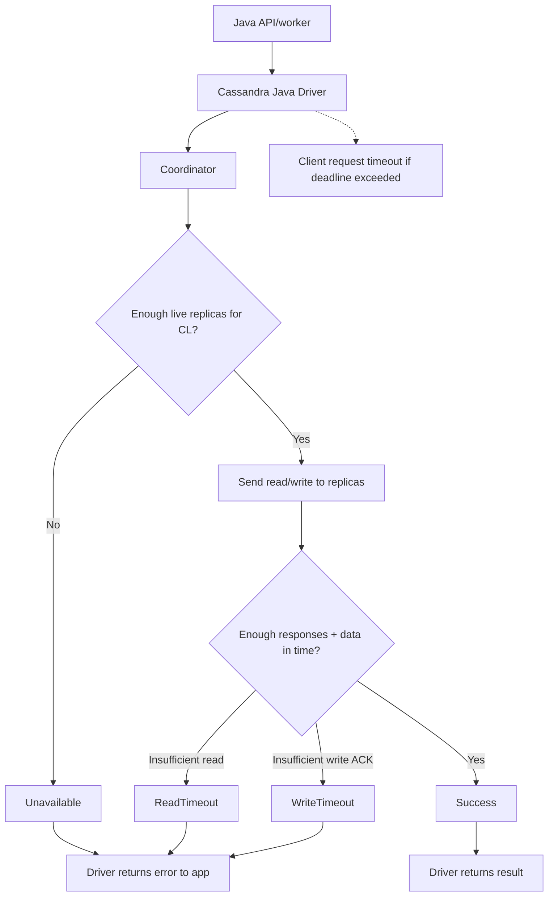
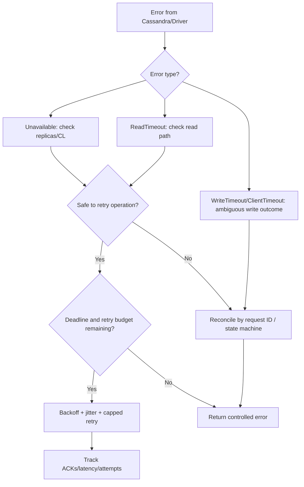

# Unavailable, ReadTimeout, WriteTimeout, and Ambiguous Outcomes in the Cassandra Java Driver

## 1. Context: A Returned Error Does Not Mean the Operation Did or Did Not Happen

In the `DATABASE_ENGINE_WIDE_COLUMN_CASSANDRA` module, Apache Cassandra is treated as a **distributed wide-column** database: tables are designed around queries, the partition key locates data, each partition has multiple replicas per the replication factor (RF), and the consistency level (CL) determines how many responses are required for a read or write operation. Java applications use the **Cassandra Java Driver** to send CQL through a coordinator.

Suppose a Java API updates an order status:

```sql
UPDATE commerce.orders_by_id
SET status = 'PAID'
WHERE order_id = ?;
```

If Java receives a `WriteTimeout` error, the most important question is not just “how many times should we retry?” but rather:

**How many replicas already wrote? Did the write succeed from a business perspective? Can we retry without corrupting the outcome?**

In Cassandra, three errors must be distinguished immediately:

- **`Unavailable`:** the coordinator determines that the currently available replicas are **insufficient** to satisfy the requested CL.
- **`ReadTimeout`:** the read operation was dispatched, but the coordinator **did not receive enough responses/data before the deadline** to return a valid result.
- **`WriteTimeout`:** the write operation was sent/processed, but the coordinator **did not receive enough required acknowledgments in time**; the data *may* already have been applied on one or more replicas.

Alongside these is the **Java Driver client-side timeout**: the client waited past its deadline without necessarily receiving an error from the coordinator. You must distinguish **observed failure** from **actual data state**.

This lesson belongs to the **Java Retries and Errors** chapter, focusing on the meaning of each error, **ambiguous outcomes**, RF/CL interactions, how Java Driver 4.x classifies errors, retry decisions, idempotency, verification/reconciliation, and operational runbooks.

### Learning Objectives

After completing this lesson, you will be able to:

1. Explain the differences between **Unavailable**, **ReadTimeout**, and **WriteTimeout** across the coordinator–replica flow.
2. Calculate the minimum replica count per CL and identify when errors occur in single- or multi-DC clusters.
3. State clearly which conclusions **can** and **cannot** be drawn from a single timeout.
4. Classify idempotent operations, counter updates, batches, LWTs, and external side effects before retrying.
5. Write Java error handling per category with bounded retry counts, time budgets, and observability.
6. Design runbooks for investigation, reconciling ambiguous outcomes, and preventing retry storms.

## 2. The CQL Flow: Know Which Layer Produced the Error

Typically, a Java request passes through these stages:



This is a **conceptual** diagram and does not depict every advanced branch such as read repair, transient replication, speculative execution, LWTs, or specialized write paths. In real systems, the client may retry on another coordinator, hit network drops, or the server may continue processing after the client stopped waiting.

### Three distinct questions to separate

| Question | Can the error alone tell us? | Additional evidence needed |
| --- | --- | --- |
| **Did the request meet CL in time?** | Usually yes, from the coordinator's returned error type | `Unavailable`, `ReadTimeout`, or `WriteTimeout` |
| **Does a replica hold the new data?** | **Cannot** conclude certainty from `WriteTimeout` | Read-back, mutation state, tracing/metrics, reconciliation |
| **Did the business workflow complete once?** | **Cannot** conclude from a timeout, especially with side effects | Idempotency keys, state records, business logs, and external systems |

**Rule of thumb:** “I did not receive a success response” differs from “Cassandra did not execute it”, which differs even further from “the business action did not happen”.

## 3. RF, CL, and Response Thresholds: Calculate Before Handling Errors

Cassandra replicates partitions across nodes. With `NetworkTopologyStrategy` and `RF(dc1)=3`, the required replicas within **one DC** for common CLs are:

| Consistency level | Responses needed in a DC with RF=3 | Impact of one node DOWN |
| --- | ---: | --- |
| `LOCAL_ONE` | 1 | Can still be served by remaining replicas |
| `LOCAL_QUORUM` | 2 | Can still be served if the other two replicas are healthy |
| `ALL` | 3 (all relevant replicas) | Cannot be satisfied if any required replica is DOWN |
| `ONE` | 1 replica per CL semantics | Can succeed, though without guaranteeing the latest value |

For **RF=3**, quorum is:

\[
\mathrm{quorum}=\left\lfloor\frac{RF}{2}\right\rfloor+1=2.
\]

If two datacenters both have RF=3, `LOCAL_QUORUM` in `dc1` requires **two replicas in `dc1`** and will not use ACKs from `dc2` to compensate for missing replicas in `dc1`. Cross-datacenter CLs like `EACH_QUORUM` have their own rules.

**Caution:** these counts describe **required responding replicas**, not a guarantee that every operation finishes whenever enough nodes are UP. A node that is UP can still be slow, stuck in long GC pauses, overloaded, hit asymmetric network drops, or fail to return the required **data response**.

### Examples by node state

```text
dc1: A, B, C — RF=3
Query: SELECT ... WHERE order_id = ?
CL: LOCAL_QUORUM -> requires 2 valid responses

Scenario 1: A and B UP, C DOWN
  Potentially 2 available -> not automatically Unavailable
  Yet if A/B are slow -> ReadTimeout can still occur

Scenario 2: A UP, B and C DOWN
  Only 1 replica seen as available by the coordinator
  -> Unavailable occurs with LOCAL_QUORUM

Scenario 3: A/B/C UP, but requests arrive slowly
  Coordinator initially sees enough live replicas
  -> ReadTimeout/WriteTimeout can still occur
```

Always count the **partition's replicas**, not total UP nodes across the entire cluster. A hundred-node cluster can still lack replicas for a specific partition.

## 4. `UnavailableException`: Insufficient Live Replicas

### 4.1. Exact meaning

When a coordinator receives a request at a given CL, it needs enough live replicas to have a chance of meeting that CL. Based on the coordinator's current liveness view, if too few replicas are available, the server immediately returns `Unavailable`.

Example:

```sql
CONSISTENCY LOCAL_QUORUM;

SELECT order_id, status
FROM commerce.orders_by_id
WHERE order_id = 11111111-1111-1111-1111-111111111111;
```

If `RF(dc1)=3` and the coordinator sees only one replica of that partition as available, the request requires two and cannot proceed.

### 4.2. What can be inferred?

- For **this attempt**, the coordinator judged there were **not enough available replicas** for the CL.
- The error typically reflects availability, topology, or DC issues—not invalid CQL syntax.
- The error is **not** proof that data was permanently lost.
- For a standard write rejected right at the preflight CL check, the coordinator normally **did not dispatch the mutation for that attempt**. However, **never generalize** this into “the entire logical operation definitely had no side effects” if earlier attempts ran, the client called external systems, or a retry policy already executed.

### 4.3. Root-cause analysis

1. Verify the **local datacenter** name in the Java Driver; a wrong DC selects unexpected coordinators/replicas.
2. Check `nodetool status`, topology, and UP/DOWN status of the **relevant replicas**.
3. Verify keyspace RF, token ownership, rack/DC layout, and ongoing bootstrap/decommission operations.
4. Check network partitions, gossip health, storage, compaction/GC, and recently replaced nodes.
5. Verify the effective CL applied by the statement or execution profile—not just default config.

**Do not automatically downgrade `LOCAL_QUORUM` to `ONE`** to evade `Unavailable` if business correctness relies on overlapping quorums. Changing CL alters the data consistency contract, not merely connection handling.

## 5. `ReadTimeoutException`: Replicas Exist, Too Few Read Responses

### 5.1. How does it differ from `Unavailable`?

`ReadTimeout` means the coordinator **had enough replicas marked available to attempt the read**, but failed to collect the necessary responses before the read deadline. Depending on the read path, the coordinator may have received some **digest responses** yet **missed the required full data response**.

In Cassandra, the read path involves:

- **Data** responses containing the actual row payload.
- **Digest** responses used to compare data integrity without transferring full rows.
- Additional reads/reconciliation when replicas disagree.

Consequently, you cannot assume “receiving enough ACKs guarantees returning data”. Some situations require an actual **data response** that fails to arrive on time.

### 5.2. Example

```text
RF=3, CL=LOCAL_QUORUM -> requires 2
Replica A: returns digest
Replica B: responds slowly
Replica C: busy with compaction / network delay

When the read deadline expires:
  Insufficient valid responses -> ReadTimeout
```

Even if the server received two responses but lacked a required data response, the error can still surface as a read timeout depending on Cassandra's data-present reporting. Inspect the “received / required / data present” fields in the exception or driver metrics for your version—**not just a raw ACK count**.

### 5.3. Does `ReadTimeout` mean the row does not exist?

**No.** Never translate `ReadTimeout` into HTTP `404 Not Found`. “Row not found” is the outcome of a read that succeeded and found no matching row. A timeout means **a reliable answer was not received within the deadline**.

Similarly, never synthesize a `null` or empty value and cache it as a successful query result.

### 5.4. Where to investigate?

- Latency and timeouts by coordinator, replica, and DC.
- Hot/wide partitions, tombstones, TTLs, SSTables touched per read, and compaction backlog.
- GC pauses, disk I/O, network saturation, dropped messages, and read repair.
- Effective consistency level and Java/HTTP deadline budgets.
- Concurrent load from speculative execution or retries.

Raising timeouts can reduce surface error rates, but if the root cause is **oversized partitions, tombstones, or overload**, you must fix the workload and bound concurrency rather than just waiting longer.

## 6. `WriteTimeoutException`: Insufficient ACKs, Ambiguous Write Outcome

`WriteTimeout` is the **most dangerous error if an application retries blindly** because the client cannot tell which replicas already persisted the write or are still processing it.

### 6.1. Example: RF=3, LOCAL_QUORUM

```text
Java client       Coordinator      A         B         C
    |                   |          |         |         |
    |--- UPDATE ------->|          |         |         |
    |                   |----mut--->|         |         |
    |                   |----mut------------->|         |
    |                   |----mut----------------------->|
    |                   |<--- ACK ---|         |         |
    |                   |          |       (slow)     (slow)
    |<-- WriteTimeout --|          |         |         |
    |                   |          |         |         |
    |                   |          |   ACK arrives late / may still complete
```

In this example, at least one replica likely applied the mutation even though the coordinator received only **one ACK in time**, falling short of the two ACKs required by `LOCAL_QUORUM`.

Actual possible outcomes:

1. The mutation was written on some replicas, failing to meet CL in time.
2. Multiple replicas wrote the data, but ACKs were lost or delayed.
3. Replicas apply the mutation after the client already timed out.
4. More complex write paths (batches, LWTs, counters) have their own sub-stages and side effects.

**There is no way to deduce exact business state from the string “WriteTimeout” alone.**

### 6.2. Write type and error semantics

Cassandra reports a `write type` in write timeout errors (e.g., simple write, batch log, counter, CAS, depending on version and execution path). This field aids diagnosis, yet it:

- Does not turn a timeout into proof of “not written”.
- Does not prove all mutations in a logged batch appeared atomically at every instant.
- Does not authorize blind retries of counters, CAS, or external payment calls without idempotency design.
- Requires checking **write type, CL, received/required ACKs, and request context** against the documentation for your exact Cassandra/Driver version.

### 6.3. Does writing at a lower CL mean “done”?

Suppose only one replica persisted the write before the deadline, and a client using `LOCAL_QUORUM` receives `WriteTimeout`. At the storage level, that replica **may retain the mutation** and propagate/converge later via repair or other anti-entropy mechanisms. Yet the application **did not receive a successful result at the requested CL**. Never rewrite the outcome to `200 OK` by assuming eventual convergence.

Conversely, if an immediate read at `LOCAL_QUORUM` shows the expected state, you must still consider **concurrent writes**, timestamps, LWT conditions, and business logic: a successful read-back on one field **does not prove external side effects outside Cassandra ran exactly once**.

## 7. Java Driver Client Timeouts Differ from Coordinator Timeouts

Java Driver 4.x enforces client-side request timeouts, such as `basic.request.timeout` or `setTimeout(Duration)` on a statement. When the driver stops waiting, the application receives `DriverTimeoutException` without necessarily receiving `ReadTimeout` or `WriteTimeout` from the coordinator.

| Scenario | Error observed in Java | What can be inferred |
| --- | --- | --- |
| Coordinator judges live replicas insufficient for CL | `UnavailableException` | Attempt lacked enough replicas for CL from the server's perspective |
| Coordinator ran the read but lacked responses/data in time | `ReadTimeoutException` | Read failed to return a valid result at CL within the deadline |
| Coordinator ran the write but lacked ACKs in time | `WriteTimeoutException` | Write lacked enough ACKs for CL; may already be applied |
| Driver hits request deadline before getting a response | `DriverTimeoutException` (or equivalent client-timeout error per version) | **Uncertain** whether the coordinator received or processed the mutation |
| Transport drops while request is in flight | Connection/driver error group | Depends on whether bytes reached the server; write outcome is also ambiguous |

A request can hit a **server timeout** at a different threshold than the **driver timeout**. Never blindly increase timeouts based on exception names without checking cluster health.

### Overall deadline and attempt counts

In Driver 4.x, the request timeout governs the **logical driver request**, spanning configured attempts, retries, and speculative executions under the active policies. Therefore:

- Having a `2 s` driver request timeout inside a `1 s` API budget is inconsistent.
- Retry policies should never stretch requests indefinitely.
- Adding a separate application-level retry loop creates multiple **logical requests**, each with a fresh deadline: **a common recipe for retry storms**, even when each individual driver request has a timeout.

When a timeout fires, cancelling a future or stopping waiting **does not recall an in-flight mutation from the coordinator or replicas**.

## 8. Error Matrix: What to Return and Whether to Retry

No single `isRetryable(Throwable)` function fits every business flow. The decision depends on **error type, CL, operation kind, idempotency, timeout budget, and cluster health**.

| Error | Simple read | Idempotent value write | Counter increment | LWT / business side effect |
| --- | --- | --- | --- | --- |
| `Unavailable` | Bounded retries possible if transient and budget allows; prioritize replica recovery | Only when proven safe without corrupting data; never auto-downgrade CL | Do not retry blindly | Do not retry blindly; check state first |
| `ReadTimeout` | Bounded retries possible when idempotent and policy permits | Not directly applicable to a read request | Not directly applicable | Read-back on a timed-out state alone cannot prove business completion |
| `WriteTimeout` | Not a normal `SELECT` error | **Ambiguous outcome**; retry only when idempotency is proven | **Do not auto-retry** | **Do not auto-retry**; reconcile, as CAS response may be in flight |
| `DriverTimeout` | May retry reads within deadline/backoff | **Unknown whether request reached server**; needs idempotency/reconciliation | **Do not auto-retry** | Needs reconciliation, request ID, and durable state |
| `ReadFailure` / `WriteFailure` | Inspect replica/server failures | Same: assess whether side effects occurred | Requires extreme caution | Requires dedicated verification |

**“Retryable” does not mean “retry immediately”.** When nodes are missing or overloaded, immediate retries worsen timeouts. Apply bounded retries, backoff with jitter, concurrency caps, and circuit breakers/bulkheads as appropriate.

If correctness requires `LOCAL_QUORUM`, switching to `LOCAL_ONE` is an explicitly approved **business consistency decision**, not a default retry-policy fallback.

## 9. Idempotency: A Prerequisite for Retrying Writes

An operation is **idempotent** if repeating it causes no further change to the final state under the defined model. In Cassandra, you must consider timestamps, TTLs, counters, external events, and concurrent writes.

### 9.1. Classifying operations

| CQL or business operation | Potentially safe to retry? | Reason |
| --- | --- | --- |
| `SELECT` by partition key | Usually yes | No mutation; still enforce timeouts and CL |
| `UPDATE ... SET status = 'PAID'` | **Conditionally** | Values match, but timestamps, concurrent writes, and side effects matter |
| `INSERT` with stable ID and immutable data | **Conditionally** | Duplicate primary key overwrites without adding rows, but TTL/timestamp/side effects must be checked |
| `UPDATE ... SET total = total + 1` on a counter | **No** | Retries can double-increment |
| `INSERT/UPDATE ... USING TTL` with relative TTL | **Not by default** | Retries shift expiration windows |
| LWT `IF NOT EXISTS` or `IF version = ?` | Needs dedicated workflow design | Retry can see `[applied]=false` because the first attempt succeeded |
| Write followed by payment gateway / email call | **Not by default** | Database mutations do not form transactions with external systems |
| Logged batch across multiple partitions | Not idempotent merely because it is `LOGGED` | Does not provide isolated cross-partition ACID transactions |

Even knowing a CQL statement has identical text and bound values is **not enough** to declare every retry business-idempotent.

### 9.2. Do not confuse repeating SET with exactly-once

```sql
UPDATE commerce.orders_by_id
SET status = 'PAID'
WHERE order_id = ?;
```

Sending the same statement twice usually leaves `PAID`. However, if after the first write another worker writes `REFUNDED` and a delayed retry of `PAID` arrives with a newer timestamp, the retry **overwrites the valid newer state**. Cassandra resolves conflicts via timestamps and data rules, not business state-machine intent.

When state transitions must be guarded by version, use single-partition **LWT/CAS** or an explicitly designed business synchronization mechanism.

### 9.3. `setIdempotent` is not magic

In Driver 4.x:

```java
BoundStatement read = selectById.bind(orderId)
    .setIdempotent(true);

BoundStatement counterWrite = updateCounter.bind(customerId)
    .setIdempotent(false);
```

`setIdempotent(true)` informs **driver retry and speculative execution policies**; it **does not** make a mutation idempotent and creates no server-side transactional deduplication. Set it only after business-level analysis, not by assuming every `UPDATE` is safe.

## 10. CQL Example: Reconciliation with Request IDs and LWTs

Suppose a service receives a payment request carrying an external stable `request_id`. We can create a table keyed by request ID to **record logical ingestion once**:

```sql
CREATE KEYSPACE IF NOT EXISTS commerce
WITH replication = {
    'class': 'NetworkTopologyStrategy',
    'dc1': 3
};

CREATE TABLE IF NOT EXISTS commerce.payment_requests_by_id (
    request_id uuid PRIMARY KEY,
    order_id uuid,
    state text,
    created_at timestamp
);

-- On the test path, this writes to a single partition.
INSERT INTO commerce.payment_requests_by_id
    (request_id, order_id, state, created_at)
VALUES (
    33333333-3333-3333-3333-333333333333,
    11111111-1111-1111-1111-111111111111,
    'RECEIVED',
    toTimestamp(now())
)
IF NOT EXISTS;
```

LWT `IF NOT EXISTS` checks record existence within **a single partition**. If the first request times out, a subsequent attempt can observe:

- `[applied]=true`: the record was created on this attempt.
- `[applied]=false`: the record already exists; you must **read and compare its contents** against the expected request ID, order ID, and state.
- Another timeout/error: the client still has no definitive answer.

**Never conclude `[applied]=false` means the request “failed”.** It may be evidence that an earlier attempt succeeded. Drive the workflow from the stored state and recorded side effects.

**Core limitation:** Cassandra LWTs enforce conditional mutations under Cassandra's CAS model—they **do not create atomic transactions across Cassandra and banks, email providers, or message brokers**. To prevent duplicate external effects, combine receiver-side idempotency keys, durable workflows/outboxes, and reconciliation.

## 11. Java Driver 4.x: Catching the Right Error Types

Examples use `com.datastax.oss.driver.api.*` from Java Driver 4.x. Before using them, select a driver dependency compatible with your Cassandra Server and JDK versions and verify the exact API.

### 11.1. Orders schema and statements

```sql
CREATE TABLE IF NOT EXISTS commerce.orders_by_id (
    order_id uuid PRIMARY KEY,
    status text,
    updated_at timestamp
);
```

The Java code below demonstrates reading a row and classifying errors:

```java
import java.net.InetSocketAddress;
import java.time.Duration;
import java.util.UUID;

import com.datastax.oss.driver.api.core.CqlSession;
import com.datastax.oss.driver.api.core.DefaultConsistencyLevel;
import com.datastax.oss.driver.api.core.DriverTimeoutException;
import com.datastax.oss.driver.api.core.cql.BoundStatement;
import com.datastax.oss.driver.api.core.cql.PreparedStatement;
import com.datastax.oss.driver.api.core.cql.Row;
import com.datastax.oss.driver.api.core.servererrors.ReadTimeoutException;
import com.datastax.oss.driver.api.core.servererrors.UnavailableException;
import com.datastax.oss.driver.api.core.servererrors.WriteTimeoutException;

public final class CassandraFailureDemo {

    public static void main(String[] args) {
        UUID orderId = UUID.fromString(
            "11111111-1111-1111-1111-111111111111");

        // Lab illustration: credentials/TLS not configured here.
        try (CqlSession session = CqlSession.builder()
                .addContactPoint(new InetSocketAddress("127.0.0.1", 9042))
                .withLocalDatacenter("dc1")
                .build()) {

            PreparedStatement select = session.prepare(
                "SELECT status FROM commerce.orders_by_id WHERE order_id = ?");

            BoundStatement statement = select.bind(orderId)
                .setConsistencyLevel(DefaultConsistencyLevel.LOCAL_QUORUM)
                .setTimeout(Duration.ofSeconds(2))
                .setIdempotent(true);

            try {
                Row row = session.execute(statement).one();
                System.out.println(row == null
                    ? "Not found"
                    : row.getString("status"));

            } catch (UnavailableException e) {
                System.err.println("Insufficient replicas for requested CL");
                // Do not auto-downgrade CL; route to degraded/unavailable handling.

            } catch (ReadTimeoutException e) {
                System.err.println("Read lacked sufficient data/responses in time");
                // Bounded retry may be considered for idempotent SELECTs.

            } catch (WriteTimeoutException e) {
                System.err.println("Write timeout: outcome may be ambiguous");
                // Branch for mutations; not expected on a pure SELECT.

            } catch (DriverTimeoutException e) {
                System.err.println("Java Driver request deadline expired");
                // Do not assert the server did not process the request.
            }
        }
    }
}
```

**Practical notes:**

- This `CqlSession` lacks TLS/auth and is for lab use only; production requires TLS, a secret manager, and least-privilege roles.
- `LOCAL_QUORUM` with RF=3 needs two replicas in that DC. `dc1` must match the real topology.
- `WriteTimeoutException` does not normally apply to pure `SELECT`s; this catch branch illustrates unified classification in a mixed read/write service.
- These exceptions can appear inside **causes** when using `CompletableFuture`/`CompletionStage`. Unwrap async completion wrappers before logging or routing.
- This sample only **catches** errors without applying a retry policy; never catch and return a fabricated success.

### 11.2. Writes with ambiguous outcomes

```java
PreparedStatement update = session.prepare(
    "UPDATE commerce.orders_by_id " +
    "SET status = ?, updated_at = ? WHERE order_id = ?");

BoundStatement mutation = update.bind(
        "PAID", java.time.Instant.now(), orderId)
    .setConsistencyLevel(DefaultConsistencyLevel.LOCAL_QUORUM)
    .setTimeout(Duration.ofSeconds(2))
    .setIdempotent(false); // Conservative until retry safety is proven.

try {
    session.execute(mutation);
    // Only marks that CQL returned success at the requested CL.
} catch (WriteTimeoutException | DriverTimeoutException e) {
    // Do not reflexively call session.execute(mutation) again.
    // Route the logical request_id into a read-back/reconciliation flow
    // designed for concurrent writes and external systems.
    markForReconciliation(orderId, e);
}
```

`markForReconciliation` is a placeholder application method, **not a Driver API**. In production, persist the request ID in a durable queue or workflow so reconciliation survives process restarts.

**Warning:** `Instant.now()` injects a new timestamp on each attempt. Regenerating timestamps across retries alters the mutation content. Safe retry designs must stabilize inputs/timestamps and account for concurrent writes, not just retain `orderId`.

## 12. Async Java: Unwrap Errors and Avoid Retrying Inside Callbacks

`session.executeAsync(statement)` returns a `CompletionStage<AsyncResultSet>` in Java Driver 4.x. Async exceptions may be wrapped in `CompletionException` when composing or joining futures.

Illustrative pattern:

```java
import java.util.concurrent.CompletionException;
import java.util.concurrent.CompletionStage;

import com.datastax.oss.driver.api.core.cql.AsyncResultSet;

// session and readStatement are initialized; this is an idempotent SELECT.
CompletionStage<AsyncResultSet> stage = session.executeAsync(readStatement);

stage.whenComplete((result, error) -> {
    if (error == null) {
        recordReadSuccess(result);
        return;
    }

    Throwable cause = error;
    while (cause instanceof CompletionException
            && cause.getCause() != null) {
        cause = cause.getCause();
    }

    if (cause instanceof UnavailableException) {
        recordUnavailable(cause);
    } else if (cause instanceof ReadTimeoutException) {
        recordReadTimeout(cause);
    } else if (cause instanceof DriverTimeoutException) {
        recordClientTimeout(cause);
    } else {
        recordUnexpectedFailure(cause);
    }
});
```

`recordReadSuccess`, `recordUnavailable`, and the other `record...` helpers are illustrative application methods, not library calls. Callbacks should remain **lightweight**, non-blocking, and free of heavy network I/O on driver threads. Never call `join()` or run infinite retry loops here.

If you need application-level retries, implement them at the **service boundary** with per-operation policies, request IDs, bounded budgets, and metrics. Never stack an unbounded retry loop atop the driver's retry policy.

## 13. Designing Retries: Bounded, Backed Off, and Contract-Preserving

### 13.1. Five principles

1. **Classify errors first:** read timeouts differ from write timeouts; unavailable differs from driver timeouts.
2. **Classify operations:** idempotent `SELECT` vs. counters, LWTs, or external side effects.
3. **Respect the overall deadline:** cap attempt counts and remaining time so chains never exceed the SLA.
4. **Shed load during widespread errors:** use exponential backoff with jitter, concurrency caps, circuit breakers, and admission control.
5. **Never silently change CL:** retrying on a different coordinator must not weaken consistency guarantees.



### 13.2. Preventing retry storms

An API receiving 10,000 req/s where every request retries three times while the cluster is overloaded can generate up to 40,000 attempts/s (depending on policy/speculative execution) instead of relieving pressure. During timeouts, earlier attempts **may still be executing on the server**, so real cluster load exceeds client-visible response counts.

Safeguards:

- Cap in-flight CQL requests per service and use bounded queues.
- Keep per-request retry limits low and add jitter to desynchronize clients.
- Do not retry every error equally; prioritize restoring replicas or shedding overload.
- Follow runbooks to shed client load, disable expensive features, or throttle background jobs when cluster headroom shrinks.
- Monitor retry counts, speculative executions, timeout ratios, p95/p99 latency, and dropped mutations.
- Use circuit breakers or degraded modes when Cassandra lacks replicas rather than collapsing the whole system under compounding retries.

### 13.3. The default retry policy is not a business policy

The driver provides retry policies and execution strategies. The default policy selectively handles certain errors based on statement properties; it is **not** a guarantee that “every timeout retries once” or “counter writes are safe”. Exact behavior depends on **driver version, retry policy, `isIdempotent`, and error type**.

During testing, record:
- Driver version and active retry policy name.
- Statement idempotency, CL, timeout, and execution profile.
- Actual request attempt count, coordinator, retry reason, and speculative executions.
- Percentage of operations remaining in an ambiguous state after the client stopped waiting.

**Never write a custom retry policy that unconditionally returns `RETRY`**. Doing so is hazardous for counters, LWTs, and external side effects.

## 14. Reconciliation: Treat Ambiguous State as a First-Class State

For critical workflows (payments, orders, ledger entries), backends should model three explicit states:

| Logical state | When recorded | Action |
| --- | --- | --- |
| `CONFIRMED` | Sufficient proof of success under the data contract | Return success and write audit logs |
| `REJECTED/FAILED` | Clear proof the operation was rejected without causing the side effect | Return appropriate failure; never infer from a timeout |
| `UNKNOWN/PENDING_RECONCILIATION` | Timeout/network drop; outcome unproven | Persist request ID, reconcile, and block duplicate side effects |

### 14.1. Workflow when an order status write hits `WriteTimeout`

1. Persist a unique **logical request ID** durably in your system.
2. Do not immediately re-trigger external side effects (such as payment calls) before verifying.
3. Read back the order state and request record from the designed keyspace/table at the required CL.
4. Reconcile versions, timestamps, business invariants, and external systems; note that a read-back could reflect a concurrent writer's mutation.
5. If verification proves the request was processed properly, transition to `CONFIRMED`; only if proof shows it was not applied should you apply/retry per contract.
6. If ambiguity persists, keep `UNKNOWN` and hand off to a reconciliation job or human review per SLA—never silently assume success or failure.

In Cassandra, a read-back at `LOCAL_QUORUM` provides stronger evidence than `LOCAL_ONE` depending on RF/CL and concurrent writes, yet **still does not rule out concurrent writers** or verify external side effects outside the cluster.

### 14.2. LWT: `[applied]=false` after a retry can reflect prior success

With `INSERT ... IF NOT EXISTS`:

- The first attempt may succeed while the client times out.
- On retry, because the row exists, Cassandra returns `[applied]=false`.
- Treating `false` blindly as “payment failed” leads to wrong decisions.

Compare the stored record fields by `request_id`, not just the `[applied]` boolean. If a row exists with a mismatched `order_id` or payload, treat it as an **idempotency-key collision/conflict** and handle it safely without overwriting.

LWTs also do not provide exactly-once guarantees for external systems. Calling a bank and recording the result in Cassandra requires dedicated orchestration; you cannot “wrap it in a CQL batch” to achieve cross-system transactions.

## 15. Error Observability: Logging Only Exception Names Is Not Enough

In production, every error log/metric needs enough context to reproduce and investigate without exposing sensitive data.

| Field / metric to capture | Why |
| --- | --- |
| Logical request ID / trace ID | Correlates attempts and supports business reconciliation |
| Operation name, CQL type (read/write/LWT/counter) | Evaluates retry safety |
| Keyspace/table, partition key type (never raw sensitive values) | Correlates with hot partitions or table settings |
| CL, serial CL, idempotency flag, timeout | Documents the operation contract |
| Driver/server version, execution profile | Distinguishes API/config across environments |
| Coordinator/DC/rack when available | Isolates faulty networks or replicas |
| Error class, write type, received/required ACKs if available | Separates `Unavailable`, `ReadTimeout`, and `WriteTimeout` |
| Driver/server latency and attempt count | Quantifies retry storms and overload |
| In-flight requests, pending compactions, dropped messages, GC | Connects app errors to cluster health |
| Request state `UNKNOWN/CONFIRMED` | Prevents dropped reconciliations |

**Never log** credentials, sensitive CQL bind values, payment tokens, or unnecessary PII. When enabling Cassandra tracing, enable it selectively per security policy, as tracing carries overhead.

### 15.1. Operational commands to inspect current state

With appropriate privileges, common read-only diagnostic commands include:

```bash
nodetool status
nodetool describecluster
nodetool tpstats
nodetool compactionstats
nodetool netstats
```

Combine these with cluster/driver metrics and logs: `nodetool status` reflects the queried node's view; nodes appearing UP do not prove Java reads/writes will meet CL. Cross-check partition replicas, inter-DC networking, per-node latency, disk I/O, and backpressure.

### 15.2. When is tracing needed?

Repeated `ReadTimeout` errors on the same partition may warrant inspecting coordinator–replica read steps. However, enabling tracing on every production query adds load. Favor sampled or targeted tracing, correlate by request ID, and stay within SLO budgets.

## 16. Runbook for a Wave of Unavailable / ReadTimeout / WriteTimeout

### Phase A — Triage in the first minutes

1. Read the exception class and confirm **whether it is a server error or driver timeout**.
2. Identify the CQL operation (**`SELECT`, mutation, LWT, counter, or batch**) along with CL, deadline, and idempotency.
3. Check error rates by node, DC, endpoint, and timestamp: cluster-wide or concentrated on specific partitions?
4. Stop any uncontrolled application-level retries; engage designed concurrency limits or degraded modes.
5. For mutations with unknown outcomes, **mark them pending reconciliation**; never arbitrarily assume “not written” or “written”.

### Phase B — Investigate the cluster

- **Unavailable:** check live replicas for the partition, RF/DC, DOWN nodes, network, gossip, and CL.
- **ReadTimeout:** check disk/compaction/tombstones/hot partitions, read latency, GC, read repair, and network.
- **WriteTimeout:** check write latency, commit log/memtable, disk, dropped messages, hinted handoff per version, write type, and CL/ACKs.
- **DriverTimeout:** check end-to-end latency, driver request deadlines, overload/routing, connectivity, retry attempts, and server logs.
- **LWT:** check contention, serial consistency, CAS contention, timeouts, and persisted state before retrying.

**Never change RF, compaction, schema, and retry policies all at once during an incident** without a plan; it obscures root cause and increases data risk.

### Phase C — Gated recovery

1. Restore required replicas/nodes to service or shed I/O load per runbook.
2. Verify CL was not unintentionally downgraded and schema/topology are stable.
3. Run **bounded verification reads/writes** using appropriate test partitions/data and least-privilege access.
4. Watch p95/p99 latency, error rate, retry ratio, queue depth, pending compactions, and `UNKNOWN` counts.
5. Ramp traffic back only when exit criteria pass; never declare recovery just because a dashboard looks green for a few seconds.
6. Close the reconciliation loop for ambiguous requests with audit trails and SLA tracking.

### Phase D — Prevention

- Model tables around queries and watch for hot partitions, tombstones, and TTL patterns.
- Schedule repair, backups, compaction, and change rollouts to avoid load spikes.
- Configure driver execution profiles appropriately for endpoints, timeout budgets, CL, and backpressure.
- Build idempotency keys and `UNKNOWN` handling workflows for critical mutations.
- Test node DOWN, slow nodes, network partitions, timeouts, and replay scenarios in controlled staging/chaos exercises.

## 17. Common Mistakes

| Mistake | Why it is wrong | Correct approach |
| --- | --- | --- |
| Treating `WriteTimeout` as “not written” | The mutation may already be applied on some replicas | Reconcile before unguarded retries |
| Treating `ReadTimeout` as “not found” | The read failed to complete successfully | Return an appropriate error; never cache synthetic empty data |
| Treating `Unavailable` as “data lost” | Usually caused by too few live replicas for CL | Restore replicas/topology; verify data separately |
| Dropping every query to `ONE` on error | Breaks the consistency contract | Fix the root cause or require explicit approval to change CL |
| Retrying every mutation three times | Counters, LWTs, and external side effects can duplicate | Classify idempotency and cap retries |
| Marking `setIdempotent(true)` on every `UPDATE` | The API flag does not create idempotency | Evaluate timestamps, TTLs, concurrent writes, and business semantics |
| Dropping `UNKNOWN` state when an API times out | Loses track of operations with uncertain outcomes | Use durable reconciliation and audit trails |
| Turning every exception into HTTP 404 | Disguises system errors as missing records | Reserve not-found for a successful `SELECT` returning no rows |
| Raising driver timeout to fix a full disk | Holds requests longer and bloats queues | Fix disk/compaction/overload and apply backpressure |
| Enabling tracing on all requests | High overhead during an active cluster incident | Use sampled or targeted tracing |
| Reading at a low CL and concluding a write failed | May read a stale replica that missed the write | Reconcile per contract, CL, and request ID |
| Treating a logged batch as an ACID transaction | Batches do not provide cross-partition isolation | Design dedicated workflows and idempotency |

## 18. Practice Exercises: Error Classification and Handling Design

**Scenario:** a two-DC cluster with `RF=3` per DC. A Java API uses `LOCAL_QUORUM` for reads/writes; one worker processes payments, another increments counters; the HTTP service enforces a 1.2-second request deadline.

### Scenario A — Unavailable

`dc1` has three replicas `A, B, C` for a partition. `B` and `C` are DOWN, `A` is UP. Java sends a `SELECT` at `LOCAL_QUORUM` and receives `Unavailable`.

1. How many replicas are required for the read to succeed?
2. Can healthy nodes in `dc2` help a `LOCAL_QUORUM` request in `dc1` meet CL?
3. Should the code automatically fall back to `LOCAL_ONE`? When does that decision require review?

**Hint:** `LOCAL_QUORUM` for RF=3 requires 2 replicas in the same DC; `A` alone is insufficient. Switching to `LOCAL_ONE` changes the consistency contract and is not a default retry action.

### Scenario B — ReadTimeout

All three replicas are UP. The coordinator receives a digest from one replica, but the data response is missing; Java receives `ReadTimeout`.

1. Why was `Unavailable` not thrown?
2. Can the API return HTTP 404?
3. List four potential causes or metrics to inspect.
4. For an idempotent `SELECT`, when is a bounded retry acceptable?

**Hint:** enough nodes appeared available, but sufficient read results did not arrive before the deadline; check GC, I/O, compaction, tombstones, routing/timeouts, and retry budget.

### Scenario C — WriteTimeout and counters

A worker executes:

```sql
UPDATE commerce.customer_counter
SET total_orders = total_orders + 1
WHERE customer_id = ?;
```

The coordinator dispatches the mutation, and the client receives `WriteTimeout`.

1. Can you guarantee the counter was not incremented?
2. If retried immediately, what business bug can happen?
3. What design supports event-ID reconciliation or safer write modeling?

**Hint:** no guarantee; retrying a counter can double-increment. Design idempotent business event handling, materialized aggregations backed by a reconcilable source of truth, or event-log storage—never rely on counters alone for exactly-once accounting.

### Scenario D — LWT after timeout

An `INSERT ... IF NOT EXISTS` for `request_id` hits a client timeout. The retry returns `[applied]=false`.

1. Should you conclude the request failed?
2. Which fields must be inspected?
3. If the same ID arrives with a different payload, how should it be handled?

**Hint:** the first attempt may have persisted; read the row by `request_id` and compare `order_id`, payload, version, and state. A mismatched payload is a conflict that must be rejected, not overwritten.

### Scenario E — Driver timeout vs. server timeout

Java sets `statement.setTimeout(Duration.ofMillis(800))` inside a 1.2-second API deadline. On one call, the coordinator is still processing when the driver hits 800 ms, returning no server error.

1. Which exception class does Java observe?
2. Can you know whether the mutation reached any replica?
3. If middleware retries a fresh request with another 800 ms timeout, can it blow past the API deadline?
4. Propose a safe retry and observability strategy.

**Hint:** driver-side timeout; the outcome is ambiguous. Retries must respect remaining budget, attempt caps, backoff, and idempotency; if mutation safety is uncertain, route to reconciliation.

## 19. Production Checklist for Retries and Ambiguous Outcomes

- [ ] Distinguish `Unavailable`, `ReadTimeout`, and `WriteTimeout` from Java Driver/network timeouts.
- [ ] Calculate CL and RF **per partition replica/DC**, not by total cluster node count.
- [ ] Never treat `ReadTimeout` as not found or `WriteTimeout` as not written.
- [ ] Categorize CQL into `SELECT`, idempotent value mutations, counters, LWTs, batches, and external side effects.
- [ ] Assign statement idempotency strictly from business semantics; never mark every `UPDATE` idempotent.
- [ ] Ensure driver retry policies and application retries do not stack into unbounded loops.
- [ ] Enforce overall deadlines, capped retries, backoff/jitter, and concurrency limits.
- [ ] Never downgrade consistency level on error without explicit approval under data requirements.
- [ ] Equip critical operations with request IDs, durable `UNKNOWN` state, and reconciliation.
- [ ] Interpret LWT `IF NOT EXISTS` using existing row contents, not `[applied]` boolean alone after retries.
- [ ] Unwrap and handle timeouts properly in async callbacks without blocking driver I/O threads.
- [ ] Emit logs/metrics for error class, CL, coordinator/DC, write type, ACKs, and attempts where supported.
- [ ] Never log credentials, sensitive data, or excessive raw CQL bind values.
- [ ] Maintain runbooks for replica recovery, compaction/disk/hot partitions, and cluster inspection.
- [ ] Test network partitions, node DOWN, slow reads, write timeouts, counter retries, and LWT timeouts.
- [ ] Confirm reconciliation plans and clean closure of `UNKNOWN` cases after incidents.

**Conclusion:** In Cassandra, **`Unavailable` signals too few live replicas for the CL**, **`ReadTimeout` signals too few read responses/data in time**, and **`WriteTimeout` signals too few write ACKs in time—never proof the write failed**. Java Driver timeouts can further obscure server outcomes. Sound error handling therefore goes beyond `catch` and `retry`: it combines **RF/CL, partition-key-aligned data models, idempotency, deadlines, backpressure, and request-ID-backed reconciliation**. This foundation enables Java applications to recover safely without turning transient errors into duplicate writes or corrupted business state.
