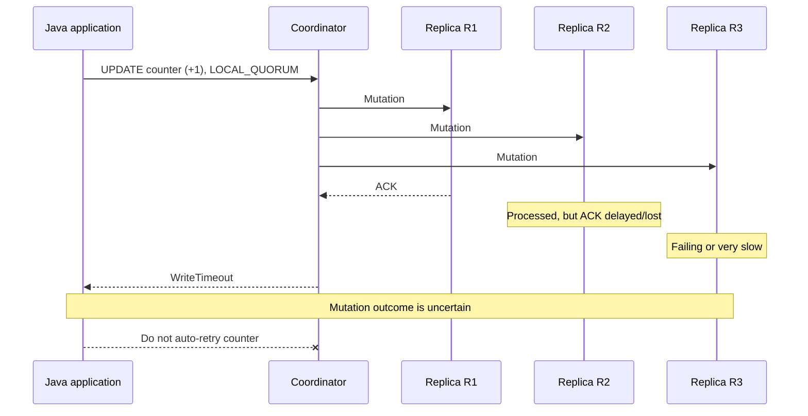
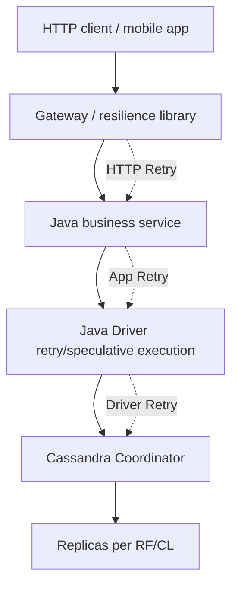
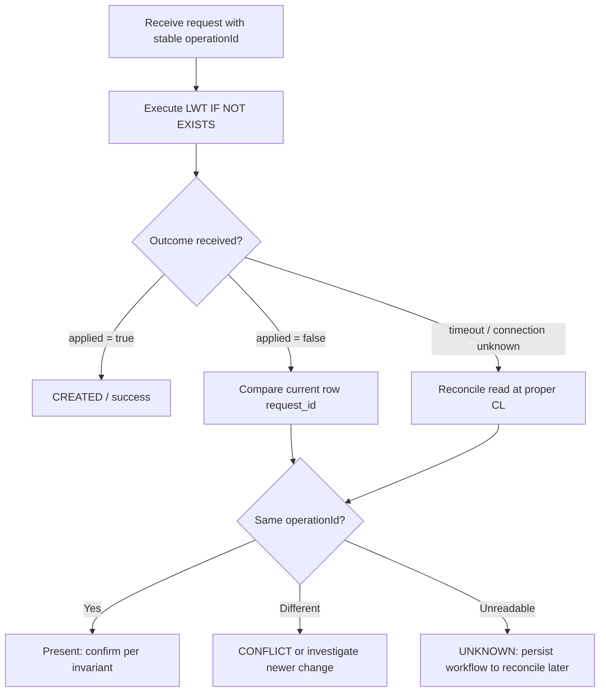
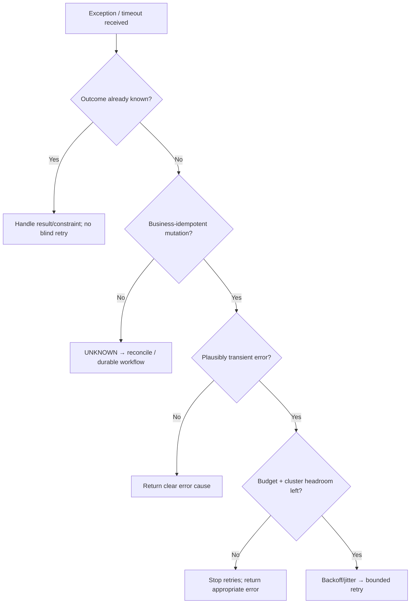

# Limiting Retries for Counters, Lists, TTLs, and Conditional Updates in the Cassandra Java Driver

## 1. The Problem: A Timeout May Already Have Persisted the Write

Apache Cassandra is a **distributed wide-column** database. A Java application sends CQL to a **coordinator**; the mutation is forwarded to **replicas** based on the **partition key** and **replication factor (RF)**, and the coordinator waits for acknowledgments per the **consistency level (CL)**. In real environments, requests can time out due to networking, GC, disk I/O, compaction, or slow replicas.

Suppose `payments-api` wants to increment a visit counter:

```sql
UPDATE retry_lab.views_by_tenant_day
SET views = views + 1
WHERE tenant_id = 'tenant-01' AND view_day = '2026-11-20';
```

The Java app waits and receives `WriteTimeoutException`. That **does not prove the increment was not applied**. One or more replicas may already have processed the mutation, while the coordinator failed to collect enough ACKs before the deadline. If the client resends, views can be incremented **twice**.

Similarly:

- `list = list + ['item']` can append the element a second time on retry.
- `USING TTL 600` resent later can shift the expiration time.
- `INSERT ... IF NOT EXISTS` can succeed on the first attempt, then return `[applied] = false` on retry because the row **already exists from the first attempt**.

**Topic of this lesson:** bounding retries based on **mutation semantics**, not merely because an exception “looks transient”. The goal is preserving data correctness, application latency, and cluster load when handling errors from Java Driver 4.x.

### Learning Outcomes

1. Distinguish **idempotent requests**, **unknown outcomes**, and **operation identity**.
2. Identify which counters, list operations, TTLs, and conditional updates **cannot be retried blindly**.
3. Interpret Cassandra errors and LWT `[applied]` results accurately.
4. Use `PreparedStatement`, `BoundStatement.setIdempotent(...)`, CL/serial CL, and retry limits in Java.
5. Design **reconciliation, operation IDs, deduplication, and retry budgets** instead of duplicating business effects.

## 2. Idempotency Is a Property of the Operation, Not the `UPDATE` Keyword

An operation is **idempotent** for retry purposes if executing it multiple times yields the same observable state and effects as executing it once, under explicit assumptions about data, timestamps, and concurrency.

Mental model:

```text
Set status = 'PAID' once      → status = PAID
Set status = 'PAID' again     → usually still PAID

Increment views = views + 1 once  → views increases by 1
Increment views = views + 1 again → views increases by 2
```

Yet `SET status = 'PAID'` is **not unconditionally safe in every system**. If another writer changes `status` to `CANCELLED` between retries, a replayed request with a **newer timestamp** overwrites the newer state. If TTLs or external triggers/side effects exist outside Cassandra, replaying carries further consequences.

Therefore, separate these dimensions:

| Dimension | Question | Example |
| --- | --- | --- |
| **CQL-level effect** | Does repeating the mutation alter data differently? | Counter increments again |
| **Concurrency-level effect** | Could it overwrite a newer update? | Retrying `status=PAID` after status changed |
| **Temporal effect** | Do TTL, timestamps, or deadlines shift? | Resending `TTL 600` 1 minute later |
| **Business-level effect** | Could it duplicate payments, events, or notifications? | Writing CQL then calling an external payment API |
| **Transport-level outcome** | Does the client know what the server did? | Write timeout after partial ACKs |

The driver sees only part of the operation. It **cannot infer** requirements like “each order is charged once” or “each page view counts once”.

## 3. A Timeout Does Not Mean “Cassandra Rolled Back”

A `LOCAL_QUORUM` request with RF=3 in `dc1` typically needs **2 of 3** local responses. Illustration:



This diagram illustrates one **plausible scenario**, not a fixed internal order for every mutation type. Counters and LWTs follow different execution paths than standard writes; the key point is that **insufficient ACKs do not prove zero effect**.

Three outcome conclusions to distinguish:

- **CONFIRMED:** the client received a server-confirmed outcome at the requested CL. For LWTs, you must also inspect `[applied]`.
- **DEFINITIVELY REJECTED:** an error class proving the request **was not executed** due to specific validation or authorization failure in a verified context; never apply this label to arbitrary network errors.
- **UNKNOWN:** insufficient information to assert whether the mutation was applied. Timeouts, post-send disconnects, or coordinator failures fall here.

**Never equate `UNKNOWN` with `FAILED`** merely because an HTTP gateway must return an error to the caller. In domain APIs, model a pending-verification state or instruct retries with a **stable operation ID**.

## 4. Layers That Can Replay the Same Request



A single CQL command can be replayed by:

1. An HTTP caller clicking again or client SDK retries.
2. API gateway, service mesh, or resilience library retries.
3. A worker/job queue redelivering a message after a visibility timeout.
4. Business code calling `session.execute(...)` again.
5. Java Driver policy retries.
6. **Speculative execution** firing a parallel execution to cut tail latency when enabled.

Even with Java Driver retries disabled, **an HTTP request or queue message can still be redelivered**. Never claim “exactly once” solely from `setIdempotent(false)`; it is one guardrail among several layers you must govern.

### End-to-end retry budget

If the gateway allows 3 attempts, the service allows 2, and the driver allows 2, worst-case nested retries can yield **3 × 2 × 2 = 12** attempts in some configurations, before counting speculative executions. That is an upper-bound configuration illustration, not default driver behavior.

Establish **one authoritative retry owner** aware of downstream retries, with a shared deadline, backoff, and cap on total attempts. Never let independent layers each “retry 3 times” without unified telemetry.

## 5. Quick Decision Matrix by Mutation Type

| Mutation | Safe to auto-retry? | Rationale | Preferred handling |
| --- | --- | --- | --- |
| Read-only `SELECT` | Usually yes, **bounded** | Does not mutate data, yet consumes read load/latency | `idempotent=true`, deadlines, backoff |
| Fixed `SET status=?`, no TTL | **Conditionally** | Timestamps/concurrent writers can alter results | Versioning / operation ID; avoid overwrites |
| `counter = counter + 1` | **Never retry blindly** | Each execution can increment again | Event/dedup architecture, reconciliation |
| `list = list + [?]` | **Never retry blindly** | Appends can insert duplicate elements | Stable element identity, set/map/separate table |
| `list = [?] + list` | **Never retry blindly** | Prepends can duplicate and shift order | Appropriate data model |
| `list[index] = value` | **Not by default** | Index `0` may shift under concurrent edits | Read/version/conditional update |
| `SET x=? USING TTL 600` | **Not by default** | Replay shifts expiration time | Absolute expiry timestamp, verify semantics |
| `INSERT ... IF NOT EXISTS` | Never retry blindly on timeout | Attempt 1 may succeed; Attempt 2 returns `false` | Read `[applied]`, operation ID, reconcile |
| `UPDATE ... IF version=?` | Never retry blindly on timeout | Compare-and-set may already have bumped version | Inspect version/state after timeout |
| Write with external side effects | **Never** rely on CQL idempotency alone | DB retries do not protect external services | Transactional outbox / durable workflow as designed |

“Conditionally” means **it is proven** that identical operations, data, and timestamps produce no wrong outcome even under contention and slow server responses. Never infer idempotency from the CQL keyword `INSERT` or `UPDATE`.

## 6. Counters: Additive Operations with Cumulative Effects

In Cassandra, a `counter` column reads as a `long` in the Java Driver, yet mutations follow special semantics. Example:

```sql
CREATE TABLE IF NOT EXISTS retry_lab.views_by_tenant_day (
    tenant_id text,
    view_day date,
    views counter,
    PRIMARY KEY ((tenant_id), view_day)
);

UPDATE retry_lab.views_by_tenant_day
SET views = views + 1
WHERE tenant_id = 'tenant-01'
  AND view_day = '2026-11-20';
```

Suppose the counter starts at 100:

```text
Attempt A: +1 applied, response lost → client times out.
Attempt B: +1 resent and applied.
Counter becomes 102 instead of 101.
```

### Why not use counters for exact-once financial accounting?

- Counter increments are not `SET value = ?` and carry no built-in per-increment deduplication ID.
- On write timeouts, retries can count the same event twice.
- Cassandra counters have strict constraints around mutations, TTLs, batches, and idempotency.
- An *at-least-once* event consumer will over-count whenever redeliveries re-increment.

If the requirement is “each `page_view_event_id` counts exactly once”:

1. Keep a **unique event ID** from the source and a durable event record.
2. Perform **deduplication** within an appropriate atomic boundary.
3. Compute or adjust aggregate projections from verified unique events.
4. Accept eventual consistency and rebuildable counts where architecture permits.

**Never implement “`SELECT processed_event` → `UPDATE counter` → `INSERT processed_event`” and call it exactly-once.** Those three steps do not form an atomic cross-partition transaction merely by sitting together or in a CQL batch. Design end-to-end atomicity and recovery properly.

### Java Driver: counters must be marked non-idempotent

```java
PreparedStatement increment = session.prepare(
    "UPDATE retry_lab.views_by_tenant_day " +
    "SET views = views + 1 " +
    "WHERE tenant_id = ? AND view_day = ?"
);

BoundStatement stmt = increment.bind("tenant-01", day)
    .setConsistencyLevel(DefaultConsistencyLevel.LOCAL_QUORUM)
    .setIdempotent(false);

session.execute(stmt); // Timeout => UNKNOWN outcome; do not retry blindly.
```

This snippet lives inside a method holding `session` and `day`. `setIdempotent(false)` informs the driver safely, yet **cannot block** callers or HTTP gateways from invoking the method again.

## 7. Lists: Append/Prepend Differ from Overwriting a List

A `list<text>` preserves order, yet list edits do not behave like a simple `SET`.

```sql
CREATE TABLE IF NOT EXISTS retry_lab.carts_by_id (
    cart_id uuid PRIMARY KEY,
    items list<text>
);

UPDATE retry_lab.carts_by_id
SET items = items + ['sku-A']
WHERE cart_id = 11111111-1111-4111-8111-111111111111;

UPDATE retry_lab.carts_by_id
SET items = ['sku-B'] + items
WHERE cart_id = 11111111-1111-4111-8111-111111111111;
```

If appending `'sku-A'` succeeded while the response dropped, a retry can append **`'sku-A'` a second time**. Internally, Cassandra manages list elements with positional/UUID mechanics; applications **must not** assume repeated appends share the same element identity.

### List operations to distinguish

| CQL pattern | Retry hazard |
| --- | --- |
| `SET items = items + ['A']` | Can append a second `'A'` element |
| `SET items = ['A'] + items` | Can prepend multiple times and alter order |
| `SET items[0] = 'A'` | Index `0` may have shifted due to concurrent adds/deletes |
| `SET items = items - ['A']` | Outcome depends on existing elements and concurrent edits; verify semantics |
| `SET items = ['A','B']` | Repeats identically in static isolation, yet can overwrite concurrent changes |

**Never assume “remove by value” or “set by index” is safe under concurrent writers.** Repeatability depends on timing, newer writes, write timestamps, and how Cassandra reconciles mutations.

### If the domain requires adding a unique item

Consider modeling **one row per item**:

```sql
CREATE TABLE IF NOT EXISTS retry_lab.cart_items_by_cart (
    cart_id uuid,
    item_id uuid,
    sku text,
    quantity int,
    PRIMARY KEY ((cart_id), item_id)
);

INSERT INTO retry_lab.cart_items_by_cart (
    cart_id, item_id, sku, quantity
) VALUES (
    11111111-1111-4111-8111-111111111111,
    22222222-2222-4222-8222-222222222222,
    'sku-A', 1
);
```

If `item_id` is a stable ID for **the same logical operation**, an `INSERT` retry updates the same row instead of adding a duplicate list element. Even then, **concurrent updates and timestamps** require explicit rules; if callers mint a new `item_id` per retry, duplicates still occur.

When only unique membership is needed, `set<text>` may fit better than a list. When per-item keys are needed, `map<id, value>` or a dedicated table identifies entries cleanly. Choose based on query shape, ordering, and cardinality—not solely to “dodge retry bugs”.

## 8. TTL: Resending Can Shift Expiration Time

Cassandra TTL (time to live) attaches a lifetime to written cells/rows per CQL semantics; expired data is not purged immediately from all SSTables, instead turning into tombstones cleaned up by compaction and repair.

Example:

```sql
CREATE TABLE IF NOT EXISTS retry_lab.sessions_by_id (
    session_id uuid PRIMARY KEY,
    state text,
    owner_id text
);

UPDATE retry_lab.sessions_by_id
USING TTL 600
SET state = 'ACTIVE'
WHERE session_id = 33333333-3333-4333-8333-333333333333;
```

Two writes one minute apart:

```text
11:00 Attempt A: TTL 600 seconds → expires around 11:10 relative to write time.
11:01 Attempt B retry: TTL 600 seconds again → shifts expiry toward 11:11.

If the system requires strict expiration per business rules,
such a retry is wrong even though the final state stays ACTIVE.
```

Exact deletion/expiration timing depends on write time/TTL, mutation timestamps, and version behavior; this example highlights **expiration-drift risk** rather than guaranteeing one universal conflict formula.

### “Setting the same value” is not necessarily temporally idempotent

```sql
UPDATE retry_lab.sessions_by_id
USING TTL 600
SET state = 'ACTIVE'
WHERE session_id = 33333333-3333-4333-8333-333333333333;
```

Do not assert only `state = ACTIVE` in tests. Inspect `TTL(state)` and `WRITETIME(state)` to understand actual semantics:

```sql
SELECT state, TTL(state), WRITETIME(state)
FROM retry_lab.sessions_by_id
WHERE session_id = 33333333-3333-4333-8333-333333333333;
```

`TTL(state)` returns remaining seconds to live for that cell per CQL rules (or `null` if no TTL was set or the cell is absent). `WRITETIME` returns the mutation timestamp (typically microseconds)—**not the wall-clock expiration time**.

### Enforce absolute expiration at the business layer

If the system truly requires `expires_at = 11:10:00Z` unchanged across retries, a more verifiable design is:

1. Store `expires_at timestamp` as **immutable business data tied to the operation ID**.
2. Have readers/APIs check `Instant.now() < expiresAt` per session rules.
3. Use Cassandra TTL as **auxiliary storage cleanup**, not the sole authority for session validity.
4. If computing remaining TTL from an absolute deadline, handle clock skew/rounding carefully and **never let retries extend access** unintentionally.

Never assume passing a fixed `USING TIMESTAMP` automatically freezes **TTL expiry**: cell conflict-resolution timestamps and storage TTL expiration are not identical concepts. Test on your exact version.

## 9. LWT: `IF NOT EXISTS` and Conditional Updates

LWTs (lightweight transactions) support conditional mutations via Paxos within Cassandra's supported scope. An operation like:

```sql
INSERT INTO retry_lab.orders_by_id (
    order_id, request_id, status
) VALUES (
    44444444-4444-4444-8444-444444444444,
    55555555-5555-4555-8555-555555555555,
    'CREATED'
) IF NOT EXISTS;
```

returns an `[applied]` column:

- `[applied] = true`: the condition succeeded and the mutation was accepted per LWT semantics.
- `[applied] = false`: the condition was not met on that execution; existing row columns may be returned.
- Timeout / transport error: **uncertain** whether execution completed.

### Retrying after an ambiguous outcome

```text
Attempt A: INSERT IF NOT EXISTS is accepted,
           but client times out without receiving [applied]=true.

Attempt B: client resends the same INSERT IF NOT EXISTS.
           Server sees the row already exists → [applied]=false.

Wrong conclusion: “The operation failed.”
Right conclusion: Reconcile stored request_id / state.
```

**`[applied]=false` is insufficient to declare a request failed at the business level** if an earlier attempt occurred. Always inspect the **logical operation ID** and stored row data.

### LWTs do not provide arbitrary cross-partition transactions

Never run `INSERT IF NOT EXISTS` into `processed_requests` followed by `UPDATE counter` and treat the two as an atomic transaction. An LWT protects **the conditional mutation it guards**; it does not merge changes across other tables, partitions, or external APIs into an ACID transaction.

## 10. Compare-and-Set: `UPDATE ... IF` and Version Conflicts

Suppose a table has a `version int` column:

```sql
CREATE TABLE IF NOT EXISTS retry_lab.order_status_by_id (
    order_id uuid PRIMARY KEY,
    status text,
    version int,
    request_id uuid
);

UPDATE retry_lab.order_status_by_id
SET status = 'PAID', version = 8,
    request_id = 66666666-6666-4666-8666-666666666666
WHERE order_id = 44444444-4444-4444-8444-444444444444
IF version = 7;
```

This is CAS (compare-and-set). If the version was 7 and Attempt A applied while the client lost the response, retry Attempt B sees version 8 and returns `[applied]=false`. That does not prove A failed.

A reconciliation approach:

1. Read the row at an appropriate CL to inspect `version`, `request_id`, and business status.
2. If `version=8` and `request_id` matches **this request's ID**, there is evidence the operation is already present.
3. If `version=8` with a different `request_id`, classify it as a **conflict**—never overwrite blindly.
4. If version is still 7, you may consider re-executing **via a race-aware workflow**, not infinite retries.
5. If unreadable due to unavailable replicas, keep **`UNKNOWN`** and defer/reconcile.

Read-after-timeout also has limits: replicas may still be converging or subsequent writes may occur; **never treat a single `SELECT` at `ONE` as global proof**. Where stronger proof is needed, use a dedicated event/operation log.

### Serial consistency has a distinct role

LWTs use a serial CL (`SERIAL` or `LOCAL_SERIAL`) for Paxos phases alongside regular CL for commit/read phases. Example in Java Driver 4.x:

```java
PreparedStatement preparedCas = session.prepare(
    "UPDATE retry_lab.order_status_by_id " +
    "SET status = ?, version = ?, request_id = ? " +
    "WHERE order_id = ? IF version = ?"
);

BoundStatement cas = preparedCas.bind(
        "PAID", 8, requestId, orderId, 7)
    .setConsistencyLevel(DefaultConsistencyLevel.LOCAL_QUORUM)
    .setSerialConsistencyLevel(DefaultConsistencyLevel.LOCAL_SERIAL)
    .setIdempotent(false);
```

`LOCAL_SERIAL` must match cross-DC replication/traffic and business invariants; never treat it as a universal default. **Do not increase LWT retries automatically** just because Paxos is involved: timeouts can occur across multiple phases and still require outcome inspection.

## 11. Error Classification in Java Driver 4.x

There is no rule “retry every timeout 3 times”. The error type reveals **part** of what occurred:

| Error type | Typical meaning | Guidance for non-idempotent writes |
| --- | --- | --- |
| `ReadTimeoutException` | Read lacked sufficient responses in time | Bounded retries possible for pure reads; never replay mutations |
| `WriteTimeoutException` | Write lacked sufficient ACKs in time | **`UNKNOWN`**; never blindly replay counters, lists, TTLs, or LWTs |
| `WriteFailureException` | Replicas/write path reported failures; state depends on write type | Never assume zero replicas applied the write |
| `UnavailableException` | Insufficient live replicas for CL at decision time | Never resolve by breaking CL contracts; wait for recovery |
| `DriverTimeoutException` | Client driver request timeout expired | Server may still be processing or have completed the request |
| `AllNodesFailedException` | No candidate node completed the request; holds per-node errors | Inspect per-node causes; never assume “not sent” |
| `InvalidQuery` / type / authorization | CQL, schema, or permission defect | Fix code/config/schema; retries cannot help |
| TLS / authentication error | Secure connection or auth failed | Fix credentials/certs/network; avoid reconnect storms |
| `[applied]=false` | LWT answered; condition was not met | Not a transport failure; handle conflict vs. dedup |

Always verify exact exception classes and API details against your **Java Driver 4.x minor version**. For `AllNodesFailedException`, inspect per-node causes and whether bytes could have been sent rather than guessing from the wrapper name.

### When are retries permitted?

Auto-retry only when **all** of these hold:

- The operation is classified **idempotent in business context**.
- The error belongs to a plausibly transient class suitable for retry.
- Attempt budget and end-to-end deadline remain.
- Proper backoff/jitter is applied and cluster capacity has headroom.
- No signs of a retry storm or prolonged infrastructure outage exist.

If any condition fails, **stop auto-retrying**, record the outcome, and route to reconciliation or proper error handling.

## 12. Java Driver Retry Policy and `setIdempotent`

Java Driver 4.x lets statements declare whether they are **idempotent** via:

```java
BoundStatement nonIdempotent = prepared.bind(arg1, arg2)
    .setConsistencyLevel(DefaultConsistencyLevel.LOCAL_QUORUM)
    .setIdempotent(false);

BoundStatement readOnly = selectPrepared.bind(arg1)
    .setConsistencyLevel(DefaultConsistencyLevel.LOCAL_QUORUM)
    .setIdempotent(true);
```

`prepared`, `arg1`, etc., are placeholders in this snippet.

### Understand the exact scope

- `setIdempotent(false)` is metadata that the **driver's retry/speculative execution policies** use to guard requests; it does not give the server exactly-once semantics.
- `setIdempotent(true)` **does not prove** an operation is truly idempotent. It is a promise from the application, so mislabeling risks duplicate effects.
- Default retry behavior, attempt counts, per-`WriteType` handling, logging, and policy extensions **depend on driver version and configuration**. Never copy 3.x config into 4.x assuming equivalence.
- Retries in HTTP clients, message brokers, workers, and outer `session.execute` loops sit **outside** the driver flag's protection.
- Speculative execution can fire extra concurrent attempts while waiting; enable it only for verified idempotent requests after benchmarking.

**Never write a custom retry policy that “retries every `WriteTimeoutException`”**, even for seemingly small writes. Always account for `WriteType`, CL, idempotency, remaining capacity, and potential partial application.

## 13. CQL Lab: Setting Up Tables for Four Scenarios

Run on an **isolated lab cluster**, never production. This example uses `NetworkTopologyStrategy`, DC `dc1`, RF=3, and client `LOCAL_QUORUM`; if your lab has fewer replicas, adjust RF/CL realistically rather than mistaking `Unavailable` for a driver bug.

```sql
CREATE KEYSPACE IF NOT EXISTS retry_lab
WITH replication = {
    'class': 'NetworkTopologyStrategy',
    'dc1': 3
}
AND durable_writes = true;

CREATE TABLE IF NOT EXISTS retry_lab.views_by_tenant_day (
    tenant_id text,
    view_day date,
    views counter,
    PRIMARY KEY ((tenant_id), view_day)
);

CREATE TABLE IF NOT EXISTS retry_lab.carts_by_id (
    cart_id uuid PRIMARY KEY,
    items list<text>
);

CREATE TABLE IF NOT EXISTS retry_lab.sessions_by_id (
    session_id uuid PRIMARY KEY,
    state text,
    owner_id text,
    expires_at timestamp
);

CREATE TABLE IF NOT EXISTS retry_lab.orders_by_id (
    order_id uuid PRIMARY KEY,
    request_id uuid,
    status text
);

CREATE TABLE IF NOT EXISTS retry_lab.order_status_by_id (
    order_id uuid PRIMARY KEY,
    status text,
    version int,
    request_id uuid
);
```

In `cqlsh`, you can set:

```text
CONSISTENCY LOCAL_QUORUM;
```

### Experiment 1 — Counter

```sql
UPDATE retry_lab.views_by_tenant_day
SET views = views + 1
WHERE tenant_id = 'tenant-01' AND view_day = '2026-11-20';

SELECT views
FROM retry_lab.views_by_tenant_day
WHERE tenant_id = 'tenant-01' AND view_day = '2026-11-20';
```

Running the `UPDATE` twice increments the value twice **when mutations succeed**. This illustrates why timeouts must not be retried blindly. **Never kill nodes or sever networking on a shared cluster** just to force a timeout.

### Experiment 2 — List

```sql
UPDATE retry_lab.carts_by_id
SET items = items + ['sku-A']
WHERE cart_id = 11111111-1111-4111-8111-111111111111;

UPDATE retry_lab.carts_by_id
SET items = items + ['sku-A']
WHERE cart_id = 11111111-1111-4111-8111-111111111111;

SELECT items
FROM retry_lab.carts_by_id
WHERE cart_id = 11111111-1111-4111-8111-111111111111;
```

You should see **two `'sku-A'` elements** from two independent appends. When stable identity and deduplication are needed, try the `cart_items_by_cart` table from Section 7.

### Experiment 3 — TTL

```sql
UPDATE retry_lab.sessions_by_id
USING TTL 600
SET state = 'ACTIVE'
WHERE session_id = 33333333-3333-4333-8333-333333333333;

SELECT state, TTL(state), WRITETIME(state)
FROM retry_lab.sessions_by_id
WHERE session_id = 33333333-3333-4333-8333-333333333333;
```

Wait briefly and repeat in the **lab**; inspect `TTL(state)` remaining rather than expecting two sends to keep the exact same deadline. When `expires_at` is a business rule, store an explicit absolute timestamp to enforce access validity.

### Experiment 4 — LWT

```sql
INSERT INTO retry_lab.orders_by_id (
    order_id, request_id, status
) VALUES (
    44444444-4444-4444-8444-444444444444,
    55555555-5555-4555-8555-555555555555,
    'CREATED'
) IF NOT EXISTS;

-- Re-run the exact same INSERT to observe [applied] on the second run.
SELECT request_id, status
FROM retry_lab.orders_by_id
WHERE order_id = 44444444-4444-4444-8444-444444444444;
```

The first execution returns `[applied] = true`; the second returns `false` while the row exists. **Never interpret `false` on the second run as proof the first attempt failed.**

## 14. Java Driver 4.x: A Repository Marking Each Mutation Explicitly

This code uses Java Driver 4.x namespace `com.datastax.oss.driver.api.core`. It assumes a long-lived `CqlSession` connected to the lab with TLS/auth (if required) and proper `localDatacenter`.

```java
import java.time.LocalDate;
import java.util.UUID;

import com.datastax.oss.driver.api.core.CqlSession;
import com.datastax.oss.driver.api.core.DefaultConsistencyLevel;
import com.datastax.oss.driver.api.core.cql.BoundStatement;
import com.datastax.oss.driver.api.core.cql.PreparedStatement;
import com.datastax.oss.driver.api.core.cql.Row;

public final class RiskAwareMutationRepository {
    private final CqlSession session;
    private final PreparedStatement incrementViews;
    private final PreparedStatement appendCartItem;
    private final PreparedStatement setSessionStateWithTtl;
    private final PreparedStatement insertOrderIfAbsent;

    public RiskAwareMutationRepository(CqlSession session) {
        this.session = session;
        incrementViews = session.prepare(
            "UPDATE retry_lab.views_by_tenant_day " +
            "SET views = views + 1 " +
            "WHERE tenant_id = ? AND view_day = ?");
        appendCartItem = session.prepare(
            "UPDATE retry_lab.carts_by_id " +
            "SET items = items + ? WHERE cart_id = ?");
        setSessionStateWithTtl = session.prepare(
            "UPDATE retry_lab.sessions_by_id USING TTL ? " +
            "SET state = ? WHERE session_id = ?");
        insertOrderIfAbsent = session.prepare(
            "INSERT INTO retry_lab.orders_by_id " +
            "(order_id, request_id, status) VALUES (?, ?, ?) " +
            "IF NOT EXISTS");
    }

    public void incrementView(String tenantId, LocalDate day) {
        BoundStatement stmt = incrementViews.bind(tenantId, day)
            .setConsistencyLevel(DefaultConsistencyLevel.LOCAL_QUORUM)
            .setIdempotent(false);
        session.execute(stmt);
        // On timeout: surface UNKNOWN to caller; do not retry blindly.
    }

    public void appendSku(UUID cartId, String sku) {
        BoundStatement stmt = appendCartItem.bind(
                java.util.Collections.singletonList(sku), cartId)
            .setConsistencyLevel(DefaultConsistencyLevel.LOCAL_QUORUM)
            .setIdempotent(false);
        session.execute(stmt);
    }

    public void setTemporaryState(
            UUID sessionId, String state, int ttlSeconds) {
        if (ttlSeconds <= 0 || ttlSeconds > 3_600) {
            throw new IllegalArgumentException("TTL outside policy");
        }
        BoundStatement stmt = setSessionStateWithTtl.bind(
                ttlSeconds, state, sessionId)
            .setConsistencyLevel(DefaultConsistencyLevel.LOCAL_QUORUM)
            .setIdempotent(false);
        session.execute(stmt);
    }

    public ConditionalInsertResult createOrderOnce(
            UUID orderId, UUID requestId, String status) {
        BoundStatement stmt = insertOrderIfAbsent.bind(
                orderId, requestId, status)
            .setConsistencyLevel(DefaultConsistencyLevel.LOCAL_QUORUM)
            .setSerialConsistencyLevel(DefaultConsistencyLevel.LOCAL_SERIAL)
            .setIdempotent(false);

        Row row = session.execute(stmt).one();
        if (row == null) {
            throw new IllegalStateException("Missing LWT result");
        }
        if (row.getBoolean("[applied]")) {
            return ConditionalInsertResult.CREATED;
        }
        UUID existing = row.isNull("request_id")
            ? null : row.getUuid("request_id");
        return requestId.equals(existing)
            ? ConditionalInsertResult.ALREADY_APPLIED
            : ConditionalInsertResult.CONFLICT;
    }

    public enum ConditionalInsertResult {
        CREATED, ALREADY_APPLIED, CONFLICT
    }
}
```

In this example:

- All **counter, list, TTL, and LWT** statements set `setIdempotent(false)` to avoid falsely declaring automatic retry safety.
- `appendCartItem` binds a list marker for `list<text>`; each invocation issues a new append mutation.
- `setTemporaryState` bounds TTL and **does not** assume retries preserve expiration time.
- `createOrderOnce` separates `CREATED`, `ALREADY_APPLIED` (same `requestId` present), and `CONFLICT` (another request).
- If `session.execute(stmt)` **throws a timeout or transport error**, the method cannot classify the outcome; the service layer must record **`UNKNOWN`** and reconcile.

**Key assumption behind `ALREADY_APPLIED`:** this demo assumes `orders_by_id` rows are guarded solely by `IF NOT EXISTS`, `request_id` is immutable, and no other workflow deletes and reuses keys. In production, verify this invariant explicitly rather than relying on a single-snapshot UUID check without guarantees.

### Note on exceptions and reading outcomes

This Java code **never catches every `RuntimeException` and calls it `UNKNOWN`**. Validation, authorization, and schema mismatches must be classified distinctly. Only **timeouts, disconnects, and uncertain coordinator outcomes** route to reconciliation; permanent errors that retries cannot fix must fail clearly with root causes.

## 15. Reconciling LWTs After Timeouts Using Request ID

A practical pattern:



### Java reconciliation read example

```java
PreparedStatement findOrder = session.prepare(
    "SELECT request_id, status FROM retry_lab.orders_by_id " +
    "WHERE order_id = ?");

BoundStatement read = findOrder.bind(orderId)
    .setConsistencyLevel(DefaultConsistencyLevel.LOCAL_QUORUM)
    .setIdempotent(true);

Row current = session.execute(read).one();
if (current != null && requestId.equals(
        current.getUuid("request_id"))) {
    // Valid only when request_id immutability is guaranteed.
    // Evidence exists that the operation is present.
}
```

This snippet receives `session`, `orderId`, and `requestId` from the caller. Under contention or lagging replica convergence, a single read may not always settle final state; use deadlines/re-checks or a durable workflow.

### When is a controlled LWT retry permissible?

A **bounded** retry may be considered after understanding CAS semantics and ensuring stable IDs and conditions. Still:

- The retry may return `false` because **the first attempt succeeded**.
- LWTs incur Paxos round-trips; mass retries worsen contention.
- Concurrent writers may have changed the condition, altering semantics from initial intent.
- For operations with external side effects, retrying LWTs still does not provide exactly-once for external effects.

Therefore, **reconciliation before or after retries** must be built into the workflow, not decided from exceptions alone.

## 16. Designing Retry Budgets and Deadlines in Java Services

For requests **proven idempotent**, a service can apply a tight retry budget:

```text
Total request deadline: 1,000 ms (illustrative, not a default config).
Attempt 1: max 350 ms.
Backoff: 50–100 ms with jitter.
Attempt 2: only if time remains and error class permits.
Max attempts: 2, including the first attempt.
If budget exhausted: return controlled status; never loop infinitely.
```

These numbers illustrate time allocation. A cross-WAN `LOCAL_QUORUM` call, an LWT, and a single-DC read each require different realistic budgets.

### General decision flow



**Backoff does not fix non-idempotency.** Sleeping 100 ms before retrying a counter still risks double-incrementing; semantics and deduplication—not sleep duration—determine safety.

### Do not equate a “successful” write with “replicated to every DC”

With RF=3 in `dc1` and `dc2`, `LOCAL_QUORUM` in `dc1` requires only two local ACKs; `dc2` replicas may lag if the WAN link fails. Replaying the same operation from `dc2` does not automatically preserve identical correctness, especially for LWTs and global uniqueness invariants.

Define local DC, CL, and serial consistency explicitly in the contract. If using `LOCAL_SERIAL` across multiple DCs, understand its scope in Cassandra docs and your workload's uniqueness/linearizability boundaries. **Never rely on a local policy while claiming global exactly-once.**

## 17. API-Layer Idempotency Keys: Getting the Boundary Right

An HTTP API might receive:

```text
POST /orders
Idempotency-Key: 6a111111-1111-4111-8111-111111111111

Body: {"orderId":"44444444-4444-4444-8444-444444444444",
       "status":"CREATED"}
```

The service must:

1. Bind a **stable operation ID** to principal, endpoint, canonical request payload, and retention window.
2. Treat identical key + identical payload as one logical operation; identical key + different payload as a conflict.
3. Persist processing state in a durable ledger with matching semantics.
4. Define `PENDING`, `CONFIRMED`, `CONFLICT`, and `UNKNOWN` states along with reconciliation logic.
5. Return “completed” only with evidence meeting the contract.
6. Size idempotency-record retention to outlast client retry windows.

### Caveat: putting an idempotency key in a header is not enough

If a handler does:

```text
if (!seen(idempotencyKey)) {
    incrementCounter();
    markSeen(idempotencyKey);
}
```

crashing between `incrementCounter()` and `markSeen()` still causes double-counting on retry. Conversely, calling `markSeen()` first and crashing before incrementing **loses counts**.

Cassandra does not provide an ACID transaction across two separate operations/partitions merely because both run in the same Java app. When strong exactly-once accounting is required, use an event/ledger architecture with rebuildable projections or a transactional store for the atomic boundary—never promise exactness from non-atomic check-then-increment logic.

## 18. Operational Failures, Metrics, and Remediation Runbook

### Signals to capture

| Signal | Why needed |
| --- | --- |
| Logical request count vs. driver attempt count | Shows whether extra attempts are climbing |
| Outcomes `CONFIRMED / UNKNOWN / CONFLICT` | Prevents conflating timeouts with failures |
| Retry count by CQL type / idempotency flag | Detects misconfigured retries on counters, lists, or LWTs |
| Driver `WriteTimeout`, `ReadTimeout`, `Unavailable` | Separates replica/quorum faults from codec/auth issues |
| Request p95/p99, deadlines, pool saturation | Retries inflate tail latency and hold connections |
| Node `tpstats` and dropped messages | Indicates queue overload |
| `compactionstats` and disk await | Reveals whether background I/O is slowing foreground work |
| RF/CL/serial CL, DC, and node health | Confirms sufficient replicas and valid quorum |
| Counter vs. event ledger mismatch | Surfaces duplicated or missed effects |
| Remaining TTL and expiry drift | Detects unintended session/rule extensions from replays |
| LWT contention and false/timeout rates | Reveals CAS races or hot-key contention |

Never place passwords, tokens, raw idempotency keys, or sensitive data into logs or metric labels. Aggregate by **query template**, operation type, CL, DC, and status while keeping label cardinality bounded.

### Cassandra observation commands

```bash
nodetool status
nodetool tpstats
nodetool compactionstats
nodetool tablestats retry_lab.views_by_tenant_day
nodetool tablehistograms retry_lab views_by_tenant_day
```

`nodetool` output reflects the queried node. `UN` does not guarantee replicas respond fast enough for CL. When a cluster is already overloaded, **never raise retries** because `WriteTimeout` spiked; retries pile more work onto the exact overloaded nodes.

### Runbook for abnormal retry spikes

1. Identify the query template and classify **counter / list / TTL / LWT / standard read-write**.
2. Audit how many retry layers, speculative executions, and physical attempts occur across driver, app, gateway, and queues.
3. If non-idempotent operations are retrying, **disable blind retries via change process** while preserving diagnostic data.
4. Separate `UNKNOWN` from `CONFLICT` and clear validation errors.
5. Inspect RF, CL, replica health, disk, network, GC, compaction, and p99.
6. Reconcile via operation IDs, event ledgers, and business invariants; never manually patch counters from guesswork.
7. Ramp traffic back gradually with retry budgets and canary validation.
8. Add alerts for duplicates, TTL drift, and LWT contention, plus regression tests.

**Never run `nodetool repair`, `flush`, or major compaction as a way to “roll back an extra retry”.** They have no knowledge of business duplicates; repair can even propagate the unintended state to other replicas.

## 19. Scenario Exercises and Solutions

### Scenario A — Counter timeout

`views=10`; the app sends `views=views+1` and hits `WriteTimeout`. A subsequent retry succeeds. Reading the counter shows 12. Should you immediately reset it to 11?

**Hint:** Never alter it manually without an event source of truth. `12` could reflect two increments from the same logical event, or a legitimate concurrent view. Check event IDs/ledgers and reconcile rather than editing from estimates.

### Scenario B — List append

An app sends `items = items + ['sku-A']` twice after a timeout. Why might two `'sku-A'` entries appear?

**Hint:** Append adds a new element rather than upserting a fixed element ID. Use a table with `PRIMARY KEY ((cart_id), item_id)` or another stable-identity design if deduplication is needed.

### Scenario C — Extended TTL

A session is expected to expire 10 minutes after initial login. Retrying `USING TTL 600` 90 seconds later extends the session past expectations. How do you fix this?

**Hint:** Persist an absolute `expires_at` tied to the login operation, enforce it on reads, use TTL strictly for auxiliary cleanup, and ensure retries cannot extend validity beyond policy.

### Scenario D — Second LWT returns `[applied]=false`

The first `INSERT ... IF NOT EXISTS` times out; the second returns `false`. The team assumes order creation failed and asks the caller to mint a new `order_id`.

**Hint:** Wrong. The first attempt may have created the order. Inspect `request_id`, `order_id`, and stored data; keep stable IDs and return `ALREADY_APPLIED` instead of creating duplicate orders.

### Scenario E — CAS version

A client sends `UPDATE status='PAID', version=8 IF version=7` and times out. A follow-up read shows `version=8` with a different `request_id`.

**Hint:** Do not claim the client's request succeeded. Another writer likely won; classify as a conflict and inspect history/operation ledgers instead of overwriting version 8.

### Scenario F — Three-layer retries

Gateway retries 3 times, service retries 2 times, and driver retries 2 times, all on a counter mutation. How high can total attempts reach under nested retries, and what is the core danger?

**Hint:** Up to 12 attempts in this configuration, excluding speculative execution. The danger is not just load, but **incrementing the counter multiple times**. Centralize retry ownership and forbid retrying non-idempotent writes.

### Scenario G — `LOCAL_QUORUM` with RF=3

One node is Down, two are Up, and one of the Up nodes suffers severe disk slowness. Counter writes time out. Should you drop CL to `ONE` for faster retries?

**Hint:** Not if the business requires local quorum. Lowering CL alters consistency guarantees without solving the double-increment risk. Fix the node/load bottleneck first, then reconcile.

### Scenario H — `setIdempotent(false)`, yet duplicates still occur

A developer marked counters non-idempotent, yet the system still double-counted when the client resent the HTTP request. Is the driver broken?

**Hint:** No. The driver flag does not stop duplicates from HTTP clients, gateways, or job queues. Enforce operation IDs and deduplication with proper atomic boundaries instead of relying only on driver flags.

### Scenario I — LWT returns `[applied]=false` with no prior retry

A brand-new `INSERT IF NOT EXISTS` request never sent before returns `false`, and the existing row belongs to another `request_id`. Should this be treated as idempotent success?

**Hint:** No. That is a genuine conflict; return `ALREADY_APPLIED` only when IDs and invariants prove the row belongs to the same logical operation.

## 20. Production Checklist for CQL Retries from Java

**Operation classification**

- [ ] Know RF/CL, DC, and keyspace per query; never infer rollback from timeouts.
- [ ] Separate read-only `SELECT`, fixed upserts, counters, lists, TTLs, and LWTs.
- [ ] Mark counters and list appends/prepends `setIdempotent(false)` and never auto-retry blindly.
- [ ] For TTLs, verify whether **absolute expiration** or relative retention is required.
- [ ] For `IF NOT EXISTS` / `IF version`, inspect `[applied]` and prepare request-ID reconciliation.
- [ ] Never assume `[applied]=false` always means business failure after an earlier attempt.

**Driver and service**

- [ ] Use `PreparedStatement`/`BoundStatement` and set idempotence flags **only when proven**.
- [ ] Verify retry and speculative execution policies for your exact Java Driver 4.x release.
- [ ] Inventory retries across gateways, services, driver, queues, and job schedulers.
- [ ] Propagate the same operation ID and payload across all layers for one logical request.
- [ ] Enforce end-to-end deadlines, attempt caps, backoff/jitter, and circuit breakers.
- [ ] Never retry validation/auth/schema errors and never lower CL just to dodge timeouts.
- [ ] Preserve **`UNKNOWN`** on `WriteTimeout`/`DriverTimeout` until verified.
- [ ] Never mint a fresh ID when replaying the same operation; govern timestamps and concurrency.

**Reconciliation and monitoring**

- [ ] Distinguish `CONFIRMED`, `ALREADY_APPLIED`, `CONFLICT`, and `UNKNOWN`.
- [ ] For business exactly-once, use durable events/ledgers with atomic boundaries—never non-atomic check-then-increment.
- [ ] Monitor TTL drift, counter-to-event-ledger mismatches, and LWT contention.
- [ ] Track attempts per logical request, errors by type, p95/p99, replica health, and disk/GC.
- [ ] Under cluster overload, fix root causes instead of raising retry counts.
- [ ] Test timeouts, duplicates, and recovery in labs; never induce faults in production.
- [ ] Never expect repair or compaction to undo duplicated business mutations.

**Key takeaway:** In Cassandra, **counter increments, list appends/prepends, TTLs, and LWTs** have distinct semantics, so no single retry policy fits every `UPDATE`. **Timeouts leave outcomes ambiguous**; `setIdempotent(false)` protects part of the Java Driver path without blocking HTTP or queue replays. When correctness matters, enforce immutable operation IDs, inspect `[applied]`, reconcile at proper CL, and design deduplication/ledgers around sound atomic boundaries before retrying.
