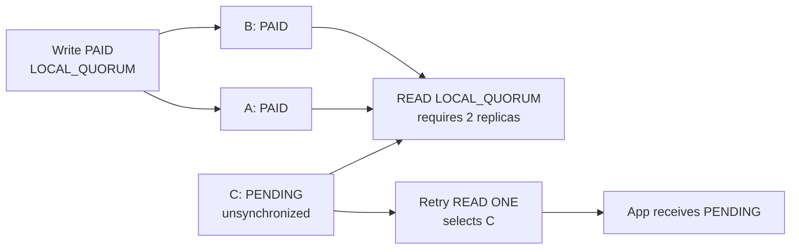
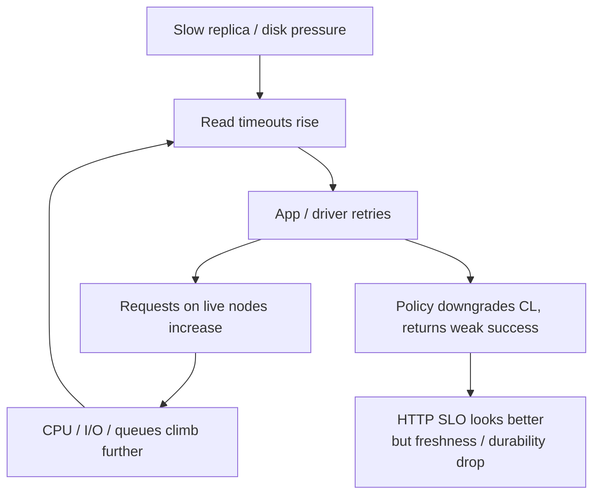

# Consistency-Downgrading Retry Policies and Risks of Violating Business Requirements

**Chapter:** Java Retries and Errors  
**Module:** `DATABASE_ENGINE_WIDE_COLUMN_CASSANDRA` — Apache Cassandra

A Java application reads an account balance at `LOCAL_QUORUM`, yet when one replica is slow or disconnected, a retry policy automatically retries at `ONE`. The UI still renders a result and the HTTP 200 rate may climb; however, the returned value can be **older than a write already acknowledged at quorum**. If the endpoint relies on that read to disburse funds, reserve inventory, or verify access permissions, a fallback disguised as “improving availability” can violate business requirements.

Even greater danger lies on the write path: a **consistency-downgrading** retry policy can treat certain write timeouts as successful when only one replica acknowledged, even though the application originally required quorum. These differences must be expressed as an **API consistency contract**, not merely a Cassandra Driver configuration setting.

This lesson sits within `DATABASE_ENGINE_WIDE_COLUMN_CASSANDRA`: distributed wide-column architecture, partition keys, query-driven table design, consistency levels, CQL, replication, compaction, repair, error handling, and Java connectivity. Its focus is **consistency-downgrading retry policies**, risk assessment, and designing safe fallbacks per workload category.

> **Version scope:** Cassandra 4.1/5.x; Java Driver for Apache Cassandra 4.x, specifically the **4.18.1** docs. `ConsistencyDowngradingRetryPolicy` is available from **Java Driver 4.10** onward; versions 4.0–4.9 have no built-in equivalent. 3.x docs use different names, behavior, and APIs. Never assume any driver version downgrades CL by default. Commands that stop replicas or swap retry policies must run only on **disposable/lab** clusters, never directly in production.

## 1. Learning Outcomes

After completing this lesson, you will be able to:

1. Explain `ONE`, `LOCAL_ONE`, `QUORUM`, `LOCAL_QUORUM`, `EACH_QUORUM`, `ALL`, and their required replica response counts.
2. Prove with an RF=3 example how lowering read/write CL breaks **quorum intersection** and read-after-write expectations.
3. Distinguish retries that **preserve CL** from retries that **downgrade CL**, and distinguish **retrying** from **ignoring errors**.
4. Understand the core scenarios of `DefaultRetryPolicy` and `ConsistencyDowngradingRetryPolicy` in Driver 4.10+.
5. Explain the differences between `UnavailableException`, `ReadTimeoutException`, `WriteTimeoutException`, and `DriverTimeoutException`.
6. Explain why `setIdempotent(true)` is neither a license to downgrade CL nor a guarantee of exactly-once mutations.
7. Establish distinct contracts for balances/accounts, inventory, authorization, dashboards, and latency-tolerant data.
8. Write Java Driver code that **fails closed** on critical paths and applies **transparent, bounded fallbacks** on read-only dashboards.
9. Design RF=3 labs, simulate missing replicas, and test CL without confusing fewer HTTP errors with correct data.
10. Set up monitoring, alerts, runbooks, and stop conditions when fallbacks breach approved bounds.

## 2. What Does a Consistency Level Actually Guarantee?

Cassandra distributes each partition (by **partition key/token**) across multiple replicas according to the replication strategy. **Consistency level (CL)** specifies how many and which replicas must respond for a read or write operation to succeed. CL does not turn a CQL statement into a multi-partition ACID transaction, nor does it prove all replicas are always in sync.

### 2.1. Common consistency levels

| CL | Conceptual requirement | Notes |
| --- | --- | --- |
| `ONE` | One replica responds | May hit a replica in another DC depending on query/coordinator/topology |
| `LOCAL_ONE` | One replica in the local DC responds | Preserves local-DC boundaries better than `ONE` |
| `TWO` / `THREE` | Two / three replicas | Requires matching RF and live replica count |
| `QUORUM` | Majority of total replicas per keyspace RF | With total RF=3, requires 2; multi-DC can span DCs |
| `LOCAL_QUORUM` | Majority of replicas in the **coordinator's DC** | With local RF=3, requires 2 in that DC |
| `EACH_QUORUM` | Quorum in **each DC** of the keyspace | Mainly for writes; not a general-purpose read CL substitute |
| `ALL` | All required replicas must respond | Loses availability if even one replica is Down |
| `ANY` | For **writes**, can be ACKed by a replica or a **hint** on the coordinator | Unsupported for reads; a hint ACK does not prove data reached a replica |

How Cassandra dispatches mutations to replicas and **how many ACKs the coordinator waits for** are separate aspects. For instance, `LOCAL_QUORUM` at RF=3 does not mean the coordinator writes to only two nodes; it means collecting the required ACKs before returning success.

### 2.2. Quorum intersection formula

A foundational rule for the **same replica set**:

\[
R + W > RF
\]

where `R` is the read replica response count, `W` is the write response count, and `RF` is the total replicas in scope. When their sum exceeds `RF`, the read and write replica sets are forced to overlap.

Example for 1 DC with RF=3:

| Write CL | Read CL | W + R | Compared to RF=3 | Guaranteed intersection? |
| --- | --- | ---: | ---: | --- |
| `LOCAL_QUORUM` (2) | `LOCAL_QUORUM` (2) | 4 | 4 > 3 | Yes |
| `LOCAL_QUORUM` (2) | `LOCAL_ONE` (1) | 3 | 3 = 3 | **No** |
| `ONE` (1) | `LOCAL_QUORUM` (2) | 3 | 3 = 3 | **No** |
| `ONE` (1) | `ONE` (1) | 2 | 2 < 3 | **No** |
| `ALL` (3) | `ONE` (1) | 4 | 4 > 3 | Yes, if the `ALL` write truly completed |

This intersection reasoning assumes matching replica placement, timestamps, write ordering, and DC scope. **Never** extrapolate from it that the system is *linearizable* under all concurrency, network partitions, or conflicting writes. Cassandra reconciles by timestamp / last-write-wins; if domain invariants require atomic state transitions, use CAS/LWT or an appropriate transactional source.

### 2.3. A stale-read illustration

Suppose a `LOCAL_QUORUM` write is ACKed by A and B, while C has not yet received the mutation:

```text
Partition P, RF=3 in dc1
  A: status = PAID    (write applied)
  B: status = PAID    (write applied)
  C: status = PENDING (lagging behind)

Read LOCAL_QUORUM requires 2:
  B + C or A + C -> includes at least 1 fresh copy

Read LOCAL_ONE requires only 1:
  If C is chosen -> may return PENDING (stale)
```

If a timeout causes the driver to downgrade `LOCAL_QUORUM → ONE`, the response can return `PENDING` even though the app previously wrote `PAID` and received quorum ACKs. **Failing a read** and **returning stale data as current** carry very different business consequences.



This diagram illustrates a possible staleness window, **not** a claim that every `ONE` read is stale.

## 3. Exactly Which Contract Terms Does Lowering CL Change?

A request that originally asked for `LOCAL_QUORUM` but executes at `ONE` can alter:

- **Replicas checked / ACKed:** lowers the acknowledgment threshold.
- **Observable values:** reads may hit a replica missing recent writes.
- **Advertised durability:** writes promised multi-replica ACKs succeeded with only one replica responding.
- **DC boundaries:** `ONE` does not restrict to local-DC replicas the way `LOCAL_ONE` does.
- **Auditability:** requests “succeeding” at a weaker CL while logs/metrics only record HTTP 200 hide contract breaches.
- **Business risk:** authorization, balances, inventory, and counters have strict correctness rules unlike dashboards.

Saying “lowering CL increases availability” tells only **half the story**. More accurately: lowering CL **allows responses with fewer ACKs in certain cases**, trading away read/write guarantee strength. When a single replica is Down in RF=3, `LOCAL_QUORUM` can still succeed; there is no need to reflexively downgrade CL.

### 3.1. Example: downgrading a write followed by a read

```text
RF=3: A, B, C

Client writes X=10 requesting QUORUM (W=2).
A persists X=10; B/C have not replied.
Coordinator reports WRITE_TIMEOUT, received=1.

Policy treats 1 ACK as sufficient at ONE and "ignores" the error.
Client reports "write succeeded" to the business flow.

Another client reads QUORUM from B+C:
B/C may still see X=9.

From the W=2 / R=2 contract perspective:
  The original quorum-intersection expectation is broken.
```

Here **actual W = 1**, not 2. A retry policy returning success to the client **does not change the physical reality** of how many ACKs arrived.

### 3.2. Consistency is not simply “number of replicas present”

A replica can be alive yet slow, partially partitioned, or lagging on mutations. `UnavailableException` reflects replicas the coordinator **knows are live** vs. required; `ReadTimeoutException` reflects replicas failing to respond in time. They are distinct errors with distinct policy behavior. Downgrading CL after a timeout can also overload surviving nodes instead of fixing the bottleneck.

## 4. Driver 4.x: The Default Policy Never Auto-Downgrades

In Java Driver 4.18.1, the two built-in retry policies behave very differently:

- **`DefaultRetryPolicy`:** the default; performs bounded retries where success odds are high and **never lowers CL**.
- **`ConsistencyDowngradingRetryPolicy`:** an explicit opt-in from **4.10+** for apps that **deliberately accept weaker consistency guarantees**; it can retry reads at a lower CL or **ignore write timeouts** under certain conditions.

Important version history:

| Driver version | Downgrading policy status |
| --- | --- |
| Driver 3.x | Had `DowngradingConsistencyRetryPolicy`, later deprecated |
| Driver 4.0–4.9 | Had no built-in equivalent to 3.x |
| Driver 4.10+, e.g., 4.18.1 | Provides `ConsistencyDowngradingRetryPolicy`; **not the default** |
| Custom retry policy | May be installed by the app | Must review code and contract; never infer from class name |

To verify whether an app is downgrading, inspect the **effective driver configuration** per environment/execution profile, any custom `RetryPolicy`, and whether application code manually retries with a different CL. Reading a default HOCON file alone is insufficient if runtime overrides exist.

### 4.1. Recommended baseline configuration

```hocon
# application.conf (Driver 4.x illustration)
datastax-java-driver {
  advanced.retry-policy.class = DefaultRetryPolicy
  basic.request.default-idempotence = false
}
```

`DefaultRetryPolicy` is already the default; stating it explicitly makes the policy obvious during code reviews. `default-idempotence=false` is a cautious baseline preventing blind retries or speculative execution on mutations.

**Configuration example NOT recommended by default in production:**

```hocon
# ONLY to recognize risky configuration in audits or controlled labs.
# NEVER copy into payment, inventory, or authorization services.
datastax-java-driver {
  advanced.retry-policy.class = ConsistencyDowngradingRetryPolicy
}
```

This configuration allows request execution to diverge from the original CL. Enable it only after the organization has analyzed and approved **every query type using that execution profile**, fully understanding write-ACK ignoring and CL downgrading.

### 4.2. Warning about the name `DowngradingConsistencyRetryPolicy`

Do not confuse the old name `DowngradingConsistencyRetryPolicy` (Driver 3.x) with `ConsistencyDowngradingRetryPolicy` (Driver 4.10+). When migrating Java projects from 3.x to 4.x, re-verify class names, behavior, and effective configuration; never copy config from old blog posts assuming it works identically.

## 5. Four Verdicts of `RetryPolicy`

Java Driver docs define these conceptual verdicts:

1. **Retry same node:** retry on the same coordinator, preserving or changing CL per the policy decision.
2. **Retry next node:** try the next coordinator in the query plan.
3. **Rethrow:** propagate the error to the application, preserving “requirements not met”.
4. **Ignore:** treat the request as successful and return an **empty result** despite the coordinator's error.

**`Ignore` is not a retry** and is the most misleading verdict for business logic: the application can log “success” when the operation **failed to reach its required CL**.

### 5.1. Decision table by error type (Driver 4.18.1)

| Scenario | `DefaultRetryPolicy` | `ConsistencyDowngradingRetryPolicy` | Risk |
| --- | --- | --- | --- |
| `UNAVAILABLE`, insufficient replicas for CL | Retries at most once on **next node**, keeping CL | May retry **same coordinator** at a lower CL | Contract-required rejection replaced by weak result |
| `READ_TIMEOUT`, enough responses but missing actual data | May retry **same node** once, keeping CL | Same as default | Adds latency; still must watch staleness/overload |
| `READ_TIMEOUT`, insufficient responses | Rethrows (no downgrade) | May downgrade CL and retry | Reads from a weaker replica subset |
| `WRITE_TIMEOUT`, `SIMPLE`/`BATCH`, `>=1` ACK | Usually rethrows; bounded exception for `BATCH_LOG` | For idempotent statements, may **ignore error** | Client reports success despite missing CL |
| `WRITE_TIMEOUT`, `UNLOGGED_BATCH` | Never treats as success | May downgrade CL and retry same node | Partial batch + duplicate/replay effects |
| `WRITE_TIMEOUT`, `BATCH_LOG` | May retry same node once | Matching retry handling | Must understand batch semantics |
| `ReadFailure` / `WriteFailure` | Rethrows | Rethrows | Never auto-downgrades to hide hard failures |
| Connection closed/aborted (idempotent statement) | May retry next node | Same | Retries can increase load |
| `DriverTimeoutException` | Client-side timeout; not server `READ_TIMEOUT` | Cannot infer ACK counts to downgrade CL | Outcome may be ambiguous |

This table **summarizes primary behavior from Driver 4.18.1 docs**, without guaranteeing every callback fires in all cases: query plans, retry counts, idempotence, error types, and internal rules still apply.

### 5.2. Nuance: idempotence

Specifically:

- `onWriteTimeoutVerdict` is invoked by the driver only for **statements marked idempotent**; otherwise the driver rethrows directly.
- `onRequestAbortedVerdict` and `onErrorResponseVerdict` are also gated on idempotence.
- `onUnavailableVerdict` and `onReadTimeoutVerdict` have dedicated cause-based logic; never summarize them as “all callbacks run only when `true`”.
- The driver also has **hard-coded** retries when a request definitely never hit the wire or needs re-preparing—do not mistake those for CL downgrading.
- Custom policies can introduce additional paths, so always inspect implementations and test empirically.

**`setIdempotent(true)` does not mean consistency requirements can be lowered.** A fixed-value assignment may be idempotent while business rules still mandate at least two replicas acknowledge the write before returning HTTP 200.

## 6. Separating Each Java Driver Exception Type

### 6.1. `UnavailableException`

The coordinator knows at decision time that live replicas are insufficient for the requested CL. For example, with local RF=3, `LOCAL_QUORUM` requires 2, yet the coordinator sees only 1 live.

You can call `getRequired()` and `getAlive()` on the exception when caught directly. However, after the default policy tries multiple coordinators, the failure may be wrapped inside `AllNodesFailedException`; application logic must not assume every outage arrives as a top-level `UnavailableException`.

**Never treat “only 1 live” as justification to auto-downgrade CL** when an operation needs quorum. Returning 503/unavailable at the API layer may be exact per contract.

### 6.2. `ReadTimeoutException`

The coordinator initially believed enough replicas were up, then failed to gather required responses on time. Sometimes enough replicas responded, yet **no full data response** arrived—only digests; the default driver policy may retry the same node once at the same CL.

When too few responses arrive, a downgrading policy may attempt a weaker CL. That **does not prove data on the remaining replica is fresh** and adds load to an already-strained cluster.

### 6.3. `WriteTimeoutException`

A write timeout can occur after one or more replicas already persisted the mutation, leaving an **unknown outcome at the original CL**. Under a downgrading policy, `SIMPLE`/`BATCH` writes with `>=1` ACK may be **ignored**, returning an empty success result to Java.

This is especially dangerous in code like:

```java
// ANTI-PATTERN: does not guarantee success at LOCAL_QUORUM
session.execute(writeStatement);
audit.markPaymentCommitted();  // Wrong assumption if retry policy ignored the error
```

When a policy masks the failure as success, callers of `session.execute` have no clue the write **missed required ACKs**. The strongest safeguard for critical writes is **never using a policy capable of ignoring or downgrading** on that session or execution profile.

### 6.4. `DriverTimeoutException` and network errors

This is a driver-side timeout when no valid response arrives within the client budget, distinct from server-returned `READ_TIMEOUT`/`WRITE_TIMEOUT`. The app may not know how far the request progressed on coordinators or replicas, especially for writes.

**Never** catch `DriverTimeoutException` and reflexively re-run `counter + 1` or a list append. Those mutations are non-idempotent and risk double execution.

### 6.5. `ReadFailureException`, `WriteFailureException`, `OverloadedException`

These are not merely “one missing ACK”. They can signal I/O faults, data corruption, replica exceptions, or overload. Per the docs, neither default nor downgrading policies convert read/write failures into arbitrary CL downgrades. Investigate node/replica logs and health; lowering consistency carelessly can mask hardware or data failures.

### 6.6. Suggested API error taxonomy

| Category | Operational meaning | Suggested application behavior |
| --- | --- | --- |
| **CL ACK met** | CQL operation accepted under chosen guarantees | Continue workflow within those guarantees |
| **Unavailable** | Insufficient live replicas per coordinator | Critical: fail closed; optional read: consider approved degraded policy |
| **Read timeout** | Insufficient data/responses in time | Critical: never substitute untrusted data; optional read: labeled fallback |
| **Write timeout** | Insufficient ACKs; may be partially applied | Return unknown / contract failure; never declare committed |
| **Driver timeout / connection loss** | Client lacks a certain outcome | Unknown outcome; reconcile writes |
| **Read / write failure** | Processing or replica fault | Incident/triage; never mask with weaker CL |
| **Unauthorized / invalid CQL** | Policy, schema, or query defect | Fix permissions/query; never retry or downgrade CL |
| **LWT `[applied]=false`** | CAS condition not satisfied | Distinct business outcome; never retry at lower CL |

## 7. What Violates Business Requirements?

### 7.1. Inventory: overselling due to stale reads

A `reserveInventory(sku, quantity)` API reads stock at quorum to check availability. When a `LOCAL_ONE` fallback reads from a replica missing recent reservations, the system **overestimates available stock**.

**Even a quorum read followed by a write does not create a cross-writer transaction against overselling.** If domain invariants demand `available >= 0`, use conditional allocation/reservation mechanisms and proper concurrency control. Downgrading CL weakens an already weak pattern, though it is not the sole cause of overselling.

### 7.2. Payments / balances: false commit confirmation

A write asks for `LOCAL_QUORUM` because invoices may only be issued after sufficient ACKs. If a retry policy ignores `WRITE_TIMEOUT` after 1 ACK, the app reports “payment complete” while other replicas lack the record and the single receiving node could fail before converging.

Never use global downgrading for:
- Balances and accounting ledgers.
- Captured or refunded payments.
- Hard credit limits or quotas.
- Transaction/order state locks during transitions.
- Legal/audit obligations requiring confirmed persistence.

Maintain a proper transactional source of truth or idempotent/conditional-write workflow. Quorum alone does not replace ledger transactions.

### 7.3. Authorization: revoked permissions reappear

A user's permissions are revoked at quorum, while an ACL row/cache on a lagging replica has not updated yet. A `ONE` read fallback can return **stale privileges**, opening a security hole if the app trusts it to grant access.

For authorization, **stale-allow is unacceptable**. Fail closed / deny whenever privilege freshness cannot be verified. Never use dashboard-style downgrades for authorization checks.

### 7.4. Dashboards: staleness can be tolerated, if disclosed honestly

An hourly page-view chart may tolerate up to **5 minutes of staleness**. If `LOCAL_QUORUM` fails and `LOCAL_ONE` returns a snapshot whose `computed_at` is within bounds, the API can return:

```json
{
  "value": 18420,
  "quality": "DEGRADED_STALE_ALLOWED",
  "requestedConsistency": "LOCAL_QUORUM",
  "effectiveConsistency": "LOCAL_ONE",
  "computedAt": "2026-11-21T09:04:00Z",
  "maximumStalenessSeconds": 300
}
```

This is an **illustrative response contract**, not built-in Cassandra Driver fields. Without a trustworthy `computed_at`, `CL=ONE` alone cannot prove freshness. If stale beyond bounds or missing/null, return “unavailable” instead of presenting `0` as live data.

### 7.5. Application contract classification table

| Workload | Acceptable lag | Downgrade read CL? | Downgrade write CL? | Recommended policy |
| --- | --- | --- | --- | --- |
| Balances / accounts | Usually strict | **No** | **No** | Fail closed; proper transactional source of truth |
| Inventory reservations | Must protect invariants | **No** for reservation checks | **No** | CAS / serialization / reservation protocol |
| Access / revoked permissions | Never allow stale-allow | **No** | **No** | Deny / unavailable + audit |
| Order state transitions | Must preserve ordering | Usually no | Usually no | Versioned / conditional transitions |
| Dashboard metrics | Up to ~5 minutes | **Conditionally** | No if ingest needs strict ACKs | Explicit labeled fallback with timestamp |
| Content recommendations | Slight staleness okay | Conditionally | Depends on event semantics | Cache/read model with stale marker |
| Rebuildable logs / analytics | Depends on RPO / accuracy | Yes | Only if data-loss policy is approved | Event facts and reconciliation |
| Non-sensitive UI config | Feature-dependent | Conditionally | Owner-dependent | Bounded staleness and rollback criteria |

**There is no single “universal best-practice config”** across all Cassandra tables. Define freshness, durability, and missing-replica behavior at the **use-case level**, not merely by keyspace or team name.

## 8. `LOCAL_ONE` Is Not `ONE` in Multi-DC Deployments

Suppose a keyspace uses `NetworkTopologyStrategy`:

```sql
WITH replication = {
  'class': 'NetworkTopologyStrategy',
  'dc1': 3,
  'dc2': 3
}
```

An app runs in `dc1`, writing at `LOCAL_QUORUM` (`2/3` replicas in `dc1`). On a `ONE` read fallback, the request **can** be served by a `dc2` replica depending on coordinator routing and query plans. That copy may miss recent local writes or violate data-locality goals.

`LOCAL_ONE` keeps reads on local replicas and avoids cross-DC spillover, **yet it still lacks quorum intersection with local-quorum writes**. Therefore:

- `LOCAL_QUORUM → LOCAL_ONE` weakens consistency while preserving local-DC boundaries.
- `LOCAL_QUORUM → ONE` both weakens consistency and can cross geographic boundaries.
- `LOCAL_QUORUM → QUORUM` is not a “safe downgrade”: it can involve remote-DC replicas, changing latency and failure modes.
- Multi-DC `EACH_QUORUM` writes must never be downgraded automatically just because one DC is down; that alters replication-visibility agreements.
- Under data-residency rules, even read-only degradation may be **forbidden** from routing to another DC.

**Important:** configuring `withLocalDatacenter("dc1")` controls load balancing, not a guarantee that auto-downgrading to `ONE` shares `LOCAL_ONE` semantics. Verify exact policy behavior against your driver version and execution paths.

## 9. Do Not Default to “Try QUORUM First, ONE on Error”

A common anti-pattern:

```text
read:
    try CL=QUORUM
    if exception:
        retry CL=ONE
    return result as normal success
```

If the client accepts stale data in all cases, starting with `ONE` yields lower latency and an honest contract. If the client **only** accepts staleness during outages, design the fallback as an **explicit degraded mode** with logs, metrics, caps, and recovery criteria—never silent behavior on every request.

### 9.1. Choose one of three models

1. **Strict:** always enforce approved CL; fail on error. For business-critical paths and authorization.
2. **Eventual by design:** use weak CL from the start for eventual-consistency workloads; never promise “immediate fresh reads”.
3. **Explicit degraded-read:** attempt strong CL; on **approved error classes**, try weaker CL once, tag stale/quality metadata, and return only if freshness is verified within error budgets.

Model 3 requires owner sign-off. Never use “retry 3 times” across all errors with stepping-down CL and no data-quality indicator.

### 9.2. Ways to improve availability without downgrading CL

- Return cached snapshots with a trusted `computedAt` and a “data as of X minutes ago” banner on dashboards.
- Design query-driven projection/read-model tables to cut latency and tombstone scans.
- Fix oversized partitions, tune paging, and eliminate `ALLOW FILTERING`.
- Fix slow nodes, compaction backlogs, network/GC stalls, or hotspots.
- Improve node health/redundancy within RF/CL limits and coordinate rolling maintenance carefully.
- Use circuit breakers, backpressure, and bounded request budgets to prevent retry storms.
- Display “temporarily unable to verify” instead of acting on stale data for critical decisions.

## 10. CQL Lab: Comparing CLs Without Mixing Data

### 10.1. Lab cluster and assumptions

For clear reasoning, use **three Cassandra nodes** in one DC `dc1`, NTS RF=3, all healthy `UN`. Every partition in the lab keyspace has three replicas on A/B/C. To simulate replica loss, use a **disposable cluster**; never stop real production nodes.

```bash
nodetool status
nodetool describecluster
cqlsh
```

In `cqlsh`:

```sql
SELECT data_center, release_version
FROM system.local;
```

If your actual DC name differs from `dc1`, update the DDL. Use RF=3 only when the DC has enough nodes and capacity; RF=1 cannot demonstrate two-replica quorum.

### 10.2. Create a critical table and a dashboard table

```sql
CREATE KEYSPACE IF NOT EXISTS lab_cl_retry
WITH replication = {
  'class': 'NetworkTopologyStrategy',
  'dc1': 3
}
AND durable_writes = true;

CREATE TABLE IF NOT EXISTS lab_cl_retry.account_state_by_id (
    account_id uuid PRIMARY KEY,
    state text,
    version bigint,
    changed_at timestamp
);

CREATE TABLE IF NOT EXISTS lab_cl_retry.dashboard_by_id (
    dashboard_id uuid PRIMARY KEY,
    display_name text,
    active_users int,
    computed_at timestamp
);
```

`account_id` and `dashboard_id` are partition keys; full-key lookups target exact replica sets rather than scanning the keyspace. The dashboard table holds aggregated data allowed to be stale; never use it for payment decisions.

### 10.3. Write a baseline at `ALL` while all three replicas are Up

```sql
CONSISTENCY ALL

INSERT INTO lab_cl_retry.account_state_by_id
    (account_id, state, version, changed_at)
VALUES (
    10000000-0000-4000-8000-000000000010,
    'ACTIVE',
    1,
    '2026-11-21T09:00:00Z'
);

INSERT INTO lab_cl_retry.dashboard_by_id
    (dashboard_id, display_name, active_users, computed_at)
VALUES (
    20000000-0000-4000-8000-000000000010,
    'homepage-traffic',
    42,
    '2026-11-21T09:00:00Z'
);

SELECT account_id, state, version
FROM lab_cl_retry.account_state_by_id
WHERE account_id = 10000000-0000-4000-8000-000000000010;
```

Once `ALL` succeeds, the initial baseline is synchronized. If this fails, **do not proceed assuming a consistent baseline**; fix the lab or pick a fresh key.

### 10.4. One replica Down: `LOCAL_QUORUM` remains available

In a disposable Docker cluster, **only if the container is literally named `cassandra3` and safe to stop**:

```bash
# DISPOSABLE LAB ILLUSTRATION. Never run in production.
docker stop cassandra3

# On a surviving node:
nodetool status
```

In `cqlsh` connected to surviving node A or B:

```sql
CONSISTENCY LOCAL_QUORUM

UPDATE lab_cl_retry.account_state_by_id
SET state = 'SUSPENDED',
    version = 2,
    changed_at = '2026-11-21T09:10:00Z'
WHERE account_id = 10000000-0000-4000-8000-000000000010;

SELECT state, version
FROM lab_cl_retry.account_state_by_id
WHERE account_id = 10000000-0000-4000-8000-000000000010;
```

At RF=3, local quorum is 2; while A and B are healthy, operations succeed. **There is no technical reason to drop to `ONE` just because C is Down.** If you test `CONSISTENCY ALL` while C is Down, `Unavailable` is the expected CL response, not data corruption.

### 10.5. Two replicas Down: quorum lost

In a **disposable lab**, to simulate only A surviving:

```bash
# Only when both containers match and the test is approved:
docker stop cassandra2

# After testing, restore both:
docker start cassandra2
docker start cassandra3
```

While only A is up:

```sql
CONSISTENCY LOCAL_QUORUM

SELECT state, version
FROM lab_cl_retry.account_state_by_id
WHERE account_id = 10000000-0000-4000-8000-000000000010;

-- Expected UNAVAILABLE because only one replica is Up.
CONSISTENCY ONE

SELECT state, version
FROM lab_cl_retry.account_state_by_id
WHERE account_id = 10000000-0000-4000-8000-000000000010;
```

`ONE` **may** return data; that does not retroactively satisfy the earlier `LOCAL_QUORUM` request. `cqlsh` does not execute Java Driver 4.x retry policies; switching `CONSISTENCY` here is an **intentional simulation** of CL differences, not a test of `ConsistencyDowngradingRetryPolicy` internals.

**Operational note:** after restarting the two nodes, check `nodetool status`, logs, and hints/repair status; do not assume stale data appears deterministically on every run. Hinted handoff and replica state can converge rapidly, so a `ONE` `SELECT` in a lab is not a guaranteed staleness detector every time.

### 10.6. Illustrating stale data via state snapshots

To demonstrate logically, consider a snapshot at one instant:

| Replica | `account.state` | `account.version` |
| --- | --- | ---: |
| A | `SUSPENDED` | 2 |
| B | `SUSPENDED` | 2 |
| C | `ACTIVE` | 1 |

When C comes back before receiving the update, a `LOCAL_ONE` read hitting C can return `ACTIVE`. **Never intentionally break repair or drop hints** in production to reproduce staleness. The snapshot table suffices to analyze quorum intersection.

## 11. Java Driver: Failing Closed for Critical Data

This Java Driver 4.x example takes a `CqlSession` already configured with TLS/auth and the proper local DC. Reading account state **never falls back** if CL is unmet.

```java
import com.datastax.oss.driver.api.core.CqlSession;
import com.datastax.oss.driver.api.core.DefaultConsistencyLevel;
import com.datastax.oss.driver.api.core.cql.PreparedStatement;
import com.datastax.oss.driver.api.core.cql.Row;

import java.util.UUID;

public final class StrictAccountReader {
    private final CqlSession session;
    private final PreparedStatement read;

    public StrictAccountReader(CqlSession session) {
        this.session = session;
        this.read = session.prepare(
            "SELECT state, version " +
            "FROM lab_cl_retry.account_state_by_id " +
            "WHERE account_id = ?"
        );
    }

    public AccountState readStrict(UUID accountId) {
        // Idempotent because read-only, while policy preserves required CL.
        Row row = session.execute(
            read.bind(accountId)
                .setConsistencyLevel(DefaultConsistencyLevel.LOCAL_QUORUM)
                .setIdempotent(true)
        ).one();

        if (row == null) {
            // Interpret as ABSENT only when read completed at required CL.
            return null;
        }

        return new AccountState(
            row.getString("state"),
            row.getLong("version")
        );
    }

    public static final class AccountState {
        public final String state;
        public final long version;

        public AccountState(String state, long version) {
            this.state = state;
            this.version = version;
        }
    }
}
```

**Usage:** configure this path with `DefaultRetryPolicy` and no downgrading execution profile; if CL fails, propagate the error to the service boundary and return “unable to verify state” per API contract.

**Never** write:

```java
// ANTI-PATTERN — never use for funds, permissions, or inventory:
try {
    return readAtLocalQuorum(accountId);
} catch (RuntimeException ex) {
    return readAtOne(accountId); // Can be stale and masks CQL/auth errors.
}
```

Especially never catch `UnauthorizedException` or `InvalidQueryException` and fall back to weaker CL; those errors have nothing to do with missing replicas.

### 11.1. Never enable downgrading policies in shared libraries

An internal Java library building a shared `CqlSession` with a global downgrading policy affects every use case: dashboards, orders, payments, and authentication. **Service owners may not even realize the policy changed** because DAO code still calls `setConsistencyLevel(LOCAL_QUORUM)`.

Inspecting effective config, execution profiles, and contracts therefore matters more than reading a single query's source code.

## 12. Java Driver: Controlled Fallback for Dashboards

Only dashboards/analytics explicitly permitted to show stale data should have a fallback path. **Do not enable `ConsistencyDowngradingRetryPolicy` globally**; instead, let application code explicitly control when to retry once, attach quality labels, and validate `computed_at`.

### 12.1. Degraded-read contract

A degraded response is allowed only when **all** of these hold:

- The query is **read-only** with no business side effects.
- The data owner approved a freshness bound, e.g., max 300 seconds.
- The error belongs to **classified replica-unavailable / read-timeout errors**, never unauthorized, invalid query, or corruption.
- Fallback executes **at most once** at the designated CL (prefer `LOCAL_ONE` when local DC matters).
- Returned data carries a **trusted timestamp** within the staleness bound.
- Response includes a **`DEGRADED`** label and `effectiveConsistency` rather than posing as a strong read.
- Rate limits/circuit breakers, metrics, and a kill switch exist to disable fallbacks.
- If data is absent or too stale, **never** return a default value as live data.

### 12.2. Complete Java example

```java
import com.datastax.oss.driver.api.core.CqlSession;
import com.datastax.oss.driver.api.core.DefaultConsistencyLevel;
import com.datastax.oss.driver.api.core.cql.BoundStatement;
import com.datastax.oss.driver.api.core.cql.PreparedStatement;
import com.datastax.oss.driver.api.core.cql.Row;
import com.datastax.oss.driver.api.core.servererrors.ReadTimeoutException;
import com.datastax.oss.driver.api.core.servererrors.UnavailableException;

import java.time.Duration;
import java.time.Instant;
import java.util.UUID;

public final class BoundedDashboardReader {
    private final CqlSession session;
    private final PreparedStatement query;
    private final Duration maximumAge = Duration.ofMinutes(5);

    // Flag must be managed via approved configuration/feature management.
    private final boolean allowDegradedRead;

    public BoundedDashboardReader(
            CqlSession session,
            boolean allowDegradedRead) {
        this.session = session;
        this.allowDegradedRead = allowDegradedRead;
        this.query = session.prepare(
            "SELECT display_name, active_users, computed_at " +
            "FROM lab_cl_retry.dashboard_by_id " +
            "WHERE dashboard_id = ?"
        );
    }

    public DashboardValue read(UUID dashboardId) {
        try {
            Row row = execute(dashboardId,
                DefaultConsistencyLevel.LOCAL_QUORUM);

            // Successful quorum read needs no downgrade.
            return parse(row, "NORMAL",
                "LOCAL_QUORUM", false);
        } catch (UnavailableException | ReadTimeoutException ex) {
            // Only selected server-side errors qualify for fallback.
            if (!allowDegradedRead) {
                throw ex;
            }

            // Never catch generic RuntimeException to avoid masking security,
            // schema, I/O, or ambiguous DriverTimeoutException errors.
            Row row = execute(dashboardId,
                DefaultConsistencyLevel.LOCAL_ONE);

            return parse(row, "DEGRADED",
                "LOCAL_ONE", true);
        }
    }

    private Row execute(UUID id, DefaultConsistencyLevel cl) {
        BoundStatement request = query.bind(id)
            .setConsistencyLevel(cl)
            .setIdempotent(true);
        return session.execute(request).one();
    }

    private DashboardValue parse(
            Row row,
            String quality,
            String effectiveCl,
            boolean enforceAge) {
        if (row == null || row.isNull("computed_at")) {
            // Never coerce null to 0 users or definitively absent data.
            throw new IllegalStateException(
                "Dashboard snapshot unavailable"
            );
        }

        Instant computedAt = row.getInstant("computed_at");
        Instant now = Instant.now();

        if (computedAt.isAfter(now.plusSeconds(5))) {
            throw new IllegalStateException(
                "Untrusted future timestamp / clock skew"
            );
        }

        Duration age = Duration.between(computedAt, now);
        if (enforceAge && age.compareTo(maximumAge) > 0) {
            throw new IllegalStateException(
                "Fallback snapshot older than allowed bound"
            );
        }

        return new DashboardValue(
            row.getString("display_name"),
            row.getInt("active_users"),
            computedAt,
            quality,
            effectiveCl
        );
    }

    public static final class DashboardValue {
        public final String name;
        public final int activeUsers;
        public final Instant computedAt;
        public final String quality;
        public final String effectiveConsistency;

        DashboardValue(
                String name,
                int activeUsers,
                Instant computedAt,
                String quality,
                String effectiveConsistency) {
            this.name = name;
            this.activeUsers = activeUsers;
            this.computedAt = computedAt;
            this.quality = quality;
            this.effectiveConsistency = effectiveConsistency;
        }
    }
}
```

### 12.3. Important limitations of this example

- This code demonstrates **at most one fallback**, never looping until success. The driver may still retry under `DefaultRetryPolicy` before throwing to the app; bounding total attempts requires tracking both driver and application layers.
- `UnavailableException` and `ReadTimeoutException` can sometimes arrive wrapped in `AllNodesFailedException` after trying coordinators; this sample **does not unwrap all nested exceptions** to avoid unsafe fallbacks. Production code can use an explicitly reviewed classifier only when safe.
- `computed_at` must be stamped **when the aggregation was actually computed** from a trusted source, never at read time. A fresh timestamp can still precede full source convergence, so it serves as an **application freshness bound**, not proof of linearizability.
- Verify clock/NTP synchronization; clock skew invalidates staleness checks.
- `LOCAL_ONE` respects local-DC bounds better than `ONE`, yet **still** lacks quorum intersection with RF=3 `LOCAL_QUORUM` writes.
- Normal dashboard responses should also carry quality or time-window metadata so users interpret numbers accurately.
- Production fallbacks also need overall timeouts, circuit breakers, rate limits, and feature ownership—not all shown in this focused snippet.
- Never apply this pattern to balances, authorization, or inventory reservation checks.

### 12.4. Why not downgrade write CL the same way?

An old read-only snapshot can be **labeled** in the UI. For a side-effecting write, re-sending at a weaker CL can:

- Replay a mutation already applied on one replica from the first attempt.
- Double-increment counters or duplicate list appends.
- Break another writer's conditional state transition.
- Report a false business commit.
- Shift write order, TTLs, or timestamps.
- Violate RPO/durability contracts despite returning HTTP 200.

Thus **the fallback example applies strictly to staleness-tolerant `SELECT`s**. Never build a generic `writeAtQuorumOrOne()` helper for domain APIs.

## 13. Idempotence and Consistency Downgrades Are Two Separate Axes

### 13.1. A mutation may be idempotent yet ineligible for CL downgrade

```sql
UPDATE lab_cl_retry.account_state_by_id
SET state = 'SUSPENDED'
WHERE account_id = 10000000-0000-4000-8000-000000000010;
```

In terms of raw cell value, running this assignment multiple times yields the same state. Yet if the system requires **`LOCAL_QUORUM` ACKs before sending a permission-revocation email**, a single ACK is insufficient. `setIdempotent(true)` never relaxes quorum durability requirements.

### 13.2. Counters and list appends are even riskier

Additional counter table in the lab keyspace:

```sql
CREATE TABLE IF NOT EXISTS lab_cl_retry.metrics_by_id (
    metric_id uuid PRIMARY KEY,
    views counter
);
```

```sql
-- NOT idempotent:
UPDATE lab_cl_retry.metrics_by_id
SET views = views + 1
WHERE metric_id = 10000000-0000-4000-8000-000000000020;
```

Retrying this counter increment can double-count; never set `setIdempotent(true)` just to engage a downgrading policy. Neither is `BEGIN COUNTER BATCH` an exactly-once mechanism.

### 13.3. Combining both axes

| Mutation | Idempotent? | Allowed to downgrade CL? |
| --- | --- | --- |
| Dashboard `SELECT` with staleness bound | Read-only | Possibly, **only as an explicit disclosed fallback** |
| Balance / authorization `SELECT` | Read-only | **No**, per business contract |
| `SET status` fixed literal | Conditional | **No** if quorum ACK/durability is required |
| `INSERT` event fact with fixed UUID | Conditional | Depends on write contract; never by default |
| Counter `+1` | **No** | No |
| List append/prepend | **No** | No |
| LWT `IF version=...` | Conditional; distinguish outcomes | Never weaken condition to `ONE` read/write |
| `LOGGED BATCH` / `UNLOGGED BATCH` | Depends on mutations & batch semantics | Never downgrade to hide partial/unknown writes |
| Timestamp-labeled cache read | No mutation | Possibly, per approved staleness SLA |

Reviews must answer **both questions**: (1) Is replay safe? (2) Is weakening the original CL guarantee permitted?

## 14. LWT, `SERIAL`, and Conditional Requirements

Cassandra supports **lightweight transactions** via `IF` for conditional updates within its supported scope, using Paxos and dedicated consistency levels like `SERIAL`/`LOCAL_SERIAL` for the conditional phase. These differ fundamentally from standard `LOCAL_QUORUM` writes.

```sql
UPDATE lab_cl_retry.account_state_by_id
SET state = 'SUSPENDED',
    version = 2
WHERE account_id = 10000000-0000-4000-8000-000000000010
IF version = 1;
```

Inspect `[applied]` and reconcile real state on timeouts. You cannot replace the conditional phase with `ONE` to “solve” quorum failures—that **alters CAS semantics**. `setSerialConsistencyLevel(...)` in the Java Driver must match your LWT contract and Cassandra version, unrelated to standard CL downgrading.

For exactly-once payment or order transitions, combine event IDs, deduplication, CAS, or a transactional source of truth. **LWTs do not provide general ACID transactions across partitions**, and retrying after a timeout must account for the possibility that the first attempt applied.

## 15. Never Mistake `ANY` for a Safe Fallback Option

`ANY` applies strictly to **writes**. In certain cases, the coordinator can ACK after storing a **hint** locally before the mutation reaches any target replica. Therefore:

- `ANY` is not a read mode “stronger than `ONE`”.
- A write ACK at `ANY` has far weaker durability/availability semantics than `LOCAL_QUORUM`.
- If the hint-holding node loses disk before replaying hints, recovery differs sharply from data persisted on multiple replicas.
- Never use `ANY` to “reliably record payments” when business rules require quorum ACKs.
- Never fall back to `ANY` when `QUORUM` writes time out.

Modern versions and configs also enforce hinted-handoff limits and edge behaviors; consult your exact version docs before inferring guarantees from ACKs.

## 16. Retry Storms and Cluster Health Impact

When replicas slow down due to disk I/O, compaction, or tombstones, retries compound load:



If both the retry policy and an HTTP gateway retry three times, attempt counts multiply. With speculative execution, one idempotent request can hit multiple coordinators concurrently. Performance analysis must therefore inspect:

- **End-to-end** attempt counts: driver + service + message queue + gateway.
- End-to-end timeout budgets, not just a single `request.timeout`.
- Backoff with jitter and concurrency limits.
- Circuit breakers and overload policies.
- Separate SLOs for **normal success** vs. **degraded success**.
- Error rates across coordinators/replicas and DC pressure.
- Never using downgrades to mask under-provisioned infrastructure.

## 17. Observability: Measure Response “Correctness” Too

### 17.1. Monitoring dashboard

| Panel / metric | What to track |
| --- | --- |
| `requested_consistency` vs. `effective_consistency` | Reveals which requests actually downgraded CL |
| Retry policy class / execution profile | Detects unintended downgrading policies |
| Retry decisions | retry same/next, rethrow, **ignore**, downgrade |
| Read/write p50/p95/p99 | Latency SLOs and business impact |
| Unavailable / read / write / driver timeouts | Separates failure modes |
| Degraded result rate | Share of responses serving allowed stale data |
| Stale age histogram | How old fallback data actually is |
| Quorum failure rate | True availability at standard CL |
| App-level unknown writes | Writes without confirmed persistence |
| Node health / replica availability | `nodetool status`, DC/rack/tokens |
| Compaction / GC / disk I/O | Root causes behind timeouts |
| Hints / repair / streaming | Anti-entropy catch-up after node outages |
| Cross-DC traffic | Unexpected cross-region routing during fallbacks |
| Business discrepancies | Inventory mismatches, stale auth, reconciliation backlog |

**Never** rely solely on HTTP 200 rates to declare “service recovered”. If degraded responses jump from 0% to 30%, the freshness guarantee delivered to clients changed dramatically.

### 17.2. Classified logging

```text
request_id=... endpoint=/dashboard/traffic
requested_cl=LOCAL_QUORUM
effective_cl=LOCAL_ONE
quality=DEGRADED
fallback_reason=read_timeout
data_age_seconds=85
retry_attempts_total=2
result=SUCCESS_DEGRADED

request_id=... endpoint=/payments/capture
requested_cl=LOCAL_QUORUM
effective_cl=LOCAL_QUORUM
quality=STRICT
result=UNVERIFIED_WRITE
error_class=WriteTimeoutException
business_action=NO_COMMIT_ACK
```

This is a **custom application log format**, not default driver fields. `effective_cl` must reflect actual runtime behavior; if an underlying policy silently downgraded or ignored errors without telling the app, never hardcode `LOCAL_QUORUM` in logs just because `setConsistencyLevel` asked for it.

Never log account numbers, payment details, or raw partition keys as metric labels; use managed correlation IDs to prevent data leaks and cardinality explosions.

### 17.3. Relevant Cassandra commands

```bash
nodetool status
nodetool describecluster
nodetool tpstats
nodetool compactionstats
nodetool netstats
nodetool tablestats lab_cl_retry.account_state_by_id
nodetool tablestats lab_cl_retry.dashboard_by_id
```

Correlate server and driver logs with selective query tracing to pinpoint slow coordinators or replicas. These commands show **per-node state** and do not directly prove business transactions succeeded at the requested CL.

### 17.4. Alerting conditions

Examples of conditions to **threshold per workload**:

- Any degraded response on payment or authorization endpoints → page/incident.
- `ConsistencyDowngradingRetryPolicy` detected in effective config of a critical service → block deployment.
- Degraded dashboard rate exceeds budget or persists too long → alert.
- `stale_age_seconds` exceeds contract TTL → fallback must fail closed.
- Retry attempt rate climbs alongside timeouts/CPU/disk → check for retry storm.
- Write error **ignored** while business audit logs record “committed” → severe integrity violation.

## 18. Controlled Incident Response Workflow

### 18.1. When timeouts spike

1. Identify endpoint, query, keyspace/table, partition key, DC, RF, and original CL.
2. Inspect **effective retry policy**, idempotence flags, speculative execution, and app/gateway retries.
3. Classify exceptions and inspect `received`/`required` or `dataPresent` where available.
4. Check node health, disk, GC, compaction, hotspots, and repair/streaming.
5. Correlate p99 and availability against stale/unknown outcomes.
6. On strict endpoints: **preserve CL**, return contractual errors, and alert owners.
7. On approved degraded endpoints: verify flags, staleness bounds, locality, and request budgets.
8. Restore nodes, replicas, and capacity; never treat fallback as a root-cause fix.
9. Reconcile timed-out or ignored writes if a risky policy was active.
10. Once standard CL recovers, disable fallback and verify data/business invariants.

### 18.2. If a global downgrading policy is discovered

- Record driver version, config source, execution profiles, affected endpoints, and exposure window.
- **Never assume HTTP 200 responses during that window met the original CL.**
- Separate staleness-tolerant reads from writes and critical reads.
- Collect logs, audit records, and domain events to find `WRITE_TIMEOUT` writes masked as successes by the policy.
- Reconcile against sources of truth and replica state; never blindly replay counter or payment operations.
- Roll out `DefaultRetryPolicy` via an approved canary while monitoring error-rate shifts.
- Conduct a data-correctness incident review, not just an infrastructure stability review.
- File tickets for policy fixes plus unit/integration tests to prevent regressions.

## 19. Testing and Fault Injection

### 19.1. Minimum test matrix

| Test | RF / CL | Simulation | Contract-compliant outcome |
| --- | --- | --- | --- |
| RF=3, 3/3 Up | Write `LOCAL_QUORUM` | No faults | Normal ACK; readable at quorum |
| RF=3, 2/3 Up | Read `LOCAL_QUORUM` | 1 node Down | Succeeds while remaining 2 replicas stay healthy |
| RF=3, 1/3 Up | Read `LOCAL_QUORUM` | 2 nodes Down | `Unavailable`/timeout; critical API never downgrades |
| RF=3, 1/3 Up | Read `LOCAL_ONE` | 2 nodes Down | Can return data, yet **does not meet quorum** |
| RF=3, 1/3 Up | Dashboard explicit fallback | LQ fails → `LOCAL_ONE` | Labeled `DEGRADED`, timestamp within bound |
| RF=3, 1/3 Up | Strict account read | LQ fails | API returns unverifiable, **never stale as current** |
| RF=3, 1/3 Up | Critical LQ write | Missing quorum | Never logs business committed; marks `UNKNOWN` |
| Multi-DC | Read `ONE` | Local DC loses replicas | May hit remote DC; verify data residency |
| Invalid CQL error | Any | Schema mismatch | No fallback |
| Auth failure | Any | Role lacks permission | No fallback |
| LWT | CL + serial CL | Missing replicas | Never weakens CAS condition |
| Counter update | Any | Timeout / disconnect | No blind retry or double increment |

### 19.2. Checking “a row was returned” is not enough

For strict APIs, assert:

- Responses return no stale value when CL cannot be satisfied.
- No code path switches `LOCAL_QUORUM` to `ONE` after exceptions.
- Driver policy **never ignores** write timeouts.
- Write-only flows never report committed without valid ACKs.
- Metrics distinguish normal success from `unavailable`/`unknown`.
- After node recovery, verify data reconciliation and repair behavior.

For degraded dashboards, assert:

- Fallback triggers only for approved errors and endpoints.
- Application-level fallback runs at most once.
- `LOCAL_ONE` is used whenever local-DC data is required.
- Response returns `quality=DEGRADED`, `computedAt`, and `effectiveConsistency`.
- Expired snapshots are rejected—never turn `null` into `0`.
- Fallback can be disabled immediately via flag or circuit breaker.
- Once quorum recovers, responses return to `NORMAL`.
- Logs contain no sensitive data.

### 19.3. Never induce production faults to prove a policy

Stopping two nodes in RF=3 is an **availability-breaking test** for quorum. Run it only on disposable clusters with environment owners and a restart plan. Never lower RF, delete SSTables, disable encryption, halt repair, or inject network partitions in production just to “test fallback”. Theoretical proof plus controlled lab tests suffice for policy decisions.

## 20. Common Misconceptions

### A. “`CL=ONE` means wrong data”

Not always: `ONE` **can** return the latest value. The issue is it **does not guarantee** intersection with an RF=3 write quorum. Business-critical logic cannot rely on “usually fresh”.

### B. “`LOCAL_ONE` is quorum because it's inside the DC”

No. With local RF=3, `LOCAL_ONE` needs one replica while `LOCAL_QUORUM` needs two. Same-DC locality does not substitute for quorum.

### C. “`DefaultRetryPolicy` automatically reduces consistency when needed”

False for Java Driver 4.18.1: the default policy performs bounded retries preserving CL. Downgrading is a separate policy.

### D. “Driver 4.x has no `ConsistencyDowngradingRetryPolicy`”

That statement omits version context: 4.0–4.9 had no built-in equivalent; 4.10+ brought it back. Know your exact version.

### E. “`setIdempotent(true)` guarantees quorum writes”

False. It supplies metadata for retries/speculation; it cannot turn one ACK into two ACKs.

### F. “If the policy ignored the error, the write succeeded at `LOCAL_QUORUM`”

False. The command may be **treated as successful at the Driver layer** with only one ACK. Never log “committed at quorum” without proof.

### G. “A timeout means the server never executed it”

False. Write timeouts and driver timeouts can occur after some replicas applied the mutation; the outcome is ambiguous.

### H. “Lowering CL only affects latency”

Incomplete. It can alter **freshness, locality, durability, and business correctness**; p99 alone does not tell the whole story.

### I. “If a `SELECT` is idempotent, fallback is always safe”

False. A read-only query can authorize payouts, shipments, or access grants. **Having no CQL side effects** does not mean business decisions tolerate stale reads.

### J. “Write `QUORUM`, read `QUORUM` is always linearizable”

Not universally guaranteed across all concurrent operations/CAS; quorum intersection supports visibility under valid assumptions, yet timestamps, concurrent writes, and app invariants still matter.

### K. “Downgrade retries never cross to another DC”

With `ONE`, locality differs from `LOCAL_ONE`; policy docs warn of cases where `LOCAL_QUORUM` downgrades to `ONE`. Under residency rules, prevent this explicitly.

### L. “No driver warning means no degradation occurred”

If a policy silently ignores errors or app code omits quality labels, successes hide the actual CL used. Audit configs/policies and instrument decision layers.

### M. “Downgrading write CL syncs immediately once repair runs”

Repair, hints, and replication converge under their own schedules; a weaker ACK does not immediately replicate everywhere. Never cite repair to justify weak durability contracts.

### N. “Enabling a downgrading policy in one shared library is harmless”

One shared session can serve both payments and dashboards. A global policy breaks every DAO's contract even when source queries explicitly call `LOCAL_QUORUM`.

## 21. Change-Review Runbook for Retry / Consistency Policies

Before merging or deploying a retry policy change:

1. Inventory endpoints and classify each as **`STRICT`**, **`EVENTUAL`**, or **`DEGRADED-READ-ALLOWED`**.
2. Document RF per DC, replication strategy, local DC, read CL, and write CL.
3. Document **business invariants**: freshness, read-after-write, durability, residency, audit, and data-loss tolerance.
4. Confirm Java Driver version, effective policy class, execution profiles, and idempotence flags.
5. Map exception paths: unavailable, read timeout, write timeout, driver timeout, and read failure.
6. Check whether the policy can **ignore** write errors; forbid it on all critical endpoints.
7. Verify every permitted fallback is read-only, bounded, and explicitly labeled.
8. Audit queue/gateway retries and speculative execution, capping total end-to-end attempts.
9. Test an RF=3 lab with missing nodes and proper recovery.
10. Verify CQL results, application statuses, and logs/metrics—not just p99.
11. Implement a kill switch for degraded paths with clear incident ownership.
12. Canary incrementally while watching degraded rates, freshness, and business discrepancies.
13. If critical data or permissions are impacted, **roll back the policy**, investigate, and reconcile.
14. Update SLO docs and train on-call responders.

### 21.1. Reusable change-record template

```text
CHANGE_ID:
OWNER:
DRIVER_VERSION:
CASSANDRA_VERSION:
DATACENTERS_AND_RF:
KEYSPACES_AND_TABLES:
QUERY_SHAPES:
PARTITION_KEY / CLUSTERING_RANGE:
REQUESTED_READ_CL:
REQUESTED_WRITE_CL:
BUSINESS_CONTRACT:
R_PLUS_W_ASSUMPTIONS:
CURRENT_RETRY_POLICY:
PROPOSED_RETRY_POLICY:
EXECUTION_PROFILE:
IDEMPOTENCE_REVIEW:
CAN_IGNORE_WRITE_TIMEOUT:
ALLOW_READ_FALLBACK:
FALLBACK_CL / LOCALITY:
MAX_STALENESS_SECONDS:
TIMESTAMP_TRUST_SOURCE:
MAX_ATTEMPTS:
REQUEST_DEADLINE:
CIRCUIT_BREAKER:
ERROR_CLASSIFICATION:
ALERTS_AND_AUDIT:
LAB_FAULT_TESTS:
CANARY_RESULTS:
STOP_CONDITIONS:
ROLLBACK_OWNER:
APPROVAL:
```

Never mark unverified fields as “PASS”. In particular, `CAN_IGNORE_WRITE_TIMEOUT=true` requires business-assurance sign-off, not just Cassandra engineering approval.

## 22. Scenario Exercises

### Scenario 1 — RF=3 and “read your writes”

A `LOCAL_QUORUM` write is ACKed by A and B while C lags. When a `LOCAL_QUORUM` read times out, a policy retries at `ONE` on C. Explain why stale state can appear using \(R + W > RF\), and name which APIs are impacted.

### Scenario 2 — Write timeout “ignored”

An app writes `status = 'PAID'` at `LOCAL_QUORUM`. The coordinator gets one ACK and hits `WRITE_TIMEOUT`. A downgrading policy ignores it. Identify which guarantee went **unproven** when Java received an empty result, and design the payment system's response.

### Scenario 3 — Dashboard allowing 5-minute staleness

A chart hits a quorum error. A `LOCAL_ONE` fallback returns `computed_at` from 3 minutes ago. Can it return HTTP 200? What metadata/quality fields are required? What if the snapshot is 8 minutes old?

### Scenario 4 — One replica Down, quorum intact

RF=3 with A/B/C; C is Down while A/B are healthy. The app requests `LOCAL_QUORUM`. Is lowering CL needed? If p99 stays high, list three infrastructure causes to investigate.

### Scenario 5 — Multi-DC and data residency

An app in `dc1` requests local-quorum reads, yet a policy falls back to `ONE`. Explain the risk of `dc2` replicas participating, and why switching only to `LOCAL_ONE` still misses quorum.

### Scenario 6 — Retry storm

Replicas slow down due to compaction. The driver retries once, the HTTP gateway retries twice, and the message queue redelivers once. Show how attempt counts multiply beyond one initial request and what caps/circuit breakers must exist.

### Scenario 7 — Driver version upgrade

A service on Driver 4.8 states “no downgrading policy exists”; later it upgrades to 4.18 and enables `ConsistencyDowngradingRetryPolicy`. What changes in the risk assessment? Explain why Driver 3.x class names cannot be used verbatim.

### Scenario 8 — Stale auth revocation

An ACL is revoked, yet one replica hasn't received the tombstone/update. A `ONE` read fallback sees the user still has access. What should the endpoint return? Why does “fail closed” differ from returning a stale permission?

### Scenario 9 — Counter increment

An app runs `views = views + 1` and hits `DriverTimeoutException`. Should it retry at `ONE`? If one ACK already occurred on the first attempt, what happens on resend?

### Scenario 10 — LWT with missing replicas

A conditional `IF version=1` update times out. A developer wants to downgrade read/write CL to `ONE`. Which LWT and serial-consistency semantics must be considered? Why must you reconcile state/event IDs instead of retrying blindly?

## 23. Self-Check Questions

1. State what `LOCAL_QUORUM` requires when local RF=3.
2. Why does `W=2, R=1, RF=3` not guarantee intersection?
3. Does a `ONE` read always return stale data? Explain “possible” vs. “guaranteed”.
4. When is `LOCAL_ONE` preferred over `ONE`, and does it provide strong reads?
5. Does `DefaultRetryPolicy` in Driver 4.18.1 auto-downgrade CL?
6. Did Driver 4.0–4.9 have a built-in downgrading policy? From which version did it reappear?
7. What can `ConsistencyDowngradingRetryPolicy` do on `UNAVAILABLE` at `QUORUM` when one replica is live?
8. On `READ_TIMEOUT` with enough responses but missing data, how can the default policy respond?
9. Why is `WriteTimeoutException` an ambiguous outcome at the original CL?
10. What does the `ignore` retry verdict mean for results and business logs?
11. Why does downgrading write CL from quorum to one ACK alter read-after-write behavior?
12. Does `setIdempotent(true)` authorize lowering CL?
13. Why are counter increments and list appends unsafe to retry after timeouts?
14. How does `DriverTimeoutException` differ from `ReadTimeoutException`?
15. When can `AllNodesFailedException` wrap an underlying `UnavailableException`?
16. Should `ReadFailureException` be handled identically to `Unavailable`? Why or why not?
17. Why is HTTP 200 insufficient proof that a write met its original CL under a downgrading policy?
18. Under what conditions is a degraded dashboard read allowed based on `computed_at`?
19. Does a fresh snapshot timestamp always guarantee business freshness? Why or why not?
20. Why should authorization reads never be downgraded?
21. With NTS `dc1:3, dc2:3`, how many replicas does cluster-wide `QUORUM` need vs. `LOCAL_QUORUM` in `dc1`?
22. How does `EACH_QUORUM` on multi-DC writes differ contractually from `ONE`?
23. Explain why lowering CL cannot cure tombstone-scan or compaction bottlenecks.
24. When a policy downgrades reads, which metrics and logs separate normal from degraded successes?
25. Build a decision table for three endpoints: payment, inventory reservation, and analytics dashboard.

### Checklist before permitting any consistency-level downgrade

- [ ] Explicit business contract exists: freshness, read-after-write, durability, locality, error responses.
- [ ] RF/NTS and per-DC quorums are calculated accurately—never inferred from total cluster nodes.
- [ ] Exact Driver version and policy are verified; no 3.x / 4.0–4.9 / 4.10+ confusion.
- [ ] `DefaultRetryPolicy` remains the baseline unless approved justification dictates otherwise.
- [ ] No downgrading policy exists on sessions/profiles serving payments, quotas, or authorization.
- [ ] No possibility of **ignoring write timeouts** exists on critical writes.
- [ ] Idempotence and consistency are evaluated separately; `true` never authorizes downgrades.
- [ ] Fallbacks apply only to staleness-tolerant read-only workloads on classified errors.
- [ ] Fallback responses include `effectiveConsistency` and `quality=DEGRADED` in the contract.
- [ ] Trusted source timestamps/watermarks and approved staleness bounds are enforced.
- [ ] When staleness exceeds bounds or rows are missing, fallbacks return unavailable rather than synthetic data.
- [ ] Attempt caps, timeouts, rate limits/circuit breakers, and a kill switch are in place.
- [ ] `LOCAL_QUORUM` is never arbitrarily switched to `ONE` where locality/residency matters.
- [ ] Driver, HTTP gateway, queue retries, and speculative execution are audited together.
- [ ] RF=3 replica-loss and recovery tests run on disposable clusters.
- [ ] Dashboards separate normal success, degraded success, and rejected/unknown writes.
- [ ] Hardware/replica outages trigger root-cause repair/restoration plans rather than treating fallback as a fix.
- [ ] Retry-policy changes have approvers, rollback plans, and audit logs.
- [ ] Unverified scenarios are never assumed safe.

**Key takeaway:** **Consistency-preserving retries** and **consistency-downgrading retries** are fundamentally different behaviors. Java Driver 4.x's `DefaultRetryPolicy` never lowers CL; `ConsistencyDowngradingRetryPolicy` (4.10+) can weaken read CL or **treat write timeouts as successes** on weaker ACKs. Every fallback must be treated as a **business contract change**. For quorum-critical data, **returning a verifiable error is better than serving weak results disguised as strong**. For staleness-tolerant analytics, keep degraded reads transparent, latency-bounded, and kill-switch protected.

## Technical References

- [Apache Cassandra Java Driver 4.18.1 — Retry policies and behavior](https://apache.github.io/cassandra-java-driver/4.18.1/core/retries/).
- [Apache Cassandra Java Driver 4.18.1 — Idempotence](https://apache.github.io/cassandra-java-driver/4.18.1/core/idempotence/).
- [Apache Cassandra Java Driver 4.18.1 — FAQ on downgrading policy in 4.10+](https://apache.github.io/cassandra-java-driver/4.18.1/faq-README/).
- [Apache Cassandra Java Driver 4.18.1 — RetryPolicy API](https://apache.github.io/cassandra-java-driver/4.18.1/api/com/datastax/oss/driver/api/core/retry/RetryPolicy.html).
- [Apache Cassandra 5.0 — Dynamo, tunable consistency, and quorum intersection](https://cassandra.apache.org/doc/stable/cassandra/architecture/dynamo.html).
- [Apache Cassandra Java Driver 4.18.1 — UnavailableException](https://apache.github.io/cassandra-java-driver/4.18.1/api/com/datastax/oss/driver/api/core/servererrors/UnavailableException.html).
- [Apache Cassandra Java Driver 4.18.1 — DriverTimeoutException](https://apache.github.io/cassandra-java-driver/4.18.1/api/com/datastax/oss/driver/api/core/DriverTimeoutException.html).

These links serve as reference points; **actual configs, execution profiles, query types, RF/CL, Java Driver, and Cassandra server behavior must be verified in your target environment**. Examples do not replace disposable-cluster testing, invariant monitoring, and data-owner sign-off.
