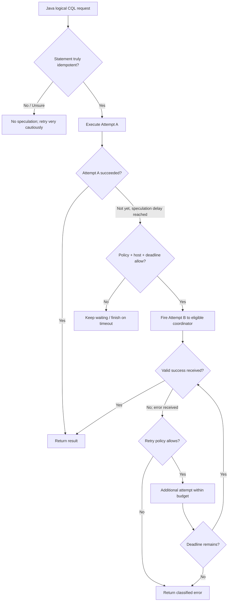

# Speculative Execution and How It Differs from Retries

> **Chapter:** Java Retries and Errors  
> **Scope:** Apache Cassandra and **Java Driver 4.x**, where a CQL query travels from the Java application to a coordinator and then to replicas based on partition key, replication factor (RF), and consistency level (CL). This lesson distinguishes **driver-side speculative execution**, **driver retries**, and **server-side speculative retries** when facing latency or errors.
>
> **Objectives:** Recognize why a single logical request can trigger multiple execution attempts; determine when to send an extra request before the first fails versus retrying on error; evaluate **idempotency**, timeouts, consistency, CPU/I/O saturation, and duplicate-write risks; configure policies per **execution profile**; and measure p95/p99, attempt counts, and real impact before enabling in production.

## 1. Scenario: High p99 Even Though Most Queries Are Fast

A Java application queries Cassandra's `orders_by_customer_day` table. Most reads finish in 20–40 ms, yet some take 300 ms due to a slow coordinator, GC pause, network jitter, or a replica running compaction.

The development team proposes:

> “If a request hasn't answered after 100 ms, fire an identical copy to another coordinator. Whichever returns first wins.”

That is **speculative execution** (also called *hedged requests*) at the **Java Driver** layer. It differs from regular retries:

- **Speculative execution:** sends **additional copies while the prior execution is still in flight**, triggered by a latency threshold and policy, before any error occurs.
- **Retry:** after an execution encounters an **error or failure condition** permitted by the retry policy, re-executes according to the driver's retry strategy.

Both generate extra work and are appropriate only when **re-execution never compromises correctness**.

If the request is a read-only `SELECT` over public data, hedging can cut tail latency under the right conditions. However, if the request is “increment view count by 1”, two parallel attempts can increment it **twice**.

**Any latency-reduction feature must be evaluated for both data correctness and cluster-wide load amplification.**

## 2. Terminology: Logical Request, Execution Attempt, Coordinator

Distinguish three entities:

1. **Logical request:** the operation the app intends to perform once, e.g., “read the latest 20 orders for customer C on day D”.
2. **Execution attempt:** a single transmission of the statement by the driver to a coordinator.
3. **Replica request:** the work the coordinator performs with replicas to satisfy CL. One execution attempt can fan out into multiple internal messages.

```text
Application
   |
   | One logical SELECT
   v
Java Driver 4.x
   |
   +---- Attempt A ---> Coordinator N1 ---> Replicas R1/R2...
   |
   +---- Attempt B ---> Coordinator N2 ---> Replicas R2/R3...
                        (only if policy fires an extra attempt)
```

Two attempts may pick different coordinators yet still **hit the same replicas**. Adding a coordinator does not mean the underlying physical work is completely isolated.

In wide-column tables, the partition key routes data by token; the coordinator uses topology and RF to contact replicas. **Speculative execution never changes the partition key, replication strategy, or consistency level.**

### “Speculative execution” is not a speculative transaction

The name might evoke “run ahead and commit later”. There is no new multi-replica commit/rollback protocol here. The driver merely **sends extra executions of the same statement** per policy.

If the server processes both attempts, read/write behavior still follows standard Cassandra rules, including timestamps, tombstones, Paxos/LWTs, and the statement's CL.

## 3. Core Comparison Table

| Criterion | Driver speculative execution | Driver retry |
| --- | --- | --- |
| **Trigger timing** | When an in-flight attempt is slow, **not necessarily failed** | When an error/condition handled by `RetryPolicy` occurs |
| **Concurrent attempts** | Can run **simultaneously** | Normally starts after a prior attempt fails; can also interact with speculation |
| **Target** | Usually another coordinator if an eligible node exists | Depends on verdict: same or next coordinator, or rethrow |
| **Governed by** | `SpeculativeExecutionPolicy` and delay schedule | `RetryPolicy` and error type / attempt / CL |
| **Requires idempotency check** | Yes—critical because the server may process both | Yes, because the first attempt may already have applied |
| **Query payload** | Same CQL/bind values, different execution path | Usually same logical statement |
| **Cost** | Increases coordinator/replica work even when the first attempt would succeed | Increases work only when retryable errors happen |
| **Goal** | Reduce **tail latency** from slow outliers | Handle selected transient errors per policy |
| **Not guaranteed** | Does not guarantee lower p99 or snapshot reads | Does not guarantee exactly-once writes or error disappearance |

In practice, the driver can use **both retries and speculation within a single logical request**. Never mechanically add retry/speculation counters assuming each logical request triggers only one kind.

## 4. Timelines: Same Request, Two Mechanisms

### A. Speculative execution

```text
t =   0 ms: Attempt A sent to coordinator N1
t =  80 ms: Attempt A not yet finished
t = 100 ms: Speculative policy fires Attempt B to N2
t = 135 ms: Attempt B returns success
t = 135 ms: App receives result from B
t = 180 ms: A may still be finishing partial work
```

This is a **hypothetical** timeline for illustration. There is no forced rollback of work already sent to the server. Client-side cancellation also **does not guarantee** coordinators or replicas halt work immediately.

### B. Retry after error

```text
t =   0 ms: Attempt A sent to coordinator N1
t =  55 ms: Attempt A receives a policy-eligible error
t =  56 ms: Retry policy decides whether to retry
t =  57 ms: Attempt B sent if policy permits
t = 100 ms: Attempt B succeeds
```

If the policy returns **`RETHROW`**, the logical request terminates with the error; no Attempt B runs. Not every error warrants retrying.

### C. Combining both mechanisms

```text
Logical request
    |
    +--> Attempt A (slow)
    |       |
    |       +--> may fail and consult RetryPolicy
    |
    +--> Attempt B (speculation after delay)
            |
            +--> may succeed or also fail
    |
    v
Driver resolves the outcome/attempts per release implementation,
time budgets, and active policies
```

Never design assuming “at most two attempts per request” if you enable both a retry policy and one speculative execution. **Total attempt budgets and request deadlines** are the boundaries you must control.

## 5. Why Can Tail Latency Improve?

In a distributed system, query latency has many components:

```text
Client
  |
  +--> TLS/network to coordinator
  +--> Coordinator scheduling/GC/CPU
  +--> Internode messaging to replicas
  +--> Memtable/SSTable/cache/index reads
  +--> Replica queues, disk I/O, compaction contention
  +--> Response aggregation per CL
  +--> Driver decoding and application mapping
```

An outlier on **one coordinator or network path** can stall a single logical request. Sending a hedged copy through a less congested coordinator can finish sooner.

However:

- If **all replicas are slow from a shared disk/compaction bottleneck**, Attempt B only adds load.
- If many clients fire speculative attempts simultaneously as p99 rises, they trigger a **feedback loop** that further overloads the cluster.
- When a statement requires `LOCAL_QUORUM`, two coordinators may query **overlapping replicas** rather than independent paths.
- If the bottleneck sits in application CPU or response mapping, extra Cassandra attempts cannot fix the root cause.

**Speculation mitigates stragglers—it never replaces capacity planning, schema/query tuning, or repair.**

## 6. Driver-Side Speculation vs. Server-Side Speculative Retry

Cassandra also provides **server-side speculative retry** on the read path for releases and tables supporting that option.

Two layers:

```text
Java Driver
   |
   | Driver-side speculation:
   | may send an extra CQL request via coordinator N2
   v
Coordinator N1 / N2
   |
   | Server-side speculative retry:
   | coordinator may contact an additional replica
   | when a replica read response is slow
   v
Replicas R1 / R2 / R3
```

| Aspect | Driver-side speculative execution | Server-side speculative retry |
| --- | --- | --- |
| Initiated by | Java Driver / client | Cassandra coordinator |
| Layer | **CQL request** to coordinator | Internal **replica read** |
| Configuration | Driver execution profile and policy | Server release / table-level read setting |
| Extra target | Another coordinator | Another replica (per read logic) |
| Scope | Controlled by statement/idempotency/driver policy | Primarily **read path** per server feature |
| Impact | Increases CQL attempts | Increases replica read requests |
| Observability | Driver metrics/tracing | Server read metrics/tracing and internode activity |

The server option usually involves `speculative_retry`, yet **values, syntax, and behavior vary by Cassandra release**. Never copy an `ALTER TABLE` snippet from an external article into production without checking your exact version.

**Both layers can fire together.** A new driver speculative attempt can reach a second coordinator that in turn fires a speculative replica read. In the worst case, that multiplies load rather than giving a free speedup.

## 7. Conditions Required for the Driver to Fire a Speculative Attempt

For speculative execution to trigger, at minimum:

1. **The policy is enabled** on the statement's effective execution profile.
2. The statement is marked **idempotent** per the driver's mechanism.
3. The prior attempt **has not returned enough to complete** before the policy's delay threshold.
4. Another eligible coordinator/host exists per load balancing and connection health.
5. The request has not ended due to **global/request timeout**, cancellation, or terminal failure.
6. The policy's max-execution cap has not been reached.
7. The driver/protocol version supports the configured behavior.

**Enabling the policy does not mean every request sends a second copy.** If a query finishes in 20 ms and the delay is 150 ms, no speculation occurs.

### Where is idempotence marked?

In Java Driver 4.x, for example:

```java
BoundStatement read = prepared.bind(customerId, day)
    .setIdempotent(true);
```

This is a **developer promise** about request semantics—not something the driver verifies by analyzing business logic.

If an unsafe mutation is marked idempotent, retries and speculation can execute multiple copies and corrupt data. **Never turn on default idempotence app-wide just to chase better p99.**

## 8. Idempotency Is the Most Important Safety Boundary

An operation is **idempotent** if running it multiple times under relevant conditions yields the same logical outcome as running it once.

### Usually good candidates

- A read-only `SELECT` by partition key with no unusual side effects.
- A write with explicit primary key/values and a **fixed timestamp**, after verifying no side effects and sound concurrency semantics.
- A metadata-only read with no business mutation.

### Must be evaluated carefully or excluded from speculation

- `UPDATE counter = counter + 1`: multiple executions increment multiple times.
- Collection/list append or prepend like `list = list + [...]`: can insert duplicate elements.
- Writes using server-generated timestamps where each execution carries a distinct timestamp.
- `INSERT`/`UPDATE` with TTL if retries/speculation shift timestamps or expirations, altering data lifetime.
- LWTs (`IF NOT EXISTS`, `IF status = ...`) when the app treats CAS results as a once-only business gate.
- Queries invoking UDFs or custom side effects unless proven pure.
- Batches containing any non-idempotent operation.
- Concurrent writes racing on the same primary key without clear versioning or timestamp rules.

**“Same CQL text and bind values” does not automatically prove idempotency.**

### Business evaluation table

| Operation | Safe to mark idempotent? | Rationale |
| --- | --- | --- |
| `SELECT ... WHERE full_partition_key = ?` | Usually yes | No intended data mutation |
| `UPDATE views = views + 1` on counter | **No** | Re-execution increments multiple times |
| `UPDATE tags = tags + {'java'}` on set | Needs evaluation | Resulting set matches, yet timestamps/side effects may matter |
| `UPDATE status='PAID' USING TIMESTAMP fixed` | Possibly, **after verification** | Mutations match better with fixed timestamp; domain must guarantee safety |
| `INSERT event_id = UUID.randomUUID()` per app attempt | Not by default | Each attempt creates a different row |
| `INSERT ... IF NOT EXISTS` | Not by default | CAS result and business workflow have distinct semantics |
| `DELETE col` | Needs evaluation | Timestamps, concurrent writes, tombstones, and audits can make replays hazardous |
| `BATCH` with counter/list append | No | Contains non-idempotent component |

When unsure, **keep non-idempotent** and build proper idempotency keys, fixed timestamps, or domain controls first.

## 9. Idempotency and “Exactly Once” Are Not the Same

Suppose an API implements “charge once for order O”. Even if the Cassandra statement looks like:

```cql
UPDATE lab.orders_by_id
SET payment_status = 'PAID'
WHERE order_id = ?;
```

charging money **does not live solely inside one CQL cell**. The service may have called an external payment gateway before updating Cassandra. Retrying the whole workflow can charge twice even though `payment_status` ends up `'PAID'`.

Therefore distinguish:

1. **Idempotency of a CQL statement.**
2. **Idempotency of the API request and business workflow.**
3. **Exactly-once effects** across external systems, typically requiring event IDs/deduplication or dedicated ledgers/transactions.

Driver speculative execution only sees **whether the statement was marked idempotent**—it has no idea whether a payment gateway would be called twice. Never cite driver properties to claim end-to-end exactly-once semantics.

## 10. CL Context: Speculation Never Increases Consistency

Suppose a keyspace uses `NetworkTopologyStrategy` with RF=3 in `dc1` and RF=3 in `dc2`.

| CL | Conceptual response requirement | What does speculation do? |
| --- | --- | --- |
| `LOCAL_ONE` | One local replica responds | May change coordinator/read path; **never upgrades** to quorum |
| `LOCAL_QUORUM` | Two replicas in coordinator's DC when local RF=3 | Fires extra CQL attempt; each attempt still needs local quorum |
| `QUORUM` | Quorum across total RF for the request | Does not alter required ACK/response count |
| `ALL` | Very strict replica requirement | Does not relax CL requirements |
| `LOCAL_SERIAL` / `SERIAL` | Governs serial/LWT phases | Not meant for arbitrary CAS hedging |

**Speculation is not read repair**, does not raise RF, and does not fix missing partition keys in queries.

### Two coordinators can still hit the same replicas

With local RF=3, N1 and N2 may both query R1/R2/R3 per server placement. If R2 has a disk bottleneck, both attempts can still stall.

Whether p99 improves or worsens thus depends on topology and **true path independence** between executions.

### When using `LOCAL_ONE`

One `LOCAL_ONE` read may hit a lagging replica that missed a recent write; a second attempt might hit a fresher replica. **Whichever responds first is not guaranteed to be the “latest”.** If business rules need stronger consistency, choose the right CL and write design instead of relying on speculation to race replicas.

## 11. Retries, Speculation, and Request Timeouts

Separate at least three timing concepts:

- **Execution attempt duration** across coordinator and replicas.
- **Speculation delay:** threshold after which the policy may launch an extra attempt if still unfinished.
- **Request timeout / deadline:** total time budget allowed by the driver/app for the logical request, depending on API and version.

Hypothetical example:

```text
Request budget: 500 ms
Speculation delay: 150 ms
Extra speculative executions: max 1

t=0    Attempt A
t=150  If A still pending -> Attempt B
t=210  If B succeeds -> return result
t=500  If no valid result yet -> request timeout
```

**Adding attempts does not extend the application's deadline.** On the contrary, it increases in-flight server work even after the client times out or cancels.

### Distinguish two common timeouts

- **Server read/write timeout:** coordinator returns an error because replica responses fell short of CL within the server's processing window.
- **Client-side driver timeout:** client ran out of time waiting for a response; the server may still be processing or have finished.

For **writes**, a timeout never proves **no replica applied the write**. Retrying or speculating non-idempotent writes can duplicate mutations, corrupt final state, or trigger double side effects.

Never raise both server and driver timeouts just to “hide” p99 spikes from a hot partition.

## 12. Which Cases Does `RetryPolicy` Handle?

In Java Driver 4.x, `RetryPolicy` inspects error details and request context to make decisions for specific cases.

Common error categories:

| Category | Typical meaning | Auto-retried? |
| --- | --- | --- |
| `ReadTimeoutException` | Coordinator lacked enough read responses for CL | **Depends on policy and context**, not blindly |
| `WriteTimeoutException` | Insufficient write ACKs; commit state may be ambiguous | Very cautiously; many write types are unsafe |
| `UnavailableException` | Insufficient live replicas for CL | Immediate retry rarely helps if topology hasn't changed |
| `ReadFailureException` / `WriteFailureException` | Replicas reported an execution error | Inspect cause and policy |
| `DriverTimeoutException` | Client-side request deadline expired | Never infer the server did not execute |
| `AllNodesFailedException` | Driver failed across candidate nodes | Inspect per-host nested causes |
| `UnauthorizedException` | Missing resource permissions | Never retry blindly; fix permissions |
| `InvalidQueryException` | Invalid CQL/schema/binding | Never retry blindly; fix query |
| TLS / authentication failure | Connection or security failure | Never bypass TLS/auth with retries |
| Overload / bootstrapping | Node rejecting load or not ready yet | Shed load; inspect topology and policies |

**Exact retry policies and error classification depend on driver version.** Never assume all exceptions in the table share identical retry paths. Some failures happen before bytes are even sent, making them host-selection/connectivity issues rather than *server request retries*.

### What not to do in Java

```java
// Anti-pattern: unbounded retry on any error.
while (true) {
    try {
        session.execute(statement);
        break;
    } catch (Exception ignored) {
        // No backoff, no deadline, no error classification.
    }
}
```

This loop can spark a **retry storm**, replay unsafe mutations, and mask auth/schema errors. If application-level retries are needed, enforce deadlines, backoff/jitter, attempt caps, exception classification, and idempotency.

## 13. Speculation Policies in Java Driver 4.x

Java Driver 4.x provides policies for speculative execution, typically configured in **driver configuration** and scoped by **execution profile**.

Conceptual options:

| Policy | Idea | Notes |
| --- | --- | --- |
| **`NoSpeculativeExecutionPolicy`** | Sends no speculative copies | Safe starting baseline |
| **`ConstantSpeculativeExecutionPolicy`** | Fires extra attempts at a fixed delay, up to a cap | Predictable, though fixed delay must suit the workload |
| **Percentile-based policy** (if supported by driver release) | Adjusts delay from observed latency distributions | Needs representative samples and release-specific metric tuning |
| **Custom policy** | Application-supplied logic | Config/logic/observability risks; use only after thorough review |

Do not assume every Java Driver 4.x version shares the exact same class list, constructors, or config keys. Verify documentation for your exact **artifact and patch version**.

**Never enable speculation across the entire application upfront.** Start on a **dedicated execution profile solely for verified idempotent reads**.

## 14. HOCON Configuration: Off by Default, Enabled Only for a Read Profile

**Illustrative** configuration example for Java Driver 4.x. Verify exact paths and class names against your target release before deploying:

```hocon
datastax-java-driver {
  basic {
    request {
      timeout = 2 seconds
      default-idempotence = false
    }
    load-balancing-policy {
      local-datacenter = "dc1"
    }
  }

  advanced {
    speculative-execution-policy {
      class = NoSpeculativeExecutionPolicy
    }
  }

  profiles {
    "hedged-read" {
      basic.request.timeout = 2 seconds

      advanced.speculative-execution-policy {
        class = ConstantSpeculativeExecutionPolicy
        delay = 150 milliseconds
        max-executions = 1
      }
    }
  }
}
```

Key goals:

- **Default** performs no speculative execution.
- **Profile `hedged-read`** can fire **at most one extra copy** in this example config.
- `delay = 150 milliseconds` is a sample test value, **not a universal default recommendation**.
- `default-idempotence = false` protects statements not explicitly marked safe.
- Requests using `setIdempotent(true)` must be **semantically audited** before routing through this profile.
- The driver sets a local DC matching topology; replace `dc1` to match your actual cluster.

**This snippet omits contact points, TLS, credentials, keyspace, and server timeouts.** Configure those separately per environment.

### Understanding `max-executions`

`max-executions` in the policy governs allowed **speculative executions** per your version/config—not a global cap across application retries. Check your driver's exact semantics, especially alongside custom retry policies or multiple execution profiles.

Never treat this number as proof that “total CQL attempts equal 2 in all scenarios”.

## 15. Java Driver 4.x: Marking a `SELECT` Idempotent and Choosing a Profile

Using a query-driven table:

```cql
CREATE TABLE IF NOT EXISTS lab.orders_by_customer_day (
    tenant_id text,
    customer_id uuid,
    day_bucket date,
    created_at timestamp,
    order_id uuid,
    status text,
    total decimal,
    PRIMARY KEY ((tenant_id, customer_id, day_bucket),
                 created_at, order_id)
) WITH CLUSTERING ORDER BY (created_at DESC, order_id ASC);
```

Assume keyspace `lab` exists with an appropriate RF. This is a wide-column table partitioned by `tenant_id + customer_id + day_bucket`; the query supplies the full partition key.

Java 4.x example:

```java
import java.time.LocalDate;
import java.time.Instant;
import java.util.UUID;
import java.util.ArrayList;
import java.util.List;

import com.datastax.oss.driver.api.core.CqlSession;
import com.datastax.oss.driver.api.core.DefaultConsistencyLevel;
import com.datastax.oss.driver.api.core.cql.BoundStatement;
import com.datastax.oss.driver.api.core.cql.ExecutionInfo;
import com.datastax.oss.driver.api.core.cql.PreparedStatement;
import com.datastax.oss.driver.api.core.cql.ResultSet;
import com.datastax.oss.driver.api.core.cql.Row;

public final class HedgedOrdersReader {
    private final CqlSession session;
    private final PreparedStatement byDay;

    public record OrderSummary(UUID id, Instant createdAt, String status) {}

    public HedgedOrdersReader(CqlSession session) {
        this.session = session;
        this.byDay = session.prepare(
            "SELECT order_id, created_at, status " +
            "FROM lab.orders_by_customer_day " +
            "WHERE tenant_id = ? AND customer_id = ? " +
            "AND day_bucket = ? LIMIT 20"
        );
    }

    public List<OrderSummary> loadLatest(
            String tenantId, UUID customerId, LocalDate day) {

        if (tenantId == null || tenantId.isBlank() ||
            customerId == null || day == null) {
            throw new IllegalArgumentException("Missing partition key");
        }

        BoundStatement statement = byDay
            .bind(tenantId, customerId, day)
            .setExecutionProfileName("hedged-read")
            .setConsistencyLevel(
                DefaultConsistencyLevel.LOCAL_QUORUM)
            .setIdempotent(true)
            .setPageSize(20);

        long startNanos = System.nanoTime();
        ResultSet result = session.execute(statement);
        ExecutionInfo info = result.getExecutionInfo();

        long elapsedMicros =
            (System.nanoTime() - startNanos) / 1_000L;

        List<OrderSummary> orders = new ArrayList<>();
        for (Row row : result) {
            orders.add(new OrderSummary(
                row.getUuid("order_id"),
                row.getInstant("created_at"),
                row.getString("status")
            ));
        }

        System.out.printf(
            "elapsed_us=%d speculativeExecutions=%d coordinator=%s%n",
            elapsedMicros,
            info.getSpeculativeExecutionCount(),
            info.getCoordinator() == null
                ? "unknown"
                : info.getCoordinator().getEndPoint()
        );

        return orders;
    }
}
```

This example uses **Java 17** for `record` and a compatible Java Driver 4.x; `CqlSession` is managed externally with proper authentication/TLS and local DC. Never log sensitive order values in production.

### Understand the measurement limits of this code

- `getSpeculativeExecutionCount()` (where present in your driver release) reports speculation recorded in the request's execution info—**not total replica read RPCs**.
- Elapsed time here spans from before `execute` to receiving result metadata; iterating and mapping rows takes extra time. To measure **end-to-end API latency**, include result consumption and serialization.
- Because the CQL includes `LIMIT 20`, logical rows are bounded; on unbounded synchronous `ResultSet`s, iterating can **automatically fetch additional pages**, adding load.
- Speculation will not fire if the initial attempt finishes before the delay.
- `setIdempotent(true)` fits a standard read-only `SELECT` here; **never copy this flag onto arbitrary writes or aggregations**.
- Live data can change between two attempts; driver speculation does not create a long-lived snapshot.
- If a query invokes side-effecting UDFs or special rules, re-verify safety.

## 16. Async Java: Reading One Request Without Blocking App Threads

In async Java backends, speculative execution remains a driver-managed policy. The application does not need to manually spawn two `CompletableFuture`s to “hedge” when using the driver policy.

```java
import java.time.LocalDate;
import java.util.UUID;
import java.util.concurrent.CompletionStage;

import com.datastax.oss.driver.api.core.CqlSession;
import com.datastax.oss.driver.api.core.DefaultConsistencyLevel;
import com.datastax.oss.driver.api.core.cql.AsyncResultSet;
import com.datastax.oss.driver.api.core.cql.BoundStatement;
import com.datastax.oss.driver.api.core.cql.PreparedStatement;

public final class AsyncOrderRead {
    private final CqlSession session;
    private final PreparedStatement select;

    public AsyncOrderRead(CqlSession session) {
        this.session = session;
        this.select = session.prepare(
            "SELECT order_id, created_at, status " +
            "FROM lab.orders_by_customer_day " +
            "WHERE tenant_id = ? AND customer_id = ? " +
            "AND day_bucket = ? LIMIT 20"
        );
    }

    public CompletionStage<AsyncResultSet> fetch(
            String tenant, UUID customerId, LocalDate day) {

        BoundStatement statement = select
            .bind(tenant, customerId, day)
            .setExecutionProfileName("hedged-read")
            .setIdempotent(true)
            .setConsistencyLevel(
                DefaultConsistencyLevel.LOCAL_QUORUM)
            .setPageSize(20);

        return session.executeAsync(statement);
    }
}
```

`AsyncResultSet.currentPage()` reads only the current page, while `fetchNextPage()` explicitly requests the next page. **Speculative execution is not pagination**: one logical page request can fire an extra execution attempt, while subsequent pages are separate logical requests.

### Why not manually fire two parallel queries?

If an app calls `executeAsync` twice and races them with `anyOf`:

- It bypasses the driver's idempotency checks, scheduling, and host selection.
- It lacks built-in cancellation, deadline tracking, and driver metrics.
- Load balancing may pick the same coordinator anyway, failing to cut tail latency.
- It is easy to overlook retry budgets, authorization, or tracing while doubling work.

**Prefer driver-supported policies**; implement app-level hedging only with clear justification and full-system semantic verification.

## 17. Writes: Examples Excluded from Speculative Execution

### Counter increments

```cql
CREATE TABLE IF NOT EXISTS lab.page_views_by_id (
    page_id uuid PRIMARY KEY,
    views counter
);
```

An increment mutation:

```cql
UPDATE lab.page_views_by_id
SET views = views + 1
WHERE page_id = 11111111-1111-4111-8111-111111111111;
```

If two copies are sent and both execute, the counter increases by **2 instead of 1**. This request must not be marked idempotent.

Java:

```java
BoundStatement statement = incrementPrepared
    .bind(pageId)
    .setIdempotent(false);
session.execute(statement);
```

**`setIdempotent(false)` alone does not guarantee exactly-once**: it stops driver-level retries/speculation for that statement, yet the app, gateway, or client can still resend the business request. Use deduplication and event IDs when exact-once effects are required.

### List appends

An `UPDATE ... SET events = events + [?]` can duplicate list items if executed twice. Never assume an `UPDATE` is safe merely because bind values stay the same.

### LWTs

An `INSERT ... IF NOT EXISTS` produces CAS results dependent on the state seen by each execution. Even if the final row is not duplicated, **interpreting `applied`/`not applied` in the workflow** requires extreme care. Never enable hedging on LWTs by default; use controlled transaction workflows and verification reads.

## 18. “Setting the Same Value” Is Still Not Unconditionally Safe

Example:

```cql
UPDATE lab.orders_by_id
SET status = 'PAID'
WHERE order_id = 11111111-1111-4111-8111-111111111111;
```

At first glance, sending `status='PAID'` twice leaves the same value. Yet consider:

1. **Timestamps:** two executions can receive different timestamps if not fixed, altering order relative to concurrent writes.
2. **TTLs:** if TTLs are present, expiration/retention shifts.
3. **Concurrent writes:** another request sets `status='CANCELLED'`; a delayed attempt arriving later can overwrite it depending on timestamp.
4. **Side effects:** triggers, CDC, or downstream pipelines may observe multiple mutations.
5. **Client retries:** timeouts never prove the prior attempt failed to execute.

A write with **fixed cell values, a fixed explicit timestamp, and no TTL/side effects** is far easier to reason about as idempotent, though you still must verify domain rules and schema compatibility.

### Fixing timestamps explicitly when appropriate

Cassandra CQL supports explicit timestamps on suitable mutations (syntax illustration):

```cql
UPDATE lab.orders_by_id
USING TIMESTAMP 1800000000000000
SET status = 'PAID'
WHERE order_id = 11111111-1111-4111-8111-111111111111;
```

CQL timestamps are in **microseconds**; the literal above is illustrative only. Never trust arbitrary client wall-clock times to generate abnormally high timestamps in production. And **fixing a timestamp does not automatically create an exactly-once workflow**.

## 19. Write Timeouts: Why Is Commit State Unknown?

Picture a `LOCAL_QUORUM` write at local RF=3:

```text
Client -> Coordinator
          |
          +--> Replica R1: mutation applied
          +--> Replica R2: mutation applied, ACK delayed
          +--> Replica R3: slow/offline node

Client times out before enough ACKs arrive
          |
          v
Application observes "timeout"
```

From a client-side timeout, you cannot assert the mutation **was not applied anywhere**. With retries or speculation:

- Replicas may receive the same mutation again.
- Non-idempotent mutations can double-increment counters or duplicate list items.
- Fresh TTLs or timestamps can race against concurrent updates.
- Aggressive retries slow an already strained cluster further.

**Retrying writes after a timeout means handling an uncertain state**, not “resending because the first attempt definitely failed”.

## 20. When Is Speculation Effective?

Good candidates typically have:

- Reads keyed by **full partition key** returning bounded rows—never full-table scans.
- Fast p95 where only a small fraction hit **coordinator/network outliers**.
- Genuine **cluster headroom** in CPU, disk, network, and concurrency.
- Multiple eligible hosts/coordinators within routing rules and the local DC.
- Proven statement idempotency.
- Strict p99 SLOs justifying the added request cost.
- Per-attempt metrics, error rates, amplification tracking, and canary/rollback plans.

### When is speculation unhelpful or harmful?

- **Cluster-wide** CPU, disk, or GC is saturated.
- Tombstone-heavy queries or huge partitions force every replica to work hard.
- Many requests already sit near client timeout; delay triggers too late.
- Load balancing has no alternative eligible nodes.
- Cross-DC bandwidth is constrained and remote coordinators add latency.
- App-level retry policies are already overly aggressive.
- Compaction, repair, or streaming heavily contends with reads.
- Workloads are dominated by writes, counters, or LWTs sensitive to replay.

Never use speculation as a substitute for eliminating hot partitions, fixing CQL/query-first models, or adding capacity.

## 21. How to Choose Delay and Max Executions

No single 50 ms, 100 ms, or 200 ms setting fits every Cassandra cluster. Decision process:

1. Measure latency distributions **per query shape, CL, and DC**—never lump all queries together.
2. Separate **coordinator** delays from **replica/disk** bottlenecks using telemetry.
3. Target read queries likely to finish faster via another coordinator.
4. Set delay **above the vast majority of healthy requests** so normal calls never speculate.
5. Start with **one extra execution** in lab/canary if policy permits.
6. Monitor extra attempts, throughput, p99, timeouts, CPU, GC, and disk await.
7. If extra attempts climb without improving p99, raise delay or turn it off.
8. Re-evaluate whenever traffic, RF/DC, driver version, or hardware changes.

### Percentile-based delays

Some drivers/policies estimate delay from historical latency percentiles. This makes sense only when:

- Samples are representative, avoiding cold-start or low-QPS skew.
- Distributions are scoped per critical workload.
- Speculation/tracing overhead does not distort the latency metrics being sampled.
- Sensible floor/cap bounds and attempt limits exist.
- Clear fallback behavior handles insufficient samples.

**Never assume a “percentile” policy is self-tuning perfection.** If latency rises because the cluster is overloaded, dynamic percentiles shift delays without fixing the overload.

## 22. Quantitative Example of Amplification Cost

Consider an illustrative workload:

```text
Logical reads:           1,000 requests/second
Speculative rate:        10% trigger 1 extra copy
Average extra CQL tries: 100 attempts/second
Total coordinator tries: ~1,100 attempts/second

Coordinator-level request work increases ~10%
(excluding replica requests, retries, and server-side speculation).
```

If each coordinator attempt requires local quorum, total replica read work can increase substantially depending on caches, server-side speculative reads, cancellation, and early responses.

A simple measurement:

\[
\text{Execution amplification}
=\frac{\text{total coordinator attempts}}{\text{logical application requests}}
\]

Observing 110,000 coordinator attempts across 100,000 logical requests yields:

\[
\text{Amplification}=1.10
\]

This measures **only the instrumented layer**, not “replica CPU rose by exactly 10%”. Always inspect server CPU, I/O, and network to gauge cluster-wide cost.

### Decision criteria

A sound experiment seeks:

- Meaningful API p99 reduction under representative load.
- No rise in errors or timeouts.
- Speculation rate staying within budget.
- Healthy headroom remaining on replicas, CPU, disk, network, and GC.
- Uncompromised data correctness.
- Stable behavior during compaction, repair, and node events.

If p99 drops from 240 ms to 180 ms while CPU hits 95% and write timeouts spike, **that optimization failed**.

## 23. Dashboards and Metrics to Track

| Metric | Layer | Meaning |
| --- | --- | --- |
| Logical request rate | API | Business request volume |
| Driver CQL attempts | Driver | Total execution attempts, including retries/speculation when instrumented |
| Speculative execution count/rate | Driver | Extra attempts fired by policy |
| Retry count/rate and reasons | Driver | Signals retry storms or transient faults |
| Successful speculative wins | Driver/app (if instrumented) | Whether hedged copies actually beat stragglers |
| API read p50/p95/p99 | Application | End-to-end user experience |
| Driver CQL latency p95/p99 | Driver | Database wait time |
| Client-side vs. server-side timeouts | Driver/server | Separates client deadlines from coordinator timeouts |
| Coordinator selection by DC | Driver | Detects routing mistakes or local-DC drift |
| Read request rate per node | Server | Load balance and hotspots |
| Read p95/p99, pending/dropped | Server | Stage queue saturation |
| CPU, JVM heap/GC pauses | Node | Code and request overhead |
| Disk await, SSTable/tombstone scans | Node | I/O and read amplification |
| Compaction/repair/streaming backlog | Node | Background resource contention |
| Error rate by exception family | API/driver | Confirms stability and safety |

**Exact metric names vary across Java Driver 4.x, exporters, and Cassandra releases.** This table describes **metric concepts**, not a guarantee every driver exports every counter out of the box. Add safe tracing/instrumentation as needed without exposing PII.

Never attach tokens, order IDs, customer IDs, or raw CQL bind values as metric labels; they cause cardinality explosions and leak sensitive data.

## 24. Why Looking Only at p99 Is Not Enough

Suppose a canary reports:

| Metric | Without speculation | With speculation |
| --- | ---: | ---: |
| p50 read latency | 28 ms | 29 ms |
| p95 read latency | 84 ms | 81 ms |
| p99 read latency | 250 ms | 170 ms |
| Extra CQL attempt rate | 0% | 12% |
| Replica CPU p95 | 61% | 79% |
| Write timeouts / 10,000 requests | 1 | 5 |

These are **hypothetical numbers for analytical practice**, not a real Cassandra benchmark.

The conclusion must not stop at “read p99 improved by 80 ms”. Ask:

- Does the added CPU leave safe headroom at peak?
- Did write timeouts rise due to speculation or a concurrent change?
- Is load uneven across nodes or DCs?
- Were reads verified at the right CL and sample partitions?
- Did retry rates rise from overload?
- Did the test window cover repair and compaction cycles?

A read-p99 gain that breaks write SLOs may need immediate rollback.

## 25. Separating Speculative Counts from Retry Counts in Observability

Never take a total attempt count and assume every extra execution came from speculation.

For example, one logical request might have:

```text
Attempt 0: sent at t=0
Attempt 1: speculation at t=120ms
Attempt 2: retry after an attempt failed
```

The driver records these events in separate counters. Dashboards should distinguish:

- **Logical application operations** (usually instrumented by the service).
- **Speculative attempts** fired by policy due to latency.
- **Retries** decided by `RetryPolicy` after failures.
- **Server-side speculative replica reads** if exposed by the server.
- **Cancelled/abandoned client attempts** once a request completes.
- **Final request timeouts** surfaced to the API.

Without reliable per-attempt tracing, report only what is directly measured—**never fabricate a “winning attempt reason”** from aggregate totals.

### How should tracing be used?

Cassandra query tracing reveals coordinator/replica read hops, though it adds overhead and stores trace rows. Use it only via sampling or in labs—never enable 100% tracing on production traffic.

```cql
TRACING ON;

SELECT order_id, status
FROM lab.orders_by_customer_day
WHERE tenant_id = 'tenant-a'
  AND customer_id = 11111111-1111-4111-8111-111111111111
  AND day_bucket = '2026-11-21'
LIMIT 20;

TRACING OFF;
```

This illustrates **a single `cqlsh` session** and does not reproduce two Java Driver speculative attempts. Observing real driver speculation requires **Java-side logs/traces** correlated with server telemetry.

## 26. Retry Storm Risks and Protective Levers

Imagine reads slow down because disks on several replicas saturate. Every API instance triggers speculation after 100 ms, while the HTTP gateway retries timed-out calls.

```text
1 user request
   |
   +--> API request #1
   |      +--> Driver attempt A
   |      +--> Driver speculative B
   |      +--> Driver retry C (on error)
   |
   +--> API gateway retry request #2
          +--> Driver attempt D
          +--> Driver speculative E
          +--> ...
```

Result: **one user action spawns a wave of cluster requests**. When all copies hit saturated disks, performance collapses further.

### Safeguards

1. Enforce an **end-to-end deadline** across HTTP → application → driver.
2. Cap retries at every layer and **coordinate an end-to-end budget**.
3. Apply API rate limits, concurrency caps, and backpressure.
4. Use circuit breakers / fail fast when the cluster is genuinely overloaded.
5. Enable speculation only on verified `SELECT`s, never globally.
6. Use jittered backoff on justified app retries to avoid synchronized waves.
7. Control partition sizes, page sizes, and tombstone scans to fix root p99.
8. Keep feature flags / fast rollbacks ready if extra attempts exceed budget.

A longer request timeout may hide client-facing errors while **holding resources occupied longer**. Fix root causes instead of merely extending waits.

## 27. Choosing Queries to Test with Speculative Execution

### Good candidate: query-first, full partition key

```cql
SELECT order_id, created_at, status
FROM lab.orders_by_customer_day
WHERE tenant_id = 'tenant-a'
  AND customer_id = 11111111-1111-4111-8111-111111111111
  AND day_bucket = '2026-11-21'
LIMIT 20;
```

Why:

- Targets one explicit partition.
- Bounds logical rows returned.
- Has no side effects.
- Lets latency be measured per exact query shape.

### Poor candidate: wide scans and filtering

```cql
-- Anti-pattern example: never use at large production scale.
SELECT *
FROM lab.orders_by_customer_day
WHERE status = 'PENDING'
ALLOW FILTERING;
```

No partition key appears in the predicate; broad filtering scans large amounts of data. Speculation just dispatches extra copies of a **heavy** query, piling on load instead of fixing the data model.

### Poor candidate: chronic hotspot queries

If one customer/day partition grows massive, even a full-key lookup stays slow—especially with tombstones or large collections. Re-bucket or redesign the table before considering speculative execution.

**Wide-column data-model quality is the primary latency fix.**

## 28. Multi-DC: Prevent Speculation from Becoming WAN Amplification

Suppose the application is in `dc1`, with RF=3 in `dc1` and `dc2`. The Java Driver must configure the proper **local datacenter**.

When load balancing restricts to `dc1`, speculative attempts stay local. Yet if misconfigured deployments or custom policies permit remote coordinators, tail latency and network costs spike.

Verify:

- Which DC owns coordinators for both primary and speculative attempts.
- Accurate RF/DC and the application's configured local DC.
- Whether CL aligns with business rules.
- Which replicas serve the read RPCs and whether they share a bottleneck.
- Whether extra traffic interferes with cross-DC replication or repair.

**`LOCAL_QUORUM` does not guarantee coordinators sit in the application's DC** if driver routing is misconfigured. Tracking coordinator DC is vital when tuning speculation.

## 29. When a Node Hits a GC Pause or Slow Disk

### Case A — A single slow coordinator

**Symptom:** requests via N1 suffer high p99 while other nodes stay healthy; N1 shows CPU/GC or event-loop spikes.

**Speculation can help:** an execution through N2 can finish faster if cluster headroom exists.

**Still fix the root cause:** tune GC, heap, thread pools, networking, and compaction timing; speculation only masks the symptom for clients.

### Case B — Shared replica disk bottleneck

**Symptom:** multiple coordinators wait on the same replica set with high disk await.

**Speculation helps very little:** both N1 and N2 must read from those same replicas. Extra coordinator requests merely deepen queues.

**Action:** optimize partitions, tombstones, SSTables/compaction, capacity, and repair schedules. Never add speculative attempts onto saturated disks.

### Case C — Cluster lacks replicas for CL

**Symptom:** `UnavailableException` or insufficient replicas for `LOCAL_QUORUM`.

**Speculation cannot create new replicas.** Trying another coordinator rarely fixes topology when CL demands two local replicas and only one is usable.

**Action:** restore nodes, fix network/topology, and check RF/DC and failure budgets; never arbitrarily lower CL just to make dashboards green.

## 30. Retry Policies and Exception Handling in Java Applications

A Java service must classify errors before responding or retrying. **Illustrative skeleton** code:

```java
import java.util.UUID;

import com.datastax.oss.driver.api.core.CqlSession;
import com.datastax.oss.driver.api.core.DriverTimeoutException;
import com.datastax.oss.driver.api.core.AllNodesFailedException;
import com.datastax.oss.driver.api.core.cql.BoundStatement;
import com.datastax.oss.driver.api.core.cql.PreparedStatement;
import com.datastax.oss.driver.api.core.servererrors.ReadTimeoutException;
import com.datastax.oss.driver.api.core.servererrors.UnavailableException;
import com.datastax.oss.driver.api.core.servererrors.InvalidQueryException;

public final class SafeReadErrors {
    private final CqlSession session;
    private final PreparedStatement select;

    public SafeReadErrors(CqlSession session) {
        this.session = session;
        select = session.prepare(
            "SELECT status FROM lab.orders_by_id WHERE order_id = ?"
        );
    }

    public String getStatus(UUID orderId) {
        BoundStatement statement = select.bind(orderId)
            .setIdempotent(true);

        try {
            var row = session.execute(statement).one();
            return row == null ? null : row.getString("status");

        } catch (InvalidQueryException e) {
            // Schema/CQL defect: never retry blindly.
            throw new IllegalStateException("Invalid CQL configuration", e);

        } catch (UnavailableException e) {
            // Insufficient replicas; alert health/CL.
            throw new IllegalStateException("Required replicas unavailable", e);

        } catch (ReadTimeoutException e) {
            // Server lacked enough responses in time.
            throw new IllegalStateException("Cassandra read timed out", e);

        } catch (DriverTimeoutException e) {
            // Client deadline; server may still be processing.
            throw new IllegalStateException("Client request timed out", e);

        } catch (AllNodesFailedException e) {
            // Inspect per-host causes: connection/auth/TLS/network.
            throw new IllegalStateException("No usable Cassandra node", e);
        }
    }
}
```

This snippet uses Java 10+ for `var` (which can be replaced by `Row`). Verify exact exception classes, constructors, and packages against your driver dependency during compilation; the code illustrates **classification rather than infinite retries**.

**Never return raw exceptions exposing endpoints, schemas, or sensitive info to public APIs.** Log internally by error category and correlation ID; never log raw bind values, tokens, or credentials.

### Never retry an entire business transaction on DB timeout

An API may perform multiple steps: calling a payment gateway, writing to DB, and publishing an event. Catching any exception and retrying **the entire method** duplicates side effects outside Cassandra. Bound retry scopes, enforce idempotency keys, and use business reconciliation.

## 31. Does Enabling Speculation Require Changing `RetryPolicy`?

Not necessarily. The two policies serve independent purposes even though both affect total attempts. A sound rollout strategy:

1. Measure a baseline with the current retry policy and **speculation disabled**.
2. Classify existing errors: server timeouts, unavailable, auth, invalid CQL.
3. Enable speculation **only for candidate reads** via an execution profile.
4. Keep the retry policy constant during canary testing so causality stays clear.
5. Measure combined attempt budgets and cancellation behavior.
6. If retry tuning is needed, ship it as a **separate change** with its own benchmark and rollback.

Never simultaneously raise retry counts, lower speculation delay, and extend request timeouts while watching only p99—you will have no idea which change drove load or altered behavior.

### “Ignore error” retry policies are also dangerous

Some retry policies allow ignoring errors and returning empty results. **Never use `IGNORE` to fake success on an uncertain mutation.** It silences critical failure signals.

Never fix data issues through client policies, because client policies lack knowledge of business invariants.

## 32. Paging and Speculative Execution

A large `SELECT` can span multiple Cassandra protocol pages:

```text
API request / page #1
   |
   +--> CQL execution (may speculate)
   |
   v
PagingState
   |
API request / page #2
   |
   +--> CQL execution for next page
   |
   v
Next PagingState
```

**Each page fetch is an independent driver request/context**, not a snapshot transaction across the entire result set.

Notes:

- `setPageSize(100)` differs from `LIMIT 100`.
- The synchronous Java Driver automatically fetches subsequent pages during iteration; calling `ResultSet.all()` on unbounded queries triggers multiple network requests.
- `AsyncResultSet.currentPage()` reads strictly the current page.
- Speculation on paged queries does not make `PagingState` safe as an unprotected public token.
- Never expose raw paging states to UIs without dedicated protection.
- Concurrent mutations between pages prevent snapshot consistency, even at `LOCAL_QUORUM`.

If a user-facing API requires a stable snapshot, design watermarks, snapshots, or immutable result tables; speculation does not provide that.

## 33. LWTs and Contention: Why Speculation Is Not a CAS Optimization

In Cassandra, LWTs use consensus protocols to evaluate conditions like:

```cql
UPDATE lab.orders_by_id
SET status = 'PAID'
WHERE order_id = 11111111-1111-4111-8111-111111111111
IF status = 'PENDING';
```

Two concurrent attempts for the same CAS can:

- Increase Paxos contention and overhead.
- Cause one attempt to observe `applied=true` while the other observes `applied=false`.
- Return a single outcome to the driver/app that obscures what every attempt saw.
- Prevent workflow conclusions from being drawn simply from “did the command finish?”.

**Never mark LWTs idempotent and enable speculation by default** merely because they “set status to a fixed value”. Use unknown-outcome policies, read-backs, idempotency keys, and domain concurrency control.

If CAS p99 is high, analyze per-partition contention, CAS frequency, cross-DC Paxos/serial CL, and transaction design—not just adding speculative coordinators.

## 34. Protecting Query Permissions and Sensitive Data

Speculative execution does not alter authorization boundaries:

- Roles still need proper `SELECT`/`MODIFY` CQL permissions.
- TLS still protects native connections where configured.
- The driver never elevates privileges when picking another coordinator.
- Applications must enforce tenant/customer authorization before querying.
- Extra execution attempts can produce extra logs/traces; avoid logging PII, secrets, or unnecessary bind values.

A `SELECT` under a service account can read across tenants if CQL omits proper tenant predicates. **Speculation never fixes missing tenant filters.**

Keep execution-profile configs under change control; enabling speculation too broadly can blow cluster capacity budgets without a single schema change.

## 35. Pre-Production Test Matrix

| Case | Scenario | Pass criterion |
| --- | --- | --- |
| T1 | `SELECT` finishes faster than delay | Zero extra attempts fired |
| T2 | One coordinator intentionally slowed in lab | Extra attempt fires and result is measured |
| T3 | No other eligible coordinator | Never loops infinitely; clean timeout/error |
| T4 | Statement `setIdempotent(false)` | Never speculated by standard policies |
| T5 | Idempotent `READ` | Speculates when threshold & host criteria match |
| T6 | Counter increment | Never marked idempotent or speculated |
| T7 | List append | No duplicates caused by driver policy |
| T8 | LWT / CAS | Never speculated blindly; business outcome verified |
| T9 | Server read timeout | Retry policy decides properly per error |
| T10 | Client request deadline expires | Terminates within app budget |
| T11 | `Unavailable` CL from missing replicas | Does not spam extra CQL requests |
| T12 | TLS / auth failure | Never bypasses security via retries |
| T13 | Uneven host load | Extra attempts do not pile onto hotspots |
| T14 | RF=3 and `LOCAL_QUORUM` | CL preserved; read results accurate |
| T15 | Two DCs | Local-DC coordinator preserved; no surprise WAN surge |
| T16 | Query with tombstones / hot partition | Speculation does not worsen p99 or load |
| T17 | Concurrent compaction/repair | Read and write SLOs stay healthy |
| T18 | Driver retry + speculation together | Attempt budget and metrics stay clear |
| T19 | API gateway also retries | No retry storm triggered |
| T20 | Different driver/profile versions | Effective config and policy classes verified |
| T21 | One node restarts | Reconnect, host selection, and p99 stay healthy |
| T22 | Multi-page result paging | No runaway auto-fetching; requests bounded |
| T23 | Read invoking impure UDF | Not marked idempotent if side-effecting |
| T24 | Ambiguous write timeout | No replay of non-idempotent side effects |
| T25 | Feature flag disabled | Cleanly reverts to non-speculative baseline |

### How to benchmark fairly?

- Identical data, schema, RF, CL, local DC, and query shape.
- Identical logical QPS, read/write mix, and observation window.
- Proper warm-up phase; never compare cold caches to warm caches.
- Multiple measurement intervals rather than a single one-minute p99 snapshot.
- Measure both **logical requests** and **server resource amplification**.
- When intentionally injecting outliers, document the method so results are not mistaken for organic benchmarks.

**Never break production nodes to “prove hedging works”.** Run fault injection in labs, staging, or approved canaries.

## 36. Incident Runbook: p99 Got Worse After Enabling Speculation

### Symptoms

- Read p99 failed to drop or climbed higher.
- Speculative execution rate spiked sharply.
- CPU/GC, disk await, and `tpstats` pending tasks climbed.
- Write timeouts rose even though speculation was enabled only for reads.

### Procedure

1. Check recent changes: which profile, delay, and max executions were deployed.
2. Inspect driver speculative rate, retry counts, and overall attempt amplification.
3. Break down by query shape, DC, coordinator/node, and time window.
4. Check server read latency, disk/compaction/repair, CPU/GC, and node health.
5. Check whether extra attempts actually win requests or merely arrive late after both stall.
6. If resource budgets or write SLOs are breached, **disable the hedged profile** via feature flag or config rollback.
7. Watch p99 and CPU after rollback; avoid premature conclusions while in-flight work drains.
8. Fix root causes: partition hotspots, tombstone scans, disks, GC, topology, or retry storms.
9. Re-test delays and candidate sets in the lab before re-enabling.
10. Archive evidence and update the runbook.

**Never fix saturation by raising `max-executions` from 1 to 5.** Amplifying load further can knock the cluster offline.

## 37. Decision Flowchart: Speculation vs. Retry



This is a **conceptual decision flow**, not an exact copy of the driver's internal state machine. In practice, retries and speculative attempts can interleave; total executions are bounded by policies, host availability, and request deadlines.

## 38. Common Misconceptions

**“Speculative execution is a retry.”** False. Speculation fires extra requests **before any failure occurs**; retries respond to failures.

**“Driver 4.x enables speculation on all `SELECT`s automatically.”** Never assume that. Check effective policy/version and idempotency; the safe default is no speculation.

**“Only one attempt runs on the server because the driver takes the first result.”** False. The other attempt may already have run or still be executing on coordinators and replicas.

**“Cancellation rolls back server-side mutations.”** False. There is no guarantee work already dispatched gets undone.

**“Identical CQL guarantees idempotency.”** False. Counters, list appends, TTLs/timestamps, and workflows can make replays dangerous.

**“An `INSERT` with the same primary key is exactly once.”** False. Cassandra upserts by PK/timestamp never guarantee end-to-end exactly-once business side effects.

**“Retrying a write timeout is safe because the server surely didn't write.”** False. Timeouts can mask partial or complete mutations already persisted.

**“Speculation upgrades `LOCAL_ONE` to `QUORUM`.”** False. CL stays unchanged.

**“Two coordinators always talk to completely separate replica groups.”** False. Replica sets overlap.

**“Server-side speculative retry and driver speculation are one single flag.”** False. They operate at two layers and can compound load.

**“Increasing speculative copies always lowers p99.”** False. On a saturated cluster, extra requests worsen p99.

**“An `Unauthorized` error goes away if retried on another node.”** Not expected; fix permissions, auth, or schema.

**“A driver timeout proves the write failed.”** False. Server state may remain ambiguous.

**“Local quorum in two DCs creates a cluster-wide consistent snapshot.”** False. Two local quorums in separate DCs need not overlap replicas.

**“Calling `setIdempotent(true)` makes a request safe.”** False. The flag merely communicates the developer's assertion to the driver.

**“One improved p99 reading justifies rollout.”** False. Evaluate extra attempts, CPU/GC, disk, write SLOs, error rates, and correctness.

**“Speculation fixes queries missing a partition key.”** False. Query-first data modeling remains essential.

## 39. Exercises and Interview Questions

1. Distinguish **logical request**, **execution attempt**, and **replica request** in Cassandra.
2. Why can speculation fire before a retry policy sees any error?
3. Sketch a timeline where Request A stalls for 300 ms, delay=100 ms, and Request B finishes in 40 ms.
4. If Request A also finishes after B returned a result, is the server required to abort A?
5. Explain why two different coordinators do not imply two completely independent replica sets.
6. At which layer does server-side speculative retry differ from driver-side speculative execution?
7. Why can enabling both mechanisms multiply read amplification?
8. What is idempotency? Why is identical CQL text insufficient?
9. Why are counter increments unsuitable for speculative executions?
10. Why can list appends produce duplicate entries?
11. When can `UPDATE status='PAID'` fail to be safely idempotent?
12. Why do explicit timestamps help reason about repeatability without guaranteeing an exactly-once workflow?
13. Does a write timeout prove no replica wrote the mutation?
14. Why shouldn't speculation be enabled by default for LWTs?
15. A Java Driver call sets `idempotent=true` on a `SELECT`. Does that automatically enable speculation?
16. A policy sets delay=150 ms and a query returns in 20 ms. Will a speculative attempt fire?
17. If no other eligible coordinator exists, what should the policy do?
18. Explain the difference between `DriverTimeoutException` and `ReadTimeoutException`.
19. Why does blind retrying rarely fix `UnavailableException`?
20. With RF=3 in `dc1`, how many local replicas does `LOCAL_QUORUM` wait for? Does speculation change that number?
21. Why can a `LOCAL_ONE` query return different values when coordinators or replicas change?
22. Name the metrics needed to prove speculation actually reduced tail latency.
23. Compute request amplification for 2,000 logical reads/s when 8% fire one extra speculative copy.
24. If p99 drops 40 ms while CPU climbs from 65% to 95%, what should you do?
25. Why must speculation metrics be separated from retry metrics?
26. How do you pick a suitable delay for a query shape with fast p95 and heavy p99 outliers?
27. When can a percentile-based policy make bad decisions?
28. Why must request timeouts/deadlines be governed at both the API and driver layers?
29. If both the API gateway and Java Driver retry, what is the load-amplification risk?
30. Why should speculative execution be enabled only on a dedicated read execution profile?
31. Write a partition-key `SELECT` for `orders_by_customer_day` and build an idempotent `BoundStatement`.
32. How do `getSpeculativeExecutionCount()` and coordinator metadata in Java results aid diagnostics?
33. A query spans multiple pages; does speculation provide a snapshot across all pages?
34. Should you speculate a `SELECT` calling an impure UDF? Why or why not?
35. When compaction or repair saturates disks, does speculation help or hurt?
36. Propose a canary plan with stop criteria when read/write p99 or CPU breaches budgets.
37. Why shouldn't you change retry policy, speculation delay, and request timeout simultaneously?
38. Design a negative-test matrix covering non-idempotent writes, unavailable, TLS failures, and deadlines.
39. Give three scenarios requiring you to **turn off speculation immediately**, with supporting evidence.
40. A payment write flow calls an external service outside Cassandra. Why can't driver retries alone prevent double-charging?

## 40. Controlled Rollout Runbook

### Before enabling

1. Inventory Cassandra server version, Java Driver 4.x artifact, local DC, RF/CL, and active retry policy.
2. Classify query shapes by read/write, idempotent/non-idempotent, p95/p99, and QPS.
3. Verify query-first partition keys, clustering order, partition sizes, tombstones, and SSTable read paths.
4. Isolate candidate reads into a dedicated execution profile; keep default speculation off.
5. Capture baseline API latency, retries, errors, CQL attempts, CPU/GC/disk/network.
6. Pick conservative delay/max-executions and enforce deadline/attempt budgets.
7. Test idempotent, non-idempotent, CL, multi-DC, and node-failure cases in the lab.
8. Save the current config and prepare a rollback/feature flag.

### During canary

9. Enable for a small percentage of approved `SELECT` traffic.
10. Watch speculative attempts and “winning” rates where driver telemetry supports it.
11. Monitor both read **and write** p99, errors/timeouts, CPU, disk await, and GC.
12. Verify coordinator DC and extra-attempt ratios; alert if budgets are exceeded.
13. Avoid rolling out RF, repair schedule, retry policy, or schema changes at the same time.
14. Stop/roll back if amplification rises without meaningful p99 gains or if other SLOs degrade.

### Post-rollout

15. Confirm effective config/execution profiles across all instances and regions.
16. Compare against baseline across full traffic cycles, including peaks and background jobs.
17. Verify no non-idempotent writes were mislabeled.
18. Tune delays or target queries using telemetry, never guesswork.
19. Archive metrics, configs, decisions, error sources, and rollback steps.
20. Revisit whenever Cassandra releases, Java Driver versions, RF/DC, hardware, or workloads change.

## 41. Conclusion

**Speculative execution** and **retries** can both cause **one logical CQL request to issue multiple execution attempts**, yet their triggers differ:

- **Speculative execution:** fires an extra attempt **because the first is slow**, before an error occurs, to reduce tail latency.
- **Retry:** tries again **after an execution fails**, when policy allows and repeating is safe.
- **Server-side speculative retry:** the coordinator issues an **extra replica read**, distinct from driver-level CQL attempts.

All three mechanisms carry cost and **never guarantee exactly-once execution, snapshots, or higher quorum**. With Java Driver 4.x, treat **idempotency as a domain contract**, enable speculation **only for `SELECT`s with measured benefit**, bound delays and extra attempts, govern end-to-end deadlines, and prevent cross-layer retry storms. **Success is measured by p95/p99 latency, error rates, and data correctness while CPU, I/O, and replicas retain safe headroom—never by maximizing speculative execution counts.**
