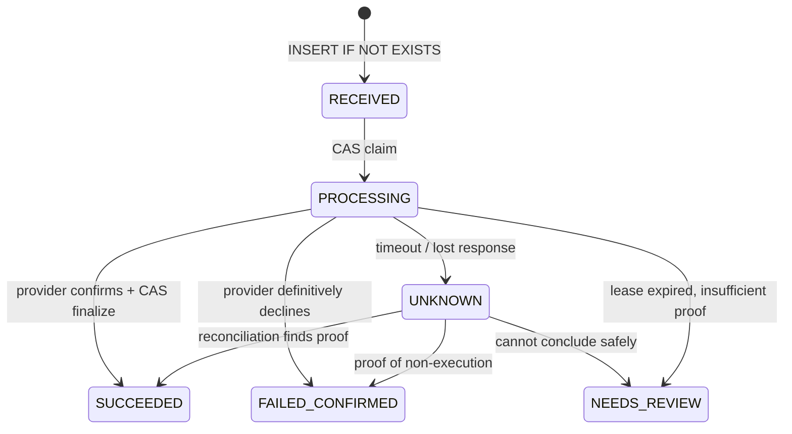
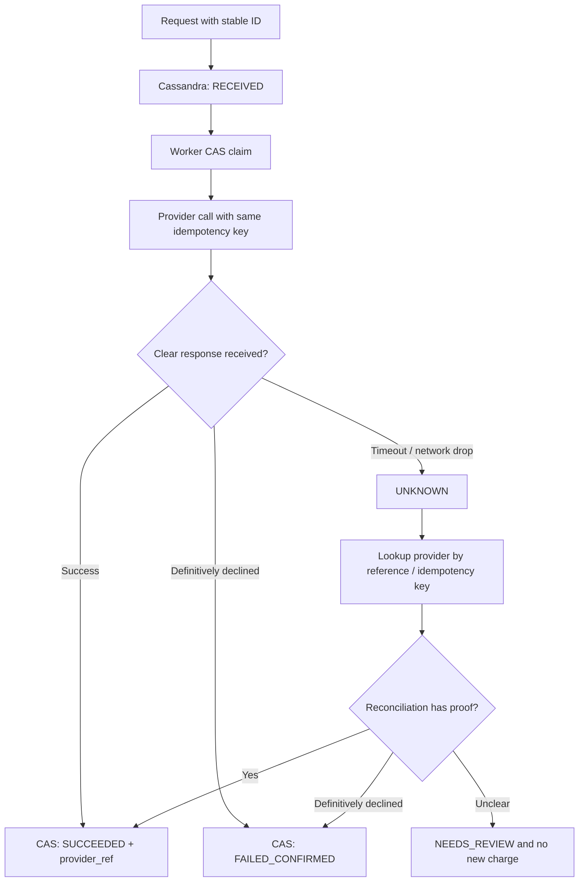

# Reconciling Unknown Outcomes and Preventing Duplicate Writes via Business Design in Apache Cassandra

## 1. The Problem: A Timeout Does Not Prove the Operation Did Not Run

Apache Cassandra is a **distributed wide-column** database: the partition key locates data, the replication factor (RF) determines replica count, and the consistency level (CL) specifies how many responses must arrive before a CQL statement is considered successful. Java applications typically connect through the **Cassandra Java Driver**, using prepared statements, timeouts, and retry policies.

Suppose a payment service sends an order status update:

```sql
UPDATE commerce.orders_by_id
SET payment_status = 'PAID'
WHERE order_id = ?;
```

The driver receives `WriteTimeoutException` after two seconds. At that instant, at least three possibilities exist:

1. Some replicas wrote the change, while the coordinator failed to receive enough ACKs for the requested CL.
2. Enough replicas wrote the change, yet ACKs/responses were delayed or lost.
3. The mutation continues processing after the client stopped waiting.

If Java immediately re-runs CQL or calls the payment gateway again assuming “timeout means failure”, one **business request** can produce **multiple executions**.

This lesson belongs to the **Java Retries and Errors** chapter of `DATABASE_ENGINE_WIDE_COLUMN_CASSANDRA`. The focus is not “how high should we raise the timeout”, but how to **design states, identifiers, deduplication, and reconciliation** so unknown outcomes never turn into lost requests or double-processing.

After completing this lesson, you will be able to:

- Distinguish a **technical attempt** from a **logical business operation**.
- Scope unknown outcomes accurately after `WriteTimeout`, `DriverTimeout`, network errors, or LWT timeouts.
- Design durable `request_id`/`idempotency_key` identifiers and detect payload conflicts.
- Use **LWT (`IF NOT EXISTS` / `IF version = ...`)** to prevent duplicate writes within **a single partition**.
- Build a **state machine** featuring an explicit `UNKNOWN` state and reconciliation workers.
- Integrate external systems (payment gateways, brokers, email) without falsely promising “exactly-once” where guarantees do not exist.
- Write Java Driver 4.x code and operate safe retry workflows under load, replica faults, and restore incidents.

## 2. Foundations: Cassandra Acknowledgments Differ from Business Outcomes

A coordinator executes a write at the chosen CL. For example, with `RF(dc1)=3`, `LOCAL_QUORUM` needs **2 replicas in `dc1`** to respond in time. Reaching quorum confirms the write at that CL; it **never** guarantees external systems finished simultaneously.

| Question | Who answers it? | Can it be inferred from one CQL response? |
| --- | --- | --- |
| Did Cassandra accept the CQL and satisfy CL? | Cassandra / Driver | Yes on success; uncertain on timeout |
| How many replicas persisted the mutation after a timeout? | Cluster state and anti-entropy convergence | **No**, never from exception name alone |
| Did the payment gateway execute the charge? | Payment provider | **No**, never from a CQL write ACK |
| Was the customer charged exactly once? | Payment ledger / source of truth, provider, and domain logic | Requires idempotency and reconciliation |
| Is it safe to call the API again? | Domain design + provider contract | Only once identifiers and semantics are verified |

### 2.1. Distinguishing four technical outcomes

| Client-observed outcome | What is known | What must **not** be claimed |
| --- | --- | --- |
| `Unavailable` | Per coordinator, insufficient live replicas for CL on this attempt | Never claim earlier attempts produced no side effects |
| `ReadTimeout` | Read lacked sufficient responses/data in time | Not “record not found” |
| `WriteTimeout` | Write lacked enough ACKs at CL in time | Not “no replica wrote” |
| `DriverTimeout` / disconnect | Java hit deadline before response or lost transport | Unknown whether request reached coordinator, replicas, or gateway |

**Core rule:** technical errors can yield business state **`UNKNOWN`**. Never map every timeout to `FAILED`, and never return `SUCCESS` merely hoping “Cassandra will converge eventually”.

### 2.2. Timeline causing double execution

```text
Client           Java API             Cassandra              Payment Gateway
  |                 |                      |                         |
  | POST request X  |                      |                         |
  |---------------->| write RECEIVED       |                         |
  |                 |--------------------->|                         |
  |                 |              (written, ACK lost)               |
  |                 |<--- TIMEOUT ---------|                         |
  |<---- 5xx -------|                      |                         |
  |                 |                      |                         |
  | POST request Y  |                      |                         |
  | (new ID on retry)                      |                         |
  |---------------->| write RECEIVED #2    |                         |
  |                 |--------------------->|                         |
  |                 |-------- call charge -------------------------->|
  |                 |-------- call charge a second time ------------>|
```

The root defect is not whether the client retried, but that **requests X and Y lacked a stable business identifier** and the receiver failed to detect they expressed the same intent.

## 3. Attempts, Logical Operations, and Idempotency Keys

Separate three identifiers:

| Identifier | Meaning | Changes on retry? |
| --- | --- | --- |
| **Transport / request attempt ID** | One HTTP call, CQL execution, or gateway call | **Can change** per attempt |
| **Logical operation ID / `request_id`** | One unique business intent, e.g., “charge order O for amount M” | **Must not** change across retries of the same intent |
| **Provider idempotency key** | External key identifying the operation to the provider API | **Must remain stable** across all calls for that operation within provider contract |

Example: a user clicks “Pay” once, and the app creates `request_id=R`. On HTTP timeout, the app retries with **the same `R`**, never minting a new `R`. The API validates tenant, payload, and the state of `R` before triggering side effects.

### 3.1. Keys must be unique within the proper business scope

Suppose the system is multi-tenant. Choose keys like:

```text
logical_key = (tenant_id, request_id)
provider_idempotency_key = "payment/" + tenant_id + "/" + request_id
```

Do not use `order_id` alone as the key if one order can have multiple independent operations (a new payment attempt after decline, a refund, partial captures). Conversely, never call `UUID.randomUUID()` **on every retry** of the same payment.

Define clearly **when a `request_id` is generated**:

- Generate **before the first attempt** and store durably so callers retain it across retries.
- Every API, worker, and message consumer propagates the exact same logical ID.
- A **genuinely new** business attempt receives a new ID; never reuse an old ID for different content.
- Scope keys to tenant/principal with authorization checks so one user cannot guess IDs and inspect another tenant's state.

### 3.2. Payload fingerprinting to catch “same ID, different intent”

If a client resends the same `request_id` while changing the amount from 120,000 to 210,000 VND, never treat that as a valid retry. Persist immutable business fields or a **canonical payload hash**.

Example fields to compare:

```text
tenant_id, operation_type=PAYMENT_CAPTURE, order_id,
amount_minor, currency, business_version
```

Build a canonical representation with fixed field order, normalized numeric/currency formats, and consistent encoding. Never hash arbitrary raw JSON assuming property order never shifts. When sensitive data must be shielded, use HMAC or policy-compliant protections.

**Mandatory rules:**

- `request_id` does not exist yet: accept the new intent.
- Same `request_id`, matching payload: return the **stored state**; never re-run the side effect.
- Same `request_id`, **different** payload: return a conflict error (e.g., HTTP `409`); never overwrite.

Idempotency keys only work if retained long enough. Excessively short TTLs allow stale retries to return after deletion and be misclassified as brand-new operations.

## 4. Designing the Request-ID Table in Cassandra

Cassandra is modeled around queries; the central query here is:

```sql
SELECT ...
FROM commerce.payment_requests_by_id
WHERE tenant_id = ? AND request_id = ?;
```

Create **one partition per logical operation**:

```sql
-- Example for a lab environment whose real DC is named dc1.
CREATE KEYSPACE IF NOT EXISTS commerce
WITH replication = {
    'class': 'NetworkTopologyStrategy',
    'dc1': 3
};

CREATE TABLE IF NOT EXISTS commerce.payment_requests_by_id (
    tenant_id uuid,
    request_id uuid,
    order_id uuid,
    amount_minor bigint,
    currency text,
    payload_hash text,
    state text,
    version int,
    attempt_id uuid,
    provider_idempotency_key text,
    provider_reference text,
    created_at timestamp,
    updated_at timestamp,
    lease_until timestamp,
    last_error_code text,
    PRIMARY KEY ((tenant_id, request_id))
);
```

**Role of each column group:**

| Column | Purpose | Notes |
| --- | --- | --- |
| `tenant_id`, `request_id` | Partition key identifying the operation | Every primary lookup must include both fields |
| `order_id`, `amount_minor`, `currency` | Immutable monetary/order contract | Never use `double` for money; use minor units or `decimal` per contract |
| `payload_hash` | Detects key reuse with altered payloads | Canonicalize data before hashing |
| `state` | State machine status | Never infer `FAILED` from `null` |
| `version` | Fencing / conditional update guard | Use CAS so stale workers cannot overwrite |
| `attempt_id`, `lease_until` | Current attempt owner and lease expiration | A lease is **not** a cross-system transaction with the gateway |
| `provider_idempotency_key` | Key sent to external provider | Keep constant across retries and recovery |
| `provider_reference` | External provider's transaction ID | Evidence supporting reconciliation |
| `created_at`, `updated_at` | Auditing and spotting stuck work | Watch clock skew and timestamp semantics |
| `last_error_code` | Diagnostic aid | Never store tokens, card numbers, or secrets |

**Never set a short default TTL on deduplication tables** just to save disk. Base retention on client retry windows, provider idempotency windows, audit requirements, restore windows, and data regulations. If the idempotency row expires while the provider still holds an earlier charge, a replay could double-charge.

Because the table is keyed by `request_id`, **never run full-table `SELECT *` with `ALLOW FILTERING`** to hunt for pending operations. Workers need a durable work queue or dedicated time-bucketed/status index tables reconciled separately; denormalized tables are not automatically atomic across partitions.

## 5. State Machine: `UNKNOWN` Is a Meaningful State

Never limit states to `SUCCESS` and `FAILED`. A payment workflow state machine can use:

| State | Meaning | When transitioned |
| --- | --- | --- |
| `RECEIVED` | Intent recorded with request ID and payload | After registration mutation succeeds |
| `PROCESSING` | Worker claimed the operation and may be calling provider | CAS on state/version |
| `UNKNOWN` | An attempt ran with an indeterminate outcome | After timeout/disconnect or reaper without effect proof |
| `SUCCEEDED` | Trusted business proof of completion | Provider confirmed success with matching reference/payload |
| `FAILED_CONFIRMED` | Clear proof the effect did not occur or was finally declined | Provider returned terminal decline/failure per contract |
| `NEEDS_REVIEW` | Cannot reconcile safely automatically | Idempotency window expired, conflicting results, insufficient evidence |



This diagram expresses **business transitions**. If a state-transition write itself times out, **the transition may already have applied**, so workers must re-read state and version rather than blindly re-applying. Never automatically transition `UNKNOWN → FAILED_CONFIRMED` merely after waiting long enough.

### 5.1. Separate “row not seen” from “definitely never executed”

An empty read-back can mean:

- The initial registration write never committed.
- The write landed on fewer replicas and is not yet visible at the read CL.
- The registration is still in flight and finishes after the read.
- Schema/topology/CL mismatch, or premature TTL expiration.

Therefore, **one `SELECT` returning no row is not always absolute negative proof** during contention or network faults. Reusing the same `request_id` allows **conditional** retry of registration rather than minting a new operation.

### 5.2. Terminal states must be protected

Once `SUCCEEDED` or `FAILED_CONFIRMED` is reached, never allow a stale worker holding an old claim to overwrite back to `PROCESSING` or another state. Guard with CAS on `state` and `version`, enforcing strict transition rules. If a refund is needed, create a **new operation** referencing the original charge rather than mutating the original charge back into a different intent.

## 6. LWT `IF NOT EXISTS`: Stopping Two Requests with the Same ID on One Partition

Registration CQL:

```sql
INSERT INTO commerce.payment_requests_by_id (
    tenant_id, request_id, order_id, amount_minor,
    currency, payload_hash, state, version,
    provider_idempotency_key, created_at, updated_at
)
VALUES (?, ?, ?, ?, ?, ?, 'RECEIVED', 0, ?, ?, ?)
IF NOT EXISTS;
```

If concurrent clients register `(tenant_id, request_id)`, **LWT** elects a single creator under Cassandra's conditional-write semantics. The app must inspect `[applied]`.

| Result | Interpretation | Action |
| --- | --- | --- |
| `[applied]=true` | This attempt conditionally created the row | Enqueue work via durable workflow |
| `[applied]=false` | Row already exists | Read and verify `order_id`, amount, currency, hash, and state; never treat as `FAILED` |
| `WriteTimeout` / `DriverTimeout` / disconnect | Uncertain whether conditional write committed | Route to read/reconciliation; **never mint a new `request_id`** |
| `Unavailable` | Insufficient replicas/quorum for CL | Never downgrade CL or bypass LWT |

**LWT protects a single Cassandra partition condition.** It never guarantees a single HTTP call, single Kafka publish, or single provider charge. Two requests with different `request_id`s can still double-charge unless an **order-level invariant** exists.

### 6.1. Never interpret `[applied]=false` as “business operation failed”

If the first attempt inserted the row and lost the response, the second attempt with **the same ID** receives `[applied]=false`. That is **expected behavior** in a deduplicating system.

- If payload **matches**, return the **row's current state** (`RECEIVED`, `PROCESSING`, `UNKNOWN`, or `SUCCEEDED`).
- If payload **differs**, report a conflict; never overwrite the existing operation's payload.
- If non-terminal, callers can poll by `request_id` or receive a pending status per contract.

**Never return `SUCCEEDED` solely because the registration row exists.** The initial row proves only that the request was accepted—not that the provider succeeded.

### 6.2. Why not use an ordinary `INSERT`?

An unconditional `INSERT` on the same primary key can be value-idempotent in simple cases, yet Cassandra uses timestamps and last-write-wins for updates. Two colliding payloads on the same key could overwrite immutable fields. When arbitrating ownership of an operation, `IF NOT EXISTS`/CAS provides a safer boundary despite higher latency/cost than regular writes.

## 7. Java Driver 4.x: Registering Requests and Classifying Outcomes

Example using `com.datastax.oss.driver.api.*` in Java Driver 4.x. Below is the **registration component**, assuming an initialized `CqlSession` configured with the proper DC, TLS, auth, and `MODIFY/SELECT` roles.

```java
import java.time.Duration;
import java.time.Instant;
import java.util.Objects;
import java.util.UUID;

import com.datastax.oss.driver.api.core.CqlSession;
import com.datastax.oss.driver.api.core.DefaultConsistencyLevel;
import com.datastax.oss.driver.api.core.DriverTimeoutException;
import com.datastax.oss.driver.api.core.cql.BoundStatement;
import com.datastax.oss.driver.api.core.cql.PreparedStatement;
import com.datastax.oss.driver.api.core.cql.ResultSet;
import com.datastax.oss.driver.api.core.cql.Row;
import com.datastax.oss.driver.api.core.servererrors.ReadTimeoutException;
import com.datastax.oss.driver.api.core.servererrors.UnavailableException;
import com.datastax.oss.driver.api.core.servererrors.WriteTimeoutException;

public final class PaymentRequestRegistry {
    public enum Decision {
        CREATED, ALREADY_EXISTS_SAME_PAYLOAD, CONFLICT, UNKNOWN
    }

    private final CqlSession session;
    private final PreparedStatement insert;
    private final PreparedStatement read;

    public PaymentRequestRegistry(CqlSession session) {
        this.session = session;
        this.insert = session.prepare(
            "INSERT INTO commerce.payment_requests_by_id " +
            "(tenant_id, request_id, order_id, amount_minor, currency, " +
            " payload_hash, state, version, provider_idempotency_key, " +
            " created_at, updated_at) " +
            "VALUES (?, ?, ?, ?, ?, ?, 'RECEIVED', 0, ?, ?, ?) " +
            "IF NOT EXISTS");

        this.read = session.prepare(
            "SELECT order_id, amount_minor, currency, payload_hash, state " +
            "FROM commerce.payment_requests_by_id " +
            "WHERE tenant_id = ? AND request_id = ?");
    }

    public Decision register(UUID tenantId, UUID requestId, UUID orderId,
            long amountMinor, String currency, String payloadHash,
            String providerKey) {

        Instant now = Instant.now();

        BoundStatement attempt = insert.bind(
                tenantId, requestId, orderId, amountMinor,
                currency, payloadHash, providerKey, now, now)
            .setConsistencyLevel(DefaultConsistencyLevel.LOCAL_QUORUM)
            .setSerialConsistencyLevel(DefaultConsistencyLevel.LOCAL_SERIAL)
            .setTimeout(Duration.ofSeconds(2))
            .setIdempotent(false); // Never blindly auto-retry CAS.

        try {
            ResultSet result = session.execute(attempt);
            if (result.wasApplied()) {
                return Decision.CREATED;
            }
            return classifyExisting(
                tenantId, requestId, orderId,
                amountMinor, currency, payloadHash);

        } catch (WriteTimeoutException
                | DriverTimeoutException
                | UnavailableException e) {
            // Registration may have committed; never mint a new requestId,
            // and never call the payment gateway just because the client timed out.
            return Decision.UNKNOWN;
        }
    }

    private Decision classifyExisting(UUID tenantId, UUID requestId,
            UUID orderId, long amountMinor,
            String currency, String payloadHash) {

        BoundStatement query = read.bind(tenantId, requestId)
            .setConsistencyLevel(DefaultConsistencyLevel.LOCAL_QUORUM)
            .setTimeout(Duration.ofSeconds(2))
            .setIdempotent(true);

        try {
            Row row = session.execute(query).one();
            if (row == null) {
                // One empty read does not prove the first write never happened.
                return Decision.UNKNOWN;
            }

            boolean same = Objects.equals(row.getUuid("order_id"), orderId)
                && row.getLong("amount_minor") == amountMinor
                && Objects.equals(row.getString("currency"), currency)
                && Objects.equals(row.getString("payload_hash"), payloadHash);

            return same
                ? Decision.ALREADY_EXISTS_SAME_PAYLOAD
                : Decision.CONFLICT;
        } catch (ReadTimeoutException
                | DriverTimeoutException
                | UnavailableException e) {
            return Decision.UNKNOWN;
        }
    }
}
```

**Key points in this example:**

- `Decision.CREATED` means **the ingestion row was created**, **not that payment succeeded**.
- `ALREADY_EXISTS_SAME_PAYLOAD` means a valid replay of the logical operation; the service layer must **read the current `state`** to respond properly without charging again.
- `UNKNOWN` must never become `FAILED_CONFIRMED`. If returned during a network outage, the caller must retry **with the same `requestId`** or rely on reconciliation.
- This snippet does not catch every transport or CAS-specific error across all driver versions. In production, classify additional runtime exceptions explicitly, while **never swallowing auth, schema, or programming bugs as `UNKNOWN`** to retry endlessly.
- `LOCAL_SERIAL` and `LOCAL_QUORUM` are illustrative choices for matching DC/RF; verify consistency contracts and topology.
- `now` is sampled for **this attempt**; when retrying registration after `UNKNOWN`, keep payload fields constant and never treat a new timestamp as a different operation.
- Receiving `CREATED` **does not guarantee work was enqueued in a durable queue**. Pair registration with a recoverable work-dispatch mechanism as covered next.

### 7.1. Why mark `setIdempotent(false)` on LWTs?

You can re-run `INSERT IF NOT EXISTS` with **the same key and payload** in a controlled manner to detect an existing record. However, **the returned result can flip** from `[applied]=true` to `[applied]=false`, and returning the right API status depends on read-backs and the state machine. Marking it non-idempotent conservatively blocks unreviewed speculative/driver retries.

The business layer can then **explicitly** re-check or retry with the same logical ID while deadline remains and it knows how to interpret outcomes—never mark `true` solely because `IF NOT EXISTS` is used.

## 8. Claiming Work and Fencing Stale Workers: CAS + Version

Deduplicating registration is only step one. If two workers both observe `RECEIVED` and both invoke the charge API, double-charging can still happen. You must conditionally **claim** the operation.

Example after reading `state='RECEIVED'` and `version=0`:

```sql
UPDATE commerce.payment_requests_by_id
SET state = 'PROCESSING',
    version = 1,
    attempt_id = 44444444-4444-4444-4444-444444444444,
    lease_until = '2026-11-21 10:00:00+0000',
    updated_at = '2026-11-21 09:55:00+0000'
WHERE tenant_id = 11111111-1111-1111-1111-111111111111
  AND request_id = 22222222-2222-2222-2222-222222222222
IF state = 'RECEIVED' AND version = 0;
```

In real systems, generate a unique `attempt_id`, bounded lease duration, and incremented `version` from the read state; the snippet above illustrates CQL syntax and **is not recommending hardcoded timestamps**.

If `[applied]=true`, the worker holds the conditional claim. If `[applied]=false`, re-read current `state`/`version`/`attempt_id` rather than calling the provider.

### 8.1. Why are both `version` and `attempt_id` needed?

A worker may stall or pause past lease expiration. A reaper grants a new claim to a second worker. If the stalled worker wakes up and writes `SUCCEEDED` unconditionally, it overwrites the newer worker's outcome.

Use conditional finalization:

```sql
UPDATE commerce.payment_requests_by_id
SET state = 'SUCCEEDED',
    provider_reference = ?,
    updated_at = ?,
    version = ?
WHERE tenant_id = ? AND request_id = ?
IF state = 'PROCESSING'
   AND attempt_id = ?
   AND version = ?;
```

**Finalization proof:** if CAS returns `[applied]=true`, this mutation passed the guard; on timeout or `[applied]=false`, inspect current state before acting further.

- `version` is an application-incremented integer from the prior read—**not a Cassandra `counter`**.
- `attempt_id` fences out stale workers.
- `lease_until` merely helps the application *decide when re-claiming is allowed*. **A lease is not a lock spanning Cassandra and the provider.**
- A reaper must never rely on wall-clock comparisons alone to “prove a worker is dead”; always use CAS fencing and accept that an in-flight external call may already have fired.
- If a process charges the provider and crashes before finalization, **CAS cannot reverse the charge**; only provider idempotency and reconciliation can resolve it.

### 8.2. Timeouts during claim also have ambiguous outcomes

If a worker sends a CAS claim and times out, it does not know whether the claim applied. Never mint a fresh `attempt_id` and immediately claim again. Query `state`, `version`, and `attempt_id` for that `request_id`; if still uncertain, route to reconciliation. Seeing `PROCESSING` with your own `attempt_id` is a useful signal, yet under concurrency and lease expiry, continue strictly via the state machine and CAS.

## 9. External Systems: Why “Exactly Once” Is Harder Than One CQL Statement

Cassandra and a payment gateway are **two independent systems**. No built-in distributed ACID transaction guarantees “commit Cassandra write and provider charge together or roll both back”.



### 9.1. Verify the provider contract

Many providers accept an **idempotency key** on charge endpoints, yet scope, key retention, payload comparison rules, and lookup endpoints **vary widely by provider and API**.

Document explicitly:

- Within what merchant/tenant scope is the key evaluated?
- Does same key + same payload return **the exact same result/reference**?
- Does same key + different payload return a conflict error or start a new operation?
- How long is the key retained? After expiry, can the provider treat a replay as a new charge?
- On network timeout, is there a lookup endpoint by `merchant_reference` or `request_id`?
- How do provider states (`PENDING`, `AUTHORIZED`, `CAPTURED`, `DECLINED`) behave, and which are terminal?
- Can webhooks arrive late, duplicated, or out of order? Are signatures verified and event IDs provided?

Without **reliable provider idempotency or lookup**, never automatically resend a charge-creating call. Hold **`UNKNOWN`**, investigate out of band, and reconcile under controlled procedures.

### 9.2. Both “write first” and “call first” have crash windows

| Ordering | Failure window | Risk mitigation |
| --- | --- | --- |
| Call provider first, then write Cassandra | Provider charged, then process crashes before writing DB | Stable provider key, reconciliation, and durable pre-call intent |
| Write Cassandra first, then call provider | Row saved, then process crashes before calling provider | Recoverable worker/queue and controlled polling |
| Write Cassandra, call provider, write final state | Provider succeeded, then finalization write times out | Hold `UNKNOWN`, look up provider, CAS finalize |
| Publish queue message then update Cassandra | Queue delivered before state saved, or vice versa | At-least-once consumer, stable IDs, cross-system reconciliation |

**Never use a cross-table `LOGGED BATCH` to claim transactionality with a provider.** Cassandra batches do not coordinate with HTTP APIs, and multi-partition writes lack the application isolation of an RDBMS ACID transaction.

## 10. At-Least-Once Delivery and Recovery: Do Not Trust a Single Queue Blindly

Kafka, SQS, or other brokers can redeliver messages if a consumer crashes before ACKing. That is **at-least-once** behavior, not a bug.

Design pattern:

1. Message carries `tenant_id`, `request_id`, payload hash, and required metadata.
2. Consumer reads the operation's state in Cassandra by partition key.
3. Consumer performs a **CAS claim** to determine whether it is authorized to call the provider.
4. Call the provider with the **unchanged idempotency key**; on timeout, never infer `FAILED`.
5. CAS-write the terminal state; on timeout, schedule reconciliation.
6. ACK the message once **durable state** reflects contractual progress; if redelivered, the consumer sees the existing state and triggers no duplicate effect.

### 10.1. Gap between table write and queue publish

Writing `payment_requests_by_id` and publishing to a queue are two independent operations. A crash between them leaves the row stranded in `RECEIVED`.

Mitigation strategies:

- **Durable outbox/intent in the same partition** with appropriate mutations/CAS; a dispatcher reads and publishes idempotently while tracking delivery state.
- CDC where supported by version and deployment, with clear ordering and at-least-once contracts.
- Queue-first ingestion, ensuring the message is durably persisted before acknowledging acceptance.
- **Periodic reconciler** detecting rows stuck in `RECEIVED`/`PROCESSING`/`UNKNOWN` too long and recovering by operation key.

Cassandra cannot efficiently scan every partition with `WHERE state='UNKNOWN'` if the table is partitioned only by `request_id`. Maintain **time-bucketed/status work-index tables** or use durable queues/CDC, accepting that separate denormalized tables can lag and need reconciliation. Never run continuous `ALLOW FILTERING` full-table scans in production.

### 10.2. Why a separate reconciliation tier is essential

Not every timed-out attempt still has a live process after a service restart. An independent reconciliation worker:

- Finds `PROCESSING` rows past lease expiration or unresolved `UNKNOWN` rows.
- Queries the provider using stable keys or references.
- Compares external outcomes against payload/order invariants and Cassandra state.
- Finalizes via CAS without overwriting terminal states.
- Routes inconclusive cases to `NEEDS_REVIEW` and raises SLA alerts.
- Recovers safely after crashes using checkpoints/locks so two reconcilers do not duplicate effects.

**Reconciliation does not mean blindly re-charging.** For uncertain outcomes, prioritize **status lookup** over firing a new mutation.

## 11. Read-Back After `WriteTimeout`: What Evidence Is Enough?

Suppose the app issued a registration mutation for `request_id=R` and hit `WriteTimeout`. It executes a `SELECT` at `LOCAL_QUORUM`.

| Read outcome | What can be stated | What cannot yet be stated |
| --- | --- | --- |
| Row `R` found with matching payload | `R` is currently visible; workflow can proceed from its `state` | That the provider already charged |
| `R` found with different payload | Idempotency key was reused for another intent; block it | Cannot overwrite to “make it match” |
| `R` not found | Not visible on this read | Cannot be certain the earlier write isn't still in flight |
| Read timed out / unavailable | Insufficient reliable data to decide | Cannot assert `R` does not exist |
| Found `PROCESSING` / `UNKNOWN` | Work progressed to that state | Uncertain whether provider charged |
| Found `SUCCEEDED` + valid reference | Success recorded in Cassandra | Cross-check provider/invariants during major incidents or restores |

Read-backs clarify state, yet **never turn a distributed system into a cross-system transaction**. For money movement, verify provider source-of-truth state and maintain idempotency.

### 11.1. Why doesn't one `LOCAL_QUORUM` read always answer everything?

With RF=3 and `LOCAL_QUORUM`, read and write quorums overlap by replica count. Yet complications remain:

- The timed-out write may **not have reached quorum** yet.
- The mutation may **arrive after** the read executes.
- Concurrent writers can update the same partition so the read reflects a newer state.
- Cassandra uses timestamps / last-write-wins for unconditional columns; never infer business sequencing solely from wall clocks.
- LWTs follow CAS semantics and require concurrency guards; one plain `SELECT` does not certify “nobody else is processing this”.

To prevent duplicates, rely on **LWTs on the same operation key** and state/version reconciliation rather than a single `SELECT` followed by unguarded mutation retries.

## 12. Handling Timeouts and Retries in the Java Driver: Which Layer Decides?

A Java request can be retried across many layers:

- Driver retry policy on eligible errors/attempts.
- Driver speculative execution when enabled.
- Service-layer retries via Java loops or futures.
- HTTP client, API gateway, or mobile app retries.
- Message broker redeliveries.
- Provider SDK internal retries.

If all layers retry independently, one intent can spawn far more attempts than expected.

### 12.1. Setting idempotence requires business proof

```java
BoundStatement query = selectById.bind(orderId)
    .setIdempotent(true); // SELECT has no business side effects.

BoundStatement conditionalInsert = insertPaymentRequest.bind(/* values */)
    .setIdempotent(false); // Conservative; service interprets CAS/reconciliation.
```

`setIdempotent(true)` **never** creates a deduplication lock; it merely informs driver policies. Never use it to treat counter increments or provider calls as safe.

### 12.2. Bounded retries vs. “retry until it works”

Consider a retry only when:

1. **Same logical operation ID** and payload.
2. You know whether the step being retried is a **read**, **registration CAS**, **provider lookup**, or **effectful charge**.
3. That step is proven safe to repeat per contract.
4. Deadline, max attempts, and cluster headroom remain.
5. Backoff/jitter and in-flight caps prevent retry storms.

Pseudocode:

```text
function handleRetry(op):
    if op.state is terminal:
        return storedOutcome(op)

    if op.payloadConflictsWithStored:
        return CONFLICT

    if op.providerOutcomeUnknown:
        return reconcileByStableProviderKey(op)

    if op.needsRegistrationCheck:
        return conditionalInsertWithSameRequestId(op)

    if op.effectfulStepCouldHaveHappened:
        return UNKNOWN_NEEDS_RECONCILIATION

    if not enoughDeadline or overload:
        return PENDING

    performOnlyProvenSafeStepWithBoundedRetry(op)
```

**Never drop `LOCAL_QUORUM` to `LOCAL_ONE` just to get a faster response** when the data contract requires quorum. CL, RF, repair, and replica health belong to your consistency strategy—not an “ignore errors” button.

### 12.3. Ensure HTTP responses never overstate the evidence

Depending on the API contract:

| Scenario | Appropriate design response | Notes |
| --- | --- | --- |
| Row durably created; work pending | `202 Accepted` or `PENDING` status | Only if a **real recovery path continues processing** after crashes |
| Operation confirmed succeeded | `200 OK` / business result | Include request ID and reference; never infer from registration insert |
| Same key, different payload | `409 Conflict` | Never invoke provider |
| Ambiguous outcome | `UNKNOWN`/`PENDING` or transient error per contract | Client must retain key; never ask client to mint a new operation ID |
| Infra failed to persist intent | `503` / retryable error per contract | Never promise “accepted” without durable persistence |

For ambiguous operations, APIs can expose **`GET /operations/{request_id}`** so clients can poll status. Lookup endpoints must enforce tenant/auth checks and report **actual state**, including `UNKNOWN`.

## 13. Interactions with Timestamps, TTLs, Batches, Counters, and Multiple Tables

### 13.1. Timestamps and concurrent writes

Cassandra resolves unconditional updates by timestamp. If a delayed retry runs after a newer attempt with a larger timestamp, it can overwrite valid newer state.

For example, one worker transitions an order to `REFUNDED`, then a client retry executes `UPDATE ... SET status='PAID'` with a newer write timestamp. Although it looks idempotent because it always sets `PAID`, **it is unsafe under the state machine**.

Solution: use CAS on `version`/`state` for state-machine transitions, keep stable IDs, and avoid unconditional mutation retries.

### 13.2. TTLs erase deduplication memory

- If an idempotency row expires via TTL while the client or provider can still replay → the system treats an old request as brand new.
- Re-writing data with relative TTLs shifts expiration windows.
- Tombstones, `gc_grace_seconds`, and repair affect visibility and recovery of deleted/expired rows.

Retention design must span **client retry horizons, message brokers, provider windows, backup/restore windows, and audit policies**. A single arbitrary TTL is never universal; sensitive data also needs proper protection and deletion policies.

### 13.3. Counters are not a deduplication foundation

`UPDATE counter = counter + 1` can execute multiple times if retried after `WriteTimeout`. Never increment counters directly during at-least-once event processing without deduplication. Store **unique event IDs** and recompute aggregates idempotently in a controlled pipeline; if counters are still used, account for consistency gaps between event logs and counter tables.

### 13.4. Logged batches do not create isolated multi-table transactions

`BEGIN LOGGED BATCH ... APPLY BATCH` helps ensure batch mutations eventually apply together, yet it does **not** create an RDBMS-style **ACID transaction with isolation and rollback** across arbitrary partitions, let alone coordinate payment gateways. Two query-driven denormalized tables can briefly diverge and require reconciliation.

If you maintain both `orders_by_id` and `orders_by_customer`, never treat a successful write to one table as proof the other has converged. Maintain a source of truth and projection updates backed by event IDs, versions, or backfill jobs.

## 14. Disaster Recovery: Backup/Restore Must Account for Deduplication

Suppose:

- 10:00: request `R` is recorded and the provider charges successfully.
- 10:10: the Cassandra cluster suffers a severe outage.
- 10:20: operators restore a snapshot taken at 09:50.

The pre-10:00 snapshot **does not contain `R`**, yet the provider still holds the charge. If the app receives `R` again and checks only the restored Cassandra cluster, it could create a new row and **charge a second time**.

Disaster recovery plans must therefore:

1. Define **RPO/RTO** and separate Cassandra state loss from provider state.
2. Keep a changelog/event ledger replayable **by ID**, or an independent reconcilable source of truth.
3. Before reopening effectful traffic, reconcile request IDs and statuses from the provider against restored data across the RPO gap.
4. Keep unproven operations in `UNKNOWN`/`NEEDS_REVIEW` without issuing new side effects.
5. Check provider idempotency-key retention, which may have expired during a long restore.
6. Test restores not just for SSTable readability, but to prove **zero duplicate charges** when replaying pending work.
7. Record checkpoints/cutover times and audit proof resolving operations in the data-loss window.

**Snapshots, repair, and replication do not replace business idempotency.** Repair converges replicas within Cassandra; it cannot reconstruct transactions held at a payment provider that vanished from an older Cassandra backup.

## 15. Observability: Track Operations, Not Just Exceptions

`WriteTimeout/s` is useful, yet it cannot tell you how many customers were double-charged. Observe the **logical operation lifecycle**.

| Signal | Why it matters |
| --- | --- |
| Operations created per `request_id` | Business traffic baseline |
| `duplicate_same_payload` / `conflict` | Distinguishes valid replays from key misuse |
| New `UNKNOWN` count and SLA backlog age | Measures reconciliation debt, not just returned errors |
| Age of `PROCESSING` / expired leases | Detects crashed workers or stuck queues |
| Provider lookups and reconciliation outcomes | Spots divergence between systems |
| Effect calls per logical ID | Detects duplicate outbound calls (even if provider deduplicates) |
| Terminal counts `SUCCEEDED` / `FAILED_CONFIRMED` | Completion rates and recovery effectiveness |
| LWT contention, CAS failures, latency | Tracks claim/dedup overhead |
| Driver timeouts, server read/write timeouts, `Unavailable` | Classifies infrastructure causes |
| RF/CL, replica health, compaction, dropped messages | Connects app errors to cluster health |
| Rows missing post-restore while provider has reference | Surfaces double-effect risk after DR |

**Never log** card numbers, payment tokens, passwords, unnecessary PII, or full CQL bind values. Use protected request IDs, trace IDs, and redacted provider references to correlate across systems.

### 15.1. Sample audit event

```json
{
  "logical_request_id": "<uuid>",
  "tenant_scope": "<tenant-internal-ref>",
  "operation": "PAYMENT_CAPTURE",
  "attempt_id": "<uuid>",
  "step": "PROVIDER_STATUS_LOOKUP",
  "state_before": "UNKNOWN",
  "state_after": "SUCCEEDED",
  "provider_reference": "<redacted-reference>",
  "source": "reconciliation-worker",
  "outcome_evidence": "provider-confirmed"
}
```

This is an **illustrative audit schema**, not configuration or live data. `outcome_evidence` must cite verifiable proof—never mark “success” from a time-based heuristic alone.

## 16. Runbook for a Surge of Unknown-Outcome Requests

### Phase A — Contain and protect data

1. Separate errors originating from Java Driver, Cassandra coordinators, providers, or message brokers.
2. Identify affected logical operation IDs, payload hashes, order IDs, tenants, Cassandra states, and provider calls.
3. Enforce in-flight caps, throttle automatic retries, or switch the service to controlled degraded mode during widespread faults.
4. For ambiguous effectful operations, **mint no new IDs** and never re-trigger charges/refunds without a verified idempotency contract.
5. Record `UNKNOWN` durably (if writes also fail, route to a durable incident queue/runbook) and preserve evidence safely.

### Phase B — Inspect cluster and data

```bash
# Read-only commands; run with appropriate privileges and target nodes:
nodetool status
nodetool describecluster
nodetool tpstats
nodetool compactionstats
nodetool netstats
```

- Check RF/DC/CL, available replicas per partition, connectivity, and driver timeouts.
- Check compaction, disks, GC, repair, and abnormal streaming.
- Read operation rows by `(tenant_id, request_id)` and inspect `state`, `version`, `attempt_id`, and payload.
- Check claim/reaper processes for stale workers or duplicate deliveries.
- Never auto-downgrade `LOCAL_QUORUM` to `LOCAL_ONE` when data requires quorum.

### Phase C — Reconcile with the provider

1. Look up by stored `provider_idempotency_key` or `provider_reference`.
2. Verify merchant/tenant, amount, currency, order ID, and provider status.
3. When the provider confirms success: CAS-transition `UNKNOWN`/`PROCESSING → SUCCEEDED` and store the provider reference.
4. When there is **definitive proof of decline/non-execution**: transition to `FAILED_CONFIRMED`.
5. When provider state remains inconclusive: mark `NEEDS_REVIEW`, alert, and issue no new effect.
6. With concurrent workers, allow only one matching finalization CAS; never overwrite terminal states.

### Phase D — Restore traffic and close the incident

- Smoke-test with **synthetic IDs/payloads** and a sandbox provider—never run live production charges “to test”.
- Monitor `UNKNOWN` backlog, reconciliation latency, duplicate-call ratio, and Cassandra p95/p99.
- Ramp traffic back only when **both Cassandra and the provider** are stable and retry queues show no storm.
- Close each operation only with terminal proof or an audited manual decision.
- Write a postmortem covering timeout root causes, durability gaps, idempotency windows, retry rules, and test/alert improvements.

## 17. Common Mistakes and Fixes

| Mistake | Consequence | Correct approach |
| --- | --- | --- |
| Generating a new UUID on every HTTP retry | One intent spawns multiple operations | Keep `request_id` stable across all attempts |
| `WriteTimeout` → default `FAILED` | May already have written/charged | Mark `UNKNOWN` and reconcile |
| `[applied]=false` → report payment failed | Earlier attempt may already have created row | Read row and return existing state |
| Checking only `request_id`, not payload | Key reused for a different amount | Payload fingerprint + conflict check |
| Using plain `INSERT` for idempotency row | Concurrent writes can overwrite immutable fields | `IF NOT EXISTS` + verify |
| Using LWT and claiming “system-wide exactly once” | Gateway/broker remain independent | Provider idempotency + durable workflow |
| 24h idempotency TTL when clients replay 7 days | Record vanishes; effect can duplicate | Match retention to all retry windows |
| Worker lease expires → call provider with new key | Two workers can double-charge | CAS fencing + unchanged provider key |
| Retrying counter updates after timeout | Can double-increment | Event ID/dedup + safe aggregation |
| Calling gateway before persisting durable intent | Crash after charge leaves no trace | Persist intent first; lookup/reconcile |
| Writing table before queue publish with no recovery | Requests stranded forever in `RECEIVED` | Durable outbox / CDC / reconciler |
| Treating empty read-back as proof it never ran | Mutation may still be in flight | Conditional retry with same key or `PENDING` |
| Restoring old snapshot and replaying freely | Double-charges relative to provider | Cross-system DR reconciliation before reopening effects |
| Lowering CL to “stop timeouts” | Weakens data consistency guarantees | Fix replicas/latency; approve CL changes separately |

## 18. Practice Exercises and Hints

**Context:** a Java app handles `POST /payments`. Cassandra has `RF(dc1)=3` and the API uses `LOCAL_QUORUM`. The provider supports idempotency keys for a bounded window and has a status-lookup endpoint, though webhooks can arrive duplicated.

### Exercise 1 — Timeout during request registration

A client sends `request_id=R1` with payload “charge 100,000 VND for O1”. `INSERT IF NOT EXISTS` in Cassandra hits `WriteTimeout`.

1. Can you conclude the row was not written?
2. Should the client mint `R2` to retry or keep `R1`?
3. If retrying `R1` returns `[applied]=false`, what should you do?
4. If the retry sends `R1` with amount 120,000 VND, how should the API respond?

**Hint:** Keep `R1`; read state/payload and reconcile. `[applied]=false` may reflect the prior attempt's success. A different payload is a conflict—do not charge.

### Exercise 2 — Crash after provider call

A worker claims `R1` and calls the provider with key `payment/T1/R1`. The provider succeeds, then the network drops before the client gets the response. The worker crashes while Cassandra remains `PROCESSING`.

1. Should a reaper call charge again with a fresh key?
2. Does lease expiration mean the effect never happened?
3. What is a safe reconciliation sequence?
4. Why must you check the provider's idempotency window?

**Hint:** Lease expiration never proves the provider did not execute. Look up the provider using the original key and compare payload/reference; never fire a new effect while `UNKNOWN`.

### Exercise 3 — Two racing workers

Worker A claims `version=4`; after a lease issue, Worker B claims `version=5`. Worker A wakes up and tries to save `SUCCEEDED`.

1. What is the risk of an unconditional `UPDATE`?
2. Write the CAS condition so A finalizes only if state/version/attempt still match.
3. If CAS returns `[applied]=false`, can you conclude A's provider call failed?

**Hint:**

```sql
UPDATE commerce.payment_requests_by_id
SET state = 'SUCCEEDED',
    provider_reference = ?,
    version = ?,
    updated_at = ?
WHERE tenant_id = ? AND request_id = ?
IF state = 'PROCESSING'
   AND version = ?
   AND attempt_id = ?;
```

A must use the `version` and `attempt_id` from its own claim; since B modified them, A cannot overwrite. CAS says nothing about what happened at the provider.

### Exercise 4 — Duplicate webhooks

The provider sends two `PAYMENT_SUCCEEDED` webhooks with the same `event_id` over two separate HTTP deliveries.

1. How do you use `event_id` to avoid sending two emails or double-posting ledgers?
2. If Cassandra updates succeeded and the webhook HTTP ACK dropped, how should redelivery behave?
3. Why doesn't `LOGGED BATCH` provide a transaction across Cassandra and email?

**Hint:** Use event-dedup records and terminal CAS states; keep email/outbox separate with stable message IDs and idempotent at-least-once consumers. Webhook redelivery must be safe when the record already exists. No ACID spans Cassandra and a mail provider.

### Exercise 5 — Restore and idempotency

A 09:00 Cassandra snapshot is restored at 10:00; the provider charged `R9` at 09:30.

1. If `R9` is missing after restore, may the app charge again?
2. Which data sources must be reconciled to recover?
3. How do you verify a DR drill produces zero duplicate effects?

**Hint:** Never charge solely because Cassandra lacks `R9`. Reconcile provider records, durable event logs, request IDs, and the RPO window before permitting replays; test in a sandbox with injected faults.

## 19. Production Safety Design Checklist

- [ ] Every business intent has a **stable logical `request_id`**, distinct from transport attempt IDs.
- [ ] Idempotency keys are scoped properly by tenant/principal and guarded against mismatched-payload reuse.
- [ ] Canonical payloads/fingerprints specify amount, currency, order, action, and conflict handling.
- [ ] Cassandra table keyed by `(tenant_id, request_id)` uses `IF NOT EXISTS`/CAS under contention.
- [ ] `[applied]=false` is interpreted as “record exists”—never assumed `FAILED`.
- [ ] State machine explicitly models `RECEIVED`, `PROCESSING`, `UNKNOWN`, `SUCCEEDED`, `FAILED_CONFIRMED`, `NEEDS_REVIEW`.
- [ ] Terminal transitions require verifiable proof; `UNKNOWN` never auto-transitions to `FAILED` on timeout alone.
- [ ] Claims and finalizations use `version`/`attempt_id` CAS fencing; leases are never treated as cross-system locks.
- [ ] Provider idempotency keys remain **unchanged** across retries, crashes, and reconciliation.
- [ ] Provider contracts are verified: scope, retention, duplicate rules, lookup endpoints, and webhook semantics.
- [ ] Durable reconciliation workers run independently of live HTTP request processes.
- [ ] Queue/outbox/CDC designs handle at-least-once semantics and close dual-write crash gaps.
- [ ] Production never runs full-table `ALLOW FILTERING` scans to find pending jobs.
- [ ] Retries respect operation type, CL, idempotency, deadlines, attempt caps, jitter, and backpressure.
- [ ] `setIdempotent(true)` is never used as a substitute for proving business safety.
- [ ] Counters, LWTs, and provider effects are never retried blindly after timeouts or lost ACKs.
- [ ] Retention/idempotency windows outlast client retries, queue replays, provider windows, and backup/restore windows.
- [ ] DR runbooks address restoring older Cassandra snapshots when external providers hold newer charges.
- [ ] Audit logs and metrics track logical IDs, `UNKNOWN` age, duplicate-call ratios, and reconciliation outcomes.
- [ ] Tests cover concurrent workers, write timeouts, network drops, lost provider responses, crashes/restores, and duplicate webhooks.

**Conclusion:** Cassandra can return errors or timeouts even when a mutation partially applied or completed without the client receiving acknowledgment. To **reconcile unknown outcomes and prevent duplicate writes**, design around **immutable logical operation IDs**, **payload fingerprints**, **single-partition LWTs keyed by request ID**, **state machines with `UNKNOWN`**, **CAS worker fencing**, and **provider idempotency/reconciliation**. No single CQL statement, HTTP retry, or `setIdempotent(true)` flag creates cross-system exactly-once semantics. Accuracy comes from **business contracts, outcome evidence, and safely repeatable recovery workflows**.
