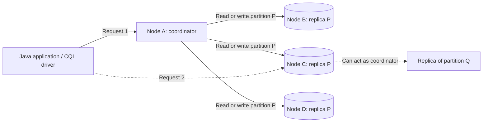
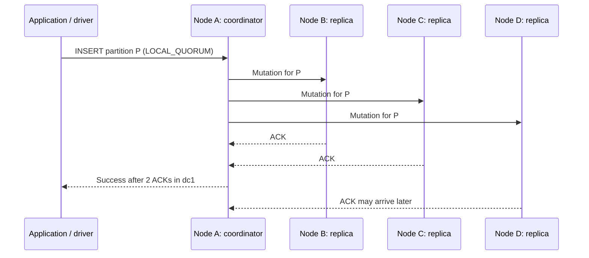

# Peer-to-Peer Architecture and Per-Request Coordinator Role

Apache Cassandra is a distributed **wide-column** database designed to scale horizontally and maintain availability when some nodes fail. To use Cassandra properly, it is necessary to distinguish two seemingly contradictory ideas: **all nodes have equal roles in the cluster**, yet **every read or write request still requires one node to coordinate it**. That coordinating node is called the *coordinator* and holds this role only for that specific request.

After this lesson, you will be able to:

- Explain why Cassandra has a **peer-to-peer** architecture without a fixed master node handling every query.
- Distinguish between **coordinator**, **replica**, **seed node**, **client driver**, and **data center/rack** concepts.
- Trace a CQL request from a Java application to the replicas and back to the client.
- Explain the impact of **partition key**, **replication factor**, and **consistency level** on routing path, availability, and query results.
- Analyze behavior when a coordinator or replica fails and inspect a running cluster using basic operational tools.

## 1. Peer-to-Peer Does Not Mean No Coordination

In a traditional primary–replica model, one node typically holds a special primary/master role for write operations. In Cassandra, **there is no global master**: every node can accept CQL connections from clients, store data for the partitions it is responsible for, and coordinate requests when clients send requests to it.

However, not every node holds the same copy of the data. Cassandra uses the **partition key** to determine the logical location of a partition and places multiple **replicas** for that partition according to the replication configuration. Therefore, two requests entering the same node may need to contact two different sets of replicas.

An accurate mental model:

1. **Peer-to-peer** describes the relationship among nodes: there is no permanently elected leader node for the entire cluster.
2. **Coordinator** describes a role for **a single request**: the node that receives the CQL request and is responsible for forwarding it, collecting results according to the consistency level, and responding to the client.
3. **Replica** describes storage responsibility for **a partition**: a node that holds a copy of that partition according to the replication strategy.

A node can be both the coordinator and a replica for the same request; or it can be the coordinator while **not** storing the queried partition. A node acting as a replica in this request can become the coordinator in the next request.



In the diagram, A coordinates request 1, though it is not necessarily a replica of P. For request 2, the client may connect to C; C then acts as the coordinator for the new request. The lines from A to B/C/D represent internal inter-node communication, not three independent queries sent by the client.

## 2. Components in a Cluster

| Component | Role | Common Misconception |
|---|---|---|
| **Node / peer** | A Cassandra process participating in the cluster; can accept CQL and store assigned partitions. | "Peer" does not mean every node stores every record. |
| **Coordinator** | The node that receives **a request**, identifies replicas, sends requests, waits for sufficient responses, and returns the result. | This is not a fixed role or a global master. |
| **Replica** | A node that owns a copy of a specific partition. | A node may be a replica for partition P but not for Q. |
| **Seed node** | An initial contact point that helps new or restarting nodes discover peers via gossip. | A seed is not a master, does not coordinate all requests by default, and is not a leader-election voter. |
| **Data center (DC), rack** | Logical/hardware topology groupings used to place replicas and prioritize locality-aware routing. | DC/rack is topology configuration; it is not a consistency level. |
| **CQL driver** | Application-side component that manages connections, metadata, routing, retries, and load-balancing policies. | The driver chooses which node to send a request to; the receiving node becomes the coordinator for that request. |

### Gossip and Topology Information

Nodes exchange membership and state information via **gossip**. Cassandra combines this information with failure detection mechanisms to determine which peers appear unresponsive. The **snitch** provides DC/rack information, which is used for replica placement and topology-aware communication prioritization.

Gossip does **not** mean every query must be sent to all nodes; data requests are primarily sent only to **the relevant replicas**. Seed nodes mainly assist with cluster discovery during initial contact. Losing a seed node after the cluster is already running does **not** cause the cluster to lose a "master", though it can still hinder nodes that need to bootstrap or reconnect if the seed configuration is inadequate.

### Token Ring, Partition Key, and Virtual Nodes

Cassandra hashes the **entire partition key** to compute a token. Tokens are distributed across a logical ring (*token ring*). Token/vnode configuration indicates which nodes are responsible for which token ranges; the replication strategy and topology determine the actual set of replicas for a partition.

For example, if a table has primary key `PRIMARY KEY ((tenant_id, device_id, event_day), event_time, event_id)`, then **the three columns inside the inner parentheses** `(tenant_id, device_id, event_day)` form the partition key. `event_time` and `event_id` are **clustering columns**, which determine data ordering **within** the partition. Changing `event_day` can change the token, thereby changing the set of replicas to contact.

> **Note:** The token ring is a logical data distribution model, not a physical network wiring diagram. Nodes communicate over the network according to actual topology; a request does not travel sequentially "around the ring".

## 3. How Does a Request Find Its Replicas?

Suppose a keyspace uses `NetworkTopologyStrategy` with replication factor **RF = 3** in DC `dc1`, with enough nodes to store three copies. Partition P is assigned to three replicas B, C, and D. The application sends a CQL statement over a connection to A.

1. **Receive request:** A becomes the **coordinator** for this request. If the client sends the same request to B, B will be the coordinator.
2. **Identify partition:** For operations with an explicit partition key, the coordinator derives the token and the set of replicas responsible for storing the partition. For other queries, the execution plan may be more complex, potentially reading across multiple partitions/nodes.
3. **Determine consistency level:** The consistency level (CL) specifies how many qualifying responses are needed before returning success. CL does **not** determine how many copies are stored; that is determined by RF and the replication strategy.
4. **Contact replicas:** The coordinator sends the operation to the appropriate replicas, possibly using locality and node health preferences. On writes, Cassandra attempts to send the mutation to all responsible replicas, even when CL only requires a subset of responses.
5. **Aggregate and return result:** The coordinator returns success once enough acknowledgments are received, or returns an error/timeout if the condition cannot be met within the timeout window.

Because the coordinator role depends on each request, saying "node A is the coordinator of the cluster" is incorrect; the accurate statement is **"A is currently the coordinator for request X"**.

### Token-Aware Routing from the Application

The Cassandra driver can leverage table metadata and the **partition key** to prefer sending requests directly to an appropriate replica, usually in the DC closest to the application. In that case, the receiving replica also acts as the coordinator, eliminating an unnecessary network hop. This works best when the driver can determine the routing key, such as from a **prepared statement** with all partition key components bound.

Token-aware routing is a **routing optimization**; it does not change RF or CL rules. If the preferred replica is unavailable, the driver can select another node according to its load-balancing and retry policies. For queries where the partition key cannot be determined, do not assume the driver can always route directly to a replica upfront.

## 4. Write Path: What Does the Coordinator Wait For Before Returning Success?

Consider an `INSERT` or `UPDATE` into partition P, with RF = 3 and CL = `LOCAL_QUORUM` in DC `dc1`:



This is an **illustrative sequence**: actual message sends and receives may occur concurrently, and which replica responds fastest is not fixed. On each replica, Cassandra processes writes via the **commit log** and **memtable**; data is flushed to an **SSTable** later. An ACK from a replica does **not** mean the data has been compacted or is already in a new SSTable. Disk durability also depends on the commit log configuration.

With RF = 3 in a DC, `LOCAL_QUORUM` requires `floor(3 / 2) + 1 = 2` replicas in that DC to acknowledge. Therefore:

- If B and C return ACKs in time, the client can receive success even if D has not yet responded.
- If only one replica is available, a `LOCAL_QUORUM` request **cannot** be confirmed as successful at that time.
- If the coordinator times out, **you cannot conclusively assume** the data was not written: some replicas may have already applied the mutation. When retrying, consider idempotency, timestamps, and side effects of the operation.

Cassandra also has **hinted handoff** for certain cases where a replica is temporarily unavailable: another node may store a "hint" to replay the mutation when the replica returns. Hints have a retention limit and do not replace **anti-entropy repair**, which reconciles and synchronizes data across replicas. You should not assume that "writing at CL ONE" guarantees other copies are already identical the moment the client receives an ACK.

### The Same Write in a Multi-DC Cluster

Suppose each DC has RF = 3. When using `LOCAL_QUORUM` in `dc1`, the coordinator requires **two ACKs from replicas in `dc1`**; responses from `dc2` are not counted to make up for a missing quorum in `dc1`. Data is still replicated to the other DC according to replica placement, but a successful response for a `LOCAL_QUORUM` request **does not guarantee** that replicas in the other DC have caught up.

By contrast, `QUORUM` is based on the keyspace's total RF across all DCs: with a total RF of 6, global quorum is `floor(6 / 2) + 1 = 4`. This affects latency and behavior during inter-DC network partitions. Choosing a CL must be based on actual read/write requirements rather than assuming "quorum" always means two nodes.

## 5. Read Path: How the Coordinator Selects and Reconciles Results

For a `SELECT` statement targeting a known partition P, the coordinator locates the replicas and requests data according to the request's CL.

- At CL `ONE` or `LOCAL_ONE`, one qualifying response is sufficient to return the result. Reads may be faster, but are more likely to observe stale data when replicas are not yet synchronized.
- At CL `QUORUM` or `LOCAL_QUORUM`, the coordinator requires enough responses from appropriate replicas. On a typical read path, Cassandra may request **full data** from one replica and a **digest** (a checksum summary for content comparison) from the others to compare; exact optimization details depend on version and scenario.
- If a mismatch is detected among replicas, Cassandra can fetch full data and reconcile versions before returning the result. **Read repair** can fix part of the inconsistency detected during reads; behavior depends on table configuration and version. It does not replace scheduled periodic repair.
- If the required number of CL responses cannot be reached, the coordinator returns an error or timeout. One node being alive does not mean all replicas required for the query are available.

Read results are governed by timestamps and mutation reconciliation rules, deletions via tombstones, TTL, and actual synchronization state. **Quorum is not a global transaction lock**; concurrent updates can still race based on timestamps.

### Comparison Table of Common Consistency Levels

Assuming no transient replication and fully configured normal replicas:

| CL | Minimum Response Requirement | Typical Implication |
|---|---|---|
| `ONE` | 1 replica from the partition's replica set | Increases availability and may reduce latency; risks reading stale data. |
| `LOCAL_ONE` | 1 replica in the local DC | Reduces dependency on inter-DC links for acknowledgment. |
| `QUORUM` | `floor(RF_total / 2) + 1` replicas across total RF | Must achieve a majority across all configured replicas of the keyspace. |
| `LOCAL_QUORUM` | `floor(RF_local_DC / 2) + 1` replicas in the local DC | Commonly used to balance consistency and latency in multi-DC applications. |
| `ALL` | Every replica of the partition | Reduces success rate whenever any single replica is unavailable. |

In a single DC with RF = 3, pairing **write `QUORUM` (W = 2) + read `QUORUM` (R = 2)** satisfies `R + W > RF`, so the read and write replica sets overlap by at least one node under normal conditions. This is a useful rule of thumb for understanding the probability of reading fresh data, **not a guarantee of linearizability** in all scenarios: concurrent writes, timestamps, network failures, and reconciliation processes still apply.

If the business logic requires an atomic check-then-set, such as "only create this record if the key does not already exist", look into **lightweight transactions (LWT)** and syntax such as `INSERT ... IF NOT EXISTS`. LWT uses a separate consensus protocol with higher overhead than regular writes; a per-request coordinator does not automatically turn every CQL statement into a locked transaction.

## 6. CQL Example: Designing Partitions for Accurate Routing

Suppose a system stores sensor data by tenant, device, and day. The application frequently asks: **"Fetch the 20 latest measurements for device X on day Y."** This is a query-driven table design pattern that is essential in Cassandra.

```sql
-- Example for a DC named dc1 with at least 3 suitable nodes.
CREATE KEYSPACE telemetry
WITH replication = {
  'class': 'NetworkTopologyStrategy',
  'dc1': 3
};

CREATE TABLE telemetry.events_by_device_day (
  tenant_id uuid,
  device_id uuid,
  event_day date,
  event_time timestamp,
  event_id timeuuid,
  reading double,
  PRIMARY KEY ((tenant_id, device_id, event_day), event_time, event_id)
) WITH CLUSTERING ORDER BY (event_time DESC, event_id DESC);
```

In this table:

- `tenant_id`, `device_id`, and `event_day` form a **composite partition key**. Together, all three determine the token and replica set.
- `event_time` and `event_id` are clustering columns, ordering rows within the same partition with the newest timestamp first.
- `event_day` provides **daily time bucketing**, preventing a device's entire history from accumulating into an unbounded partition. Actual bucket size should be chosen based on traffic volume and data size.

In `cqlsh`, you can set the session CL and then execute a query matching the partition key:

```sql
-- CONSISTENCY is a cqlsh command, not part of the CQL SELECT statement.
CONSISTENCY LOCAL_QUORUM;

SELECT event_time, event_id, reading
FROM telemetry.events_by_device_day
WHERE tenant_id = 11111111-1111-1111-1111-111111111111
  AND device_id = 22222222-2222-2222-2222-222222222222
  AND event_day = '2026-11-21'
LIMIT 20;
```

With this query, the coordinator locates **a single partition** and contacts the corresponding replicas according to CL. If `event_day` is omitted from the filter, the query no longer specifies the full partition key and will normally be rejected by Cassandra unless an appropriate query mechanism exists. `ALLOW FILTERING` is not a default fix: it can trigger expensive scans that sharply increase latency and cluster load.

This is why Cassandra's wide-column model typically requires **one table per primary query pattern** rather than relying on JOINs or arbitrary filtering as in relational databases.

## 7. How Should a Java Application Connect and Route?

With Apache Cassandra Java Driver 4.x (the `com.datastax.oss.driver` API), specify contact points to initialize the connection, explicitly set the **local data center**, and then use a prepared statement with the full partition key:

```java
import com.datastax.oss.driver.api.core.CqlSession;
import com.datastax.oss.driver.api.core.cql.BoundStatement;
import com.datastax.oss.driver.api.core.cql.PreparedStatement;
import com.datastax.oss.driver.api.core.cql.Row;
import com.datastax.oss.driver.api.core.DefaultConsistencyLevel;

import java.net.InetSocketAddress;
import java.time.LocalDate;
import java.util.UUID;

public class ReadDeviceEvents {
    public static void main(String[] args) {
        UUID tenantId = UUID.fromString("11111111-1111-1111-1111-111111111111");
        UUID deviceId = UUID.fromString("22222222-2222-2222-2222-222222222222");

        try (CqlSession session = CqlSession.builder()
                .addContactPoint(new InetSocketAddress("127.0.0.1", 9042))
                .withLocalDatacenter("dc1")
                .build()) {

            PreparedStatement prepared = session.prepare(
                "SELECT event_time, reading " +
                "FROM telemetry.events_by_device_day " +
                "WHERE tenant_id = ? AND device_id = ? AND event_day = ? " +
                "LIMIT 20"
            );

            BoundStatement statement = prepared
                .bind(tenantId, deviceId, LocalDate.parse("2026-11-21"))
                .setConsistencyLevel(DefaultConsistencyLevel.LOCAL_QUORUM);

            for (Row row : session.execute(statement)) {
                System.out.println(row.getInstant("event_time")
                    + ": " + row.getDouble("reading"));
            }
        }
    }
}
```

The address `127.0.0.1` and DC `dc1` are illustrative values only: in real deployments, use reachable contact points and the actual DC name. You should configure **multiple contact points** for more reliable connection initialization. Contact points do **not** mean every query goes through those nodes; after fetching metadata, the driver can select other coordinators based on tokens, node health, and load-balancing policies. Prepared statements help the driver know the partition key so it can perform token-aware routing when metadata is available.

Consistency levels should be managed per business requirement or via execution profiles. For example, reading a device feed might tolerate `LOCAL_ONE` on some screens, whereas an operation needing read-after-write within the same DC typically considers `LOCAL_QUORUM` for both reads and writes with the caveats noted earlier. Retries must be tied to **idempotency** and timeout semantics; never blindly retry every mutation unconditionally.

## 8. Common Misunderstood Failure Scenarios

| Scenario | What Happens | Design Implication |
|---|---|---|
| **Coordinator A dies before replying** | The client sees a connection error/timeout; replicas may have written partially or met CL. Subsequent requests can be coordinated by another node. | A timeout does not mean rollback; evaluate retry, idempotency, and timestamps. |
| **One replica of partition P is down, RF = 3** | With two replicas still available in the DC, `LOCAL_QUORUM` reads/writes can still succeed. | Fault tolerance depends on RF, CL, DC, and replica health, not on the coordinator label. |
| **Two replicas of P are down, RF = 3** | Only one replica responds; `LOCAL_QUORUM` cannot be met, but `LOCAL_ONE` may still succeed if that replica is available. | CL creates a trade-off between acknowledgment requirements and availability. |
| **A seed node goes down after the cluster is formed** | Running peers can continue communicating and serving requests. | Seeds are not masters; you still need multiple well-chosen seeds for startup/joining. |
| **Network splits cluster 2–1 with RF = 3** | The side with two replicas can achieve quorum; the side with one replica cannot, though `ONE` may accept requests under appropriate conditions. | Cassandra does not guarantee both sides of a network partition can accept quorum writes. |
| **One partition receives heavy reads/writes** | Replicas of that partition become overloaded even when other nodes in the cluster are idle. | The coordinator does not automatically split a "hot" partition; revisit the partition key and bucketing. |

When replicas hold different values, Cassandra uses timestamps and data reconciliation rules to determine the effective record. Clock skew or concurrent writes can produce unexpected outcomes; time synchronization and proper update design are important operational requirements. Deleted records use **tombstones**; skipping repair for long periods can affect correctness once tombstones expire.

## 9. Practical Observation: Coordinator, Topology, and CL

In a lab environment, start with three nodes in the same DC, RF = 3, and the table from section 6. Check cluster status:

```bash
nodetool status
nodetool describecluster
```

`nodetool status` shows DCs, racks, and node states (for example, `UN` typically stands for *Up/Normal*). `nodetool describecluster` checks cluster info and schema agreement. When you need to inspect gossip data for diagnostics, `nodetool gossipinfo` can be used; its output is verbose and does not replace application error/latency metrics.

To observe the path of a query, you can enable tracing in a `cqlsh` session:

```sql
TRACING ON;
CONSISTENCY LOCAL_QUORUM;

SELECT event_time, event_id, reading
FROM telemetry.events_by_device_day
WHERE tenant_id = 11111111-1111-1111-1111-111111111111
  AND device_id = 22222222-2222-2222-2222-222222222222
  AND event_day = '2026-11-21'
LIMIT 20;

TRACING OFF;
```

The trace can show which node acted as coordinator, the steps sending messages to replicas, and the corresponding timings. Output varies by data placement, Cassandra version, and execution optimizations. Only enable tracing selectively, because tracing itself adds processing overhead and trace storage cost.

When troubleshooting a failed request, answer in order:

1. **What is the partition key?** Does the query target one partition or multiple partitions?
2. **Where are the replicas located?** What are the RF, replication strategy, DC/rack, and their status?
3. **Which coordinator did the client send the request to?** Does the driver have the metadata/routing key to prefer a local replica?
4. **How many responses does CL require, and in which DC?** This is a common root cause of `Unavailable`, `ReadTimeout`, or `WriteTimeout`.
5. **Are replicas out of sync or unrepaired?** Check network interruptions, hints, repairs, tombstones, and node load.

Avoid treating `nodetool repair` as a "fix-everything" button before identifying the root cause; repair consumes resources and needs an operational schedule suited to data size, topology, and Cassandra version.

## 10. Summary Mental Model

Asking **"who is the master?"** leads to misunderstanding Cassandra. Ask **"which node did this request enter, which replicas does the partition key point to, and how many responses does CL require?"**. With that model:

- **Peer-to-peer** explains why there is no single fixed coordination bottleneck and why the cluster can scale by adding nodes.
- **Partition key + token + replication strategy** explains which replicas hold the data; **clustering columns** determine data organization within a partition.
- **Per-request coordinator** explains the CQL query path and response collection point; which node acts as coordinator can change from request to request.
- **Consistency level** explains the success condition for each operation; it does not determine replica count, does not replace repair mechanisms, and does not turn every update into a linearizable transaction.
- **The Java driver** can pick a better entry node when given complete routing keys, DC, and topology; meanwhile, query-driven table design establishes the long-term performance foundation.

Once these roles are clear, subsequent topics such as multi-DC replication, compaction, repair, failure handling, and query optimization will share a unified framework: **data is distributed by partition, replicas serve requests together, and a temporary coordinator is responsible for achieving the requested consistency level**.
