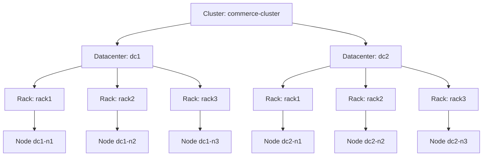
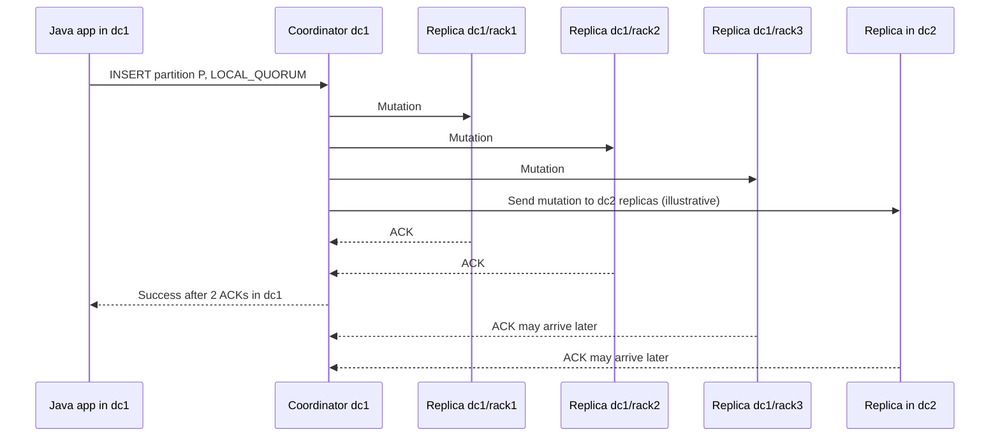

# Relationship Between Node, Rack, Datacenter, and Cluster

Apache Cassandra is a **distributed wide-column** database in which data is partitioned and replicated across multiple machines. When discussing Cassandra cluster architecture, four concepts—**node**, **rack**, **datacenter**, and **cluster**—form the most important topology hierarchy. Understanding their exact relationships helps answer very practical questions: Where is a partition placed? Why can losing one machine still allow reads/writes, while losing a rack can cause failures? Which datacenter should a Java application connect to? And how does the replication factor relate to the consistency level?

Lesson objectives:

- Accurately distinguish node, rack, datacenter (DC), and cluster, along with each level's scope of responsibility.
- Understand how logical topology is declared and how it maps to physical failure domains.
- Explain how the **partition key**, tokens, `NetworkTopologyStrategy`, and **replication factor** determine replica placement across DCs and racks.
- Predict the impact of a node, rack, or entire DC outage on read/write consistency levels.
- Create a multi-DC keyspace using CQL, inspect topology with `nodetool`, and configure a Java application to prefer the local DC.

## 1. Four Levels in the Same Architecture

Conceptually, a Cassandra cluster consists of one or more datacenters; each datacenter contains one or more racks; and each rack contains nodes. Cassandra does not require a strict one-to-one mapping with physical locations or physical server racks, but the configuration should reflect **components that can fail together**.



The diagram above illustrates **one** way to organize two DCs, three racks per DC, and one node per rack. Real-world clusters typically have multiple nodes per rack; each DC may also span multiple hardware groups or availability zones. The name `rack1` may be reused across different DCs because a rack is scoped within its respective **DC**.

| Level | Scope | Primary Function | Example |
|---|---|---|---|
| **Node** | A single Cassandra instance participating in the cluster, usually running on a physical machine or VM/container with its own resources and network address. | Receives/sends requests, stores assigned partitions, participates in peer-to-peer communication. | `dc1-n1` |
| **Rack** | A group of nodes within a DC, used to represent a **failure domain**. | Helps the replication strategy avoid placing too many copies of the same partition in a group that can fail simultaneously. | `dc1/rack2` |
| **Datacenter (DC)** | A group of racks/nodes within the same logical topology domain. | Determines replica placement, local read/write policies, and cross-region traffic. | `dc1`, `dc2` |
| **Cluster** | The entire set of nodes forming one Cassandra deployment sharing metadata and membership state. | Provides the distributed data space; a keyspace can replicate data across multiple DCs within the same cluster. | `commerce-cluster` |

Relationship to remember: **each node belongs to exactly one rack in exactly one DC at a time; multiple DCs can belong to the same cluster**. Rack and DC are topology labels known to the system through snitch configuration and state exchange; they are not separate record-storage entities independent of nodes.

## 2. Node: The Unit of Processing, Storage, and Scaling

A Cassandra node is a member of the cluster. It can:

- Store data for the partitions assigned to it by the distribution strategy; handle writes via the **commit log**, **memtable**, and later **SSTables**.
- Serve data reads, apply mutations, and participate in replication, compaction, and repair operations.
- Accept CQL connections from drivers and act as the **coordinator for a request**; the coordinator sends requests to the appropriate replicas and aggregates responses according to the consistency level.
- Exchange membership and status information with peers using **gossip**.

Cassandra uses a **peer-to-peer** architecture, with no fixed master coordinating all queries. "Which node is the coordinator?" is a **per-request** question, not a permanent node classification. A node acting as the coordinator for a read query might still not hold a copy of the partition being read.

Core point: **the number of nodes does not equal the number of replicas per partition**. For example, in a DC with 12 nodes and RF = 3, a typical partition only has three copies in that DC; other partitions may be placed on different sets of three nodes. As a result, adding nodes helps distribute load and capacity, although rebalancing data requires streaming and stabilization time after topology changes.

### Tokens and Virtual Nodes (vnodes)

Cassandra hashes the **partition key** into a token in the token space. Each node owns token ranges; with vnodes, a single node can own multiple non-contiguous token ranges. This mechanism forms the foundation for distributing partitions across the cluster.

A token is not synonymous with a "rack" or a "DC". Tokens locate partitions on the logical ring, whereas the **replication strategy** combined with **DC/rack information** determines which nodes hold replicas. Nodes can communicate directly over the network; data does not have to hop step-by-step around a physical ring of machines.

## 3. Rack: Grouping Nodes with Correlated Failure Risk

In Cassandra, a *rack* is a label describing a group of nodes within a DC. This label is typically designed to align with a **failure domain**: a physical rack sharing power/network switches, a group of hosts sharing underlying infrastructure, or an **availability zone** in a cloud environment. There does not have to be a literal physical rack bearing the configured name.

Why does Cassandra need to know about racks? Suppose partition P has RF = 3 in DC `dc1`:

- If all three replicas reside on three nodes in the same rack and that rack's switch fails, all three replicas can lose connectivity at the same time.
- If the three replicas are spread across three independent racks, losing one rack may only take out one of the three replicas. The remaining two replicas can still serve `LOCAL_QUORUM`.

With `NetworkTopologyStrategy`, Cassandra attempts to place replicas of a partition across **distinct racks within each DC**, provided the topology has enough suitable racks and nodes. If RF exceeds the number of available racks in a DC, placing multiple replicas in the same rack becomes unavoidable; **you should not conclude that RF = 3 automatically tolerates losing a rack if the DC only has one rack**.

A rack is a concept for **data placement and fault isolation**, not a special node. It does not execute CQL, does not store data as a separate process, and does not replace the replication factor. Incorrect rack configuration (for instance, putting every node in `rack1` even though they actually span three different zones) deprives Cassandra of critical information needed to distribute replicas according to real failure risks.

## 4. Datacenter: Boundary for Replica Placement and Local Queries

A Cassandra cluster can span multiple DCs. In common cloud deployments, teams typically map:

- **One Cassandra DC ↔ one cloud region** (or a network domain with comparable latency and availability).
- **One Cassandra rack ↔ one availability zone** within that region.
- **One Cassandra node ↔ one instance** deployed in the declared zone.

This is a **common deployment pattern**, not a mandatory rule: DC/rack names represent logical topology. Two groups of machines at the same physical site can still be separated into two Cassandra DCs if operational design requires it, and a Cassandra DC can run on an organization's own infrastructure.

The DC directly influences three decisions:

1. **Where replicas reside:** `NetworkTopologyStrategy` allows configuring an independent RF for each DC.
2. **Where the application prefers to query:** Cassandra drivers are usually configured with `localDatacenter` to prefer nodes in the DC closest to the application.
3. **How many responses are needed for a query to succeed:** `LOCAL_ONE` and `LOCAL_QUORUM` count replicas in the **coordinator's DC**, whereas other consistency levels have broader scope.

Having replicas in another DC provides regional resilience, but **does not automatically fail over applications, DNS, connections, traffic, or readiness checks** when the active DC is completely lost. That is a failover responsibility for the application and operations stack.

## 5. Cluster: A Collection of Peers, Not a Single Control Machine

A Cassandra cluster comprises nodes participating in the same distributed system, sharing membership, schema, and token distribution metadata. The `cluster_name` setting is one identifier for the cluster; beyond the cluster name, nodes also need matching communication, seed, snitch/partitioner configuration, and proper join procedures to actually become peers of the same cluster.

Within a cluster:

- **Keyspaces** define the replication strategy and per-DC replication factors.
- **Tables** define the partition key, clustering columns, and how data is stored/queried.
- **Tokens/ring** locate partitions; the replication strategy and topology determine which nodes hold replicas.
- **Seed nodes** are contact points that help discover peers on startup or cluster join; **seeds are not masters**, do not coordinate every CQL command, and do not need to live in a dedicated rack or DC.

Distinguish two very different setups:

| Topology | Impact |
|---|---|
| Two DCs **in the same cluster**, with the keyspace having RF in both DCs. | Cassandra can replicate partitions between both DCs as configured, sharing cluster schema and supporting local/cluster-wide CLs. |
| Two **independent clusters**, each with its own DC. | There is no automatic CQL replication between the two clusters; another data sync or migration mechanism must be built if needed. |

Therefore, saying "we have two datacenters" is not enough to conclude you have disaster recovery. You need to know **whether they belong to the same cluster, which keyspaces have replicas where, how caught up the data is, and how the application fails over**.

## 6. CQL: Placing Replicas by DC with `NetworkTopologyStrategy`

Consider an order management system with two DCs, `dc1` and `dc2`. Each DC has at least three suitable nodes spread across at least three independent racks. We want each partition to have **three replicas in each DC**:

```sql
CREATE KEYSPACE commerce
WITH replication = {
  'class': 'NetworkTopologyStrategy',
  'dc1': 3,
  'dc2': 3
};

CREATE TABLE commerce.orders_by_shop_day (
    shop_id uuid,
    order_day date,
    created_at timestamp,
    order_id uuid,
    state text,
    PRIMARY KEY ((shop_id, order_day), created_at, order_id)
) WITH CLUSTERING ORDER BY (created_at DESC, order_id ASC);
```

In this example:

- The cluster has **two DCs**, but only **one `commerce` keyspace** with two independent RF values.
- `RF_dc1 = 3`, `RF_dc2 = 3`: a total of **six full replicas per partition** in the assumed topology, not six replicas for the whole table or six coordinators.
- A partition is identified by the **pair** `(shop_id, order_day)`. The same pair of values maps to the same replica set; a different day may map to a different placement.
- `created_at` and `order_id` are **clustering columns** ordering rows within a partition; they do not increase the replica count or choose the DC.
- DC names in the replication definition **must match the DC names nodes advertise through the snitch**. Typing `dc-1` by mistake when nodes declare `dc1` will not produce the intended topology.

`NetworkTopologyStrategy` is the right choice for environments with DC/rack topology. `SimpleStrategy` distributes replicas around the token ring without applying DC/rack placement goals; it should not be chosen for multi-DC production deployments.

### Illustrating One Partition Placed Across Different Racks

Suppose each DC has six nodes evenly split across three racks, two nodes per rack. With RF = 3 per DC, the replica set of partition P **might** be:

| DC | Rack | Replica of Partition P |
|---|---|---|
| `dc1` | `rack1` | `dc1-n1` |
| `dc1` | `rack2` | `dc1-n4` |
| `dc1` | `rack3` | `dc1-n6` |
| `dc2` | `rack1` | `dc2-n2` |
| `dc2` | `rack2` | `dc2-n3` |
| `dc2` | `rack3` | `dc2-n5` |

This is an **illustrative example**, not an algorithm that always picks those exact named nodes. Actual replicas depend on tokens, vnode configuration, snitch, and topology state. Partition Q may reside on a different group of nodes. Cassandra tries to choose distinct racks for replicas when possible, but does not guarantee that every real-world DC always has enough healthy racks/nodes to satisfy every CL.

### RF Is Not CL, and Changing RF Does Not Instantly Move Historical Data

**Replication factor (RF)** is the target number of copies per partition within its defined scope; **consistency level (CL)** is the acknowledgment condition for a read/write request. For example, in `dc1` with RF = 3, a query at `LOCAL_QUORUM` requires two qualifying responses from `dc1` replicas. Having an acknowledgment condition of two does **not** make Cassandra store only two copies.

When changing RF via `ALTER KEYSPACE`, or adding a new DC/node, the cluster needs to distribute data to the new replicas via appropriate streaming/rebuild/repair mechanisms depending on version and operational procedures. **Updating the schema does not mean historical data is immediately present on all new replicas**. Never experiment with changing RF or DC/rack labels on a production cluster serving live traffic without a data migration and verification plan.

## 7. Relating Topology to Read and Write Consistency Levels

Keeping the assumption `RF_dc1 = 3` and `RF_dc2 = 3`, the application connects to a coordinator in `dc1`:

| Consistency level | Required Responses | Scope and Implications |
|---|---|---|
| `LOCAL_ONE` | 1 replica in `dc1`. | Low cross-DC dependency, at the cost of potentially reading stale data if replicas are out of sync. |
| `LOCAL_QUORUM` | `floor(3/2) + 1 = 2` replicas in `dc1`. | Typically balances single-replica fault tolerance with local-DC latency. |
| `QUORUM` | `floor(6/2) + 1 = 4` replicas across both DCs combined. | May require cross-DC responses; scope depends on total RF. |
| `EACH_QUORUM` | **On writes:** at least 2 replicas in **each** DC. | Guarantees per-DC quorum, but writes can fail if one DC is unresponsive. Not used for normal reads. |
| `ALL` | 6 replicas. | Requires every involved replica to respond; reduces availability if any node or network link fails. |

`LOCAL_QUORUM` is evaluated relative to the **coordinator's DC**, not the IP address of the machine running the application. The Java driver prefers `dc1` nodes because of its local DC setting; if traffic shifts to a coordinator in `dc2`, `LOCAL_QUORUM` for new requests applies to `dc2` replicas.

### Example Write Path



In a real system, the coordinator may use different forwarding or parallel-send optimizations depending on the version; the diagram highlights only the **ACK requirement boundary**. Replicas in `dc2` are also targeted per replication, but **ACKs from `dc2` do not substitute for missing two ACKs in `dc1` when a request uses `LOCAL_QUORUM` in `dc1`**. Success in `dc1` also does not prove all `dc2` replicas have been updated yet.

For reads, Cassandra can fetch data/digests from replicas and reconcile mismatches when needed. Choosing `LOCAL_ONE` versus `LOCAL_QUORUM` directly affects the required response count; results also depend on replica synchronization, timestamps, tombstones, and repair operations. Quorum across reads and writes provides overlapping replica sets under specific assumptions, **without automatically turning Cassandra into a database with linearizable transactions for every CQL statement**.

## 8. When a Node, Rack, or Datacenter Fails

With RF = 3 in `dc1`, partition P's three replicas reside in three different racks, and the coordinator sends requests at `LOCAL_QUORUM`:

| Failure | Accessible Replicas of P in `dc1` | Expected Outcome |
|---|---:|---|
| One replica node stops | 2 | `LOCAL_QUORUM` can still succeed if the remaining two replicas respond on time. |
| One rack containing a replica of P fails | 2 | Quorum is preserved if the three replicas truly span three independent racks. |
| Two racks containing two replicas of P fail | 1 | Cannot meet `LOCAL_QUORUM`; `LOCAL_ONE` may still serve with corresponding consistency risks. |
| Entire `dc1` loses connectivity | 0 | Cannot meet local CL in `dc1`; application failover to `dc2` and data/state verification are required before serving. |
| Network link between `dc1` and `dc2` drops while both DCs remain up | 3 in each DC | `LOCAL_QUORUM` requests in each DC can continue succeeding locally; `EACH_QUORUM` writes will fail if the remote DC cannot be reached. |

The outcomes in this table also depend on the coordinator, network paths, actual node/rack count, and replica health; they are **not unconditional guarantees**. If a node is still "Up" but responds too slowly, missing timely ACKs can still cause timeouts.

### Reasoning About a Network Partition

In `dc1` with RF = 3, `LOCAL_QUORUM` requires two responses. If the network splits so that two replicas are on one side and the remaining replica is on the other:

- A coordinator on the **two-replica** side can achieve `LOCAL_QUORUM` if both can serve.
- A coordinator on the **one-replica** side cannot achieve `LOCAL_QUORUM` at that moment, even though the node is alive.
- At CL `LOCAL_ONE`, the one-replica side may still serve some operations, but the risk of reading stale data or accepting writes not confirmed by all replicas increases.

That is why Cassandra architecture must be evaluated using both **replica placement and acknowledgment requirements**, rather than simply counting how many nodes show `UN` status.

### After Recovery: Being Back Online Does Not Mean Synchronized

While a replica is absent, new mutations may not reach it. **Hinted handoff** helps replay some missed writes within configured limits; **anti-entropy repair** compares and synchronizes data across replicas. **Compaction** organizes/merges SSTables on individual nodes and is not responsible for cross-DC data replication. Distinguish these three mechanisms so you do not mistake a recovered node or rack for fully consistent data.

When all of `dc1` fails, some writes that returned success at `LOCAL_QUORUM` in `dc1` may **not yet have been confirmed in `dc2`**. Shifting traffic immediately to `dc2` can expose a temporary data gap depending on replication state and the outage. A DR plan must clearly define acceptable data loss (RPO), recovery time (RTO), replica verification, and convergence handling after both DCs reconnect.

## 9. How Does a Node Know Its DC and Rack?

DC/rack information is provided by the **snitch**. In deployments using `GossipingPropertyFileSnitch`, each node has its own DC/rack configuration in the `cassandra-rackdc.properties` file (illustrative):

```properties
# On node dc1-n1
dc=dc1
rack=rack1
```

And in the Cassandra configuration, the corresponding snitch must be selected (illustrative configuration key):

```yaml
endpoint_snitch: GossipingPropertyFileSnitch
```

A node in `dc1/rack2` must declare `dc=dc1`, `rack=rack2`; a node in `dc2/rack1` declares `dc=dc2`, `rack=rack1`. Configuration may be supplied differently by the deployment platform (for example, cloud snitches); what matters is that nodes recognize topology **accurately and consistently with the underlying infrastructure**.

Changing the DC/rack label of a node that already holds data **is not just editing a string**: those labels affect how Cassandra places replicas. It requires an appropriate topology migration/streaming/repair procedure and post-change verification. Never arbitrarily change labels as a quick workaround for `Unavailable` errors.

### Inspecting with `nodetool`

Run from a host with access to a Cassandra node:

```bash
nodetool status
nodetool describecluster
```

`nodetool status` typically groups nodes by DC, showing status codes such as `UN` (*Up/Normal*) and the `Rack` column. `nodetool describecluster` checks cluster metadata and schema agreement. Verify that each DC has enough nodes, racks are assigned properly, and critical nodes are healthy before attempting failover.

In `cqlsh`, you can check the DC/rack of **the node your current session is querying** via system tables:

```sql
SELECT cluster_name, data_center, rack
FROM system.local;

-- Check the effective RF of a keyspace:
SELECT keyspace_name, replication
FROM system_schema.keyspaces
WHERE keyspace_name = 'commerce';
```

Metadata tables and columns may vary slightly across Cassandra versions. `system.local` only reflects **the current node**; do not treat it as a cluster-wide list. To verify peers, prefer comparing `nodetool status` and peer metadata appropriate for your running version.

### Why You Should Not Assume Seeds Are "Primary Nodes"

Seeds only assist with **membership discovery** when peers start up or join; they are not required to store every partition, nor do they hold master authority to distribute queries. Place seeds with sufficient diversity across the infrastructure and configure them properly so new nodes have a way to discover the cluster, but normal CQL requests do not have to route through seed nodes.

## 10. Java Application Connecting by Datacenter

With Apache Cassandra Java Driver 4.x, `localDatacenter` tells the driver where to prefer sending requests. This is a **client routing** setting; it does not alter keyspace replication.

```java
import com.datastax.oss.driver.api.core.CqlSession;
import com.datastax.oss.driver.api.core.DefaultConsistencyLevel;
import com.datastax.oss.driver.api.core.cql.PreparedStatement;
import com.datastax.oss.driver.api.core.cql.BoundStatement;
import com.datastax.oss.driver.api.core.cql.Row;

import java.net.InetSocketAddress;
import java.time.LocalDate;
import java.util.UUID;

public class ShopOrders {
    public static void main(String[] args) {
        UUID shopId = UUID.fromString("aaaaaaaa-aaaa-aaaa-aaaa-aaaaaaaaaaaa");

        try (CqlSession session = CqlSession.builder()
                .addContactPoint(new InetSocketAddress("10.0.1.11", 9042))
                .addContactPoint(new InetSocketAddress("10.0.2.12", 9042))
                .withLocalDatacenter("dc1")
                .build()) {

            PreparedStatement prepared = session.prepare(
                "SELECT order_id, created_at, state " +
                "FROM commerce.orders_by_shop_day " +
                "WHERE shop_id = ? AND order_day = ? LIMIT 20"
            );

            BoundStatement statement = prepared
                .bind(shopId, LocalDate.parse("2026-11-21"))
                .setConsistencyLevel(DefaultConsistencyLevel.LOCAL_QUORUM);

            for (Row row : session.execute(statement)) {
                System.out.println(row.getUuid("order_id") + " "
                    + row.getString("state"));
            }
        }
    }
}
```

Addresses `10.0.1.11` and `10.0.2.12` are examples only; real configurations must use **reachable contact points** in the same cluster and matching the local DC. Configure multiple contact points so session initialization does not depend on a single node. Contact points are only the **starting point for cluster discovery**; once metadata is fetched, the driver can prefer other coordinators, especially when prepared statements supply the full partition key to enable **token-aware routing**.

If the application is deployed in both `dc1` and `dc2`, each application deployment typically sets its corresponding `localDatacenter`. During failover from `dc1` to `dc2`, the system must switch endpoints/routing or rely on pre-designed fallback connection configurations; changing `LOCAL_QUORUM` does not automatically move request-receiving servers to a healthy DC.

## 11. Designing Topology for Performance and Reliability

Decisions about cluster, DC, rack, and nodes are not independent of the wide-column data model:

| Decision | Rationale | Risk When Done Wrong |
|---|---|---|
| **Choose partition keys by query** | Distributes data and lets drivers/coordinators locate a partition's replicas. | Hot partitions overload one replica group even while many nodes in the cluster sit idle. |
| **Bucket large partitions** | Bounds partition size and spreads access across time/groups. | Oversized partitions degrade reads, compaction, repair, and latency. |
| **Choose RF per DC** | Defines copy count and fault tolerance in each domain. | RF too low cannot meet CL after failures; RF too high increases storage/write/repair overhead. |
| **Map racks to real failure domains** | Reduces the chance of losing multiple replicas from a single power, switch, or zone failure. | Replicas may end up sharing a single failure domain that operators assumed was isolated. |
| **Select read/write CL per workload** | Balances latency, availability, and data freshness. | `ALL` can be overly sensitive to failures; `ONE` may fail freshness requirements. |
| **Co-locate applications with serving DC** | Cuts CQL query time and avoids WAN dependency for `LOCAL_*`. | Cross-region requests increase latency and timeout probability. |
| **Schedule repair / control tombstones** | Helps replicas converge after disconnects or missed mutations. | Long-lived replica divergence increases risk when deleting data and after tombstones expire. |

Do not expect **adding nodes** to automatically fix a hot partition: in Cassandra, every operation targeting the same partition still hits that partition's replica set. You must redesign the partition key or bucketing model around query patterns alongside scaling node/rack/DC resources.

Likewise, **compaction** only optimizes how SSTables are stored on a node and can impact I/O load; it does not replace **replication** for placing data across topology or **repair** for synchronizing replicas.

## 12. Self-Check Practice Exercise

Suppose cluster `commerce-cluster` has two DCs. Each DC has three racks, with two nodes per rack. Keyspace `commerce` uses RF = 3 in each DC, and partition P currently has one replica in each rack across both DCs. The Java application runs in `dc1` using `LOCAL_QUORUM`.

**Scenario A — One node holding a replica of P in `dc1` fails:** How many ACKs are required for a successful write? The two remaining replicas in `dc1` can still provide the required **2 ACKs**. If one of those two fails to respond in time, timeouts can still occur; RF and rack count only indicate placement capability.

**Scenario B — An entire rack holding a replica of P fails:** Because P's replicas reside across three different racks, `dc1` still has two replicas of P. Explain why a three-rack layout outperforms three nodes in the same rack when a shared switch fails.

**Scenario C — The two DCs lose connectivity to each other:** `LOCAL_QUORUM` writes received by a `dc1` coordinator can be acknowledged by `dc1` replicas, whereas `EACH_QUORUM` writes cannot succeed without reaching `dc2`. List the DR impact and repair requirements once the link is restored.

**Scenario D — Failing over the application to `dc2`:** You must verify `RF_dc2`, replica health, data freshness, application network routing, and `localDatacenter`. Merely changing the DC name in CQL or lowering CL is not a complete failover plan.

To practice on a test cluster, run `nodetool status`, record node/rack counts per DC, inspect `system_schema.keyspaces`, and verify whether the actual topology supports your chosen RF/CL. Never intentionally shut down nodes or alter configuration on a production cluster just to run this exercise.

## 13. Key Takeaways

In Cassandra, the **cluster** is the entire system of peers; **datacenter** partitions the cluster into topology domains that can apply independent RF and local routing; **rack** represents a correlated failure group inside a DC; and **node** is the unit that directly stores data and serves CQL.

Trace every request through this chain:

```text
Partition key → token → replicas by RF + DC/rack
                        ↓
Client/Java driver → request coordinator
                        ↓
                  ACKs/results by CL
```

If you accurately identify **which partition**, **which racks/DCs hold its replicas**, **which failure domain is down**, and **how many responses the consistency level requires**, you can explain almost every Cassandra architectural decision, load distribution behavior, availability characteristic, and common read/write error. This also serves as the foundation for diving deeper into replication, repair, compaction, and distributed troubleshooting in upcoming lessons.
