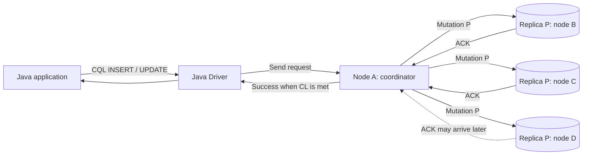
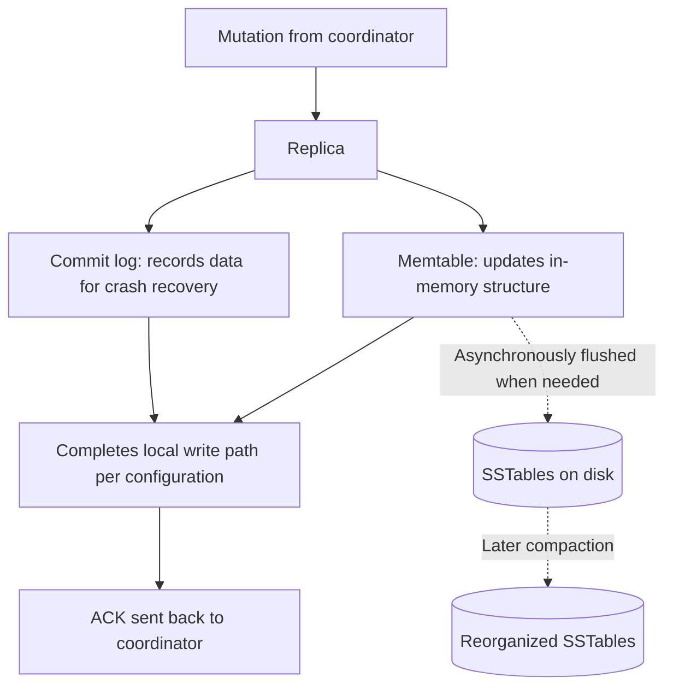
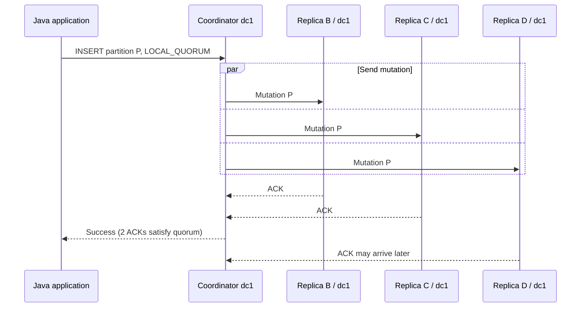

# Write Path from Application to Coordinator and Replicas

When a Java application issues an `INSERT` or `UPDATE` statement to Apache Cassandra, data does not pass through a fixed master server. The **driver** selects a Cassandra node to receive the request; that node becomes the **request coordinator**; the coordinator identifies the **replicas** responsible for storing the partition, sends the mutation, and waits for a number of acknowledgments matching the **consistency level** (CL). On each replica, data passes through the **commit log** and **memtable** before being written out as **SSTables** during subsequent flushes.

Understanding this path helps distinguish three easily confused questions: *Was the write reported as successful to the client? How many replicas acknowledged it? And has the data converged across all replicas?* These three questions can have three different answers at the same point in time.

Lesson objectives:

- Trace a mutation from the Java application, CQL driver, and coordinator to replicas and back to the client.
- Understand how the partition key, tokens, replication strategy, and datacenter/rack determine the replica set, while CL defines the success condition for **each request**.
- Distinguish commit log, memtable, SSTable, flush, compaction, hinted handoff, and repair along the write path.
- Analyze scenarios involving ACKs, timeouts, replica failures, coordinator failures, and safe retries.
- Practice CQL, Java Driver configuration, tracing, and cluster inspection commands.

## 1. The Big Picture: One Request, Multiple Replicas

Apache Cassandra is a **distributed wide-column** database with a **peer-to-peer** architecture. Any node chosen by the driver can accept a request and become the coordinator for that request. A coordinator is not a cluster master; it is only responsible for handling **the request in flight**.

A typical write path consists of six stages:

1. **The application constructs a CQL statement** specifying keyspace/table, key values, and CL; the driver manages connections and chooses a receiving node.
2. **The receiving node becomes the coordinator**; it resolves the partition key, token, and replica set based on the replication strategy and topology.
3. **The coordinator sends the mutation** to the replicas responsible for the partition. Logically, all replicas are targets for storing a copy, though message forwarding may be optimized per DC and Cassandra version.
4. **Each replica performs the local write**, including updating the commit log and memtable; once the replica's local write criteria are satisfied, it sends an acknowledgment (ACK) back to the coordinator.
5. **The coordinator collects enough ACKs for the CL** and returns success to the driver, or returns an error/timeout if the condition is not met within the timeout window.
6. **Background tasks** such as flushing, compaction, and replica reconciliation via repair continue independently of when the application receives its ACK.



In the diagram, node A **does not necessarily** hold partition P. If A is also a replica of P, it performs the local write as well and counts its own ACK according to the same rules. On the next request, the driver can choose B as the coordinator. Cassandra does not need to "transfer mastership" between A and B.

## 2. Before Writing: How the Partition Key Determines Where Data Goes

In the wide-column model, tables must be designed around queries. Consider a temperature measurement system organized by tenant, device, and day. The application frequently writes a measurement point and later reads measurements for **one device on one day**.

Test environment example: two datacenters `dc1` and `dc2`, each with at least three suitable nodes distributed across independent racks; each partition has three copies in each DC.

```sql
CREATE KEYSPACE telemetry
WITH replication = {
  'class': 'NetworkTopologyStrategy',
  'dc1': 3,
  'dc2': 3
};

CREATE TABLE telemetry.measurements_by_device_day (
    tenant_id uuid,
    device_id uuid,
    event_day date,
    event_time timestamp,
    event_id uuid,
    temperature_c double,
    PRIMARY KEY ((tenant_id, device_id, event_day), event_time, event_id)
) WITH CLUSTERING ORDER BY (event_time DESC, event_id ASC);
```

In this table:

- The **composite partition key** is `(tenant_id, device_id, event_day)`. Cassandra hashes all three values to compute the partition's **token**.
- `event_time` and `event_id` are **clustering columns**, used to sort rows within the same partition and distinguish events. They do not determine which nodes hold the partition.
- `temperature_c` is a regular data column.
- Partitioning by `event_day` prevents a device's measurement history from growing into an unbounded partition. Bucket size must be chosen based on write volume and practical operational limits.

Suppose we write one measurement point:

```sql
INSERT INTO telemetry.measurements_by_device_day (
    tenant_id, device_id, event_day, event_time, event_id, temperature_c
) VALUES (
    11111111-1111-1111-1111-111111111111,
    22222222-2222-2222-2222-222222222222,
    '2026-11-21',
    '2026-11-21T08:30:00+07:00',
    33333333-3333-3333-3333-333333333333,
    36.7
);
```

On this write, the coordinator must locate the replica set for the partition identified by the three values `tenant_id`, `device_id`, and `event_day`. Other partitions may have different replica sets. **Replication factor (RF)** is the target number of copies of *each partition* per DC; RF = 3 does not mean the entire table is stored on only three nodes in the whole cluster.

### Tokens, Replicas, and Topology

Overview model:

```text
Partition key values
       |
       v
    Hash function -> token
       |
       v
Token ranges / virtual nodes
       |
       v
NetworkTopologyStrategy + per-DC RF + snitch (DC/rack)
       |
       +----> replica set in dc1
       |
       +----> replica set in dc2
```

`NetworkTopologyStrategy` learns topology from each node's DC/rack information and tries to spread copies across distinct racks when possible. Replica placement is a function of partition key, token, replication strategy, and cluster configuration; **the coordinator does not arbitrarily pick the three fastest machines to store the data**.

## 3. How the Application and Driver Choose the Receiving Node

In a Java application, **contact points** are used for the initial connection and to fetch topology metadata. Once metadata is retrieved, the driver can open connections to other nodes and select coordinators according to its load-balancing policy.

The Cassandra driver can use **token-aware routing** to prefer a replica of the partition as the coordinator. This eliminates one internal network hop: if the request is sent directly to a replica of P, that node both coordinates and participates in storing P. Token-aware routing works best when the driver knows the complete routing key, such as from a **prepared statement** with all partition key components bound.

Two responsibilities to keep distinct:

| Component | Decides | Does Not Decide |
|---|---|---|
| **Java Driver** | Which node receives the request, connections and metadata used, retry policies, local-DC-preferred routing. | Does not decide RF and does not move partitions to other nodes. |
| **Coordinator** | Which replicas are responsible for the partition, mutation messages, and ACK requirement per CL. | Does not become master of all partitions or guarantee all replicas have converged merely by returning an ACK. |
| **Replica** | Updates local data, writes to commit log/memtable, and sends ACK based on local write state. | Does not decide CL on behalf of the client. |

If the driver picks a node that is not a replica, that node can still coordinate the write; the difference is usually an extra network hop. Therefore, **a contact point is not the fixed address of a "write master"**, and `localDatacenter` is the driver's preferred routing configuration, not the only place where replicas exist.

## 4. How Does the Coordinator Handle a Write Request?

For a normal CQL write with a resolved partition key, the coordinator receives the mutation payload and consistency level from the driver and performs the main steps:

1. **Validate the request** including schema, data types, permissions, and applicable limits; prepare the mutation with a timestamp and related attributes such as TTL if present.
2. **Determine responsible replicas** from the token and cluster metadata, and compute the required acknowledgment count from CL and RF.
3. **Check expected availability**. If not enough replicas are believed to be available for the CL upfront, the coordinator can return an `Unavailable` error; actual behavior depends on network and replica state.
4. **Distribute the mutation**. Cassandra aims to update all natural replicas of the partition while using internal network/routing optimizations appropriate to the version and topology.
5. **Collect ACKs** against the CL condition. Once enough acknowledgments arrive, the coordinator can return success without waiting for the remaining replicas.
6. **Track unresponsive replicas** within system capabilities. Mechanisms like hinted handoff can help replay mutations in certain situations; that is not an absolute guarantee replacing repair.

Conceptually, the coordinator holds transient request state: which replicas have responded, whether CL is satisfied, and whether the request has timed out. **It is not required to store a copy of the partition being written.** Durable storage is the responsibility of the replicas.

### Today's Coordinator Can Be Tomorrow's Replica

Suppose partition P has replicas B, C, D. The driver sends a request to A, and A coordinates it. For partition Q, the replica set might be A, C, E; if the driver sends request Q to A, then A is both coordinator and replica. The coordinator address is therefore **not a property of a table, keyspace, or cluster**.

## 5. What Happens Inside a Replica When It Receives a Mutation?

A replica is where a partition's copy actually lives. Along Cassandra's normal write path, two structures are especially important: the **commit log** and the **memtable**.



| Component | Role | Relationship to ACK |
|---|---|---|
| **Commit log** | Write-ahead log used to recover mutations if the process crashes before the memtable is fully flushed. | Part of the local write path, though physical `fsync` timing depends on commit log configuration. |
| **Memtable** | In-memory structure holding mutations not yet flushed to SSTables. | Updated on the write path; no need to wait for memtable flush before sending ACK. |
| **SSTable** | Immutable data files on disk created by flushes and compaction. | Flushing to SSTables usually happens **after ACK**, not as a completion requirement for a normal write. |
| **Compaction** | Merges/reorganizes SSTables, reclaiming obsolete data and tombstones per Cassandra rules. | A storage maintenance task, not a condition for the coordinator to return success. |

### Commit Log and Durability

The commit log's job is to support recovery of mutations already received but not yet flushed from the memtable. **Do not equate "ACK sent" with "a new SSTable was created"**. Nor should you assume ACK means every byte has been `fsync`ed on every disk: durability depends on commit log sync configuration, storage hardware, and consistency level.

With `periodic` commit log sync mode, there can be an interval between writing and syncing to disk; `batch` mode has different sync-wait behavior. When evaluating sudden power-loss tolerance, inspect **the exact running Cassandra configuration**, RF, and replica health. RF distributes risk, but does not replace durability verification.

### Why Can Cassandra Write So Fast?

Cassandra optimizes its write path using an **LSM-tree**-style design: sequential appends to the commit log and updates to the memtable, followed later by flushing data to immutable SSTables. This avoids random in-place updates to data files on every mutation. In return, the system requires compaction and read/reconciliation mechanisms when multiple SSTables or replicas hold different versions of data.

**Compaction is not replication**: compaction operates on a node's local storage files, whereas replication distributes copies across nodes/DCs. **Repair** is the process that compares data across replicas to fix divergence; these processes cannot substitute for one another.

## 6. How Many ACKs Does the Coordinator Wait For? RF and Consistency Level

**RF** answers *how many copies of a partition are configured?* **CL** answers *how many acknowledgments must this write collect, and from which DCs, before returning success?*

Suppose keyspace `telemetry` has `RF_dc1 = 3` and `RF_dc2 = 3`, and the coordinator receiving the request is in `dc1`:

| Write CL | Acknowledgment Condition | Consequence |
|---|---|---|
| `ONE` | One ACK from any replica of the partition. | Can return early; other copies may not have finished yet. |
| `LOCAL_ONE` | One ACK from a replica in `dc1`. | Acknowledgment condition does not require ACKs from another DC. |
| `LOCAL_QUORUM` | `floor(3 / 2) + 1 = 2` ACKs in `dc1`. | Suitable for many write workloads needing local quorum while limiting cross-DC dependency. |
| `QUORUM` | `floor(6 / 2) + 1 = 4` ACKs across total replicas in both DCs. | May require cross-DC responses, impacting latency and network fault sensitivity. |
| `EACH_QUORUM` | At least 2 ACKs **in each DC**. | Stronger when per-DC acknowledgment is required; fails if one DC is unavailable. Used for writes. |
| `ALL` | All 6 ACKs. | Very sensitive to failure of a single replica or network link. |

In a **single-DC RF = 3** cluster, `QUORUM` and `LOCAL_QUORUM` both require two ACKs within that single DC. In a **two-DC RF = 3 + 3** cluster, `QUORUM` requires four global ACKs, whereas `LOCAL_QUORUM` in `dc1` only requires two ACKs from `dc1`.

Cassandra also has `ANY` for **writes**: it can return success if the mutation is accepted as a **hint** even when no natural replica acknowledges. Therefore, `ANY` is unsuitable when the application needs to read the data from replicas right after writing; never use `ANY` for reads. This is a special case to distinguish from `ONE`.

### Why "ACKed" Does Not Mean "All Replicas Are Updated"

At `LOCAL_QUORUM` with three replicas in `dc1`, the coordinator can receive ACKs from B and C and return success even while D has not responded. D might be slow, temporarily unreachable, or may have processed it with a delayed ACK. Later, D may receive the mutation or require data convergence mechanisms.



The diagram intentionally shows only `dc1` replicas to focus on the `LOCAL_QUORUM` condition. For a keyspace with replicas in `dc2`, the mutation still needs to be replicated to that DC's replicas; cross-DC messages may use internal forwarding optimizations depending on version. **Success in `dc1` does not guarantee data is already present on every replica in `dc2`.**

## 7. Distinguishing Five Milestones of a Write

When investigating performance and correctness, do not lump every event together as "write finished." Consider these milestones:

| Milestone | What Is Known | What Cannot Be Concluded Yet |
|---|---|---|
| **T1 — Driver sends** | The request left the application over a connection to a node. | Cannot yet tell whether the coordinator or replicas will succeed. |
| **T2 — Coordinator distributes** | Replicas have been identified and mutations dispatched on the write path. | Cannot yet tell which replicas have applied the mutation. |
| **T3 — One replica ACKs** | One replica completed its local write steps sufficient to ACK. | If CL requires quorum, one ACK is not enough for success. |
| **T4 — Enough ACKs for CL** | The coordinator can return success to the client. | Does not imply all replicas/DCs have caught up or compaction has run. |
| **T5 — Data converges later** | Replicas synchronize via mutation delivery, hints, or repair as needed. | Cannot be inferred from the `INSERT` response alone; requires actual observation/verification. |

Application-measured latency typically includes **driver processing and queueing + client/coordinator network + coordinator processing + internal network + ACK time of the required replicas**. One slow replica does not always slow down the request if other replicas already satisfy CL; however, failures that drop below the required ACK count lead to timeouts or availability errors.

## 8. Timestamps, TTL, UPDATE, and Deletes in the Mutation Path

Cassandra processes mutations by **partition key and cells**, combined with timestamps to reconcile values when concurrent writes race or different replicas hold differing state.

### `INSERT` and `UPDATE` Are Normally Upserts

For regular CQL statements, an `INSERT` on an existing key can update values; `UPDATE` does not require reading first and then writing like a locked read-modify-write. Cassandra does not check "does not exist" by default on `INSERT`. If the system must create a row only when it does not yet exist, use a **lightweight transaction (LWT)**:

```sql
INSERT INTO telemetry.measurements_by_device_day (
    tenant_id, device_id, event_day, event_time, event_id, temperature_c
) VALUES (
    11111111-1111-1111-1111-111111111111,
    22222222-2222-2222-2222-222222222222,
    '2026-11-21',
    '2026-11-21T08:30:00+07:00',
    33333333-3333-3333-3333-333333333333,
    36.7
) IF NOT EXISTS;
```

This is a **conditional write** using a separate consensus protocol, with different overhead and semantics from regular writes; LWT should not be treated as the default for every `INSERT`. For continuous event ingestion, a deterministic event identifier helps the application avoid creating unintended duplicate rows on retries.

### Timestamps and Write Ordering

Mutations/cells carry timestamps. When replicas reconcile competing versions, timestamps play a crucial role in deciding the winning value; **a request arriving later in network wall-clock time does not necessarily win** if its timestamp is smaller. Clock skew or poorly controlled client-supplied timestamps can cause a newer write to be masked by an older value.

Avoid blind retries with a fresh timestamp if a mutation might have partially succeeded and another operation has already updated the same cell. The system should pick an idempotency strategy suited to the domain: reusing the same event key, same payload, and managing timestamps carefully when needed.

### TTL and Tombstones

When writing with `USING TTL`, values have a time-to-live; upon expiration, Cassandra applies expiration/tombstone semantics to handle expired data. `DELETE` statements also generate **tombstones** rather than guaranteeing every byte is immediately erased across all replicas. Compaction and repair affect tombstone lifecycles; workloads using TTL or deletes must be designed within repair intervals and load characteristics.

Changing a partition key is not an automatic row-moving `UPDATE`. If a partition key must change, the application must write the record under the new key and handle cleanup of the old record appropriately.

### Batch Does Not Mean a Cluster-Wide Transaction

CQL `BEGIN BATCH ... APPLY BATCH` has specific purposes and costs; a **logged batch** provides eventual atomicity for a group of mutations via the batchlog mechanism, but **does not** provide relational transactional isolation across arbitrary partitions. Oversized batches or batches spanning too many partitions can impose significant load. For a sensor ingestion stream, it is usually better to issue individual mutations targeting well-chosen partitions and optimize batching based on real access patterns.

## 9. Errors at Coordinator and Replicas: How Should the Client Interpret Them?

The outcome returned to the driver depends on CL and send/receive status. The following cases are critical:

| Situation | Possible Outcome | Correct Interpretation |
|---|---|---|
| **One replica is down before sending** | Coordinator can still write if CL requires fewer ACKs than healthy replicas. | RF and CL together determine whether writes can proceed. |
| **Not enough replicas believed available upfront** | May return `Unavailable`. | The request cannot meet availability requirements; do not conclude the whole cluster is down. |
| **Replicas receive mutation but ACKs are slow/lost** | May return `WriteTimeout` even though some replicas wrote it. | A timeout **does not prove the mutation was not applied**. |
| **Coordinator dies after dispatching mutation** | Client loses connection/times out; replicas may have written enough, partially, or nothing. | The outcome is **uncertain** without appropriate verification. |
| **One DC loses network during `LOCAL_QUORUM` write** | Coordinator in the healthy DC can still succeed using local replicas. | Do not assume replicas in the disconnected DC received the data. |
| **`ALL` write when one replica does not respond** | Request fails/times out even if most replicas already wrote. | Higher CL raises confirmation requirements at the cost of availability during failures. |

### Why Can Retries Be Dangerous?

Suppose the application sends a write for event E; the coordinator forwards it to two replicas, but the response to the client is lost. The client sees a timeout and retries:

1. If it generates a **new record key on every retry**, the application can create two different rows for the same event.
2. If it uses the **same partition/clustering key and payload**, duplicate row risk drops, though two writes can still carry different timestamps and race with another mutation.
3. If the write contains a **counter**, increment/decrement operations are not idempotent like setting an absolute value; retries can apply the delta multiple times.
4. If using **LWT** or `IF` conditions, you must inspect the applied result instead of treating every retry as equivalent.

Drivers support retry policies, but the application must tie retries to **genuine idempotency semantics**. Do not configure automatic retries for every `INSERT`/`UPDATE` simply because `WriteTimeout` occurred. For critical business state, design stable event IDs, check state by key, or use appropriate conditional mechanisms.

## 10. Replica Missed a Write: How Hint, Repair, and Compaction Differ

A successful write at a lower CL does not require every replica to ACK. When a replica is absent, copies can temporarily diverge; Cassandra has different mechanisms to close that gap.

| Mechanism | Purpose | Key Limitations |
|---|---|---|
| **Hinted handoff** | Stores missed mutation information for a temporarily unavailable replica to replay when it recovers. | Bounded by time/config/resource limits; does not guarantee hints exist for every divergence. |
| **Anti-entropy repair** | Compares data across replicas and synchronizes differences. | Consumes I/O, CPU, and network; must be scheduled per operational and version guidance. |
| **Read repair** | Can fix part of an inconsistency discovered during reads, depending on version and table settings. | Not guaranteed to scan every partition; does not replace periodic repair. |
| **Flush** | Moves memtable data into an SSTable on a node. | Does not transfer data to other replicas. |
| **Compaction** | Reorganizes SSTables and handles obsolete data/tombstones per strategy. | Not a cluster-wide replication or reconciliation process. |

For example, B and C ACKed a `LOCAL_QUORUM` mutation while D was down. The coordinator can return success. When D returns, data may be replayed via hints if conditions allow; if hints expired or were skipped, repair remains an essential tool for reconciliation. **Do not run repair after every write**: it is a scheduled operational task.

In multi-DC clusters, cross-DC network interruptions can extend convergence time. Before failing over to another DC, verify how up-to-date that DC's data actually is; `LOCAL_QUORUM` success in the source DC **does not** equate to confirmed writes in the target DC.

## 11. Java Driver 4.x Example: Writing with Explicit CL

The following example uses the `com.datastax.oss.driver` API from Apache Cassandra Java Driver 4.x. The prepared statement includes all three partition key components, enabling the driver to compute the routing key and prefer a local replica when metadata is complete.

```java
import com.datastax.oss.driver.api.core.CqlSession;
import com.datastax.oss.driver.api.core.DefaultConsistencyLevel;
import com.datastax.oss.driver.api.core.cql.BoundStatement;
import com.datastax.oss.driver.api.core.cql.PreparedStatement;

import java.net.InetSocketAddress;
import java.time.Instant;
import java.time.LocalDate;
import java.util.UUID;

public class SaveMeasurement {
    public static void main(String[] args) {
        UUID tenantId = UUID.fromString(
            "11111111-1111-1111-1111-111111111111");
        UUID deviceId = UUID.fromString(
            "22222222-2222-2222-2222-222222222222");
        UUID eventId = UUID.fromString(
            "33333333-3333-3333-3333-333333333333");
        LocalDate eventDay = LocalDate.parse("2026-11-21");
        Instant eventTime = Instant.parse("2026-11-21T01:30:00Z");

        // Documentation-only addresses: replace with real nodes.
        try (CqlSession session = CqlSession.builder()
                .addContactPoint(new InetSocketAddress("192.0.2.10", 9042))
                .addContactPoint(new InetSocketAddress("192.0.2.11", 9042))
                .withLocalDatacenter("dc1")
                .build()) {

            PreparedStatement prepared = session.prepare(
                "INSERT INTO telemetry.measurements_by_device_day " +
                "(tenant_id, device_id, event_day, " +
                " event_time, event_id, temperature_c) " +
                "VALUES (?, ?, ?, ?, ?, ?)"
            );

            BoundStatement write = prepared
                .bind(tenantId, deviceId, eventDay, eventTime, eventId, 36.7)
                .setConsistencyLevel(DefaultConsistencyLevel.LOCAL_QUORUM);

            session.execute(write);
            System.out.println("LOCAL_QUORUM write acknowledgment received");
        }
    }
}
```

In this example:

- `192.0.2.10` and `192.0.2.11` are **documentation-reserved** addresses, not real Cassandra endpoints; replace them with reachable contact points in your cluster.
- `dc1` is an illustrative DC name; it must match the nodes' DC name in real deployments.
- `eventId` is generated/recorded before sending the request. If the workflow needs to retry the same event, reuse the same identifier instead of generating a new UUID on each attempt.
- `LOCAL_QUORUM` requires a majority of the partition's replicas **in the coordinator's DC** to acknowledge; in the `RF_dc1 = 3` example, that means two local ACKs.
- `session.execute(write)` throws an exception if the request is not confirmed according to the API/CL; production applications need to handle timeouts, uncertain state, logging, and controlled retry policies.

In production systems, manage driver configuration via deployment/execution profiles, reuse a long-lived `CqlSession` instead of creating one per request, and specify multiple contact points matching the DC. Asynchronous execution can be considered depending on load requirements; the coordinator–replica path and CL semantics remain fundamentally the same.

### When Can You Allow Driver Retries?

There is no single answer for every table. For writes keyed by an immutable event key with a stable payload and proper timestamp rules, safer retry handling can be designed. For counters, state-dependent mutations, or concurrent updates, carefully evaluate replay effects. Only mark a statement idempotent when **it is truly guaranteed** that re-executing it produces the intended effect; never blindly enable unconditional retries for every query.

## 12. Observing the Write Path with CQL and Operational Tools

In a test environment, create the keyspace/table as in section 2 and run an `INSERT` with tracing enabled:

```sql
-- CONSISTENCY and TRACING are cqlsh commands.
CONSISTENCY LOCAL_QUORUM;
TRACING ON;

INSERT INTO telemetry.measurements_by_device_day (
    tenant_id, device_id, event_day,
    event_time, event_id, temperature_c
) VALUES (
    11111111-1111-1111-1111-111111111111,
    22222222-2222-2222-2222-222222222222,
    '2026-11-21',
    '2026-11-21T08:31:00+07:00',
    44444444-4444-4444-4444-444444444444,
    36.9
);

TRACING OFF;
```

The trace can reveal mutation preparation, message dispatch, and replica responses. Exact output varies by version and execution optimizations; tracing carries processing overhead, so enable it selectively for diagnostics rather than leaving it on for every production request.

Inspect cluster state with `nodetool`:

```bash
nodetool status
nodetool describecluster
nodetool tpstats
```

- `nodetool status`: identifies which nodes are `UN` (*Up/Normal*), their DC/rack, and node distribution, allowing you to infer replica availability.
- `nodetool describecluster`: checks cluster metadata, schema agreement, and high-level topology.
- `nodetool tpstats`: displays activity/queues of internal thread pools, useful when suspecting node overload; exact metric details vary by version.

When comparing writes, record **CL, per-DC RF, coordinator node, partition key, number of responding replicas, timing, and error details**. Do not diagnose slowness from a single trace line alone: commit log speed, memtable/flush pressure, compaction, cross-DC networking, partition hotspots, and coordinator load can all contribute.

### Symptoms Requiring Deeper Analysis

| Symptom | Investigation Direction |
|---|---|
| `WriteTimeout` spikes when one rack has issues | Are the partition's replicas concentrated in that rack? How many ACKs does CL require? |
| Write latency rises even while replicas remain `UN` | Check I/O, commit log, memtable flush, compaction backlog, network, and thread pool queues. |
| Writes in `dc1` succeed but reads in `dc2` see stale values | Check cross-DC replication, CL, network links, hints, and repair; verify timestamps. |
| Adding many nodes still leaves one write stream slow | Check for a hot partition and clustering/bucketing; one partition still writes to a finite replica set. |
| Retries cause row counts to grow unexpectedly | Check whether the event ID / clustering key is reused across retries. |

## 13. Common Misconceptions

**"Writes in Cassandra always go to a master."** False. The node receiving a request is the coordinator *for that request*; any node can act as coordinator, while replicas store partitions according to tokens and topology.

**"With CL ONE, data is only sent to one node."** False. CL specifies **how many ACKs are required** to return success; replication still aims to update all responsible replicas.

**"Two ACKs mean two nodes have created a new SSTable."** False. Normal write ACKs relate to the local write path via commit log/memtable; flushing and compaction happen separately.

**"Writing successfully at LOCAL_QUORUM means the backup DC already has the latest data."** You cannot conclude that. `LOCAL_QUORUM` only requires quorum in the coordinator's DC. Freshness in the other DC depends on replication state.

**"WriteTimeout means the data was not written."** False. Some replicas may have applied the mutation while responses or enough ACKs simply failed to reach the client in time.

**"Both repair and compaction fix replicas missing data."** False. Repair compares and synchronizes replicas; compaction reorganizes SSTables on a single node.

**"Enabling retries on every INSERT is always safe."** False. Retry safety depends on keys, timestamps, TTL, counters, concurrent operations, and business rules.

## 14. Reasoning Exercises and Knowledge Check

Keep the assumption that keyspace `telemetry` has `RF_dc1 = 3` and `RF_dc2 = 3`, with the coordinator in `dc1`.

**Scenario A:** One replica in `dc1` loses connectivity while the remaining two respond. Can a `LOCAL_QUORUM` write succeed? **Yes**, because two local ACKs are needed, provided both arrive on time. If using `ALL`, it cannot succeed while a replica is disconnected.

**Scenario B:** Two replicas in `dc1` send ACKs, while three replicas in `dc2` have not ACKed yet. Can a client using `LOCAL_QUORUM` receive success? **Yes**. Can we conclude the data is updated on every `dc2` node? **No**.

**Scenario C:** The driver reports `WriteTimeout` after the coordinator dispatched the mutation. The application immediately generates a new `event_id` and retries `INSERT`. What can happen? **Two rows for the same business event** if the original mutation was applied. Keep identifiers stable and use a clear strategy for uncertain states.

**Scenario D:** A node has ACKed, but has not flushed its memtable yet. Does that mean nothing was written to storage? **No**. The commit log participates in the write path; physical sync behavior depends on configuration. Not having a new SSTable yet does not mean there is no write log.

**Scenario E:** DC `dc2` loses network connectivity while `LOCAL_QUORUM` writes in `dc1` continue to succeed. Once connectivity is restored, which mechanisms matter? **Hinted handoff and repair**, along with verifying how caught up data is before failing business traffic over to the backup DC.

You can experiment on a learning cluster by checking `nodetool status`, enabling `TRACING` for an `INSERT`, and comparing `LOCAL_ONE` against `LOCAL_QUORUM` when replicas are responding normally. Never intentionally take down production nodes to test these scenarios.

## 15. Summary of the Write Path

To understand any write outcome in Cassandra, check these points in order:

1. **What is the partition key?** It determines the token and identifies the replica set.
2. **Which node did the client send the request to?** That node serves as the coordinator for the request.
3. **Which DCs/racks hold the replicas?** RF and `NetworkTopologyStrategy` determine intended copy placement.
4. **What does a replica do before ACKing?** The mutation is written to the commit log and applied to the memtable along the local write path; SSTables are created by flushing later.
5. **How many ACKs does CL require?** That is the condition for the coordinator to return success, not a guarantee that all replicas have converged.
6. **What if an error or timeout occurs?** The outcome may be uncertain; retries, hinted handoff, and repair must be understood with their own semantics.

```text
Java / CQL Driver
        |
        v
Request coordinator
        |
        +-- Partition key -> token -> replicas by RF + topology
        |
        +-- Mutation --> Replica 1: commit log + memtable --> ACK
        +-- Mutation --> Replica 2: commit log + memtable --> ACK
        +-- Mutation --> Replica 3: commit log + memtable --> ACK (may lag)
        |
        +-- Enough ACKs for consistency level
        v
Response to application

Afterward: SSTable flush, compaction, hints/repair as needed.
```

Cassandra's write path combines **partition distribution**, **topology-aware replication**, **LSM-tree-optimized local writes**, and **consistency-level acknowledgments**. This forms the foundation for analyzing query-driven table design, replication, performance, durability, failure recovery, and Java client integration in subsequent topics.
