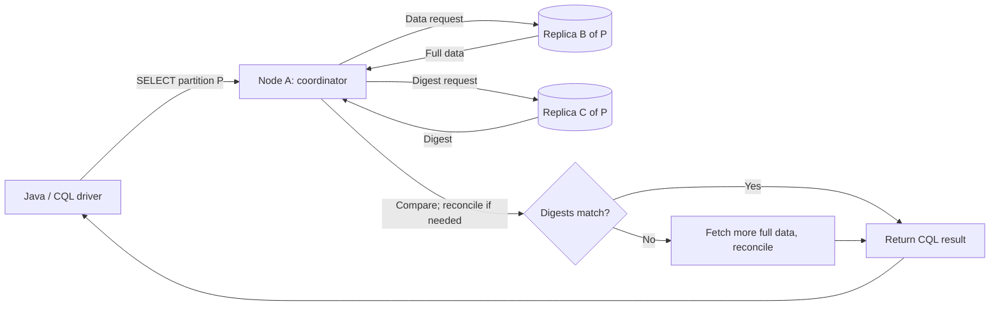
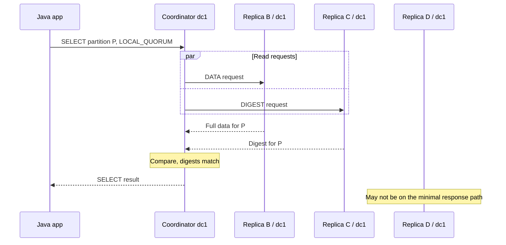
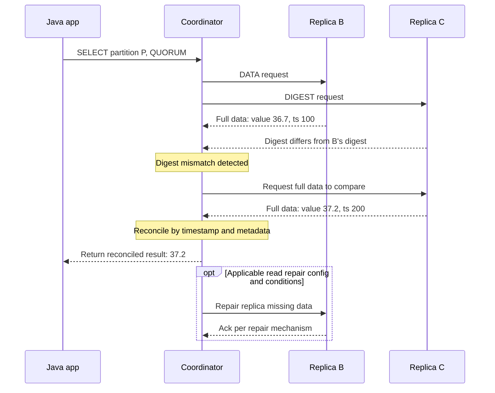
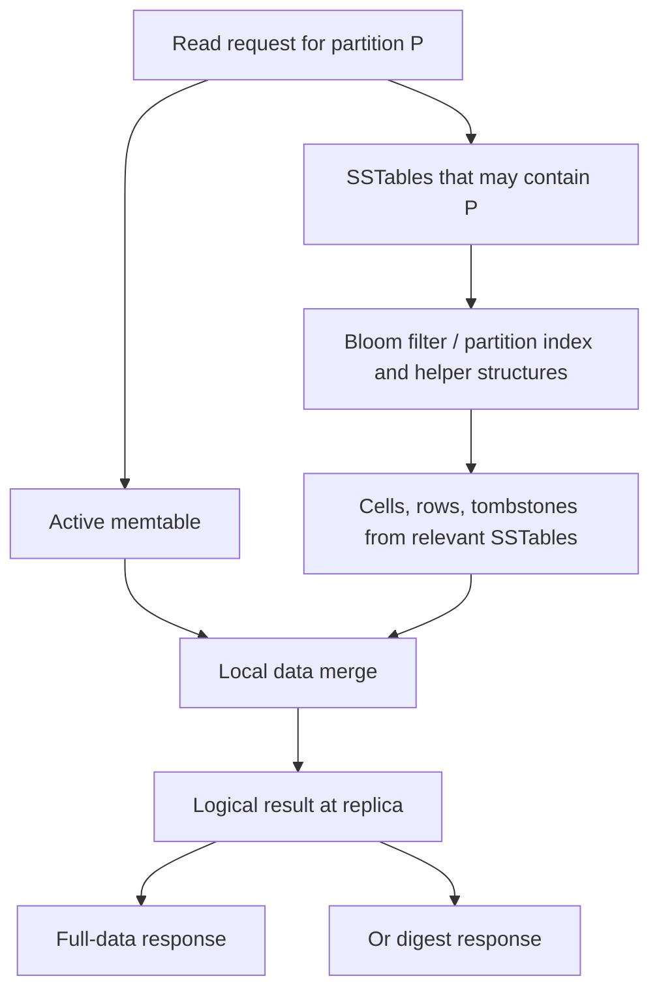

# Read Path, Digest Responses, and Version Reconciliation

In Apache Cassandra, a `SELECT` request is not necessarily processed by a node holding all the requested data. A Java application sends CQL to a node, which acts as the **request coordinator**, locates the **replicas** storing the partition, collects responses according to the **consistency level (CL)**, and returns the data to the client. To reduce network traffic, replicas can respond with either **full data** or a **digest**. If the compared contents differ, the coordinator must fetch the differing versions and perform **reconciliation** to determine the read result.

This is a fundamental aspect of distributed wide-column architecture: multiple copies of a partition may **not have converged at the exact same moment**, yet Cassandra must still answer queries under the specific guarantees of the chosen CL. Mastering the read path helps you design partition keys, select CLs, troubleshoot replica failures, plan repairs, and build Java applications with predictable latency.

After this lesson, you will be able to:

- Trace the path of a `SELECT` from the Java Driver to the coordinator, replicas, digests, and final response.
- Distinguish a full-data response from a digest response, and explain why digests match or differ.
- Describe how Cassandra reconciles versions at the cell level using timestamps, tombstones, TTLs, and data semantics.
- Distinguish **reconciliation**, **read repair**, and **anti-entropy repair**.
- Predict the impact of RF, `ONE`, `LOCAL_QUORUM`, and `QUORUM` on consistency and availability.
- Practice CQL tracing, partition-key queries, and using Java Driver 4.x to observe data reads.

## 1. How Is a Read Query Coordinated?

Cassandra organizes its cluster in a **peer-to-peer** model. The node receiving a request from a client is the **coordinator for that request**; there is no fixed read master. A node acting as coordinator may itself be a replica storing the target partition, or it may simply mediate communication with other replicas.

For a query that specifies the partition key, the high-level path is:

1. The application builds a `SELECT`, passes parameters, and selects a CL.
2. The CQL driver chooses a node to receive the request based on topology, load-balancing policy, and token-aware routing capability.
3. The coordinator extracts the partition key, computes the token, inspects cluster metadata, and identifies the replica set according to the replication strategy.
4. The coordinator sends read requests to appropriate replicas, with the **response payload type** and **required response count** matching the CL, version, and execution optimizations.
5. The coordinator compares results/digests; if necessary, it fetches additional data and reconciles versions.
6. The coordinator returns the CQL rowset to the driver once the required conditions are met; the driver decodes them into `Row` objects for the application.



The diagram illustrates a case where multiple responses must be compared. With a CL requiring only one replica, digest comparison against another replica is **not performed by default**. Which replicas are contacted and how messages are sent can vary by CL, replica count, response latency, and Cassandra version.

### Coordinator and Replica Can Be the Same Node

If the driver knows the full partition key and metadata, **token-aware routing** can prefer a replica of the partition as the coordinator, saving one network hop. If the request arrives at another node, that node can still coordinate it. The coordinator role **changes per request**, whereas whether a node is a replica of a partition depends on tokens and the replication strategy.

## 2. Partition Key, Tokens, DC/Rack, and the Replica Set

In Cassandra, the **partition key** is not merely a `WHERE` filter condition; it determines which nodes store the partition.

Suppose keyspace `telemetry` has:

- `NetworkTopologyStrategy`.
- Replication factors `RF_dc1 = 3` and `RF_dc2 = 3`.
- Enough nodes/racks to distribute three distinct replicas in each DC.
- Applications in `dc1` normally send requests to coordinators in `dc1`.

When reading partition P, the coordinator uses the partition's token to identify **three replicas in `dc1` and three replicas in `dc2`**. Replicas are not picked randomly on every read. Partition Q can have a different replica set because its partition key hashes differently.

```text
Partition key from SELECT
          |
          v
      Hash -> token
          |
          v
  Token ownership + NetworkTopologyStrategy
          |
          +--> dc1: replicas P1, P2, P3
          |
          +--> dc2: replicas P4, P5, P6
          |
          v
   Coordinator contacts replicas per CL
```

**Racks** help Cassandra spread copies across independent failure domains when possible; **DCs** define replication scope and the meaning of local CLs. If a rack containing a replica of P fails, how many replicas of P remain reachable in the DC determines whether the read can still satisfy the CL.

Do not think of the token ring as a physical network loop through which every request must pass node-by-node. It is a **logical** data distribution model; the coordinator and replicas exchange messages directly according to the actual network topology.

## 3. What Is a Full-Data Response?

A **full-data response** contains the actual data result for the queried partition or slice. Depending on the `SELECT` statement, the data read may include cells, metadata required for reconciliation, tombstone information, and other fields needed by the internal protocol; the application ultimately receives only the rows and columns requested by CQL.

For example, the application needs the 20 latest measurements for device D on day N:

```sql
SELECT event_time, event_id, temperature_c
FROM telemetry.measurements_by_device_day
WHERE tenant_id = 11111111-1111-1111-1111-111111111111
  AND device_id = 22222222-2222-2222-2222-222222222222
  AND event_day = '2026-11-21'
LIMIT 20;
```

A replica executes the query against its local data and returns the **actual content** needed by the coordinator. Full data can be sizable when partitions are large or results span many cells; thus requesting full data from every replica solely to verify agreement would significantly increase network traffic.

**Full data does not mean reading the entire partition in every situation.** Filters, slices, clustering order, paging, and result limits affect how much data must be read and transmitted; internal optimizations also depend on Cassandra version and data characteristics.

## 4. What Is a Digest Response and Why Is It Useful?

A **digest** is a summary checksum of the read result, typically computed by hashing a logical representation of the data relevant to the query. A replica can return a digest instead of sending all cells back to the coordinator. The coordinator compares that digest against the corresponding digest of the full data it received.

| Response Type | What Does It Contain? | What Is It Used For? |
|---|---|---|
| **Full data** | Detailed data to construct the read result, along with required internal metadata. | Gives the coordinator concrete data to return or reconcile. |
| **Digest** | A summary/checksum validating the equivalence of the read data. | Detects when replicas hold differing results with much lower network overhead than full data. |

Simple example: Replicas B and C both have the logical result `temperature_c = 36.7` with identical comparable version metadata; their digests are expected to match. If B holds version `36.7` while C holds version `37.2`, the digests will differ, signaling the need to compare detailed data.

**A digest is neither a copy of the data nor a way to reconstruct rows.** From C's digest alone, the coordinator cannot deduce that C holds `37.2`; it must request **full data** if reconciliation is needed.

Nor is a digest a byte-level comparison of **SSTable files**. Two replicas can store identical logical data while having flushed or compacted into SSTables with different physical layouts. That alone does not make their read-result digests differ.

### What Does a Matching Digest Tell You?

When the data and corresponding digest match, the coordinator can return the received full-data response to the client, provided the **CL is satisfied**. A matching digest only confirms equivalence within **the scope of the responses compared for that request**; it does **not** prove that every other replica, every partition, or every DC in the cluster is fully synchronized.

### What Does a Digest Mismatch Tell You?

A digest mismatch indicates a difference in the compared content, or a metadata/version difference affecting the check. The coordinator then needs more information to assemble a valid result. Do not jump to the conclusion that "a replica has corrupted data": missed recent mutations, replication lag, tombstones, TTLs, or concurrent writes can all cause replicas to differ at read time.

## 5. Normal Read Path When Digests Match

Suppose `dc1` has RF = 3, the coordinator is in `dc1`, and the query uses `LOCAL_QUORUM`. When there are no errors and no extra reads needed, a typical path is:

1. The coordinator requests **full data** from one appropriate replica.
2. The coordinator requests a **digest** from another replica to meet the minimum CL response count.
3. The first replica returns the data; the second replica returns the digest.
4. The coordinator compares the corresponding hashes and sees that they match.
5. Since two matching responses from `dc1` have been gathered, the coordinator returns the result to the client.



This is an **explanatory model**, not a guarantee that Cassandra always picks B for full data, C for digest, or contacts only two replicas. Depending on version, the coordinator may apply latency optimizations, send speculative/retry requests, or contact additional replicas. The purpose of the illustration is to separate **sufficient responses** from **total existing copies**.

With `ONE` or `LOCAL_ONE`, a single valid response can be enough to reply to the client; without further comparison, the query can return stale data held by that replica. With `ALL`, the response requirement is much stricter and far more prone to fail if a replica is unresponsive.

## 6. On Digest Mismatch: Fetching More Data and Reconciling

Suppose B holds temperature `36.7` and C received a newer update `37.2`. If the coordinator fetches full data from B and a digest from C, the digests will mismatch. The coordinator **cannot pick a value from a digest alone**; it must obtain the detailed data required to reconcile.



In real deployments, how many replicas are asked for full data and when the client receives a reply may differ from this diagram; certain **read repair** modes wait for the repair writes before replying. If the version/configuration does not require blocking on repair, reconciliation can still produce the right read result without immediately synchronizing every replica.

Three activities to distinguish:

1. **Discrepancy detection:** a digest mismatch indicates that responses disagree.
2. **Version reconciliation:** the coordinator gathers enough data to determine the effective cells in the result.
3. **Replica repair (read repair):** the system can write the reconciled data back to replicas that were behind, with scope and blocking behavior depending on configuration.

Data reconciliation serves **the current request's result**; read repair serves **replica state**. The two goals are related, but they are not a single operation.

## 7. What Rules Does Cassandra Use to Reconcile Versions?

At a fundamental level, Cassandra uses **last-write-wins by cell timestamp** to reconcile mutations. Each cell can carry a timestamp; timestamp comparison rules along with tombstone/TTL semantics determine the effective value. This is a **logical timestamp attached to the mutation**, not necessarily the wall-clock arrival order at a coordinator.

### Example: Two Replicas Holding Different Values

| Replica | Value of `temperature_c` | Illustrative Timestamp | During Reconciliation |
|---|---:|---:|---|
| B | 36.7 | 100 | Older version. |
| C | 37.2 | 200 | Newer version; selected for this cell. |
| D | 36.7 | 100 | May need updating if participating in repair. |

For the same key and the same cell, the version at timestamp `200` beats timestamp `100` under normal rules. If **different columns** were updated by different mutations, the resulting row can be a combination of valid cells coming from **multiple replicas**, rather than simply "picking the entire row from the newest node."

Notes:

- The **largest timestamp** does not automatically equal **the last request to reach a node** if clock synchronization drifts or the application specifies `USING TIMESTAMP`.
- Equal timestamps have deterministic tie-breaking rules involving mutation type and cell contents. Never build business logic assuming two concurrent writes with the same timestamp will resolve by "network arrival order."
- Cassandra does not turn every `UPDATE` into a locked transaction. For conditional updates requiring strict semantics, use **lightweight transactions (LWT)** such as `IF`/`IF NOT EXISTS` and account for consensus overhead.

### Tombstones: Deletes Are Also Versions to Reconcile

`DELETE` does not necessarily remove physical data from every replica the instant the client receives success. Cassandra writes a **tombstone** with a timestamp to mark prior data as deleted.

For example:

- Replica B holds cell `state = "ACTIVE"` at timestamp `100`.
- Replica C holds a tombstone deleting that cell at timestamp `200`.
- When reconciled within the valid window, the **newer tombstone** prevents the older value on B from reappearing.

Reads or repairs may need to process tombstones to ensure accurate results. Skipping repair for too long until tombstones are purged under retention rules can risk **deleted data resurrection** under certain conditions. That is why repair schedules and `gc_grace_seconds` must align with replica outage windows and data lifecycles; never lower `gc_grace_seconds` just to "reduce tombstones" without understanding the consequences.

### TTL and Expired Data

Values written with a `TTL` expire after the configured duration. During reads, replicas and coordinators must honor expiration state and associated metadata. Two replicas may not have fully converged yet, but reconciliation must not arbitrarily resurrect an expired value.

### Why Can Reads Slow Down During Conflicts?

A normal read may only need one full-data response and digests. On a digest mismatch, the coordinator may have to request additional **full data** and perform reconciliation, possibly followed by read repair. These extra steps increase network traffic, CPU, I/O, and tail latency. If conflicts or tombstones happen constantly, investigate replication health or data modeling rather than merely raising timeouts.

## 8. How Do Read Repair and Anti-Entropy Repair Differ?

**Read repair** occurs during or alongside the read path when Cassandra detects divergent copies and configuration permits fixing them. **Anti-entropy repair** is a broader comparison process to synchronize partitions across replicas, typically run proactively using tools such as `nodetool repair`.

| Criterion | Read Repair | Anti-Entropy Repair |
|---|---|---|
| Trigger | Some read queries detect divergence when comparing replicas. | Operational/scheduled repair task independent of any single SELECT. |
| Scope | The subset of data touched by the read request, depending on version and settings. | Token/partition ranges across repaired replicas. |
| Goal | Helps heal inconsistencies observed during reads. | Synchronizes data across replicas, including data never read by users. |
| Client latency | Can add latency if repair blocks the read response. | Primarily adds cluster load; not an inline step of every SELECT. |
| Limitation | Does not guarantee detecting divergence in unread partitions. | Requires resources, monitoring, and an appropriate schedule. |

### `read_repair` Options in Cassandra 4.x

In Cassandra 4.x versions, the `read_repair` table option supports modes such as:

- `BLOCKING`: read repair can **wait for repair write acknowledgments** under appropriate conditions before completing the read path, helping preserve **monotonic quorum reads** under Cassandra's documented conditions.
- `NONE`: does not perform that blocking read repair; **reconciliation may still be needed to return the correct result for the request**. This mode carries semantic trade-offs for multi-row/multi-partition batch scenarios.

Choosing a mode must be based on your **Cassandra version**, table, and application requirements. Never assume read repair behaves identically across every version or that enabling `BLOCKING` guarantees the cluster can never diverge. Read repair does not replace periodic repair, replication, or failure monitoring.

## 9. How Is Data Found Inside a Replica?

When a replica receives a full-data request, it must look up the partition in the **memtable** and existing **SSTables**. Inside the node, Cassandra uses indexes and helper structures such as partition indexes, bloom filters, and caching (depending on table and version) to avoid unnecessary I/O.



**SSTables are immutable**: an `UPDATE` does not overwrite old bytes in place inside an SSTable. A replica may need to merge fragments from the memtable and multiple SSTables to determine the effective cells and tombstones. Only then does it have the logical data to send back to the coordinator or hash into a digest.

This explains three commonly confused phenomena:

- A **compaction backlog** can leave many SSTables containing fragments of a single partition, increasing read cost.
- **Many tombstones** can force a replica to scan deletion markers even when few live rows are returned.
- A **hot partition** can overload a few replicas even when many nodes in the cluster are idle.

Partition key design and partition size directly affect reads, not merely which node stores the data. Queries specifying the complete partition key are generally far more efficient than queries forced to scan multiple partitions with `ALLOW FILTERING`.

## 10. Consistency Level on Reads: How Many Responses Are Required?

Assume `RF_dc1 = 3`, `RF_dc2 = 3`, coordinator in `dc1`, and no transient replication:

| Read CL | Minimum Condition | Notes |
|---|---|---|
| `ONE` | One replica of the partition. | Latency can be low, at the risk of reading stale data. |
| `LOCAL_ONE` | One replica in `dc1`. | Does not need `dc2` replicas to satisfy the acknowledgment condition. |
| `LOCAL_QUORUM` | `floor(3 / 2) + 1 = 2` replicas in `dc1`. | Enables comparison and reconciliation within a local quorum. |
| `QUORUM` | `floor(6 / 2) + 1 = 4` replicas across total RF. | May need to contact replicas across DCs, increasing cross-region network dependency. |
| `ALL` | All six replicas. | Sensitive to failure or slowness on any single replica; often fragile under partial outages. |

CL **does not determine how many copies are stored**; RF does that. CL determines how many valid responses are sufficient for the coordinator to return a result. A replica holding newer data that **is not among the queried/responding replicas** can leave a lower-CL query returning stale data.

### Understanding the `R + W > RF` Rule Correctly

With **one DC, RF = 3**, if writes require `W = 2` ACKs (quorum) and reads require `R = 2` responses (quorum), then:

```text
R + W = 2 + 2 = 4 > RF = 3
```

Two replica sets of these sizes **must overlap at least at one replica**. This property explains why quorum read/write pairs are a popular choice when you want to observe acknowledged writes. However:

- Concurrent writes, clock skew/timestamps, TTLs, tombstones, timeouts, and replica health still affect outcomes.
- `R + W > RF` must be evaluated within **the same replica set / DC scope**. Writing at `LOCAL_QUORUM` in `dc1` and immediately reading at `LOCAL_QUORUM` in `dc2` does not guarantee overlap: both sets are local, but to **two different DCs**.
- Quorum overlap does not create **linearizable transactions** for arbitrary CQL. Conditional statements use LWT with their own protocol and guarantees.

For read-after-write flows within the same DC, pairing `LOCAL_QUORUM` for both writes and reads is a common design, while still requiring analysis of application semantics, failure limits, latency, and access timing.

## 11. When a Replica or Coordinator Fails

A failure on the read path is not the same as a total cluster failure. One partition can lose quorum while other partitions remain queryable. Common cases:

| Situation | Possible Behavior | How to Analyze |
|---|---|---|
| Replica receiving `DATA` goes down before responding | Coordinator may try another eligible replica if time and policy permit. | Check available replicas within CL scope. |
| Data replica responds, but digest replica does not arrive in time | `ReadTimeout` may occur if required responses miss the deadline. | A timeout does not mean no replicas have the data. |
| Digests differ | Coordinator must fetch more full data to reconcile and may trigger read repair. | Latency increases due to extra messages and processing. |
| Not enough replicas considered alive to satisfy CL | May immediately return `Unavailable`. | Check DC, RF, node health, and network paths. |
| Replica throws an error while reading | May surface as `ReadFailure` or equivalent error depending on version/driver. | Distinguish internal processing failures from missing ACKs. |
| Coordinator dies mid-request | Driver sees connection loss/timeout and may pick another coordinator per policy. | There is no fixed read master; the request can be retried. |
| Connectivity drops between `dc1` and `dc2` | `LOCAL_QUORUM` inside each DC can continue if enough local replicas exist; cluster-wide `QUORUM` may fail. | CL scope determines whether cross-DC networking is required. |

### Retries and Speculative Execution on the Read Path

Normal `SELECT` reads can be retried on timeouts under suitable conditions, though unbounded retries will overload struggling nodes. Drivers must bound retries and respect timeouts and load-balancing policies. **Speculative execution** can fire a backup read request to another coordinator if the first is slow; in exchange, it increases network/cluster load and may observe slightly different states if data is concurrently changing.

When reading via paging, do not treat `SELECT` pages as an isolated transactional snapshot of continuously changing data. Concurrent mutations and differing read times can affect what is observed across pages.

### Can Digests Match Yet Data Still Not Be What Was Expected?

Yes. Matching digests **among the compared replicas** do not imply that:

- Another unqueried replica does not hold a newer version.
- Application clocks and timestamps have no skew.
- The `WHERE` clause or table design selected the right partition and all business rows.
- No concurrent write happened immediately after the result was returned.

Digests are a tool for detecting divergence **within a specific read**, not a global guarantee of freshness or business-model correctness.

## 12. Complete CQL Example: Querying by Partition

On a properly configured test cluster with DCs `dc1` and `dc2`, create the keyspace/table:

```sql
CREATE KEYSPACE telemetry
WITH replication = {
  'class': 'NetworkTopologyStrategy',
  'dc1': 3,
  'dc2': 3
};

CREATE TABLE telemetry.measurements_by_device_day (
    tenant_id uuid,
    device_id uuid,
    event_day date,
    event_time timestamp,
    event_id uuid,
    temperature_c double,
    PRIMARY KEY ((tenant_id, device_id, event_day), event_time, event_id)
) WITH CLUSTERING ORDER BY (event_time DESC, event_id ASC);
```

Insert a sample row:

```sql
INSERT INTO telemetry.measurements_by_device_day
  (tenant_id, device_id, event_day, event_time, event_id, temperature_c)
VALUES (
  11111111-1111-1111-1111-111111111111,
  22222222-2222-2222-2222-222222222222,
  '2026-11-21',
  '2026-11-21T08:30:00+07:00',
  33333333-3333-3333-3333-333333333333,
  36.7
);
```

Read the same partition at `LOCAL_QUORUM` using `cqlsh`:

```sql
-- The next two lines are cqlsh commands, not CQL SELECT syntax.
CONSISTENCY LOCAL_QUORUM;
TRACING ON;

SELECT event_time, event_id, temperature_c
FROM telemetry.measurements_by_device_day
WHERE tenant_id = 11111111-1111-1111-1111-111111111111
  AND device_id = 22222222-2222-2222-2222-222222222222
  AND event_day = '2026-11-21'
LIMIT 20;

TRACING OFF;
```

With the full key supplied, the coordinator resolves a single partition; clustering order retrieves the most recent timestamps first. Omitting `event_day` leaves the partition key incomplete. Cassandra will normally reject the query or require another access path; casually adding `ALLOW FILTERING` can force the cluster to scan large volumes of data and cause severe latency.

### How to Read Tracing Output

The trace can show sending requests to replicas, receiving data/digests, completing, or issuing follow-up messages. **Do not assume every trace displays a "digest mismatch" event**: if replicas agree, there is no mismatch; event details also depend on version, optimizations, and trace level. Enable tracing selectively since tracing adds processing overhead and persists trace metadata.

Intentionally making replicas diverge to test read repair should only be done in a dedicated learning Cassandra environment under controlled procedures; never alter state or stop nodes in a production cluster for experiments.

## 13. Java Driver 4.x: Reading Data with Explicit CL

This example uses the `com.datastax.oss.driver` API from Apache Cassandra Java Driver 4.x. The prepared statement contains all **three partition key components**, allowing the driver to derive the routing key and prefer an appropriate local node:

```java
import com.datastax.oss.driver.api.core.CqlSession;
import com.datastax.oss.driver.api.core.DefaultConsistencyLevel;
import com.datastax.oss.driver.api.core.cql.BoundStatement;
import com.datastax.oss.driver.api.core.cql.PreparedStatement;
import com.datastax.oss.driver.api.core.cql.Row;

import java.net.InetSocketAddress;
import java.time.LocalDate;
import java.util.UUID;

public class ReadMeasurements {
    public static void main(String[] args) {
        UUID tenantId = UUID.fromString(
            "11111111-1111-1111-1111-111111111111");
        UUID deviceId = UUID.fromString(
            "22222222-2222-2222-2222-222222222222");
        LocalDate day = LocalDate.parse("2026-11-21");

        // 192.0.2.0/24 is an example network reserved for documentation.
        try (CqlSession session = CqlSession.builder()
                .addContactPoint(new InetSocketAddress("192.0.2.10", 9042))
                .addContactPoint(new InetSocketAddress("192.0.2.11", 9042))
                .withLocalDatacenter("dc1")
                .build()) {

            PreparedStatement prepared = session.prepare(
                "SELECT event_time, event_id, temperature_c " +
                "FROM telemetry.measurements_by_device_day " +
                "WHERE tenant_id = ? AND device_id = ? AND event_day = ? " +
                "LIMIT 20"
            );

            BoundStatement read = prepared
                .bind(tenantId, deviceId, day)
                .setConsistencyLevel(DefaultConsistencyLevel.LOCAL_QUORUM);

            for (Row row : session.execute(read)) {
                System.out.printf(
                    "%s | %s | %.2f C%n",
                    row.getInstant("event_time"),
                    row.getUuid("event_id"),
                    row.getDouble("temperature_c")
                );
            }
        }
    }
}
```

The contact points in the example must be replaced with real node addresses, and `dc1` must match the cluster's DC name. The driver prefers local nodes thanks to `withLocalDatacenter("dc1")`; initial contact points are **not the sole nodes** handling all requests. For large result sets, `SELECT` results can be split into multiple pages that the driver fetches incrementally as the application iterates.

CL is set **per request**, not on the table schema; an application can use one execution profile for monitoring dashboards and another for workflows requiring higher freshness. A `SELECT` is generally safer to retry under controlled limits than non-idempotent mutations, though total time and cluster load must still be bounded.

## 14. Diagnostic Tools and Symptoms for Slow or Inconsistent Reads

Useful commands in operational environments:

```bash
nodetool status
nodetool describecluster
nodetool tablestats telemetry.measurements_by_device_day
nodetool tpstats
```

- `nodetool status` shows DCs, racks, which nodes are `UN` (*Up/Normal*), and any nodes exhibiting abnormal states.
- `nodetool describecluster` provides cluster and schema overview information to check topology agreement.
- `nodetool tablestats` reports table metrics, which may include tombstones, latencies, and SSTable counts depending on version.
- `nodetool tpstats` exposes thread pool queues and internal tasks when suspecting a slow or overloaded node.

| Symptom | Investigation Directions |
|---|---|
| `LOCAL_ONE` reads are fast but occasionally return stale values | The chosen replica may not have converged; check writes, hints, repairs, and replica sync. |
| `LOCAL_QUORUM` reads show rising tail latency | Check slow replicas, read repair, digest mismatches, network, and SSTable/tombstone pressure. |
| `ReadTimeout` when a rack loses connectivity | Are partition replicas distributed across racks? How many ACKs does CL need in that DC? |
| Reading from another DC returns stale data | Compare CL and DC scope of both writes and reads; verify cross-DC replication status. |
| Querying one device degrades as history grows | Check partition size, daily/hourly bucketing, clustering order, paging, and tombstones. |
| Unexpected data remains visible after `DELETE` | Check timestamps, repair, tombstones, offline duration, and `gc_grace_seconds` setting. |

Do not blame digests for every unexpected read result: digests simply **detect disagreement** among the queried replicas. Root causes may lie in lagging replication, reading from the wrong DC or partition, concurrent writes, timestamps, tombstones, or query logic.

### Checklist When Investigating a Read Request

1. What is the request's partition key, and are all components specified?
2. Which DC is the coordinator in? Does the driver have enough metadata for token-aware routing?
3. What is the keyspace RF in each DC, and on which nodes/racks do the replicas actually reside?
4. How many responses does CL require and from which scope?
5. Which full-data and digest responses were collected? Were there mismatches, timeouts, or blocking read repairs?
6. What event could have left replicas with differing versions, tombstones, or TTLs?
7. Is there an appropriate repair and monitoring plan after network or node outages?

## 15. Self-Practice Scenarios

**Scenario A — Differing digests:** B returns full data `36.7@100`, while C returns a non-matching digest. Can the coordinator deduce C's value from the digest alone? **No.** It must request the appropriate full data and reconcile by timestamp and metadata.

**Scenario B — Local quorum:** `RF_dc1 = 3`; how many responses does `LOCAL_QUORUM` require? **Two replicas in `dc1`.** Does that prove `dc2` is synchronized? **No.**

**Scenario C — Write in one DC, read in another:** A `LOCAL_QUORUM` write succeeds in `dc1`, followed immediately by a `LOCAL_QUORUM` read in `dc2`. Why might stale data still be seen? **The two local quorum sets do not overlap**, and cross-DC replication may not have completed yet.

**Scenario D — Competing timestamps:** B holds `state = "NEW"@300`, while C holds `state = "PAID"@250`. During normal reconciliation, which cell wins? **`NEW@300`**, even if business logic might expect `PAID`. That is why timestamps and update rules must be managed carefully; never equate network order with business order.

**Scenario E — Deleted data:** B holds `status = "ACTIVE"@100`, while C has a tombstone `@200`. Will valid reconciliation bring back `ACTIVE`? **No**, as long as the newer tombstone is retained and properly applied. When a replica stays offline too long, pay close attention to repair schedules and tombstone lifecycles.

**Scenario F — All digests match:** Two queried replicas return matching data and digest. Can you conclude every other replica in every DC is consistent? **No.** What was observed only covers the responses within that request's scope.

## 16. Summary of the Read Model

A `SELECT` statement in Cassandra goes through a sequence of decisions:

```text
Java Driver: choose coordinator
            |
            v
Coordinator: partition key -> token -> replica set by RF/topology
            |
            +--> Replica B: full data
            |
            +--> Replica C: digest (if comparison needed)
            |
            v
      Compare responses
        /             \
   Match            Mismatch
     |                    |
     |           Fetch more full data
     |                    |
     |           Reconcile timestamps,
     |           tombstones, TTLs, cells
     |                    |
     +----------+---------+
                |
       CL satisfied?
                |
                v
      Return result to client
                |
       Read repair if applicable;
       periodic repair runs separately
```

**Full data** supplies concrete results; **digests** check equivalence with low bandwidth; **reconciliation** determines the effective version when replicas differ; **read repair** can heal some discrepancies found during reads; and **anti-entropy repair** handles broader cluster synchronization. Combining this understanding with **partition keys, replication factor, consistency level, DC/rack topology, SSTables/compaction**, and Java Driver configuration lets you design queries, reason about data freshness, and diagnose distributed failures systematically.
