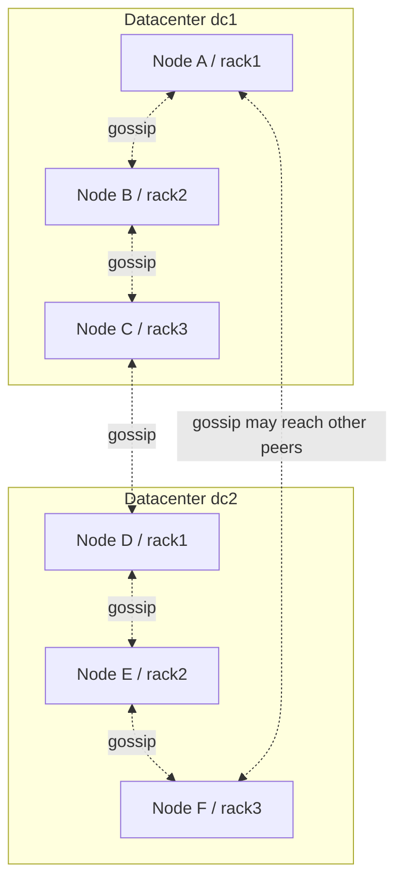
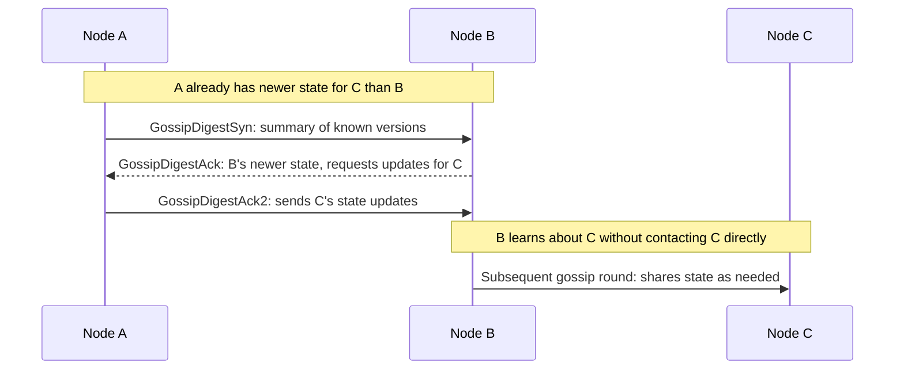
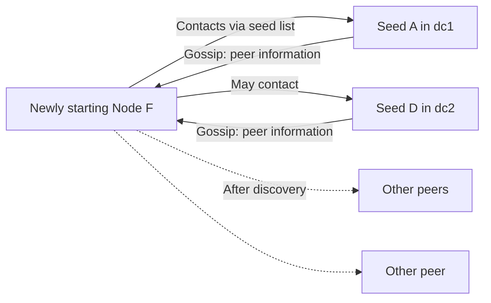
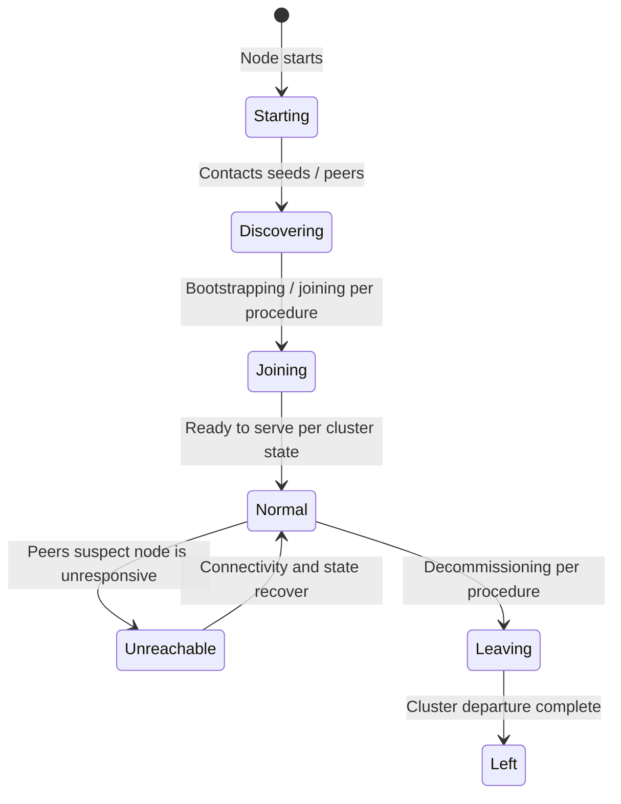
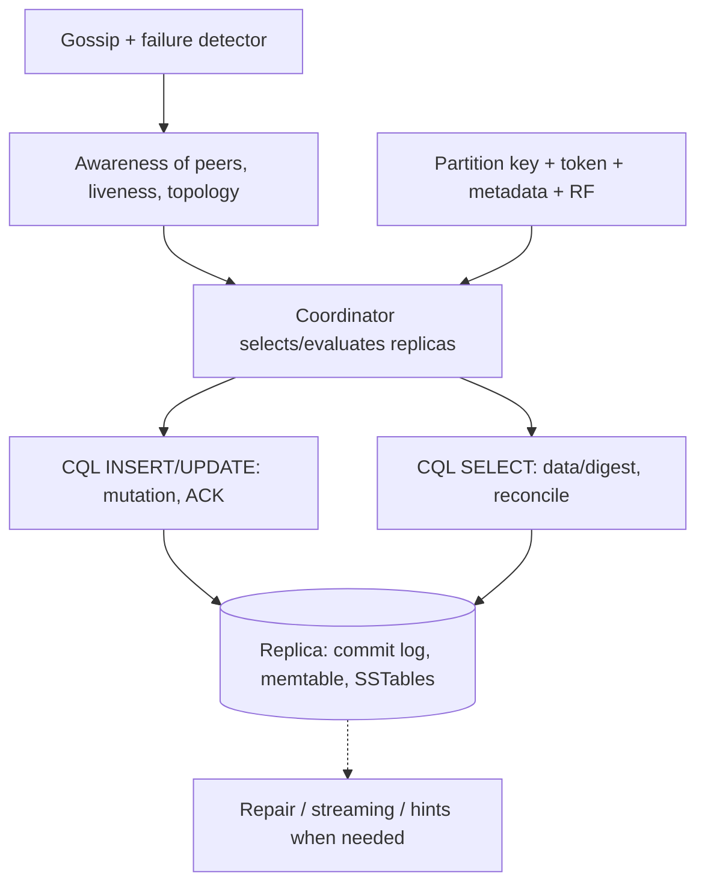

# Gossip and Membership State Propagation

Apache Cassandra is a **distributed wide-column** database using a **peer-to-peer** architecture. There is no fixed master maintaining a membership directory or broadcasting notifications to every node when the cluster changes. Instead, nodes exchange state via **gossip**: each node periodically contacts a few peers to share what it knows about other members. Information propagates gradually through the cluster, allowing nodes to build a shared awareness of topology and peer up/down status.

Gossip answers the question **"Which nodes exist in the cluster and how are they currently perceived?"** It does not replace data replication, consistency level selection, fixing divergent records, or transaction management. To operate Cassandra properly, you must distinguish the state-propagation protocol, **failure detector**, **seed nodes**, cluster metadata, and the CQL request flow between coordinators and replicas.

After this lesson, you will be able to:

- Explain how gossip operates without a central control server.
- Distinguish *membership*, *liveness*, and *application state*; understand heartbeat, generation, and version in gossip state.
- Describe the roles of seed nodes, snitches, racks/datacenters, and the failure detector.
- Analyze scenarios where a node starts, joins, stops responding, recovers, or becomes network-partitioned.
- Interpret `nodetool status` and `nodetool gossipinfo` outputs and recognize the limits of each single view.
- Understand how membership changes impact replication, consistency levels, and Java Driver clients.

## 1. Why Does a Cluster Need Gossip?

Suppose a cluster has six nodes spanning two datacenters:



The dashed lines illustrate **possible exchanges**, not six fixed gossip connections. In each interval, a node selects peers to exchange state with; over multiple rounds, state spreads across the cluster.

Consider a scenario: B restarts, D loses network connectivity for several minutes, and F is being added to the cluster. To route requests to appropriate replicas, nodes need to know which peers exist and which appear available. If only a single central node held this list, that node would easily become a bottleneck or single point of failure. Gossip enables peers to **disseminate state themselves** and keep operating when some members stop responding.

Gossip has three key properties:

1. **Decentralized:** there is no "gossip master" or leader node responsible for broadcasting orders to the entire cluster.
2. **Epidemic / gradual propagation:** each round contacts only a subset of peers; updates may reach different nodes at different times.
3. **Eventually convergent:** when connectivity is stable and nodes continue gossiping, views of cluster state tend to converge; over brief intervals, they may temporarily disagree.

The third property is especially important: **gossip is not a synchronous cluster-wide transaction**, nor does it guarantee that every node simultaneously learns of a failure or marks a peer down at the exact same instant.

## 2. Membership, Liveness, and Application State Are Three Different Layers

When reading `nodetool gossipinfo` output, it is easy to lump everything together as "node state." Separate these three concepts:

| Concept | Question It Answers | Example |
|---|---|---|
| **Membership** | Which endpoints/nodes are known to the cluster? | Nodes A, B, and C have joined or are known in the cluster. |
| **Liveness** | Is the peer responding as expected from this node's perspective? | A sees B as UP; A suspects D is unresponsive. |
| **Application state** | Which Cassandra-related states or attributes does the peer advertise? | `DC`, `RACK`, `TOKENS`, `HOST_ID`, node lifecycle state. |

An **endpoint** usually refers to the node address used for internal Cassandra communication, which in modern versions/configurations can include both address and port. An endpoint is not the same as the CQL `9042` address that a Java application uses for queries.

A node can be:

- Known in membership yet temporarily **unresponsive**.
- Considered alive yet in **joining** or **leaving** state, not yet ready to serve its full data share like a normal node.
- Still running the Cassandra process yet unreachable over the network from certain peers.
- Answering CQL requests while experiencing an internal communication issue, causing state disagreement across nodes.

Therefore, "being listed," "being Up," and "being ready to hold replicas for tokens" are **distinct conditions**.

## 3. How Does Gossip Exchange State?

In the gossip model commonly described for Cassandra 3.x/4.x, exchanges consist of three logical message types:

- **GossipDigestSyn:** a node sends a summary of the states it currently knows.
- **GossipDigestAck:** the peer replies with newer information it holds, while requesting missing or stale states from the initiator.
- **GossipDigestAck2:** the initiating node sends the remaining updates requested by the peer.

Message names are internal protocol details that may evolve or be optimized across Cassandra versions; the key takeaway is **comparing state versions and exchanging only what is needed**.



For example, A learns that C transitioned from ready to unresponsive. When A gossips with B, B learns that new state; B then spreads it to other peers. A does not need to send a direct notification to **every** node in the cluster at the exact same time.

### What Is Sent in One Round?

Gossip does not mean copying the entire state table on every round. The initiator sends **digests** identifying known states and versions; the peer compares them and exchanges only missing or outdated items. Thus, state traffic stays much smaller than continuously broadcasting full metadata to every node.

Cassandra uses a short gossip interval, around **one second per round** in many versions. This is a **typical processing cadence**, not a guarantee that every change reaches all nodes in exactly one second. Convergence latency depends on node count, load, network conditions, gossip scheduling, and peer responsiveness.

## 4. Heartbeat, Generation, and Version: How Does Gossip Know What Is Newer?

Gossip must distinguish fresh state from stale state relayed through another peer. In Cassandra's state representation, three concepts commonly appear:

| Component | Meaning | Why Is It Needed? |
|---|---|---|
| **Heartbeat** | Periodic progress counter of liveness at an endpoint. | Indicates the endpoint continues operating and propagating state. |
| **Generation** | Distinguishes state epochs for an endpoint, typically tied to a new startup. | Prevents stale state from before a restart from overwriting newer state. |
| **Version** | Marks each update to individual state entries within a generation. | Allows peers to tell which attribute/application state is newer and needs syncing. |

Imagine A previously held B's state at **generation 15, version 30**, and then B restarts and emits state under **generation 16**. B's state in the new generation should be treated as the current session's state, even if another peer still holds an older version. These numbers are illustrative only; they are **not** node addresses or partition record counts.

### A Heartbeat Is Not a Single Ping

Incrementing a heartbeat/gossip update and succeeding on a single network check are not identical. A node can pause due to GC or overload, packets can be delayed or dropped, and peers can interpret missing replies differently. The **failure detector** uses the history of heartbeat arrivals/updates to evaluate state, rather than checking one ping and immediately declaring a node dead.

### Attached Application States

Depending on Cassandra version, gossip output may contain attributes such as:

| Common Attribute | General Meaning |
|---|---|
| `DC`, `RACK` | Topology information advertised by the node. |
| `HOST_ID` | Logical identity of the node, distinct from a raw IP address. |
| `TOKENS` | Information related to tokens owned/advertised by the node in the corresponding metadata mechanism. |
| `STATUS` or `STATUS_WITH_PORT` | Node lifecycle status from the protocol/version perspective. |
| `RELEASE_VERSION` | Cassandra version advertised by the endpoint. |
| `SCHEMA` | Schema metadata digest/marker in certain versions/architectures. |

The list of keys and output format are **not fixed across versions**. Notably, Cassandra **5.0** introduces **Cluster Metadata Service / TCM** to manage cluster metadata changes in a more coordinated way. Do not copy every gossip-based schema/topology propagation detail from an older version verbatim onto 5.x. Gossip remains relevant for liveness and peer state, but consult version-specific documentation when analyzing **what serves as the source of truth for metadata changes**.

## 5. Seed Nodes Help Discover Peers, They Are Not Masters

A new or restarting node needs some initial contact addresses to discover other members. Those addresses are configured via the **seed provider**, and nodes providing initial contact are called **seed nodes**.

Bootstrap illustration:



**Seed is not a superior role.** A seed is still an ordinary Cassandra node—it can be a replica, coordinate requests, or fail just like any other node. It is not required to store every partition, does not approve every query, and does not maintain a master "central membership ledger."

Keep in mind:

- Configure **multiple appropriate seeds** so new nodes do not depend on a single initial address; spread them across real failure domains and DCs.
- Do not make **every node a seed**. An intentionally curated seed list is easier to operate.
- A node already in the cluster and talking to peers can keep serving when a seed goes down; however, **bootstrapping, restarting, and rediscovery** can become difficult if all reachable seeds are unavailable.
- The seed list must contain real endpoints reachable over the **internode network**. Confusing NAT addresses, firewalls, or CQL vs. internode ports breaks discovery.

### Example Seed Configuration (Illustrative)

On Cassandra using a typical `cassandra.yaml` layout, configuration may look like:

```yaml
cluster_name: 'telemetry-cluster'

seed_provider:
  - class_name: org.apache.cassandra.locator.SimpleSeedProvider
    parameters:
      - seeds: "192.0.2.11,192.0.2.21"

endpoint_snitch: GossipingPropertyFileSnitch
```

Addresses in `192.0.2.0/24` are documentation-only; they cannot be deployed verbatim. Exact syntax and parameters must match your running Cassandra version. This snippet does **not** replace `listen_address`, `broadcast_address`, authentication, encryption, or safe bootstrap procedures.

Changing the seed list also **does not automatically fix missing replica data**; seeds only assist cluster discovery. When a node actually joins to become a replica, metadata updates and **data streaming** follow dedicated procedures.

## 6. Gossip Propagates Topology State, Snitch Interprets DC/Rack

In Cassandra, every node has a topological location: it belongs to a **datacenter** and a **rack**. With `GossipingPropertyFileSnitch`, local information can be configured in `cassandra-rackdc.properties`:

```properties
# Example on a node in dc1, rack2
dc=dc1
rack=rack2
```

The snitch tells Cassandra the DC/rack location; gossip helps peers propagate relevant state information. In other environments, topology is determined by the corresponding cloud snitch or configuration mechanism. Thus, **a rack is not an independent gossip service**, and a node does not automatically know its DC/rack just from an IP address pattern.

**NetworkTopologyStrategy** uses DC/rack information to place replicas per the keyspace's RF. For example:

```sql
CREATE KEYSPACE telemetry
WITH replication = {
  'class': 'NetworkTopologyStrategy',
  'dc1': 3,
  'dc2': 3
};
```

With sufficient racks and nodes in the topology, Cassandra tries to place three copies of each partition on distinct racks **within each DC**. Gossip informs nodes about peers, but **does not pick RF**: RF belongs to the keyspace definition.

If a node advertises DC `dc_1` while the keyspace specifies `dc1`, do not expect Cassandra to treat them as equal. Incorrect rack/DC info can lead to unintended replica placement, inability to meet CL, and multiple replicas sharing a single physical failure domain.

**Never arbitrarily rename the DC/rack label of a node holding data.** Doing so affects replica placement/metadata and must follow version-appropriate topology migration procedures.

## 7. Gossip and the Failure Detector: Suspecting a Fault Differs from Confirming a Dead Node

Gossip propagates state, while the **failure detector** evaluates whether a peer appears unresponsive. Cassandra uses a **phi accrual failure detector** in common versions: instead of counting a fixed number of failed pings, it examines the historical distribution of inter-arrival intervals to compute a **suspicion level** (phi).

Intuitive explanation:

- A normally receives regular progress signals from B.
- Over some interval, A stops receiving updates at the expected cadence.
- The suspicion value rises with elapsed time and historical response variance.
- Once a configured threshold is exceeded, A can **convict/mark B down from A's viewpoint** and avoid picking B for operations needing live replicas.

The conclusion "B is down" here is **node A's assessment**, not hardware proof that B is powered off. B may still be running while experiencing:

- Network loss on the path to A.
- Long pauses from garbage collection, CPU saturation, or I/O overload.
- Internode messaging congestion, queues, or blocked worker threads.
- A network partition while remaining reachable by a different subset of peers.

**There is no cluster-wide majority vote just to mark a node down in gossip.** Peers can hold differing views until state and connectivity stabilize.

### Thresholds and Behavior on Flaky Networks

Parameters such as `phi_convict_threshold` can adjust failure detector sensitivity in some versions. Lowering the threshold too far may mark nodes down on brief latency spikes; raising it too high may prolong how long coordinators keep contacting an unresponsive node.

Do not treat tweaking the threshold as a knee-jerk fix whenever `DN` appears in `nodetool status`. First check **networking, node resources, GC, internode ports, clocks, logs, and actual Cassandra health**, then evaluate configuration against version recommendations.

## 8. Join, Restart, Leave Cycles and Lifecycle States

Gossip is tied to membership lifecycles, while topology changes also require managing metadata and data. At a high level, this can be modeled as:



This diagram is a **pedagogical model**: actual state names and transitions vary by version, especially when using newer cluster metadata management systems. Being in `Joining` or `Leaving` does not mean the node becomes a complete replica for every partition in one instantaneous step.

### A Newly Joining Node Needs More Than Gossip

When adding node F, it must:

1. Start up with proper identity, networking, DC/rack, and seeds.
2. Discover peers and validate cluster information.
3. Participate in the topology/metadata change workflow.
4. Receive its assigned data ranges via **streaming** or the corresponding bootstrap mechanism.
5. Transition to normal state once the appropriate conditions are satisfied.

Gossip helps other nodes learn that F is joining, but **it does not mean all partitions are already on F the moment peers see F's name**. Similarly, decommissioning a node must transfer/adjust replica responsibilities properly rather than simply killing the process and waiting for gossip to notice.

### Is a Restarted Node Treated as a Brand-New Node?

A normally restarted node retains its identity, data, and metadata. A new generation distinguishes fresh state from older state cached on peers. If changing IPs, changing host IDs, losing data, or replacing a failed node, follow the proper **replace/recovery procedure**; never copy node data/config onto another instance and boot both concurrently.

## 9. Gossip Affects Reads and Writes, Without Carrying Application Data

Placing gossip in the overall architecture:



Gossip provides part of the **decision-making context**, not application rows like a data replication protocol. When an application writes a mutation for partition P, the coordinator sends requests to **responsible replicas** based on token, replication strategy, and cluster state. On reads, the coordinator gathers data/digests per CL; version reconciliation or read repair happens separately.

| Mechanism | Typical Content | Purpose |
|---|---|---|
| **Gossip** | Membership/endpoint state and metadata. | Propagates peer awareness and liveness. |
| **CQL requests / internode messaging** | Queries, mutations, ACKs, data/digests. | Serves reads/writes requested by applications. |
| **Streaming** | Data for bootstrapping, topology changes, or related operations. | Transfers data ownership/copies between nodes. |
| **Hinted handoff** | Mutations missed by a replica within eligible limits. | Helps replay missed writes after a replica recovers. |
| **Anti-entropy repair** | Comparison summaries and data needed to sync replicas. | Reduces data divergence among replicas. |
| **Compaction** | Reading/rewriting SSTables on a single node. | Organizes local storage; not membership propagation. |

**Gossip alone does not guarantee every replica's data is consistent.** Node B may appear `UP` to A while still missing a mutation due to an earlier network drop. Data convergence must be evaluated using CL, hints, repair, tracing, and related diagnostics.

## 10. Example: Does Node D Going Down Cause Requests to Fail?

Suppose keyspace `telemetry` has `RF_dc1 = 3`, with three replicas of partition P—A, B, and C—in three different racks of `dc1`. A Java application sends requests at `LOCAL_QUORUM`, requiring **two qualifying responses** in `dc1`.

| Event | Gossip / Failure Detector View | Possible Consequence |
|---|---|---|
| C loses connectivity while A and B stay up | Peers gradually detect C as unresponsive. | `LOCAL_QUORUM` reads/writes can still succeed via A and B. |
| C stops responding right before being marked down | Membership/liveness may not yet be updated on every coordinator. | Some requests try C and time out; others still gather enough ACKs depending on path. |
| Both B and C become unreachable | Fewer than two replicas remain able to respond in the DC. | `LOCAL_QUORUM` cannot succeed if only A is available. |
| C returns after several hours | Gossip can again show C as `UP`. | C may still need hints/repair to catch up on missed writes. |
| One seed S goes down while A, B, and C communicate | Seeds are not masters; peers still retain known state. | The cluster can continue serving; new nodes need other seeds/discovery paths. |

If a DC has multiple racks and RF = 3, yet **all three replicas of P accidentally share one failure domain** due to misconfigured topology, a single switch failure can take out all three simultaneously. Accurate rack configuration is critical; gossip only spreads what nodes declare and cannot fix infrastructure misconfigurations on its own.

### Network Partitions Cause Divergent Perceptions

Suppose the three replicas in `dc1` split into two network sides: {A, B} and {C}. Unable to reach each other, each side may mark peers on the other side down. The `LOCAL_QUORUM` condition (2/3) can only be satisfied on the two-replica side **if a coordinator there can reach both A and B**.

Node C still running does not make a quorum request from C's side succeed. On the other hand, `LOCAL_ONE` requests may succeed in certain positions depending on replicas and network paths, trading off consistency. This comes from **RF and CL**, not from gossip "voting on which data is valid."

## 11. How Does Gossip Relate to the Java Driver?

A Java application communicates with Cassandra using the **native CQL protocol**, typically on port `9042`. It **does not participate in internode gossip**. The driver discovers nodes and topology through cluster metadata/protocol events, then maintains its own client-side view to select coordinators.

With Apache Cassandra Java Driver 4.x, you can inspect the metadata discovered by the driver:

```java
import com.datastax.oss.driver.api.core.CqlSession;
import com.datastax.oss.driver.api.core.metadata.Node;

import java.net.InetSocketAddress;

public class InspectCassandraTopology {
    public static void main(String[] args) {
        // Replace documentation IPs and DC name with real values.
        try (CqlSession session = CqlSession.builder()
                .addContactPoint(new InetSocketAddress("192.0.2.11", 9042))
                .addContactPoint(new InetSocketAddress("192.0.2.12", 9042))
                .withLocalDatacenter("dc1")
                .build()) {

            for (Node node : session.getMetadata().getNodes().values()) {
                System.out.printf(
                    "endpoint=%s dc=%s rack=%s%n",
                    node.getEndPoint(),
                    node.getDatacenter(),
                    node.getRack()
                );
            }
        }
    }
}
```

`192.0.2.11` and `192.0.2.12` belong to documentation-reserved IP ranges; this example only runs after substituting real endpoints. Configure `localDatacenter` to match the DC name advertised by the cluster.

Metadata seen by the driver **updates asynchronously**, so do not treat a single `getMetadata()` call as an instantaneous synchronous snapshot across every replica. The driver monitors metadata and connection health to adjust routing. A node may be excluded from the client's load-balancing plan due to CQL connection issues while some Cassandra peers still see it as alive via internode gossip.

### Contact Point, Seed, and Coordinator Are Not the Same Concept

| Entity | Who Uses It? | Role |
|---|---|---|
| **Contact point** | Java Driver and CQL clients. | Initial connection endpoint to bootstrap a session and discover the cluster. |
| **Seed** | Cassandra nodes on startup/join. | Initial contact endpoint to discover peers via cluster/gossip mechanisms. |
| **Coordinator** | A Cassandra node handling **one CQL request**. | Routes to replicas, collects responses per CL, and replies to the client. |
| **Replica** | Cassandra nodes storing a partition per metadata/RF. | Actually serves reads or stores mutations. |

You do not have to use seeds as your sole contact points. Choose contact points based on native CQL reachability and availability; choose seeds based on **internode** communication infrastructure.

## 12. Observing Gossip and Membership with Operational Commands

On a **test cluster** with Cassandra nodes running, these commands help inspect topology and state:

```bash
nodetool status
nodetool gossipinfo
nodetool describecluster
```

### `nodetool status`

This command groups nodes by DC/rack and commonly displays:

- `UN`: **Up / Normal** — the node is seen as alive and in normal lifecycle state from the queried perspective.
- `DN`: **Down / Normal** — the node is not seen as alive, even though its lifecycle state remains normal.
- Other states such as joining, leaving, or moving may appear depending on timing and version.

Those two letters describe **liveness + lifecycle state**, not a full data health check. An `UN` node can still be slow, full on disk, backed up on compaction, or holding unrepaired replicas.

### `nodetool gossipinfo`

`nodetool gossipinfo` displays **the gossip state known by the queried node** about endpoints. Exact formatting varies across versions, and can include heartbeat generation/version, DC/rack, host ID, release version, or status.

When analyzing it, check:

1. Which **endpoints** are known?
2. Did a new **generation/version** appear after a node restarted?
3. Do **DC/RACK** values match the intended topology?
4. Are any endpoints marked unreachable/down?
5. Do two different nodes have **diverging views** during an incident?

**Reading output from one node does not mean every node shares that exact view.** When suspecting a network partition, run the command from nodes on both sides (via authorized operational access) to compare perspectives.

### `nodetool describecluster` and System Tables

This command shows cluster overview and schema/metadata agreement depending on version. You can cross-check the local node's view via `cqlsh`:

```sql
SELECT cluster_name, data_center, rack, host_id
FROM system.local;
```

`system.local` reflects **only the node handling the CQL query**; it is not a list of all cluster members. On versions supporting `system.peers_v2`, you can also inspect peer metadata:

```sql
-- Availability depends on version; use for inspection only, never edit.
SELECT * FROM system.peers_v2;
```

Never manually modify system tables to "force" gossip or membership into a desired state. When metadata disagrees, investigate the root cause and follow official topology/metadata operational procedures.

## 13. Networking and Configuration: Why Can't Gossip Reach Peers?

A Cassandra cluster relies on **at least two easily confused connection types**:

- **Native CQL** from applications/drivers to nodes, commonly on port `9042`.
- **Internode messaging/gossip** between Cassandra nodes. Common ports are `7000` (unencrypted) or an encrypted port such as `7001` in some configurations/versions.

These are **typical** defaults and can be customized. A host may accept CQL on `9042` while internode traffic is blocked; client connectivity does not prove the node participates cleanly in gossip.

Specific issues to check:

| Symptom | Possible Cause | Verification Step |
|---|---|---|
| New node fails to discover peers | Wrong/unreachable seed list, incorrect internode address. | Check `seed_provider`, `listen_address`, `broadcast_address`, DNS, and actual network reachability. |
| Node flaps between `UN` and `DN` | Long GC pauses, CPU/I/O overload, packet loss, or intermittent firewall drops. | Correlate state transition timestamps with logs, metrics, and network telemetry. |
| Nodes report unexpected DC/rack values | Inconsistent snitch or topology configuration. | Check `GossipingPropertyFileSnitch`, `cassandra-rackdc.properties`, and gossip output. |
| Java Driver sees the node, but queries often time out | Node is alive in membership, yet storage/network/replica/CL path is too slow. | Inspect CQL traces, metrics, RF, CL, and replica resources. |
| Node restarted, but peers disagree on its state | Gossip has not converged yet, networking issue, or bootstrap/metadata task in progress. | Compare `gossipinfo` across multiple nodes and review bootstrap logs. |
| One DC lost; surviving DC runs, but failover struggles | Not all keyspaces have RF in the surviving DC, app routing has not shifted, or replicas lag behind. | Check per-DC RF, CL, write timestamps, and DR plan. |

### Is "Waiting for Gossip to Converge" Enough to Fix an Error?

Only if the cause is **short-lived state propagation lag** on a healthy network. If a node lost connectivity, has wrong internode addresses, has saturated queues, or hit a metadata change failure, waiting will not fix the root cause. Nor does gossip convergence imply that **business data has been repaired**.

### Dangerous Operations Never to Use as a First Step

Administrative commands affecting membership/topology—such as **force remove, assassinate, replace, decommission**—have consequences far beyond reading status. When a node is down, never run them just to make `nodetool status` look cleaner. First determine what data remains on the node, the replication factor, bootstrap/streaming state, recovery options, and the exact version documentation.

## 14. Practice Scenarios: Correctly Reading a Gossip Incident

**Context:** A cluster has `dc1` (A, B, C) and `dc2` (D, E, F), three racks per DC. Keyspace `telemetry` has RF = 3 in each DC. A Java application in `dc1` uses `LOCAL_QUORUM`.

### Scenario A — Seed A is down, while B and C are up

Someone claims "A is the master, so the cluster stopped accepting writes." Is this true?

**No.** Seeds are not masters. If the two required replicas of the partition in `dc1` can still serve, `LOCAL_QUORUM` requests can still succeed. However, newly starting or joining nodes may need other seeds to discover the cluster.

### Scenario B — C stops responding to gossip for 20 seconds

Some peers mark C down, yet the Cassandra process on C is still running. Is that a contradiction?

**No.** The failure detector assesses reachability; a running process does not guarantee the node can exchange messages on time. Inspect networking, GC, resources, and other peers' views before deciding on action.

### Scenario C — `nodetool gossipinfo` differs on B and E

Does this always indicate corrupted Cassandra data?

**No.** Gossip state propagates gradually, and brief discrepancies can occur. If divergence persists, investigate connectivity loss or fault conditions. **Divergent replica data** is a separate issue evaluated through CL/repair and domain checks.

### Scenario D — B restarts and shows a new generation

Does a new generation mean B's data was definitely wiped?

**No.** A generation typically distinguishes heartbeat state across restarts. Data may still reside in SSTables/commit logs and be recovered via storage mechanisms. Data state must be verified separately.

### Scenario E — The `dc1`–`dc2` link is severed

A client in `dc1` continues writing `LOCAL_QUORUM` successfully. Can we conclude all `dc2` replicas are updated?

**No.** `LOCAL_QUORUM` only requires quorum in the coordinator's DC; cross-DC updates may be missing. Once the network returns, observe replication/hints and follow repair procedures to assess convergence.

### Scenario F — Node F is newly added and its name appears in gossip

Can F immediately replace replicas for every partition as soon as it is discovered?

**No.** Membership discovery is only one piece. Bootstrapping, metadata/topology updates, and **data streaming** must finish according to your version's mechanics before concluding F is ready for its new replica responsibilities.

## 15. Quick Triage Checklist When a Node Is Reported Down

When a membership alert fires on a production cluster, walk through this sequence of questions:

1. **Is it the right node/address?** Match endpoint, host ID, DC/rack, and instance identity.
2. **Who sees it as down?** Compare `nodetool status` and `nodetool gossipinfo` on representative peers; one node's view is not cluster-wide consensus.
3. **Is internode networking open?** Check IP/port connectivity, firewalls, DNS/NAT, inter-DC links, and network events.
4. **Is the node hung or overloaded?** Inspect the process, Cassandra logs, GC, CPU, I/O, messaging queues, and disk space.
5. **Is the node joining, leaving, or restarting?** Cross-check metadata and version-specific streaming/topology tasks.
6. **Which replicas are affected?** Use partition key, token, RF/DC, rack, and CL to determine remaining read/write capability.
7. **Could data be missing?** Check the outage window, which CL writes were ACKed under, hints/repair, and recovery plans.

Avoid jumping to conclusions from one indicator alone: an `UN` node does not guarantee valid data, a `DN` node does not prove the machine is powered off, and a seed down does not mean the cluster lost a master.

## 16. Summary Mental Model

Gossip is how Cassandra **propagates membership awareness**, not a protocol for moving application data. A node learns about peers via seeds and gossip rounds; exchanges digests/state with heartbeat, generation, and version to compare fresh vs. stale info; the failure detector uses missing responses to assess liveness; and the snitch supplies DC/rack info for metadata/topology and replica placement. On top of that foundation, each request's coordinator processes CQL according to partition key, RF, and CL.

```text
Seed / peer discovery
         |
         v
Gossip: SYNC membership state (heartbeat, generation, version)
         |
         +--> DC, rack, and version-specific application state
         |
         +--> Failure detector: UP/DOWN assessment from peer viewpoint
         |
         v
Node's membership/topology view
         |
         v
Coordinator + metadata/token/RF + consistency level
         |
         +--> Reads/writes with eligible replicas
         |
         +--> Streaming / hints / repair when data sync is needed
```

Understanding this separation of duties clarifies **failure detection timing, transient membership disagreements, bootstrap/restart behavior, reads/writes during network partitions, and replica state after recovery**. In Cassandra, a distributed system can keep serving even while some peers do not immediately agree on status; what still must be verified for every request is **which replicas are actually reachable, what consistency level is required, and how far data has converged**.
