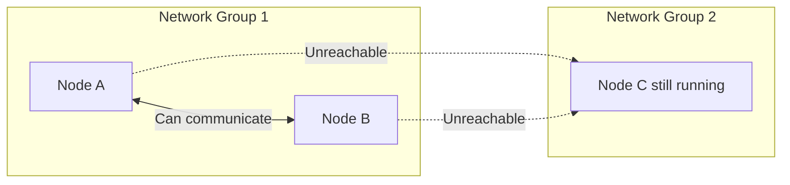
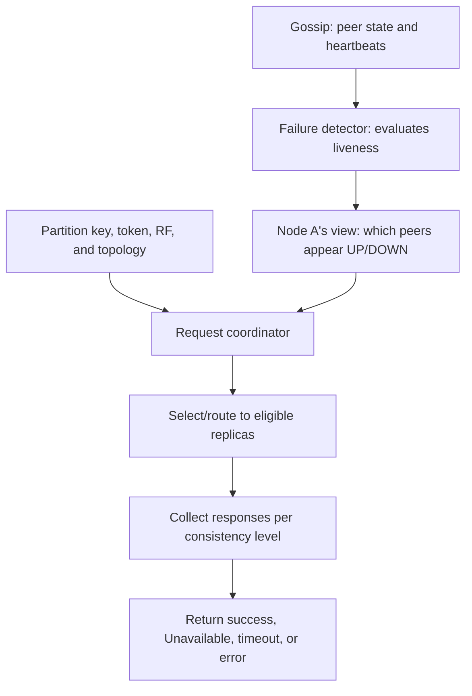
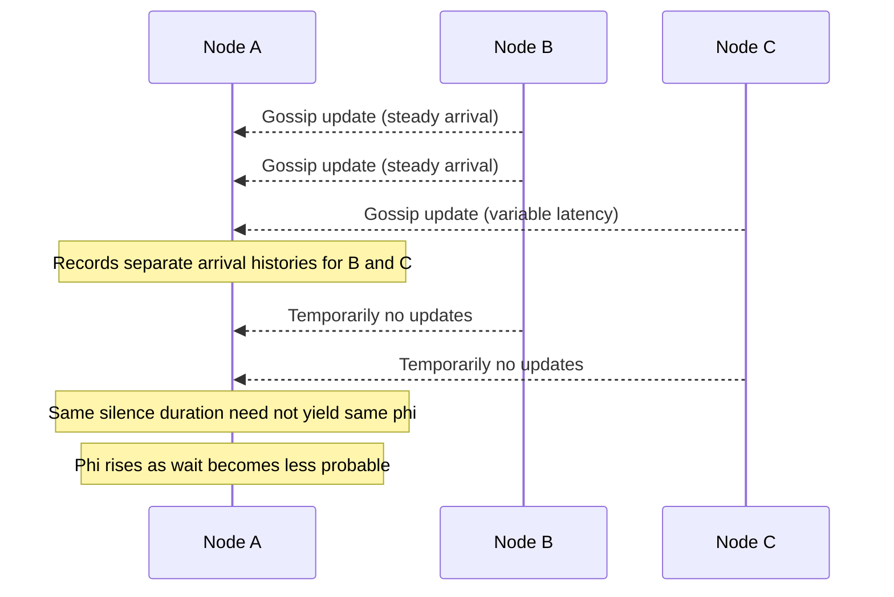
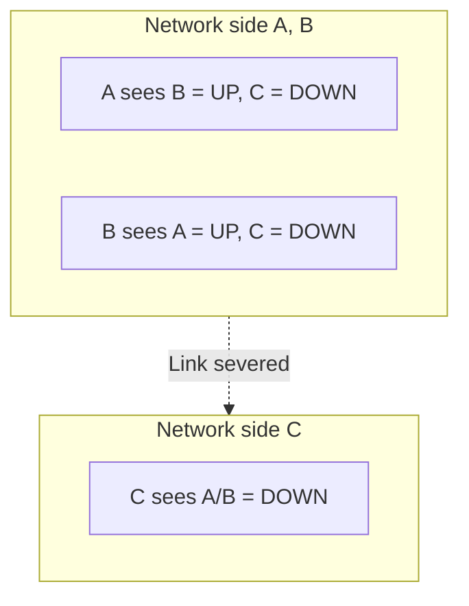
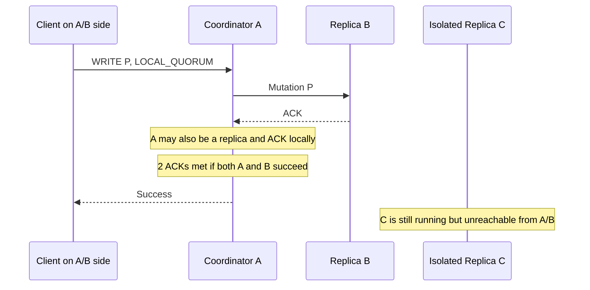
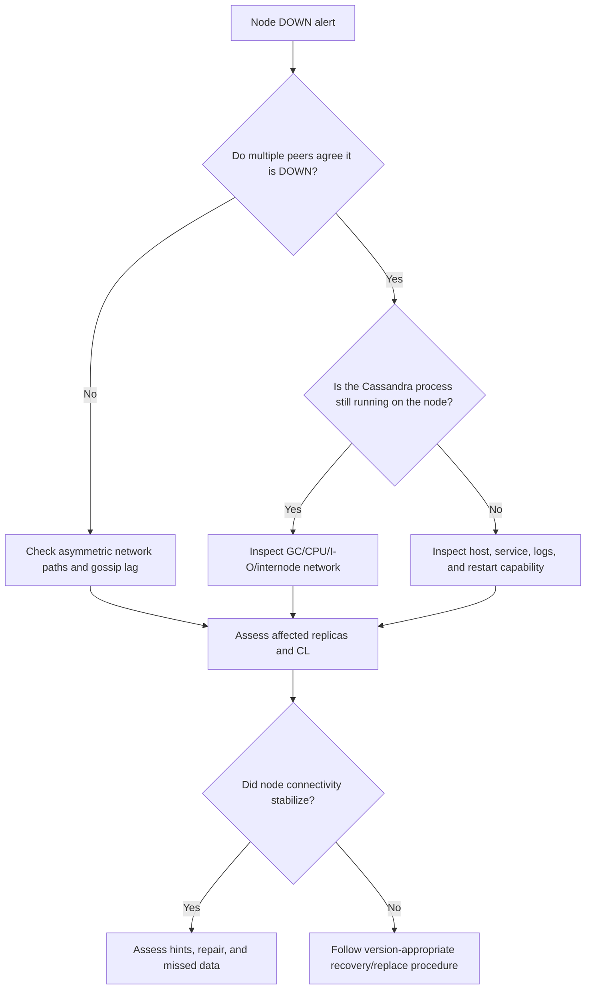

# Failure Detector and the Limits of Inferring a Node Is Dead

In Apache Cassandra, a node that fails to respond in time **is not necessarily dead**. It may be paused by garbage collection, overloaded on I/O, partitioned from a few peers, or restarting. However, other nodes cannot wait indefinitely to know for sure what happened: they must decide whether to keep sending read/write requests to that node. The **failure detector** is the mechanism that helps Cassandra make operational decisions based on communication signals between nodes.

Cassandra's failure detector is commonly known as the **phi accrual failure detector**. Rather than proving that a machine has stopped running, it evaluates a **suspicion level** when liveness updates from a peer fail to arrive at the previously observed cadence. The result can be used to treat a node as `UP` or `DOWN` from the evaluating node's perspective.

This lesson is part of the **Cluster Architecture** section of the Cassandra module, connecting peer-to-peer concepts, gossip, partition keys, replicas, replication factor (RF), consistency levels (CL), and error handling in Java applications.

After this lesson, you will be able to:

- Explain why you cannot conclusively infer a node "is dead" from a timeout alone.
- Describe the role of gossip, heartbeats, inter-arrival interval history, and the phi threshold.
- Distinguish **liveness**, **membership**, node lifecycle state, and the ability to serve **a specific request**.
- Predict the effect of a node being marked `DOWN` on `ONE`, `LOCAL_QUORUM`, `QUORUM`, and read/write availability.
- Analyze false positives, false negatives, network partitions, GC pauses, and differing views across nodes.
- Use `nodetool`, CQL, and the Java Driver to observe and classify failures before making topology changes.

## 1. "Node Down" Is an Assessment, Not Physical Proof

Suppose a cluster has three replicas A, B, and C for partition P. For some period, A stops receiving timely gossip or internal responses from C. There are at least four possibilities:

1. **C actually powered off or the Cassandra process stopped.**
2. **C is still running** but is experiencing a long JVM garbage collection pause or CPU starvation.
3. **The network link A–C is broken**, while B can still reach C.
4. **The communication path is congested**, delaying messages beyond expectations.

From the lone observation "A is not receiving replies from C," A **cannot reliably distinguish** those four cases. Waiting for absolute proof could stall the system from answering requests. Therefore, Cassandra uses the failure detector to assess risk and quickly pick viable routing paths.

Key takeaway: the `DOWN` status is **an operational judgment based on observations at a specific time and place**, not a hardware forensic verdict.

### A Network Partition Example



A and B may suspect C is `DOWN`, while C continues local work and may suspect A/B are `DOWN`. Neither side can observe the full network reality at once. The failure detector must make decisions from a **local perspective**, rather than acting as an "omniscient observer" of the cluster.

## 2. Where Does the Failure Detector Sit in Cassandra Architecture?

Cassandra uses a **peer-to-peer** architecture: there is no cluster-wide master checking every machine's health. Each node maintains information about peers, receives state updates via gossip, and forms its own assessment of responsiveness.

To avoid conflating functions, distinguish these components:

| Component | Function | Does Not Mean |
|---|---|---|
| **Gossip** | Propagates membership and peer state information through periodic exchanges. | A mechanism to replicate all table data. |
| **Failure detector** | Evaluates the suspicion level that a peer is unresponsive based on communication history. | Proof that the machine crashed or storage lost data. |
| **Membership / topology metadata** | Lists known nodes, identities, and responsibilities for tokens/DCs/racks. | `UP` status does not mean every partition is synchronized. |
| **Coordinator** | Coordinates each CQL request, locates replicas, and waits for responses per CL. | A fixed master of the cluster or of a table. |
| **Replica** | A node storing a copy of a partition per RF and replication strategy. | Every `UP` node is a replica of every partition. |
| **Java Driver** | Manages CQL connections, client-side topology view, and chooses nodes to send requests to. | A direct participant in the internode gossip protocol. |

When gossip/failure detector marks C as unresponsive, a coordinator may avoid sending requests to C or conclude there are not enough available replicas for the CL. However, **a partition's natural replica set** is still determined by partition key, token, and replication strategy; marking C `DOWN` does not make some other arbitrary node immediately own a new copy.



## 3. What Signals Does Gossip Provide to the Failure Detector?

In common Cassandra versions, gossip exchanges state between peers in short rounds. States carry a **heartbeat** and **generation/version** numbers, helping detect new progress and distinguish stale state from fresh state after a restart.

- **Heartbeat:** advances with node activity, providing a signal that the endpoint is continuing to update state.
- **Generation:** distinguishes state epochs for the same endpoint, typically tied to a new startup.
- **Version:** compares newer vs. older updates for individual state entries within a generation.
- **Gossip state:** may include DC, rack, host ID, lifecycle state, and other attributes depending on version.

When A receives an update regarding C, A knows C is still making progress. The update may come **directly from C or via another peer**; gossip exchanges do not require A to connect to every node in every round.

### Gossip Cadence Is Not a Hard Liveness Deadline

Many Cassandra versions use a typical gossip round of about one second, yet **there is no rule saying "silent for over one second means down."** Network responses, execution time, and state transmission rates fluctuate. The failure detector uses **arrival-time history** to estimate how unusual a delayed update is.

Do not confuse a **gossip heartbeat** with an `INSERT` or `SELECT` ACK: the two message types serve different purposes. A node can still look `UP` in gossip while serving data queries too slowly and timing out; conversely, CQL clients may reach a node while its internode network link is failing.

## 4. What Is the Phi Accrual Failure Detector?

Fixed-timeout mechanisms typically work like: "No reply for X seconds means the node is down." That approach adapts poorly to varying network latencies or transient system load.

The **phi accrual failure detector** provides a continuous measure: how **unusual is the current silence duration compared to the historical arrival pattern from that peer?** Phi is typically expressed conceptually as:

\[
\phi(t) = -\log_{10}\left(P(T > t)\right)
\]

Where:

- \(T\) is the inter-arrival interval between received signals under the statistical model in use.
- \(t\) is the elapsed time since the most recent signal.
- \(P(T > t)\) is the probability predicted by the model that an interval could exceed \(t\).
- The higher \(\phi(t)\) is, the **more unusual** the silence duration is under the model.

This is a **conceptual formulation**; the exact formula, distribution estimation, and internal sampling/bounds depend on the Cassandra implementation and version. Do not use this formula to replace Cassandra's values or algorithms without checking the exact version you operate.

### How to Interpret Phi Values

In the idealized model above:

| Phi Value | Model Tail Probability \(P(T > t)\) | Interpretation |
|---:|---:|---|
| 1 | \(10^{-1}\) | Observed wait time is moderately unusual. |
| 2 | \(10^{-2}\) | Wait time is less common under the model. |
| 4 | \(10^{-4}\) | Substantially higher suspicion level. |
| 8 | \(10^{-8}\) | Very high suspicion level under the estimated model. |

**Do not** infer that "phi = 8 means 99.999999% chance the machine is physically dead" in real-world failure probability terms. That number is the probability of **the wait interval under the model**, not the posterior probability that the host powered off. If network conditions, load, or statistical samples shift abruptly, the estimate can misjudge.

### The `phi_convict_threshold` Setting

In versions that use `phi_convict_threshold`, Cassandra compares the suspicion level against the threshold to decide whether to **convict** (mark a peer unresponsive). Phi is **not a count of failed pings**, and the phi threshold **does not convert into a fixed N seconds**.

- A threshold **too low** can increase false positives during network or GC jitter.
- A threshold **too high** can delay detecting truly unresponsive peers, causing requests to keep trying dead nodes longer.
- Exact defaults and semantics must be verified against your Cassandra version, config, and real telemetry.

Never change the threshold solely because `DN` appeared once in `nodetool status`. Identify the underlying network, JVM, I/O, and related events first.

## 5. Illustration of Wait Intervals and Two Network Profiles

Imagine two peer pairs with different update arrival histories:

- **Stable network:** inter-arrival intervals cluster tightly around a low baseline with minimal variance.
- **Noisy network:** inter-arrival intervals fluctuate widely due to load, jitter, or cross-region links.

If both peers stay silent for the exact same duration, their phi scores can **differ**, because "unusual" is evaluated relative to each peer's own history.



You do not need to compute phi by hand in operations. The point of this example is to avoid reasoning like "a node silent for X seconds is definitely down" or "all nodes must share the exact same detection delay."

## 6. Limits of a Failure Detector in an Asynchronous System

A distributed system cannot definitively distinguish an arbitrarily slow node from a dead node using only messages observed over finite time. Real systems impose deadlines, rely on **probabilistic/statistical suspicion**, and continue serving within required bounds.

### False Positive: Marked Down While Still Running

C can be marked down by A even while C is still running because of:

- Long stop-the-world GC pauses.
- Saturated CPU or disk I/O blocking message-handling threads.
- Packet loss, route changes, or intermittent firewall drops.
- Broken internode links while the native CQL port remains reachable.
- Hypervisor VM pauses or clock/OS scheduling anomalies.

This is a **false positive in liveness evaluation**, not necessarily data corruption. Consequences can include coordinators temporarily avoiding a healthy node, fewer usable replicas for requests, or flapping `DN` alerts.

### False Negative or Delayed Detection

Conversely, a node that has already stopped may remain marked `UP` briefly until peers detect it. A coordinator sends a request, waits until the deadline, and times out; liveness state may update shortly afterward.

This illustrates that **failure detection time** and **request timeout duration** are two different quantities. Both are shaped by connectivity, load, CL, and configuration; no single parameter guarantees every request finishes before a fixed bound.

### Every Node Has Its Own Perspective



Gossip spreads gradually. Even without a complete network split, A can mark C `DOWN` before B does. `UP`/`DOWN` states from the failure detector **do not represent instantaneous cluster-wide consensus** and are not an atomic membership transaction.

## 7. Do Not Confuse `DOWN` with Node Lifecycle State

In `nodetool status` output, there are typically two dimensions:

- **Liveness:** `U` (*Up*) or `D` (*Down*) reflects the observing node's reachability judgment.
- **Lifecycle/token state:** `N` (*Normal*), `J` (*Joining*), `L` (*Leaving*), `M` (*Moving*), or other version-dependent representations.

For example:

| Common Display | Read Along Both Axes | Cannot Conclude |
|---|---|---|
| `UN` | Node is seen as **Up, Normal**. | "Every query through this node is fast and replicas are definitely repaired." |
| `DN` | Node is seen as **Down, Normal**. | "The machine lost all data" or "we must remove the node immediately." |
| `UJ` | Node is seen as **Up, Joining**. | "The node already owns and serves every new partition completely." |
| `UL` | Node is seen as **Up, Leaving**. | "We can power off the machine immediately without affecting replication." |

A newly starting/joining node may appear in membership before data streaming completes. A node retaining its identity in the cluster after an outage does not mean it has been removed from replica ownership. Topology changes like replace, decommission, and remove require dedicated metadata and streaming procedures.

In Cassandra 5.x, the **Cluster Metadata Service / TCM** changes how metadata changes are coordinated; do not apply every operational rule from older versions verbatim across all releases. Still, the fundamental limit holds: **liveness perception does not prove storage or hardware state**.

## 8. Which Replicas Must Be Alive for Reads/Writes to Succeed?

The failure detector estimates which nodes appear available, while **replication factor** and **consistency level** determine whether a request can complete using the reachable replicas.

Example keyspace for an event read/write system:

```sql
-- Example where dc1 and dc2 each have at least 3 suitable nodes.
CREATE KEYSPACE telemetry
WITH replication = {
    'class': 'NetworkTopologyStrategy',
    'dc1': 3,
    'dc2': 3
};

CREATE TABLE telemetry.events_by_device_day (
    tenant_id uuid,
    device_id uuid,
    event_day date,
    event_time timestamp,
    event_id uuid,
    measurement double,
    PRIMARY KEY ((tenant_id, device_id, event_day), event_time, event_id)
) WITH CLUSTERING ORDER BY (event_time DESC, event_id ASC);
```

For partition P, suppose three replicas A/B/C are in `dc1` and three replicas D/E/F are in `dc2`. The coordinator is in `dc1`. The following table assumes normal replicas without transient replication:

| CL | Requirement | When C in `dc1` Is Seen as Down |
|---|---|---|
| `ONE` | One replica returns a valid response. | Can succeed via A or B. |
| `LOCAL_ONE` | One `dc1` replica returns a valid response. | Can succeed via A or B. |
| `LOCAL_QUORUM` | `floor(3/2)+1 = 2` `dc1` replicas. | Can succeed if both A and B respond on time. |
| `QUORUM` | `floor(6/2)+1 = 4` replicas across total RF. | Can succeed if four valid responses arrive, potentially involving `dc2`. |
| `ALL` | All six replicas. | Fails if C is truly unable to respond. |

If **two** replicas of P in `dc1` are unavailable, `LOCAL_QUORUM` cannot be satisfied by the single remaining local replica. ACKs or data from `dc2` **cannot compensate** for a missing local quorum on a `LOCAL_QUORUM` request coordinated in `dc1`.

These statements apply specifically to **replicas of partition P**. If a node that does not own P is marked down, it does not directly reduce P's replica count; it can still affect metadata, load, routing, or other partitions. Always trace **partition key → token → replica set** before concluding.

### Why Can an Up Node Still Cause Request Timeouts?

A replica marked `UP` only means liveness signals have not crossed the failure threshold; it may be bogged down in compaction, repair, flushing, tombstone scans, or slow disk I/O. The coordinator sends reads/writes, yet ACKs or data fail to arrive before the deadline. Therefore:

**"Replica appears alive" is a routing hint, not a guarantee that the replica will answer every operation on time.**

## 9. `Unavailable`, `ReadTimeout`, `WriteTimeout`, and Execution Failures

When a request fails, the exception type and timing suggest the cause:

| Symptom | Common Interpretation | What Cannot Be Inferred |
|---|---|---|
| `Unavailable` | Coordinator sees too few replicas considered available to meet CL at request evaluation time. | Does not prove the entire cluster is down. |
| `ReadTimeout` | Did not receive enough read responses within the timeout window. | Does not prove the partition does not exist or all replicas are broken. |
| `WriteTimeout` | Did not receive enough write acknowledgments within the timeout window. | **Does not** prove the mutation rolled back or was not written to any replica. |
| `ReadFailure` / `WriteFailure` | Replicas or the execution path reported an internal error during the operation, per version/mechanism. | Not identical to a gossip failure or node removal. |
| Client/coordinator connection error | Driver could not reach the chosen node or the connection dropped. | Does not mean replicas never received the request; write outcome may be uncertain. |

**Valid ACK/response counts and CL ultimately decide the result.** A node seen as `DOWN` by the failure detector can cause the coordinator to return `Unavailable` before sending; a node seen as `UP` yet extremely slow can trigger timeouts after the coordinator sends requests.

For writes, the most important rule is **timeout does not equal rollback**. If a mutation reached some replicas, the client may miss the ACK even though data changed. Java applications must design retries around idempotency semantics, event keys, and timestamps instead of retrying unconditionally.

## 10. Network Partition: Running Nodes Can Still Lose Quorum

Consider a DC with RF = 3 where replicas of P are A, B, and C. A network partition splits them: A/B can talk to each other, but neither can reach C.



If A and B are both replicas of P and the write succeeds, the A/B side achieves a 2/3 quorum. A client that can only reach C **cannot** meet `LOCAL_QUORUM` for P even though C is running; it may read/write at `LOCAL_ONE` under suitable conditions, trading off consistency.

Here:

- The **failure detector** reflects broken connectivity from each side's perspective.
- **CL** determines how many responses are needed; C's side cannot form a majority alone.
- Incomplete **replication** on C can be addressed once connectivity recovers via mutation delivery/hints and proper repair.
- **Gossip reconverging** does not itself prove data has converged.

Do not assume the side with more nodes **always** holds quorum for every partition. Replica placement decides; another partition may map to a different subset of nodes.

## 11. Sources of False Convictions: GC, CPU, I/O, and Network

When a node repeatedly flips `UN` ↔ `DN`, investigate the root cause before raising the phi threshold.

### JVM and Garbage Collection

A long stop-the-world pause can freeze Cassandra process execution so peers miss timely updates. Once the pause ends and the node resumes, peers may mark it `UP` again. Inspect GC logs, heap pressure, allocation rates, and pause timestamps aligned with alerts.

### CPU, Disk I/O, and Storage Pressure

Compaction backlogs, slow commit log/flushes, heavy repairs, abundant tombstones, or hot partitions can slow a node down. A node may still process gossip while serving queries terribly—or extreme saturation can delay gossip too. Correlate queue, I/O, and latency metrics rather than looking only at `UN`.

### Internode Networking

Cassandra separates **native CQL connections** from applications (typically port `9042`) from **internode messaging** between nodes (ports and TLS settings vary by version/config; commonly `7000`/`7001`). A node can answer on the CQL port while blocked on internode networking, causing peers to suspect it is down or fail to deliver mutations.

Check routing, DNS/NAT, firewalls, packet loss, inter-DC latency, broadcast/listen address settings, and TLS certificates if encrypted. Never conclude the failure detector was at fault simply because raising the threshold temporarily silenced the alert.

### Host and Infrastructure Resources

Paused VMs, noisy/overloaded hypervisors, memory exhaustion, CPU-throttled containers, or full disks can interrupt a node. Correlate Cassandra alerts with host telemetry at the **same timestamps**.

## 12. Observing with `nodetool` and CQL

On a test cluster or through authorized operational access, run:

```bash
nodetool status
nodetool gossipinfo
nodetool describecluster
nodetool tpstats
```

**`nodetool status`** shows the queried node's view of node status, DC/rack, and lifecycle state. `UN` normally means *Up/Normal*, and `DN` means *Down/Normal*. **`nodetool gossipinfo`** displays the gossip state known to the queried node: endpoints, heartbeat generation/version, and version-specific application states.

**`nodetool describecluster`** helps inspect cluster overview and schema/metadata agreement; **`nodetool tpstats`** exposes internal thread pools/queues when suspecting overload. Exact output varies by version.

In `cqlsh`, topology info for **the node currently handling the CQL connection** can be queried:

```sql
SELECT cluster_name, data_center, rack, host_id
FROM system.local;

-- Inspect keyspace replication:
SELECT keyspace_name, replication
FROM system_schema.keyspaces
WHERE keyspace_name = 'telemetry';
```

`system.local` is not a complete cluster roster; peer tables (such as `system.peers_v2` on supported versions) or appropriate tooling metadata can help inspect other nodes.

### Comparing Perspectives Across Multiple Peers

If A reports C as `DN` while B reports C as `UN`, record **timestamps, the queried node, addresses/host IDs, and version**, and verify reachability in each direction. A single `nodetool status` run reflects only **one node's viewpoint at that instant**, not cluster-wide consensus.

Example diagnostic log table:

| Timestamp | Observing Node | Observation About C | Additional Evidence |
|---|---|---|---|
| 08:30:01 | A | `DN` | Packet loss on A ↔ C; C's GC log not yet checked. |
| 08:30:03 | B | `UN` | B is still exchanging internal messages with C. |
| 08:30:09 | A | `UN` | Path A ↔ C recovered. |

This is **illustrative data**, not real logs. The goal is to underscore that **perceived state can differ by location and time**.

### Testing Reads/Writes by CL

You can use `TRACING` in `cqlsh` to trace a test request path:

```sql
CONSISTENCY LOCAL_QUORUM;
TRACING ON;

SELECT event_time, measurement
FROM telemetry.events_by_device_day
WHERE tenant_id = 11111111-1111-1111-1111-111111111111
  AND device_id = 22222222-2222-2222-2222-222222222222
  AND event_day = '2026-11-21'
LIMIT 20;

TRACING OFF;
```

`TRACING` and `CONSISTENCY` are `cqlsh` commands. Running the query requires creating the table from section 8 with matching sample data; you do not need to stop nodes to test this. Tracing adds processing and storage overhead, so enable it selectively in appropriate environments.

## 13. The Java Driver Has Its Own Connection Health View

Java Driver 4.x queries Cassandra over **native CQL** rather than joining gossip. The driver maintains node/DC/rack metadata, connection state, and client load-balancing policies. Thus **the driver seeing a node as unavailable for CQL** does not necessarily mean **the internode failure detector on every node has marked it down**.

The example below prints driver-observed metadata and executes a `SELECT` at `LOCAL_QUORUM`:

```java
import com.datastax.oss.driver.api.core.CqlSession;
import com.datastax.oss.driver.api.core.DefaultConsistencyLevel;
import com.datastax.oss.driver.api.core.cql.BoundStatement;
import com.datastax.oss.driver.api.core.cql.PreparedStatement;
import com.datastax.oss.driver.api.core.cql.Row;
import com.datastax.oss.driver.api.core.metadata.Node;

import java.net.InetSocketAddress;
import java.time.LocalDate;
import java.util.UUID;

public class CassandraLivenessExample {
    public static void main(String[] args) {
        // Documentation IPs: replace with reachable contact points.
        try (CqlSession session = CqlSession.builder()
                .addContactPoint(new InetSocketAddress("192.0.2.10", 9042))
                .addContactPoint(new InetSocketAddress("192.0.2.11", 9042))
                .withLocalDatacenter("dc1")
                .build()) {

            for (Node node : session.getMetadata().getNodes().values()) {
                System.out.printf("node=%s dc=%s rack=%s state=%s%n",
                    node.getEndPoint(),
                    node.getDatacenter(),
                    node.getRack(),
                    node.getState());
            }

            PreparedStatement prepared = session.prepare(
                "SELECT event_time, measurement " +
                "FROM telemetry.events_by_device_day " +
                "WHERE tenant_id = ? AND device_id = ? AND event_day = ? " +
                "LIMIT 20");

            BoundStatement read = prepared.bind(
                    UUID.fromString("11111111-1111-1111-1111-111111111111"),
                    UUID.fromString("22222222-2222-2222-2222-222222222222"),
                    LocalDate.parse("2026-11-21"))
                .setConsistencyLevel(DefaultConsistencyLevel.LOCAL_QUORUM);

            for (Row row : session.execute(read)) {
                System.out.printf("%s: %.2f%n",
                    row.getInstant("event_time"),
                    row.getDouble("measurement"));
            }
        }
    }
}
```

`192.0.2.0/24` is a documentation-reserved range. In real deployments, provide actual node addresses, the real local DC name, and authentication/TLS settings if enabled. The driver receives metadata asynchronously; printing `Node.getState()` reflects **driver-local state at the moment of the call**, not a hardware diagnostic or cluster-wide liveness consensus.

If a request fails due to connectivity, the driver can try another coordinator per its routing and retry policies. **Never assume all write operations are idempotent by default**: `WriteTimeout` can occur after some replicas have already written. For sensitive mutations, use deterministic event IDs, controlled timestamps, or conditional operations where aligned with business requirements.

## 14. After a Node Recovers, What Else Needs Attention?

Suppose C was network-isolated for a long duration and then returns as `UP` in A/B's view. This indicates connectivity is recovering; **it does not prove C holds all mutations that occurred while it was absent**.

Cassandra separates distinct mechanisms here:

| Mechanism | Purpose | Limitations |
|---|---|---|
| **Gossip / failure detector** | Detects and spreads awareness of reachability. | Does not transfer all missed data. |
| **Hinted handoff** | Can buffer and replay some mutations when a replica is briefly absent. | Bounded by retention window/config and hint recording conditions. |
| **Anti-entropy repair** | Compares data across replicas and fixes differences. | Requires scheduling and resources; does not run automatically just because a node turns `UP`. |
| **Streaming / bootstrap / replace** | Transfers data for replica ownership/topology changes. | Depends on join/replace/decommission workflows and version. |
| **Compaction** | Merges/reorganizes SSTables on a node. | Does not synchronize data across replicas. |

A normal restart of C with intact disk data differs greatly from **replacing a node that lost its entire disk**. Never run remove, assassinate, replace, or decommission just because `DN` appears briefly; those commands affect membership, tokens, and data ownership.

### Why Do Tombstones Make Repair Critical?

A node that missed a `DELETE` may still retain the old value. Cassandra uses **tombstones** to prevent deleted data from resurfacing during reconciliation. If a replica stays absent too long and tombstones expire past their configured lifecycle before old data is reconciled, there is a risk of **deleted data resurrection** under certain conditions.

Therefore, a node switching from `DN` to `UN` does not end the incident; assess **missed write volume, outage duration, repair schedules, TTLs/tombstones, and recovery requirements**.

## 15. Diagnostic Workflow: From DOWN Alert to Root Cause

When a node is marked `DOWN` in a Cassandra cluster serving applications, proceed in order:

1. **Confirm identity:** endpoint, host ID, DC/rack, and which node reports it down. Distinguish a single failing node from an entire rack or subnet.
2. **Compare multiple viewpoints:** run `nodetool status` and `nodetool gossipinfo` from nodes in different failure domains where authorized.
3. **Check network connectivity:** broadcast/listen addresses, internode ports, firewalls, packet loss, routes, DNS, and cross-DC links.
4. **Inspect node resources:** Cassandra process, logs, GC pauses, CPU, RAM, disk space, I/O, and thread/queue backlogs.
5. **Identify lifecycle state:** is the node normal, restarting, bootstrapping, streaming, leaving, or replacing? Cross-check version and metadata.
6. **Identify affected partitions/replicas:** derive from partition keys and per-DC RF, rather than counting arbitrary cluster nodes.
7. **Assess application impact:** which `Unavailable`/timeout errors occur, which CL, which coordinators, at what rate and latency?
8. **Plan post-incident synchronization:** hints, repair, or node replacement procedures as needed; pay special attention to cross-DC `LOCAL_QUORUM` writes.

Avoid two knee-jerk reactions: raising `phi_convict_threshold` without addressing slowdowns, or removing a node from membership when it is merely temporarily isolated.

### A Simple Decision Tree



This diagram is a reasoning guide, not a guaranteed playbook for every outage. In cases where a node is **still running yet severely overloaded**, brief checks may not capture the full picture; combine observations over time.

## 16. Self-Practice Exercises

**Scenario A — Node is online, but A reports it down.** A receives no updates from C for a long time; B still communicates with C. Should you conclude C is dead? **No.** Check A–C networking, load, GC, and status from multiple peers; the alert reflects a local view.

**Scenario B — Phi rises.** Does a rising phi prove data was lost? **No.** Phi measures how abnormal the silence duration is under the statistical model; it does not inspect disks or partition presence.

**Scenario C — One replica down, RF = 3.** Partition P has replicas A/B/C in `dc1`; C is seen as down, while A and B respond. Can a `LOCAL_QUORUM` write succeed? **Yes, potentially**, since two local ACKs satisfy quorum, provided they arrive before timeout.

**Scenario D — One replica alive, RF = 3.** A and B are unreachable; C is still serving. Can a `LOCAL_QUORUM` write for P succeed? **No**, if only C can respond. A `LOCAL_ONE` operation may still succeed under suitable conditions, trading off consistency.

**Scenario E — Coordinator sends write and times out.** May the client assume the write never happened and generate a new event key on retry? **No.** Some replicas may have saved the mutation; use an idempotent retry plan and key-based verification.

**Scenario F — Node flips from DN to UN.** Can you conclude the replica matches all data? **No.** Liveness recovery differs from data convergence; evaluate hints and repair based on outage duration.

**Scenario G — Two DCs partitioned.** Can a `LOCAL_QUORUM` write in `dc1` succeed even while `dc2` is disconnected? **Yes**, if enough local replicas are healthy; do not assume data reached `dc2`. This must be addressed in DR design.

## 17. Common Mistakes to Avoid

| Misconception | Accurate Understanding |
|---|---|
| "`DN` means the machine is dead and must be removed immediately." | `DN` is a liveness judgment; verify host, network, and lifecycle state before touching topology. |
| "All nodes learn simultaneously when a peer goes down." | Gossip propagates gradually, and the failure detector evaluates per node. |
| "Phi is the probability that the machine is dead." | Phi measures how unusual the wait interval is under a statistical model. |
| "Raising the phi threshold fixes network errors." | It can mask symptoms or delay fault detection; fix the underlying cause. |
| "If a node is Up, all read/write requests will succeed." | RF, CL, replica placement, load, and timeouts govern each request. |
| "Gossip automatically replicates missed data." | Mutation replication, hinted handoff, streaming, and repair are separate mechanisms. |
| "The Java Driver participates in gossip and shares peer liveness conclusions." | The driver observes via CQL protocol/metadata and can hold a different view. |
| "Losing one node stops the entire cluster from writing." | Only partitions/CLs lacking enough responding replicas fail to meet their requirements. |

## 18. Conclusion

**The failure detector helps Cassandra act under uncertainty**, rather than delivering absolute proof about a node's physical state. It converts heartbeat/gossip arrival history into a **suspicion level**; from that, peers assess liveness and coordinators decide which replicas can be contacted for each request.

The right reasoning chain when a node is reported down is:

```text
Missing communication signals from peer
                |
                v
Phi accrual failure detector evaluates suspicion level
                |
                v
A node perceives peer as UP/DOWN (local perspective)
                |
                +--> Check host, GC, CPU, I/O, and network paths
                |
                +--> Cross-check perspectives of other peers
                |
                v
Partition key + token + RF/DC/rack -> request replicas
                |
                v
Consistency level + actual responses -> read/write outcome
                |
                v
After recovery: assess hints, streaming, and repair if needed
```

Keeping **"node suspected down"**, **"node truly unreachable from a specific location"**, **"insufficient replicas for CL"**, and **"data synchronized"** distinct will let you diagnose Cassandra failures accurately, avoid hasty node-replacement actions, and design Java applications with controlled timeout and retry behavior.
