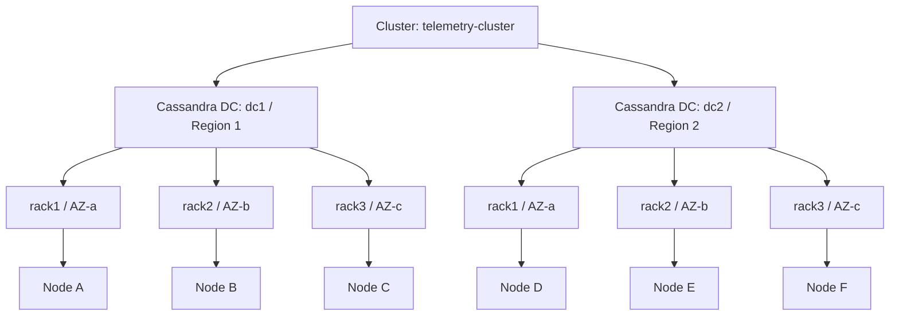
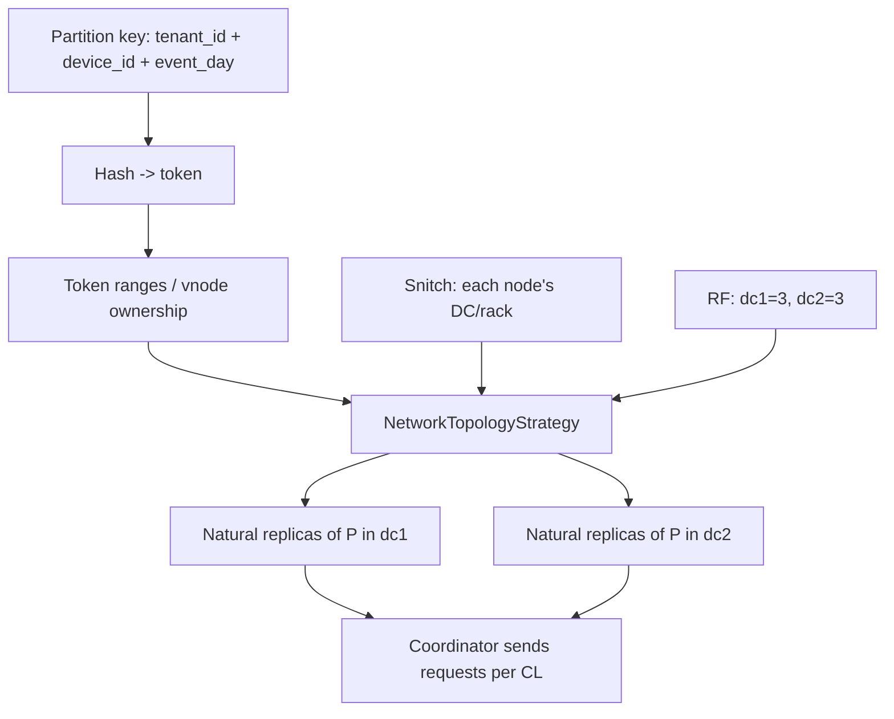
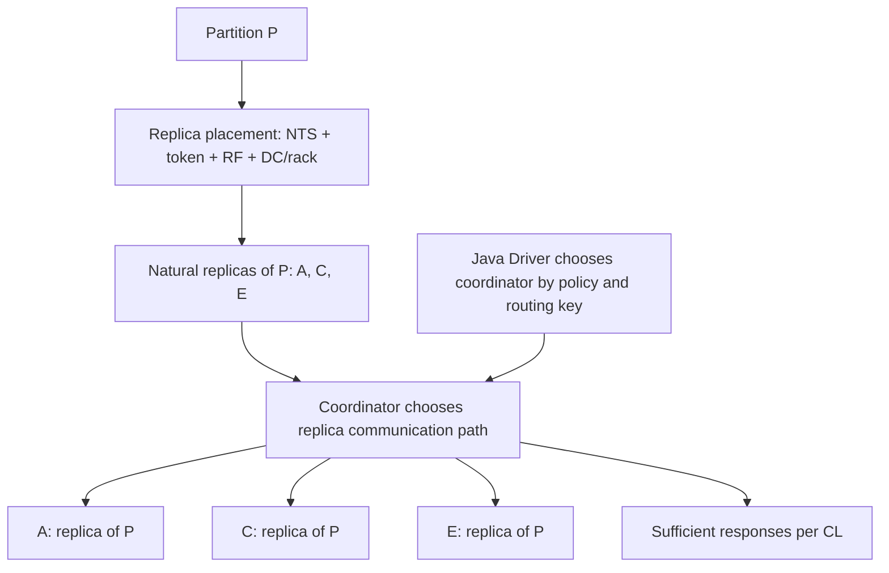

# Snitch, Topology Information, and Failure-Domain-Aware Replica Selection

An Apache Cassandra cluster can span multiple servers, racks, availability zones, and datacenters. When storing multiple copies of a partition, merely counting replicas is **not enough**: if replicas sit on machines that share a power supply or network uplink, a failure in that infrastructure domain can make them all unreachable simultaneously. Cassandra solves most of this placement problem through cluster **topology**, the **snitch**, and the **replication strategy**.

The **snitch** tells Cassandra which **datacenter (DC)** and **rack** each node belongs to. **NetworkTopologyStrategy** combines that information with **tokens** and the **replication factor (RF)** to choose the nodes holding each partition's replicas, attempting to spread copies across different racks whenever possible. Then, the request's **consistency level (CL)** determines how many replicas must respond before the coordinator returns success.

This lesson belongs to the **Cluster Architecture** chapter of the Apache Cassandra module, connecting wide-column fundamentals, query-driven table design, replication, read/write paths, error handling, and the Java Driver. After this lesson, you will be able to:

- Distinguish **node**, **rack**, **datacenter**, **cluster**, and **failure domain**.
- Explain what the snitch does, what data it supplies, and why the snitch **does not decide RF**.
- Trace partition key → token → replication strategy → replica set, and explain why two partitions can live on different nodes.
- Predict fault tolerance when losing a node, a rack/availability zone, or an entire DC.
- Understand the differences among **replica placement**, **read replica selection**, and **driver coordinator selection**.
- Write CQL to configure replication, inspect topology with `nodetool`, and read topology metadata from a Java application.

## 1. Why Care About Failure Domains?

Suppose partition P has RF = 3, meaning we want three copies. Consider two layouts:

| Placement | Replicas of P | When Their Rack Loses Power |
|---|---|---|
| **Same rack** | Nodes A, B, C all in `rack1` | All three can lose connectivity at the exact same time. |
| **Spread across three racks** | A in `rack1`, B in `rack2`, C in `rack3` | Losing `rack1` affects only one replica; B and C can still serve a 2/3 quorum. |

With the exact same RF, **actual fault tolerance differs** because a single outage can affect multiple nodes simultaneously. A *failure domain* is a group of resources exposed to correlated failure due to shared power, switch, storage fabric, availability zone, or another shared component.

In on-premises environments, a Cassandra rack typically maps to a physical server cabinet or a group of hosts sharing underlying infrastructure. In cloud environments, a common pattern is **one Cassandra DC per region** and **one Cassandra rack per availability zone (AZ)** within that region. This is an *operational mapping*, not a mandatory technical constraint.



The diagram assumes one node per rack for clarity; real deployments often have multiple nodes in the same rack. The name `rack1` can appear in both `dc1` and `dc2` because racks are scoped **within each DC**. The goal is not to invent as many rack labels as possible, but to ensure those labels **accurately mirror components that can fail together**.

## 2. Node, Rack, DC, and Cluster Hierarchy

| Component | Meaning in Cassandra | Key Question |
|---|---|---|
| **Node** | A Cassandra member capable of accepting CQL and storing assigned partitions. | Which nodes hold a copy of partition P? |
| **Rack** | A group of nodes inside a DC representing a failure domain below the DC level. | Are P's replicas placed in independent racks? |
| **Datacenter** | A group of racks/nodes used to govern replication and local routing. | How many replicas of P are in `dc1` and `dc2`? |
| **Cluster** | All peer nodes forming one Cassandra deployment. | Do these DCs belong to the same cluster and replication topology? |

Each node belongs to one rack in one DC at a time; multiple DCs can belong to the same cluster. Cassandra is a **peer-to-peer** system with no fixed master coordinating all queries. A node can become the **coordinator** when receiving a request and act as a **replica** if assigned to store that partition. Neither role determines rack/DC placement.

DC and rack are **logical topology metadata known to Cassandra**, not two separate running daemons. A single physical AZ can host multiple nodes; rack names must be configured accurately so placement mechanisms understand failure boundaries.

### Distinguish "Independent in Name" from "Independent in Infrastructure"

If you label three VMs `rack1`, `rack2`, and `rack3` while all three run on the same hypervisor or depend on the same power supply, Cassandra will distribute replicas by **label** yet still fail to avoid correlated outages. The snitch cannot measure true infrastructure independence; it **trusts the declared topology**.

Conversely, if three AZs are genuinely independent yet all three nodes declare `rack1`, Cassandra lacks the information needed to spread replicas across AZs. Validating topology is therefore part of availability verification, alongside RF and CL.

## 3. What Is a Snitch?

The **snitch** is the component that tells Cassandra the **relative topology location** of an endpoint/node, typically its DC and rack names. Some snitch mechanisms or optimizations can also help evaluate endpoint proximity/latency to prioritize access where appropriate.

In short, the snitch answers: **"Which DC and rack is this node in?"** That information informs replica placement and communication paths. The snitch does not replace the data distribution algorithm and is not an assignment server.

| Component | What It Provides / Decides | What It Does Not Do |
|---|---|---|
| **Snitch** | Node DC/rack topology, assisting locality assessment. | Does not set RF = 3 and does not store data copies. |
| **Partitioner + token ownership** | Maps partition keys to tokens and relates them to node token ranges. | Does not infer physical failure domains without topology info. |
| **Replication strategy** | Combines tokens, RF, and topology to select **natural replicas** per partition. | Does not turn request CL into stored replica count. |
| **Consistency level** | Specifies minimum responses for a read/write request to succeed. | Does not create new replicas when a node goes down. |
| **Driver load balancing** | Selects the node receiving a CQL request (coordinator), preferring DC and token when feasible. | Does not define where partitions are stored. |

In many versions, the snitch is configured in `cassandra.yaml` via `endpoint_snitch`. Option names and cloud integrations can vary across versions; use a snitch supported by your deployed Cassandra version.

### From Local Configuration to Cluster-Wide Awareness

With `GossipingPropertyFileSnitch`, each node reads its locally configured DC/rack and advertises it via state/gossip mechanisms. Peers gradually learn the needed topology information. Do not assume every node sees changes instantaneously; changing the DC/rack of a node already holding data is a **major topology change** requiring a dedicated operational procedure.

In Cassandra 5.x, the **Cluster Metadata Service / TCM** coordinates cluster metadata changes differently from older releases. Always check version-specific documentation for internal topology/metadata management. **The core principle that the snitch supplies DC/rack for placement decisions remains fundamental.**

## 4. Common Snitch Types and When to Use Them

Cassandra offers several snitch implementations across versions and deployment environments. Do not memorize one name and apply it blindly to every cluster.

| Type / Category | Typical Meaning | When to Consider |
|---|---|---|
| **GossipingPropertyFileSnitch** | Reads local `dc`/`rack` settings from `cassandra-rackdc.properties` and broadcasts them to peers. | Self-managed deployments, on-premises, VMs, or whenever declaring explicit topology. |
| **Cloud-environment snitches** | Can derive region/zone from infrastructure metadata, depending on snitch and version. | Clusters running on platforms supported by that snitch; verify DC/AZ mapping. |
| **SimpleSnitch** in older docs | Does not provide real rack/DC awareness suitable for multi-failure-domain environments. | Mainly seen in examples or simple setups; do not default to it for multi-DC production. |
| **Dynamic snitch / endpoint scoring** | Optimization scoring endpoints by observed latency alongside underlying topology awareness. | Relates to read-path performance; not a way to alter RF or natural replicas. |

Example configuration on a node in `dc1/rack2` using `GossipingPropertyFileSnitch`:

```yaml
# cassandra.yaml (illustrative)
cluster_name: 'telemetry-cluster'
endpoint_snitch: GossipingPropertyFileSnitch
```

```properties
# cassandra-rackdc.properties on this node
dc=dc1
rack=rack2
```

Other nodes must set DC/rack values matching **their own location**. These files and syntax are samples; real deployments must verify file paths, permissions, DC names, internode networking, supported snitches, and version guidance.

**Never simply edit the snitch and rolling-restart nodes to "move regions" on a cluster holding data.** Changing DC/rack can alter how Cassandra computes replicas, impacting bootstrapping, streaming, repair, and topology management workflows.

## 5. Partition Keys, Tokens, and Natural Replicas

Cassandra is a wide-column system optimized for query-driven table design. The **partition key** determines a partition's token; **clustering columns** define row ordering within the partition.

Example:

```sql
CREATE KEYSPACE telemetry
WITH replication = {
    'class': 'NetworkTopologyStrategy',
    'dc1': 3,
    'dc2': 3
};

CREATE TABLE telemetry.readings_by_device_day (
    tenant_id uuid,
    device_id uuid,
    event_day date,
    event_time timestamp,
    event_id uuid,
    reading double,
    PRIMARY KEY ((tenant_id, device_id, event_day), event_time, event_id)
) WITH CLUSTERING ORDER BY (event_time DESC, event_id ASC);
```

In this table, `(tenant_id, device_id, event_day)` is the **composite partition key**. Cassandra hashes **all three values** into a token. `event_time` and `event_id` are clustering columns; they order and locate rows inside the partition but do **not** choose the DC or rack.

In an example with six eligible nodes spanning two DCs, `RF_dc1 = 3` and `RF_dc2 = 3`, a single partition has **three replicas in each DC**, six copies total. That does not mean every row of the table goes to the same six nodes in a larger cluster: another partition has a different token and may map to a different set of natural replicas.

### What Are Natural Replicas?

**Natural replicas** are the nodes designated by the replication strategy to hold copies of a partition. For instance, P's replicas might be A, B, C in `dc1` and D, E, F in `dc2`. If a coordinator G outside that set receives a request, G **can still coordinate**, while the actual data read/written lives on the natural replicas.

If a natural replica goes down, Cassandra does not automatically promote an arbitrary `UP` node into a permanent new full replica of P. Mechanisms like hints and bootstrap/streaming operations address different scenarios; **replica placement** remains governed by metadata and the replication strategy.



This diagram is a logical model. The token ring **is not a daisy-chained ring of machines**; communication between coordinator and replicas runs over the actual internode network. Virtual nodes (*vnodes*) let a node own multiple token ranges, without magically giving a node extra racks or DCs.

## 6. How Does NetworkTopologyStrategy Select Replicas Across Racks?

`NetworkTopologyStrategy` is the standard replication strategy when a cluster has DC/rack topology. Each DC configures its own RF. Within each DC, the strategy **attempts to place replicas in distinct racks** when enough eligible racks and nodes exist, avoiding putting all copies in one failure domain.

Example 12-node cluster: `dc1` has six nodes evenly split across three racks; `dc2` is structured similarly. RF in each DC is 3. An **illustrative** replica set for partition P:

| DC | Rack | Node Holding P |
|---|---|---|
| `dc1` | `rack1` | A |
| `dc1` | `rack2` | C |
| `dc1` | `rack3` | E |
| `dc2` | `rack1` | H |
| `dc2` | `rack2` | J |
| `dc2` | `rack3` | L |

This is **not an algorithm that picks specific node names**. Actual placement depends on tokens, vnodes, node count, topology, and replication strategy. Partition Q may be placed on different nodes.

### Conditions for One Replica per Rack

If each DC has **at least three independent racks** and RF = 3, the strategy can distribute three copies across three distinct racks. However:

- If a DC has only **two racks** and RF = 3, at least two replicas must share a rack, regardless of total node count.
- If a DC has only **one rack**, RF = 3 cannot protect against that rack losing power.
- If racks are named properly yet **nodes depend on the same upstream switch in another rack**, topology labels cannot overcome the shared point of failure.
- If the cluster spans multiple AZs yet rack metadata is misconfigured, the strategy lacks accurate information to spread replicas across AZs.

RF should be chosen based on **available nodes, actual racks/DCs, required fault tolerance, capacity, and cost**, rather than blindly setting 3 everywhere.

### When RF Exceeds the Number of Racks

Suppose RF = 4 in a DC with three racks. You cannot place four replicas in four distinct racks when only three racks exist. At least one rack must hold multiple replicas, or the topology/RF design must change. Thus, the statement "NetworkTopologyStrategy always puts every replica in a separate rack" **only holds when the topology has enough racks and nodes**.

### When Adding New Nodes

Adding nodes can shift token ranges and partition ownership; **bootstrapping/streaming** must transfer data to the new owners. Seeing a new node in gossip or `nodetool status` does not prove data transfer has finished. Likewise, changing RF or adding a DC requires version-appropriate data distribution/repair workflows; editing the schema alone does not finish historical synchronization.

## 7. A Failure-Domain Placement Exercise

Suppose a DC has six nodes across three racks:

```text
dc1
├── rack1 (AZ-a): A, B
├── rack2 (AZ-b): C, D
└── rack3 (AZ-c): E, F

Keyspace telemetry: RF_dc1 = 3
Partition P (illustrative): A, D, E
Partition Q (illustrative): B, C, F
```

If `rack2` loses connectivity, P loses D while keeping A and E; Q loses C while keeping B and F. With CL `LOCAL_QUORUM` and RF = 3, each partition **can still** reach two responses from its remaining replicas if they respond in time.

However, if every node in `dc1` is configured with `rack1`, Cassandra's rack-aware placement cannot provide the intended AZ failure protection, even though the nodes physically live in three AZs.

Conversely, spreading replicas across three racks alone **does not guarantee** survival if an entire datacenter fails. Surviving a DC outage requires **replicating to another DC**, data convergence, application failover capability, and appropriate CL selection.

## 8. Topology and Consistency Level Together Determine Availability

Recall: **RF is the desired copy count**, while **CL is the response requirement for each request**. Using keyspace `telemetry` from section 5 with `RF_dc1 = 3` and `RF_dc2 = 3`, and a coordinator in `dc1`:

| CL | Response Requirement | Topology Notes |
|---|---|---|
| `ONE` | One replica returns a valid response. | Can be fast; does not guarantee reading the latest version if replicas have not converged. |
| `LOCAL_ONE` | One replica in `dc1`. | Local acknowledgment condition; does not need ACKs/data from `dc2`. |
| `LOCAL_QUORUM` | `floor(3/2) + 1 = 2` replicas in `dc1`. | Can tolerate losing one `dc1` replica if the remaining two respond. |
| `QUORUM` | `floor(6/2) + 1 = 4` replicas across total two-DC RF. | May require cross-DC communication depending on responding set. |
| `EACH_QUORUM` | **For writes:** quorum in **each** DC: 2 in `dc1` and 2 in `dc2`. | Fails if either DC cannot achieve its own local quorum. |
| `ALL` | All replicas of the partition (six in this example). | Sensitive to failure or slowness of any single replica or link. |

In the single-DC RF = 3 example, if partition P spans three racks, losing one rack leaves **two remaining replicas capable of meeting `LOCAL_QUORUM`**. If two racks holding replicas of P fail simultaneously, only one replica remains, so `LOCAL_QUORUM` cannot be met. This is the intersection of **topology fault tolerance** and **CL requirements**.

### An `UP` Replica Does Not Guarantee Request Success

`nodetool status` may report a node as `UN` (*Up/Normal*), yet the node can still be slow due to GC, networking, I/O, compaction, tombstones, or repair. The coordinator needs **timely ACKs/data**. `Unavailable` can occur if too few replicas appear available; `ReadTimeout`/`WriteTimeout` can occur after sending when too few responses arrive before the deadline.

When a write times out, the mutation **may have reached some replicas**. Therefore, Java applications must use idempotent retry strategies, stable event keys, and controlled timestamps when needed. Proper topology lowers the risk of correlated loss, but does not eliminate uncertain execution outcomes.

### Multi-DC and the Limits of `LOCAL_QUORUM`

Suppose the application writes in `dc1` at `LOCAL_QUORUM` and immediately reads in `dc2` also at `LOCAL_QUORUM`. Both quorums are local, yet **they do not necessarily overlap**: a write confirmed in `dc1` may not yet have enough copies in `dc2` at the moment of the read. When designing DR/failover, account for cross-DC replication, WAN links, convergence lag, and acceptable data-loss targets.

## 9. Placement and Read Replica Selection Are Two Separate Steps

A common question: "The snitch picks nodes to read from—does it also pick which nodes store data?" There are two distinct layers of decision-making:

1. **Replica placement:** partition key → token → `NetworkTopologyStrategy` + RF + DC/rack info, producing the **natural replica** set. This determines **who is responsible for storing the data**.
2. **Read replica selection:** the coordinator decides how to query replicas in the eligible set, considering CL, locality, node health, and performance optimizations. Endpoint latency scoring (such as dynamic snitch on supporting versions) can affect **read preference order**, without **turning a non-replica node into a replica**.



The diagram condenses decisions for readability; the Java Driver actually sends requests **to a coordinator**, and the coordinator contacts natural replicas. Optimizing read replica selection does not create a permanent "read master."

### Dynamic Snitch: Adjusts Performance Preference, Not RF

On versions featuring **dynamic snitch**, Cassandra can use response-time statistics to score eligible endpoints for certain read paths. Faster-responding nodes may be preferred when appropriate. However:

- If the fastest node **is not a replica of P**, speed does not make it a data source for P.
- CL still dictates **how many responses are required**; picking a fast replica does not shrink a quorum from two to one.
- Dynamic snitch does not replace topology, rack-awareness, or data repair.
- Endpoint scoring and configuration vary across versions; consult documentation for your running release when tuning read latency.

For writes, the coordinator still targets all responsible replicas; **CL defines the ACK condition**, not a mechanism to pick "one best copy" and skip the rest.

## 10. How Does the Java Driver Choose a Coordinator?

A Java application connects to Cassandra over the native CQL protocol, usually on port `9042`. The driver uses **contact points** to bootstrap connections and fetch metadata. Afterward, the driver can select other nodes as coordinators based on local datacenter, connection health, tokens, and load-balancing policies.

If a prepared statement includes the complete partition key and the driver has up-to-date metadata, **token-aware routing** can prefer sending requests directly to a natural replica in the local DC, eliminating a network hop. However, **which DC the driver runs in does not change the keyspace's replica placement**.

Example using Apache Cassandra Java Driver 4.x:

```java
import com.datastax.oss.driver.api.core.CqlSession;
import com.datastax.oss.driver.api.core.DefaultConsistencyLevel;
import com.datastax.oss.driver.api.core.cql.BoundStatement;
import com.datastax.oss.driver.api.core.cql.PreparedStatement;
import com.datastax.oss.driver.api.core.cql.Row;
import com.datastax.oss.driver.api.core.metadata.Node;

import java.net.InetSocketAddress;
import java.time.LocalDate;
import java.util.UUID;

public class CassandraTopologyRead {
    public static void main(String[] args) {
        // IPs in documentation range: replace with real contact points.
        try (CqlSession session = CqlSession.builder()
                .addContactPoint(new InetSocketAddress("192.0.2.10", 9042))
                .addContactPoint(new InetSocketAddress("192.0.2.11", 9042))
                .withLocalDatacenter("dc1")
                .build()) {

            // Topology view discovered by the driver.
            for (Node node : session.getMetadata().getNodes().values()) {
                System.out.printf("node=%s dc=%s rack=%s%n",
                    node.getEndPoint(),
                    node.getDatacenter(),
                    node.getRack());
            }

            PreparedStatement prepared = session.prepare(
                "SELECT event_time, event_id, reading " +
                "FROM telemetry.readings_by_device_day " +
                "WHERE tenant_id = ? AND device_id = ? AND event_day = ? " +
                "LIMIT 20");

            BoundStatement query = prepared.bind(
                    UUID.fromString("11111111-1111-1111-1111-111111111111"),
                    UUID.fromString("22222222-2222-2222-2222-222222222222"),
                    LocalDate.parse("2026-11-21"))
                .setConsistencyLevel(DefaultConsistencyLevel.LOCAL_QUORUM);

            for (Row row : session.execute(query)) {
                System.out.printf("%s %s %.2f%n",
                    row.getInstant("event_time"),
                    row.getUuid("event_id"),
                    row.getDouble("reading"));
            }
        }
    }
}
```

Notes:

- `192.0.2.0/24` is reserved for documentation; replace with reachable endpoints. `dc1` must be the **actual DC name**.
- Driver metadata updates via client mechanisms; it can **lag** behind internode state briefly during topology transitions.
- `withLocalDatacenter("dc1")` prefers sending CQL to the local DC; it does not configure RF or automatically fail the app over to a backup DC during outages.
- Choose CL based on data needs. Two `LOCAL_QUORUM` responses do not automatically guarantee every replica in another DC has the newest copy.
- Reuse a long-lived `CqlSession` across the application rather than creating a new session per request.

## 11. Inspecting Real Topology with `nodetool` and System Tables

To see how Cassandra **currently perceives** the cluster, start with inspection commands:

```bash
nodetool status
nodetool describecluster
nodetool gossipinfo
```

`nodetool status` typically groups nodes by DC, showing the rack column and states like `UN` (*Up/Normal*). This quickly reveals if all nodes in an AZ ended up in the same rack or have suspicious rack labels. `nodetool describecluster` checks overall metadata/schema state; `nodetool gossipinfo` displays peer states known to the queried node, which can include `DC`/`RACK` depending on version.

An **illustrative** abbreviated `nodetool status` output:

```text
Datacenter: dc1
Status=Up/Down
|/ State=Normal/Leaving/Joining/Moving
-- Address       Load     Tokens  Owns   Host ID  Rack
UN 192.0.2.10    ...      ...     ...    ...      rack1
UN 192.0.2.11    ...      ...     ...    ...      rack2
UN 192.0.2.12    ...      ...     ...    ...      rack3

Datacenter: dc2
-- Address       Load     Tokens  Owns   Host ID  Rack
UN 192.0.2.20    ...      ...     ...    ...      rack1
UN 192.0.2.21    ...      ...     ...    ...      rack2
UN 192.0.2.22    ...      ...     ...    ...      rack3
```

Addresses and `...` placeholders are examples only, not actual command output. **How the Owns column is computed and its accuracy depend on replication strategy and command flags**, so do not use a percentage in the status table to infer exact placement of a specific partition.

### Querying CQL Metadata

In `cqlsh`, you can inspect information for the node currently handling CQL:

```sql
SELECT cluster_name, data_center, rack, host_id
FROM system.local;

SELECT keyspace_name, replication
FROM system_schema.keyspaces
WHERE keyspace_name = 'telemetry';
```

`system.local` describes **the current node**, not the entire cluster roster. On versions supporting `system.peers_v2`, you can inspect peer metadata:

```sql
-- May differ or be absent on some versions.
SELECT peer, data_center, rack
FROM system.peers_v2;
```

Compare outputs across **multiple nodes**, especially when suspecting inconsistent topology. Never manually edit system tables to "fix" DC/rack labels. Unconverged metadata or bad changes must be resolved using procedures matching your Cassandra version.

## 12. CQL Tracing: Observing a Query's Path

After creating the table from section 5 and inserting test data, you can trace a read query:

```sql
-- CONSISTENCY and TRACING are cqlsh commands.
CONSISTENCY LOCAL_QUORUM;
TRACING ON;

SELECT event_time, event_id, reading
FROM telemetry.readings_by_device_day
WHERE tenant_id = 11111111-1111-1111-1111-111111111111
  AND device_id = 22222222-2222-2222-2222-222222222222
  AND event_day = '2026-11-21'
LIMIT 20;

TRACING OFF;
```

Tracing helps identify the coordinator, replica exchanges, and request execution cost. **Do not assume tracing always lists every natural replica or "why a rack was picked"**; trace output varies by version, execution path, CL, and internal optimizations. Tracing adds processing overhead, so enable it selectively.

Query-driven table design narrows the scope: because `WHERE` provides all of `tenant_id`, `device_id`, and `event_day`, the coordinator can target a single partition. Dropping any partition key component usually prevents the query from using the efficient default read path; adding `ALLOW FILTERING` just to "make it run" can trigger multi-partition scans and heavy cluster load.

## 13. Common Topology Configuration Mistakes

| Symptom | Possible Cause | Consequence |
|---|---|---|
| All nodes in a DC show `rack1` despite spanning three AZs | Copied the exact same `cassandra-rackdc.properties` to every node. | NTS lacks the info needed to spread replicas across AZs as intended. |
| Keyspace specifies `dc1`, while nodes advertise `DC1` or `dc-1` | Inconsistent DC naming; DC names are case-sensitive strings. | RF/placement misses the intended DC, causing `Unavailable` or unexpected operational behavior. |
| Three replicas on three nodes still go down together on a switch failure | Nodes share an underlying physical failure domain or have wrong rack labels. | RF fails to deliver expected rack-level fault tolerance. |
| Java Driver sends queries cross-region | Misconfigured `localDatacenter`, contact points, metadata, or load-balancing policy. | Higher latency, timeouts, and WAN bandwidth usage. |
| Added a new DC, yet reads return very little historical data | Schema/RF changed, but streaming/rebuild/repair is incomplete. | New DC does not yet have complete replicas for serving or failover. |
| One node reports a different rack from peers | Out-of-sync snitch/config or un-updated metadata state. | Replica placement decisions may diverge from expectations; investigate before altering topology. |
| A rack fails and `LOCAL_QUORUM` fails | Replicas were not truly spread across enough racks, or surviving nodes are slow/down. | Check **each partition's replicas** and actual ACKs, not just total `UN` nodes. |

### Is a Node Marked `DOWN` a Reason to Change the Snitch?

Usually **no**. A node can go down due to networking, GC, I/O, disk failure, or process crashes. The snitch describes topology; changing it while troubleshooting a liveness failure can alter replica placement and make recovery harder. Identify the root cause first via `nodetool`, logs, metrics, internode links, and replica status.

### Do Seed Nodes Determine Replica Placement?

**No.** Seeds assist **peer discovery** when nodes start up or join. Seeds can sit in ordinary racks/DCs and are not masters. Replica placement still relies on tokens, strategy, RF, and topology. Avoid placing all seeds in a single fragile failure domain if cluster discovery/restarts need resilience; however, seed count is not replication factor.

## 14. Risks of Changing Topology

A seemingly tiny edit like changing `dc=dc1` to `dc=dc2` carries major consequences: from Cassandra's viewpoint, the node is switching replication domains. That can alter natural replica sets for partitions, affecting local CL, network paths, streaming, repair, and data safety.

Operations requiring formal procedures:

1. **Adding nodes or racks:** ensure each node has accurate addresses, snitch, and DC/rack from the start; complete bootstrap/streaming before treating it as fully serving.
2. **Adding a new DC:** configure appropriate RF, stream or rebuild data copies using version-supported methods; verify data completeness and application routing before failing over.
3. **Moving a node to another DC/rack:** never do this by arbitrarily editing config files and restarting on a cluster with data; follow supported topology migration guidelines and limits.
4. **Changing RF:** update the schema and finish data distribution/repair workflows; never treat `ALTER KEYSPACE` alone as proof that all new replicas hold full data.
5. **Replacing/decommissioning/removing a node:** verify replica ownership, data state, streaming status, tokens, and cluster readiness before acting.

In Cassandra versions using TCM, metadata modifications must follow the new metadata system's workflows and preconditions. The goal is **evolving topology while preserving data and availability**, not merely changing labels displayed by `nodetool status`.

### Repair and Compaction Do Not Solve the Same Problem

- **Streaming** transfers data during bootstrapping or node ownership changes.
- **Hinted handoff** can replay some mutations missed while a replica was briefly away, within configured bounds.
- **Anti-entropy repair** compares and synchronizes differences across replicas.
- **Compaction** reorganizes SSTables on each node for read performance and obsolete data/tombstone cleanup; it **does not copy replicas into new racks or DCs**.

When a rack loses connectivity and comes back, the snitch may still display the right rack label. That **does not prove** replicas in that rack caught up on every mutation. Recovery still requires assessing hints, repair, tombstones, and data freshness after the outage.

## 15. Designing Topology for a Real Java Application

Suppose an IoT device monitoring system requires:

- Continuous writes keyed by `tenant_id`, `device_id`, and day.
- Reading the 20 latest measurements in a day for one device.
- Serving in two regions, surviving loss of one AZ per region while letting `LOCAL_QUORUM` requests continue if remaining replicas respond.
- A failover plan to the other region during major outages.

A sound initial design **given sufficient resources** is:

| Factor | Illustrative Choice | Rationale |
|---|---|---|
| Cluster | One Cassandra cluster, two DCs. | Enables keyspace replication across both DCs. |
| DC | `dc1` in Region 1, `dc2` in Region 2. | Regional network and failure-domain boundaries. |
| Rack | Three independent racks/AZs per DC. | Enables spreading RF = 3 across three AZs. |
| Nodes | At least one node per rack; usually more depending on capacity/load. | Provides replica targets and horizontal capacity. |
| RF | `NetworkTopologyStrategy` with 3 in each DC. | Three copies per partition within each DC. |
| Partition key | `(tenant_id, device_id, event_day)`. | Scopes queries by device/day and prevents unbounded partitions. |
| Driver | Apps in each region set their corresponding `localDatacenter`. | Minimizes cross-DC traffic and latency for local requests. |
| Common CL | `LOCAL_QUORUM` for flows needing local-DC quorum confirmation. | Can survive one replica/rack outage under proper topology. |
| Operations | Monitor replicas, repair, tombstones, throughput, and failover. | Ensures data convergence and clear RPO/RTO targets. |

This design **is not a zero-RPO promise**. A `LOCAL_QUORUM` write succeeding in `dc1` may not yet be confirmed in `dc2`. If business requirements demand that the backup DC observe the newest write before acknowledging success, evaluate write CL and latency requirements—such as considering `EACH_QUORUM` where appropriate—recognizing that writes will then depend on both DCs being available.

When a partition becomes too hot, adding nodes or racks does not automatically split that partition: the same partition still hits a finite set of natural replicas. Revisit bucketing/partition keys and query-driven table design alongside infrastructure scaling.

## 16. Reasoning Exercises

**Exercise A — Three nodes, one rack:** `dc1` has three nodes A/B/C all labeled `rack1`, RF = 3. If the entire rack fails, how many replicas of P remain reachable in `dc1`? **Zero reachable replicas in that DC** if the outage hits the whole rack. RF = 3 only improves single-node fault tolerance, not shared-domain failure tolerance.

**Exercise B — Three independent racks:** `dc1` has A in `rack1`, B in `rack2`, C in `rack3`; RF = 3. If `rack2` fails, how many responses does `LOCAL_QUORUM` need? **Two**; A and C can satisfy it if both respond in time.

**Exercise C — RF exceeds rack count:** A DC has two racks and RF = 3. Can you guarantee all three replicas reside in distinct racks? **No**, because only two racks exist; at least one rack must hold multiple replicas if enough nodes exist.

**Exercise D — Misconfigured snitch:** A node physically in AZ-b advertises `rack1`, matching AZ-a's rack label. Can Cassandra automatically tell they are in two different AZs? **Not by default.** The snitch supplies topology from config/metadata, so fix the configuration and verify data impact using proper procedures before changing labels.

**Exercise E — Driver sends to a non-replica node:** The driver sends a `SELECT` for partition P to node G, while natural replicas are A/B/C. Can G coordinate? **Yes.** G becomes the coordinator and contacts the appropriate replicas, provided networking and health allow.

**Exercise F — Cross-DC read-after-write:** A `LOCAL_QUORUM` write succeeds in `dc1`; immediately afterward, the application reads at `LOCAL_QUORUM` in `dc2`. Is reading the new write guaranteed? **No**, because the two DC quorums do not overlap and the remote DC copy may not have converged yet.

**Exercise G — Adding a rack:** Renaming the rack of a node holding data and restarting it—is that enough to "rebalance" replicas? **No.** Topology changes require version-appropriate metadata, streaming/repair, and verification procedures.

**Exercise H — Node reports `UN` yet reads time out:** Is the snitch definitely broken? **Not necessarily.** The node may pass liveness checks while lagging due to I/O, compaction, GC, or network load; inspect CL and actual responses before concluding.

## 17. Common Misconceptions to Eliminate

| Misconception | Accurate Explanation |
|---|---|
| "The snitch creates three copies automatically." | RF and the replication strategy determine copy count/placement; the snitch supplies DC/rack info. |
| "Every node holds every partition because Cassandra is peer-to-peer." | Each partition has a natural replica set assigned by token/strategy. |
| "RF = 3 means surviving any single rack outage." | Only when replicas are genuinely spread across suitable failure domains and remaining nodes can satisfy CL. |
| "A rack must be a literal physical server rack." | A rack is a topology label; it can represent an AZ or another appropriate failure domain. |
| "Three distinct rack names guarantee three truly independent failure domains." | Names must match real infrastructure; the snitch cannot detect hidden shared dependencies. |
| "Dynamic snitch changes which nodes store a partition." | It only affects endpoint/latency preference; it does not alter the replication strategy. |
| "The driver's local DC is the only DC storing data." | Local DC controls client routing; replication can span multiple DCs. |
| "When a node goes down, Cassandra immediately turns another node into a replica for that partition." | Replica ownership does not change merely due to liveness; proper topology and data processes are required. |
| "Changing RF in CQL means historical data is immediately synchronized." | Appropriate data distribution and repair workflows must still complete. |
| "Once a node comes back up after an outage, data is consistent." | `UP` does not prove replicas converged; hints/repair still need evaluation. |

## 18. Summary

The accurate mental model for replica placement in Cassandra is:

```text
Application designs partition key
                  |
                  v
      Hash partition key -> token
                  |
                  v
      Node token/vnode ownership
                  |
                  v
     Replication strategy + per-DC RF
                  ^
                  |
      Snitch: each node's DC/rack
                  |
                  v
       Partition's natural replica set
                  |
                  v
Coordinator receives CQL -> contacts eligible replicas
                  |
                  v
        ACKs/data gathered per CL
                  |
                  v
       Return result / timeout / error
```

**The snitch describes topology**, **NetworkTopologyStrategy uses topology to place natural replicas**, **RF defines copy count**, and **CL defines each request's success condition**. When racks align with real failure domains, Cassandra can avoid losing multiple copies together. When misconfigured, high node counts and high RF can still create an illusion of safety.

For Java applications and real operations, always check **partition key, token, replica locations, real DC/rack, CL, and node responses** before concluding whether an incident compromises availability or data integrity. This foundation prepares you to dive deeper into multi-DC replication, repair, compaction, timeouts, and safe topology changes.
