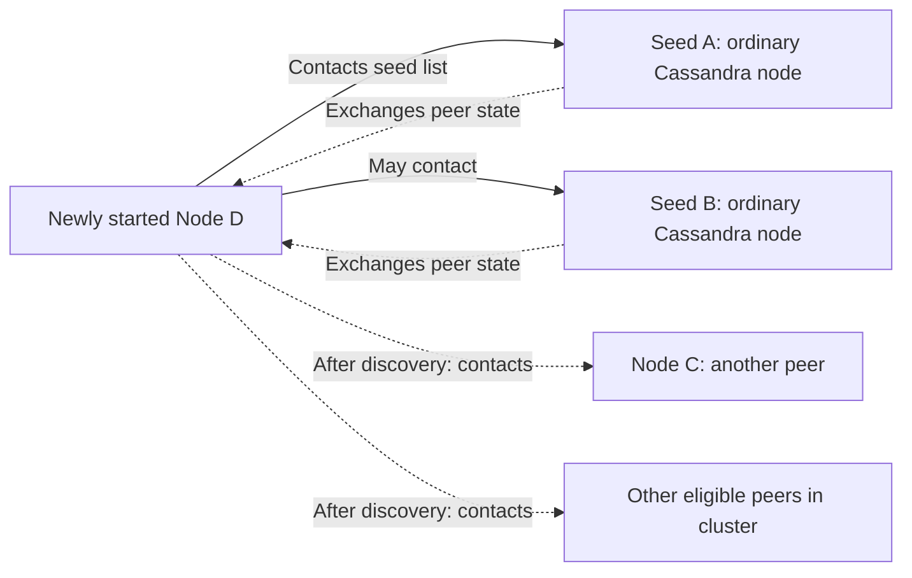
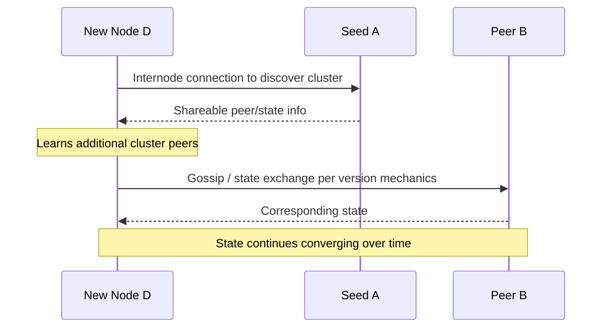
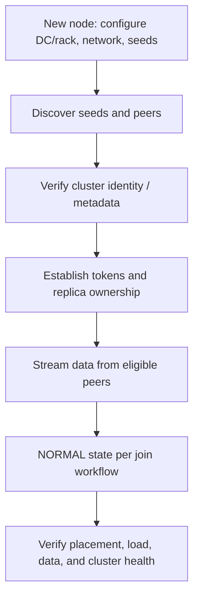
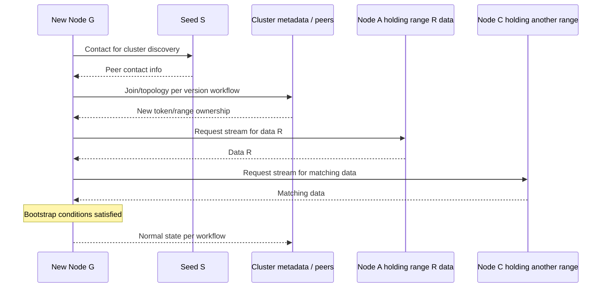

# Seed Nodes, Bootstrapping, and Distinction from a Leader Role

In Apache Cassandra, a newly started node cannot learn all cluster members on its own unless another member introduces them. It needs some initial addresses for **peer discovery**. Those addresses are configured in a **seed list**, and the nodes designated as initial contact points are called **seed nodes**. However, seeds are **not masters**: Cassandra still uses a **peer-to-peer** architecture where any eligible node can accept CQL requests, act as a per-request coordinator, and store data for its assigned partitions.

Two concepts often conflated are **seed discovery** and **bootstrapping**. Discovery helps a new node learn about the cluster, whereas bootstrapping is the process of joining the topology and **receiving the data** needed for the token ranges and partitions the node will own. Reaching a seed **does not** prove bootstrapping is complete. Conversely, an already running cluster can keep serving when a seed loses connectivity, as long as replicas, network paths, and essential metadata services still satisfy request requirements.

This lesson belongs to the **Cluster Architecture** chapter of the **Apache Cassandra wide-column** database module, placing seed and bootstrap concepts in relation to partition keys, replication, consistency levels, network failures, and Java application connectivity.

After this lesson, you will be able to:

- Explain the roles of seed nodes, the seed provider, and gossip during cluster discovery.
- Distinguish seeds, coordinators, replicas, bootstrapping nodes, and leader/consensus roles that appear in certain specialized features.
- Describe the steps when a new node joins a cluster, acquires token ownership, and **streams** data.
- Recognize the differences among **bootstrapping a new node**, **restarting an existing node**, **replacing a node that lost data**, and **decommissioning**.
- Analyze what happens when a seed, an ordinary node, or an entire replica group loses connectivity.
- Inspect join/streaming state with `nodetool`, configure seeds sensibly, and understand why Java Driver contact points are a separate concept.

## 1. What Problem Do Seed Nodes Solve?

Suppose a cluster `telemetry-cluster` consists of A, B, and C in `dc1`. You want to add node D in the same DC. When D first boots, it must know at least one reachable peer to learn cluster state. D is configured with a list of seed addresses such as A and B, and contacts those peers over Cassandra's internode communication layer.



The lines above depict **discovery**, not all data transfer flows. A and B are not fixed centers coordinating every query or copying every partition to D. Seeds simply provide a **starting point** for a node to gather information and communicate with the cluster.

Gossip normally spreads membership state across peers. A node does not need to ask a seed about **every** liveness change once it has discovered and established communication with other members. Depending on version, topology or cluster metadata changes may involve additional coordination workflows, yet **being listed as a seed** never grants a node leader privileges.

### Seed Is a Configuration Role, Not a Server Tier

A seed node:

- Remains an ordinary **Cassandra node** with its own DC, rack, address, and partition storage responsibilities just like other nodes.
- Can act as **coordinator** if an application sends a CQL request to it.
- Can be a **replica** for partition P while not being a replica for partition Q.
- Can fail, restart, run compaction and repair, and carry query load just like any other node.
- Serves as an **initial cluster discovery contact** for other nodes.

There is no "seed master" or "seed database" holding all data required for the cluster to serve reads and writes.

## 2. Distinguishing Seed, Peer, Coordinator, Replica, and Leader

| Role / Concept | Scope | Responsibility | Common Misconception |
|---|---|---|---|
| **Seed node** | Peer discovery config | Provides initial endpoints for nodes to contact when finding members. | Not a cluster master. |
| **Peer / node** | Cassandra member | Communicates with peers, can accept CQL, and stores assigned partitions. | Peer does not mean every node holds every record. |
| **Coordinator** | **Per CQL request** | Receives client query, finds replicas, waits for responses per CL, and returns result. | Not a fixed primary node for every request. |
| **Natural replica** | **Per partition** | Stores a copy of data assigned by the replication strategy. | Seeds are not automatically replicas of every partition. |
| **Bootstrapping node** | Topology join phase | Receives data ownership and streams per the version's join process. | Knowing a seed does not mean bootstrapping is done. |
| **Leader / consensus coordinator** | A specialized protocol or operation, if present | May appear in metadata operations or lightweight transactions depending on version. | Does not create a global primary/master for normal CQL reads/writes. |

In a peer-to-peer architecture, each request can have a different coordinator. The Java Driver picks a receiving node based on metadata, topology, and load-balancing policies. For instance, request one goes to A and request two goes to C: A and C act as coordinators **for their respective requests**, regardless of whether either appears in the seed list.

### Does "Masterless" Mean Cassandra Never Has Consensus Mechanisms?

**No.** Distinguish two levels:

1. **Normal CQL read/write path:** Cassandra does not depend on a fixed storage leader; coordinators are per request, and replicas are determined by partition key and token.
2. **Features requiring consensus or coordinated metadata:** Lightweight transactions (LWT) use Paxos, and Cassandra 5.x introduces the **Cluster Metadata Service (CMS)** to handle cluster metadata changes in a coordinated manner. Coordinator/leader roles inside those mechanisms **do not turn seed nodes into cluster-wide data leaders**.

Hence, saying "Cassandra has no leader" is accurate only when referring to **having no fixed master for all data reads and writes**. Do not overgeneralize it to "there is no consensus, quorum, or coordination anywhere in the system."

## 3. Seed Providers and Seed Lists

In Cassandra deployments using `SimpleSeedProvider`, the seed list is usually declared in `cassandra.yaml`:

```yaml
# Configuration illustration; verify against your running version.
cluster_name: 'telemetry-cluster'

seed_provider:
  - class_name: org.apache.cassandra.locator.SimpleSeedProvider
    parameters:
      - seeds: "192.0.2.11,192.0.2.12"

endpoint_snitch: GossipingPropertyFileSnitch
```

Addresses `192.0.2.11` and `192.0.2.12` belong to a **documentation-reserved** range; replace them with real peer addresses reachable over the internode network. Never copy the example verbatim into production. Real configurations also require listen/broadcast addresses, DC/rack settings, authentication/encryption, and parameters matching your Cassandra release.

**The seed list is not a list of every node.** Typically you choose a few stable seeds spread across appropriate failure domains with reliable network paths from joining nodes. Guidance on seed count and placement depends on cluster size, DCs, and Cassandra version.

Operational principles:

- Pick **multiple reachable seed endpoints**, avoiding placing all of them on one host, one rack, or one network path.
- Consider **seeds in each DC** to avoid depending on cross-DC links when nodes in that DC start up or rediscover peers.
- Keep the seed list **consistent and managed** across nodes in line with cluster design.
- Do not assume "more seeds is always better"; making every node a seed makes configuration harder to manage without adding any extra data replicas.
- Seeds are **internode** addresses; do not confuse them with Java application CQL contact points on port `9042`.

### Should a Node's Seed List Include Its Own Address?

A seed node can appear in the seed lists distributed across the cluster. How seeds behave during initial cluster formation, bootstrap steps, and seed-flagged node behavior have version-specific details; **never use tricks with the seed list to try skipping streaming**. Keep seed provider configuration separate from settings like `auto_bootstrap`, and follow the official add/init procedures for your exact version.

## 4. How Does Gossip Discover Peers?

In versions using the traditional gossip model, a node contacts known peers and exchanges digests/state. Internal message names are commonly described as `GossipDigestSyn`, `GossipDigestAck`, and `GossipDigestAck2`; the general mechanism compares known state versions so only missing or newer updates are sent.



Gossip has key properties:

- **Decentralized:** multiple peers propagate membership state, without requiring a seed to sit in the middle of every exchange.
- **Gradual propagation:** nodes can learn about joins, outages, or restarts at slightly different times.
- **Inferential failure detection:** the failure detector evaluates whether a peer appears responsive, without absolute proof that a machine powered off.

Gossip **does not** send full SSTables as part of normal state propagation, nor does it automatically sync every missed partition. Getting data onto a new node is handled by **bootstrapping/streaming**, whereas data drift between replicas may require **hinted handoff** or **repair**.

### Cluster Metadata in Cassandra 5.x

Cassandra 5.x introduces the **Cluster Metadata Service (CMS)** into cluster metadata management. Topology and schema changes follow explicit recording and coordination mechanisms, differing in operational detail from older releases. When investigating a join failure or topology configuration issue, consult documentation for the **exact running version** to determine metadata state.

What remains unchanged conceptually: **seeds help establish initial contact; seeds do not automatically hold coordination or CMS leadership authority**. Data storage still operates by partition and replica, and the CQL coordinator remains a per-request role.

## 5. Bootstrapping Is More Than Connecting to a Seed

**Bootstrapping** is the process of bringing a new node into the cluster so it takes ownership of part of the token space and its corresponding data. Having network connectivity to a seed is only the **preparatory step**.

A general sequence when adding a new node:

1. **Prepare the node:** install a compatible Cassandra build and configure cluster name, internode/CQL addresses, snitch, DC/rack, and seed provider. Confirm the node is a **genuinely new instance**, not duplicating the host ID/identity or data of a running node.
2. **Start and discover:** the node contacts seeds/peers, verifies target cluster identity, and reads version-appropriate metadata state.
3. **Establish token ownership:** the cluster computes token/vnode distribution and updates replica ownership per replication strategy, RF, and topology.
4. **Stream data:** the new node receives the partitions/ranges it must own from existing sources via the bootstrap workflow. Data typically streams from appropriate owning peers, **not necessarily from seeds**.
5. **Complete join:** the node transitions to normal state once the metadata and data preconditions of the workflow are satisfied.
6. **Post-join verification:** inspect data, load, streaming completion, capacity balance, and any repair/cleanup steps required by your procedure and version.



This diagram is a **conceptual model**, not a literal runbook for every release. Exact ordering and metadata handling vary significantly, especially between pre-CMS and CMS-enabled versions.

### Example Replica Set Shift

Suppose a keyspace has RF = 3 in `dc1`, with nodes A/B/C/D/E/F serving various token segments. When adding G, some token ranges or replica assignments may shift. For example, partition P previously had natural replicas A/C/E, and after the topology settles may be assigned to A/E/G. This is **illustrative only**: actual natural replica selection depends on tokens, vnodes, replication strategy, and rack/DC layout.

The crucial point is that **G must receive the relevant data** before it can fully fulfill its new replica duties; merely appearing in gossip or join metadata does not guarantee G already holds all rows of P.

## 6. How Do Tokens, Vnodes, and Replication Relate to Bootstrapping?

Cassandra hashes the **partition key** into a token. Nodes own token ranges; with **virtual nodes (vnodes)**, a single node can own multiple non-contiguous token ranges.

Wide-column table example by device/day:

```sql
CREATE KEYSPACE telemetry
WITH replication = {
  'class': 'NetworkTopologyStrategy',
  'dc1': 3,
  'dc2': 3
};

CREATE TABLE telemetry.events_by_device_day (
    tenant_id uuid,
    device_id uuid,
    event_day date,
    event_time timestamp,
    event_id uuid,
    reading double,
    PRIMARY KEY ((tenant_id, device_id, event_day), event_time, event_id)
) WITH CLUSTERING ORDER BY (event_time DESC, event_id ASC);
```

Here, `(tenant_id, device_id, event_day)` is the **composite partition key** determining the partition's token; `event_time` and `event_id` order rows within the partition. `NetworkTopologyStrategy` uses tokens, RF, and DC/rack info to determine **natural replicas** for each partition.

When bootstrapping G, the cluster must transfer the partitions/ranges newly owned by G onto that node. This is **actual data**: G cannot materialize `reading` values merely by learning peer names over gossip.

### Does Adding a Node Change RF?

Not automatically. With `RF_dc1 = 3`, each partition still has **three desired copies in `dc1`**, though the set of nodes holding each copy can shift as tokens/ring adjust. Adding nodes helps **distribute storage capacity and load** across more machines; it does not mean partition P suddenly gains four or five replicas.

A **hot partition** is still served primarily by that partition's own finite replica set. If all writes continuously target the same partition P, adding more nodes will not split P automatically; revisit your partition key, daily/hourly bucketing, and query-driven table design.

## 7. Data Streaming: What Happens After Discovery?

**Streaming** is the transfer of data between nodes to satisfy partition/range ownership during events like bootstrapping or topology changes. It is completely distinct from exchanging **gossip heartbeats/state**.



The diagram separates seed S from data sources A and C to emphasize: **seeds are not default streaming sources**, do not hold every partition, and are not elected as a "primary copy server" for every joining node. Streaming sources are selected based on required data, topology, and version mechanics.

Streaming consumes **network bandwidth, disk I/O, and CPU**, potentially affecting CQL latency on serving nodes. Schedule node additions thoughtfully, monitor progress, and ensure spare capacity. A node that received incomplete data due to a failed bootstrap must be handled via proper recovery procedures; never treat "rebooting repeatedly" as a general fix.

## 8. How Does a Joining Node Differ from Up/Normal?

`nodetool status` typically displays two dimensions together:

- First character: `U` (*Up*) or `D` (*Down*) showing liveness from the queried node's perspective.
- Second character: `N` (*Normal*), `J` (*Joining*), `L` (*Leaving*), `M` (*Moving*), or another version-dependent status.

| Example | Meaning | What Must Not Be Assumed |
|---|---|---|
| `UJ` | Node is seen as alive and joining topology. | The node has finished receiving data like a normal replica. |
| `UN` | Node is seen as Up/Normal. | All partitions are fully repaired or every request is guaranteed to succeed. |
| `DN` | Node is seen as Down/Normal. | The node lost its disks and must be removed/replaced immediately. |
| `UL` | Node is seen as Up/Leaving. | You can shut it down immediately without finishing decommission. |

Request availability still depends on **partition key, natural replica set, RF, CL, network state, and timely responses**. An `UN` node can still be very slow due to compaction, repair, flushing, or tombstones.

During bootstrapping, liveness and data readiness are two separate layers: **a node appearing in membership does not prove data transfer has finished**.

## 9. Bootstrapping, Restarting, Replacing, and Decommissioning Are Different

These four operations are frequently confused:

| Scenario | Does Node Keep Old Data/Identity? | Proper Handling |
|---|---|---|
| **Adding a new node (bootstrap)** | New node, does not yet hold assigned data copies. | Join topology and stream data for assigned ranges. |
| **Restarting an existing node** | Usually retains host ID, tokens, commit log/SSTables, and compatible state. | Restart as an existing member; assess missed mutations and recovery. |
| **Replacing a dead/data-lost node** | Replacement instance differs from old node; identity/tokens and missing data must be handled. | Follow version-specific replace procedure, ensuring old node cannot coexist conflictingly and replicas recover. |
| **Decommissioning a live node** | Existing node leaves the cluster cleanly. | Hand off ownership/data and update topology before stopping or removing it. |

A severe mistake is **copying an old node's data directory/host ID and booting both concurrently on a new node**. That creates identity and metadata conflicts. Similarly, never use `auto_bootstrap: false` or wipe data directories as a "fast node-add trick" without an exact version-appropriate procedure and verified cluster state.

### Does Bootstrapping Happen Automatically on a New Seed Node?

Versions and configurations differ in how seeds, tokens, and `auto_bootstrap` interact. Therefore, never state simply that **"just adding the new node's IP to the seed list makes it receive all data"** or **"a seed node never needs streaming."** Always check **the exact version's bootstrap behavior**, actual data state, and add/replace workflow constraints before putting a node into production.

### Does a Restarting Node Need Seeds?

A restarting node can use known endpoints and configured seeds to discover peers and refresh state, but **that does not turn it into a fresh node needing to bootstrap all data**. When it preserves its identity, tokens, and data, restart recovery differs fundamentally from a blank new node. If data was lost, metadata failed, or downtime was prolonged, appropriate sync/recovery steps are required.

## 10. What Happens If a Seed Node Fails?

Consider two distinct situations:

| Context | What a Failed Seed May Cause | What Still Matters |
|---|---|---|
| **Cluster is stable; nodes already communicate** | May reduce discovery endpoints for new/restarting nodes. Normal CQL queries do not have to pass through seeds. | Replicas, network, RF/CL, coordinators, and health of required metadata services. |
| **New node needs to bootstrap but cannot reach seeds/peers** | New node may fail to discover or join the cluster. | Are other seeds reachable, are IPs/ports right, and what are version/metadata rules? |
| **A seed is also a natural replica of P** | If the seed goes down, that replica of P is unavailable just like any other replica node. | Do enough remaining replicas of P survive to satisfy CL? |
| **All seeds in one rack/AZ fail together** | Discovery risk increases for new nodes; cluster also loses those replicas/capacity. | Can surviving peers still communicate, and does topology have seed redundancy in another failure domain? |

From the table above, **"seed down" does not equal "cluster down,"** yet seeds should not be treated as trivial either. They are an important dependency for **discovery and internal connection initialization**, especially when scaling or recovering.

### A Quorum Example Independent of the Seed Label

Suppose partition P has three replicas A, B, and C in `dc1` (RF = 3), and the application writes at `LOCAL_QUORUM`, needing **two local ACKs**. If A is a seed and A goes down, the write can **still succeed** if B and C respond on time. If B and C go down while A stays up, `LOCAL_QUORUM` fails even though seed A is healthy.

Thus, the number of living seeds **does not determine quorum**. To evaluate requests, inspect the partition's natural replicas and the actual CL.

## 11. Initializing a New Cluster vs. Expanding an Existing One

These two tasks require different preparation:

**Initializing a brand-new cluster:** nodes have no shared state or business data yet. Design the cluster name, seed/contact topology, partitioner, snitch, DC/rack, security, and version-specific initialization sequence. Initial nodes form the cluster; during initial bootstrap, there is no pre-existing cluster to stream data from. Follow your exact Cassandra version's **initial cluster setup** guide as the source of truth.

**Expanding a running cluster:** the new node must match the existing cluster, declare accurate DC/rack topology, acquire token ownership, and receive required data. Never run a "first-cluster initialization" workflow to force a standalone node into an existing cluster holding data.

Checklist before adding a node:

1. Do RF and actual node/rack counts in the DC support your fault-tolerance goals?
2. Can the new node **reach seeds/peers over internode networking**?
3. Do Cassandra version, snitch config, cluster name, network security, and schema align?
4. Are disk, CPU, I/O, bandwidth, and maintenance window sufficient for streaming?
5. Can you monitor join state, streaming, and metrics before shifting application traffic?

These questions are far more useful than merely verifying "we can ping the seed."

## 12. Practical Inspection with `nodetool` and CQL

Common status commands while observing a bootstrap:

```bash
# Check DC, rack, Up/Down, and Joining/Normal state
nodetool status

# Inspect ongoing streaming activity from the node's viewpoint
nodetool netstats

# View membership/gossip info known to the node
nodetool gossipinfo

# Check cluster overview and version-specific schema/metadata
nodetool describecluster
```

No single command proves all replicas are healthy:

- `nodetool status` shows whether a node is `UJ` or `UN`, yet `UN` is not proof of full repair or convergence.
- `nodetool netstats` can show active streaming; seeing no active streams is **not enough** to confirm a new node received all expected data.
- `nodetool gossipinfo` displays peer state from **the queried node's perspective**, not a guarantee that every peer instantly agrees on identical metadata.
- `nodetool describecluster` helps verify cluster/schema agreement and version-specific state.

In `cqlsh`, inspect current replication settings:

```sql
SELECT cluster_name, data_center, rack, host_id
FROM system.local;

SELECT keyspace_name, replication
FROM system_schema.keyspaces
WHERE keyspace_name = 'telemetry';
```

`system.local` describes **the node handling the CQL connection**. To inspect peers, use `nodetool status` or version-supported system tables; never edit system tables directly to alter membership.

### Signals to Record During a Bootstrap

| Signal | Why It Matters |
|---|---|
| Does the new node have the right **cluster name, DC, rack, and host ID**? | Prevents joining the wrong cluster or declaring faulty topology. |
| Is there connectivity to **seeds/peers**? | Confirms discovery works. |
| Does state transition from joining to normal? | Tracks join lifecycle progress. |
| Is streaming progressing and completing as expected? | Verifies the node receives data for its new ownership. |
| Do latency/timeouts on source nodes or clients rise? | Assesses resource impact caused by bootstrapping. |
| How do RF/CL and healthy racks behave during the transition? | Evaluates availability while topology is changing. |

## 13. Distinguishing Seeds from Java Driver Contact Points

**Seeds** are used by **Cassandra nodes** for peer discovery at the internode layer. **Contact points** are used by **CQL clients / the Java Driver** to open initial connections to the cluster and fetch metadata. They may share host IPs, yet they differ in **protocol, role, and network port**.

| Property | Seed Node | Java Driver Contact Point |
|---|---|---|
| Who uses it | Cassandra nodes during discovery/bootstrap/restart. | CQL apps / Java Driver when initializing `CqlSession`. |
| Connection type | **Internode** networking and peer protocols. | **Native CQL** networking. |
| Typical port | Internode, e.g., `7000` or configured TLS port per version. | Usually `9042`. |
| Holds all partitions? | No. | No; merely an initial endpoint contacted by the client. |
| Coordinator for all requests? | No. | No; driver can pick other coordinators after discovering the cluster. |
| Must use the exact same list? | No. | No; choose each based on reachability and its respective policy. |

A failing contact point can hinder **initial CQL session startup** if the application lacks alternatives; that is a client connectivity issue, not proof that Cassandra gossip/seeds are broken. Likewise, an internode seed may be healthy while its CQL port is unreachable from application subnets.

### Java Driver 4.x: Using Multiple Contact Points

```java
import com.datastax.oss.driver.api.core.CqlSession;
import com.datastax.oss.driver.api.core.DefaultConsistencyLevel;
import com.datastax.oss.driver.api.core.cql.BoundStatement;
import com.datastax.oss.driver.api.core.cql.PreparedStatement;
import com.datastax.oss.driver.api.core.cql.Row;

import java.net.InetSocketAddress;
import java.time.LocalDate;
import java.util.UUID;

public class ReadTelemetry {
    public static void main(String[] args) {
        UUID tenant = UUID.fromString(
            "11111111-1111-1111-1111-111111111111");
        UUID device = UUID.fromString(
            "22222222-2222-2222-2222-222222222222");

        // 192.0.2.0/24 is for documentation: replace with real endpoints.
        try (CqlSession session = CqlSession.builder()
                .addContactPoint(new InetSocketAddress("192.0.2.21", 9042))
                .addContactPoint(new InetSocketAddress("192.0.2.22", 9042))
                .withLocalDatacenter("dc1")
                .build()) {

            PreparedStatement prepared = session.prepare(
                "SELECT event_time, event_id, reading " +
                "FROM telemetry.events_by_device_day " +
                "WHERE tenant_id = ? AND device_id = ? AND event_day = ? " +
                "LIMIT 20"
            );

            BoundStatement statement = prepared
                .bind(tenant, device, LocalDate.parse("2026-11-21"))
                .setConsistencyLevel(DefaultConsistencyLevel.LOCAL_QUORUM);

            for (Row row : session.execute(statement)) {
                System.out.printf("%s %s %.2f%n",
                    row.getInstant("event_time"),
                    row.getUuid("event_id"),
                    row.getDouble("reading"));
            }
        }
    }
}
```

With a prepared statement containing the full partition key, the driver can use **token-aware routing** to prefer an appropriate natural replica as coordinator when metadata is available. The contact points in this snippet **do not need to be seed nodes**. In real applications, reuse `CqlSession`, manage connection/auth/TLS configuration through deployment config, and set local DC to match actual topology.

A newly bootstrapped node also **does not automatically appear in the application's static contact-point list**; the driver discovers it via cluster metadata and routing policies after cluster and client views update.

## 14. Common Mistakes When Seed or Bootstrap Fails

| Symptom | Common Misconception | Root-Cause Direction |
|---|---|---|
| New node cannot join | "The seed must grant master permission and is refusing." | Check seed/peer reachability, cluster name, internode network, config, and version metadata. |
| Node stays in `UJ` for a long time | "Gossip hasn't finished propagating yet." | Inspect `nodetool netstats`, bootstrap logs, stream sources, disk/bandwidth, and metadata state. |
| Seed A is down, yet clients keep reading/writing | "The system must be ignoring errors." | This is normal when quorum and peer connectivity remain satisfied. |
| After adding G, some queries slow down | "The seed is sending data too slowly." | Check streaming on source/target nodes, compaction load, network, and replica placement; sources need not be seeds. |
| Added nodes, yet a hot partition stays slow | "Cassandra isn't load-balancing." | Inspect partition key distribution; a single partition still hits a finite replica set. |
| G appears in `nodetool status`, yet data is missing | "It's in membership, so every record must be copied." | Verify bootstrap/streaming/repair and keyspace replication. |
| Node restarts with old data but is treated like a new node | "Just add its IP to the seed list." | Check host ID, tokens, data directory, IP change, and restart/replace procedure. |
| `LOCAL_QUORUM` fails while the seed is `UN` | "Quorum must be counted on seeds." | Check the partition's natural replicas and actual responses; the seed label does not decide CL. |

### Network Paths: Reaching a Seed over CQL Does Not Prove Internode Works

Native CQL and internode traffic can use different ports, TLS settings, and listen/broadcast addresses. Never test only port `9042` and assume seed discovery will work. Verify internal addresses, DNS/NAT, firewalls, internode ports, and actual encryption settings.

### Avoid Risky Changes Just to "Fix a Seed"

Never casually delete data directories, change host IDs, disable auto-bootstrap, edit system tables, force-remove, or trigger replace commands just to clear an error from `nodetool status`. Those actions risk data loss or replica ownership conflicts. Determine first whether you are dealing with **a new node, a restart, or a replacement** before choosing a workflow.

## 15. How Does Adding a Node Relate to Consistency Level?

Bootstrapping changes storage responsibilities across nodes, but **does not automatically change the client's CL**. For a keyspace with RF = 3 in `dc1`:

- `LOCAL_ONE` requires one replica in `dc1` to respond.
- `LOCAL_QUORUM` requires `floor(3/2) + 1 = 2` responses in `dc1`.
- `ALL` requires all replicas in scope; sensitive when any replica is slow or disconnected.

State during topology transitions must be handled according to the version's internal rules because natural replica sets and token ownership may be shifting. Never assume a `UJ` node counts as a complete replica for ACKs or that seeds are always added to quorum.

In a multi-DC cluster with `RF_dc1 = 3` and `RF_dc2 = 3`, `LOCAL_QUORUM` in `dc1` needs **two** ACKs/data from local replicas; a healthy seed in `dc2` cannot substitute for that quorum. A successful write in `dc1` does not guarantee `dc2` replicas have converged; failing over to another DC still requires checking data state, repair, and DR targets.

### What to Check Beyond `UN` After Bootstrapping?

Inspect data distribution, partition read/write behavior, latency, streaming/compaction load, and replica health. If prior node downtime or topology changes left data out of sync, tools like **anti-entropy repair** reconcile differences. **Compaction** only reorganizes SSTables on a node; it does not replace bootstrap streaming or replica repair.

## 16. Reasoning Exercises

**Scenario A — Seed down after cluster is stable.** Cluster has A/B/C; A is a seed; B and C still communicate and are two healthy replicas for partition P (RF = 3). Can a `LOCAL_QUORUM` write still succeed? **Yes**, if B and C respond on time. Seeds are not masters gating writes.

**Scenario B — New node contacts seed successfully.** D receives cluster peer info. Can we conclude D already holds all new partitions? **No.** Metadata/token updates and data **streaming** must still complete.

**Scenario C — Seed does not hold the partition range needed.** Node G bootstraps and streams a range from node C, while seed A does not own that range. Is this abnormal? **No.** Seeds assist discovery, while streaming depends on data ownership.

**Scenario D — All seeds reside in one AZ.** That AZ loses connectivity while several peers elsewhere remain up. Must existing queries stop? **No**, though new or restarting nodes needing discovery can be severely impacted. Spread seeds across appropriate failure domains.

**Scenario E — Java Driver's contact point is B, while the seed list only has A.** Can the application send requests to B? **Yes**, if B serves native CQL and the driver is configured properly. B does not need to be a seed.

**Scenario F — Bootstrapping a new node using the host ID of a still-running old node.** What is the risk? **Identity/metadata conflict**, not a faster join. Keep add-node and replace procedures strictly separate.

**Scenario G — Cassandra 5.x with CMS.** Does CMS make seeds the master for every `SELECT` and `INSERT`? **No.** Coordinated metadata management is separate from per-request coordinator data handling.

**Scenario H — Does adding nodes split a hot partition automatically?** **No.** Partition key and token still govern replicas; redesign bucketing or query patterns if one partition becomes hot.

## 17. Questions to Answer Before Troubleshooting Seed/Bootstrap Issues

1. **Is this a brand-new cluster or an existing cluster with data?** First-node initialization and cluster expansion follow different procedures.
2. **Is this a new node, a restarting node, or a replacement node?** Do identity, data, and tokens match that exact case?
3. **Can the node reach peers over internode networking?** Are seed list, ports, TLS, DNS/NAT, and listen/broadcast addresses right?
4. **Do cluster name, version, snitch, and DC/rack match?** Fix mismatches before letting the node join.
5. **How are tokens/vnodes and replica ownership managed?** Has the cluster recorded the metadata change per your version's mechanism?
6. **Where is streaming progressing or failing?** Inspect `nodetool netstats`, logs, and resources on source/target nodes.
7. **Which business requests are impacted?** Check partition keys, natural replicas, RF, and CL; never use seed status as a proxy for the whole cluster.
8. **Has data converged?** Verify via data checks and repair workflows when needed; `UN` alone is not enough proof.

During investigation, record **timestamps, observing node, Cassandra version, host ID, DC/rack, join state, and specific connection errors**. Those details are far more actionable than a vague "seeds aren't working."

## 18. Summary

View seed and bootstrap as two distinct phases:

```text
New node
   |
   +--> Seed list: find initial endpoints
   |       |
   |       +--> Gossip/peer discovery and version-specific metadata
   |
   v
Join topology: identity, tokens/vnodes, DC/rack, replica ownership
   |
   v
Bootstrap/streaming: receive owned data from eligible peers
   |
   v
Meet join completion criteria and transition to normal state
   |
   v
Serve CQL by role:
   - Coordinator: per request
   - Replica: per partition
   - Seed: discovery contact (if configured)
```

**A seed node is a peer providing a discovery contact point, not a cluster-wide data leader.** **Bootstrapping** is the process of joining the cluster and taking on data ownership—not merely connecting to a seed. Cassandra continues selecting natural replicas via **partition key, token, replication strategy, RF, and topology**, and determines request success via **CL**. Metadata coordination or conditional transaction protocols in certain versions are separate concerns and never turn seeds into CQL masters.

Keeping this boundary clear lets you add nodes, recover clusters, distribute seeds across failure domains, configure the Java Driver, and diagnose timeouts without confusing **"discovered peers"** with **"fully joined and holding data."**
