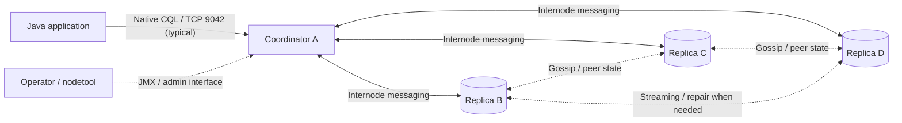
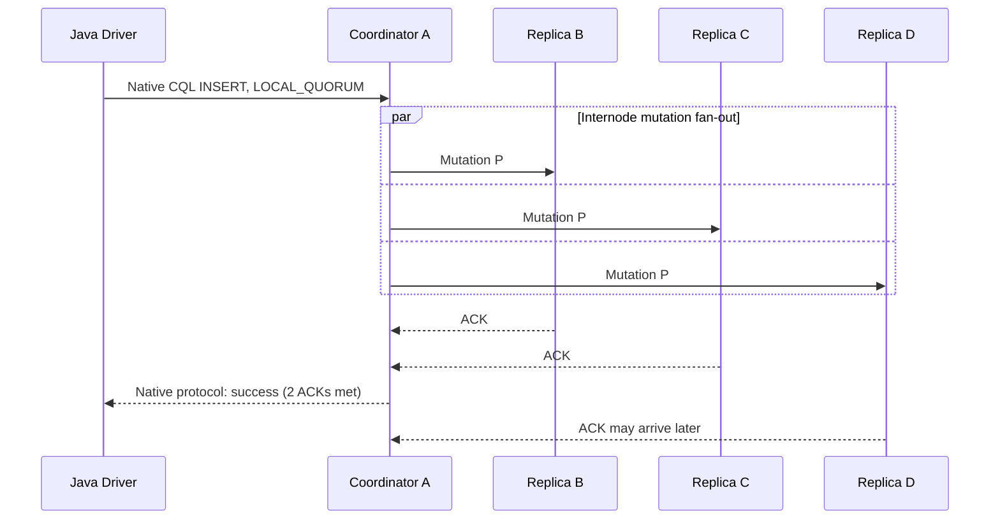
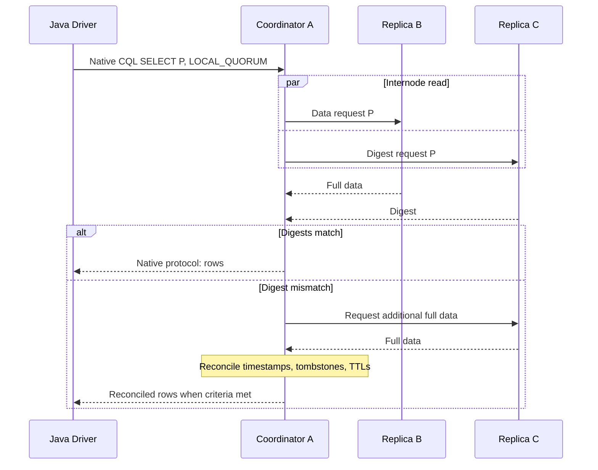
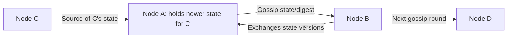
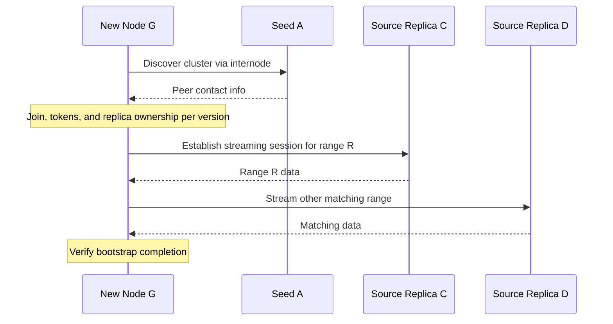
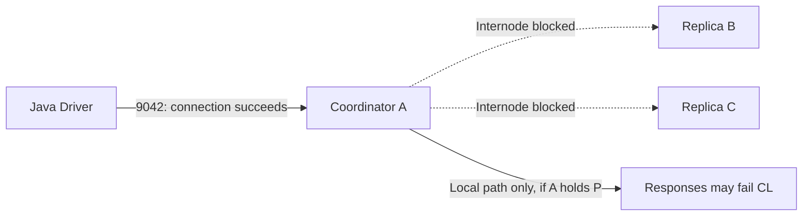

# Internode Messaging, Native Transport, and Traffic Types

Apache Cassandra is a **distributed wide-column** database. An `INSERT` statement from a Java application is only the starting point: once a node receives the CQL request, that node may need to contact multiple **replicas** to write data, collect acknowledgments, and return a result according to the **consistency level (CL)**. Alongside application queries, nodes also exchange **gossip**, topology state, repair coordination, and occasionally bulk data transfers during **bootstrapping** or **streaming**.

Not every connection in Cassandra is CQL. Two primary layers must be distinguished:

- **Native transport / native protocol:** the communication path between **CQL clients** (Java Driver, `cqlsh`, applications) and a Cassandra node, typically over TCP port **9042**.
- **Internode messaging:** the communication path **between Cassandra nodes** to coordinate reads, writes, gossip, and other distributed tasks. A common port for internode messaging is **7000**; encrypted configurations or specific versions may also use a port such as **7001**.

In addition, there are **data streaming**, **repair**, **administration/JMX**, **monitoring**, and cross-datacenter traffic. Some mechanisms may share underlying transport infrastructure or use different channels/modes depending on the version; never assume "one traffic type = always one exact port" across all Cassandra releases.

Lesson objectives:

1. Distinguish communication paths and traffic types present in a cluster.
2. Trace a read/write request from the Java Driver to coordinator, replicas, and back to the application.
3. Explain the role of internode messaging for gossip, replication, consistency levels, and topology operations.
4. Recognize how **control/state** traffic differs from **CQL data** traffic, **streaming/repair**, and **administration**.
5. Identify network boundaries, ports, listen/broadcast addresses, encryption, and multi-DC connectivity requirements.
6. Use CQL, `nodetool`, and the Java Driver to diagnose timeouts/connectivity without conflating distinct failure classes.

## 1. Map of Communication Paths in a Cluster

Suppose a Java application runs in `dc1` and the cluster has three replicas of partition P there. The Java Driver typically starts with a CQL connection to a **contact point**. After discovering metadata, it can send requests to another node acting as **coordinator**. The coordinator identifies natural replicas and exchanges internal messages; the application does not directly write to each replica over three separate CQL connections.



The diagram separates **traffic purposes**; it does not claim each arrow is a separate TCP socket or that the same message types can travel arbitrarily over any port. Transport details, TLS, and multiplexing depend on configuration and version.

| Communication Path | Initiator and Receiver | Typical Content | Purpose |
|---|---|---|---|
| **Client → node** | Java Driver, `cqlsh` → Cassandra coordinator | CQL requests, prepared statements, bound parameters, row results, errors | Executes business queries via the native protocol. |
| **Node ↔ node: read/write** | Coordinator ↔ natural replicas | Mutations, ACKs, data/digest responses, timeouts/errors | Enforces replica placement and CL. |
| **Node ↔ node: gossip** | Cassandra peers | Membership state, heartbeats, topology-related state | Propagates peer awareness and supports liveness detection. |
| **Node ↔ node: streaming** | Source node ↔ target node | Data transferred during bootstrap/replace/rebuild or other bulk ops | Moves data copies or ownership. |
| **Node ↔ node: repair** | Involved nodes/replicas | Comparison coordination, sync summaries, and repair data | Fixes data divergence across replicas. |
| **Admin / monitoring** | Ops tools ↔ node, agents/metrics exporters | JMX, status, metrics, operational commands | Controlled observability and administration. |

Gossip does not carry every row in your tables. Streaming is not a type of `SELECT` sent by the Java Driver. And JMX is not a port for regular CQL application queries.

## 2. Native Transport: Client Communicating with the Coordinator

**Native transport** is the layer accepting connections and executing the Cassandra Native Protocol from applications. CQL is the query language; on the wire, the driver uses the **native protocol** to transmit requests, parameters, metadata, results, and error messages. The protocol has its own versioning, framing, and multiplexing; clients do not send "SQL files" or access SSTables directly.

A typical Java Driver session:

1. The driver opens connections to one or more **contact points** configured by the application.
2. The driver performs protocol handshake/capability negotiation, authentication, and encryption if configured.
3. The driver fetches needed metadata about nodes, DC/racks, keyspaces, schemas, and tokens to manage routing.
4. The application prepares statements, binds parameters, sets a CL, and sends a request over a connection to a node.
5. The receiving node becomes the **coordinator for that request**; it processes CQL and exchanges internal messages with replicas when needed.
6. The coordinator returns results or errors over **native transport**; the driver decodes them into `ResultSet`, `Row`, or Java exceptions.

CQL example:

```sql
SELECT event_time, event_id, reading
FROM telemetry.readings_by_device_day
WHERE tenant_id = 11111111-1111-1111-1111-111111111111
  AND device_id = 22222222-2222-2222-2222-222222222222
  AND event_day = '2026-11-21'
LIMIT 20;
```

When the client supplies all partition key components, token-aware routing lets the driver prefer a local replica as coordinator. Still, **the coordinator is not a fixed master**; a node acting as coordinator may not store this partition at all.

### Contact Points Are Not Seeds

A **contact point** is an address used by **CQL clients** when initializing connections. A **seed node** is an initial contact endpoint used by **Cassandra peers** during cluster discovery. One host can serve as both a seed and a configured contact point, yet the two roles are distinct.

- Contact points typically use the **native CQL port** such as `9042`.
- Seeds serve **internode discovery/messaging**, generally not using port `9042` for that purpose.
- After bootstrapping connections, the driver can send CQL to other nodes without going through the initial contact point.
- Seeds do not sit in the middle of every CQL request.

A common mistake is seeing a client connect to `9042` on node A and concluding nodes A/B/C can all exchange internode messaging. Those two communication layers use **different configurations, security models, and network paths**.

## 3. Internode Messaging: Coordination Among Peers

**Internode messaging** is the mechanism Cassandra nodes use to exchange messages for distributed work. It sits **behind the client's CQL layer** during a typical request, though many internode messages are not client-initiated: gossip and background operational tasks run even when no application is issuing `SELECT`s.

Common categories of internal messages:

| Category | Example Logical Content | Why Is It Needed? |
|---|---|---|
| **Mutation / write** | Mutations sent to replicas, processing ACKs, error responses | Replicates records and collects ACKs per CL. |
| **Read** | Data requests, digests, full-data responses | Reads and compares partition replicas. |
| **Gossip / liveness** | Membership state, version-specific heartbeat/generation/version | Assesses which peers appear responsive. |
| **Topology / schema / metadata** | State exchange, notifications, or required change coordination | Keeps cluster state consistent enough for coordination; exact mechanism varies by version. |
| **Hint / repair coordination** | Missed mutation hints, comparison trees, and replica fixes | Helps data converge after failures. |
| **Streaming control / data** | Stream session negotiation, status, and bulk data transfer | Bootstrapping/rebuilding/repairing/ownership changes. |

Do not force a rigid protocol/port diagram from Cassandra 3.x onto Cassandra 4.x/5.x. Internally, Cassandra may prioritize message classes, enforce queue or connection limits, or route streaming over distinct transport channels depending on release.

### The Internode Protocol Is Not the CQL Client Protocol

A standard Java Driver does not connect directly to the internode port to issue a `SELECT`. Conversely, a Cassandra node does not use the client's native CQL protocol as its sole path for sending mutations to replicas. The same cluster opens both listeners, each with its own **protocol, execution path, and security model**.

## 4. Write Flow: From Native CQL to Internode Mutations

Consider a system storing measurements by device and day. Suppose partition P has natural replicas B, C, D in `dc1`, RF = 3, and coordinator A receives a request in `dc1`.



Key steps to understand:

1. **Native CQL:** the application sends `INSERT` and CL to coordinator A.
2. **Replica placement:** A maps partition key → token → replication strategy to locate P's natural replicas. If A is also a replica, A's local write replaces one network hop.
3. **Internode mutations:** A distributes the mutation to the appropriate replicas; traffic may cross multiple DCs depending on the keyspace's RF.
4. **Local write at replica:** each replica updates its commit log and memtable on the write path, then sends an ACK once its conditions are met. SSTable flushing and compaction happen separately.
5. **CL:** at `LOCAL_QUORUM` with RF = 3 in the coordinator's DC, **two local ACKs** suffice for the coordinator to return success. ACKs from another DC do not substitute for missing local quorum.

Crucial point: **CL determines the required number of ACKs, not "send the mutation only to that exact count of replicas."** RF sets the desired copy count. When RF spans another DC, the coordinator still directs mutations toward those replicas via replication mechanics, even though `LOCAL_QUORUM` confirmation does not wait for remote-DC ACKs.

### Bandwidth Implications

A small write from a client triggers multiple **internode** messages: mutations to each replica, returning ACKs, cross-DC traffic if the keyspace replicates across DCs, and potentially hints or repair later. Client-side network volume **does not equal** total cluster traffic. With high RF or heavy write streams, size internode and cross-DC capacity—not just port `9042`.

## 5. Read Flow: Full Data, Digests, and Reconciliation

For a `LOCAL_QUORUM` read in a DC with RF = 3, the coordinator can contact replicas for **full data** and **digests**; when results differ, it fetches additional data to reconcile versions.



This diagram is a **conceptual model** of a read path comparing replicas. At `ONE`, a single full-data response can suffice without requesting digests from other replicas. Speculative retries, read repair, and exact contacted replica counts depend on version and configuration.

Distinguish clearly:

- **Data response:** contains the payload the coordinator needs to build the result.
- **Digest response:** a summary checksum used to detect inconsistent read data; **does not contain enough data to reconstruct rows**.
- **Reconciliation:** compares cell versions/timestamps, TTLs, and tombstones to pick the effective result.
- **Read repair:** can use internode messaging to update replicas missing data, depending on version and settings.

Consequently, a `SELECT` returning few rows can still consume substantial network and I/O when replicas disagree or encounter many tombstones. Never assume "the client received 5 KB, so internode traffic was only 5 KB."

## 6. Gossip and Failure Detector: State Traffic, Not Data Rows

**Gossip** enables nodes to propagate awareness of peers, DC/rack, and state according to version mechanics. In Cassandra releases using the traditional gossip model, state includes heartbeats, generations, versions, and application states; exchanges commonly use digests to minimize payload size.



Gossip traffic runs at the **node-to-node** layer; it is neither a CQL table update nor a Java Driver request. The **failure detector** uses arrival/absence signals to infer peer responsiveness. If A sees C as `DOWN`, that is not proof C powered off; it could be a network partition or GC pause.

Two conclusions must never be equated:

1. **Gossip converged:** peers share a closer view of cluster state.
2. **Replica data converged:** partition copies actually hold identical logical values after mutations, hints, or repair.

Gossip does not perform the second job. A replica that just flipped from `DN` back to `UN` can still be missing mutations from its outage window.

### Metadata by Version

Cassandra 5.x introduces the **Cluster Metadata Service (CMS)** to coordinate cluster metadata changes. Message details and the source of truth for topology/schema modifications differ from the older model. When analyzing metadata traffic, check your **specific Cassandra version**, rather than assuming all metadata still merely "spreads through gossip" as in earlier releases.

## 7. Streaming: Bulk Data Movement Between Nodes

A newly bootstrapping node must receive data for the token ranges and partitions it will own. **Streaming** transfers that data from appropriate peers. Similarly, node replacements, rebuilds, replication changes, and certain repair workflows can generate streaming or large inter-node transfers.



**Seeds are not necessarily streaming sources.** They only assist discovery. Nodes holding eligible data and able to serve as stream sources participate according to the workflow.

Streaming differs from normal CQL mutations in **volume, duration, and purpose**. A small `INSERT` sends a mutation and waits for ACKs; bootstrapping may transfer gigabytes or terabytes (depending on the cluster), saturating bandwidth/I/O for extended periods. Never assume streams always run on the CQL port or share the exact same channel as gossip: exact protocols, ports, and transport optimizations **vary by Cassandra release and configuration**.

### Repair Also Generates Traffic, Unlike Compaction

**Anti-entropy repair** compares data across replicas and synchronizes differences. It creates coordination sessions, comparison structures, and inter-node data streams. **Compaction** primarily reads and rewrites SSTables on **the same node**, not as a network replication protocol; however, compaction consumes I/O and CPU and can slow network operations through resource contention.

**Hinted handoff** differs as well: when a replica is temporarily absent, Cassandra can buffer hints and replay missed mutations when the replica returns within configured bounds. Never rely solely on hints to skip scheduled repairs.

## 8. Multi-DC Networking: Local Traffic vs. Cross-DC Traffic

Suppose a cluster has `dc1` and `dc2`, each with RF = 3. The application runs in `dc1`, with the Java Driver configured with `localDatacenter = dc1`. A `LOCAL_QUORUM` write in `dc1` can be confirmed once **two `dc1` replicas** respond, yet the data still needs to replicate to `dc2` per topology.

| Traffic Type | Stays Within One DC | Can Cross DCs | Key Considerations |
|---|---|---|---|
| Native CQL from local app | Yes, when driver prefers local nodes. | Yes, if routing/failover shifts traffic. | Client/coordinator latency, security, and connection pooling. |
| Internode mutations/reads | Yes. | Yes, depending on RF, CL, and placement. | Replica fan-out, WAN latency, packet loss. |
| Gossip / state | Yes. | Yes, so peers maintain multi-DC cluster awareness. | Reachability and peer convergence. |
| Streaming / bootstrap / rebuild | Yes. | Yes, when expanding/rebuilding a DC or changing topology. | WAN bandwidth and recovery time. |
| Repair | Yes. | Yes, when comparing replicas across DCs; scope options affect traffic. | Control schedule, repair type, and resource budget. |
| JMX / monitoring | Per operational design. | Only if architecture and security policies permit. | Never expose admin ports to the public Internet. |

Crucially, **client-observed latency** and **internal bandwidth** do not scale one-to-one. CL may let the client avoid waiting on a remote DC, yet cross-DC replication still consumes network bandwidth. `QUORUM` across six total replicas needs four responses; `LOCAL_QUORUM` needs only two from `dc1`. Choosing a CL directly affects WAN sensitivity and fault tolerance, not merely "strong vs. weak."

### Watch Out When the Link Between Two DCs Drops

If `dc1` and `dc2` become network-partitioned, `LOCAL_QUORUM` requests inside each DC **can** continue serving if enough local replicas remain up. However, a write acknowledged in `dc1` may not have reached `dc2`. When connectivity recovers, evaluate missed data, hints, repair, and failover readiness. Gossip returning to normal **does not** prove cross-DC replication has finished.

## 9. Common Network Ports and Addresses

Not all Cassandra ports are exposed to the same audiences. A typical deployment has these layers:

| Common Port / Setting | Connection | Scope / Notes |
|---|---|---|
| **9042/TCP** (`native_transport_port`) | Java Driver, `cqlsh`, native CQL clients → node | Open only to **authorized applications**, never blindly open to the Internet. |
| **7000/TCP** (`storage_port`) | Cassandra node ↔ Cassandra node | Common internode port. Must be open bidirectionally between peers that communicate. |
| **7001/TCP** (`ssl_storage_port`) | Internode under certain TLS modes/versions | Do not assume every TLS cluster listens on 7001; check your running version's config. |
| **7199/TCP** (common JMX) | `nodetool` / JMX tooling → Cassandra JVM | Admin port; restrict by network, authentication, and SSL—never expose publicly. |
| **Monitoring / agent ports** | Exporters, Prometheus, observability tools | No universal single standard port; depends on integration. |

**Ports are only common defaults**, not substitutes for checking real configuration. Internode TLS port usage, connection boundaries, and certain listeners have evolved across releases; base firewall rules on documentation and the actual config of your running Cassandra version.

### Distinguishing Listen, Broadcast, and Client Addresses

These configuration fields serve distinct purposes:

- `listen_address`: address the node uses to **listen for internode traffic** in corresponding setups.
- `broadcast_address`: address the node **advertises** for peers to reach it via internode messaging where needed.
- `rpc_address`: address **listening for native transport** in versions using this setting; the name echoes legacy Thrift terminology, so interpret it per your Cassandra version.
- `broadcast_rpc_address`: address **advertised to clients/drivers** for native CQL connections, especially critical when binding on all interfaces.
- `native_transport_port`: native CQL port, typically 9042.
- `storage_port` and `ssl_storage_port`: port settings for internode messaging according to configuration and version.

**Illustrative** example for a node in `dc1`, using documentation-reserved IPs:

```yaml
# Illustrative config; check compatibility with your exact Cassandra version.
cluster_name: 'telemetry-cluster'

# Path between Cassandra nodes:
listen_address: 192.0.2.11
broadcast_address: 192.0.2.11
storage_port: 7000
ssl_storage_port: 7001

# Native CQL path from drivers:
start_native_transport: true
rpc_address: 192.0.2.11
native_transport_port: 9042
broadcast_rpc_address: 192.0.2.11

endpoint_snitch: GossipingPropertyFileSnitch
```

In practice, internal node IPs may differ from the IPs reachable by external clients. A **broadcast** address must be an address the remote side can actually reach, not necessarily equal to the listen address. When setting `rpc_address: 0.0.0.0` in supported configs, configure a valid `broadcast_rpc_address`; never advertise `0.0.0.0` as an endpoint for drivers to connect to.

**Never change network fields on a production cluster by copying this example.** Changing broadcast/listen addresses can disrupt node identity, reachability, membership, and node replacement; follow version-specific procedures.

## 10. TLS, Authentication, and Network Permissions

Cassandra has at least two security scopes to configure separately:

1. **Client-to-node:** Java applications ↔ native CQL listener. TLS and authentication control who can send CQL and whether traffic is encrypted.
2. **Node-to-node:** peers ↔ internode messaging/streaming. Node-to-node TLS protects internal data and state traffic, requiring matching certificates, truststores, endpoint configs, and version policies.

Traditional configurations include sections such as `client_encryption_options` and `server_encryption_options`. **Sub-key names, keystore types, and TLS enforcement behavior vary across versions**, so this lesson omits dummy passwords, fake certificate paths, or claims that one sample YAML safely enables TLS across every Cassandra release.

Security checklist:

- Segment **client networks**, **internode networks**, and **admin networks** per infrastructure policy.
- Grant native CQL access only to authorized applications; never open internode ports broadly just to fix a client error.
- Secure **cross-DC internode links** as well, because mutations, state, and streaming traverse the WAN.
- Never expose JMX publicly; enforce authentication, TLS, network policies, and scoped admin accounts.
- Inspect certificate chains, hostnames/SANs, truststores, and expiration dates when TLS handshakes fail.
- Test connectivity **bidirectionally** between nodes; asymmetric NAT or firewall rules can break gossip or streaming even while CQL clients look fine.

Never disable TLS in production for a "quick test" without controlled test environments and security sign-off.

## 11. Setting Up Keyspace and Table to Observe Traffic

In a test cluster with two DCs using the names above, create the keyspace and wide-column table:

```sql
CREATE KEYSPACE telemetry
WITH replication = {
  'class': 'NetworkTopologyStrategy',
  'dc1': 3,
  'dc2': 3
};

CREATE TABLE telemetry.readings_by_device_day (
    tenant_id uuid,
    device_id uuid,
    event_day date,
    event_time timestamp,
    event_id uuid,
    reading double,
    PRIMARY KEY ((tenant_id, device_id, event_day), event_time, event_id)
) WITH CLUSTERING ORDER BY (event_time DESC, event_id ASC);
```

Here, the partition key is **`(tenant_id, device_id, event_day)`**; Cassandra hashes all three values into a token, then uses `NetworkTopologyStrategy` and per-DC RF to find natural replicas. `event_time` and `event_id` are **clustering columns**: they sort and distinguish rows within the partition, not the DC or rack.

Write and read the same partition:

```sql
INSERT INTO telemetry.readings_by_device_day
  (tenant_id, device_id, event_day, event_time, event_id, reading)
VALUES (
  11111111-1111-1111-1111-111111111111,
  22222222-2222-2222-2222-222222222222,
  '2026-11-21',
  '2026-11-21T08:30:00+07:00',
  33333333-3333-3333-3333-333333333333,
  36.7
);

SELECT event_time, event_id, reading
FROM telemetry.readings_by_device_day
WHERE tenant_id = 11111111-1111-1111-1111-111111111111
  AND device_id = 22222222-2222-2222-2222-222222222222
  AND event_day = '2026-11-21'
LIMIT 20;
```

The query specifies the full partition key, so the coordinator targets a specific replica set. Omitting any partition key component or casually adding `ALLOW FILTERING` can trigger broad scans and sharply raise internode and I/O load.

## 12. Observing CQL and Internals with the Right Tools

In a test environment, use `cqlsh` to enable tracing for **one intentional request**:

```sql
-- cqlsh commands, not pure CQL SELECT syntax.
CONSISTENCY LOCAL_QUORUM;
TRACING ON;

SELECT event_time, event_id, reading
FROM telemetry.readings_by_device_day
WHERE tenant_id = 11111111-1111-1111-1111-111111111111
  AND device_id = 22222222-2222-2222-2222-222222222222
  AND event_day = '2026-11-21'
LIMIT 20;

TRACING OFF;
```

Tracing shows coordinator processing steps, requests sent to replicas, and responses received. Tracing **is not a packet capture** of every TCP connection, nor does it necessarily reveal every stream or gossip step. Enabling tracing adds load and metadata writes, so use it selectively.

Cluster observation:

```bash
nodetool status
nodetool gossipinfo
nodetool netstats
nodetool tpstats
nodetool describecluster
```

| Command | Useful For | Limitations |
|---|---|---|
| `nodetool status` | Viewing nodes by DC/rack, `UN`/`DN`, and lifecycle state. | An `UN` node can still fail to serve reads/writes on time. |
| `nodetool gossipinfo` | Inspecting peer state known to the queried node. | A **local viewpoint**, not proof all peers agree immediately. |
| `nodetool netstats` | Checking active streaming sessions and related network info per version. | Not a total byte counter for every CQL request in the cluster. |
| `nodetool tpstats` | Checking internal thread pools/queues to spot overload. | Must be paired with metrics and logs to find root cause. |
| `nodetool describecluster` | Checking cluster name and high-level schema/metadata agreement. | Not a packet payload inspection tool. |

In CQL, inspect node and keyspace metadata:

```sql
SELECT cluster_name, data_center, rack, host_id
FROM system.local;

SELECT keyspace_name, replication
FROM system_schema.keyspaces
WHERE keyspace_name = 'telemetry';
```

`system.local` reflects **only the node answering the request**, not a cluster-wide roster. Peer tables or driver metadata (depending on version) help cross-check topology at a wider scope.

## 13. Java Driver 4.x: Client Path and Local Routing

This Java example uses Apache Cassandra Java Driver 4.x with the `com.datastax.oss.driver` API. It opens **native CQL connections** to contact points rather than directly opening internode messaging to replicas.

```java
import com.datastax.oss.driver.api.core.CqlSession;
import com.datastax.oss.driver.api.core.DefaultConsistencyLevel;
import com.datastax.oss.driver.api.core.cql.BoundStatement;
import com.datastax.oss.driver.api.core.cql.PreparedStatement;
import com.datastax.oss.driver.api.core.cql.Row;
import com.datastax.oss.driver.api.core.metadata.Node;

import java.net.InetSocketAddress;
import java.time.Instant;
import java.time.LocalDate;
import java.util.UUID;

public class CassandraTrafficExample {
    public static void main(String[] args) {
        UUID tenantId = UUID.fromString(
            "11111111-1111-1111-1111-111111111111");
        UUID deviceId = UUID.fromString(
            "22222222-2222-2222-2222-222222222222");
        UUID eventId = UUID.fromString(
            "33333333-3333-3333-3333-333333333333");
        LocalDate day = LocalDate.parse("2026-11-21");
        Instant time = Instant.parse("2026-11-21T01:30:00Z");

        // Documentation IPs; replace with real contact points.
        try (CqlSession session = CqlSession.builder()
                .addContactPoint(new InetSocketAddress("192.0.2.11", 9042))
                .addContactPoint(new InetSocketAddress("192.0.2.12", 9042))
                .withLocalDatacenter("dc1")
                .build()) {

            // This is driver metadata, not the gossip protocol.
            for (Node node : session.getMetadata().getNodes().values()) {
                System.out.printf("node=%s dc=%s rack=%s%n",
                    node.getEndPoint(),
                    node.getDatacenter(),
                    node.getRack());
            }

            PreparedStatement insert = session.prepare(
                "INSERT INTO telemetry.readings_by_device_day " +
                "(tenant_id, device_id, event_day, event_time, event_id, reading) " +
                "VALUES (?, ?, ?, ?, ?, ?)");
            BoundStatement write = insert
                .bind(tenantId, deviceId, day, time, eventId, 36.7)
                .setConsistencyLevel(DefaultConsistencyLevel.LOCAL_QUORUM);
            session.execute(write);

            PreparedStatement select = session.prepare(
                "SELECT event_time, event_id, reading " +
                "FROM telemetry.readings_by_device_day " +
                "WHERE tenant_id = ? AND device_id = ? AND event_day = ? " +
                "LIMIT 20");
            BoundStatement read = select
                .bind(tenantId, deviceId, day)
                .setConsistencyLevel(DefaultConsistencyLevel.LOCAL_QUORUM);

            for (Row row : session.execute(read)) {
                System.out.printf("%s %s %.2f%n",
                    row.getInstant("event_time"),
                    row.getUuid("event_id"),
                    row.getDouble("reading"));
            }
        }
    }
}
```

In this example:

- `192.0.2.11` and `192.0.2.12` are **illustrative** IPs, not real node addresses. `dc1` must match the cluster's local DC.
- Both prepared statements provide the full **partition key**; when the driver has metadata, it can use token-aware routing to prefer an eligible replica as coordinator.
- `LOCAL_QUORUM` applies to **ACKs/data in the coordinator's DC**, without requiring the client to connect directly to every replica in that DC.
- Driver metadata updates asynchronously. It may not match every node's gossip view at the exact same instant.
- Production applications should configure authentication, TLS, timeouts, retry policies, and reuse a long-lived `CqlSession` rather than creating a session per request.

Iterating over `Row` reflects the CQL request result. From this Java API alone, you cannot infer how many internode TCP connections were opened or what streams are running. Deeper analysis requires traces, logs, metrics, and network tools under authorized access.

## 14. Diagnosis: CQL Connects, Yet Internode Is Blocked

This is one of the most important scenarios for separating traffic layers.

Suppose A, B, and C are natural replicas of partition P, yet a firewall accidentally blocks **internode** traffic from A to B and C. Applications can still connect to A's **native CQL port**:



In that state:

- TCP handshake and CQL authentication can succeed; **`INSERT`/`SELECT` requests still time out or return `Unavailable`** because too few replicas are reachable.
- If A is **not** a natural replica of P, even a low CL can fail because the needed replicas sit on unreachable nodes.
- If A is a replica, `LOCAL_ONE` may serve some requests, while `LOCAL_QUORUM` at RF = 3 requires another local replica; actual results depend on connectivity and deadlines.
- Gossip/failure detector may gradually mark peers `DOWN`; that reflects reachability along the internode path, not proof that B/C powered off.

Conversely, when internode communication is healthy yet port `9042` on A is blocked for a subset of application hosts, **the Cassandra node may operate normally internally**, while those clients cannot establish CQL connections to A. These are two distinct failure modes requiring different network fixes.

## 15. Classifying Errors by Traffic Layer

| Symptom | Likely Layer Involved | What to Check |
|---|---|---|
| Java Driver cannot open a session; connection refused/handshake errors | **Client → native transport** | Contact points, `9042`, TLS, authentication, client-reachable broadcast address. |
| `cqlsh` connects, yet `LOCAL_QUORUM` repeatedly times out | **Coordinator ↔ replica** | RF, natural replicas, internode network, liveness, queues, disk/GC. |
| Node flaps `UN`/`DN`, peers disagree on status | **Gossip / failure detector**, internode | Packet loss, GC pauses, CPU, listen/broadcast addresses, asymmetric routing. |
| Adding a node is very slow; `nodetool netstats` shows long stream sessions | **Streaming / bootstrap** | Bandwidth, disk I/O, stream sources, cross-DC links, logs. |
| Repair causes CQL latency spikes | **Repair + node/network load** | Repair schedule, scope, compaction/I/O, inter-replica network. |
| Reading `LOCAL_ONE` in backup DC returns stale data after failover | **Cross-DC replication / convergence** | Write/read CL, WAN links, hints, repair, timestamps. |
| Queries fail only from one app subnet while nodes stay `UN` | **Client networking** | Routing/NAT, `broadcast_rpc_address`, security groups, TLS. |
| `nodetool` cannot connect while CQL works | **JMX / admin** | JMX port, auth, SSL, admin network, permissions. |

### Distinguishing `Unavailable` from Timeouts

`Unavailable` is typically returned when the coordinator **does not see enough replicas considered available** to satisfy CL upfront. `ReadTimeout`/`WriteTimeout` usually indicates the request entered execution but **did not receive enough responses before the deadline**. Additionally, `ReadFailure`/`WriteFailure` occurs when replicas report internal execution errors.

For writes, **a timeout does not prove the mutation was not applied**: some replicas may have already saved it. Never retry unboundedly by generating new event keys; design idempotency and uncertain-outcome handling in the application.

For reads, digest mismatches and reconciliation can generate extra messages and raise latency even while nodes stay `UN`. Do not hastily blame every timeout on "slow 9042 networking."

## 16. Network Capacity and Operations: What to Prioritize?

To evaluate performance, look at **three load tiers**:

1. **Client traffic:** CQL connection count, requests/s, query/result payload sizes, p95/p99 latency, and timeouts.
2. **Internode request traffic:** RF-multiplied mutation fan-out, ACKs/data/digests, gossip/metadata traffic, and cross-rack/cross-DC load.
3. **Bulk / maintenance traffic:** streaming, repair, hints, and indirect node contention from compaction/I/O.

Optimizations such as **client-side connection pooling**, native protocol multiplexing, internode compression, and resource throttling can improve performance, though exact configuration depends on version. Never assume enabling internode compression speeds up every workload; incompressible data, constrained CPU, or encrypted traffic can produce different trade-offs.

A sensible observability workflow:

- Measure request rate and latency at the application/driver, separating connect errors from CQL timeouts.
- Correlate failing requests with coordinator, RF, CL, and the partition's replica set.
- Inspect internode bytes/messages/queues alongside node CPU/disk in the same time window.
- Isolate bootstrap, repair, or cross-DC failover windows from normal steady-state load.
- Size inter-DC bandwidth for traffic peaks and recovery after losing a failure domain.

### Controlling Partition-Level Hotspots

Cassandra does not automatically split a **very hot partition** across all cluster nodes. The partition key determines the natural replica set, so requests to a hot partition concentrate on those specific replicas. Adding nodes or upgrading network interfaces will not resolve that on its own. Redesign keys/bucketing around query patterns—balancing device/day/tenant granularity—alongside node sizing and retention/tombstone management.

### Lowering CL Is Not a Free Network Optimization

Dropping from `LOCAL_QUORUM` to `LOCAL_ONE` can reduce how many ACKs/data responses the coordinator waits on, but **it changes consistency semantics**; it does not reduce RF and does not cancel replication traffic to other replicas. Conversely, using `EACH_QUORUM` for multi-DC writes enforces quorum confirmation in every DC and makes cross-DC outages directly fail client writes. Every CL decision must stem from business and failover requirements, not just a latency graph.

## 17. Reasoning Exercises

**Scenario A — Native CQL works, quorum writes fail:** The driver connects to A on `9042` cleanly, yet `LOCAL_QUORUM` `INSERT`s time out. Can we conclude port `9042` on A is the cause? **No.** Also inspect internode messaging to natural replicas, node load, and actual ACKs.

**Scenario B — Seed down:** Seed S stops responding, while peers still communicate internally and partition P has enough healthy replicas. Must every CQL request route through S? **No.** Seeds assist discovery; they are not CQL masters.

**Scenario C — WAN link outage:** Two-DC cluster, RF = 3 per DC; `LOCAL_QUORUM` writes in `dc1` continue succeeding. Does that confirm `dc2` holds the mutations? **No.** The ACK requirement applies only to `dc1`.

**Scenario D — Heavy streaming:** New node G is bootstrapping, and source nodes show elevated disk and network utilization. Is the Java Driver firing millions of `INSERT` statements to populate G? **Not necessarily.** Bootstrapping uses node-to-node streaming, separate from normal CQL queries.

**Scenario E — Replica is Up yet reads time out:** `nodetool status` shows `UN` for C, yet reads time out. Is this a contradiction? **No.** Liveness does not guarantee reading SSTables/memtables and replying in time when I/O, GC, networking, or queues stall.

**Scenario F — Broken JMX:** `nodetool status` cannot reach a node because JMX is blocked, yet `cqlsh` still runs `SELECT`. Does that prove the node left the cluster? **No**; check the JMX port and configuration separately.

**Scenario G — Contact point vs. replica:** The driver uses A as a contact point, while partition P's natural replicas are B/C/D. Can A act as coordinator? **Yes**, if A accepts a valid request; A will contact the appropriate replicas over internode messaging.

**Scenario H — Enabling tracing:** Should `TRACING ON` be enabled on every production request to count packets? **No.** Tracing adds overhead and is not a packet capture; use metrics and proper diagnostics instead.

**Scenario I — Opening only TCP 9042 between two DCs:** Is that enough for a multi-DC Cassandra cluster to synchronize replication? **No.** Peers need properly configured internode connectivity; `9042` serves CQL client traffic.

## 18. Deployment and Troubleshooting Checklist

When preparing a cluster with Java applications and multiple racks/DCs, answer:

1. **Who connects to whom?** Diagram **client → native CQL** and **node ↔ node internode** paths separately, including cross-DC links.
2. **Which ports, addresses, and TLS settings are actually active?** Verify `native_transport_port`, `storage_port`, `ssl_storage_port`, listen/broadcast settings, and encryption configs for your running version.
3. **Are seeds and contact points confused?** Seeds serve node discovery, contact points serve drivers, and neither is a master.
4. **Which replicas hold each partition?** Derive from partition key, token, `NetworkTopologyStrategy`, RF, DC, and rack.
5. **What does the request's CL require?** Separate local vs. cluster-wide ACKs; factor in fault tolerance and cross-DC links.
6. **Which layer is failing?** TCP/connect/TLS, internode, replica execution, gossip liveness, streaming, or JMX.
7. **Is maintenance running concurrently?** Check bootstrapping, repair, hints, compaction, and their network/I/O impact.
8. **Has data converged?** An `UN` node, healthy gossip, or working CQL connection does not replace verifying replicas, hints, and repair.
9. **How does the application retry?** Does it use stable event keys, suitable CLs, timeouts, and idempotency?
10. **Is there failure-domain redundancy?** Verify rack/DC mapping, reachable seeds, network paths, and DR failover procedures.

These questions prevent two classic diagnostic blunders: *"Java can connect, so the Cassandra cluster is healthy"* and *"CQL threw an error, so we must fix seeds/gossip."* Only by knowing **the traffic type and both endpoints** can you pick the right tool and fix.

## 19. Summary

Viewed as a whole, Cassandra runs multiple concurrent traffic layers:

```text
Java App / cqlsh
      |
      | Native CQL transport (typically TCP 9042)
      v
Request coordinator
      |
      | Internode messaging: mutations, ACKs, read data/digests
      +--------------------> Natural replicas by token + RF + topology
      |                                |
      |                                +--> Commit log / memtable / SSTables
      |
      | Gossip / metadata / liveness among peers
      +--------------------> Cluster nodes
      |
      | Streaming / repair / hints when needed
      +--------------------> Eligible source / target nodes

Admin / monitoring
      |
      +--> JMX / agents / metrics (not CQL client protocol)
```

**Native transport** serves CQL applications; **internode messaging** handles distributed coordination among nodes; **gossip** propagates state; **streaming/repair** transfers and reconciles data; and **JMX/monitoring** supports operations. These layers may share host resources and network infrastructure, yet **success at one layer never proves every other layer is healthy**.

When analyzing Cassandra errors, start from **partition key → natural replicas → coordinator → CL**, and map out **client traffic, internode traffic, cross-DC traffic, and maintenance traffic**. This mindset ties cluster architecture consistently to wide-column table design, replication, reads/writes, repair, compaction, timeout handling, and Java client integration.
