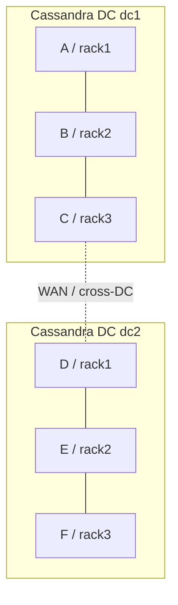
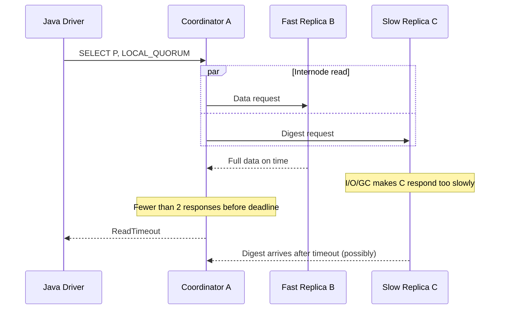
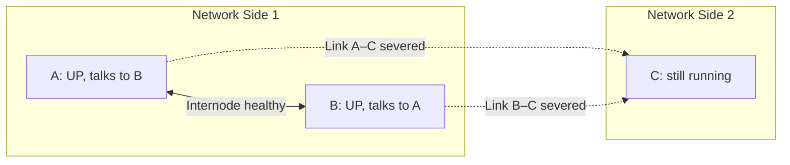
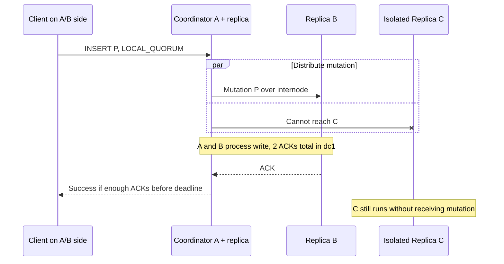
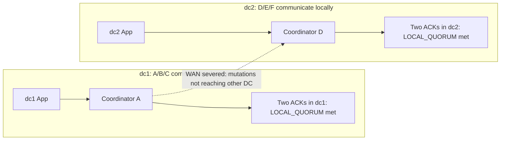
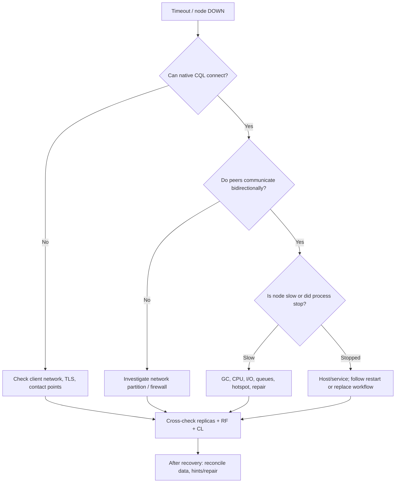

# Network Partitions, Slow Nodes, and Differences from Crash-Stop Failures

In an Apache Cassandra cluster, the alert "node unresponsive" does not tell you whether the node **has stopped**, **is running slowly**, or **is simply unreachable from one side of the network**. All three scenarios can produce the exact same symptoms in a Java application—`ReadTimeout`, `WriteTimeout`, dropped connections, or `Unavailable`—yet they have vastly different operational consequences and remedies.

This is a core problem in **distributed architecture**. Cassandra uses a **peer-to-peer** model, storing each partition on its **natural replicas** according to token, replication strategy, and replication factor (RF). A CQL request is coordinated by a **coordinator**, and the **consistency level (CL)** determines the minimum number of responses the coordinator must collect. When the network partitions or a node slows down, the entire cluster does not fail uniformly: the outcome depends on **the partition's replica set**, **DC/rack**, **CL**, **liveness views**, **network paths**, and **request deadlines**.

This lesson dives into distinguishing these failure modes so you can read signals accurately, choose appropriate consistency levels, and act safely before restarting, replacing, or removing nodes. The material ties into the Cassandra module's core themes: partition keys and query-driven table design, CQL, replication, repair, compaction, failure detection, and Java Driver integration.

After this lesson, you will be able to:

- Distinguish **crash-stop**, **crash-recovery**, **slow node**, **network partition**, and **client–coordinator link failure**.
- Explain why the failure detector cannot "prove a node is dead" from a timeout alone.
- Analyze read/write capability when a cluster loses a node, a rack, or a cross-DC link.
- Calculate quorums for `LOCAL_QUORUM`, `QUORUM`, and `EACH_QUORUM` in concrete RF examples.
- Understand **uncertain** write outcomes after `WriteTimeout`, how to prevent duplicate data on retries, and what must happen after recovery.
- Use CQL, `nodetool`, tracing, logs, and the Java Driver to pinpoint which layer caused an error.

## 1. One Symptom, Multiple Different Failure Modes

In a centralized system, a stopped process is usually straightforward to identify. In a distributed cluster, peers only observe **whether messages arrive or fail to arrive within a given time**. That is evidence of *reachability*, not absolute proof of *physical state*.

| Scenario | Nature | Is the Node Still Running? | Can Another Peer Reach It? |
|---|---|---|---|
| **Crash-stop** | Host/process stops and does not resume during the observation window. | No. | No, except stale replies already in flight. |
| **Crash-recovery** | Node stops and later restarts, usually keeping its data and identity if disks survive. | No while stopped; yes after recovery. | Changes across phases. |
| **Slow node** | Process stays alive, yet processes or communicates very slowly. | Yes. | Possibly, though delayed or missing deadlines. |
| **Network partition** | Communication between groups of nodes is disrupted. | All may still be running. | Depends on network side and connection direction. |
| **Client-side partition** | Application cannot reach a coordinator over native CQL, even while Cassandra nodes talk to each other. | Likely yes. | Internode layer may still be completely normal. |
| **Partial failure** | Only part of a node's functionality or network paths fails. | Not necessarily stopped. | Might answer CQL while failing internode, or vice versa. |

Key distinction: a node can be **`UP` from A's perspective**, yet **`DOWN` from B's perspective**. A slow node can be marked `DOWN` briefly by both and then reappear on its own. Neither phenomenon proves a disk failure or data loss.

### Illustrating Two Identical Client Symptoms

An application sends `SELECT` to coordinator A and receives `ReadTimeout`:

- **Scenario 1:** Replica C crashed; the coordinator needs two responses, but only one replica is available.
- **Scenario 2:** Replica C is running and reading SSTables, but slow disk I/O causes its response to arrive after the deadline.
- **Scenario 3:** C replies on time toward B, yet packets on path C → A are dropped; A never receives them.
- **Scenario 4:** C and A communicate fine, yet coordinator A itself is overloaded or the path A → Java Driver drops.

The application sees nearly identical symptoms. Fixing the right issue requires checking **the path, timing, and how many responses actually reached the coordinator**.

## 2. "Partition" in Cassandra Has Two Meanings That Must Stay Separate

In Cassandra contexts, the word *partition* appears in both **data modeling** and **distributed networking**, with two completely different meanings:

| Term | Meaning | Example |
|---|---|---|
| **Data partition** | The set of rows sharing the same partition key in a wide-column table. | Sensor readings for device D on day N. |
| **Network partition** | Two or more groups of nodes cannot exchange messages across certain network paths. | `dc1` cannot reach `dc2`. |

The **partition key** determines the token and replica set holding the data. A **network partition** determines which replicas can communicate and respond at request time. A network failure does not change partition keys or split a data partition.

Example table:

```sql
CREATE KEYSPACE telemetry
WITH replication = {
  'class': 'NetworkTopologyStrategy',
  'dc1': 3,
  'dc2': 3
};

CREATE TABLE telemetry.readings_by_device_day (
    tenant_id uuid,
    device_id uuid,
    event_day date,
    event_time timestamp,
    event_id uuid,
    reading double,
    PRIMARY KEY ((tenant_id, device_id, event_day), event_time, event_id)
) WITH CLUSTERING ORDER BY (event_time DESC, event_id ASC);
```

Here, `(tenant_id, device_id, event_day)` is the **composite partition key**; Cassandra hashes all three values into a token to determine replicas. The two clustering columns `event_time` and `event_id` sort and identify rows within the same data partition.

If the network splits in two, this stored partition **is not split into two halves of rows** along the network boundary. Replicas of *the same data partition* can end up on opposite sides, and each side can hold differing data versions until connectivity recovers.

## 3. Illustrative Setup: Two DCs, Multiple Racks, Per-DC RF

To keep calculations consistent throughout this lesson, consider a six-node cluster:



Assume `telemetry` uses `NetworkTopologyStrategy` with `RF_dc1 = 3` and `RF_dc2 = 3`. Because each DC in the example has only three nodes, every data partition has three natural replicas in each DC: **A, B, C** and **D, E, F**. In larger real-world clusters with more nodes, different partitions are assigned to different subsets of nodes by token.

Distinct racks illustrate **failure domains**. When enough racks/nodes exist, `NetworkTopologyStrategy` tries to spread replicas across racks, though the snitch only knows what is declared. Three different rack names do not prove three truly independent power supplies, switches, or availability zones.

Assume the Java application normally connects in `dc1`, so requests have coordinators in `dc1`. Unless noted otherwise, this example assumes **normal replicas without transient replication**. CL is evaluated against **the data partition's natural replica set**, not arbitrarily against total nodes in the cluster.

## 4. Crash-Stop: When a Process or Machine Has Completely Stopped

**Crash-stop** is a failure model where a node halts and stops processing during the observation period. Causes include power loss, host failure, or a dead Cassandra process. Peers receive no new ACKs from that node after it halts, though remember that messages sent right before the crash may still arrive while in flight.

Write path when C halts:

1. Java Driver sends `INSERT` to coordinator A.
2. A identifies partition P's replicas in `dc1` as A/B/C.
3. A and B can still process the mutation locally and send ACKs; C does not respond.
4. If CL is `LOCAL_QUORUM`, the two ACKs from A and B **can suffice** to return success.
5. If CL is `ALL` and the partition also has replicas in `dc2`, C failing to respond prevents reaching all ACKs.

C stopping does not make other partitions **automatically lose all data**: they still have replicas per RF. However, if C owns a copy of partition P, requests needing more replicas than remain available can fail.

### Crash-Recovery Is Not the Same as Replace

If C restarts while preserving its host ID, tokens, SSTables, commit log, and consistent state, that is typically a **restart/recovery of an existing node**. C can recover local state and catch up on missed mutations through appropriate mechanisms.

If C completely lost its disks or hardware, **replace** is a different procedure from restart; never copy a live node's data directory/host ID onto a new instance. Both situations also differ from merely **unplugging the network** of a running node.

## 5. Slow Node: Still Running, Yet Missing Deadlines

A slow node is a **performance failure that can manifest as an availability failure**. It still accepts or processes requests, yet takes so long that coordinators or clients hit their timeouts.

Typical causes:

- **JVM GC pauses:** long stop-the-world pauses delay gossip, message processing, and CQL responses.
- **Disk I/O:** flushes, commit log syncs, compaction, or high-latency storage bottleneck reads/writes.
- **Tombstones and numerous SSTables:** a `SELECT` must scan many tombstones/cells or merge fragments scattered across SSTables.
- **Hot partitions:** heavy traffic piles onto the same partition, overloading a finite set of replicas.
- **CPU / heap pressure:** backed-up queues, resource starvation, or heavy allocation.
- **Network latency / packet loss:** the node finishes processing, yet ACKs/data arrive back at the coordinator too late.
- **Operational tasks:** bootstrapping/streaming, repair, rebuild, or hint replay compete for bandwidth and I/O with live requests.



In this diagram, C **has not stopped**. It may still send a valid digest afterward, only too late for the timed-out request. The failure detector may still rate C `UP` if gossip is not delayed enough, so `UN` status does not contradict `ReadTimeout`.

### A Slow Node Can Be Mistaken for Down

If GC pauses or network congestion last long enough that peers miss timely heartbeat signals, the failure detector may **suspect C is down**. Once C regains speed, its state can flip back to `UP`. Therefore, distinguish:

- **Slow on the request path:** ACKs/data arrive late.
- **Slow on the membership path:** gossip/heartbeats arrive late.
- **Slow on the client path:** Java Driver fails to get native CQL replies on time.

All three paths can be affected simultaneously, though not necessarily.

## 6. Network Partition: Nodes Still Run, Yet the Cluster Splits Views

A **network partition** occurs when groups of nodes can no longer exchange required messages due to cut links, switch/firewall faults, routing issues, sustained packet loss, or inconsistent network config. The network can split along **rack**, **AZ**, **DC**, or individual endpoint boundaries.

Example in `dc1`, where A and B talk to each other but neither can reach C:



A and B may mark C `DOWN`; C may view A and B as unresponsive. This is a **local liveness assessment**. There is no central "gossip master" giving both sides absolute truth. When the network heals, peers reconverge on membership views, while data may still require hints/repair.

### Partitions Are Not Always Symmetric

Not every network fault severs a link bidirectionally. A may reach C while C's ACKs never return to A; or A reaches C while B cannot. Load balancers, NATs, stateful firewalls, MTU mismatches, TLS issues, and inter-AZ faults can all create asymmetric failures. Therefore:

- "Can ping from A to C" does not prove bidirectional internode messaging works.
- "TCP `9042` is open" does not prove internode ports/networking are healthy.
- "One peer sees C as `UN`" does not prove other peers see the same.
- "Client got a response" does not prove replicas in another DC received the mutation.

Investigating a network partition requires **collecting evidence from multiple locations and traffic directions**.

## 7. Failure Detector: Measuring Suspicion, Not Proving Death

Cassandra uses a **phi accrual failure detector** in many common releases, relying on the arrival history of gossip/update signals from a peer to measure how unusual silence has become.

The common intuitive formulation is:

\[
\phi(t) = -\log_{10}(P(T>t))
\]

Here \(T\) represents inter-arrival times between updates under the statistical model, and \(t\) is elapsed time since the latest update. **A higher phi means the current silence is more unusual under the model**, not a direct "probability the hardware died."

In configurations supporting `phi_convict_threshold`, a peer can be marked unresponsive once suspicion exceeds the threshold:

| Observation | Reasonable Interpretation | What Remains Unknown |
|---|---|---|
| Phi rises due to missing heartbeats | Peer is no longer delivering/receiving updates at expected cadence. | Is the peer off, paused in GC, or network-isolated? |
| A sees C down, B sees C up | The two peers have different observations. | Asymmetric network fault or state still converging? |
| C flips back to `UN` | C is again perceived as alive/normal from one perspective. | Does C hold all latest data, or is its I/O still slow? |
| Node stays `UN` yet requests time out | Membership still considers the node alive. | Why is data processing or request networking too slow? |

**Never tune the phi threshold** merely because a node briefly flashed `DN`. Lowering it can increase false positives; raising it can delay real fault detection. Check GC, I/O, networking, metrics, logs, and Cassandra version first.

### Liveness View Differs from Lifecycle State

`nodetool status` usually displays `UN` (*Up/Normal*) or `DN` (*Down/Normal*); joining/leaving nodes show other lifecycle states. Those two letters describe **liveness** and **lifecycle**, not a checksum of all stored data. A joining node can communicate before finishing data streaming; a normal node can be network-partitioned.

In Cassandra 5.x, cluster metadata management uses the **Cluster Metadata Service (CMS)**; metadata coordination details differ across Cassandra generations. Never rely on gossip state as the sole assumption about the progress of a replace, leave, or bootstrap operation.

## 8. RF, CL, and Availability When a Node Halts or Slows Down

**RF** is the desired copy count per partition. **CL** is the minimum response condition before reporting success to the client. How many `UP` nodes exist in the cluster **does not itself tell you** whether a request meets CL, because you must check *which nodes are actually replicas of the partition*.

In `dc1` with three replicas A/B/C for partition P:

| Request CL in dc1 | Required Responses in dc1 | One Replica C Down or Too Slow | Two Replicas B/C Down |
|---|---:|---|---|
| `LOCAL_ONE` | 1 | Can succeed via A or B. | Can succeed via A if A responds. |
| `LOCAL_QUORUM` | 2 | Can succeed via A and B on time. | Fails if only A responds. |
| `ALL` (keyspace only in dc1 with RF=3) | 3 | Fails if C does not respond. | Fails. |

With **two DCs, RF = 3 + 3** as in our starting example, the calculations are:

| CL | Condition | Depends on Other DC? |
|---|---|---|
| `ONE` | One replica from the partition's replica set. | Does not mandate a specific DC. |
| `LOCAL_ONE` | One replica in the coordinator's DC. | Not required. |
| `LOCAL_QUORUM` | `floor(3/2)+1 = 2` in the coordinator's DC. | Does not need ACKs from the other DC to satisfy condition. |
| `QUORUM` | `floor(6/2)+1 = 4` across total replicas. | Usually needs cross-DC responses when one DC only has three replicas. |
| `EACH_QUORUM` (**write**) | Two ACKs in **each DC**. | Yes, every DC must achieve quorum. |
| `ALL` | All six replicas. | Yes; one unresponsive replica blocks success. |

`EACH_QUORUM` is for **writes**; do not use it as a normal read CL. `ANY` is a special **write-only** level that can succeed via a hint under eligible conditions, which does not mean a natural replica already holds the data ready to read.

### "Enough Living Nodes" Does Not Mean Enough for CL

Suppose C is slow while D/E/F in `dc2` are all healthy. A `LOCAL_QUORUM` write in `dc1` still needs two ACKs from A/B/C. If only A responds on time, three ACKs from `dc2` **cannot substitute** for `dc1`'s quorum. Conversely, cluster-wide `QUORUM` can gather four responses across both DCs if the network allows.

This is why you must specify **the request's CL, per-DC RF, where the coordinator sits, and which nodes replicate the partition**, rather than vaguely saying "the cluster still has five live nodes."

## 9. Partitioning One DC into 2 + 1: Which Side Has Quorum?

Consider `dc1` alone, RF = 3, with partition P's replicas A/B/C. The network splits into `{A,B}` and `{C}`. Suppose the Java client on the A/B side reaches coordinator A.



Result:

- **A/B side:** can meet `LOCAL_QUORUM` via two reachable replicas responding on time.
- **C side:** a client reaching only C cannot meet `LOCAL_QUORUM` for P; a `LOCAL_ONE` request may still succeed under suitable conditions.
- **After reconnection:** C may be missing mutations acknowledged on the A/B side and need to catch up.

It is not true that "the side with more nodes" always holds quorum for **every partition**: in a large cluster where partitions map to different replica sets, a larger network side containing too few replicas of partition Q will still fail Q's CL.

### `ONE` Writes on Both Sides Can Conflict

Suppose a client on the A/B side writes `state = "RUNNING"` while a client on C's side writes `state = "STOPPED"` to **the same cell** using a low CL satisfied on each side. Once the network heals, replicas hold two competing versions. Cassandra reconciles by **cell timestamp and tombstone semantics**; never assume "the side with more nodes wins" or "whichever happened later in real life wins."

If business logic requires conditional state transitions, evaluate **lightweight transactions (LWT)** and proper idempotency models; also note that LWT uses its own consensus/serial consistency protocol and can be disrupted by network partitions.

## 10. Partition Between Two Datacenters: Local Quorum Can Work on Both Sides

Suppose the WAN between `dc1` and `dc2` breaks, while local networks inside each DC stay healthy. Each DC has RF = 3. Two applications keep sending `LOCAL_QUORUM` to their **local** coordinators.



**Requests can succeed simultaneously in both DCs** if enough local replicas and other conditions hold. However:

1. A successful write in `dc1` does not prove `dc2` has the new data.
2. A successful write in `dc2` does not prove `dc1` received that write.
3. If both sides modify **the same cell** while isolated, upon convergence Cassandra resolves conflicts by timestamp/semantics, not by human expectations of real-world order.
4. If the application fails over from the source DC to the backup DC before data converges, some recently ACKed writes may **not yet be visible in the target DC**.

With total RF = 6, cluster-wide `QUORUM` requires **4 responses**. When the WAN is completely severed, each DC has only three natural replicas: neither side has four responses, so `QUORUM` requests fail. `EACH_QUORUM` for writes also fails because quorum cannot be reached in **each DC**.

The trade-off is clear:

- `LOCAL_QUORUM` prioritizes availability within one DC during WAN outages, without guaranteeing the write is already present on the other side.
- `QUORUM`/`EACH_QUORUM` strengthens cross-DC confirmation in this setup, at the cost of depending on the WAN link and remote replicas.

### Note on Cross-DC Read-After-Write

Writing `LOCAL_QUORUM` in `dc1` and then reading `LOCAL_QUORUM` in `dc2` **has no guaranteed overlap between the two local quorum sets**. Never market that pair as an immediate *cross-DC read-your-writes* guarantee. Within a single DC with RF = 3, quorum write + quorum read overlap when acting on the same replica set under suitable conditions, yet still do not turn concurrent writes into cluster-wide linearizable transactions.

## 11. CAP Perspective: Do Not Turn "AP" or "CP" into Absolute Labels

The CAP theorem reminds us that when **a real network partition occurs**, a distributed store cannot simultaneously guarantee both **strong consistency in the linearizability sense** and **availability for every valid request** on both sides of the partition.

In Cassandra, behavior depends on **CL, RF, and failure scope**:

- With `LOCAL_ONE` or `ONE`, many requests can still be served while replicas have not converged, trading off stale reads or concurrent write conflicts.
- With `LOCAL_QUORUM` in one DC, requests can continue if the client's side retains enough local natural replicas; a side holding only one replica of an RF = 3 partition cannot serve it.
- With `QUORUM` or `ALL`, certain network partitions prevent meeting conditions even while some nodes remain up.
- With LWT, conditional consensus requirements and serial consistency levels must be evaluated separately; never extrapolate transactional guarantees from normal write CLs.

Therefore, labeling all of Cassandra "always AP" or "always CP" and deducing every behavior from that label is **oversimplified**. When designing, be concrete: *which request, which CL, which replica set, which failure domain, and which property must hold?*

**Eventual consistency** is not a promise that every copy syncs instantaneously once the network heals. Data may need mutation delivery, hint replay, or **anti-entropy repair**; repair schedules and tombstones/TTLs must be operated properly.

## 12. Reads When a Node Is Slow or the Network Is Partitioned

The read path adds another nuance: the coordinator can request **full data** from one replica and a **digest** from another. Matching digests confirm agreement across the compared responses; a digest mismatch triggers fetching extra full data and **reconciliation** using timestamps, cells, TTLs, and tombstones.

| Situation | What Might the Read Path Do? | Outcome to Understand |
|---|---|---|
| One replica is slow while others respond | Coordinator may rely on faster-responding replicas depending on CL and optimizations. | Not every replica has to be fast if CL is already met. |
| `LOCAL_ONE` returns fast from a stale replica | May return an outdated value. | No quorum cross-check happens by default on that request. |
| `LOCAL_QUORUM` hits a digest mismatch | Needs additional full data to reconcile, possibly read repair per version/table mode. | Latency rises, yet a mismatch does not prove disk corruption. |
| Too few replicas respond before deadline | May raise `ReadTimeout`. | Do not conclude the row does not exist or all replicas are down. |
| One request is slow and driver fires a speculative request | May improve odds of an earlier response when enabled. | Adds cluster load; does not fix underlying I/O or network issues. |

**Read repair** runs on certain reads depending on version and settings; **anti-entropy repair** reconciles replicas broadly regardless of whether users read those partitions. Never treat reading a single row and seeing the expected value as proof that all replicas are fully repaired.

### Querying by Partition Key Narrows Where Failures Can Arise

With `telemetry.readings_by_device_day`, a `WHERE` clause providing all of `tenant_id, device_id, event_day` lets the coordinator target a single data partition. Queries missing partition key components or abusing `ALLOW FILTERING` touch many partitions, generate unnecessary load, and obscure root causes when diagnosing a "slow node."

## 13. Writes When the Coordinator Times Out: Succeeded, Failed, or Unknown?

This is a common source of correctness bugs in Java applications. Suppose Java sends an `INSERT` for event E at `LOCAL_QUORUM`:

1. The coordinator dispatches the mutation to replicas A/B/C.
2. A and B write successfully, yet the coordinator crashes before sending the ACK back to the client.
3. The client observes a dropped connection or timeout.
4. The mutation **may have already satisfied quorum** without the client knowing.

Another case: only A wrote before timing out, while B and C did not. Identical client symptom, different replica state. There is no "timeout = rollback" rule.

```mermaid
sequenceDiagram
    participant App as Java App
    participant Co as Coordinator
    participant A as Replica A
    participant B as Replica B
    App->>Co: INSERT event E
    Co->>A: Mutation E
    Co->>B: Mutation E
    A-->>Co: ACK
    B-->>Co: ACK
    Note over Co: CL may already be satisfied
    Note over Co: Coordinator crashes / response link drops
    Co--xApp: No success response
    Note over App: Outcome uncertain; do not assume rollback
```

### Safe Retries Must Be Grounded in Idempotency

| Mutation Style | Retry Risk | Design Consideration |
|---|---|---|
| Writing an event with a **new UUID on every attempt** | Can create two rows for the same event. | Generate `event_id` **before** the first attempt and reuse it on retries. |
| Writing the same key and absolute values | Lowers duplicate-row risk; timestamps and concurrent writes still matter. | Pick stable keys/payloads and domain-appropriate timestamp strategy. |
| `UPDATE counter = counter + 1` | Can increment multiple times if replayed. | Never treat counters as idempotent by default. |
| Conditional `IF` writes / LWT | Retries follow consensus/conditional semantics. | Inspect and handle `[applied]` results properly. |
| Writes with changing TTL/timestamp per attempt | Extends lifetime or creates unintended versions. | Control timestamp/TTL if retries must have equivalent effect. |

Drivers provide **retry policies**, yet you must never auto-retry every mutation blindly on `WriteTimeout`. Improper retries also amplify load on struggling nodes and trigger **retry storms**. Bound retry count, total duration, apply suitable backoff, and monitor error rates.

## 14. After the Network Heals or a Node Recovers: Is Data Automatically Consistent?

A node shifting from `DN` to `UN` means **reachability is perceived to have recovered**, not that its data checksum matches every replica.

Relevant mechanisms:

| Mechanism | Effect | What It Does Not Guarantee |
|---|---|---|
| **Gossip** | Peers propagate membership/liveness state. | Does not transfer every missed row. |
| **Hinted handoff** | Stores/replays some mutations destined for absent replicas within configured bounds. | Does not replace repair; hints have retention windows and preconditions. |
| **Read repair** | Can heal discrepancies encountered on the read path per version/mode. | Does not scan unread partitions. |
| **Anti-entropy repair** | Compares replicas and syncs differences across the repaired range. | Does not run instantaneously when a node turns Up; consumes resources. |
| **Streaming** | Transfers data for bootstrap, replace, rebuild, and related operations. | Not gossip, and not an automatic catcher for every delayed write. |
| **Compaction** | Merges/reorganizes local SSTables. | Does not synchronize replicas on other nodes. |

### Tombstones Make Outage Duration Critical

In Cassandra, `DELETE` typically writes a **tombstone** with a timestamp to suppress older values. If a replica stays absent too long and tombstones are purged past their retention lifecycle before differences are repaired, there is a risk of **deleted data resurrection** under certain conditions. Never arbitrarily lower `gc_grace_seconds` or skip repair just because a node returned to `UN`.

When recovering after a network or DC outage, inspect **outage duration, which CL mutations were ACKed under, whether source data remains intact, hint validity, repair, and failover timing**. Having high RF in Cassandra does not exempt you from verifying data convergence.

## 15. Observation Tools: Separating Signals from Node, Client, and Network

During diagnosis, never start by removing or replacing a node. Start by **measuring and comparing viewpoints**.

Observation commands on Cassandra nodes:

```bash
nodetool status
nodetool gossipinfo
nodetool tpstats
nodetool netstats
nodetool tablestats telemetry.readings_by_device_day
nodetool describecluster
```

| Source | What It Measures | Limitations |
|---|---|---|
| `nodetool status` | Nodes by DC/rack, Up/Down, lifecycle. | Local viewpoint; `UN` does not guarantee fast I/O or freshest data. |
| `nodetool gossipinfo` | Peer state/generation/version known to the queried node. | Not simultaneous cluster-wide truth. |
| `nodetool tpstats` | Internal thread pools/queues suggesting saturation. | Must be paired with JVM/OS/network metrics. |
| `nodetool netstats` | Streaming activity and related network info per version. | Not a packet capture of all CQL requests. |
| `nodetool tablestats` | Table metrics, SSTables, read/write stats, and tombstones per version. | Does not isolate network issues alone. |
| **Cassandra logs / GC logs** | Connection errors, pauses, timeouts, streaming/repair status. | Requires correlating timestamps across nodes. |
| **Java Driver metrics / logs** | Request latency, per-node/coordinator errors, connections, timeouts. | Client view may differ from internode gossip. |
| **Network / OS telemetry** | RTT, packet loss, retransmits, NIC, firewall, disk, CPU. | Does not tell you directly whether CL received enough ACKs. |

### Two Easily Confused Ports

- **Native CQL** typically uses TCP `9042` between applications/drivers and Cassandra.
- **Internode messaging/gossip** typically uses ports like TCP `7000` or the configured TLS/version port (such as `7001` in some environments).

A node can **serve CQL on `9042`** while failing to reach other replicas over internode ports, causing quorum requests to fail. Conversely, internode peers can communicate cleanly while clients fail to reach `9042` due to firewalls or TLS. Testing one port never proves all traffic layers are healthy.

## 16. CQL Practice: Observing Behavior by Consistency Level

On a **test cluster with sufficient nodes/DCs and the keyspace from section 2**, insert a measurement:

```sql
INSERT INTO telemetry.readings_by_device_day (
    tenant_id, device_id, event_day, event_time, event_id, reading
) VALUES (
    11111111-1111-1111-1111-111111111111,
    22222222-2222-2222-2222-222222222222,
    '2026-11-21',
    '2026-11-21T08:30:00+07:00',
    33333333-3333-3333-3333-333333333333,
    36.7
);
```

In `cqlsh`, compare reads of the same partition:

```sql
-- CONSISTENCY and TRACING are cqlsh commands.
CONSISTENCY LOCAL_ONE;
TRACING ON;

SELECT event_time, event_id, reading
FROM telemetry.readings_by_device_day
WHERE tenant_id = 11111111-1111-1111-1111-111111111111
  AND device_id = 22222222-2222-2222-2222-222222222222
  AND event_day = '2026-11-21'
LIMIT 20;

CONSISTENCY LOCAL_QUORUM;

SELECT event_time, event_id, reading
FROM telemetry.readings_by_device_day
WHERE tenant_id = 11111111-1111-1111-1111-111111111111
  AND device_id = 22222222-2222-2222-2222-222222222222
  AND event_day = '2026-11-21'
LIMIT 20;

TRACING OFF;
```

Tracing can show which replicas the coordinator contacted and the data/digest exchange steps, depending on version and execution path. **Never inject faults on production** to test this: if you want to observe real timeouts, use a sandbox environment or an approved chaos test with a recovery plan. Tracing adds CPU/storage overhead, so enable it selectively.

### Why Might Both Test Queries Return the Same Result?

When replicas are healthy and converged, `LOCAL_ONE` and `LOCAL_QUORUM` normally return identical values. That does not prove they share **the same confirmation guarantees** or fault tolerance. To test behavior under network partitions, design **controlled fault injection and measure responses** rather than running two `SELECT` statements on a healthy cluster.

## 17. Java Driver 4.x: Identifying Error Classes and Handling Uncertainty

Java applications use **native CQL transport** rather than joining gossip directly. The driver chooses coordinators, tracks its own metadata/connections, and can treat a node as unavailable for CQL while a peer still marks it `UP`.

The example below uses Apache Cassandra Java Driver 4.x (`com.datastax.oss.driver`). It illustrates a read with explicit CL and common exception handling; **IPs and DC name are illustrative**:

```java
import com.datastax.oss.driver.api.core.AllNodesFailedException;
import com.datastax.oss.driver.api.core.CqlSession;
import com.datastax.oss.driver.api.core.DefaultConsistencyLevel;
import com.datastax.oss.driver.api.core.cql.BoundStatement;
import com.datastax.oss.driver.api.core.cql.PreparedStatement;
import com.datastax.oss.driver.api.core.cql.Row;
import com.datastax.oss.driver.api.core.servererrors.ReadTimeoutException;
import com.datastax.oss.driver.api.core.servererrors.UnavailableException;

import java.net.InetSocketAddress;
import java.time.LocalDate;
import java.util.UUID;

public class CassandraFailureRead {
    public static void main(String[] args) {
        UUID tenant = UUID.fromString(
            "11111111-1111-1111-1111-111111111111");
        UUID device = UUID.fromString(
            "22222222-2222-2222-2222-222222222222");

        // 192.0.2.0/24 addresses are for documentation only.
        try (CqlSession session = CqlSession.builder()
                .addContactPoint(new InetSocketAddress("192.0.2.11", 9042))
                .addContactPoint(new InetSocketAddress("192.0.2.12", 9042))
                .withLocalDatacenter("dc1")
                .build()) {

            PreparedStatement prepared = session.prepare(
                "SELECT event_time, reading " +
                "FROM telemetry.readings_by_device_day " +
                "WHERE tenant_id = ? AND device_id = ? AND event_day = ? " +
                "LIMIT 20");

            BoundStatement read = prepared
                .bind(tenant, device, LocalDate.parse("2026-11-21"))
                .setConsistencyLevel(DefaultConsistencyLevel.LOCAL_QUORUM)
                .setIdempotent(true); // Only for pure side-effect-free SELECTs

            try {
                for (Row row : session.execute(read)) {
                    System.out.printf("%s -> %.2f%n",
                        row.getInstant("event_time"),
                        row.getDouble("reading"));
                }
            } catch (UnavailableException ex) {
                System.err.println("Not enough replicas perceived available for CL");
            } catch (ReadTimeoutException ex) {
                System.err.println("Not enough read responses before deadline");
            } catch (AllNodesFailedException ex) {
                System.err.println("Driver could not find an eligible node to execute");
            }
        }
    }
}
```

In production, additional errors can occur—connection errors, `ReadFailure`, client-side request timeouts, authentication/TLS failures, or server errors. **Classify all exceptions according to your exact driver API/version**; this snippet highlights the three most instructive branches rather than serving as a complete production error handler.

### Writes and Controlled Retries

When sending an `INSERT` to record an event, generate `event_id` **before** the first attempt, reuse it if retrying the same event, and account for timestamp/TTL semantics. Using a prepared statement with the full partition key enables efficient routing, yet **never guarantees a timed-out write failed**.

Never blindly set `setIdempotent(true)` on every `UPDATE`, counter, or LWT merely to make the driver retry more aggressively. Idempotency must be evaluated based on **business side effects, keys, timestamps, concurrent operations, and payloads**.

## 18. Practical Runbook to Distinguish the Three Failure Modes

When receiving a "Cassandra node unavailable" alert, follow this workflow:

1. **Capture initial symptoms:** request name, partition key (if safe to log), CL, coordinator DC, exception, start/end timestamps, latency, and attempt count.
2. **Check the client layer:** can clients connect to native CQL `9042`, or is there a TLS/auth error or a post-connect request error?
3. **Identify natural replicas:** derive from partition key/token, replication strategy, and per-DC RF; never just count total `UN` nodes.
4. **Compare liveness viewpoints:** run `nodetool status` and `nodetool gossipinfo` from multiple nodes/failure domains where authorized.
5. **Inspect the target node:** Cassandra process, host heartbeat, GC pauses, CPU/heap, disk latency, compaction, queues/`tpstats`, and logs.
6. **Check bidirectional networking:** internode TCP/TLS, DNS/NAT, firewalls, packet loss/retransmissions, cross-rack/DC routes, and incident timing.
7. **Correlate errors with CL:** `Unavailable`, timeout, or failure; did enough replicas actually meet the deadline?
8. **Look for background tasks:** are bootstrap/streaming, repair, compaction, or hint replay competing for resources?
9. **Choose the right recovery:** if slow, relieve load/I/O; if network-partitioned, restore connectivity; if crash-stop, follow supported restart/replace procedures.
10. **Verify data post-recovery:** evaluate uncertain writes, hints, repair, TTLs/tombstones, and per-DC readability before declaring the incident closed.



This flowchart suggests an **inspection order**; no single branch proves an exclusive root cause. A single fault can sever internode links, trigger Java timeouts, and overload a node via retry storms simultaneously. Combine evidence rather than tweaking one metric and declaring victory.

## 19. Reasoning Practice Scenarios

**Scenario A — True crash-stop.** Partition P has three replicas A/B/C in `dc1`; C is powered off. A and B respond on time. Can `LOCAL_QUORUM` succeed? **Yes**, because RF = 3 requires two local responses. `ALL` on a keyspace with RF = 3 in that DC fails while C is unresponsive.

**Scenario B — Slow node.** C remains `UN`, yet takes 10 seconds to respond while requests time out sooner. Does `UN` contradict `ReadTimeout`? **No.** Liveness and request performance are two separate observations.

**Scenario C — 2 + 1 network partition.** A/B communicate; C is isolated. A client on C's side wants to write `LOCAL_QUORUM` for P (RF = 3). Does it succeed? **No**, if only C responds. A client on the A/B side can succeed if both replicas process it on time.

**Scenario D — Two DCs lose WAN.** Each DC has RF = 3. Can `LOCAL_QUORUM` writes in `dc1` and `dc2` succeed concurrently? **Yes, potentially.** Does that guarantee both DCs hold the same data version? **No.**

**Scenario E — Global quorum during WAN outage.** RF = 3 + 3; how many responses does `QUORUM` need? **Four.** Each DC only has three replicas, so neither side can reach `QUORUM` alone when the WAN is completely down.

**Scenario F — Client connects to 9042 yet queries fail.** Can you declare the Cassandra node healthy? **No.** Internode links or replicas may be unresponsive even though the native CQL handshake succeeded.

**Scenario G — WriteTimeout.** Client receives no ACK after writing event E. May it generate a new `event_id` and retry unconditionally? **No.** The previous mutation may have been stored; use a stable event key and controlled retry semantics.

**Scenario H — Node comes back up.** `nodetool status` flips `DN` to `UN`. Does that prove all copies have converged? **No.** Verify hints/repair and data state, especially after hours of network outage.

**Scenario I — More nodes, yet same rack.** RF = 3, and all three replicas sit in the same physical rack. Can losing that rack break quorum? **Yes.** Inspect actual failure domains and snitch, not just RF.

**Scenario J — Many `SELECT`s slow due to tombstones.** Is this definitely a network partition? **No.** A well-connected node can still be slow scanning tombstones and numerous SSTables.

## 20. Misconceptions to Eliminate

| Wrong Conclusion | Correct Reasoning |
|---|---|
| "A timeout proves the node is powered off." | A timeout only means too few replies arrived on time; it could be slowness or networking. |
| "`DN` is proof we must remove the node from the cluster." | `DN` is one viewpoint's liveness assessment; diagnose before touching topology. |
| "Network partition means data was split into two partition keys." | Network partition and data partition are completely different concepts. |
| "As long as two nodes are `UP` anywhere in the cluster, quorum succeeds." | You must check whether those two nodes are natural replicas within the CL's scope. |
| "We can use `dc2` ACKs to satisfy `LOCAL_QUORUM` in `dc1`." | `LOCAL_QUORUM` requires enough replicas in the coordinator's DC. |
| "ACKed in `dc1` means `dc2` already has the data." | Local `LOCAL_QUORUM` writes do not wait for remote-DC quorums. |
| "Gossip recovering means replica data matches." | Liveness and data convergence are separate; hints/repair may still be needed. |
| "WriteTimeout means the write did not happen." | Mutations may have been applied on some replicas. |
| "Changing the failure detector threshold fixes GC/disk/network errors." | It only hides symptoms or creates flawed detection. |
| "Increasing RF fixes all slowness errors." | RF changes copy count/load and cost; hot partitions, disks, networks, and CL still dominate. |
| "Cassandra is always AP, so every request always succeeds." | Availability depends on CL and reachable replicas. |

## 21. Summary Mental Model

When a Cassandra node fails to respond, reason as follows:

```text
Java Driver sees error / coordinator lacks responses
                 |
                 v
Separate failure mode:
  - Crash-stop / crash-recovery
  - Slow node (GC, I/O, CPU, queues)
  - Network partition / asymmetric path
                 |
                 v
Inspect from multiple viewpoints: client, peer, host, network
                 |
                 v
Partition key -> token -> natural replicas -> DC/rack
                 |
                 v
CL + RF + timely responses -> request success or failure
                 |
                 v
Post-recovery: evaluate uncertain writes, hints, repair,
TTLs/tombstones, and cross-DC convergence state
```

**A halted node** stops responding because it is no longer running; **a slow node** may reply after the deadline; **a network partition** leaves running nodes with diverging views and severed data paths. Those three modes cannot be told apart from a single timeout or one line of `nodetool status`.

In Cassandra, the decisive question is not "How many nodes are Up in the cluster?" but **"Which partition, which replicas, where is the coordinator, which paths are open, and how many responses does the consistency level require?"** Answering those questions consistently connects cluster architecture to wide-column table design, RF/CL choices, multi-DC replication, repair/compaction, and resilient Java applications.
