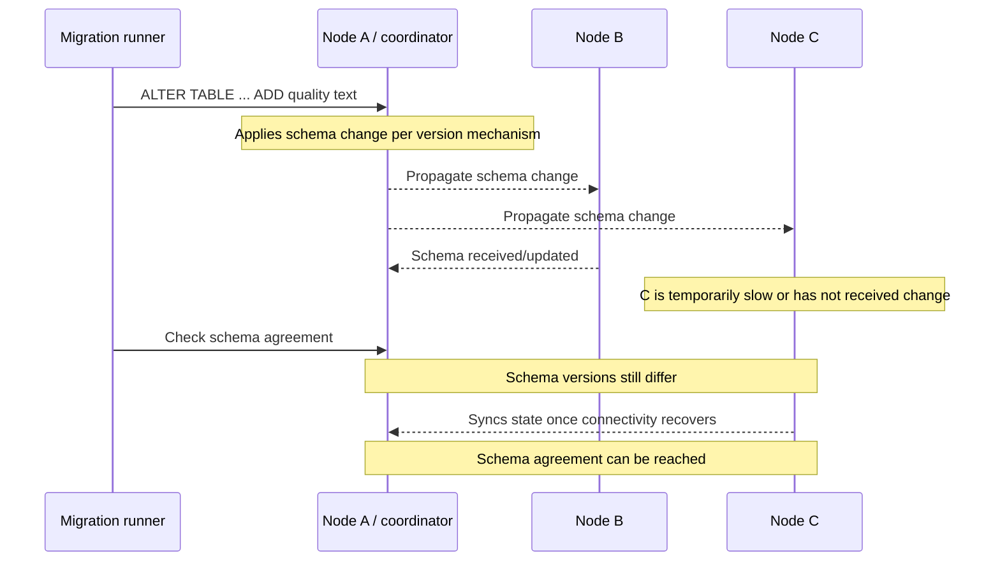
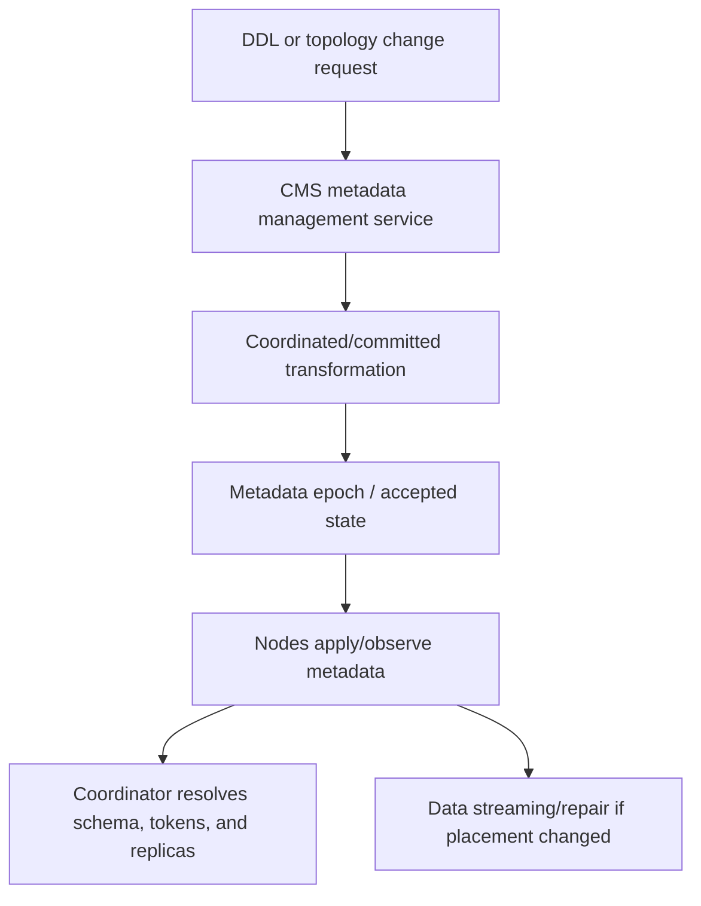
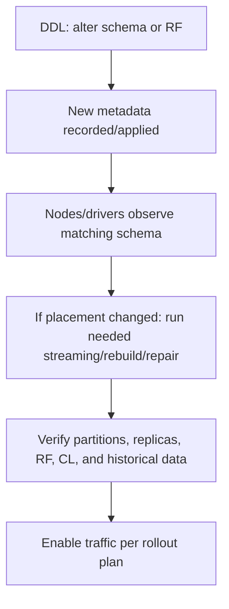
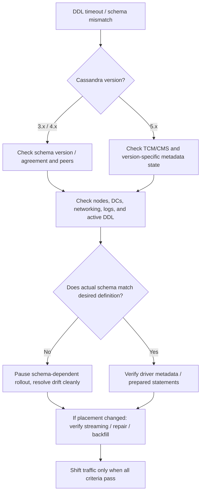

# Cluster Metadata, Schema Agreement, and Version Differences

In Apache Cassandra, application data is distributed as **partitions** across multiple **replicas**. For a node to know which partitions to read or write, it also needs **cluster metadata**: cluster members, datacenter/rack locations, tokens, replication strategies, keyspaces, tables, and columns. This metadata is not the same as the CQL rows stored by applications. A `CREATE TABLE` or `ALTER KEYSPACE` statement alters **how the cluster interprets data or topology**, so it requires specialized management.

In Cassandra 3.x/4.x, schema changes are typically propagated through inter-node coordination alongside **schema version** tracking; operators and drivers can observe **schema agreement**. Cassandra 5.x introduces the **Cluster Metadata Service (CMS)** and **Transactional Cluster Metadata (TCM)** to coordinate cluster metadata changes in a linearizable sequence. You should not take an explanation of "gossip and wait for all nodes to share a schema UUID" from an older release and apply it verbatim to every 5.x deployment.

This lesson belongs to the **Cluster Architecture** chapter of the Apache Cassandra module, connecting wide-column concepts, partition keys, query-driven table design, replication, consistency levels, reads/writes, compaction, repair, distributed failures, and the Java Driver.

After this lesson, you will be able to:

- Classify **schema metadata**, **topology/placement metadata**, **membership/liveness**, and **application data**.
- Explain what **schema agreement** guarantees and what it **does not** guarantee.
- Contrast the schema management model in Cassandra 3.x/4.x with the TCM/CMS architecture of Cassandra 5.x at a design level.
- Identify risks when changing keyspace RF, tables/columns, topology, or running DDL while nodes are offline.
- Use CQL, `nodetool`, `cqlsh`, and Java Driver 4.x to inspect schema and metadata safely.
- Design **expand–migrate–contract** migrations and a schema disagreement triage runbook without manually editing system tables.

## 1. What Is Cluster Metadata and Why Does It Matter?

A Cassandra node needs two kinds of knowledge to execute a statement:

1. **Data definitions:** which keyspaces have which tables, which columns form the partition key, clustering columns, data types, indexes, and table options.
2. **Placement and ownership:** how partition keys hash into tokens, which nodes are natural replicas, which DCs/racks they live in, and what replication factors apply.

For example, a Java application executes:

```sql
SELECT event_time, reading
FROM telemetry.readings_by_device_day
WHERE tenant_id = 11111111-1111-1111-1111-111111111111
  AND device_id = 22222222-2222-2222-2222-222222222222
  AND event_day = '2026-11-21'
LIMIT 20;
```

To execute this query, the coordinator must know:

- Does `telemetry.readings_by_device_day` exist, and what data type is `reading`?
- Does the partition key consist of `tenant_id`, `device_id`, and `event_day`, rather than `device_id` alone?
- Which token ranges contain the token derived from that partition key?
- How does the keyspace place replicas via `NetworkTopologyStrategy` and per-DC RF?
- How many responses can the currently available replicas provide for the CL?

If two nodes temporarily have different views of the schema, the same CQL request can succeed on one node and fail with missing table/column errors on another. If topology/replication metadata disagrees, nodes risk making inconsistent replica/placement decisions. That is why **metadata must be managed and converged under strict controls**, rather than treated like an ordinary application table written arbitrarily.

## 2. Four Categories Often Lumped Together as "Metadata"

| Category | Examples | Where Used | How to Reason About It |
|---|---|---|---|
| **Schema metadata** | Keyspaces, tables, columns, primary keys, indexes, UDTs, table options. | Parsing and executing CQL; driver statement preparation. | Changed via DDL and version-appropriate schema workflows. |
| **Topology / placement metadata** | Token ranges, node identities, DC/rack, RF, replica placement, topology transitions. | Coordinator selecting natural replicas; bootstrap/replace/leave. | More than just a "list of live nodes." |
| **Membership / liveness** | Gossip heartbeats, peer status perceived as `UP`/`DOWN`. | Failure detection and communication routing decisions. | A point-in-time/local assessment; does not prove a node is dead. |
| **Application data** | Cells, rows, tombstones, timestamps, TTLs, and table SSTables. | Replicas serving `SELECT`/`INSERT`/`UPDATE`/`DELETE`. | Converges via mutations, hints, read repair, anti-entropy repair, or streaming as applicable. |

**Schema agreement does not equal data agreement.** Three nodes can agree on a table named `telemetry.events` and its primary key definition while replica B is still missing the latest mutation for partition P. Conversely, a replica holding stale data does not prove its schema is current merely because its SSTables exist on disk.

### How Do Cluster Identity and Metadata Differ from Seeds?

`cluster_name` identifies a cluster. A **seed node** is an initial contact point for peers to discover the cluster; it is not a "central metadata server" in the classic Cassandra model. A seed can still act as a replica or coordinator like any other node. Even in versions with CMS, being a seed **does not automatically make a node a leader or the sole metadata authority**.

## 3. What Is Schema Agreement?

Put simply, **schema agreement** is the state where relevant nodes share the same understanding of schema definitions, as defined and observable in the running Cassandra version. When two nodes hold conflicting views of a table, coordinators and clients can hit unpredictable failures as requests route to different nodes.

In Cassandra 3.x/4.x, operators commonly observe:

- A **schema version** representing a digest/fingerprint of the schema known to each node.
- Diverging schema versions grouped in tool output such as `nodetool describecluster`.
- Drivers optionally **waiting for or checking schema agreement** after DDL before proceeding with dependent operations.

Example:

```text
Node A: schema version V2
Node B: schema version V2
Node C: schema version V1 (has not received/applied DDL yet)

=> No schema agreement across A/B/C.
```

This is an explanatory model for versions using traditional schema versioning. Schema version is neither a "count of applied migrations" nor a row timestamp, and it never proves replica data is synchronized.

### Three Things Schema Agreement Does NOT Guarantee

1. **It does not guarantee old data has moved to new replica locations** after an `ALTER KEYSPACE` changing RF or topology. Metadata can update long before data distribution jobs finish.
2. **It does not guarantee all applications are using the new schema.** The Java Driver caches metadata and prepared statements and may need updates; an older binary might still query a renamed or dropped column.
3. **It does not guarantee all nodes are healthy and responding on time.** A node with matching schema can still be `DN`, network-partitioned, I/O-saturated, or hitting read timeouts.

Thus, during a production migration, "schema agreement PASS" is only **one checkpoint**, not permission to immediately delete old code or shift all traffic.

## 4. Differences Among Schema, Schema Version, and Data Version

The word "version" appears across multiple layers:

| Term | Tied To | When Does It Change? |
|---|---|---|
| **Schema version** (traditional) | Keyspace/table/index/type definitions known by a node. | When schema changes, once the corresponding state is applied. |
| **Metadata epoch** (TCM/CMS model) | Logical ordering of committed metadata changes. | When a metadata transformation commits under the corresponding mechanism. |
| **Cell write timestamp** | Version of a cell value or tombstone in data. | When a mutation updates a cell or deletes data. |
| **Application schema version** | Migration revision tracked by the application/release pipeline. | When a deployment runner records a migration as executed. |
| **Cassandra release version** | Node software version, e.g., 4.x vs. 5.x. | When upgrading the Cassandra binary. |

Two nodes sharing the same `schema_version` **tell you nothing about the newest cell value**. A higher metadata epoch **says nothing about whether data has been repaired**. Applications can maintain their own migration-tracking table, yet that never replaces Cassandra's internal metadata mechanisms.

## 5. Traditional Schema Model in Cassandra 3.x/4.x

In the pre-CMS model, schema is stored and managed as cluster state, with schema changes propagated among nodes. Different nodes may learn updates at slightly different times, and tools/drivers compare **schema versions** across peers.

A conceptual sequence:



This diagram illustrates **asynchrony and verification points**; it does not prescribe exact packets/ACKs or guarantee identical message ordering across all Cassandra 3.x/4.x releases. Internal schema handling and driver wait behavior vary by release.

### Why Must Concurrent DDL Be Avoided?

When two tools or two services alter tables or keyspaces concurrently, schema history can become harder to manage:

- The second DDL statement may reference tables/columns not yet consistently known across nodes.
- Drivers may hold stale cached metadata or prepared statements.
- Migration logs and operational state can blur "succeeded," "timed out," and "applied without agreement."

A sound operational rule is **a single controlled migration pipeline** serialized by locks/coordination in your release system, rather than letting every Java service instance create or alter schema at startup. Never treat Cassandra DDL like a multi-table RDBMS transaction.

## 6. Cassandra 5.x: TCM and Cluster Metadata Service (CMS)

Cassandra 5.0 introduces **Transactional Cluster Metadata (TCM)** and the **Cluster Metadata Service (CMS)** to manage cluster metadata changes in a strictly ordered, better-controlled way. This is a major architectural shift compared to the mindset that "every topology/schema update just gossips and eventually converges."

Conceptually:

- **TCM** models cluster metadata and state transitions as **transformations** recorded in a logical sequence.
- **CMS** is the cluster metadata consensus/management service in supporting versions, with its own designated members and coordination workflow.
- Metadata changes are tagged with an **epoch** so nodes know which metadata milestone they have caught up to.
- Updating node metadata state and streaming/repairing actual data remain **two separate tasks**.



**CMS is not a data master:** regular CQL queries are still coordinated per request, and natural replicas still store data by token/RF. Being a CMS member or coordinating a metadata change **does not mean seed node**, nor "one machine every `SELECT` must pass through."

### What Not to Assume Across Versions

Never write a runbook claiming:

> "Every Cassandra 5.x deployment simply compares schema UUIDs over gossip and that's all you need."

Nor assume the opposite extreme:

> "With CMS enabled, every node instantly has all data/schema and metadata errors can never happen."

TCM/CMS improves metadata coordination, yet it still relies on networking, metadata consensus quorum/conditions, tracking apply progress, and running streaming/repair when replica placement changes. CMS admin commands, CMS member configuration, and upgrade behavior **must follow documentation for your exact running Cassandra version**; never run legacy hacks or force-edit system tables to "bump the epoch."

## 7. Architectural Comparison Across Versions

| Dimension | Cassandra 3.x/4.x (Traditional Model) | Cassandra 5.x with TCM/CMS |
|---|---|---|
| Schema / topology management | States propagate and are compared via schema versions/metadata across peers. | Metadata changes commit as ordered transformations inside the CMS service. |
| Observation concepts | `schema_version` and schema agreement as exposed by version/tools. | Metadata epochs / CMS status become primary alongside node/client schema views. |
| What to wait for after DDL | Peers must converge on matching schema awareness and drivers refresh metadata. | Check metadata commit outcome, apply progress, and client refresh under new mechanics. |
| Token / RF / DC changes | May require bootstrap/streaming/repair in addition to metadata updates. | Still require separate data-movement steps even though metadata is strictly ordered. |
| Gossip | Tied to membership/liveness and certain schema/topology info in older releases. | Still used for peer liveness/state; no longer the sole source of truth for coordinated metadata. |
| CQL coordinator | Per request, not a fixed seed/master. | Still per request; CMS does not turn nodes into a read/write master. |

**Upgrade note:** Configuration, tooling, commands, and cluster transitions from 4.x to 5.x have specific constraints. Never take system-table examples or schema agreement assumptions from one release and run metadata-altering actions on another without verifying compatibility.

## 8. Schema-Changing DDL Differs from Data-Changing Mutations

These two CQL statements have completely different effects:

```sql
-- DDL: alters schema structure
ALTER TABLE telemetry.readings_by_device_day
ADD quality text;

-- DML: mutates data inside a partition
UPDATE telemetry.readings_by_device_day
SET quality = 'VALID'
WHERE tenant_id = 11111111-1111-1111-1111-111111111111
  AND device_id = 22222222-2222-2222-2222-222222222222
  AND event_day = '2026-11-21'
  AND event_time = '2026-11-21T08:30:00+07:00'
  AND event_id = 33333333-3333-3333-3333-333333333333;
```

`ALTER TABLE` changes **column definitions**. Nodes and drivers need the new schema to handle `quality` properly. `UPDATE` creates a **data mutation**, sent by the coordinator to replicas per token, RF, and CL; it does not create a new "schema version."

**Adding a column does not populate values** for existing rows. Older rows missing the `quality` cell generally return `null` at the CQL layer for that new column unless backfilled by the application. In Cassandra, a column existing in schema does not imply every row physically stores a cell for it.

### Schema Agreement Does Not Replace Query-Driven Table Design

If a table has partition key `(tenant_id, device_id, event_day)`, adding `quality` via schema change does not turn `quality` into an efficient filter across all partitions. Different query patterns may require **another query-optimized table**, suitable indexes, or data-model redesign.

Likewise, you cannot arbitrarily alter a primary key in place like renaming an ordinary column. When you need a different partition key, you normally **create a new table and migrate data and query paths** rather than expecting `ALTER TABLE` to instantaneously redistribute partitions.

## 9. Complete CQL Example: Creating and Evolving a Table

Suppose a test cluster has DCs `dc1` and `dc2`, each with enough nodes/racks for the target RF:

```sql
CREATE KEYSPACE IF NOT EXISTS telemetry
WITH replication = {
  'class': 'NetworkTopologyStrategy',
  'dc1': 3,
  'dc2': 3
};

CREATE TABLE IF NOT EXISTS telemetry.readings_by_device_day (
    tenant_id uuid,
    device_id uuid,
    event_day date,
    event_time timestamp,
    event_id uuid,
    reading double,
    PRIMARY KEY ((tenant_id, device_id, event_day), event_time, event_id)
) WITH CLUSTERING ORDER BY (event_time DESC, event_id ASC);
```

Run DDL from a **single controlled migration pipeline**, wait for appropriate metadata/schema readiness, and verify the active schema before deploying code that uses the new column:

```sql
-- Second migration (executed on release schedule):
ALTER TABLE telemetry.readings_by_device_day
ADD quality text;

-- Inspect the table's schema metadata:
SELECT keyspace_name, table_name, column_name, kind, type
FROM system_schema.columns
WHERE keyspace_name = 'telemetry'
  AND table_name = 'readings_by_device_day';
```

In `cqlsh`, you can view the schema formatted by the tool with:

```text
DESCRIBE KEYSPACE telemetry;
DESCRIBE TABLE telemetry.readings_by_device_day;
```

`DESCRIBE` is a `cqlsh` utility command; do not expect to execute it verbatim as a CQL query through the Java Driver. `IF NOT EXISTS` makes migrations re-runnable in some cases, yet **it does not verify that an existing schema matches your intended definition**. If a table already exists with a different primary key, silently skipping table creation can mask a serious mismatch.

### Avoid Mixing Multiple Decisions in One Migration

To simplify rollbacks and troubleshooting, separate steps:

1. Create the keyspace/table or add the new column.
2. Verify schema/metadata is applied and drivers observe the updated structure.
3. Deploy code writing the new data while preserving backward compatibility with older code.
4. Backfill or transform historical data if business requirements demand it.
5. Switch queries and consumers to the new structure.
6. Only consider dropping old columns/tables once all consumers and retention windows are verified.

This is the **expand–migrate–contract** workflow; schema agreement is one checkpoint inside it, not the whole migration.

## 10. Changing Replication Metadata Does Not Mean Data Is Distributed

With `NetworkTopologyStrategy`, the keyspace schema holds per-DC RF. Initial example:

```sql
CREATE KEYSPACE example_ks
WITH replication = {
  'class': 'NetworkTopologyStrategy',
  'dc1': 3
};
```

If the organization adds a second DC, replication requirements may change via a statement like:

```sql
-- Illustrates only the replication declaration update step.
ALTER KEYSPACE example_ks
WITH replication = {
  'class': 'NetworkTopologyStrategy',
  'dc1': 3,
  'dc2': 3
};
```

**Critical warning:** That DDL statement **does not prove** historical data has moved to the three new replicas in `dc2`. The cluster requires version- and topology-appropriate **rebuild/streaming/repair and verification** workflows, sized for network capacity, healthy data sources, and current state. Never route critical reads/writes to a new DC merely because `system_schema.keyspaces` already displays the updated RF.

After the DDL, answer these questions:

- Are tokens, racks, and DCs configured correctly on the new nodes?
- Have DC addition and data movement workflows finished?
- Do historical partitions have complete copies in the new DC?
- Are enough replicas healthy to satisfy `LOCAL_QUORUM` in the new DC?
- Are Java applications configured with the right `localDatacenter`, contact points, and failover?

### Why Can Changing RF Affect Consistency Level?

If `dc1`'s RF increases from 3 to 5, `LOCAL_QUORUM` rises from **2** to **3** local responses. That alters latency and fault-tolerance dynamics. Increasing RF should never be viewed as a "free" timeout fix: it adds copies, mutation traffic, and operational overhead.

## 11. Schema Agreement and Replica Data Convergence Differ at Three Milestones



Three milestones to keep distinct:

**Milestone A — Metadata updated:** The system accepts a new definition, such as column `quality` or a new RF. Depending on version, the corresponding metadata commit/apply flow runs.

**Milestone B — Schema/metadata usable consistently:** Involved nodes, admin tools, and drivers observe compatible definitions according to version semantics. In traditional versions, this is called *schema agreement*.

**Milestone C — Data correct across replicas:** If placement changed or backfill is needed, data is streamed/repaired/written and verified. Milestone C **does not occur instantaneously just because A and B finished**.

Adding an optional column might not require streaming the whole table, yet still requires code migration and business backfill. Increasing RF or adding a DC usually entails heavy data movement. Both DDL statements carry **vastly different operational costs** despite both being "schema changes."

## 12. Interaction with Gossip, Failure Detector, and Seeds

A network-isolated node can miss schema/topology updates across different management models. Still, do not blame every schema agreement issue on gossip without checking Cassandra version.

- **Gossip:** propagates liveness/membership awareness and version-appropriate state info; never streams all application partitions.
- **Failure detector:** judges whether peers respond as expected. A node marked `DOWN` may still be running, yet unreachability can impede metadata/DDL progress.
- **Seed nodes:** initial discovery contacts, not schema masters broadcasting definitions for every request.
- **Coordinator:** node handling a CQL DDL/DML request, not a permanent leader of all schema.
- **CMS in Cassandra 5.x:** metadata coordination service with its own members and rules—not synonymous with seed nodes or a partition's natural replicas.

### When a Network Partition Occurs During Metadata Changes

Suppose `dc1` and `dc2` lose WAN connectivity right when an operator wants to change RF or schema. Whether DDL succeeds, stalls, or fails depends on the exact metadata mechanism and preconditions for your version. Never claim "each DC can alter schema independently and Cassandra will pick the best definition."

With **CMS/TCM**, coordinated metadata changes do not permit two isolated halves to commit conflicting metadata histories freely. With traditional releases, avoid concurrent schema migrations across partitioned sides and never try to "fix" disagreement by writing directly into system tables.

**Operational rule:** during major outages or unstable topology, prioritize restoring connectivity and confirming metadata state before running more DDL that deeply affects data.

## 13. Java Driver: Client-Side Metadata Is Not Instantaneous Cluster-Wide Truth

Java applications use the **native CQL protocol**, usually on port `9042`. Driver 4.x maintains a **metadata cache** of the cluster, keyspaces, tables, and nodes/DCs/racks for routing and prepared statements. Client-side metadata refreshes via driver mechanisms and can briefly **lag** behind a DDL change or network blip.

Three common situations:

1. **Node A has the new column, driver has not refreshed metadata yet:** client metadata APIs may not show the column yet even if queries sent to that node already recognize it.
2. **Driver sees the new schema, another coordinator does not yet:** requests hitting that node can return missing column/table errors under traditional versioning or during metadata lag/errors.
3. **Prepared statements created before the migration:** after schema changes, test queries/prepared statements for compatibility; re-preparing or coordinated code deployment may be required.

Therefore, never let every Java instance run `ALTER TABLE` on startup and immediately execute `SELECT quality` without waiting/verifying schema readiness.

### Java Driver 4.x: Inspecting Metadata and Executing Queries

Example using the `com.datastax.oss.driver` API. Create the keyspace/table beforehand through your migration workflow, replace documentation IPs with real addresses, and configure auth/TLS as needed.

```java
import com.datastax.oss.driver.api.core.CqlIdentifier;
import com.datastax.oss.driver.api.core.CqlSession;
import com.datastax.oss.driver.api.core.DefaultConsistencyLevel;
import com.datastax.oss.driver.api.core.cql.BoundStatement;
import com.datastax.oss.driver.api.core.cql.PreparedStatement;
import com.datastax.oss.driver.api.core.cql.Row;
import com.datastax.oss.driver.api.core.metadata.schema.KeyspaceMetadata;

import java.net.InetSocketAddress;
import java.time.LocalDate;
import java.util.Optional;
import java.util.UUID;

public final class SchemaMetadataExample {
    public static void main(String[] args) {
        // 192.0.2.0/24 IPs are for documentation only.
        try (CqlSession session = CqlSession.builder()
                .addContactPoint(new InetSocketAddress("192.0.2.11", 9042))
                .addContactPoint(new InetSocketAddress("192.0.2.12", 9042))
                .withLocalDatacenter("dc1")
                .build()) {

            Optional<KeyspaceMetadata> keyspace = session.getMetadata()
                .getKeyspace(CqlIdentifier.fromCql("telemetry"));

            if (keyspace.isEmpty()) {
                throw new IllegalStateException(
                    "Driver cannot see keyspace telemetry: check migration/schema");
            }

            CqlIdentifier tableName =
                CqlIdentifier.fromCql("readings_by_device_day");
            if (!keyspace.get().getTables().containsKey(tableName)) {
                throw new IllegalStateException(
                    "Driver cannot see table: check schema agreement and metadata refresh");
            }

            PreparedStatement ps = session.prepare(
                "SELECT event_time, reading, quality " +
                "FROM telemetry.readings_by_device_day " +
                "WHERE tenant_id = ? AND device_id = ? AND event_day = ? " +
                "LIMIT 20");

            BoundStatement read = ps.bind(
                    UUID.fromString("11111111-1111-1111-1111-111111111111"),
                    UUID.fromString("22222222-2222-2222-2222-222222222222"),
                    LocalDate.parse("2026-11-21"))
                .setConsistencyLevel(DefaultConsistencyLevel.LOCAL_QUORUM);

            for (Row row : session.execute(read)) {
                // quality may be null for un-backfilled historical rows.
                System.out.printf("%s %.2f quality=%s%n",
                    row.getInstant("event_time"),
                    row.getDouble("reading"),
                    row.getString("quality"));
            }
        }
    }
}
```

**Limitation note:** This code checks **the driver's metadata view**, not cluster-wide schema agreement. `getTables()` shows the driver received the table schema, yet does not prove the `quality` column exists if the table was created earlier; verify column metadata or execute queries only after migration confirmation. In production, separate migration runners from read/write application services.

Use a driver version compatible with your Cassandra release; do not assume every Java Driver 4.x API/option stays identical forever. Drivers also offer release-specific schema-agreement/refresh checks; on timeout, **inspect DDL state before retrying**.

## 14. CQL and Tools for Inspecting Cluster Metadata

### Viewing Schema Metadata from CQL

In `cqlsh` or an appropriate CQL client, read system tables **strictly for observation**:

```sql
-- Local info for the node currently serving CQL:
SELECT cluster_name, data_center, rack, host_id
FROM system.local;

-- Replication declaration:
SELECT keyspace_name, replication
FROM system_schema.keyspaces
WHERE keyspace_name = 'telemetry';

-- Column structure:
SELECT table_name, column_name, kind, position, type
FROM system_schema.columns
WHERE keyspace_name = 'telemetry'
  AND table_name = 'readings_by_device_day';
```

In traditional Cassandra versions, you may see `schema_version` in node and peer metadata:

```sql
-- Use only if your running version still supports these columns.
SELECT schema_version FROM system.local;

-- Some versions expose system.peers_v2 for peer metadata.
SELECT peer, data_center, rack
FROM system.peers_v2;
```

Do not assume these internal columns/tables **keep the exact same representation in Cassandra 5.x**; CMS/TCM introduces epoch and metadata models. Check documentation and tooling for your exact version. Above all, **never run `UPDATE`/`DELETE` directly on `system_schema` or internal metadata tables** to force an outcome.

### Checking Metadata and Schema Disagreement via nodetool

```bash
nodetool status
nodetool describecluster
nodetool gossipinfo
nodetool netstats
nodetool tpstats
```

| Tool | What It Checks | Interpretation Caveat |
|---|---|---|
| `nodetool status` | DC/rack, Up/Down state, node lifecycle. | An `UN` node might not yet have applied every DDL expected by clients. |
| `nodetool describecluster` | Cluster metadata, schema versions, or equivalent info per release. | Format and schema agreement reporting change across versions. |
| `nodetool gossipinfo` | Peer states known to the queried node; schema-related state in supporting versions. | Not a replica data comparison tool. |
| `nodetool netstats` | Ongoing streaming sessions. | Stream completion alone does not verify every historical record arrived. |
| `nodetool tpstats` | Internal thread pools and queues indicating node saturation. | Not a confirmation of schema agreement. |

In older versions, `nodetool describecluster` can group endpoints by **schema version**. When two versions exist, identify **which nodes, which DC, and what timeframe**, and correlate logs/DDL. In newer versions with CMS, inspect metadata state using that release's official tools rather than comparing UUIDs from an old guide.

## 15. A Common Schema Disagreement Scenario

Suppose a 3.x/4.x cluster has three nodes A/B/C in `dc1`. Operations runs:

```sql
ALTER TABLE telemetry.readings_by_device_day
ADD quality text;
```

A and B apply the new schema, while C was disconnected and missed the update. The Java application deploys immediately and begins running `SELECT quality`. Possible outcomes:

- Requests hitting A or B succeed, returning `null` for `quality` on older rows.
- Requests hitting C fail with `Undefined column` or an equivalent schema error because C does not know the new column yet.
- The driver or migration runner waiting for schema agreement times out.
- Clients holding older prepared statements may encounter invalidation/reprepare events on schema change.

**Sensible handling:**

1. Pause rollouts that **depend on the new column** until schema stabilizes.
2. Check C's status via networking, `nodetool status`, `describecluster`, logs, and version-appropriate metadata.
3. Restore connectivity/required sync so C catches up under the version's metadata mechanism.
4. Re-verify schema across involved nodes and drivers before enabling new application code.
5. Only then proceed with writing new data, backfilling, or querying the new column as planned.

Never attempt to "fix" this by manually copying `system_schema.columns` rows from A to C. Internal tables belong to metadata management, not manual DML edits.

## 16. DDL Timeout or Schema Agreement Timeout: Outcomes Can Be Uncertain

Just like distributed writes, when a client fails to receive timely confirmation for a **schema change**, never assume the operation "never happened." Depending on version, DDL may have been accepted, applied, or committed at some stage even though the client missed the final reply or timed out waiting for agreement/refresh.

For instance, a migration runner sends `CREATE TABLE` and times out. Retrying the exact same statement blindly without checking can mean:

- The table already exists with the exact definition, so retry fails with "already exists."
- The table already exists with a **different** definition than expected.
- Some nodes or drivers do not yet reflect the new state even though it progressed.
- Under a newer metadata coordination system, the error may involve apply/consensus state requiring version-specific inspection.

A safer workflow is **reconciling actual state before retrying**:

```text
DDL times out
      |
      v
Check migration history and cluster schema metadata
      |
      +--> Exact definition exists: verify agreement/refresh, skip redundant create
      |
      +--> Not present: inspect network/CMS/peer health, then retry safely
      |
      +--> Different definition exists: BLOCK rollout, resolve drift cleanly
```

`IF NOT EXISTS` and `IF EXISTS` do not guarantee that two schema definitions are **equivalent** or that metadata updates behave like a multi-step business transaction. Good migrations verify both **the desired target state** and safe re-runnability.

## 17. Risky Schema Changes and How to Reduce Risk

| Change Type | Primary Risk | Recommended Approach |
|---|---|---|
| **ADD optional column** | Old/new apps see differing schemas during rollout; nulls in historical rows. | Expand first, verify schema, deploy new code, backfill if needed. |
| **DROP column** | Old code still reads/writes it; tombstone/SSTable history nuances. | Contract only after all consumers are gone; have a business rollback plan. |
| **Change column type** | Strict CQL type constraints; existing rows hold incompatible encodings. | Usually introduce a new column/table and migrate data rather than forcing in-place changes. |
| **Change primary key** | Alters partitioning, tokens, and query access patterns. | Create a new query-aligned table, then backfill and cut over traffic. |
| **Increase / decrease RF** | Changes replica ownership and CL ACK counts. | Plan data movement, capacity, repair, and verification. |
| **Add a DC** | New replicas lack historical data, risking failover gaps. | Follow version-specific DC expansion/rebuild/repair workflow; verify before serving. |
| **Bootstrap / replace / decommission** | Token ownership shifts while data streams. | Avoid concurrent DDL; use controlled topology/metadata workflows. |
| **Upgrade Cassandra 4.x → 5.x** | TCM/CMS, metadata protocol, and tooling differences. | Follow exact release upgrade paths; never assume legacy scripts work unchanged. |

### Why Is "Schema Rollback" Rarely Simple?

Suppose a migration adds a new column and the application starts writing data into it; immediately running `DROP` to roll back code can hide new data from queries or leave hard-to-recover state. When changing RF, you cannot cleanly "undo" via reverse DDL while streaming or repair is underway.

Therefore, prefer **rolling back application code before rolling back schema**, while the expanded structure stays backward-compatible. When a true schema rollback is unavoidable, verify data impact, retention, backups/snapshots, backfills, and release constraints first.

## 18. Schema Metadata Is Not an Instantaneously Consistent Catalog Across Clients

A Java application relies on cached metadata to route requests. During a rollout:

- **Server metadata:** each node holds a view/version per the running system.
- **Driver metadata:** clients observe the cluster via native CQL control connections, events, and refresh logic.
- **Migration state:** the deployment pipeline tracks its own revision history.
- **Business data state:** replicas store values governed by timestamps and tombstones.

These layers do not necessarily flip state in the same millisecond. Safe rollouts require **backward compatibility during transition windows**, not merely inserting a fixed sleep timer.

For example, add `quality` and let the new service start writing `quality` after the schema is ready; initially, older services keep reading `reading` without touching the new column. Only after every service handles the change do you tighten application-level rules or switch queries. This minimizes **schema drift between clients and the cluster**.

### Prepared Statements When Schema Changes

Prepared statements cache query plans and metadata on both servers and drivers. Altering tables or columns can invalidate some statements or require re-preparation. Drivers often handle certain re-prepare cases automatically, yet you must never count on that to keep queries working after `DROP` or type changes. Test queries from **both old and new application versions** against the transitional schema.

## 19. Multi-DC Operations and Offline Node Groups

Suppose keyspace `telemetry` has `RF_dc1 = 3` and `RF_dc2 = 3` across two DCs linked by a WAN. During a schema update, the WAN drops:

1. Some nodes cannot observe DDL/metadata progress from the other DC.
2. Traditional schema models and CMS/TCM handle coordination differently; never infer from `LOCAL_QUORUM` write availability that schema migrations **can proceed independently in each DC**.
3. DML queries using stable existing schemas may keep serving, whereas altering schema during a partition makes failures much harder to classify.
4. If changing RF or topology, cross-WAN data streaming required after recovery can be massive.

**Data `LOCAL_QUORUM` and CMS/metadata quorum are not the same formula.** Never take `floor(RF_dc1/2)+1` to guess how many CMS members a metadata update needs. Consensus rules and membership for metadata services must be checked in your specific Cassandra release documentation.

### When a Node Returns After Prolonged Downtime

A node flipping back to `UN` does not prove:

- The node holds the current **metadata epoch / schema state** matching the running cluster.
- The node holds every new mutation for its stored partitions.
- Applications/drivers in other DCs have refreshed schema.
- Repair/streaming steps following an RF change have finished.

Track **metadata**, **replica data**, and **client readiness** independently. That prevents failing over traffic to an unready DC after a disaster.

## 20. Runbook When Suspecting Schema Disagreement or Metadata Drift

A read-only triage workflow before taking action:

1. **Identify the Cassandra release:** node version, driver version, upgrade status. Match against traditional schema agreement vs. CMS/TCM mechanics.
2. **Record the latest DDL action:** who ran it, timestamp, coordinator, exact statement, and deployment pipeline.
3. **Identify the concrete error:** missing keyspace/column, `InvalidQueryException`, migration timeout, stale driver metadata, or metadata service error.
4. **Compare actual vs. expected schema:** inspect `system_schema.keyspaces`, `system_schema.tables`, `system_schema.columns`, or `DESCRIBE` on representative nodes.
5. **Inspect topology/liveness:** `nodetool status`, logs, internode networking, DC/rack, and any bootstrapping/leaving/replacing nodes.
6. **Check agreement per version:** `nodetool describecluster` and schema versions on supporting releases; official metadata/CMS status tools on 5.x.
7. **Inspect drivers:** contact points, local DC, metadata refresh, and which queries/prepared statements depend on the schema.
8. **Halt competing DDL:** run no further migrations until state is clear; never edit system tables directly.
9. **Restore operational conditions:** network, load, metadata convergence, and follow-up steps per version guide.
10. **Verify thoroughly:** schema matches, clients are compatible, and data movement/backfills finished if RF/topology/tables changed.



Never edit `system_schema` with DML, delete metadata files, or run force-remove/replace commands merely to silence a schema disagreement warning. Those actions can severely damage metadata history and data integrity.

## 21. Scenario Exercises

**Scenario A — Identical schema, differing data.** A, B, and C all see the table and column `quality`, yet C missed the newest write. Is there schema agreement? **Potentially yes** at the schema layer; data divergence is a separate concern handled via CL, hints, and repair.

**Scenario B — Added column, old app unchanged.** Old service reads only `reading`; new service also reads `quality`. Should you immediately `DROP reading` once schema agrees? **No.** Ensure all consumers have migrated and data/backfills are verified.

**Scenario C — RF raised from 3 to 5.** The moment metadata shows RF = 5, how many responses does `LOCAL_QUORUM` require? **Three** if the DC has RF = 5; however, never assume data has automatically populated the two new replicas.

**Scenario D — Added a new DC via `ALTER KEYSPACE`.** Can you immediately route all reads to the new DC? **No.** Complete data streaming/sync and verify availability per your version's workflow first.

**Scenario E — DDL timeout.** Should you loop `CREATE TABLE` unconditionally until no error occurs? **No.** The state may already be applied; inspect actual schema against the target definition first.

**Scenario F — Cassandra 5.x.** Can you take a `schema_version` comparison table from a 3.x article and conclude CMS finished all transformations? **No.** Understand metadata epochs and use 5.x-compatible tools.

**Scenario G — Seed down.** A seed cannot serve CQL while other nodes are healthy. Is the seed a schema master guaranteeing every migration fails? **No.** Seeds assist discovery; metadata changes depend on the metadata service and peer reachability.

**Scenario H — Driver sees new schema.** Java calls `getMetadata().getKeyspace(...)` and sees the table. Does that prove every replica holds historical data after an RF change? **No.** Client metadata and replica data are distinct layers.

**Scenario I — Changing partition key.** Changing `(tenant_id,device_id,event_day)` to `(device_id)` in a desired-schema YAML file—will that make Cassandra automatically repartition data? **No.** You need a new table and data migration because the partition key is fundamental to the storage layout.

**Scenario J — Multi-DC WAN severed.** DML `LOCAL_QUORUM` keeps working inside each DC. Can metadata migrations proceed independently in both DCs? **No.** Metadata/schema uses its own coordination rules; avoid competing DDL during partitions.

## 22. Common Misconceptions

| Misconception | Accurate Understanding |
|---|---|
| "Schema agreement means every replica holds identical rows." | Schema metadata and replica data are two separate layers. |
| "`schema_version` is a data write timestamp." | It reflects schema version in traditional releases, not cell timestamps. |
| "Run DDL once and every Java Driver instantly sees the column." | Client metadata updates asynchronously, and prepared statements may need adaptation. |
| "`ALTER KEYSPACE` changing RF finishes streaming automatically." | Placement metadata and data movement/repair are separate steps. |
| "Seeds are the primary schema distribution nodes." | Seeds mainly serve peer discovery, not schema mastership. |
| "CMS is a master handling every SELECT/INSERT." | CMS coordinates metadata, while CQL coordinators/replicas still serve data. |
| "Cassandra 5.x propagates schema identically to 4.x." | TCM/CMS substantially changes metadata management architecture. |
| "`IF NOT EXISTS` guarantees a perfectly idempotent migration." | You must still verify existing definitions match expectations. |
| "Node `UN` proves all metadata and data are up to date." | Liveness does not guarantee schema, driver, or replicas have converged. |
| "You can `UPDATE system_schema` to cure schema disagreement." | Never manually edit system tables; use DDL and version-appropriate workflows. |

## 23. Summary

Mental model to retain:

```text
DDL / topology or RF change
               |
               v
Version-specific Cassandra metadata management
  - 3.x/4.x: schema version, propagation, agreement
  - 5.x: TCM/CMS, transformations, metadata epoch
               |
               v
Nodes apply/observe schema + topology
               |
               +--> Java Driver refreshes metadata / prepared queries
               |
               +--> If placement changed: run needed streaming/rebuild/repair
               |
               v
Verify three independent layers:
  (1) Schema/metadata properly applied
  (2) Historical/replica data ready
  (3) Application/driver compatible with new schema
               |
               v
Roll out traffic per plan
```

**Cluster metadata** tells Cassandra schemas, tokens, DC/racks, and replica ownership. **Schema agreement** in traditional models verifies involved nodes share the same schema definition; Cassandra 5.x uses **TCM/CMS** to coordinate metadata changes in order. Neither mechanism turns a DDL result into proof that all data replicas have streamed/repaired or that every Java Driver instance is ready.

Whenever modifying a Cassandra system, keep **schema metadata**, **topology metadata**, **liveness**, **actual data**, and **client metadata** distinct. That prevents broken migrations, supports accurate RF/CL choices, keeps bootstrap/repair safe, and lets you run Java applications through verifiable steps rather than guessing from one status line.
