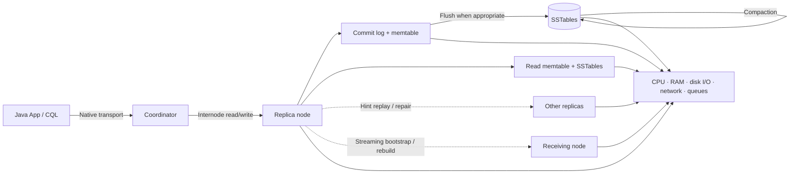
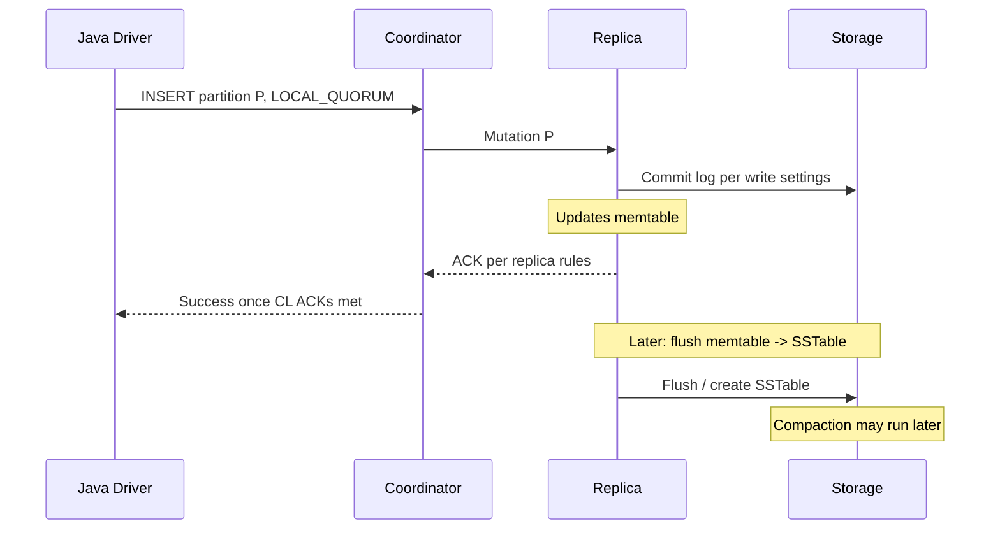
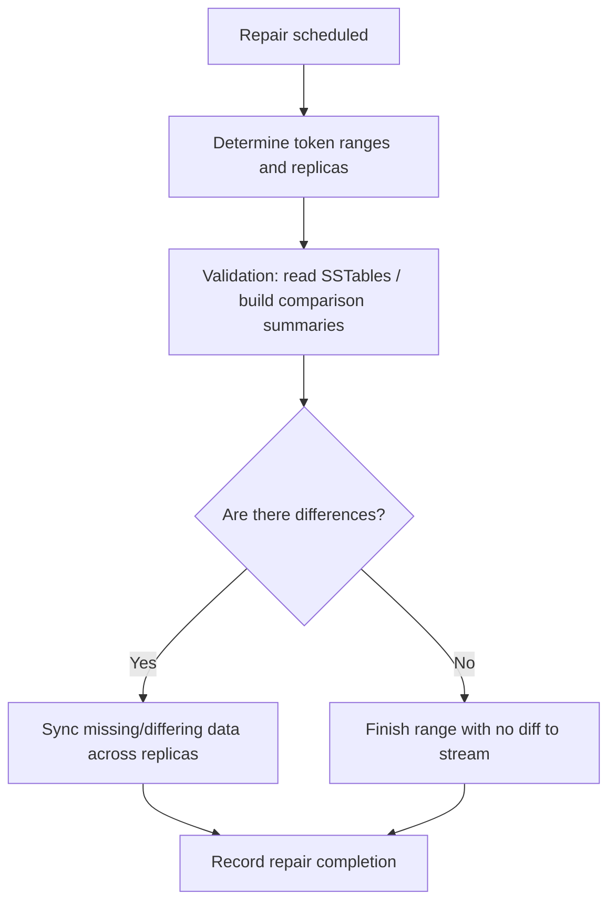
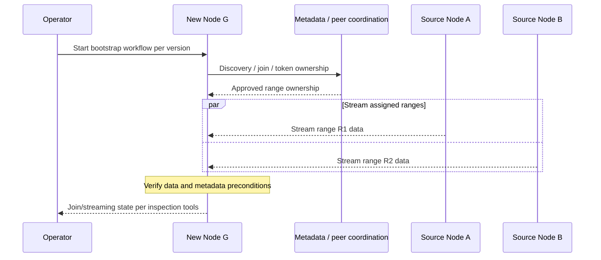
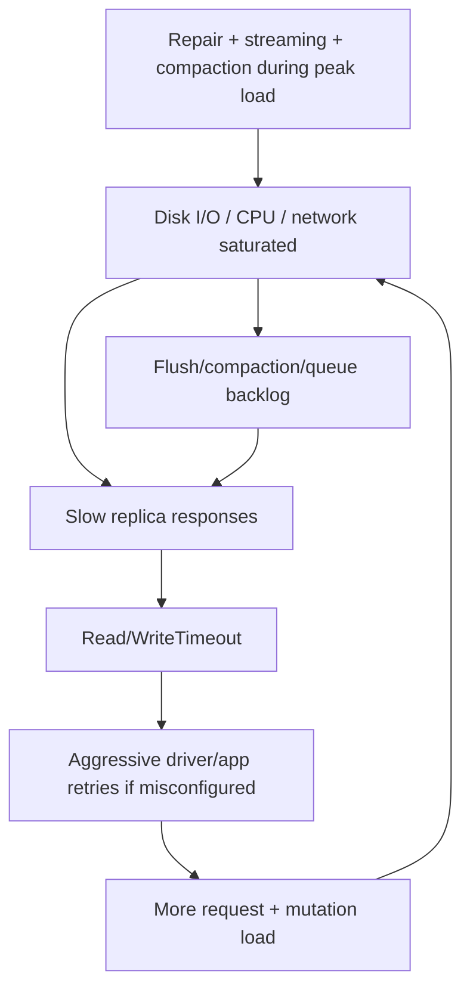
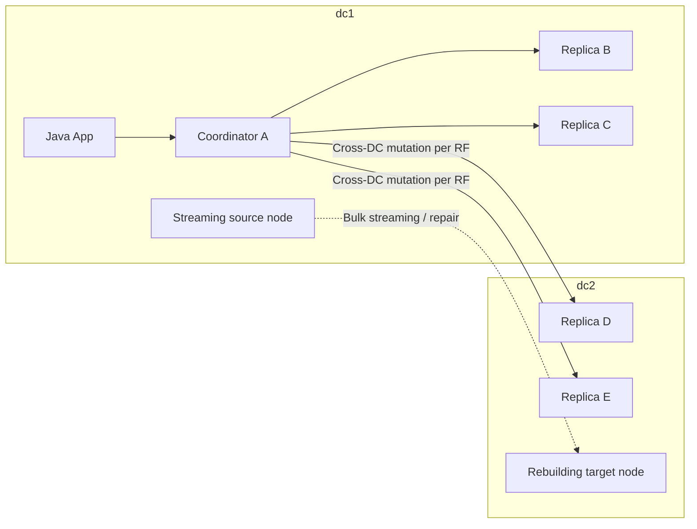
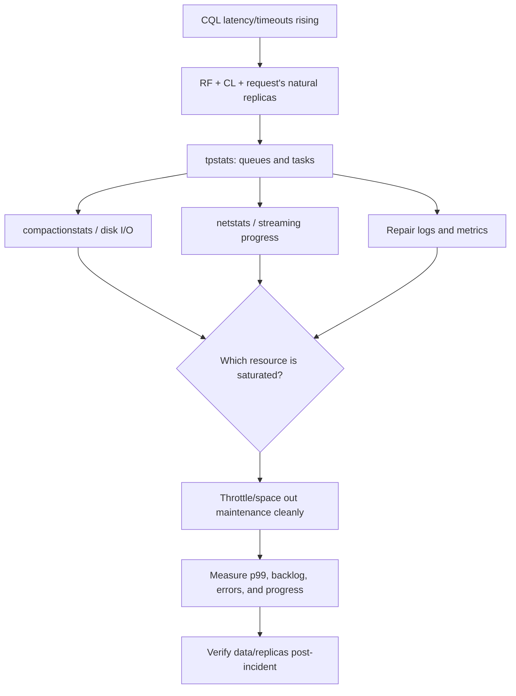

# Background Tasks, Streaming, and Resource Coordination

Apache Cassandra is a **distributed wide-column** database: a single CQL statement from a Java application can involve a coordinator, multiple replicas, commit logs, memtables, and SSTables. However, direct application requests represent only **part** of the work each node must perform. To maintain storage efficiency and long-term consistency, Cassandra also runs tasks such as **memtable flushes, compaction, hinted handoff, anti-entropy repair, streaming, cleanup**, and other maintenance operations.

These operations are often grouped together as **background tasks**. They do not necessarily run "for free" when a node happens to be idle. Streaming during bootstrap consumes network bandwidth, a major compaction generates heavy I/O, repair reads data across multiple replicas, and flushes write memtables down to SSTables. If these tasks overlap with peak application load, **p95/p99 latency, timeouts, and the ability to satisfy consistency levels** can all suffer.

This lesson belongs to the **Cluster Architecture** section of the Apache Cassandra module. Its goal is to connect storage and operational mechanisms with **partition keys, replication, CQL reads/writes, repair, compaction, troubleshooting, and the Java Driver**, rather than treating each task as an isolated admin command.

After this lesson, you will be able to:

- Distinguish **foreground requests**, **background maintenance**, **data streaming**, and **metadata/gossip traffic**.
- Describe the purpose and triggers of flushes, compaction, hint replay, repair, bootstrap streaming, and cleanup.
- Explain which resources face contention: **CPU, RAM, disk space, IOPS, disk throughput, network, threads/queues, and timeouts**.
- Predict why a node can remain `UN` while `LOCAL_QUORUM` requests time out under heavy background load.
- Schedule operations so heavy repair, bootstrapping, and compaction do not overload the cluster simultaneously.
- Use `nodetool`, metrics, tracing, and the Java Driver to distinguish background bottlenecks from network or replica failures.

## 1. Foreground and Background Work Inside a Cassandra Node

**Foreground workload** generally refers to work on the client request path: receiving CQL, reading memtables/SSTables, writing commit logs and memtables, sending/receiving mutations or data/digests, and returning results per CL. **Background workload** comprises the activities that keep storage and replicas healthy over time.



The arrows show logical relationships, **not a thread-pool map or TCP port diagram**. Flushes and compaction primarily use **local** resources, whereas streaming and repair can consume **inter-node** network bandwidth. Client reads/writes and background tasks compete for the very same physical resources.

### "Background" Does Not Mean "Zero Request Impact"

Consider a replica flushing memtables and compacting multiple SSTables:

1. Client sends `SELECT`; the replica must read SSTable files from a busy disk.
2. Compaction is also reading and writing SSTables on that exact same disk.
3. I/O queues lengthen, delaying the data response back to the coordinator.
4. The coordinator fails to reach quorum before the deadline and may return `ReadTimeout`.

Background tasks **do not need to throw their own exception** to affect applications. Frequently, they simply slow down everyday request paths.

## 2. Map of Task Types and Triggers

| Task | Why Does It Run? | Involved Data / Path | Dominant Contended Resources |
|---|---|---|---|
| **Memtable flush** | Persists memtable data into an SSTable upon flush thresholds, memory pressure, or admin trigger. | **Single node**, memtable → SSTable. | RAM, disk writes, I/O queues. |
| **Compaction** | Merges/reorganizes SSTables, reconciling versions and tombstones under safety rules. | **Single node**, local SSTable read/write. | Disk reads/writes, temp disk space, CPU. |
| **Hint replay / handoff** | Replays mutations buffered for a temporarily absent replica within config limits. | Hinting node → target replica. | Disk, internode network, write load. |
| **Anti-entropy repair** | Compares and synchronizes data discrepancies across replicas. | Multiple replicas, validation and repair streams. | Disk reads, CPU, network, sometimes streaming. |
| **Bootstrap streaming** | New node receives data for its assigned token ranges. | Source nodes → new node. | Network, disk reads/writes, CPU. |
| **Rebuild / replace streaming** | Reconstructs copies in a DC or replacement node per procedure. | Eligible source and target nodes. | Heavy network and disk. |
| **Cleanup** | Drops data for token ranges a node no longer owns after topology changes. | Local SSTables on the node. | Disk reads/writes, I/O, CPU. |
| **Snapshot / backup** | Preserves recovery points or exports data per policy. | SSTables, storage/backup target. | Disk space, I/O, potentially network. |
| **Gossip / metadata coordination** | Maintains peer awareness and version-specific metadata changes. | Node-to-node / control traffic. | Network and CPU; typically smaller than bulk streaming. |

The cadence and internal structure of each task **depend on Cassandra version, configuration, compaction strategy, workload shape, and cluster events**. There is no single "background scheduler" that perfectly queues every task so CQL is never affected.

## 3. Write Path: Commit Log, Memtable, and Flush

When a replica receives a mutation:

1. It writes via the **commit log** for crash durability and updates the **memtable** for active data.
2. The replica sends an ACK per its local write handling; the coordinator collects ACKs per CL.
3. When a memtable needs flushing, Cassandra writes an **immutable SSTable** to disk.
4. Data may span multiple SSTables; **compaction** runs later to reorganize them per strategy.



The diagram depicts **one replica**, omitting full fan-out and ACKs from other replicas. The core point: **clients do not wait for SSTables to be compacted before receiving success**. Flushes and compaction have separate schedules; exact commit log sync, ACK timing, and durability depend on config, mutation type, and version.

### Why Is a Flush Backlog Dangerous?

Flushing writes substantial data from RAM to disk. If write ingestion spikes or storage is too slow:

- Memtable/flush work piles up, creating **memory and I/O pressure**.
- Cassandra's throttling/backpressure mechanisms can slow incoming writes to prevent unbounded backlog growth.
- Write request latency rises even though network and RF are unchanged.
- Flushes produce more SSTables; if compaction falls behind, subsequent reads must inspect more files.

Thus, `WriteTimeout` while nodes stay `UN` can stem from a storage bottleneck, not just replication or network failures.

## 4. Compaction: Local Work with Cluster-Wide Consequences

**SSTables are immutable.** New writes and updates write new data fragments rather than overwriting old files in place. **Compaction** reads relevant SSTables and writes new SSTables according to table policy; it reduces file count, merges cell versions, and purges expired data **when safety conditions allow**.

Device/day table example:

```sql
CREATE KEYSPACE telemetry
WITH replication = {
  'class': 'NetworkTopologyStrategy',
  'dc1': 3,
  'dc2': 3
};

CREATE TABLE telemetry.readings_by_device_day (
    tenant_id uuid,
    device_id uuid,
    event_day date,
    event_time timestamp,
    event_id uuid,
    reading double,
    PRIMARY KEY ((tenant_id, device_id, event_day), event_time, event_id)
) WITH CLUSTERING ORDER BY (event_time DESC, event_id ASC);
```

Mutations for one partition can live across the memtable and multiple SSTables on **each** replica. On reads, the replica must merge relevant versions and tombstones. Compaction streamlines or reorganizes local storage, yet it:

- **Does not copy data from node A to node B.**
- **Does not suddenly bring a down replica back up.**
- **Does not guarantee all tombstones disappear immediately.**
- **Is not a snapshot/backup** and does not replace repair.

### Common Compaction Strategies

| Strategy | High-Level Idea | Workload Considerations |
|---|---|---|
| **SizeTieredCompactionStrategy (STCS)** | Groups similarly sized SSTables into compaction batches. | Write-heavy workloads; can trigger large I/O bursts and temp space spikes. |
| **LeveledCompactionStrategy (LCS)** | Organizes SSTables into non-overlapping size levels. | Read-latency-sensitive workloads, trading off higher write amplification and I/O. |
| **TimeWindowCompactionStrategy (TWCS)** | Groups SSTables by time windows for time-series/TTL data. | Time-series data with retention/TTL; avoid out-of-order late writes mixing windows. |
| **UnifiedCompactionStrategy (UCS)** on supporting releases | Configurable unified compaction policies in modern releases. | Adopt only after verifying version, migration path, and real workload metrics. |

No strategy is "best for every table." Selecting compaction depends on **read/write mix, partition sizes, TTLs, tombstones, read/write amplification, disk headroom, and disk throughput**. Never switch strategies cluster-wide in production just because a `pending compactions` graph spiked for a few minutes.

### Disk Space During Compaction

Compaction often needs to **write new SSTables before deleting old SSTables**. Always maintain **disk space headroom** and never run filesystems continuously near full. Running out of space can stall compaction, flushes, and streaming, disrupting CQL availability.

## 5. Repair: Reconciling Replicas Differs from Compaction

Cassandra replicates data according to RF, yet replicas can drift due to node outages, network partitions, write timeouts, or replication lag. **Anti-entropy repair** compares and synchronizes data across replicas within a selected token/partition scope.

A conceptual repair flow:

1. Identify participating replicas for the chosen token ranges and scope.
2. Nodes build/exchange **validation** data to pinpoint differing ranges.
3. Comparison may use **Merkle trees** or equivalent structures depending on version.
4. Differing ranges/cells are synchronized via appropriate data transfer.
5. The workflow records repair completion and updates operational state per release mechanics.



**Repair may transfer very little data** if replicas already match in the compared range, yet validation still incurs disk reads and CPU. Conversely, after a long outage, large differences can trigger **heavy data transfers** and noticeably impact CQL latency.

### Do Not Confuse Three "Repair" Concepts

| Mechanism | Typical Trigger | Scope |
|---|---|---|
| **Read repair** | Some read paths detect replica mismatch, depending on version/table option. | Data read and reconciled within that request. |
| **Anti-entropy repair** | Operational/scheduled task run over ranges/replicas. | Partitions within the repair scope, even if never read by clients. |
| **Compaction** | Local table storage policy or admin trigger. | SSTables on one node; never compares across other replicas. |

Repair is part of **eventual consistency and failure recovery design**, not an instant fix for every request error. It must be **scheduled, monitored, and throttled**, especially on multi-TB or multi-DC clusters.

## 6. Streaming: When Actual Data Moves Between Nodes

**Streaming** transfers data between Cassandra nodes so a node receives the partitions/ranges it must store. Common scenarios:

- **Bootstrap:** adding a node and redistributing replica ownership.
- **Replace:** replacing an unrecoverable node cleanly without identity/token conflicts.
- **Rebuild:** populating a DC or node via supported operational commands.
- **Replication / topology changes:** certain changes require transferring data to new replicas.
- **Repair:** syncing differing ranges can spawn streaming sessions.



**Streaming source nodes do not have to be seeds.** Seeds assist peer discovery; data streams from nodes owning the relevant ranges. Streaming **is not gossip** and is not equivalent to the Java Driver re-sending individual `INSERT` statements to build data.

### Streaming Involves Both Control and Data Paths

A streaming session negotiates **ranges, sources/targets, session state, progress, and payload transfer**. Exact multiplexing, connections, framing, and compression depend on version/configuration; never assume all streaming bytes ride the same connection as mutations or pass through CQL port `9042`.

**Network bandwidth is only half the story:** the source node must read from disk and the destination node must write to disk; both compete for I/O with foreground requests. If a source replica is already serving heavy reads/writes, streaming can spike latency even with ample network bandwidth remaining.

## 7. Hinted Handoff and Replay on Replica Recovery

When replica C is temporarily unresponsive, a coordinator or eligible node can store **hints** for missed mutations to replay later within configured limits. Once C reconnects, **hint replay** adds node-to-node traffic and write load on C.

Example: partition P has RF = 3 in `dc1`, natural replicas A/B/C. C goes down briefly:

1. Application writes at `LOCAL_QUORUM`.
2. A and B provide two ACKs, so the client gets success.
3. Mutations destined for C may be stored as hints if conditions allow.
4. When C returns, replay forwards the buffered mutations.
5. If C was out too long or hints could not cover every case, **repair** is needed for convergence.

Hint replay does not guarantee a node offline for days will automatically recover every missed write. Hint retention windows, replay throttling, storage caps, and config rules must be verified per release. Replay also **competes for network bandwidth and disk I/O** with fresh requests.

### Write Timeouts Create Uncertain State

`WriteTimeout` does not mean the mutation definitely failed to write. A and B may have saved it while the coordinator lost connectivity before returning success. If the Java application generates a **new `event_id`** on each retry, one event can become two CQL rows. Retries must therefore rely on **stable event keys and idempotent semantics**, not merely the fact that the client timed out.

## 8. Cleanup, Snapshots, and Other Background Work

Not all maintenance tasks stem from data errors.

**Cleanup:** after topology changes, a node may still hold token ranges it no longer owns. Cleanup removes data no longer owned according to version mechanics. It consumes disk I/O and must run in the **right topology-change sequence**; never run cleanup prematurely to "free disk space" on a node that has not completed bootstrap/rebalancing.

**Snapshot:** creates a point-in-time recovery reference, typically using SSTable files and storage optimizations like hard links where supported. Snapshots may incur minimal initial copy cost yet still **consume effective disk space** as old SSTables get compacted away, requiring retention/deletion/off-node backup policies. A local snapshot **is not** an independent replica against disk or DC loss.

**Backup:** moves and retains data off-node per organizational policy; backup network traffic can compete with replication and streaming, especially during peak hours.

**Gossip and metadata tasks:** typically tiny compared to bulk streaming, yet sensitive to GC pauses, CPU scheduling, or network saturation. If background I/O/CPU freezes a node long enough, peers may mark it `DOWN` even though hardware is fine.

## 9. Resource Coordination: Seven Bottlenecks to Watch

| Resource | Tasks Most Likely to Pressure It | Observable Symptoms |
|---|---|---|
| **CPU** | Compression, compaction, repair validation, serialization, GC. | Growing queues, higher p99 latency, sluggish gossip. |
| **Heap / off-heap RAM** | Memtables, buffers, caches, metadata, streaming/network buffers. | GC pauses, memory pressure, OOMs, or sudden latency spikes. |
| **Disk IOPS** | Random reads, memtable flushes, validation, compaction. | Small requests stall even before raw disk throughput saturates. |
| **Disk throughput** | Sequential SSTable read/write, streaming source/target, backups. | Disk bandwidth saturation, flush/compaction backlogs. |
| **Disk capacity** | New SSTables, temp compaction files, snapshots/hints/commit logs. | Insufficient headroom, failed flushes or compactions. |
| **Network bandwidth / latency** | RF fan-out, cross-DC replication, streaming, hint replay, repair. | Delayed ACKs/data, timeouts, stalled bootstraps. |
| **Thread pools / queues & deadlines** | Concurrent tasks competing for execution. | Growing pending tasks, request timeouts while nodes stay `UN`. |

Low average CPU utilization **does not rule out an I/O bottleneck**; IOPS can saturate well before byte throughput peaks. Likewise, low throughput with high latency can point to random-read queue depth or unstable underlying storage.

### Amplification Feedback Loops



During an incident, merely raising timeouts keeps requests holding resources longer. Merely raising retries can ignite a **retry storm**. Inspect resources, background workloads, and **CL conditions** before tuning driver settings.

## 10. Tasks Do Not Always Share the Same Priority

Cassandra uses various **stages, executors, queues, and throttling controls** for internal work. However, stage names, concurrency caps, and pipelines vary across versions. Never rely on a static thread-pool list to claim "streaming always runs lower priority than writes, so it can never impact requests."

Coordination principles:

- **Foreground latency** is an SLO to protect; never run uncontrolled maintenance just because the cluster reads `UN`.
- **Flushing** directly impacts durable write ingestion; starving flushes to favor other tasks can cause severe backpressure.
- **Compaction** should not stay disabled indefinitely: SSTable backlogs, read amplification, and tombstone accumulation worsen over time.
- **Repair** should not be postponed endlessly just because it costs resources: prolonged replica drift, tombstone retention, and recovery safety depend on repair schedules.
- **Streaming** during add/replace/rebuild may need to finish before new nodes serve fully, yet concurrent streams must match source and target capacity.
- **Hint replay** can cause write spikes when a node recovers; budget for that extra write load.

This is a **resource budgeting and operational sequencing** problem, not flipping one global flag for every task.

## 11. RF, CL, and Resources: Waiting for Fewer ACKs Does Not Mean Less Work

Suppose the keyspace in section 4 uses `NetworkTopologyStrategy` with `RF_dc1 = 3` and `RF_dc2 = 3`. An application in `dc1` sends an `INSERT` for partition P at `LOCAL_QUORUM`:

- The coordinator needs **two valid ACKs in `dc1`** to return success.
- Mutations still target **all natural replicas** per RF/topology, including replicas in `dc2`.
- Success in `dc1` **does not** prove `dc2` replicas already applied the mutation.
- Cross-DC networking/repair continues consuming resources after the client receives its ACK.

| CL at dc1 Coordinator | Key Requirement in Example | Trade-Off to Watch |
|---|---|---|
| `LOCAL_ONE` | One `dc1` replica responds. | Lower latency, higher chance of reading unconverged data. |
| `LOCAL_QUORUM` | Two `dc1` replicas respond. | Depends on at least two local replicas staying fast enough. |
| `QUORUM` | Four of six total replicas respond. | Likely needs WAN responses; adds cross-DC timeout exposure. |
| `EACH_QUORUM` (write) | Quorum in **each DC**: two in `dc1` and two in `dc2`. | Shrinks cross-DC confirmation gap while depending on both DCs. |
| `ALL` | All six replicas respond. | Fragile whenever any single replica or link slows/fails. |

**CL does not change RF** and does not eliminate streaming or repair bandwidth. Lowering CL to avoid timeouts alters application consistency guarantees; evaluate it alongside read-after-write needs, failover, and critical data requirements.

### Replica Still UP Yet Too Slow

If C is still marked `UP` by the failure detector yet bogged down in heavy compaction, the coordinator may miss C's response before the deadline. With RF = 3 and `LOCAL_QUORUM`, the remaining two replicas can still serve it. However, if both B and C are hit by heavy streaming/repair and only A responds in time, `LOCAL_QUORUM` fails. **Liveness does not guarantee enough performance to finish requests on time.**

## 12. Intra-DC vs. Cross-DC Traffic

In multi-DC clusters, separate **replica mutation/read paths** from **bulk data movement**:



Rebuilding `dc2` can consume massive WAN bandwidth while `dc1` applications simultaneously replicate writes cross-DC. If the WAN link saturates, cross-DC mutations and ACKs lag. With `LOCAL_QUORUM` in `dc1`, requests can keep succeeding using local replicas, yet remote data diverges, creating failover risk.

Budget network capacity across four tiers:

1. **Steady-state traffic:** foreground reads/writes multiplied by RF, gossip, telemetry.
2. **Peak traffic:** application bursts and controlled retries.
3. **Maintenance traffic:** streaming, repair, hints/backups.
4. **Failure catch-up:** backlog replay when a rack or DC reconnects after an outage.

Never assume nominal WAN circuit speed equals usable Cassandra bandwidth: protocol overhead, packet loss, QoS policies, and other workloads share the link.

## 13. Designing Partition Keys to Reduce Resource Contention

Not every performance problem can be tuned away via compaction throttling. **Query-driven wide-column data modeling** dictates partition count, partition size, and how evenly requests hit replicas.

In `telemetry.readings_by_device_day`, the partition key is `(tenant_id, device_id, event_day)` and clustering columns are `(event_time, event_id)`. A query with the full partition key:

```sql
SELECT event_time, event_id, reading
FROM telemetry.readings_by_device_day
WHERE tenant_id = 11111111-1111-1111-1111-111111111111
  AND device_id = 22222222-2222-2222-2222-222222222222
  AND event_day = '2026-11-21'
LIMIT 20;
```

Daily bucketing keeps one device from creating an unbounded historical partition. Still, if a device emits millions of points per second, **a single-day partition can still grow too large or hot**. Revisit bucket granularity, cardinality, retention, and query patterns—without over-sharding into tiny buckets if queries would then have to read hundreds of buckets.

### Hot Partitions Complicate Maintenance Windows

- A finite set of replicas absorbs most reads/writes for the hot partition.
- Flushes and compaction on those specific nodes face heavier I/O.
- Repair/streaming on those same nodes can push p99 latency past SLOs.
- Adding nodes **does not automatically split an existing partition** across all nodes; you must adjust the data model or key distribution.

If time-series tables use TTL, evaluate **tombstones and compaction strategy**, not merely live row count.

## 14. Tombstones, TTLs, and the Risk of Postponing Repair

`DELETE` and expired TTL entries generate **tombstones** / logical deletion markers that replicas must honor. Cassandra cannot erase every trace across all nodes immediately because an offline replica might still hold older values.

For example:

1. Replicas A and B record a tombstone deleting a cell at a newer timestamp.
2. Offline replica C misses the delete and keeps the old value.
3. When C returns, reconciliation must let the tombstone suppress the old value.
4. If tombstones are purged prematurely under retention rules before replicas are repaired, there is a risk of **deleted data resurrection** under certain conditions.

`gc_grace_seconds` and repair schedules reflect how long a replica may stay absent—not a tuning knob to "minimize tombstones at all costs." Never arbitrarily slash `gc_grace_seconds` or skip repair long-term just to reduce immediate I/O.

Compaction purges tombstones **when safety conditions permit**; repair reconciles across replicas; neither replaces the other. With TWCS, understand how TTL, data timestamps, and late writes interact with compaction windows.

## 15. Scheduling Maintenance: A Practical Window Plan

Suppose the `telemetry` cluster faces heavy traffic from **08:00–20:00** in its primary DC, with nightly backups and a planned node addition. An illustrative operational schedule:

| Phase | Activity | Gate to Proceed |
|---|---|---|
| Pre-change | Capture baselines: request rate, p95/p99, compaction backlog, disk headroom, network throughput. | No open incident skewing metrics. |
| Off-peak window | Add **one** node / bootstrap per version workflow. | Sufficient bandwidth/disk; streaming sources not overloaded. |
| During streaming | Watch `nodetool netstats`, logs, queues, CQL latency. | Metrics stay within agreed operational/SLO thresholds. |
| Post-bootstrap | Verify topology/tokens, new data, and required post-join tasks. | Node reaches healthy state; streaming completes per checklist. |
| Repair window | Run scoped repair, avoiding overlap with other bulk jobs. | Monitor validation/streaming; p99 stays within bounds. |
| Backup / snapshot | Follow retention and capacity policies. | Disk/network retain headroom for compaction and flushes. |

These hours are **illustrative for a hypothetical load**, not a universal Cassandra rulebook. Global clusters serving multiple time zones may have no "quiet night." In that case, rely on **strict concurrency, scope, and bandwidth throttling**, coordinating across ops teams instead of merely waiting for nighttime.

### Order of Operations When Multiple Tasks Need to Run

1. Check cluster health and SLOs before starting.
2. Prioritize ensuring **disks do not fill up** and write/flush paths stay healthy.
3. Never run multiple heavy streaming/repair jobs concurrently on the same node group without verified headroom and metrics.
4. Once a job starts, monitor **both source and target nodes**, not just the target.
5. Define clear pause/throttle criteria and rollback procedures if timeouts rise.
6. After completion, wait for metrics to stabilize and verify data before shifting traffic.

## 16. Throttling Throughput and Concurrency: Never Copy Settings Blindly

Cassandra exposes throughput and concurrency controls for compaction, streaming, and flushes across versions. For example, some releases include settings such as:

- `compaction_throughput_mb_per_sec` or version-equivalent names/units.
- `concurrent_compactors` to cap parallel compaction tasks.
- Streaming throttles in **megabits/second** or stream/thread limits; exact names and behavior evolve across versions.
- Memtable/flush and thread/concurrency settings matched to storage hardware.

**Never assume these sample values or parameter names behave identically across Cassandra 3.x, 4.x, and 5.x.** Pay special attention to **MB/s** vs. **Mb/s** (bytes vs. bits). Base settings on:

- Each node's **disk read and write capacity**, not just NIC speed.
- **Write/read ratio** and business latency SLOs.
- SSTable sizes, compaction strategy, and tombstone density.
- RF/topology and **cross-DC** link pressure.
- Target completion windows for repair/streaming and outage recovery bounds.

Raising compaction throughput clears backlogs faster at the cost of higher I/O contention. Setting it too low lets SSTables pile up, steadily degrading reads. Tight streaming caps protect WAN links while prolonging bootstraps and topology transitions. Every tuning choice is a trade-off.

## 17. Observing with `nodetool`: Watch the Right Backlog

Typical inspection commands (run in test environments or via authorized operational access):

```bash
nodetool status
nodetool tpstats
nodetool compactionstats
nodetool netstats
nodetool tablestats telemetry.readings_by_device_day
nodetool gossipinfo
nodetool describecluster
```

| Tool | What to Inspect | What Cannot Be Concluded Alone |
|---|---|---|
| `nodetool status` | DC/rack, `UN`/`DN`, joining/leaving, overall topology. | An `UN` node can still be I/O-saturated. |
| `nodetool tpstats` | Queues and active/pending/completed tasks across version stages. | Does not distinguish CPU vs. disk root causes on its own. |
| `nodetool compactionstats` | Active compactions, pending count, and progress per release. | Brief spikes in pending count do not prove a crisis. |
| `nodetool netstats` | Active streaming sessions, sent/received progress, and related state per version. | Does not capture all native CQL/internode traffic. |
| `nodetool tablestats` | Table metrics, SSTables, read/write latency/tombstones, and disk usage per release. | Does not replace long-term time-series metrics. |
| `nodetool gossipinfo` | Peer state from the queried node's perspective. | Does not prove replicas hold identical data. |
| `nodetool describecluster` | Cluster metadata/schema summary per version tooling. | Does not measure actual I/O or bandwidth usage. |

**Trends over time** matter far more than one snapshot. For instance, `pending compactions` naturally rises after traffic peaks and drains back down; real trouble is a continuously growing backlog that cannot catch up, eroding disk headroom and read latency.

### Combining Metrics and Logs

Beyond `nodetool`, monitor:

- **Client/driver:** p50/p95/p99 read/write latency, request rate, timeouts/errors by CL and DC.
- **JVM:** GC pauses, heap/off-heap usage, CPU, thread scheduling.
- **Storage:** disk used/free, IOPS, throughput, queue depth, read/write latency.
- **Internode:** bytes/messages, network retransmissions, packet loss, inter-rack/DC RTT.
- **Maintenance:** pending/running compactions, flush backlog, streaming progress, repair duration/errors.
- **Logs:** disk errors, streaming, repair, coordinator timeouts, topology/schema events.

Exact metric names and JMX paths vary by Cassandra version and monitoring stack. Always align **timestamps and source/target nodes** when comparing metrics.

## 18. Using CQL Tracing to Separate Request Paths from Background Tasks

With `telemetry.readings_by_device_day` created, trace a partition read:

```sql
-- CONSISTENCY and TRACING are cqlsh commands, not CQL SELECT syntax.
CONSISTENCY LOCAL_QUORUM;
TRACING ON;

SELECT event_time, event_id, reading
FROM telemetry.readings_by_device_day
WHERE tenant_id = 11111111-1111-1111-1111-111111111111
  AND device_id = 22222222-2222-2222-2222-222222222222
  AND event_day = '2026-11-21'
LIMIT 20;

TRACING OFF;
```

Tracing can reveal coordinator/replica execution steps, data/digest exchanges, and internal timings. However, **a single `SELECT` trace is not a log of every compaction, streaming, or repair job on the node**. If requests slow down during compaction, **correlate trace timestamps with metrics, `compactionstats`, and OS I/O**, rather than expecting the trace itself to print "slowed by compaction."

Tracing adds processing and storage overhead, so never leave it enabled unconditionally in production. Never intentionally induce real outages by killing replicas or launching heavy peak-hour repairs just for demonstration.

## 19. Java Driver 4.x: Managing Timeouts, CL, and Retries

The Java Driver operates over **native CQL**, without directly controlling internal compaction or streaming threads. Applications must **understand CL and idempotency** so background contention never turns transient timeouts into duplicate rows or retry storms.

Example using Apache Cassandra Java Driver 4.x (`com.datastax.oss.driver` API). It writes an event with a stable key and reads the partition with an explicit CL:

```java
import com.datastax.oss.driver.api.core.CqlSession;
import com.datastax.oss.driver.api.core.DefaultConsistencyLevel;
import com.datastax.oss.driver.api.core.cql.BoundStatement;
import com.datastax.oss.driver.api.core.cql.PreparedStatement;
import com.datastax.oss.driver.api.core.cql.Row;
import com.datastax.oss.driver.api.core.servererrors.WriteTimeoutException;
import com.datastax.oss.driver.api.core.servererrors.ReadTimeoutException;

import java.net.InetSocketAddress;
import java.time.Instant;
import java.time.LocalDate;
import java.util.UUID;

public class CassandraBackgroundWorkloadExample {
    public static void main(String[] args) {
        UUID tenant = UUID.fromString(
            "11111111-1111-1111-1111-111111111111");
        UUID device = UUID.fromString(
            "22222222-2222-2222-2222-222222222222");
        UUID event = UUID.fromString(
            "33333333-3333-3333-3333-333333333333");
        LocalDate day = LocalDate.parse("2026-11-21");

        // Contact points are illustrative IPs; replace with real endpoints.
        try (CqlSession session = CqlSession.builder()
                .addContactPoint(new InetSocketAddress("192.0.2.11", 9042))
                .addContactPoint(new InetSocketAddress("192.0.2.12", 9042))
                .withLocalDatacenter("dc1")
                .build()) {

            PreparedStatement insert = session.prepare(
                "INSERT INTO telemetry.readings_by_device_day " +
                "(tenant_id, device_id, event_day, event_time, event_id, reading) " +
                "VALUES (?, ?, ?, ?, ?, ?)");

            // Keep event ID and payload stable when reprocessing the same event.
            BoundStatement write = insert.bind(
                    tenant, device, day,
                    Instant.parse("2026-11-21T01:30:00Z"), event, 36.7)
                .setConsistencyLevel(DefaultConsistencyLevel.LOCAL_QUORUM);

            try {
                session.execute(write);
            } catch (WriteTimeoutException ex) {
                // Never assume the mutation rolled back.
                System.err.println(
                    "Uncertain write: handle retry/idempotency at business layer");
            }

            PreparedStatement select = session.prepare(
                "SELECT event_time, event_id, reading " +
                "FROM telemetry.readings_by_device_day " +
                "WHERE tenant_id = ? AND device_id = ? AND event_day = ? " +
                "LIMIT 20");

            BoundStatement read = select.bind(tenant, device, day)
                .setConsistencyLevel(DefaultConsistencyLevel.LOCAL_QUORUM)
                .setIdempotent(true); // Pure side-effect-free SELECT

            try {
                for (Row row : session.execute(read)) {
                    System.out.printf("%s %s %.2f%n",
                        row.getInstant("event_time"),
                        row.getUuid("event_id"),
                        row.getDouble("reading"));
                }
            } catch (ReadTimeoutException ex) {
                System.err.println("Read missed response deadline");
            }
        }
    }
}
```

`192.0.2.0/24` IPs are documentation-only, and `dc1` must match the real DC. In secured environments, configure authentication, TLS, timeouts, and connection policies. In production, reuse a single `CqlSession` instead of creating one per request.

**Never mark every mutation idempotent automatically.** Re-writing the same key/value reduces duplicate rows, yet timestamps, TTLs, counters, LWTs, monotonic values, and concurrent updates still affect business idempotency. A `WriteTimeout` during heavy compaction/repair **can happen after some replicas already applied the write**.

Applications must bound retries, avoid immediate tight-loop retries, and monitor retry rates per node/DC. Simply raising timeouts never fixes missing disk headroom or I/O saturation.

## 20. Runbook: When Repair or Streaming Overlaps Peak Hours

**Scenario:** During peak traffic, operations adds node G to `dc1` while repairing a large keyspace and carrying a high compaction backlog. The Java Driver reports rising `ReadTimeout`/`WriteTimeout` errors even though `nodetool status` shows all nodes `UN`.

Triage order:

1. **Identify the real error:** which requests, coordinators/replicas, DC, CL, and when p95/p99 jumped.
2. **Verify quorum:** check RF and required responses. A replica still `UP` that responds too slowly can trigger timeouts.
3. **Inspect streaming:** check `nodetool netstats` on G **and on source nodes**, not just the joining node.
4. **Inspect compaction / flushes:** check `nodetool compactionstats`, `tpstats`, disk utilization, queue depth, and disk latency.
5. **Inspect repair:** check token range, participating nodes, validation/streaming, and job start time.
6. **Pinpoint the bottleneck:** source disk, destination disk, CPU/GC, inter-rack/DC network, or raw capacity?
7. **Relieve contention per runbook:** pause or throttle controllable maintenance jobs without recklessly bypassing flushes/durability; follow version-specific steps to stop or throttle active jobs.
8. **Protect clients:** watch for retry storms; never drop CL or auto-retry non-idempotent writes merely to quiet alerts.
9. **Track recovery:** pending work, disk headroom, request latency, and error rates should trend downward.
10. **Verify post-change state:** confirm streaming/repair finished per plan, new replicas hold data, and no catch-up gaps remain before shifting traffic.



This diagram guides **investigation order**; it does not claim every p99 spike comes from background tasks. Network partitions, failing disks, partition hotspots, schema/topology drift, or missing natural replicas can produce similar symptoms.

## 21. Self-Practice Scenarios

**Scenario A — Flushes and commit logs.** An `INSERT` succeeded at the desired CL, yet the replica's SSTables have not compacted yet. Is that a contradiction? **No.** Write ACKs and compaction occur at different stages; durability and commit log/flushes follow node configuration.

**Scenario B — Compaction and replication.** Replica B holds stale data after missing a mutation. Will running compaction on B automatically pull the latest data from A? **No.** Compaction is local storage maintenance; missed data requires hints, repair, or streaming as appropriate.

**Scenario C — Repair finds zero differences.** Can it still consume CPU and I/O even without bulk streaming? **Yes.** Validation/comparison still requires reading SSTables and computing trees/hashes.

**Scenario D — Newly bootstrapped node.** G shows `UN` right after joining. Is that enough to conclude all historical data in the DC is synced and ready for immediate failover? **No.** Verify streaming, RF, repair, and application checks first.

**Scenario E — RF = 3 in dc1, `LOCAL_QUORUM`.** B and C stay `UN` yet read extremely slowly due to disk I/O; only A answers on time. Can the request succeed? **No**, if two timely responses are required and only one arrives before the deadline.

**Scenario F — Saturated WAN.** `LOCAL_QUORUM` writes in `dc1` keep succeeding. Does that guarantee `dc2` received all mutations? **No.** Local confirmation never proves remote replicas have converged.

**Scenario G — Hint replay.** C returns after a few hours. Can you just wait for gossip to report `UP` and assume C has all data? **No.** Hints have retention/capacity limits; assess repair and outage duration.

**Scenario H — Disk 95% full.** Should you raise compaction concurrency and start more bootstraps to clear backlogs faster? **Not by default.** Both compaction and streaming consume temporary disk space and can worsen disk exhaustion.

**Scenario I — Hot partition.** One device writes massive volume into the same daily partition. Will adding ten nodes split that partition's load evenly across all nodes? **No.** That partition still maps to its finite natural replica set by token/RF; revisit bucketing, partition keys, and workload shape.

**Scenario J — Java `WriteTimeout`.** During heavy compaction, the client times out on `INSERT`. Should it immediately retry with a fresh `event_id`? **No.** The mutation may already be stored; stable event keys and controlled retries are essential.

## 22. Misconceptions to Eliminate

| Misconception | Accurate Explanation |
|---|---|
| "Background tasks only run when nodes are idle." | Many background jobs run alongside CQL and compete for real physical resources. |
| "An `UN` node is guaranteed fast enough to satisfy quorum." | Liveness does not guarantee timely ACKs or data responses. |
| "Compaction repairs data across replicas automatically." | Compaction primarily manages local SSTables; repair reconciles across replicas. |
| "Streaming always passes through seed nodes." | Seeds assist discovery; streaming sources depend on token ranges, data, and topology. |
| "Streaming only uses the network, not disks." | Sources read from disk and targets write to disk, alongside network/CPU usage. |
| "Repair always streams every SSTable to every node." | Repair validates and transfers only needed differences per version mechanics; validation still has cost. |
| "Hint replay completely replaces repair." | Hints are bounded by time/config and never cover every divergence. |
| "Setting compaction throughput to 0 is the best way to eliminate timeouts." | Backlogs accumulate, worsening read amplification and disk pressure. |
| "Lowering CL to ONE reduces physical replica count." | RF stays unchanged; CL only changes how many responses the coordinator waits on. |
| "A timed-out write definitely rolled back." | Mutations may have been applied on some replicas; evaluate idempotency before retrying. |
| "The instant TTL expires, all tombstones vanish." | Tombstones clear via retention, compaction, and repair rules—not instantaneously. |
| "Each port permanently maps to one fixed workload across every release." | Transport, streaming, TLS, and connections evolve across versions and configs. |

## 23. Summary Coordination Model

```text
Java App / foreground CQL
       |
       v
Coordinator -> natural replicas by partition key, token, RF
       |
       +--> Read memtable/SSTables, data/digest responses
       |
       +--> Write commit log + memtable, ACKs per CL
                           |
                           v
                   Flush -> SSTables
                           |
                           v
                      Compaction

Background tasks and node operations:
  - Hinted handoff: replay missed mutations
  - Anti-entropy repair: compare and sync replicas
  - Streaming: bootstrap/replace/rebuild/topology changes
  - Cleanup/snapshot/backup: storage lifecycle and recovery

           ALL COMPETE FOR SHARED
CPU | RAM | Disk IOPS/throughput/capacity | Network | Queues
                           |
                           v
              p95/p99, timeouts, SLOs, and convergence lag
```

**Background tasks** keep Cassandra operable over the long run; **streaming** moves real data between nodes; **repair** converges replicas; **compaction** organizes local storage; and **flushes** move memtables to SSTables. Different purposes still share the exact same hardware resources. Therefore, never measure availability solely by `UP` nodes or RF counts: evaluate **CL quorums and timely responses under shared resource load**.

When scheduling maintenance or investigating incidents, cross-check **partition keys, natural replicas, RF, CL, disk headroom, I/O latency, network throughput, queues, compaction/streaming/repair progress, and Java Driver timeouts/retries**. This holistic view prevents skipping repairs too long, launching heavy streaming at peak hours, and compromising Cassandra's verifiable read/write reliability.
