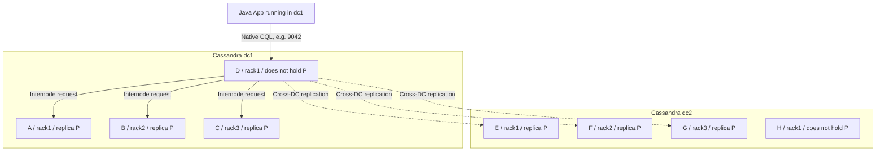
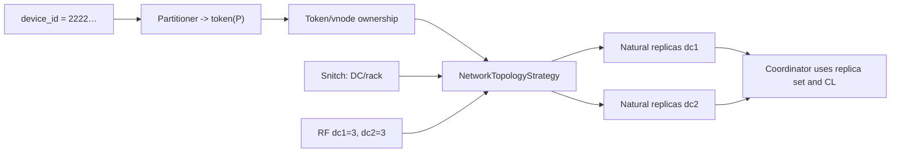
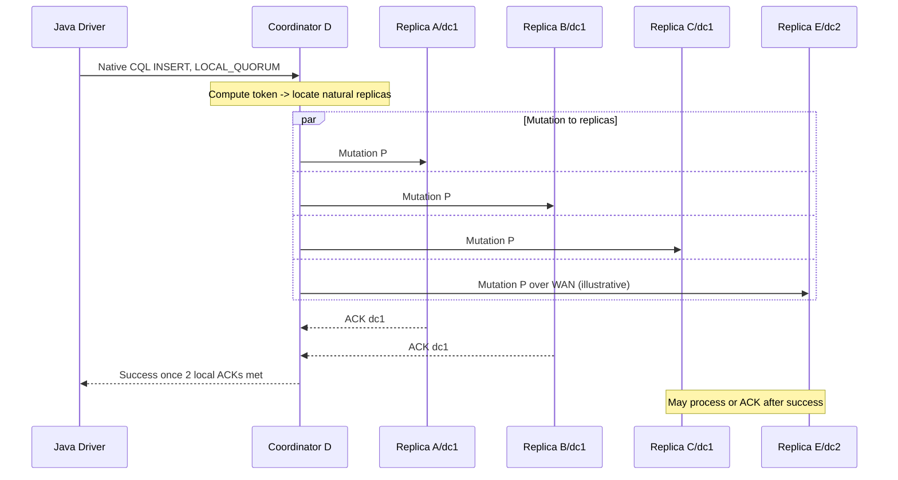
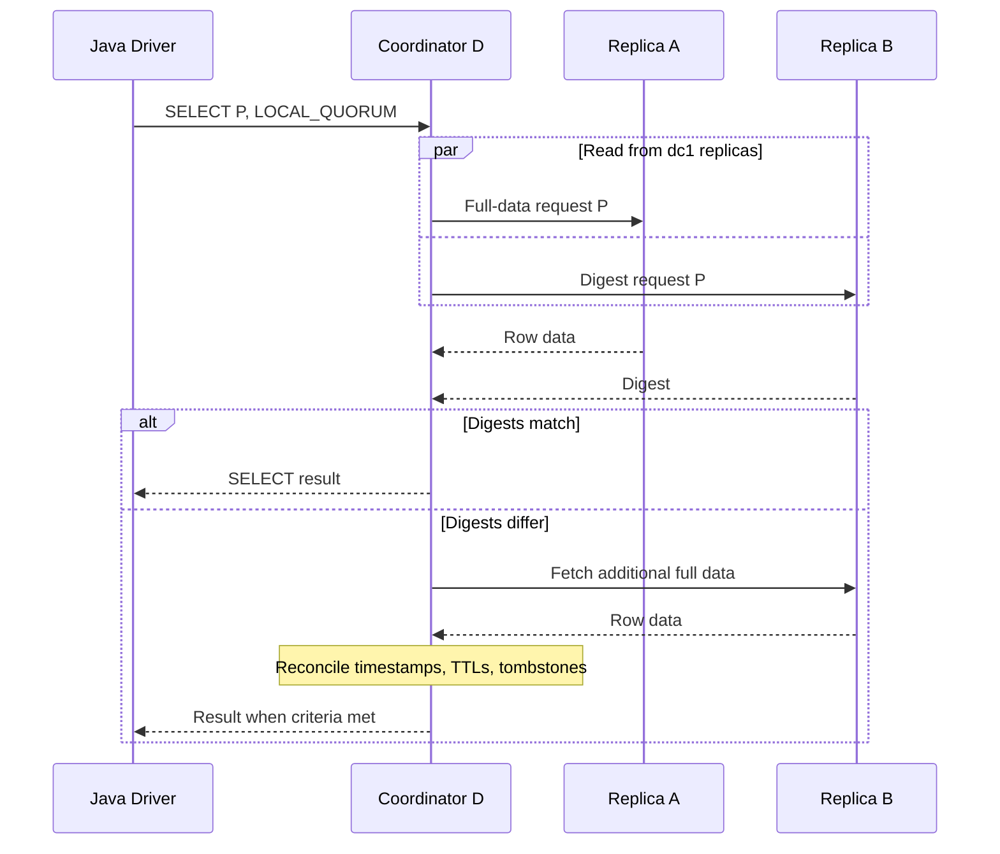
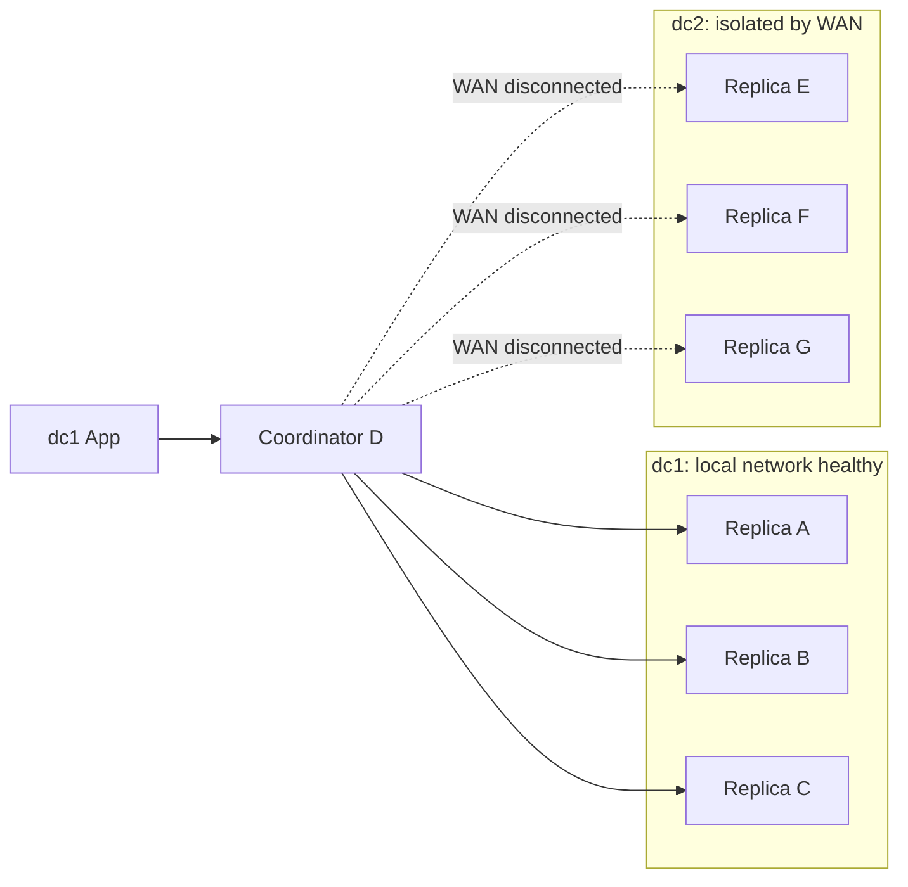
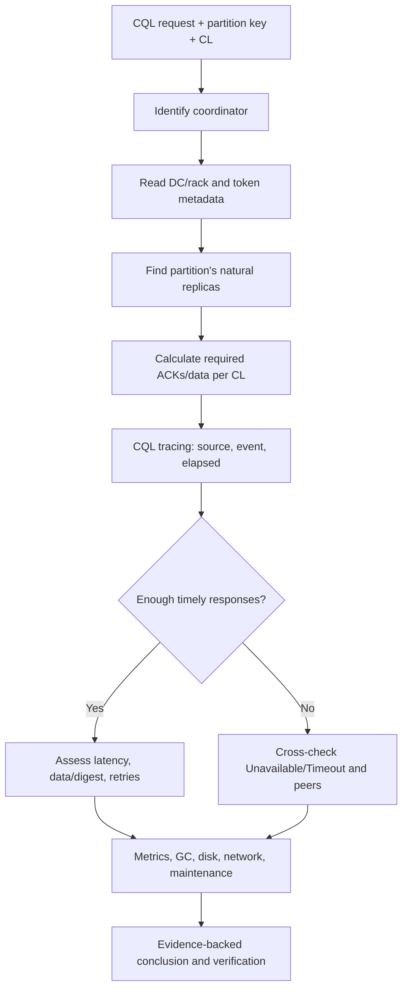

# Reading Cluster Diagrams and Tracing a Real Request Across Nodes

An Apache Cassandra diagram may draw eight nodes, two datacenters, multiple racks, and communication arrows. Yet when a Java application sends **one** `INSERT` or `SELECT` statement, the more important questions are: **which node does the request enter, where does the partition live, which replicas receive messages, how many responses satisfy the consistency level, and what evidence verifies the actual path?**

This lesson teaches you to **read a cluster diagram as a map of responsibilities**, and then **trace a CQL request across nodes** by combining CQL tracing, `nodetool`, Java Driver metadata, and operational metrics. Three layers of information must remain distinct:

1. **Topology:** nodes, datacenters (DCs), racks/failure domains, tokens, and natural replicas.
2. **Request path:** Java Driver → coordinator → replicas → responses → driver.
3. **Evidence:** request traces, token/replica metadata, logs, node status, and each tool's limitations.

Cassandra is a **distributed wide-column** database with query-driven table design. A partition key maps to a token; the **replication strategy** selects natural replicas, while the **consistency level (CL)** defines how many responses are required for the request to succeed. Mastering this chain provides the basis for explaining reads/writes, multi-DC replication, compaction, repair, timeouts, and Java connectivity.

After this lesson, you will be able to:

- Read cluster diagrams without confusing the **logical token ring** with **physical network wiring**.
- Distinguish **contact point**, **coordinator**, **natural replica**, **seed**, **rack**, **DC**, and **failure domain**.
- Construct timelines for `LOCAL_QUORUM` writes, data/digest reads, digest mismatches, and timeout errors.
- Use `nodetool getendpoints` and replication metadata to verify a partition key's replicas.
- Enable controlled tracing in `cqlsh`, read `system_traces`, and separate observed facts from speculation.
- Extract coordinator and tracing IDs from Apache Cassandra Java Driver 4.x and write an investigation report for a real request.

## 1. Reading Diagrams: What Does Each Arrow Represent?

Before tracing a request, know **which kind of relationship each diagram element depicts**. Some diagrams draw nodes on a token ring, others draw DC/rack networks or replica sets. They do not mean the same thing.

| Diagram Element | Meaning to Verify | What Not to Infer |
|---|---|---|
| Node inside a **DC/rack** | Logical topology location and declared failure domain. | Racks are guaranteed physically independent in power or switching. |
| Node owning **tokens/vnodes** | Ownership of token ranges in metadata. | Each vnode corresponds to a separate physical host. |
| **Client → node** arrow | Native CQL connection to the node acting as coordinator. | Client writes directly to every replica on its own. |
| **Coordinator → replica** arrow | Internode request: mutation, data/digest, ACK. | Replicas are guaranteed to reply before the deadline. |
| **Gossip among peers** link | Exchange of state, liveness, and membership. | Gossip carries every application row. |
| **Streaming / repair** link | Bulk data transfer or reconciliation between nodes. | This is a client-issued `INSERT`. |
| Dashed **WAN / degraded link** | Connectivity may be disrupted or suffer high latency. | Every TCP connection between two DCs must take the exact same route. |

In particular, a **token ring** diagram is a logical view of the token space. It does **not** mean messages travel sequentially A → B → C → D like a physical token-ring LAN. Coordinators contact eligible replicas directly over the internode network.

## 2. End-to-End Scenario: Two DCs, Four Nodes Each

Suppose cluster `telemetry-cluster` has two DCs. Each DC has four nodes spread across three racks; keyspace `telemetry` has RF = 3 in each DC.



**Illustrative assumption, not actual token-hashing output:** for partition P, natural replicas are assumed to be `{A,B,C}` in `dc1` and `{E,F,G}` in `dc2`; D and H are not replicas of P. The diagram also **intentionally** routes the driver to D to prove a node **not holding P can still act as coordinator**. Token-aware drivers will normally prefer a local replica like A, B, or C when metadata is available.

In a real cluster, identifying A/B/C/E/F/G must be **verified against the partition's token and real metadata**, never guessed from alphabetical order or box placement in a drawing.

### Questions to Answer from the Diagram

1. Which DC is **local** to the coordinator? In this scenario: `dc1`.
2. What is the RF of **partition P**? `RF_dc1 = 3`, `RF_dc2 = 3`, six total desired copies.
3. Who receives CQL from the client? D, so **D is the coordinator for this request**.
4. Who must store P? A/B/C/E/F/G by assumption.
5. If using `LOCAL_QUORUM` at D, what is the minimum number of `dc1` responses required? **Two**.
6. Under the assumed placement, losing one rack holding a replica of P knocks out one replica; the other two racks still allow reaching quorum.

## 3. Assigning the Right Roles to Each Node

A Cassandra node can assume multiple roles **depending on the request**, though not every role is fixed per machine.

| Role | Example in Diagram | Properties |
|---|---|---|
| **Contact point** | Could be D, A, or B depending on Java Driver config. | Initial connection endpoint for CQL clients; does not have to hold P. |
| **Coordinator** | D for the request in question. | Accepts CQL, locates replicas, waits for CL responses; varies per request. |
| **Natural replica of P** | A/B/C/E/F/G in the example. | Selected by token + replication strategy to store partition P. |
| **Non-replica node for P** | D/H. | Can still store partition Q and coordinate requests for P. |
| **Seed node** | Could be A/E if configured as seeds. | Peer discovery contact on Cassandra startup; not a master for every CQL query. |
| **CMS member (some versions)** | Metadata coordination member in Cassandra 5.x. | Not synonymous with seeds or data coordinators. |

**Never count all `UN` nodes to calculate quorum for P.** D may be Up without becoming a replica of P just because it is coordinating. H may also be Up without helping `LOCAL_QUORUM` in `dc1` for P.

### Driver Locality Differs from Data Locality

A driver configured with `localDatacenter = dc1` prefers nodes in `dc1` as coordinators. This **does not alter RF**: natural replicas remain fixed by metadata. A coordinator in `dc1` may still need to forward mutations to `dc2` because the keyspace replicates across both DCs.

## 4. Partition Key → Token → Natural Replicas

To trace an actual path, first identify the concrete partition key. Pick a table serving **reads of a device's current state**:

```sql
CREATE KEYSPACE telemetry
WITH replication = {
    'class': 'NetworkTopologyStrategy',
    'dc1': 3,
    'dc2': 3
};

CREATE TABLE telemetry.device_state_by_id (
    device_id uuid PRIMARY KEY,
    tenant_id uuid,
    status text,
    battery_pct int,
    last_seen timestamp
);
```

`device_id` is a single-column partition key, so each device has **one row for its latest state**. This fits a `WHERE device_id = ?` query; it **does not** replace a historical table with clustering columns and daily bucketing. For unbounded time-series history, create a separate query-aligned table such as `readings_by_device_day`.

When the application queries a device:

```sql
SELECT tenant_id, status, battery_pct, last_seen
FROM telemetry.device_state_by_id
WHERE device_id = 22222222-2222-2222-2222-222222222222;
```

Logical steps:

1. Cassandra parses `device_id` as type `uuid`, forming the complete partition key.
2. The **partitioner** hashes the key into a token (`Murmur3Partitioner` on most common clusters).
3. Token/vnode metadata maps which nodes own which token ranges.
4. `NetworkTopologyStrategy` combines the token, per-DC RF, and DC/rack topology to pick natural replicas.
5. The coordinator decides how to contact replicas to satisfy CL, weighing topology, liveness, and read/write optimizations.



The diagram omits numeric tokens because **you cannot deduce real cluster tokens from a UUID and node names alone**: you need the exact partitioner and token metadata. Never substitute Java's `hashCode()` or modulo-node-count for Cassandra's partitioner.

## 5. Inspecting Replicas with Tools Before Enabling Tracing

On an eligible Cassandra node in a supporting version, run:

```bash
nodetool status
nodetool describecluster
nodetool getendpoints telemetry device_state_by_id 22222222-2222-2222-2222-222222222222
```

**`nodetool getendpoints`** queries the responsible endpoints for a partition key in a table/keyspace according to the queried node's metadata. Input key syntax and formatting **depend on version and partition key type**; this example uses a single `uuid` key to avoid ambiguity. For composite partition keys, never guess by joining values with commas without checking how the tool parses them.

The expected output is a list of **replica addresses**, not proof that they hold all mutations or are healthy. Actual output may **differ completely** from the illustrative `{A,B,C,E,F,G}` set; replace diagram labels with real endpoints before diagnosing.

### When Can Replica Output Change?

- The cluster is **bootstrapping, decommissioning, replacing, or changing topology**.
- Keyspace RF changed, yet streaming/repair has not completed.
- Tokens/vnodes, snitch, DC/rack, or cluster metadata changed.
- The queried node briefly holds a differing metadata view during a transition.

Always record a `getendpoints` output with **timestamp, queried node, Cassandra version, keyspace/table, and exact partition key**.

### Do Not Confuse Replicas with Endpoints Contacted in a Request

`getendpoints` returns **storage ownership per metadata**. Tracing shows **which peers were actually contacted during one specific request**, which may be a subset of replicas on low-CL reads, or include speculative retries depending on settings. Those two lists answer two different questions.

## 6. Tracing an INSERT: Six Replicas, Yet Waiting for Two Local ACKs

Insert a device state row:

```sql
INSERT INTO telemetry.device_state_by_id
    (device_id, tenant_id, status, battery_pct, last_seen)
VALUES (
    22222222-2222-2222-2222-222222222222,
    11111111-1111-1111-1111-111111111111,
    'ONLINE',
    87,
    '2026-11-21T08:30:00+07:00'
);
```

Assume D is the coordinator in `dc1` and write CL is `LOCAL_QUORUM`:



**Note:** for readability, only E is drawn to represent remote replicas; **F and G also belong to P's natural replicas** and are replication targets by assumption. Two `dc1` ACKs giving the client success **do not prove** E, F, or G already received the mutation.

At each replica, normal writes go through **commit log + memtable** before flushing to SSTables; **compaction** runs asynchronously later. Clients do not wait for SSTables to compact before a write succeeds.

### Checking the ACK Condition

With `RF_dc1 = 3`, `LOCAL_QUORUM` requires **floor(3/2)+1 = 2 local ACKs**. This is a **response requirement**, not a rule to transmit the mutation to only two nodes. If D is also a replica of P, local processing on D replaces one internode arrow.

### Write Timeout: What Questions Must Tracing Answer?

If the client receives `WriteTimeout`, ask: where were mutations sent, how many valid ACKs reached the coordinator before the deadline, did any replica return a failure, and did the response back to the driver drop? **WriteTimeout does not equal rollback.** Some replicas may have saved `ONLINE`; retrying blindly with altered keys, timestamps, or TTLs can corrupt business semantics.

## 7. Tracing a SELECT: Full Data and Digests

After writing, the Java Driver executes:

```sql
SELECT tenant_id, status, battery_pct, last_seen
FROM telemetry.device_state_by_id
WHERE device_id = 22222222-2222-2222-2222-222222222222;
```

On a `LOCAL_QUORUM` read path, the coordinator can request **full data** from one replica and a **digest** from another. Digests compare read contents; they cannot be decoded back into full rows.



This diagram illustrates **one read path with replica comparison**, not a guarantee that the coordinator always sends one data request to A and one digest request to B. Actual request counts and order depend on CL, replica selection, speculative retries, liveness, paging, and version.

### What Does a Digest Mismatch Mean?

Replicas can differ because mutations have not reached every copy, or due to TTLs/tombstones or concurrent updates. A digest mismatch triggers fetching extra full data to **reconcile**; it **does not prove SSTables are corrupted**. **Read repair** may participate depending on version/table config; **anti-entropy repair** reconciles data across a broader range.

With `LOCAL_ONE`, **one response** from a local replica normally suffices, risking stale values when replicas diverge. Do not apply the digest/quorum diagram to **every** CL.

## 8. On Paper: Calculate Quorum Before Concluding Failure

In the scenario with RF = 3 per DC and total RF = 6, assuming coordinator D is in `dc1`:

| CL | Requirement | When C Is Down While A/B Are Healthy |
|---|---|---|
| `LOCAL_ONE` | One `dc1` replica. | Can succeed. |
| `LOCAL_QUORUM` | Two `dc1` replicas. | Can succeed via A and B. |
| `QUORUM` | `floor(6/2)+1 = 4` replicas across both DCs. | Can succeed if at least two remote replicas respond on time. |
| `EACH_QUORUM` (**write**) | Two ACKs in **each DC**. | Can succeed if each DC reaches two and the WAN is healthy. |
| `ALL` | All six replicas. | Fails if C does not respond. |

`EACH_QUORUM` is for **writes** only, not normal reads. **Quorum must be calculated on replicas of that specific partition and within the right DC scope**, not across total `UP` nodes.

If inside `dc1` A and B communicate while C is isolated, a coordinator able to reach A and B can meet `LOCAL_QUORUM` for P. A client reaching only C **cannot** reach two responses in `dc1`, even though C is running.

## 9. Tracing in cqlsh: Running a Traced Request

On a **test cluster**, after creating the keyspace/table from section 4, run in `cqlsh`:

```sql
-- CONSISTENCY and TRACING are cqlsh commands.
CONSISTENCY LOCAL_QUORUM;
TRACING ON;

SELECT tenant_id, status, battery_pct, last_seen
FROM telemetry.device_state_by_id
WHERE device_id = 22222222-2222-2222-2222-222222222222;

TRACING OFF;
```

When tracing is enabled and supported for the query, `cqlsh` displays a **tracing session ID** and execution events. Useful fields include start time, **coordinator**, sending read/mutation messages, receiving data/digests/ACKs, relative step timings, and the source node of each event.

Do not expect **identical wording** across Cassandra 3.x/4.x/5.x. Not every internal action is traced; tracing **is not a packet capture**. Events from remote nodes may arrive late or go missing under timeouts, async collection, or network failures.

### Tracing Does Not Prove All Replicas Have Converged

Reading `LOCAL_QUORUM` from A/B with matching responses describes only **that single request**; it does not prove C, E, F, or G hold identical copies across every partition. `TRACING ON` adds overhead and trace rows typically expire via TTL, making it unsuitable as a business audit log.

## 10. Reading Traces from `system_traces`

In many Cassandra versions, tracing events are persisted in the `system_traces` system keyspace. Once you have a real tracing ID from `cqlsh` or the Java Driver, query that UUID.

**Illustrative** UUID example (replace with a real ID):

```sql
SELECT session_id, coordinator, request, duration
FROM system_traces.sessions
WHERE session_id = aaaaaaaa-aaaa-4aaa-8aaa-aaaaaaaaaaaa;

SELECT event_id, activity, source, source_elapsed, thread
FROM system_traces.events
WHERE session_id = aaaaaaaa-aaaa-4aaa-8aaa-aaaaaaaaaaaa;
```

Columns and behavior can vary across releases. `system_traces` uses TTLs, and events are written asynchronously and may be lost during node failures. An empty query result **is not enough** to conclude tracing was never enabled.

| Field | Question It Helps Answer | Limitations |
|---|---|---|
| `session_id` | Which trace does the event belong to? | Not `device_id` or an application request ID. |
| `coordinator` | Which node coordinated the request? | Not necessarily a natural replica of P. |
| `source` | Which node recorded the event? | Does not prove `source` holds all partitions. |
| `activity` | Which internal step was traced? | Exact text depends on release and execution path. |
| `source_elapsed` | Relative time since trace start (typically microseconds). | Cannot naively sum values across nodes as total latency. |
| `duration` | Session duration recorded by trace mechanism. | Can differ from client-measured latency due to network/driver overhead. |

When comparing events across hosts, account for **clock skew, missing trace events, and event flush lag**. Never treat display row order as proof that messages executed strictly in that sequence.

## 11. Recording an Evidence Table Instead of Just Screenshotting Traces

For verifiable debugging, capture findings in a structured table:

| Field | Illustrative Value | Where Collected |
|---|---|---|
| Table & operation | `telemetry.device_state_by_id`, `SELECT`. | Application / CQL statement. |
| Partition key | `device_id = 2222…`. | Bound prepared statement parameter. |
| CL | `LOCAL_QUORUM`. | CQL / driver statement. |
| Coordinator | D (illustrative). | Trace session / Java `ExecutionInfo`. |
| Coordinator DC | `dc1`. | Driver metadata and `nodetool status`. |
| Natural replicas of P | A/B/C/E/F/G (assumed). | In practice: `nodetool getendpoints` / token metadata. |
| Responding replicas | A/B in the read diagram. | Trace events + related metrics/logs. |
| Trace ID | Real system-generated UUID. | `cqlsh` or `ExecutionInfo`. |
| Error / latency | Measured at driver and server. | Metrics, `system_traces`, logs. |

Never log secret tokens, connection strings, or sensitive customer data in diagnostic notes. If a partition key contains PII, mask or redact it in reports per organizational policy.

## 12. Java Driver 4.x: Extracting Coordinator and Tracing ID

The Java Driver is a **native CQL** client and does not participate in gossip. The driver API exposes client-discovered node metadata, the coordinator for **a specific execution**, and trace IDs when requested.

Java Driver 4.x example:

```java
import com.datastax.oss.driver.api.core.CqlSession;
import com.datastax.oss.driver.api.core.DefaultConsistencyLevel;
import com.datastax.oss.driver.api.core.cql.BoundStatement;
import com.datastax.oss.driver.api.core.cql.ExecutionInfo;
import com.datastax.oss.driver.api.core.cql.PreparedStatement;
import com.datastax.oss.driver.api.core.cql.ResultSet;
import com.datastax.oss.driver.api.core.cql.Row;
import com.datastax.oss.driver.api.core.metadata.Node;

import java.net.InetSocketAddress;
import java.util.UUID;

public class TraceCassandraRequest {
    public static void main(String[] args) {
        UUID deviceId = UUID.fromString(
            "22222222-2222-2222-2222-222222222222");

        // 192.0.2.0/24 IPs are for documentation only.
        try (CqlSession session = CqlSession.builder()
                .addContactPoint(new InetSocketAddress("192.0.2.11", 9042))
                .addContactPoint(new InetSocketAddress("192.0.2.12", 9042))
                .withLocalDatacenter("dc1")
                .build()) {

            for (Node node : session.getMetadata().getNodes().values()) {
                System.out.printf("peer=%s dc=%s rack=%s%n",
                    node.getEndPoint(), node.getDatacenter(), node.getRack());
            }

            PreparedStatement prepared = session.prepare(
                "SELECT tenant_id, status, battery_pct, last_seen " +
                "FROM telemetry.device_state_by_id WHERE device_id = ?");

            BoundStatement read = prepared.bind(deviceId)
                .setConsistencyLevel(DefaultConsistencyLevel.LOCAL_QUORUM)
                .setIdempotent(true)
                .setTracing(true); // Enable only for diagnostic requests

            ResultSet result = session.execute(read);
            ExecutionInfo info = result.getExecutionInfo();

            System.out.println("Coordinator: " + info.getCoordinator());
            System.out.println("Trace ID: " + info.getTracingId());
            System.out.println("Query successful");

            for (Row row : result) {
                System.out.printf("status=%s battery=%s%n",
                    row.getString("status"),
                    row.isNull("battery_pct")
                        ? "null"
                        : row.getInt("battery_pct"));
            }
        }
    }
}
```

**Usage notes:**

- `192.0.2.11`/`192.0.2.12` are example IPs; replace with real contact points. `dc1` must be the real DC name.
- `ResultSet.getExecutionInfo()` describes the execution reported to the driver; the actual coordinator **may be A, B, or C**, not necessarily D as in the diagram.
- `getTracingId()` can be null if tracing was not enabled or trace info was not returned. Check for null before querying `system_traces`.
- `setTracing(true)` adds overhead; enable selectively rather than unconditionally for all traffic.
- Reuse `CqlSession`, configure authentication/TLS/timeouts for your environment, and use driver metrics to monitor requests.

If driver libraries/releases differ in API, consult official docs for your exact version. This exercise does not require running against a production cluster.

## 13. ExecutionInfo and Traces Are Not an "Omniscient Graph"

Three complementary observation layers exist:

1. **Driver:** knows which node received the request, client-side timing, retries/speculative attempts, and final result/exception.
2. **Coordinator/server trace:** shows traced internal steps on participating nodes.
3. **Cluster/host metrics:** show replica health, networking, GC, disk, compaction, streaming, and queues in the same timeframe.

A trace **does not display every kernel packet**, and `nodetool status` **does not show the exact request path**. For example:

- Trace shows the coordinator sent a digest request to B with no reply event. B might be slow, network-isolated, or the trace event dropped; check B's metrics/logs to confirm.
- The driver throws `AllNodesFailedException` when it cannot reach any eligible CQL coordinator, yet Cassandra nodes may still talk cleanly over internode links.
- `nodetool status` shows B as `UN` while reads from B time out due to I/O or GC; liveness does not guarantee timely responses.

**The strongest proof is independent signals from the same timeframe supporting one hypothesis**, never attributing root cause to a single isolated trace line.

### Tracing ID vs. Application Request ID

A backend API may attach its own `request_id` in HTTP/application logs. Cassandra tracing issues **its own session ID** per traced query; one API request can execute **multiple CQL queries**, each with a different tracing ID. To reconstruct end-to-end paths, correlate these IDs securely in logs; never assume they share the same UUID.

If the Java Driver triggers retries or speculative executions, inspect metadata across all **attempts** rather than only the final coordinator in the result. Different attempts can hit different coordinators within one logical application request.

## 14. Practical Failure Branches When Tracing Requests

| Error / Symptom | Where Failure May Sit | How to Check |
|---|---|---|
| Cannot open `CqlSession` or TLS/auth error | Driver ↔ native CQL / coordinator. | Contact points, port `9042`, TLS, auth, client-advertised address. |
| `Unavailable` | Coordinator sees too few replicas available for CL. | RF, CL, natural replicas, liveness from coordinator's perspective. |
| `ReadTimeout` | Read path lacked enough responses before deadline. | Data/digest trace, slow replicas, disk/GC/network. |
| `WriteTimeout` | Did not receive enough write ACKs before deadline. | Mutation/ACK trace, write load, uncertain write state. |
| `ReadFailure` or `WriteFailure` | Replica or execution path threw an internal failure. | Logs, failure counts, involved nodes, and version. |
| Driver request timeout | Client deadline expired before hearing back from coordinator. | Driver metrics, client network, server trace if available. |
| Query fails mid-schema-change | Driver/server hold mismatched schema metadata. | Schema agreement or version-specific metadata epoch, prepared statements. |
| Slow reads during repair/bootstrap | Replicas and network contend for resources. | `compactionstats`, `netstats`, I/O, CPU, per-node latency. |

### How Does Unavailable Differ from Timeout?

`Unavailable` reflects the coordinator's upfront assessment that **not enough replicas are considered available** to satisfy CL. A timeout indicates the request ran yet **did not receive enough responses before the deadline**. Both can involve networking, yet **neither proves a node powered off**.

For instance, C may stay running while partitioned; A/B suffice for `LOCAL_QUORUM` in `dc1`. If B is also slow on disk I/O, requests can time out even while most cluster nodes show `UN`.

## 15. Tracing a WAN Fault Between Two Datacenters

Returning to the two-DC RF = 3 + 3 diagram. Suppose the WAN between `dc1` and `dc2` drops while A/B/C still reach D:



For a write to P:

- `LOCAL_QUORUM` in `dc1` **can succeed** with two local ACKs; `dc2` may not yet see the mutation.
- `QUORUM` across total RF = 6 requires **four** responses, while `dc1` holds at most three natural replicas of P: fails if the WAN is completely down with no alternate path.
- `EACH_QUORUM` writes need two ACKs **per DC**, so they also fail while `dc2` is unreachable.
- `LOCAL_QUORUM` reads in `dc2` after failover **do not automatically see** recent writes ACKed in `dc1` until cross-DC data converges.

**Gossip reporting the WAN recovered does not prove data is repaired.** Afterward, assess hint replay, missed writes, anti-entropy repair, and RPO/RTO targets.

### What If the Coordinator Changes DC?

`LOCAL_QUORUM` is evaluated against **the executing coordinator's DC**. When the driver changes routing policy or fails over to another DC, the local ACK scope shifts with it. Always log `localDatacenter`, coordinator, and CL together; recording CL alone is not enough to reproduce behavior.

## 16. When a Trace Shows One Replica Is Slow

Suppose a `SELECT` trace shows:

```text
T0       Java sends SELECT -> coordinator D
T0+2ms   D sends full-data request to A
T0+3ms   D sends digest request to B
T0+8ms   A returns data response
T0+55ms  B finally returns digest response
T0+57ms  D returns response to client
```

These timestamps are **purely illustrative** for practicing timeline reading. They suggest B's read path or B→D networking ran slower than A's; **they do not conclusively prove** B has a failing disk.

Verification checklist:

1. Did B experience a **GC pause** or CPU pressure at `T0`?
2. Did `nodetool tpstats` or disk I/O latency jump on B?
3. Was B running compaction, repair, or streaming in that window?
4. Did other queries through B show similar latency, or only one hot partition?
5. Were network RTT/retransmits between B↔D elevated?
6. Were tracing events missing, delayed in collection, or recorded on skewed clocks?

If B is otherwise healthy, never remove/replace it over one `57 ms` sample. Base decisions on **multi-request trends, p95/p99, and node-level evidence**.

### Tracing Can Alter Execution Timing

Enabling tracing adds event collection and persistence overhead. It helps diagnostics, yet traced queries can show higher latency than untraced ones. Never use a single traced query duration as a production load baseline.

## 17. Connecting Diagrams to Operational Tools

Each tool answers a different part of the diagram:

```bash
nodetool status
nodetool describecluster
nodetool getendpoints telemetry device_state_by_id 22222222-2222-2222-2222-222222222222
nodetool gossipinfo
nodetool tpstats
nodetool compactionstats
nodetool netstats
```

| Tool | What It Verifies | What Cannot Be Concluded Alone |
|---|---|---|
| `nodetool status` | DC/rack, Up/Down, lifecycle, node addresses. | Does not show where a single request's messages went. |
| `nodetool getendpoints` | Natural replicas for a partition key per metadata. | Does not tell whether all replicas responded on time. |
| `nodetool gossipinfo` | Peer state/liveness from the queried node's view. | Does not prove a down node is physically off. |
| `nodetool tpstats` | Stage queues, active/pending work per version. | Does not separate disk slowness from network slowness alone. |
| `nodetool compactionstats` | Active compactions or backlog. | Does not replace tracing data for the SELECT under study. |
| `nodetool netstats` | Streaming sessions/progress per release. | Not a summary of every internode packet. |
| `nodetool describecluster` | High-level cluster metadata/schema per tool output. | Does not verify every row has converged. |

`system.local` and `system_schema` are helpful for reading topology/schema via CQL:

```sql
SELECT cluster_name, data_center, rack, host_id
FROM system.local;

SELECT keyspace_name, replication
FROM system_schema.keyspaces
WHERE keyspace_name = 'telemetry';
```

`system.local` describes **only the node handling the CQL query**, not the whole cluster. In Cassandra 5.x, metadata adds **TCM/CMS**, so do not assume 3.x/4.x schema/topology inspection queries behave identically on every release.

## 18. Multi-Node Tracing: Consistent Time and Identity

A tricky situation occurs when A reports B `UN`, D reports B `DN`, and the driver sees timeouts. To avoid mixing up events:

- Record **timezone-aware timestamps** on client, coordinator, and hosts (where permitted).
- Record **host IDs**, internode addresses, and native CQL addresses; they may differ due to NAT or broadcast settings.
- Verify **DC/rack from the snitch** and actual rack/AZ; never guess from hostnames.
- Log **trace session ID** and **application request ID** separately. Trace ID identifies diagnostics; application request ID identifies the business call.
- Record **schema version / metadata state** if migrations or topology changes are active.
- Never use raw log line order across hosts with skewed clocks as absolute causal proof.

### A Reproducible Investigation Table

| Field | Example Entry |
|---|---|
| Time window | `2026-11-21 08:30:00–08:30:05 +07:00`. |
| Client | Java Driver 4.x, local DC = `dc1`. |
| Request | `SELECT device_state_by_id WHERE device_id = 2222…`. |
| CL / coordinator | `LOCAL_QUORUM` / D per `ExecutionInfo`. |
| Natural replicas | Endpoint list from `getendpoints` on D. |
| Trace | Real session UUID; events with `source` and `source_elapsed`. |
| Node evidence | GC, disk, `tpstats`/`compactionstats` in same window. |
| Network evidence | RTT/retransmits between relevant coordinator ↔ replicas. |
| Conclusion | Evidence-backed hypothesis, plus unverified gaps. |

These entries are **template placeholders**. Never carry dummy trace UUIDs or illustrative node names into a real cluster incident report.

## 19. Ten-Step Runbook to Trace a Real Request

1. **Pin down the question:** "Why was this `SELECT` slow?" or "Did this `LOCAL_QUORUM` write get its ACKs?"—do not aimlessly inspect the whole cluster.
2. **Capture the CQL request:** table, operation, partition key, CL, timestamp, retries, and application request ID; redact sensitive values.
3. **Identify the coordinator:** from `ExecutionInfo`, `cqlsh` trace, logs, or metrics; distinguish it from contact points.
4. **Read topology:** check `nodetool status`, DCs/racks, and relevant failure domains.
5. **Find natural replicas:** use `getendpoints` or version-appropriate token/strategy metadata; never guess from diagrams.
6. **Compute required responses:** from RF, CL, and coordinator DC. With RF = 3, `LOCAL_QUORUM` needs two local responses.
7. **Enable selective tracing:** gather trace ID, data/digest/mutation/ACK events, and request timeline.
8. **Compare node evidence:** `tpstats`, GC, disk, network, compaction, streaming/repair; separate slowness from disconnection.
9. **Assess uncertain outcomes:** especially write timeouts; decide whether key-stable retries or business verification are needed.
10. **Conclude and verify:** document the offending node/path, supporting evidence, trace limits, and safe post-fix verification.



A good runbook never starts by **shutting down nodes, deleting data, or changing RF**. Topology/repair actions can affect data; start with measurements and read-only tools to localize the fault.

## 20. Diagram-Reading Practice Scenarios

**Exercise A — Coordinator does not hold partition.** D is not a replica of P, yet the app sends `INSERT` to D. Can D handle it? **Yes**: D coordinates and forwards mutations to the responsible replicas.

**Exercise B — Contact point is a seed.** Driver configures A as a contact point; A is also a seed. Must every CQL request go through A? **No.** The driver can pick other coordinators; seeds are not CQL masters either.

**Exercise C — RF = 3 per DC.** How many local ACKs does a `LOCAL_QUORUM` write in `dc1` need? **Two.** It does not have to wait for remote-DC ACKs before returning success.

**Exercise D — One local replica down.** C is down; A and B are healthy. Can `LOCAL_QUORUM` for P succeed? **Potentially yes**, if A and B respond on time. `ALL` fails if C truly cannot respond.

**Exercise E — Two slow replicas.** B and C remain `UN` yet miss the deadline; only A returns data/ACK. Is `LOCAL_QUORUM` guaranteed to succeed? **No.**

**Exercise F — Digest mismatch.** Trace shows A's data and B's digest differ. Does that prove B's SSTables are corrupted? **No**; replicas can hold differing versions when mutations have not converged.

**Exercise G — Trace mentions only A and B.** Can you conclude C, E, F, and G are not natural replicas of P? **No.** A trace reflects one specific request, not full placement metadata.

**Exercise H — Local write succeeded.** `LOCAL_QUORUM` in `dc1` succeeded while the WAN was down. Does `dc2` definitely hold the new row? **No.**

**Exercise I — Client connection drops after write.** Driver times out, yet the coordinator may have collected enough ACKs. Is retrying with a brand-new event ID definitely safe? **No**; evaluate idempotency, business keys, timestamps, and TTLs.

**Exercise J — Node is UN yet slow.** Trace shows B responded late. Should you remove B immediately? **No.** Inspect GC, I/O, compaction, streaming, hot partitions, and networking.

**Exercise K — RF changed.** `getendpoints` shows new replicas after `ALTER KEYSPACE`. Do the new replicas definitely hold full historical data? **No**; streaming/rebuild/repair and verification are required.

**Exercise L — Composite key.** Historical table has `PRIMARY KEY ((tenant_id, device_id, event_day), ts)`. Is hashing only `device_id` right for locating replicas? **No**; tokens depend on the **entire partition key** encoded in exact types and order.

## 21. Common Wrong Conclusions When Reading Diagrams

| Wrong Conclusion | Accurate Understanding |
|---|---|
| "The first node on the ring always receives requests first." | Token rings are logical representations; clients pick coordinators via routing policies. |
| "The coordinator must be a natural replica." | A coordinator does not have to store the queried partition. |
| "An arrow to a replica means it ACKed." | Sending a mutation/read and receiving a timely reply are separate steps. |
| "CL = 2 means writing only two copies." | RF sets replica count; CL sets how many responses to wait for. |
| "If a node is Up, requests through it always succeed." | A node can be slow, resource-starved, or cut off from other replicas. |
| "Trace shows A/B, so P only has two replicas." | Traces show specific request steps, not full replica metadata. |
| "A digest is a compressed row." | Digests are only for comparison and cannot reconstruct full data. |
| "Trace returned no events, so the request never ran." | Events can drop, expire via TTL, or lag due to async writes. |
| "Write timeout means the mutation does not exist." | Some replicas or even quorum may have already saved it. |
| "Gossip converged means data is repaired." | Membership/liveness and replica data convergence are two distinct layers. |
| "New schema means data movement is finished." | Placement changes may require separate streaming/repair steps. |

## 22. Summary Mental Model

Reading a Cassandra cluster diagram **never stops at counting nodes**. Starting from **one real request**, follow the chain:

```text
Java Driver / cqlsh
      |
      | CQL + partition key + consistency level
      v
Request coordinator (may not hold the partition)
      |
      | Partition key -> token
      v
Replication strategy + RF + DC/rack -> natural replicas
      |
      +--> INSERT: mutation -> replicas -> ACKs per CL
      |
      +--> SELECT: data/digest -> reconcile -> rows per CL
      |
      v
Native CQL response / Unavailable / Timeout / Failure
      |
      v
Evidence: trace ID + ExecutionInfo + getendpoints
      |
      v
Cross-check logs, GC, disk, network, gossip,
compaction, streaming, repair, and version-accurate metadata
```

**The three decisive questions** are: **(1) which coordinator received the request, (2) which natural replicas are responsible for the partition, and (3) how many valid responses arrived before the deadline?** Topology diagrams show failure domains and logical ownership; CQL tracing reveals part of the runtime path; Java Driver metadata and node metrics/logs complete the story.

When you keep **placement metadata**, **request message flows**, and **observable evidence** distinct, you can explain why `LOCAL_QUORUM` still writes when one replica is down, why an `UN` node still causes read timeouts, why a write can succeed in one DC before reaching another, and when post-outage repair must be evaluated. That is the core skill for operating distributed Cassandra clusters and designing reliable Java applications.
