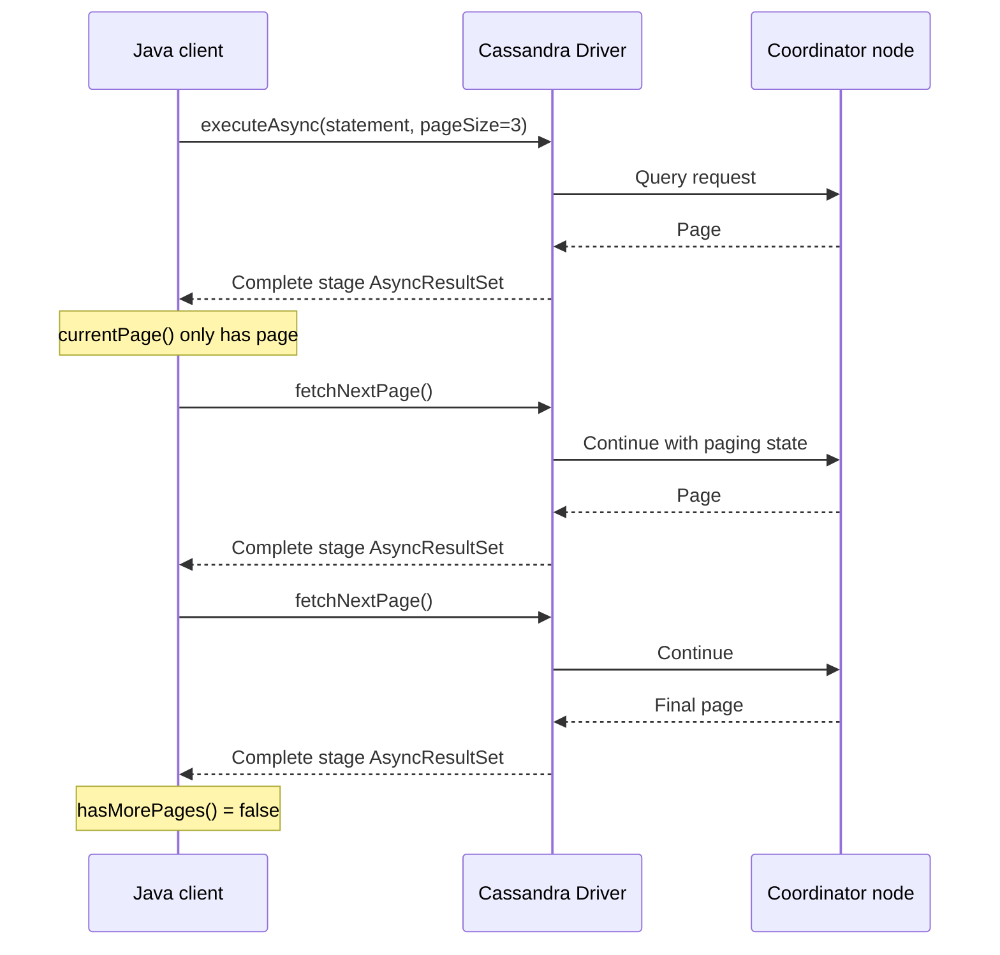
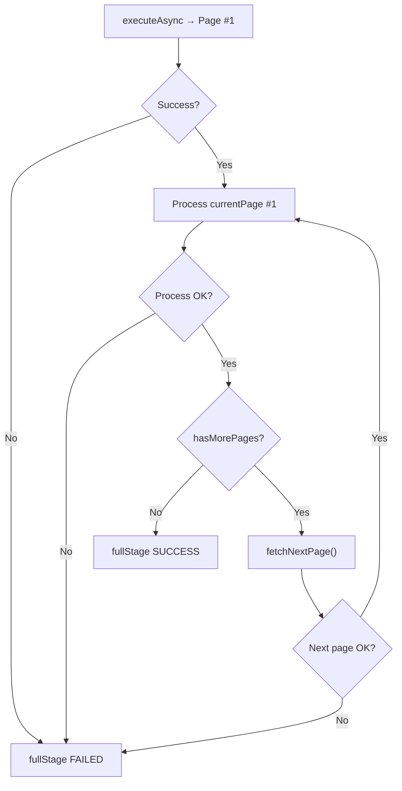
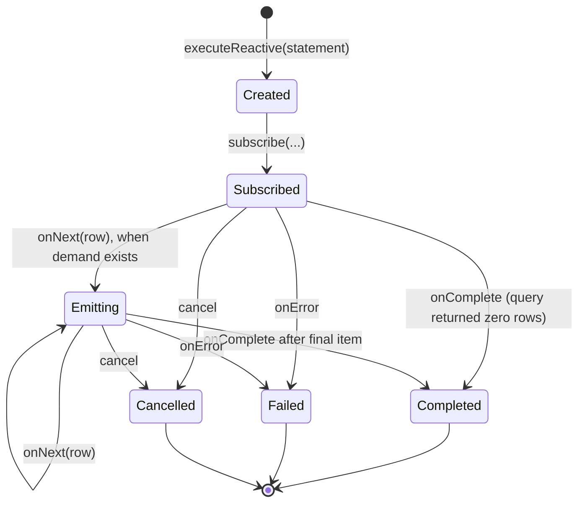

# Distinguishing Request Completion from Consuming All Result Pages

> **Chapter:** Async and Reactive  
> **Module:** `DATABASE_ENGINE_WIDE_COLUMN_CASSANDRA` — distributed architecture and wide-column modeling of Apache Cassandra; partition keys, query-driven tables, consistency levels, CQL, replication, compaction, repair, error handling, and Java connectivity.  
> **Focus:** In Java Driver 4.x, the promise that an "asynchronous query has completed" **does not mean** all result pages have been fetched and processed. Understand the exact boundaries of `executeAsync`, `AsyncResultSet`, `currentPage`, `fetchNextPage`, `CompletionStage`, as well as `ReactiveResultSet` and the `onComplete` signal so your application never drops data.

A very common bug when migrating from synchronous to asynchronous CQL:

```java
// WRONG if the goal is to read ALL rows:
session.executeAsync(statement).thenAccept(result -> {
    for (Row row : result.currentPage()) {
        process(row);
    }
    markExportCompleted(); // More pages may remain unfetched.
});
```

`executeAsync(statement)` returns a `CompletionStage<AsyncResultSet>`. When this stage completes normally, the driver has received **a response with one current page of results**; it has not promised that all subsequent pages have been fetched. `currentPage()` only iterates the data of the **current page**. If `hasMorePages()` is `true`, later pages must be explicitly requested via `fetchNextPage()`. And `markExportCompleted()` should run only after the **fetch + per-page processing chain** succeeds and any required side effects are confirmed.

This is not just a row-count discrepancy. In a data export pipeline, CDC reconciliation, backfill, or business job, marking a checkpoint too early can silently lose unread rows—even though the first request reported success, threw no exceptions, and even showed an impressive p99 for that first request.

This lesson clearly distinguishes three levels of completion:

1. **Request/page response ready:** the `CompletionStage<AsyncResultSet>` for a single `executeAsync` or `fetchNextPage` call has succeeded.
2. **Full result set consumed:** every required page has been fetched and every desired row processed, or the reactive publisher has emitted `onComplete` after being asked to consume the full stream.
3. **Downstream operation committed:** data has been properly written/backed up/processed, and the checkpoint/manifest has been updated and verified per application requirements.

**1 does not imply 2; nor does 2 automatically imply 3.**

## 1. Learning Objectives

After completing this lesson, you will be able to:

- Explain how Cassandra **protocol/driver paging** differs from CQL `LIMIT` and UI pagination.
- Distinguish `CqlSession.execute` returning `ResultSet` (synchronous) from `executeAsync` returning `CompletionStage<AsyncResultSet>`.
- Understand `currentPage()`, `remaining()`, `one()`, `hasMorePages()`, and `fetchNextPage()`.
- Prove why a finished `thenAccept` callback does not mean a job has read all results.
- Use `thenCompose` to build **a single future that completes after all pages**, not just the first page.
- Handle errors occurring **on the second/Nth page**, even when the first page succeeded.
- Avoid calling synchronous `session.execute()` inside callbacks on driver I/O threads.
- Keep memory bounded, rate-limited, and backpressured when multiple requests/pages run concurrently.
- Distinguish reactive states: **publisher created**, **subscribed**, **emitted a row**, **`onComplete`**, **cancelled**, and **`onError`**.
- Explain why `Flux.take(10)` or `Mono.from(...)` can stop reading early without consuming the full result.
- Combine asynchronous processing/persistence with paging in an error-observable chain rather than "fire-and-forget."
- Design operationally meaningful checkpoints, retries, paging state handling, and page/row/byte metrics.
- Write a CQL/Java Driver 4.x lab verifying paging, completion signals, cancellation, and errors.
- Produce a runbook for diagnosing "job reports DONE but destination is missing data."

## 2. Why Must Cassandra Split Results Across Multiple Pages?

### 2.1. Valid Queries Can Return Many Rows

An events table modeled by tenant and day:

```sql
CREATE TABLE app.events_by_tenant_day (
    tenant_id uuid,
    event_day date,
    event_time timestamp,
    event_id uuid,
    event_type text,
    PRIMARY KEY ((tenant_id, event_day), event_time, event_id)
) WITH CLUSTERING ORDER BY (event_time DESC, event_id DESC);
```

A single `(tenant_id,event_day)` partition can contain hundreds or tens of thousands of events. Rather than sending everything in one massive response, Cassandra uses **paging** to return data in chunks, reducing memory/response size and letting the client process results incrementally.



Paging **does not equal a transaction** or an immutable snapshot of all data. If the application and replicas mutate data while the client advances across pages, separate read requests may observe different points in time/state under Cassandra semantics.

### 2.2. Page Size Is Only the Size *Per Fetch*

Example:

```java
BoundStatement stmt = prepared.bind(tenantId, eventDay)
    .setPageSize(3);
```

If the query has 8 rows and the server returns 3, 3, and 2 rows sequentially:

```text
pageSize = 3
          ┌─────────────┐
Page #1   │ row 1,2,3   │  ← executeAsync stage completes here
          ├─────────────┤
Page #2   │ row 4,5,6   │  ← only upon fetchNextPage
          ├─────────────┤
Page #3   │ row 7,8     │  ← final page
          └─────────────┘
Full results = 8 rows / 3 pages
```

**The number 3 is a hint:** the server may return slightly more or fewer rows than the target page size depending on conditions and Cassandra version. Never write business logic assuming `currentPage()` always holds exactly three rows; use `hasMorePages()` to detect remaining pages rather than checking whether the last page has fewer rows than `pageSize`.

### 2.3. Paging Does Not Make Unbounded Queries Cheap

`setPageSize(500)` limits rows per response, **not total scan cost** if code fetches to the end. A query missing a partition key or scanning many SSTables/tombstones remains expensive. You still need:

- Complete **partition key** constraints.
- Reasonable **clustering key** bounds.
- `LIMIT` when an endpoint only needs N rows.
- Page size tuned to **row size**, not just row count.
- Concurrency/bytes-per-second caps and timeouts aligned with SLOs.
- Monitoring of replica availability, compaction/repair, and read latency.

`Async` keeps the application from blocking a thread on network I/O; it does not turn Cassandra into a distributed OLAP engine for full-table scans.

## 3. Three Levels of Completion in a Flow

### 3.1. A Timeline Has Multiple Milestones

```text
T0  executeAsync() called; CompletionStage returned immediately
T1  Cassandra returns page #1; stage #1 COMPLETES normally
T2  App iterates page #1
T3  fetchNextPage() for page #2
T4  Page #2 arrives; stage #2 COMPLETES
T5  App iterates page #2
T6  fetchNextPage() for page #3
T7  Page #3 arrives and is iterated; hasMorePages=false
T8  Downstream persistence / checksum / manifest finished
T9  Job COMMITTED
```

At T1, the first-page request/response has succeeded. However, **you cannot mark the job COMPLETE before T7** if the goal is to read every row; and if durable destination writes are required, **T7 is still insufficient**—you must wait until T8/T9.

### 3.2. Exact Meaning Table

| Signal / event | What does it prove? | What does it NOT prove? |
|---|---|---|
| `executeAsync` returns a stage | Driver accepted the async execution request | Coordinator processed it or data arrived |
| First stage completes normally | `AsyncResultSet` for the first page is available | Remaining pages have been fetched |
| `currentPage()` finished iterating | Rows in the current page were processed in the loop scope | `hasMorePages()` is false or downstream committed |
| `hasMorePages()==true` | Driver knows more pages can be fetched | The next page has already been read |
| `fetchNextPage` stage completes | The next page is ready | All subsequent pages after it have arrived |
| `hasMorePages()==false` **and** page fully iterated | Result set has been drained for this traversal | External writes/checkpoints have committed |
| Reactive `onComplete` | Publisher (**subscribed and not cancelled early**) emitted all items in stream scope | External async side effects outside the pipeline committed |
| HTTP 200 / job DONE | **Only an application assertion** | Actual data correctness if marked prematurely |
| Downstream commit + reconcile | Evidence that data was written/reconciled | All DC replicas have permanently converged |

### 3.3. Variable Names That Do Not Mislead

Avoid:

```java
CompletionStage<AsyncResultSet> allRowsDone =
    session.executeAsync(statement);  // Semantically WRONG name.
```

Use:

```java
CompletionStage<AsyncResultSet> firstPageStage =
    session.executeAsync(statement);

CompletionStage<Long> allRowsProcessedStage =
    firstPageStage.thenCompose(
        firstPage -> processAllPages(firstPage, 0L));
```

The name `allRowsProcessedStage` is accurate only if `processAllPages` truly awaits every page and the required processing.

## 4. Comparing Sync, Async, and Reactive APIs

| Characteristic | Synchronous `execute` | Asynchronous `executeAsync` | Reactive `executeReactive` |
|---|---|---|---|
| API return type | `ResultSet` | `CompletionStage<AsyncResultSet>` | `ReactiveResultSet` (Publisher of `ReactiveRow`) |
| First page | `execute` returns after first response | First stage completes after first response | When publisher is subscribed and has demand |
| Later pages | Driver **auto-fetches** as iterator advances; can block caller | **Must** call `fetchNextPage` | Driver coordinates per subscriber demand/backpressure |
| "Read everything" | Iterate entire `ResultSet`/iterator | Process each `currentPage` and fetch until `hasMorePages=false` | Consume stream until `onComplete` without early cancel/`take` |
| Error on page N | May throw mid-iteration | Page N stage completes exceptionally | `onError` on publisher/subscriber |
| Calling thread | Can block | Non-blocking driver I/O; watch callbacks | Signals may arrive on driver I/O thread |
| Mid-stream cancel | Stop iterating / close scope | Stop chain; does not guarantee server undo | Subscription `cancel` stops demand |
| Best suited for | CLI, low/bounded concurrency | Async web, ETL, futures pipelines | Reactor/Reactive Streams, demand-based pipelines |

**Do not mix them up:**

- `ResultSet` (sync) auto-fetches during iteration.
- `AsyncResultSet` only holds the current page.
- `ReactiveResultSet` publishes rows upon subscription; completion arrives **after the subscriber receives the entire stream** (unless cancelled or errored).

Driver 3.x shared a unified result set across APIs; Driver 4.x **intentionally separates** sync and async to prevent accidental blocking fetches inside callbacks.

## 5. Lab CQL: Creating Enough Rows to See at Least Two Pages

### 5.1. Environment Setup

The example uses a lab Cassandra cluster with a real datacenter named `dc1` and at least three full replicas if configured with RF=3. If the lab only has one node, set RF=1 to match capacity while noting that `LOCAL_QUORUM` behavior with RF=3 cannot be verified on a single node.

Setup schema:

```sql
CREATE KEYSPACE IF NOT EXISTS lab_async
WITH replication = {
  'class': 'NetworkTopologyStrategy',
  'dc1': 3
};

CREATE TABLE IF NOT EXISTS lab_async.events_by_tenant_day (
    tenant_id uuid,
    event_day date,
    event_time timestamp,
    event_id uuid,
    event_type text,
    payload text,
    PRIMARY KEY ((tenant_id, event_day), event_time, event_id)
) WITH CLUSTERING ORDER BY (
    event_time DESC,
    event_id DESC
);
```

Partition key `(tenant_id,event_day)` allows fast lookups of a tenant's events for a given day. Row size and actual row counts must still be bounded so giant partitions do not form.

### 5.2. Simulated Data: 8 Rows in One Partition

```sql
CONSISTENCY LOCAL_QUORUM;

INSERT INTO lab_async.events_by_tenant_day
(tenant_id,event_day,event_time,event_id,event_type,payload)
VALUES (
  11111111-1111-1111-1111-111111111111,
  '2026-11-21','2026-11-21 08:01:00+0000',
  00000000-0000-4000-8000-000000000001,'VIEW','p1'
);

INSERT INTO lab_async.events_by_tenant_day
(tenant_id,event_day,event_time,event_id,event_type,payload)
VALUES (
  11111111-1111-1111-1111-111111111111,
  '2026-11-21','2026-11-21 08:02:00+0000',
  00000000-0000-4000-8000-000000000002,'VIEW','p2'
);

INSERT INTO lab_async.events_by_tenant_day
(tenant_id,event_day,event_time,event_id,event_type,payload)
VALUES (
  11111111-1111-1111-1111-111111111111,
  '2026-11-21','2026-11-21 08:03:00+0000',
  00000000-0000-4000-8000-000000000003,'CLICK','p3'
);

INSERT INTO lab_async.events_by_tenant_day
(tenant_id,event_day,event_time,event_id,event_type,payload)
VALUES (
  11111111-1111-1111-1111-111111111111,
  '2026-11-21','2026-11-21 08:04:00+0000',
  00000000-0000-4000-8000-000000000004,'VIEW','p4'
);

INSERT INTO lab_async.events_by_tenant_day
(tenant_id,event_day,event_time,event_id,event_type,payload)
VALUES (
  11111111-1111-1111-1111-111111111111,
  '2026-11-21','2026-11-21 08:05:00+0000',
  00000000-0000-4000-8000-000000000005,'CLICK','p5'
);

INSERT INTO lab_async.events_by_tenant_day
(tenant_id,event_day,event_time,event_id,event_type,payload)
VALUES (
  11111111-1111-1111-1111-111111111111,
  '2026-11-21','2026-11-21 08:06:00+0000',
  00000000-0000-4000-8000-000000000006,'VIEW','p6'
);

INSERT INTO lab_async.events_by_tenant_day
(tenant_id,event_day,event_time,event_id,event_type,payload)
VALUES (
  11111111-1111-1111-1111-111111111111,
  '2026-11-21','2026-11-21 08:07:00+0000',
  00000000-0000-4000-8000-000000000007,'PURCHASE','p7'
);

INSERT INTO lab_async.events_by_tenant_day
(tenant_id,event_day,event_time,event_id,event_type,payload)
VALUES (
  11111111-1111-1111-1111-111111111111,
  '2026-11-21','2026-11-21 08:08:00+0000',
  00000000-0000-4000-8000-000000000008,'VIEW','p8'
);
```

Do not run these INSERT statements in production. With page size = 3, **expect multiple pages** (e.g., 3, 3, 2), though page size is a hint and the server may vary rows per page. Do not write tests asserting an exact count of three pages; tests should verify that **the first page does not cover all 8 rows** in the confirmed lab setup.

### 5.3. Proper Partition Query

```sql
SELECT event_time, event_id, event_type, payload
FROM lab_async.events_by_tenant_day
WHERE tenant_id = 11111111-1111-1111-1111-111111111111
  AND event_day = '2026-11-21';
```

Do not add `ALLOW FILTERING`. Both WHERE conditions supply the full partition key, and results are ordered by the default clustering columns `event_time DESC, event_id DESC`.

## 6. Java: Wrong Examples That Easily Slip Past Code Review

### 6.1. Reading Only the First Page

```java
import com.datastax.oss.driver.api.core.CqlSession;
import com.datastax.oss.driver.api.core.cql.AsyncResultSet;
import com.datastax.oss.driver.api.core.cql.Row;
import java.util.concurrent.CompletionStage;

CompletionStage<AsyncResultSet> stage =
    session.executeAsync(statement);

stage.thenAccept(rs -> {
    for (Row row : rs.currentPage()) {
        save(row);
    }
    System.out.println("DONE"); // WRONG if more pages exist.
});
```

What is wrong?

1. `executeAsync` completion only provides an `AsyncResultSet` for the first page.
2. `currentPage()` does not automatically fetch all pages.
3. The code does not check `hasMorePages()`.
4. The code does not call `fetchNextPage()`.
5. `thenAccept(...)` returns **a new stage**, which is discarded; exceptions in `save` or the callback may go unobserved.
6. If `save(row)` performs an async side effect that is not awaited, not even the first page is guaranteed persisted.
7. The job can report success without even reading row #4.

### 6.2. The "for-loop" Differs Between the Two APIs

Synchronous:

```java
// Sync ResultSet can auto-fetch additional pages during iteration.
ResultSet rs = session.execute(statement);
for (Row row : rs) {
    process(row);
}
```

Asynchronous:

```java
// Iterates ONLY the CURRENT PAGE.
CompletionStage<AsyncResultSet> stage =
    session.executeAsync(statement);

stage.thenAccept(rs -> {
    for (Row row : rs.currentPage()) {
        process(row);
    }
});
```

This is an **intentional** difference in Driver 4.x, not a bug. If you convert sync code to async merely by replacing `execute` with `executeAsync`, you must explicitly write the **paging traversal**.

### 6.3. `one()` Does Not Mean "Only One Row in the Entire Query"

```java
session.executeAsync(statement).thenApply(rs -> rs.one());
```

`AsyncResultSet.one()` retrieves **one row from the current page**, or `null` if that page's iterator is exhausted. It does not automatically look into subsequent pages and does not mean the query only has one row in Cassandra.

Use `one()` when the query is designed to return at most one row (full PK lookup / appropriate `LIMIT 1`), or when the application **intentionally only wants the first item**. For exports/reconciliation needing completeness, you must drain all pages.

## 7. Key APIs of AsyncResultSet

| API | Returns | Accurate meaning | Common mistake |
|---|---|---|---|
| `currentPage()` | `Iterable<Row>` | Rows in the **current page** | Treating it as the entire result |
| `remaining()` | `int` | **Unconsumed** rows in the current page | Treating it as total remaining rows |
| `one()` | `Row` or `null` | Consumes the next row of the current page | Treating `null` as end of the whole query |
| `hasMorePages()` | `boolean` | One or more pages remain to be fetched | Assuming the next page is already in memory |
| `fetchNextPage()` | `CompletionStage<AsyncResultSet>` | Asynchronously fetches **one** next page | Calling once and assuming that finishes all remaining pages |
| `getExecutionInfo()` | `ExecutionInfo` | Metadata for **this page's** response | Treating it as metadata for the entire scan |
| `getColumnDefinitions()` | `ColumnDefinitions` | Schema of the returned columns | Treating it as describing all table data |
| `wasApplied()` | `boolean` | LWT outcome when query is conditional | Treating it as "all of SELECT was iterated" |

The APIs above belong to Driver 4.19 `com.datastax.oss.driver.api.core.cql.AsyncResultSet`/`AsyncPagingIterable`. On other versions, check the exact documentation of the artifact in use.

### 7.1. currentPage() Can Only Be Consumed Once

Driver 4.19 specifies that `currentPage()` returns the same iterable; rows are **consumed** during iteration and cannot be looped over a second time from the start.

Wrong:

```java
for (Row row : rs.currentPage()) {
    validate(row);
}
for (Row row : rs.currentPage()) {
    persist(row); // No guarantee any rows remain to iterate.
}
```

Right: **validate and process in a single pass**, or store a bounded immutable copy if two-pass processing of **one page** is truly required:

```java
for (Row row : rs.currentPage()) {
    validate(row);
    persist(row);
}
```

If `persist` is asynchronous, await it appropriately before declaring the page committed.

### 7.2. remaining() Does Not Replace hasMorePages()

After reading through the current page:

```text
remaining() == 0
hasMorePages() == true
```

is a completely valid state: current rows are exhausted, **but more pages remain unfetched**.

Conversely:

```text
remaining() > 0
hasMorePages() == false
```

means **you are on the final page, but have not finished iterating its rows**. The true completion condition is **all rows in the current page processed** *and* **no pages left to fetch**.

### 7.3. Do Not Call fetchNextPage When hasMorePages=false

Per the 4.19 API, `fetchNextPage()` can throw `IllegalStateException` if no next page exists. Always check:

```java
if (rs.hasMorePages()) {
    return rs.fetchNextPage();
}
```

Do not guess the final page by checking "fewer than page size" or "reached an estimated row count."

### 7.4. Pages and Cursors Are Not Thread-Safe for Parallel Iteration

An `AsyncResultSet` uses an underlying iterable/cursor for the current page. Do not let two threads iterate the same `currentPage` concurrently. If parallel processing is needed, **extract rows into immutable/detached data** or split work in a controlled manner while managing row/driver buffer lifetimes and memory budgets.

Different `AsyncResultSet` page instances can be processed in more complex pipelines, though fetching the next page must still follow the result set's protocol/order; for simplicity and to avoid races in the lab, **process one page sequentially** before fetching the next.

## 8. Correct Java: Chaining CompletionStage Across All Pages

### 8.1. A Single Future Completing Only After All Pages Are Processed

The example below reads a full partition, counts rows, and returns a `CompletionStage<Long>` that **completes only after the last page**:

```java
import com.datastax.oss.driver.api.core.cql.AsyncResultSet;
import com.datastax.oss.driver.api.core.cql.Row;
import java.util.concurrent.CompletableFuture;
import java.util.concurrent.CompletionStage;

public final class AllPagesCounter {

    public static CompletionStage<Long> countAll(
            CompletionStage<AsyncResultSet> firstPage) {
        return firstPage.thenCompose(rs -> countPage(rs, 0L));
    }

    private static CompletionStage<Long> countPage(
            AsyncResultSet rs, long previousCount) {

        long count = previousCount;
        for (Row row : rs.currentPage()) {
            count++;
        }

        if (!rs.hasMorePages()) {
            return CompletableFuture.completedFuture(count);
        }

        long accumulated = count;
        return rs.fetchNextPage().thenCompose(
            next -> countPage(next, accumulated));
    }
}
```

Calling it:

```java
CompletionStage<Long> wholeResultCount =
    AllPagesCounter.countAll(session.executeAsync(stmt));

wholeResultCount.whenComplete((count, failure) -> {
    if (failure != null) {
        System.err.println("Failed to read all pages");
    } else {
        System.out.println("All rows consumed = " + count);
    }
});
```

**Key point:** `thenCompose` *flattens* the stage returned by the callback rather than discarding the next stage. If the Nth page fails, `wholeResultCount` completes exceptionally instead of returning a bogus successful count.

### 8.2. Why thenCompose Instead of thenApply?

Wrong example:

```java
// Callback returns A STAGE, so thenApply creates a nested stage.
CompletionStage<CompletionStage<Long>> nested =
    session.executeAsync(stmt)
        .thenApply(rs -> countNextPages(rs));
```

Right example:

```java
CompletionStage<Long> flat =
    session.executeAsync(stmt)
        .thenCompose(rs -> countNextPages(rs));
```

`thenApply` fits when the callback returns a **plain value**: a `String`, `Long`, or DTO. `thenCompose` fits when the callback starts **a new asynchronous step**: `fetchNextPage`, async persistence, or a dependent query.

### 8.3. Do Not Forget to Observe the Final Stage

A subtle bug:

```java
CompletionStage<Long> stage =
    AllPagesCounter.countAll(session.executeAsync(stmt));

stage.thenAccept(count -> logCount(count));
// Discards the stage from thenAccept and errors from stage;
// if main returns early, the session may close before completion.
```

For a CLI, you can **wait at the boundary on a non-driver I/O thread**:

```java
long count = stage.toCompletableFuture().join();
System.out.println(count);
```

However, **never** call `join()` or synchronous `session.execute()` **inside callbacks running on a driver I/O thread**: this can cause deadlocks/thread starvation or be detected and rejected by the driver.

### 8.4. Chain Error Propagation



The essence of `CompletionStage` composition is building an outcome **that depends on every step awaited in the chain**. If you call `fetchNextPage()` without **returning its stage**, failures on later pages will not belong to the "full stage" and the caller may receive a false completion signal.

## 9. Rule: Never Block Driver I/O Threads

### 9.1. Callbacks Can Run on I/O Threads

`thenApply`, `thenAccept`, and `thenCompose` without the `Async` suffix can execute right on the thread completing the stage—which for `executeAsync` is typically a **Netty/driver I/O thread**. Placing slow work inside the callback:

```java
session.executeAsync(stmt).thenAccept(rs -> {
    for (Row row : rs.currentPage()) {
        writeCsvAndFsync(row); // CAN BLOCK THE I/O THREAD!
    }
});
```

can stall processing for other requests on the same event loop, spiking p99 and timeouts. You do not need to "read 2 million rows" to trigger this; a single large page or slow `fsync` is enough.

### 9.2. Offload Heavy Page Processing to an Application Executor

A better pattern uses `thenComposeAsync` with a dedicated executor:

```java
import com.datastax.oss.driver.api.core.cql.AsyncResultSet;
import com.datastax.oss.driver.api.core.cql.Row;
import java.util.concurrent.CompletableFuture;
import java.util.concurrent.CompletionStage;
import java.util.concurrent.Executor;

public final class OffloadedPageDrain {

    // handle(row) is synchronous processing; executor MUST NOT be driver I/O.
    public static CompletionStage<Long> drain(
            CompletionStage<AsyncResultSet> first,
            Executor workerExecutor) {
        return first.thenComposeAsync(
            rs -> processPage(rs, 0L, workerExecutor),
            workerExecutor);
    }

    private static CompletionStage<Long> processPage(
            AsyncResultSet rs, long count, Executor workers) {

        long nextCount = count;
        for (Row row : rs.currentPage()) {
            handle(row); // Runs on workerExecutor.
            nextCount++;
        }

        if (!rs.hasMorePages()) {
            return CompletableFuture.completedFuture(nextCount);
        }

        final long accumulated = nextCount;
        return rs.fetchNextPage().thenComposeAsync(
            next -> processPage(next, accumulated, workers),
            workers);
    }

    private static void handle(Row row) {
        // Illustrative only: validate/transform/persist in worker.
        if (row == null) {
            throw new IllegalArgumentException("unexpected null");
        }
    }
}
```

This example shows **synchronous side effects on a separate executor** completing before fetching or finishing further. If using `saveAsync(row)` to write to Kafka/object storage, you must **compose the save future**, not fire-and-forget.

An application `ExecutorService` must be shut down properly with the lifecycle. In production, enforce **bounded queues, in-flight budgets, and shutdown policies**; `Executors.newFixedThreadPool` uses a default queue that can grow unboundedly if you keep submitting jobs.

### 9.3. Avoid Buffering Everything in Memory Just to "Not Block"

Changing to:

```java
for (Row r : rs.currentPage()) {
    synchronized (allRows) {
        allRows.add(r);
    }
}
```

does not solve the problem if `allRows` grows to millions of rows. Keep the pipeline streaming/chunked and cap bytes/page/partition. For rows containing large buffers, consider converting to DTOs or detaching per API/ownership rules when crossing threads, and evaluate memory lifetime/GC.

## 10. Finishing One Page Still Does Not Mean Downstream Committed

### 10.1. Fire-and-Forget Persistence Is the Second Trap

```java
for (Row row : rs.currentPage()) {
    CompletableFuture<Void> saveFuture = saveAsync(row);
    // saveFuture is ignored.
}

if (!rs.hasMorePages()) {
    markDone(); // WRONG: writes may still be running or failing.
}
```

Even after iterating every page, **starting** side effects is different from **awaiting their success**. If an export job must guarantee data is stored in object storage or a target Cassandra table, the completion stage must encompass:

1. Fetch page.
2. Validate/transform rows.
3. Persist/flush downstream batch.
4. Verify ACK/checksum per contract.
5. Only then fetch the next page or commit checkpoint.
6. Finish all pages and commit the manifest.

### 10.2. Per-Page Process-and-Commit Pattern

```java
// PSEUDOCODE – savePageAsync must be implemented for the concrete sink.
CompletionStage<Void> consume(
        AsyncResultSet page, Sink sink) {

    List<EventDto> batch = new ArrayList<>();
    for (Row row : page.currentPage()) {
        batch.add(transform(row));
    }

    // savePageAsync completes only after the sink acknowledges the batch.
    return sink.savePageAsync(batch).thenCompose(ignored -> {
        if (!page.hasMorePages()) {
            return CompletableFuture.completedFuture(null);
        }
        return page.fetchNextPage()
            .thenCompose(next -> consume(next, sink));
    });
}
```

This is **pseudocode** because `Sink`, `EventDto`, and `transform` are application abstractions. The key principle is **returning the stages of both the save and the fetch**, rather than spawning two futures and marking done.

### 10.3. Conditional Checkpointing

A manifest might look like:

```yaml
# Custom manifest design, NOT a Cassandra native format.
job_id: export-20261121-001
query_scope:
  keyspace: lab_async
  table: events_by_tenant_day
  tenant: "11111111-1111-1111-1111-111111111111"
  event_day: "2026-11-21"
state: RUNNING
last_complete_page: 2
last_sink_commit: VERIFIED
paging_state: "<opaque encoded token, protected>"
final_page_reached: false
job_complete: false
```

**Do not** flip `job_complete=true` simply because the first `executeAsync` stage succeeded. Update it only after every page in scope is fetched/processed, the sink ACKs/verifies, and the manifest commits successfully.

## 11. Errors Occurring on Page Two or Page N

### 11.1. Why First-Page Success Does Not Guarantee Query Success

Suppose:

```text
Page 1: returned successfully, 500 rows
Page 2: returned successfully, 500 rows
Page 3: coordinator timeout / node unavailable / network error
```

Page 1's `CompletionStage<AsyncResultSet>` has already **completed normally**; its success is not "revoked" when page 3 fails. If the job only observes the first stage, dashboards may show green while only 1,000 rows were read and subsequent rows were never fetched.

What you must observe is the stage of the **entire chain** (e.g., `fullScanStage`) or reactive `onError`/`onComplete`, not just the first response.

### 11.2. Proper Exception Handling Patterns

```java
CompletionStage<Long> allPagesStage =
    AllPagesCounter.countAll(session.executeAsync(stmt));

CompletionStage<Void> monitored = allPagesStage.handle((count, err) -> {
    if (err != null) {
        System.err.println(
            "Full result NOT consumed: " +
            rootCause(err).getClass().getSimpleName());
    } else {
        System.out.println(
            "Full result consumed, rowCount=" + count);
    }
    return null;
});
```

`rootCause` is just an illustrative helper; if you want the job to **fail** so a scheduler retries, do not turn every error into a `null` success inside `handle(...)`. The `handle` snippet above is for *logging* and is unsuitable as a business completion result on errors because it **swallows the exception**. Better:

```java
CompletionStage<Long> monitoredWithoutSwallowing =
    allPagesStage.whenComplete((count, err) -> {
        if (err != null) {
            logFailureCategory(err);
        }
    });
```

`whenComplete` normally preserves the failure state of the original stage (unless the callback itself throws); **still retain/await the returned stage** in case the callback fails, and avoid heavy work inside it.

### 11.3. Why Retrying the Full Query Can Be Wrong

If page 3 fails after pages 1–2 were written to the sink:

- Retrying the entire query can **write duplicates** of those 1,000 rows.
- A `DELETE`/TTL between the two scans can alter the result set.
- Timestamps/CL can cause a subsequent read to see different data.
- Discarding old pages and rewriting requires explicit manifest/temp-output handling.
- Paging state alone does not provide a cluster-wide snapshot.

You need a strategy built on **idempotent sinks, checkpoints committed after page processing, verified retry/resume, event identity, and reconciliation**. Do not rely on a generic retry policy to claim "exactly once."

### 11.4. Deliberately Testing Failures in the Lab

A unit/integration test should:

1. Use a mock/fake `AsyncResultSet` where page 1 succeeds.
2. Configure `fetchNextPage` to return a **failed** future for page 2.
3. Run `countAll` or `consume`.
4. Assert **fullStage fails** and `markJobCompleted` is not called.
5. Assert page 1 was processed properly and page 2 was not committed.
6. Exercise retry per the defined idempotency/deduplication strategy.

You do not need to deliberately crash production Cassandra to demonstrate this error. Integration tests on a lab cluster can add a network proxy or fault injection where permitted.

## 12. Reactive Streams: Creating a Publisher Does Not Mean the Query Ran

### 12.1. The Reactive API Is a Different Model from CompletionStage

Apache Cassandra Java Driver 4.x provides a reactive API via `CqlSession.executeReactive(...)`. It returns a `ReactiveResultSet` acting as a `Publisher<ReactiveRow>`.

Example declaration:

```java
import com.datastax.dse.driver.api.core.cql.reactive.ReactiveResultSet;

ReactiveResultSet publisher =
    session.executeReactive(statement);

// No subscription exists yet here.
// You cannot call markJobCompleted() just because the publisher was created.
```

**Note on package name:** `com.datastax.dse.driver.api.core.cql.reactive` has the `dse` prefix for historical reasons, but reactive queries also work with **Apache Cassandra OSS** when using the compatible Java Driver 4.x. Do not assume this API is exclusive to DataStax Enterprise. The **Reactive Streams API** library must be on the runtime classpath; integrations such as Project Reactor use the corresponding compatible artifacts.

Per Driver 4.19 documentation, the default publisher is:

- **Cold:** the query is triggered when a subscriber subscribes, not when `executeReactive` returns.
- **Unicast / single-subscription:** a single `ReactiveResultSet` instance by default does not support multiple independent subscribers.
- **Demand-aware:** the subscriber requests how many items it wants, and the driver emits rows and schedules next-page fetches to match demand.
- **Driver-side non-blocking:** avoid blocking in `onNext`, as signals may be emitted on a driver I/O thread.

### 12.2. Four States of a Publisher



`onComplete` is the terminal signal of the **current subscription**. If the application actively caps or truncates the stream (`take(n)`, `next()`, timeout/cancel), **downstream** may complete normally after N rows while the **upstream result set was never fully consumed**.

### 12.3. Anti-Pattern: Creating a Publisher and Ignoring It

```java
// WRONG: nobody subscribed -> the query may never execute.
ReactiveResultSet ignored =
    session.executeReactive(insertStatement);

markWriteCompleted();
```

Another Reactor anti-pattern:

```java
// WRONG: doOnNext obtains the publisher but never subscribes to it.
Flux.just(insertStatement)
    .doOnNext(session::executeReactive)
    .then();
```

Even if something externally subscribes to `Flux.just(...)`, the inner reactive query is **never subscribed to** because `doOnNext` merely constructs and discards it. The right way is to **compose/flatten the publisher**:

```java
Mono<Void> writesDone =
    Flux.just(insertStatement)
        .concatMap(stmt -> Flux.from(session.executeReactive(stmt)))
        .then();
```

Only when `writesDone` is subscribed to does it actually run. Here `insertStatement` is a prepared/bound `Statement<?>` instance; the snippet relies on Reactor and the driver's reactive API.

## 13. Reactive: Receiving Every Row and Waiting for onComplete

### 13.1. Example Reading a Whole Partition with Reactor

```java
import com.datastax.dse.driver.api.core.cql.reactive.ReactiveRow;
import reactor.core.publisher.Flux;
import reactor.core.publisher.Mono;

Mono<Long> allRowsCounted =
    Flux.from(session.executeReactive(statement))
        .doOnNext(row -> inspect(row))
        .count();

// In a web service: RETURN Mono<Long> so the framework subscribes.
// In a CLI/test: call .block() on a non-driver-I/O thread.
```

`Mono<Long>` emits **the total number of rows that passed through the reactive stream** once the source finishes with `onComplete`. If any page fails, `Mono` fails instead of emitting a successful count. Without a subscription, nothing executes.

**Preconditions:** `inspect` must not block or throw unexpectedly, and the statement must actually select all needed rows. If operators like `take/filter/onErrorResume` are present, "count" reflects **the post-operator stream**, not necessarily the logical row total in Cassandra.

### 13.2. Counting Is Not Always Worth Running

```java
Flux.from(session.executeReactive("SELECT * FROM enormous_table"))
    .count();
```

can read huge amounts of data across the cluster even though the final output is a single `Long`. When you need total row metrics at scale, use pre-aggregation, analytics, or properly designed counters rather than scanning all of Cassandra.

The examples in this lesson primarily **illustrate completion semantics**, not an endorsement of full-table scans in production.

### 13.3. onComplete Does Not Mean the Last onNext Has Persisted

```java
Flux.from(session.executeReactive(statement))
    .doOnNext(row -> saveAsync(row)) // Discards saveAsync's future.
    .then();
```

Even after the reactive stream emits all rows and `onComplete`, `saveAsync(row)` may still be in flight. To finish the pipeline only after the sink ACKs, **compose** it:

```java
// PSEUDOCODE: sink.persist(row) returns Mono<Void>.
Mono<Void> fullyPersisted =
    Flux.from(session.executeReactive(statement))
        .concatMap(row -> sink.persist(row), 1)
        .then();
```

Use `concatMap` to preserve order and process sequentially at the sink (keeping prefetch small when needed). If parallel execution is allowed, use `flatMap` with bounded concurrency, while defining ordering and idempotency. `fullyPersisted` succeeding means:

1. A subscription occurred.
2. The source publisher emitted all requested rows in the full stream (no `take`/cancel).
3. Every `sink.persist(row)` completed per the sink's contract.
4. No unhandled `onError` occurred.

It **does not** prove remote DC backups, repairs, or convergence of every target replica; those are separate system contracts.

## 14. Why take(n), next(), and Cancellation Are Not "Full Consumption"

### 14.1. take(n) Completes *Downstream*, Not Draining the Source

```java
Mono<Long> countAtMostFive =
    Flux.from(session.executeReactive(statement))
        .take(5)
        .count();
```

If the partition has 8 rows, `countAtMostFive` can succeed with 5. `take(5)` **cancels upstream** after receiving 5 items; it does not request remaining pages. `Mono` completed ≠ entire Cassandra result consumed.

Using `take(5)` is **correct** when the requirement is at most 5 rows; it is wrong if the application labels the outcome `allEventsExported`.

### 14.2. Mono.from(...) May Take the First Element and Stop

```java
Mono<ReactiveRow> firstOnly =
    Mono.from(session.executeReactive(statement));
```

`Mono.from(Publisher)` typically requests a single first item and cancels once received. It makes sense for queries designed to return at most one row, but **cannot replace** draining the entire stream for an export.

If you want a completion signal for the full stream without retaining rows:

```java
Mono<Void> fullyConsumed =
    Flux.from(session.executeReactive(statement)).then();
```

However, `then()` **discards the row data**; use it only when you genuinely just want to drain/ack, not when rows must be persisted. And if `take(5)` precedes it, `then()` only awaits the **5-row-capped** stream.

### 14.3. Cancellation and Terminal Signals

Reactive Streams distinguishes:

- `onComplete`: publisher signals all items for the consumed subscription have been emitted.
- `onError`: query/stream failed.
- `cancel`: subscriber **requests no more data**; this is not upstream `onComplete`.
- Framework timeout/disposal: can cancel the subscription before reading everything.

Use `doFinally` to record the exact termination reason:

```java
import reactor.core.publisher.Flux;
import reactor.core.publisher.Mono;
import reactor.core.publisher.SignalType;

Mono<Void> job =
    Flux.from(session.executeReactive(statement))
        .doFinally(signal -> {
            if (signal == SignalType.CANCEL) {
                markCancelledNotCompleted();
            } else if (signal == SignalType.ON_ERROR) {
                markFailedNotCompleted();
            }
            // Do not blindly mark DONE inside doFinally.
        })
        .then();
```

`markCancelledNotCompleted()` and `markFailedNotCompleted()` are illustrative hooks, not Driver/Reactor APIs. In production, manage job state via an orchestrator instead of doing blocking database writes inside `doFinally` or on a driver thread.

### 14.4. What Happens When an HTTP Client Disconnects?

In a reactive web app, when the caller closes the HTTP stream:

- The framework may dispose the upstream subscription.
- An already-started Cassandra query may remain in flight briefly.
- You cannot assert the query never ran or that write side effects rolled back.
- An export job decoupled from the HTTP stream needs its **own lifecycle management** if it should continue after client disconnect.
- If an endpoint only serves one page or the first N rows, early cancellation is **intentional** behavior and not an error.

Always separate **backend job** lifecycle from **HTTP response stream** lifecycle: the two can be completely different.

## 15. Backpressure: Row Demand Affects Page Fetching

### 15.1. Reactive Streams Demand

In Reactive Streams, a subscriber calls `Subscription.request(n)` to signal capacity for n more items. The driver emits rows matching demand and coordinates fetching the next page when needed.

```text
Subscriber: request(4)
    │
    ▼
Driver: emit row1, row2, row3
    │
    ├── page #1 exhausted
    ├── more demand remains
    └── fetch page #2
         └── emit row4
```

However, the Cassandra native protocol **has no mechanism to pass per-row backpressure directly from subscriber to storage engine**. The driver controls **the rate of next-page requests**, which does not make a query missing a partition key optimal.

### 15.2. Backpressure Operates at a Different Granularity Than Paging

| Layer | Unit | What is controlled |
|---|---|---|
| Reactive subscriber | Requested `onNext` items | Demand to receive rows |
| Driver paging | CQL pages / row buffers | When to fetch the next page |
| Cassandra CQL | Query shape, partition/clustering scan | Server workload |
| App concurrency | Number of in-flight queries/batches | Total pressure on the cluster |
| Downstream sink | ACKed and committed rows/batches | True processing/persistence throughput |

A subscriber calling `request(1)` **does not guarantee** Cassandra reads only one physical row; an entire page may already have been computed/read by the server and sent.

### 15.3. Practice: Bounding Demand and Offloading

Example with Reactor:

```java
import reactor.core.publisher.Flux;
import reactor.core.publisher.SynchronousSink;
import reactor.core.scheduler.Schedulers;

Flux<String> output =
    Flux.from(session.executeReactive(statement))
        .limitRate(32)
        .publishOn(Schedulers.boundedElastic())
        .map(row -> costlySynchronousSerialization(row));
```

`limitRate(32)` throttles the demand Reactor sends upstream; it **does not** change the driver's page size. `publishOn` shifts downstream processing onto another scheduler; use `boundedElastic` for moderate blocking I/O per policy, not for dumping millions of unbounded tasks. If processing is purely CPU-bound, consider `Schedulers.parallel()` with appropriate bounds.

**Important:** `publishOn` maintains its own prefetch/buffer depending on library and version; you still need a memory budget and p99 monitoring—do not equate "reactive" with "zero buffering."

### 15.4. Reactive Writes Require Concurrency Limits

An anti-pattern:

```java
// WRONG for a source of 100,000 writes without concurrency limits:
Flux.from(sourceStatements)
    .flatMap(session::executeReactive)
    .then();
```

This can generate massive in-flight requests, overloading Cassandra and triggering `WriteTimeoutException`/`OverloadedException`.

Bounded example:

```java
Mono<Void> writeBatchCompleted =
    Flux.from(sourceStatements)
        .flatMap(
            stmt -> Flux.from(session.executeReactive(stmt)),
            8 // At most 8 concurrent subscriptions/query executions.
        )
        .then();
```

For **regular INSERT/UPDATE**, queries typically emit no rows; terminal success of the publisher indicates the server/driver request completed under the statement's CL and semantics. Still:

- **LWT** requires checking `wasApplied`/conditional results instead of treating "no error" as condition applied.
- A concurrency of 8 may not fit your cluster; load-test it.
- A write timeout does not prove the mutation never happened.
- `flatMap` may not preserve emission order across requests; if per-partition ordering is required, use `concatMap` or key-based grouping/serialization.

## 16. ReactiveResultSet Single-Subscription and Caching

### 16.1. Do Not Subscribe Twice to the Same Publisher

```java
ReactiveResultSet result = session.executeReactive(statement);

long count = Flux.from(result).count().block();
// Second subscription on the same result: usually fails.
List<String> names = Flux.from(result)
    .map(r -> r.getString("event_type"))
    .collectList()
    .block();
```

Driver 4.19 defaults to **cold, unicast, single-subscription** publishers. A second subscription can fail with `IllegalStateException` via `onError`. Here "cold" does not mean **one instance can be re-subscribed endlessly to re-run the query**.

### 16.2. One Subscription, Multiple Computations

If you need both a count and summary metrics in a single pass:

```java
// Reactor: a single source subscription producing an aggregated result.
Mono<EventStats> stats =
    Flux.from(session.executeReactive(statement))
        .reduce(
            new EventStats(),
            (acc, row) -> acc.add(row.getString("event_type")));
```

`EventStats` is an illustrative helper; in production avoid mutable accumulators shared across subscriptions. Use an immutable accumulator or `collect` with a supplier creating fresh state per subscription. This performs **one pass over the source stream**, not two.

### 16.3. cache() Can Buffer the Entire Dataset

```java
Flux<String> cached =
    Flux.from(session.executeReactive(statement))
        .map(row -> row.getString("event_type"))
        .cache();
```

`cache()` helps for small result sets shared by multiple consumers, but if a query returns millions of rows, caching everything on the heap risks an **OutOfMemoryError**. For large datasets:

- Compute aggregations in **a single pass**.
- Or use multicast/shared flows with explicit lifetime policies.
- Or write data to a durable sink first, then let consumers read from the sink.
- Never turn on unbounded caching just "to subscribe a second time."

### 16.4. Reactive Retries Need a Fresh Publisher

```java
// ANTI-PATTERN: retry may re-subscribe to the same publisher
// which only allows a single subscription.
Flux.from(session.executeReactive(statement))
    .retry(2);
```

When policy genuinely allows retrying an idempotent query, create a fresh publisher per attempt:

```java
Flux<ReactiveRow> retried =
    Flux.defer(() ->
        Flux.from(session.executeReactive(statement))
    ).retry(2);
```

**Crucially:** retrying the **entire result stream** can replay rows already emitted and persisted before the failure on page N. If downstream is not idempotent, `retry(2)` can create duplicates. Safer options are page/range checkpointing, idempotent sinks, and controlled retry/resume rather than a bare `retry` operator.

## 17. Completion Semantics When Queries Return Few or Zero Rows

### 17.1. Point Lookups

For the query:

```sql
SELECT event_type FROM lab_async.events_by_tenant_day
WHERE tenant_id = ?
  AND event_day = ?
  AND event_time = ?
  AND event_id = ?;
```

The full primary key identifies at most one row. Once `executeAsync` returns the first page, `one()` suffices if the contract is "find one row or none," because the schema prevents multiple rows.

The precondition is that **the query design genuinely bounds results to at most one row**; do not rely on "the API only wants one row" to claim you drained an unbounded query.

### 17.2. INSERT/UPDATE Do Not Return Row Lists

```java
CompletionStage<AsyncResultSet> writeStage =
    session.executeAsync(insertStatement);
```

For regular write CQL, normal completion of the stage represents the write response per Cassandra's consistency level and semantics. There is no need to call `fetchNextPage` for "returned data rows" when no further rows/pages exist. Still, it does not mean:

- Every replica in all DCs has received the write.
- Incremental backups have flushed/uploaded.
- Other denormalized tables are synchronized.
- A cluster-wide transaction committed.
- All follow-up async tasks have executed.

### 17.3. LWT and wasApplied

For `INSERT ... IF NOT EXISTS` or conditional updates:

```java
session.executeAsync(lwtStatement).thenApply(
    rs -> rs.wasApplied()
);
```

`wasApplied()==false` is a valid outcome meaning **the condition was not met**; the request can complete without error while the mutation **was not applied**.

In the reactive API, `ReactiveResultSet.wasApplied()` returns a metadata publisher. For regular non-LWT queries, never use `wasApplied` to infer whether data exists or "everything was read"—those are completely different questions.

### 17.4. Empty Results Still Complete Normally

When a SELECT by partition key matches no rows:

- Async `currentPage()` can be empty and `hasMorePages()==false`.
- Reactive publisher can emit `onComplete` with zero `onNext` signals.
- That is **a successful query finding zero rows**, distinct from a timeout or Unauthorized.

Do not report "Cassandra unavailable" merely because row count = 0.

## 18. Paging State, Checkpointing, and Resume

### 18.1. Paging State Is a Page Cursor, Not a Snapshot Timestamp

Each page response can provide `ExecutionInfo.getPagingState()` or `getSafePagingState()` to resume the same statement. Per Driver 4.19 docs:

- Paging state is **opaque**: never modify it manually.
- Reuse it only with the **same query string and bound values**.
- It is a **forward-only** continuation mechanism, not arbitrary offset paging.
- The safe `PagingState` wrapper can detect statement mismatches early.
- It is not a transactional snapshot; Cassandra data can change between pages.

### 18.2. Correct Checkpoint Boundaries

```text
Fetch page #N
   ↓
Process all currentPage rows
   ↓
Sink ACK/verify page #N
   ↓
Persist "next-page paging state" + processed page ID
   ↓
Fetch page #N+1
```

**Never** persist the paging state pointing to page #N+1 before page #N is fully processed and committed: a crash then would **skip page #N**.

If page #N was committed to the sink before the checkpoint saved, a restart may re-process page #N. Hence the sink must be idempotent or use appropriate deduplication/atomic checkpointing.

### 18.3. Paging State Exists Before Current Page Rows Are Consumed

`getExecutionInfo().getPagingState()` generally represents the position **after the fetched page**, not a fine-grained cursor mid-way through rows the user has consumed in the current page. Therefore, grabbing the state immediately upon receiving a page and saving the checkpoint before iterating the whole page opens a data-loss gap.

Wrong example:

```java
AsyncResultSet rs = ...;
ByteBuffer nextState = rs.getExecutionInfo().getPagingState();
saveCheckpoint(nextState);   // WRONG if currentPage isn't fully processed yet.
for (Row row : rs.currentPage()) {
    persist(row);
}
```

### 18.4. Do Not Confuse OffsetPager with Protocol Paging

Cassandra CQL has no server-side `OFFSET` in the RDBMS sense. The driver's `OffsetPager` can **emulate** offset-style paging by re-running the query and discarding skipped rows—cost grows with the offset. It does not replace `fetchNextPage` and should never be used for full-table exports.

For UI "Next" pagination, use a protected paging state / continuation token. If exposed over HTTP:

- Encode/encrypt and sign it to prevent tampering per security policy.
- Bind tenant/role/query hash, expiration, and schema version.
- Never allow raw paging states to be reused across different users or queries.
- Handle stale or mismatched-statement tokens with controlled errors.
- Accept that pages viewed over time are not a global snapshot.

### 18.5. Topology, Compaction, Restarts, and Paging State

During schema changes, node restarts, compactions, or topology changes, resume behavior must be **tested** for your Cassandra/Driver version. Paging tokens may become invalid or queries may see mutated data. For migrations requiring strong completeness, **token-range manifests, capture/replay, and reconciliation** are generally far more reliable than relying solely on a saved paging state.

## 19. Read Consistency, CL, and Data Changing Between Pages

### 19.1. One Query Is Not a Multi-Page Transaction

Suppose page 1 is read at 10:00 and page 2 at 10:02:

```text
10:00 Client reads page #1 (newest events)
10:01 Writer INSERTs a new event, DELETEs an older event
10:02 Client fetches page #2
```

Cassandra does not guarantee pages form a **logical snapshot of the table/partition as of 10:00**. Query results can reflect concurrent changes happening mid-paging; whether duplicates or omissions appear depends on conditions, ordering, and concurrent writes, and must be evaluated for your exact version.

**Do not** design an "exact full export as of T0" using only `executeAsync` + `fetchNextPage`. If business requirements demand a strict cut, use immutable time buckets, write fences/event logs, proper backup/snapshot procedures, or a dedicated analytics system.

### 19.2. LOCAL_QUORUM Applies Per Request, Not as a Global Snapshot

With `NetworkTopologyStrategy` RF=3 in the local DC, `LOCAL_QUORUM` typically requires two full replicas. However:

- Different pages can be served by coordinators/replicas in different states.
- TTLs, tombstones, and repairs can affect what is observed.
- A recent write can become visible differently depending on timestamps and CL.
- Other DCs are not automatically checked just because the query uses `LOCAL_QUORUM`.

`CqlSession` and CL do not create a "transaction" spanning across page fetches.

### 19.3. Do Not Infer Completeness from a Single Row Count

A lab job reading 8 rows when the source has 8 rows is a **toy check**, insufficient to prove correctness while a table is taking writes:

- One extra row plus one missing row still adds up to 8.
- TTL expirations can shrink row counts over time.
- A partition may be updated mid-scan.
- Replicas may be unrepaired or quorum unsatisfied.

For migrations/reconciliation, compare **full primary keys, values, watermarks/cutoffs, deletes, and per-partition checksums**.

## 20. HTTP APIs: "Returning One Page" vs. "Exporting Everything"

### 20.1. Properly Scoped Paginated Endpoint

`GET /events?tenant=...&day=...&pageToken=...` typically only needs to:

1. Authenticate the tenant and validate day/limit parameters.
2. Query one page by PK with a sensible page size.
3. Return **the rows of the current page**.
4. Return a secure continuation token if `hasMorePages()==true`.
5. Avoid fetching the entire history when the client asked for "one page."

If the endpoint promises **one page**, stopping after the first page **honors the contract**. Include response metadata:

```json
{
  "items": [
    {"event_id": "00000000-0000-4000-8000-000000000008"}
  ],
  "has_more": true,
  "next_page_token": "<signed-and-scoped-token>"
}
```

The token is a placeholder. If no paging state exists or there are no further pages, `next_page_token` can be null/omitted per API design; never fabricate tokens in code.

### 20.2. Export Endpoints Must Have a Different Contract

`POST /exports` typically creates a job:

```text
QUEUED → RUNNING → FETCHING / PERSISTING → VERIFYING → COMPLETED
                                              ↘ FAILED
                                         ↘ CANCELLED
```

HTTP 202 Accepted only confirms the job was queued; it **does not** mean the export finished. The job reaches `COMPLETED` only after all needed pages are processed and the artifact/manifest is verified.

### 20.3. Avoid Returning 200 While Unobserved Futures Remain

Wrong:

```java
public HttpResponse startExport() {
    session.executeAsync(stmt).thenAccept(this::processFirstPage);
    return HttpResponse.ok("Export complete"); // Wrong contract.
}
```

Conceptually right:

- Return 202 + jobId, with a worker/scheduler owning the completion lifecycle; or
- Return a `CompletionStage<Response>` / `Mono<Response>` that **composes** all processing without detaching the future inside a callback.
- Separate HTTP request timeouts from job deadlines; do not hold an HTTP connection open for multi-hour jobs without good reason.
- Shutdown must handle pending jobs, checkpoints, and cancellation.

## 21. Operations: Measuring the Three Distinct Latencies

### 21.1. Separating First-Page and Full-Scan Latency

Let:

- \(T_0\): query start.
- \(T_1\): first page available.
- \(T_N\): last page consumed.
- \(T_C\): sink/checkpoint committed and verified.

Then:

\[
L_{\mathrm{first}} = T_1 - T_0
\]

\[
L_{\mathrm{read\ all}} = T_N - T_0
\]

\[
L_{\mathrm{job}} = T_C - T_0
\]

**Never use `L_first` as an export job's SLO.** A query with a 30 ms first-page latency that takes 6 minutes to read 10,000 pages still has `L_read_all` ≈ 6 minutes. If uploading/sinking takes another 2 minutes, `L_job` ≈ 8 minutes. Full job time is what matters for judging "export finished."

### 21.2. Capacity Budget

Suppose a job must read 1.2 million rows averaging 1 KiB/row:

\[
V_{\mathrm{logical}} \approx
1.2 \times 10^6\ \mathrm{KiB}
\approx 1{,}172\ \mathrm{MiB}
\]

With a suggested page size of 500 rows:

\[
N_{\mathrm{pages}} \approx
1{,}200{,}000/500
= 2{,}400.
\]

That is only an **estimate**; actual rows/page and Cassandra read amplification may differ. At an average 30 ms per *non-overlapping* network page:

\[
T_{\mathrm{network}} \approx
2{,}400 \times 0.03 = 72\ \mathrm{seconds}
\]

before counting decoding, disk reads/compaction, sink I/O, retries, or WAN latency. Do not treat this multiplication as a committed SLA; it illustrates why **a 30 ms first page does not mean a 30 ms full export**.

### 21.3. Useful Metrics

| Metric | Meaning | Alerting |
|---|---|---|
| `first_page_latency_ms` | From `executeAsync` to first stage completion | Slow coordinator/driver/network |
| `pages_fetched_total` | Pages received | Is paging actually advancing? |
| `rows_processed_total` | Rows processed | Real progress |
| `bytes_processed_total` | Data transformed/persisted | Reflects true volume |
| `last_page_seen` | Reached `hasMorePages=false` after consuming final page | Traversal completion |
| `sink_ack_count` | Pages/batches persisted successfully | Prevents "read but not written" |
| `full_drain_latency_ms` | Start to final page | Full-read SLO |
| `job_commit_latency_ms` | Start to manifest commit | Job SLO |
| `paging_fetch_failures_total` | Failures on next-page fetches | Distinguishes from first-page errors |
| `cancelled_subscriptions_total` | Cancelled reactive jobs | Prevents false DONE flags |
| `inflight_queries` | Active queries/pages | Backpressure/concurrency |
| `cdc_or_export_lag` | Target watermark vs. processed watermark | RPO/cutover readiness |

These are **illustrative application-defined metric names**, not built-in defaults exported by Java Driver or Cassandra.

### 21.4. SLOs and Failure Classification

A job should distinguish:

- **FIRST_PAGE_ERROR:** initial request failed.
- **LATER_PAGE_ERROR:** first request succeeded, but fetching page N failed.
- **PROCESS_ERROR:** row decoding/validation failed.
- **SINK_ERROR:** writing to destination failed.
- **CANCELLED:** cancelled by client/framework/job controller.
- **INCOMPLETE:** stopped without final-page evidence.
- **COMPLETED:** entire chain succeeded and downstream manifest committed.

If you only have a `query_success_total` counter incremented when the first stage completes, dashboards will misreport paged jobs.

## 22. Runbook for "Job Reports DONE but Rows Are Missing"

### Scenario A — Only Reading the First Page

**Symptom:** all jobs export roughly `pageSize` rows even when the source has far more.

**Diagnosis:** look for `executeAsync(...).thenAccept(rs -> rs.currentPage())` lacking `hasMorePages()/fetchNextPage()`. Remember `AsyncResultSet` differs from `ResultSet`.

**Fix:** build a full-drain `CompletionStage` using `thenCompose` or switch to a reactive publisher consumed through `onComplete`. Add an integration test with more rows than one page.

### Scenario B — Final Page Not Fully Iterated

**Symptom:** `hasMorePages=false` yet output has fewer rows than expected.

**Diagnosis:** code marks DONE upon seeing `!hasMorePages()` **before** iterating the entire final `currentPage()`, or `one()` only took a single row.

**Fix:** process the entire current page before checking terminal conditions; never use `remaining()==0` as proof of whether network pages remain.

### Scenario C — Final Stage Ignored

**Symptom:** logs show "start export OK", job exits early, futures fail silently.

**Diagnosis:** a `thenCompose/thenAccept/whenComplete` returned a stage that the code never returned, awaited, or subscribed to.

**Fix:** return the **composed stage** at the service boundary; attach observability to the final stage; avoid fire-and-forget unless a job scheduler owns the full future.

### Scenario D — Reactive Completes After 10 Rows

**Symptom:** `Flux.take(10).then()` completes normally, missing all later rows.

**Diagnosis:** an operator **cancelled upstream**. Downstream completion only means the **capped scope** finished.

**Fix:** if you want all rows, remove `take`; if business only wants top-10, rename the metric/contract to match that scope and use CQL `LIMIT 10` where appropriate instead of reading broadly and cancelling.

### Scenario E — Slow or Failing Sink After Source onComplete

**Symptom:** exporter finished reading, but object storage is still missing files/batches.

**Diagnosis:** `doOnNext(row -> saveAsync(row))` discarded the future, so source `onComplete` did not wait for the sink.

**Fix:** use `concatMap`/`flatMap` with a concurrency budget and await ACKs; commit the manifest only after all side effects finish. Never mark COMPLETE inside `doFinally` if the signal is CANCEL/ERROR.

### Scenario F — Page N Times Out

**Symptom:** first page succeeds, thousands of rows read, then an exception occurs.

**Diagnosis:** distinguish driver timeout, read timeout, unavailable, schema/permissions, network, and large partitions/tombstones; check metrics at page N and cluster health.

**Fix:** do not swallow exceptions; checkpoint cleanly at page/sink boundaries, perform idempotent retries, measure p99, reduce concurrency, or fix the query/range. Never silently lower consistency level if business requires `LOCAL_QUORUM`.

### Scenario G — Dataset Changed During the Read

**Symptom:** job traversed all pages, yet differs from a later snapshot check of the source.

**Diagnosis:** source continued taking writes/DELETEs/TTLs and paging is not a snapshot; two points in time are being compared.

**Fix:** establish a cutoff/immutability window, source write fence, or CDC replay and key-level reconciliation. Never assume `hasMorePages=false` proves a snapshot at T0.

## 23. Testing: Simulating Multiple Pages and Proper Completion

### 23.1. Essential Test Cases

| Test | Given | Expected |
|---|---|---|
| Single page | 2 rows, `hasMorePages=false` | Full stage completes after processing 2 rows |
| Two pages | 3 + 2 rows | Full stage completes after both pages |
| N pages | 3 + 3 + 2 rows | Counts 8, nothing missed |
| First page error | `executeAsync` future fails | Full stage fails |
| Page N error | First page succeeds, next fetch fails | Full stage fails, DONE not marked |
| Final page has rows | `hasMorePages=false` with `remaining>0` | All final rows processed |
| Iterating page twice | Calling `currentPage` in two loops | Test detects rows are consumed and not emitted twice |
| Callback error | Row transform throws exception | Full stage fails |
| Sink error | `saveAsync` fails | Job not COMMITTED |
| Unsubscribed reactive | Only creates Publisher | No query execution or success marker |
| Reactive `take(4)` | Source has 8 rows | Downstream completes with 4, upstream not drained |
| Reactive `onError` page N | Source errors mid-stream | No `onComplete` or success |
| Reactive cancel | Client disconnects | Job CANCELLED/partial, not DONE |
| Reactive single subscriber | Use publisher once then re-subscribe | Second subscription rejected per default API |
| Concurrency overload | 100 concurrent jobs opened | Backpressure/bounded queues/alerts engage |
| Checkpoint resume | Crash after sink ACK before checkpoint | Retry creates no logical duplicates |

### 23.2. Java Pseudo Fake Pages

You can unit-test `AllPagesCounter` by mocking `AsyncResultSet` with Mockito or a fake matching your API version. Test logic:

```java
// PSEUDOCODE: rs1, rs2 are mocked AsyncResultSet objects.
when(rs1.currentPage()).thenReturn(List.of(row1, row2, row3));
when(rs1.hasMorePages()).thenReturn(true);
when(rs1.fetchNextPage()).thenReturn(
    CompletableFuture.completedFuture(rs2));

when(rs2.currentPage()).thenReturn(List.of(row4, row5));
when(rs2.hasMorePages()).thenReturn(false);

long total = AllPagesCounter
    .countAll(CompletableFuture.completedFuture(rs1))
    .toCompletableFuture()
    .join();

assertEquals(5L, total);
```

In a real test, mock `Row` and import your test/assertion libraries. Add a failure case:

```java
when(rs1.fetchNextPage()).thenReturn(
    CompletableFuture.failedFuture(
        new IllegalStateException("page 2 failed")));

assertThrows(CompletionException.class, () ->
    AllPagesCounter
        .countAll(CompletableFuture.completedFuture(rs1))
        .toCompletableFuture()
        .join()
);
```

`CompletableFuture.failedFuture` was added in Java 9; if your project uses Java 8, construct a future and call `completeExceptionally`. More importantly, assert that **the full-chain future fails**, not just the first-page stage.

### 23.3. Integration Tests Without Hardcoding Exact Page Counts

Even with `pageSize=3`, Cassandra may return slightly different row counts per page. In the lab:

1. Insert 8 rows into one partition with distinct full primary keys.
2. Query them with a partition-scoped `SELECT`.
3. Set a small `pageSize` and confirm the run actually produces multiple pages.
4. Run the async full-drain and assert all 8 unique event IDs.
5. Compare against sync full iteration and reactive full consumption.
6. Test `currentPage` alone and prove it returns **fewer than 8** in your lab environment.
7. Test reactive `take(4)` and compare **4** vs. **8**.
8. Do not run cluster-wide `COUNT(*)` to verify; check only the small lab partition or known key set.

### 23.4. Never Block Event Loops in Tests

Avoid long `Thread.sleep` calls or calling `join()` inside driver callbacks to "wait for the next page"; use fake `CompletableFuture`s or virtual time if supported by your framework, and await results **on the test thread**. Avoid integration tests that open a new connection/session per page; share one `CqlSession` per cluster/app lifecycle.

## 24. Applied Exercises

### Exercise 1 — Completion Milestones

A job calls `executeAsync` at 09:00, the first page returns at 09:00:00.050, the last page finishes reading at 09:01, and the sink commits at 09:02. At which timestamps can you declare "first request succeeded," "all pages read," and "export job completed"?

### Exercise 2 — Single Page Not Yet Drained

`hasMorePages()==false` immediately upon receiving `AsyncResultSet`, while `remaining()==20`. May you mark DONE? What work remains?

### Exercise 3 — Missing Pages Due to Callback

`thenAccept(rs -> rs.currentPage().forEach(this::save))` followed by `markDone`. Name at least three guarantees that are missing.

### Exercise 4 — thenApply or thenCompose?

A method `next(AsyncResultSet)` returns `CompletionStage<Long>`. To return a `CompletionStage<Long>` after the next page completes, should you use `thenApply` or `thenCompose`? Why?

### Exercise 5 — one()

A SELECT matches 2,000 rows across multiple pages. `AsyncResultSet.one()` returns one row and the code stops. Is the query drained? When is that behavior valid?

### Exercise 6 — Counting a Page

A query has `pageSize=500` with 1,200 matching rows. `executeAsync(...).thenApply(rs -> count(rs.currentPage()))` returns 500. What is that a count of?

### Exercise 7 — Second-Page Failure

`executeAsync` completes normally, but `fetchNextPage` fails. Which future must represent the job outcome? How would observing only the first stage mislead?

### Exercise 8 — Blocking Callback

A `thenCompose` callback calls synchronous `session.execute` for a follow-up query. What can happen if the callback runs on a driver I/O thread? How should this be structured?

### Exercise 9 — Unsubscribed Reactive

`ReactiveResultSet rs = session.executeReactive(stmt);` with nothing further done. Can you claim the request ran? What action is required?

### Exercise 10 — take and onComplete

A publisher has 100 rows, and `Flux.from(rs).take(10).count()` returns 10 normally. Can you call this "consumed all 100 rows"? Which signal is being misinterpreted?

### Exercise 11 — Reactive Write Emitting No Rows

`session.executeReactive(insert)` is subscribed to and completes without any `onNext`. Does that mean the INSERT did not run? How do you check an LWT result?

### Exercise 12 — Fire-and-Forget Sink

`doOnNext(row -> saveAsync(row))` followed by `then()` completes. Which data might still be unsafe? Which operator fixes this?

### Exercise 13 — Checkpointing Too Early

The header/metadata of page #3 carries the paging state for page #4. A job saves this checkpoint as soon as page #3 arrives, then crashes after processing 10% of page #3's rows. Which data can be skipped on restart?

### Exercise 14 — Replay and Duplicates

The sink wrote all of page #2, while the checkpoint remained at page #1. On restart, page #2 may be processed again. What design prevents logical duplicate records?

### Exercise 15 — Backpressure

A subscriber only calls `request(1)`. Does that guarantee the Cassandra server reads no more than one physical row? Why?

### Exercise 16 — Cancellation

An HTTP user disconnects and the subscription cancels after 20 rows. If the job intended to export 1 million rows, what status should the scheduler record? Can it be treated as `onComplete`?

### Exercise 17 — Cache

The same `ReactiveResultSet` gets two subscribers. Why can the second subscription fail? What risk does `cache()` pose over 5 million rows?

### Exercise 18 — Reactive Retry

A publisher fails on page N after 2,000 rows were persisted. What can `retry(3)` from the beginning do? What is the role of `Flux.defer(...)`, and what else is needed?

### Exercise 19 — Paging Is Not a Snapshot

While scanning a partition, the application INSERTs and DELETEs rows. Why does full-drain success still fail to prove the row set matches a snapshot at T0?

### Exercise 20 — Page Size and LIMIT

An endpoint only needs 30 events, while `pageSize=1000`. Should you use CQL `LIMIT 30`, `setPageSize(30)`, or both? Why doesn't page size cap total rows?

### Exercise 21 — Monitoring

A dashboard shows `request_success_total=100` and `pages_fetched_total=100`, even though each job should span dozens of pages. What is the risk? Which metrics should be added to prove full draining?

### Exercise 22 — SLOs

First-page latency = 40 ms, the remaining 800 sequential pages average 25 ms each, and the sink takes an extra 5 s. Estimate the minimum full job latency ignoring overhead, and explain how it differs from first-page latency.

### Exercise 23 — Swallowed Reactive onError

A pipeline uses `onErrorResume(err -> Mono.empty())`, followed by `then()`, and marks COMPLETED. Which errors are hidden, and how should reporting be fixed?

### Exercise 24 — Multi-DC / CL

A `LOCAL_QUORUM` query fetches all pages. Can you claim every replica and remote DC is now synchronized on all data?

### Exercise 25 — LWT

An `INSERT ... IF NOT EXISTS` returns `wasApplied=false`, yet the request stage succeeds. Is there a contradiction? What does "success" mean here?

### Answer Key

1. 09:00:00.050 = first request/page ready; 09:01 = full result consumed; 09:02 = sink committed, job DONE.
2. No. All 20 rows in the current page must be processed/committed; `false` only means no more network pages remain.
3. Unchecked whether more pages exist, async saves unawaited, and the stage's errors may be ignored.
4. `thenCompose` to flatten the future; `thenApply` yields a nested `CompletionStage<CompletionStage<Long>>`.
5. No. Valid only when the query/full primary key guarantees at most one row or the API intentionally wants only the first item.
6. The row count in the **first page**, not the whole query.
7. The full-chain stage must fail; first-stage success does not represent the final outcome.
8. Driver I/O thread may block/deadlock or the driver fails fast; use `executeAsync`/`thenCompose`, or offload heavy CPU/I/O.
9. No. Needs a Reactor/Reactive Streams subscriber; the publisher is cold.
10. No. Downstream completion after `take(10)` can come with upstream cancellation, leaving the 100 rows undrained.
11. No. Regular writes normally complete with zero rows; check errors/CL, and use `wasApplied` for LWT where applicable.
12. Sink writes are not guaranteed ACKed/committed; use `concatMap`/`flatMap` to compose the Mono/future through completion.
13. The remaining 90% of page #3 can be skipped because the checkpoint already points to page #4.
14. Use idempotent keys/versions and verified sink commits/checkpoints; retries may re-process without creating logical duplicates.
15. No. The driver paces page fetches; the native protocol does not forward per-row demand to the server storage engine.
16. `CANCELLED`/`INCOMPLETE`; cancellation is not upstream `onComplete` or a full drain.
17. Publishers are single-subscription by default; `cache()` buffers all items in memory, risking OOM.
18. Replays rows #1..#2000 causing duplicates; `defer` creates a fresh publisher per attempt, but an idempotent sink/checkpoint/reconciliation is still required.
19. There is no multi-page query transaction/snapshot; concurrent mutations/TTLs/CL reads can change observed state mid-scan.
20. Usually use `LIMIT 30` to cap total rows, plus a reasonable page size for the response; page size is only a per-page hint.
21. Each job may only be reading the first page and reporting success; add full-drain status, `last_page_seen`, `rows_processed`, sink ACK, and full-job latency.
22. Approximately \(0.040 + 800\times0.025 + 5 = 25.04\) seconds, excluding overhead; vastly different from 40 ms.
23. Page N/sink errors are turned into a "successful" empty stream; preserve `onError` and mark FAILED, using recovery only under an explicit contract.
24. No. Full-drain is a client traversal, not proof of replica repair or cross-DC consistency.
25. No. The request was processed, but the LWT condition was not met so the mutation was not applied.

## 25. Implementation Checklist for Async/Reactive Java Driver

**Queries and data**

- [ ] Query specifies full partition key and appropriate clustering bounds; no accidental broad scans.
- [ ] `LIMIT` used for APIs needing only N rows; page size understood as a **per-page hint**.
- [ ] Each endpoint/job clearly defined as a **one-page API** vs. **full-drain job**.
- [ ] Paging never treated as a cluster-wide snapshot while writes/TTLs/repairs happen.
- [ ] RF/CL/local DC aligned with business contracts.

**Async API**

- [ ] Implements the `currentPage → hasMorePages → fetchNextPage` traversal.
- [ ] `currentPage()` iterated only once; cursor never shared across threads.
- [ ] A single `CompletionStage` represents the entire traversal.
- [ ] Uses `thenCompose` when a callback returns a stage; no discarded futures.
- [ ] Errors on page N propagate and never mark DONE.
- [ ] No synchronous `execute` or blocking `join` inside driver I/O callbacks.
- [ ] Heavy processing offloaded to an application executor with capacity/queue policies.
- [ ] Downstream persistence composed into the completion chain.

**Reactive API**

- [ ] Publisher is actually **subscribed** to, not merely created via `executeReactive`.
- [ ] Distinguishes `onComplete`, `onError`, and `cancel`.
- [ ] Never uses `take`/`next`/`Mono.from` for jobs requiring the full result.
- [ ] Never subscribes twice to a single `ReactiveResultSet` instance.
- [ ] Never calls `retry` on a single-subscription publisher without a fresh-source strategy.
- [ ] On retries, ensures idempotency/page-sink rollback to avoid duplicates.
- [ ] Bounds concurrency and demand; never blocks `onNext` on driver I/O.
- [ ] Never `cache()`s an entire large result set on the heap.
- [ ] On reactive writes, awaits terminal signals and checks LWT `wasApplied` explicitly.

**Operations**

- [ ] Metrics separate first-page latency, full-drain latency, and job-commit latency.
- [ ] Counters track pages/rows/bytes processed and sink ACKs.
- [ ] Paging states checkpointed **only after the current page has committed**.
- [ ] Manifest tracks explicit RUNNING/FAILED/CANCELLED/COMPLETED states.
- [ ] Alerts exist for jobs stopping at page #1, page N failures, retries, and cancellations.
- [ ] Tests cover multi-page, final page with remaining rows, next-page failures, and sink failures.
- [ ] Shutdown / HTTP disconnect does not falsely mark DONE or lose checkpoints.
- [ ] Reconciliation/restore drills tested under concurrent write load if required by the workload.

## 26. Version Reference Documentation

- [Apache Cassandra Java Driver 4.19 — Paging](https://apache.github.io/cassandra-java-driver/4.19.0/core/paging/): sync `ResultSet`, `AsyncResultSet`, `hasMorePages`, `fetchNextPage`, and paging state.
- [Apache Cassandra Java Driver 4.19 — Async Programming](https://apache.github.io/cassandra-java-driver/4.19.0/core/async/): `CompletionStage`, threading, error propagation, and paging.
- [Apache Cassandra Java Driver 4.19 — Reactive Streams](https://apache.github.io/cassandra-java-driver/4.19.0/core/reactive/): `ReactiveResultSet`, subscriptions, backpressure, caching, and retries.
- [Java Driver 4.19 API — AsyncPagingIterable](https://apache.github.io/cassandra-java-driver/4.19.0/api/com/datastax/oss/driver/api/core/AsyncPagingIterable.html): single-use `currentPage`, `remaining`, `hasMorePages`, and `fetchNextPage`.
- [Java Driver 4.19 API — AsyncResultSet](https://apache.github.io/cassandra-java-driver/4.19.0/api/com/datastax/oss/driver/api/core/cql/AsyncResultSet.html): asynchronous result set.
- [Java Driver 4.19 API — ReactiveResultSet](https://apache.github.io/cassandra-java-driver/4.19.0/api/com/datastax/dse/driver/api/core/cql/reactive/ReactiveResultSet.html): unicast/single-subscriber publisher and metadata.
- [Java Driver 4.19 API — ReactiveRow](https://apache.github.io/cassandra-java-driver/4.19.0/api/com/datastax/dse/driver/api/core/cql/reactive/ReactiveRow.html): row with per-page execution info.
- [Apache Cassandra — CQL/data modeling](https://cassandra.apache.org/doc/latest/cassandra/developing/cql/): designing queries around partition and clustering keys.
- [Project Reactor — Reference](https://projectreactor.io/docs/core/release/reference/): `Flux`, `Mono`, `take`, `then`, `concatMap`, `flatMap`, and `publishOn`.

**Version conditions:** examples primarily target Java Driver 4.19.x, Project Reactor 3.x, and Java 11+ where `CompletableFuture.failedFuture` is used. Verify your core artifact, reactive-streams library, JVM version, Cassandra release, response protocol, and framework behavior. Snippets marked `PSEUDOCODE` require project-specific adapter/sink/test classes before running.

## 27. Conclusion: When Can You Say "All Results Read"?

- **A successful `executeAsync` stage only guarantees the current page is ready**, not that all pages have arrived.
- **`currentPage` only holds the current page's rows**, must be iterated once, and must be followed by checking `hasMorePages`.
- **`hasMorePages=false` does not prove the final page was processed**; you must still consume its remaining rows.
- **`fetchNextPage` returns a new future**; compose with `thenCompose` across all pages so errors on page N are never dropped.
- **Sync `ResultSet` can auto-fetch during iteration; `AsyncResultSet` does not**. Migrating sync → async without adding a paging loop is a severe logic bug.
- **Reactive `executeReactive` only constructs a Publisher**; a subscription and demand are required for the query to execute.
- **Reactive `onComplete` after full consumption** is the right milestone for a full-stream job; `take(n)`, `next()`, or `cancel` can finish downstream early without draining the source.
- **`onComplete`/future completion does not guarantee downstream persistence** if `saveAsync` was called fire-and-forget; compose sink ACKs and commits.
- **Paging state is a cursor to the next page, not a snapshot timestamp**; checkpoint only after the current page has been processed and sink-committed.
- **Async/reactive does not eliminate Cassandra costs**: partition keys, CL, compaction, tombstones, concurrency, backpressure, and timeouts still govern p99 and load.
- **Job DONE requires a verifiable contract:** all pages in scope read, all target rows processed, persistence steps confirmed, no unhandled errors/cancellations, and the manifest committed.

In summary: **"request completed" is a network/driver milestone, whereas "everything read and processed" is a full application workflow milestone.** Build your futures, publishers, and metrics around the exact milestone you actually need to guarantee.
