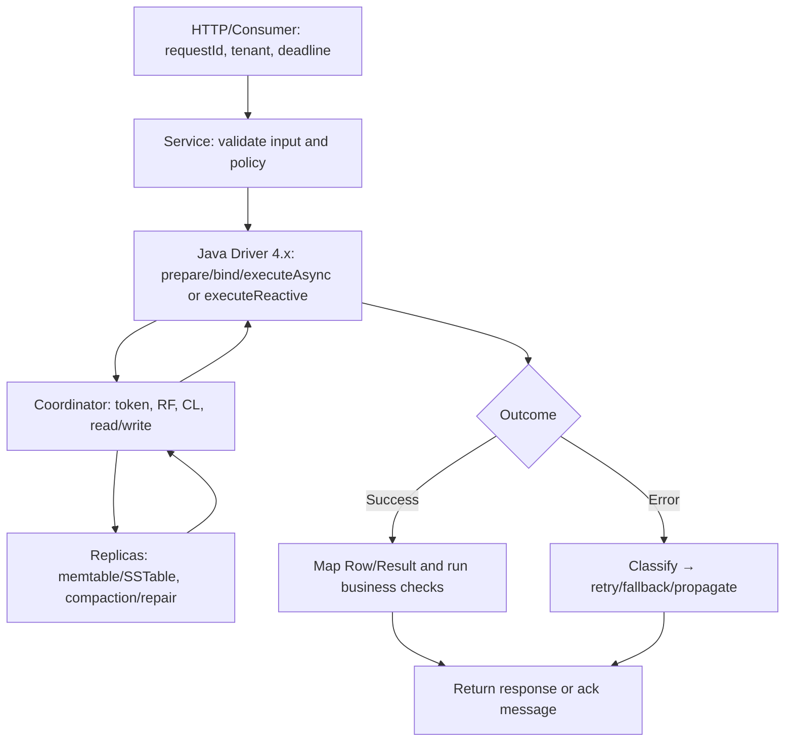
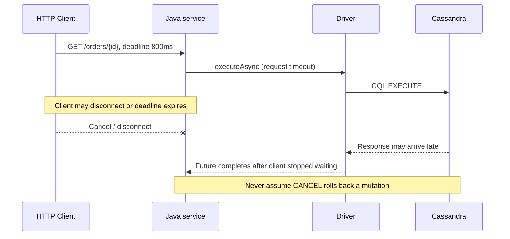
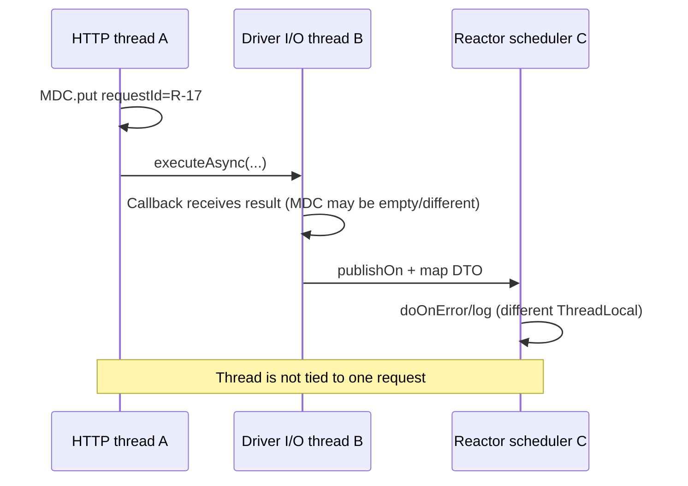

# Error Handling Chains, Recovery, and Application Context Propagation

## 1. Why Is Async Processing More Than Changing `execute` to `executeAsync`?

In a Java service accessing Apache Cassandra, a request typically traverses several steps: receiving an HTTP call or message, authenticating the user, looking up by **partition key**, calling Cassandra with a **consistency level**, mapping `Row` to business data, possibly updating another table, and finally returning a response or acknowledging a message. When these steps run asynchronously, an error can occur **after the Java method has already returned** and on a thread other than the request-receiving thread.

Two very common mistakes:

- The application calls `session.executeAsync(stmt)` without retaining or observing the final `CompletionStage`. Cassandra times out, yet the API still returns HTTP 200, or a callback throws an exception that nobody handles.
- The application uses Reactor, calls `session.executeReactive(stmt)`, and never subscribes to the publisher. The code looks like it wrote data, yet **no query was ever executed**.

Another subtle pitfall: a client-side timeout **does not prove a mutation was not written**. Retrying without idempotency rules can cause Cassandra to execute the same business action multiple times. An async pipeline must therefore answer four questions:

1. How is **success** defined for each step (rows returned, ACKs meeting CL, or LWT `[applied]`)?
2. Which **errors** are retryable, and which must propagate intact or map to domain errors?
3. Does **recovery** via cache/fallback still satisfy the data contract and promised consistency level?
4. How is **context**—such as request ID, trace ID, deadline, and tenant—propagated across threads, callbacks, and Reactor operators without leaking data?

This lesson belongs to the **Async and Reactive** chapter of the `DATABASE_ENGINE_WIDE_COLUMN_CASSANDRA` module, connecting directly to distributed architecture, the wide-column model, partition keys, query-driven table design, read/write replication and consistency, compaction, repair, error handling, and Java Driver 4.x.

**After this lesson, you will be able to** build a `CompletionStage` or Reactor pipeline with clear error contracts; handle retries, timeouts, cancellation, backpressure, and paging; propagate correlation/tracing context across async boundaries; and test outcomes, rejected inputs, Cassandra call counts, and side effects on failure.

## 2. Four-Layer Error Map: Do Not Lump Everything Into `Exception`



| Layer | Example errors | Owner |
| --- | --- | --- |
| **Input/business** | Malformed key, order not found, invalid state | Controller/service; return 400/404/409 per contract |
| **Driver/client** | No node available, TLS/credential error, overloaded pool, client timeout | Application infrastructure; throttling/observability policies |
| **Coordinator/replica** | `UnavailableException`, `ReadTimeoutException`, `WriteTimeoutException`, schema errors | Driver + SRE; uphold CL and assess actual data state |
| **Async/reactive pipeline** | Callback throws `NullPointerException`, subscriber cancel, saturated scheduler, lost context | Developers; do not blame every failure on Cassandra |

**Zero rows** (`row == null`, `Mono.empty()` after a valid SELECT) is not automatically an infrastructure error. Conversely, **LWT `wasApplied() == false`** can be a normal CQL completion where the business condition was not satisfied. Separate result, empty, false, and error at every boundary.

## 3. Three Programming Models and What They Mean

| Model | Java Driver 4.x | When it runs | How errors propagate |
| --- | --- | --- | --- |
| Synchronous | `session.execute(stmt)` → `ResultSet` | When invoked | Throws exception directly on calling thread |
| Asynchronous | `session.executeAsync(stmt)` → `CompletionStage<AsyncResultSet>` | When `executeAsync` is called | Stage completes exceptionally; callbacks run afterward |
| Reactive Streams | `session.executeReactive(stmt)` → `ReactiveResultSet` | **Upon subscription** | `onError` signal in the stream |

Do not equate `CompletionStage` with Reactive Streams:

- `CompletionStage` models **a single future result or failure**, with no per-item `request(n)` mechanism.
- `ReactiveResultSet` is a publisher with `onSubscribe/onNext/onError/onComplete` signals and Reactive Streams demand/backpressure.
- You can bridge `CompletionStage` to `Mono` or use `Flux.from(session.executeReactive(...))` directly, but you must understand **when the query actually executes**, when a retry issues a fresh request, and whom cancellation affects.

Per Java Driver 4.18.x documentation, reactive types live under a package prefixed `com.datastax.dse...` for historical reasons; **reactive still works with standard Apache Cassandra**, without requiring DSE.

## 4. CQL Fixture: Small Data, Enough Behavior to Test

The examples below target a **lab cluster**, DC named `dc1`, with enough nodes for RF3. Adjust RF/DC to match your topology in other environments. Never put sensitive data or run experimental DDL/deletes in production.

```sql
CREATE KEYSPACE async_lab_ks
WITH replication = {'class': 'NetworkTopologyStrategy', 'dc1': 3}
AND durable_writes = true;

CREATE TABLE async_lab_ks.orders_by_id (
    order_id uuid PRIMARY KEY,
    customer_id text,
    status text,
    total decimal,
    updated_at timestamp
);

CREATE TABLE async_lab_ks.events_by_order_day (
    order_id uuid,
    bucket_day date,
    event_ts timestamp,
    event_id uuid,
    event_type text,
    PRIMARY KEY ((order_id, bucket_day), event_ts, event_id)
) WITH CLUSTERING ORDER BY (event_ts DESC, event_id DESC);

INSERT INTO async_lab_ks.orders_by_id
    (order_id, customer_id, status, total, updated_at)
VALUES (11111111-2222-4333-8444-555555555555,
        'synthetic-customer-7', 'CREATED', 120.50,
        '2026-11-21T08:00:00+0000');

INSERT INTO async_lab_ks.events_by_order_day
    (order_id, bucket_day, event_ts, event_id, event_type)
VALUES (11111111-2222-4333-8444-555555555555,
        '2026-11-21', '2026-11-21T08:01:00+0000',
        22222222-3333-4444-8555-666666666666, 'CREATED');

INSERT INTO async_lab_ks.events_by_order_day
    (order_id, bucket_day, event_ts, event_id, event_type)
VALUES (11111111-2222-4333-8444-555555555555,
        '2026-11-21', '2026-11-21T08:02:00+0000',
        33333333-4444-4555-8666-777777777777, 'VALIDATED');

INSERT INTO async_lab_ks.events_by_order_day
    (order_id, bucket_day, event_ts, event_id, event_type)
VALUES (11111111-2222-4333-8444-555555555555,
        '2026-11-21', '2026-11-21T08:03:00+0000',
        44444444-5555-4666-8777-888888888888, 'READY');
```

**Lab invariants:**

- `orders_by_id` holds one known order by partition key `order_id`; any other UUID yields an empty result.
- `events_by_order_day` holds three rows in partition `(order_id, bucket_day)` ordered `READY → VALIDATED → CREATED`; `setPageSize(1)` triggers multi-page behavior.
- With RF3 and `LOCAL_QUORUM` in the same DC, requests require local quorum responses. CL **does not replace** business deduplication or cross-partition transactions.

## 5. Proper `CompletionStage` Chains: Compose Instead of Blocking

Examples target Java 17+ and Java Driver 4.18.x; the following snippets assume `CqlSession session` is created **once** for the service lifecycle and closed cleanly on application shutdown.

```java
import java.math.BigDecimal;
import java.util.*;
import java.util.concurrent.*;
import com.datastax.oss.driver.api.core.DefaultConsistencyLevel;
import com.datastax.oss.driver.api.core.CqlSession;
import com.datastax.oss.driver.api.core.cql.*;

record Order(UUID id, String status, BigDecimal total) {}

// Prepare once during repository initialization (after schema is ready).
PreparedStatement getOrder = session.prepare(
    "SELECT order_id, status, total " +
    "FROM async_lab_ks.orders_by_id WHERE order_id = ?");

CompletionStage<Optional<Order>> findOrderAsync(UUID orderId) {
    BoundStatement bound = getOrder.bind(orderId)
        .setConsistencyLevel(DefaultConsistencyLevel.LOCAL_QUORUM)
        .setIdempotent(true);

    return session.executeAsync(bound).thenApply(page -> {
        Row row = page.one();
        if (row == null) {
            return Optional.empty();
        }
        return Optional.of(new Order(
            row.getUuid("order_id"),
            row.getString("status"),
            row.getBigDecimal("total")));
    });
}
```

`thenApply` is appropriate when **transforming the result inline** without launching further async work. If you need to call Cassandra again based on the result, use `thenCompose`:

```java
CompletionStage<Optional<Order>> stage = findOrderAsync(orderId);

CompletionStage<Optional<String>> statusStage = stage.thenCompose(maybeOrder -> {
    if (maybeOrder.isEmpty()) {
        return CompletableFuture.completedFuture(Optional.empty());
    }
    // Example returning a value after another async step.
    return fetchExternalStatusAsync(maybeOrder.get().id())
        .thenApply(Optional::ofNullable);
});
```

Here `fetchExternalStatusAsync` is a hypothetical method returning `CompletionStage<String>`; this snippet illustrates composition without requiring an extra Cassandra table. Using `thenApply` on a future-returning function creates **a nested future**, making error and result paths hard to manage.

### Choosing Operators by Semantics

| API | When to use? | Key point |
| --- | --- | --- |
| `thenApply(f)` | Map A to B with lightweight computation | Callback may run on the stage-completing thread |
| `thenCompose(f)` | `f` returns a `CompletionStage<B>` | Flattens stage; inner errors propagate downstream |
| `thenCombine(other, f)` | Two independent results needed together | No built-in concurrency limit |
| `whenComplete((v,e) -> ...)` | Metrics/logging without altering value | Does not recover from errors; callback errors create a new failed stage |
| `exceptionally(ex -> value)` | Replace a specific failure with a fallback value | Applying to all errors hides auth/schema/bug issues |
| `handle((v,e) -> ...)` | Transform both success and failure | Must classify exceptions and rethrow disallowed ones |
| `thenApplyAsync(f, executor)` | CPU-heavy mapping work | Use a bounded executor; never feed an unbounded queue |

**Dropped errors:** `stage.thenAccept(row -> ...);` without keeping the returned stage. If the upstream stage fails, the callback never runs; if the callback throws, the new future fails unobserved. In server code, **return the final stage to the framework** and attach terminal logging/metrics/error mappers appropriately.

## 6. Unwrapping Root Causes from `CompletionException`

When a callback throws or a stage fails, Java may wrap the cause in `CompletionException`. When classifying errors, unwrap carefully:

```java
static Throwable unwrapAsync(Throwable error) {
    Throwable current = error;
    while ((current instanceof CompletionException
            || current instanceof ExecutionException)
            && current.getCause() != null) {
        current = current.getCause();
    }
    return current;
}
```

Never swallow stack traces or turn all errors into `null`. Classify by **semantics**:

| Category | Examples | Handling |
| --- | --- | --- |
| Not found / empty | PK `SELECT` returns 0 rows | `Optional.empty()` or HTTP 404; **do not retry**—not an error |
| Invalid query / schema | `InvalidQueryException`, missing table/column | Report deployment/schema error; **never fall back as "order not found"** |
| Authentication / authorization | Bad credentials, missing `SELECT/MODIFY` | Return error and alert; do not hammer CQL with retries |
| Transient availability / read timeout | `UnavailableException`, `ReadTimeoutException` | May retry **idempotent reads** within deadline budget, preserving CL |
| Write timeout | `WriteTimeoutException` | **Uncertain outcome**; verify state before business-level retry |
| LWT not applied | `wasApplied() == false` | Return conflict/precondition failed; **do not** treat as transport error |
| Callback mapping bug | `NullPointerException`, bad codec/parser | Fix code or data; do not run database retry loops |
| Cancellation | Subscriber cancel, HTTP client disconnect | Clean up resources; never claim mutation rolled back |

**Note:** exact exception names and policies depend on your driver release. Handle errors **with the right type and contract** first, before considering retries or fallbacks.

### Selective Recovery with `handle`

```java
CompletionStage<Optional<Order>> dbRead = findOrderAsync(orderId);

Optional<Order> cachedSnapshot = Optional.empty(); // Example: verified cache.
boolean staleReadPermitted = false;                  // Endpoint policy.

CompletionStage<Optional<Order>> resolved =
    dbRead.handle((value, failure) -> {
        if (failure == null) {
            return value;
        }
        Throwable cause = unwrapAsync(failure);
        if (staleReadPermitted && cause instanceof
                com.datastax.oss.driver.api.core.servererrors.UnavailableException) {
            return cachedSnapshot; // Fallback ONLY when contract permits.
        }
        throw new CompletionException(cause);
    });
```

If an API promises "the latest `LOCAL_QUORUM`-confirmed state," a stale cache **must never** be substituted silently. Any fallback must be explicit in the API contract (e.g., `stale=true`, cache timestamp, read-only mode) or disallowed altogether.

## 7. Threading: Fast Callbacks, Never Block Driver I/O Threads

Java Driver 4.x uses internal thread pools for request I/O and administrative tasks. A `thenApply` callback attached to a driver-completed stage may run **on an I/O thread**. If that callback calls synchronous `session.execute()`, code risks deadlock and the driver has checks to detect and reject such calls.

```java
// WRONG: blocking Cassandra call inside an I/O callback:
session.executeAsync(bound).thenApply(rs -> {
    return session.execute(otherBound).one();  // DO NOT DO THIS.
});

// RIGHT: compose asynchronous requests:
session.executeAsync(bound).thenCompose(rs -> {
    Row first = rs.one();
    if (first == null) {
        return CompletableFuture.completedFuture(Optional.empty());
    }
    return session.executeAsync(otherBound)
        .thenApply(next -> Optional.ofNullable(next.one()));
});
```

If you must hash thousands of records or serialize heavy JSON, offload that step to a **bounded CPU executor**:

```java
ExecutorService mappingPool = Executors.newFixedThreadPool(4);

CompletionStage<Payload> mapped = session.executeAsync(bound)
    .thenApplyAsync(rs -> mapLargeResponse(rs), mappingPool);

// Call mappingPool.shutdown() on application shutdown;
// never create a new pool per request.
```

Here `Payload`/`mapLargeResponse` are illustrative abstractions. For multi-page results, fetch pages asynchronously before mapping the result. **A separate executor does not make blocking driver calls acceptable**; it only isolates CPU cost and still requires backpressure and bounded queues.

### Anti-Patterns to Eliminate

```java
// Never call from an HTTP event loop or driver callback:
Order blocking = findOrderAsync(orderId)
    .toCompletableFuture()
    .thenApply(opt -> opt.orElseThrow())
    .join();

// Never launch unbounded future/executor fan-out:
for (UUID id : millionIds) {
    session.executeAsync(getOrder.bind(id));
}
```

`join()/get()` blocks the thread; running it on an event loop collapses throughput and causes cascading timeouts. Launching millions of unbounded in-flight requests triggers pool saturation, memory pressure, retry storms, and p99 spikes.

## 8. Async Paging: True Completion Means Reading Every Page

`session.executeAsync(stmt)` delivers only the **current page** via `AsyncResultSet.currentPage()`. If business requirements need all rows in a partition, you must fetch subsequent pages while `hasMorePages()` is true.

```java
record Event(UUID id, String type) {}

static CompletionStage<List<Event>> collectAllPages(
        AsyncResultSet page, List<Event> collected) {
    for (Row row : page.currentPage()) {
        collected.add(new Event(
            row.getUuid("event_id"),
            row.getString("event_type")));
    }
    if (!page.hasMorePages()) {
        return CompletableFuture.completedFuture(List.copyOf(collected));
    }
    return page.fetchNextPage()
        .thenCompose(next -> collectAllPages(next, collected));
}

CompletionStage<List<Event>> eventsStage = session.executeAsync(
    preparedEvents.bind(
        orderId, LocalDate.of(2026, 11, 21))
        .setPageSize(1)
        .setConsistencyLevel(DefaultConsistencyLevel.LOCAL_QUORUM)
        .setIdempotent(true))
    .thenCompose(page -> collectAllPages(page, new ArrayList<>()));
```

Assume `preparedEvents` is a prepared SELECT against `events_by_order_day` already initialized. The `ArrayList` here belongs to **one request/chain** and is not shared across concurrent requests. For large datasets, process pages in a bounded/streaming manner instead of buffering everything in RAM, and offload heavy mapping callbacks.

**Never** return `currentPage()` and report success if the contract demands all three rows. If a later page fails, **the whole business operation** must fail—or follow an explicit partial-result API—rather than silently returning truncated rows. Each `fetchNextPage()` is a new network request with its own timeout/retry behavior.

## 9. Deadlines, Timeouts, and Cancellation Have Three Distinct Meanings

| Mechanism | Boundary | What must NOT be inferred |
| --- | --- | --- |
| Driver request timeout | Bound on one request execution, including driver-configured retries/speculation | Does not prove a write never reached replicas |
| Application end-to-end deadline | Full API budget: auth → 2 queries → mapping → response | Does not automatically propagate as stage timeouts |
| Cancellation (future/subscriber) | Caller stops waiting or sends cancel signal | Does not physically cancel every mutation accepted by the coordinator |

Example **hypothetical** budget: client allows 800 ms; validation 30 ms, order lookup max 250 ms, downstream call 200 ms, mapping 50 ms, buffer 270 ms. Setting each Cassandra attempt timeout to 2 seconds while the whole API only has 800 ms is a **contradictory** configuration.



**Read timeout:** if the query is idempotent, you may retry within remaining budget. **Write timeout:** verify/trace by business ID before re-issuing side-effecting actions. An HTTP client disconnect has no power to "revoke" an `INSERT/UPDATE` that already reached the server.

### Timeouts in Reactor

```java
Mono<Optional<Order>> readOnce = Mono.defer(
    () -> Mono.fromCompletionStage(() -> findOrderAsync(orderId)));

Mono<Optional<Order>> guarded = readOnce
    .timeout(Duration.ofMillis(500))
    .doOnError(error -> metrics.increment("order_read_failed"))
    .doFinally(signal -> metrics.increment("order_read_finished"));
```

`Mono.fromCompletionStage(Supplier)` defers stage creation until subscription. A Reactor timeout triggers an error/cancel on the subscriber side; **it does not guarantee Cassandra stopped executing**. Never use `timeout().onErrorReturn(empty)` to claim "order does not exist."

## 10. Conditional Retries: Time Bounds and Idempotency

A **retry** is a new request or an extra attempt, not a free replay of an existing result. The driver has its own retry policy; if you add Reactor/service-level retries as well, account for **both layers** so total attempts do not multiply excessively.

| CQL / action | Application-level retry? | Reason |
| --- | --- | --- |
| `SELECT ... WHERE order_id=?` | Yes, for transient errors within deadline | Generally idempotent; preserves CL and query semantics |
| `INSERT/UPDATE` with identical values | Only after analyzing timestamps/TTL and business logic | Even if final state matches, TTL expiration/audits/side effects can differ |
| `UPDATE counter ... c=c+1` | **Never retry blindly** | Can double-increment |
| `list_col = list_col + [...]` | **Never retry blindly** | Can append twice |
| `UPDATE ... IF status=?` | Not by default; handle uncertain outcome | LWT uses Paxos/serial CL; verify condition state |
| Writing two denormalized tables | Do not treat retrying the chain as atomic | One table may have succeeded while the other did not |
| Auth / schema / codec errors | Never | Retrying will not fix credentials, CQL, or Java mappings |

### Selective Read Retries in Reactor

```java
import reactor.core.publisher.Mono;
import reactor.util.retry.Retry;
import java.time.Duration;
import com.datastax.oss.driver.api.core.servererrors.*;

Mono<Optional<Order>> safeRead =
    Mono.defer(() ->
        Mono.fromCompletionStage(() -> findOrderAsync(orderId)))
    .retryWhen(
        Retry.backoff(2, Duration.ofMillis(50))
            .maxBackoff(Duration.ofMillis(250))
            .jitter(0.5)
            .filter(error ->
                error instanceof ReadTimeoutException
                || error instanceof UnavailableException))
    .timeout(Duration.ofMillis(800));
```

This is **illustrative**; production code also needs concurrency limits, full-request budgets, unwrapped exception checks, and alignment with driver retry policies. `Retry.backoff(2,...)` allows up to **two extra retries** after the initial attempt, not two total attempts. `retryWhen` re-subscribes, so the upstream chain must be wrapped in `defer`/a supplier rather than holding an already-started stage.

**Never downgrade CL from `LOCAL_QUORUM` to `ONE` just to make a retry succeed** when the contract requires higher consistency. Do not immediately retry bursts of failed requests when a node/DC goes down; use jittered backoff and circuit breakers/bulkheads to avoid retry storms.

## 11. Fallbacks, Circuit Breakers, and Bulkheads: Business-Meaningful Recovery

Three distinct mechanisms:

- **Fallback** returns an alternate result, such as a cached state tagged `asOf`. It must be **accepted by the API contract**, not merely used to lower error counts.
- **Circuit breaker** temporarily stops calling downstream during sustained failures. It **does not** fix Cassandra; it limits blast radius and aids recovery.
- **Bulkhead / concurrency limit** caps in-flight Cassandra requests for a workload so saturation/errors do not drag down the entire JVM or cluster.

Example selective fallback for a **stale-permitted read-only** endpoint:

```java
Mono<ReadView> view = readOrderMono(orderId)
    .map(order -> new ReadView(order, false))
    .onErrorResume(UnavailableException.class, error ->
        cachedView(orderId)
            .map(stale -> new ReadView(stale, true)));
```

Here `readOrderMono` returns `Mono<Order>`, `cachedView` returns `Mono<Order>`, and `ReadView` is an example DTO; all three must be designed upfront. If `readOrderMono` emits empty because the order does not exist, this chain **does not** run the fallback because empty **is not an error**. If the cache is also empty, return an appropriate error without hiding that the DB was unavailable.

**Never use a stale fallback** for payment confirmation, authorization checks, balance verification, or state-transition preconditions where freshness/consistency is mandatory. Never treat `onErrorResume(e -> Mono.empty())` as a default pattern: it turns outages into "no data."

### Limiting Concurrency to Prevent Overload

```java
Flux<Order> orders = Flux.fromIterable(orderIds)
    .flatMap(id ->
        Mono.defer(() -> Mono.fromCompletionStage(
            () -> findOrderAsync(id)))
            .flatMap(optional ->
                optional.map(Mono::just).orElseGet(Mono::empty)),
        16); // Illustrative max concurrency; tune against real workload.
```

`flatMap(..., 16)` bounds active inner streams, but **does not** create a transaction, preserve result ordering, or govern background queries elsewhere. If ordering matters, evaluate `concatMap` or `flatMapSequential` along with their latency/throughput trade-offs.

## 12. Driver Reactive API: Publishers Only Run Upon Subscription

Java Driver 4.x provides `CqlSession.executeReactive(Statement<?>)`, returning `ReactiveResultSet`—a `Publisher<ReactiveRow>`. The API uses the historical package:

```java
import com.datastax.dse.driver.api.core.cql.reactive.ReactiveResultSet;
import com.datastax.dse.driver.api.core.cql.reactive.ReactiveRow;
import reactor.core.publisher.Flux;

ReactiveResultSet publisher = session.executeReactive(
    getOrder.bind(orderId)
        .setConsistencyLevel(DefaultConsistencyLevel.LOCAL_QUORUM)
        .setIdempotent(true));

// Not subscribed yet → query has NOT executed.
Flux<Order> orders = Flux.from(publisher).map(r ->
    new Order(r.getUuid("order_id"), r.getString("status"),
        r.getBigDecimal("total")));

// Framework or terminal subscriber must subscribe;
// production code must not call block() on an event loop.
```

**Important:** by default the publisher is **cold, unicast, and single-subscription**. If downstream subscribes twice to the same `publisher`, or `retryWhen` re-subscribes to the same result set, the driver may reject it with an error.

### Right Way to Supply a Fresh Publisher per Subscribe/Retry

```java
Flux<Order> deferredRead = Flux.defer(() ->
    Flux.from(session.executeReactive(
        getOrder.bind(orderId)
            .setConsistencyLevel(DefaultConsistencyLevel.LOCAL_QUORUM)
            .setIdempotent(true)))
        .map(r -> new Order(
            r.getUuid("order_id"),
            r.getString("status"),
            r.getBigDecimal("total"))));

Flux<Order> retriable = deferredRead.retryWhen(
    Retry.backoff(2, Duration.ofMillis(50))
        .filter(error -> error instanceof ReadTimeoutException));
```

For each **subscription**, `Flux.defer` creates a fresh `ReactiveResultSet`. This **enables proper retry mechanics**, while also issuing a **new CQL request**; bound retries and verify data consistency. Never infinitely `cache()` a `Flux` holding production data and share it across tenants due to PII, memory, and staleness risks.

### What Does an Empty Reactive Write Result Mean?

Normal CQL writes return no rows. Therefore:

```java
Mono<Void> saveStatusReactive(BoundStatement write) {
    return Mono.defer(() ->
        Flux.from(session.executeReactive(write)).then());
}
```

`then()` completes normally **only after the upstream publisher completes**; having no `onNext` signals does not mean the write didn't happen. Classic bug:

```java
// WRONG: doOnNext only runs a side-effect returning a publisher,
// without subscribing to that returned publisher.
Flux.just(write).doOnNext(session::executeReactive);

// RIGHT: return the publisher into the chain so it is subscribed.
Mono<Void> writeDone = Flux.from(session.executeReactive(write)).then();
```

The final `writeDone` is **single-subscription**; if it may be retried or re-subscribed, wrap `session.executeReactive(write)` in `Mono.defer` as in the first method.

### Reactive LWT Has Its Own `wasApplied()`

```java
Mono<Boolean> conditionalUpdate(BoundStatement lwt) {
    return Mono.defer(() -> {
        ReactiveResultSet rs = session.executeReactive(lwt);
        return Flux.from(rs).then(Mono.from(rs.wasApplied()));
    });
}
```

The reactive result set's `wasApplied()` method is a **metadata publisher**; before the query/transaction completes, that metadata is not yet emitted. `false` means the condition was not met, **not** a driver error. Use LWT/serial CL per business requirements; do not treat it as an atomic transaction across partitions.

## 13. Backpressure, Paging, and Stream Cancellation

Reactive Streams lets downstream issue demand via `request(n)`. The driver fetches additional pages as needed; however, **row-level demand does not mean network requests equal n**. Page size is a hint, and one page can hold many rows. For large datasets, enforce both total row limits and downstream pacing.

```java
Flux<String> eventTypes = Flux.defer(() ->
    Flux.from(session.executeReactive(
        preparedEvents.bind(orderId, LocalDate.of(2026, 11, 21))
            .setConsistencyLevel(DefaultConsistencyLevel.LOCAL_QUORUM)
            .setPageSize(2)
            .setIdempotent(true))))
    .map(row -> row.getString("event_type"))
    .limitRate(64);
```

**Do not casually attach `collectList()` on tables with millions of rows**: RAM pressure still spikes despite upstream backpressure. When an API only needs 100 rows, express that bound in CQL/schema; for long-running processing, use explicit paging/batch streams with clear policies and state.

If downstream calls `cancel()`:

- Reactor may stop emitting rows and release subscription/network resources depending on the driver.
- The server may already have processed the request/page or mutation before receiving the signal, especially on timeouts/disconnects.
- **Cancellation does not roll back CQL writes** and does not mean a source consumer event was acked.
- If a streaming HTTP response already sent some rows before failing, HTTP status may already be committed; design an explicit error/partial-result protocol rather than assuming you can swap the response to HTTP 500.

## 14. Application Context: Request ID, Trace ID, Tenant, and Deadline

Context is **not just for pretty logs**. It connects Java layers, the driver, and metrics:

- **Correlation/request ID:** ties together HTTP handler, repository, retry, and downstream logs.
- **Trace/span context:** links parent-child spans; never turn a trace ID into a business key.
- **Tenant/account scope:** determines **service authorization** and which partition keys may be read; never pull tenant identity from stale MDC logs.
- **Deadline/cancellation:** ingress request budget, preventing downstream retries from blowing past the overall SLO.
- **Idempotency key/event ID:** distinguishes legitimate retries from new business events.
- **Authenticated principal:** verified identity; never copy raw tokens or passwords into context or logs.

### Why `ThreadLocal`/MDC Easily Breaks

In synchronous servlets, one request often runs on a single thread start to finish. In async/Reactive:



`MDC` typically relies on `ThreadLocal`; pooled threads **are reused** across requests. Without explicit propagation and cleanup, logs can **lose the request ID** or—worse—**attach another user's request ID or tenant**. Never read `MDC.get("tenant")` for authorization in Reactor.

## 15. Passing Context via Immutable Parameters for CompletionStage

The simplest, least framework-coupled pattern: create an **immutable request context** on ingress, pass it explicitly to services/repositories, and capture it in callbacks.

```java
import java.time.Instant;
import java.util.UUID;

record RequestContext(
    String requestId,
    String tenantId,
    Instant deadlineUtc
) {}

CompletionStage<Optional<Order>> findOrder(
        RequestContext context, UUID orderId) {
    // Tenant policy is verified in the service before calling the repository;
    // never pull context from a shared ThreadLocal.
    BoundStatement stmt = getOrder.bind(orderId)
        .setConsistencyLevel(DefaultConsistencyLevel.LOCAL_QUORUM)
        .setIdempotent(true);

    return session.executeAsync(stmt)
        .thenApply(rs -> Optional.ofNullable(rs.one()).map(r ->
            new Order(
                r.getUuid("order_id"),
                r.getString("status"),
                r.getBigDecimal("total"))))
        .whenComplete((value, error) ->
            metrics.record(
                "orders_by_id_lookup",
                context.requestId(),
                error == null ? "success" : "error"));
}
```

Here `metrics.record` is an illustrative abstraction; **do not** use raw request IDs as high-cardinality metric labels in Prometheus. Tenant-to-order ownership must still be enforced in business logic; querying solely by `order_id` does not enforce row-level isolation in Cassandra.

Pros: correlation ID does not depend on which thread runs the callback. Cons: must be threaded through parameters across layers; keep the context **small, immutable, free of secrets, and never treated as an authorization credential by itself**.

## 16. Reactor Context: Bound to the Subscription, Not a Thread

Reactor provides `Context` (`contextWrite` to set, `deferContextual` to read). Context travels with the **subscriber/pipeline**, surviving scheduler hops without pinning threads.

```java
import reactor.core.publisher.Mono;
import reactor.util.context.Context;

Mono<String> pipeline = Mono.deferContextual(ctx -> {
    String requestId = ctx.getOrDefault("requestId", "missing");
    return Mono.just("handled:" + requestId);
});

Mono<String> withContext = pipeline
    .contextWrite(Context.of("requestId", "req-synthetic-001"));
```

Upon subscription, `withContext` emits `handled:req-synthetic-001` even if operators hop threads. Conversely:

```java
Mono<String> unsafe = Mono.just("work")
    .publishOn(Schedulers.parallel())
    .map(v -> MDC.get("requestId")); // Can be null or wrong!
```

The second snippet assumes `reactor.core.scheduler.Schedulers` and `org.slf4j.MDC` are imported; it is meant to **demonstrate the anti-pattern**, not production code.

### Attaching Context Through a Repository

```java
Mono<Order> findOrderReactive(UUID orderId) {
    return Mono.deferContextual(ctx -> {
        String requestId = ctx.getOrDefault("requestId", "missing");
        return Mono.fromCompletionStage(() -> findOrderAsync(orderId))
            .flatMap(optional ->
                optional.map(Mono::just)
                    .orElseGet(Mono::empty))
            .doOnError(error -> logSafeError("findOrder", requestId, error));
    });
}

Mono<Order> response = findOrderReactive(orderId)
    .contextWrite(ctx -> ctx.put("requestId", "req-synthetic-001"));
```

`logSafeError` is a logger abstraction recording only query shape, validated request ID, and error class. **Important boundary:** Reactor Context is accessible inside Reactor operators, but **does not automatically make arbitrary callbacks inside `CompletionStage` or non-Reactor libraries context-aware**. The code above extracts `requestId` before creating the stage and passes it explicitly. When crossing out of Reactor into custom `Executor`s or Kafka callbacks, use explicit context propagation or dedicated integration libraries.

### Direction of `contextWrite`

Reactor Context flows from downstream subscribers up to upstream operators. Thus `contextWrite(...)` placed **lower down** in a chain supplies values to `deferContextual(...)` above it. Calling `contextWrite` after an eager `CompletableFuture` has already started outside `defer` **cannot go back in time** to supply context to the already-started request.

## 17. Bridging to MDC and Tracing: Scoped, Never Set-and-Forget

If your application uses SLF4J MDC, never call `MDC.put("requestId", ...)` once and assume it follows every thread. For logging inside an operator, **read Reactor Context and populate MDC inside a short scope**:

```java
import org.slf4j.MDC;

Flux<Order> observed = ordersFlux
    .doOnEach(signal -> {
        if (!signal.isOnError() && !signal.isOnNext()) {
            return;
        }
        String reqId =
            signal.getContextView().getOrDefault("requestId", "unknown");
        try (MDC.MDCCloseable ignored =
                 MDC.putCloseable("requestId", reqId)) {
            if (signal.isOnError()) {
                log.warn("query_shape=orders_by_id_lookup failure_class={}",
                    signal.getThrowable().getClass().getSimpleName());
            } else {
                log.debug("query_shape=orders_by_id_lookup row_observed");
            }
        }
    });
```

This assumes `ordersFlux` and `log` are defined by the application and the context key was populated. `MDC.putCloseable` returns a scope that auto-cleans when the callback exits; **never leave MDC set permanently on I/O threads**. Never log tenant IDs, partition key UUIDs, request bodies, or raw `BoundStatement`s if they contain PII.

### OpenTelemetry Context Is More Than a Trace ID String

In OpenTelemetry instrumentation, `Context.current()` depends on the active thread/scope. To carry context across an uninstrumented callback, **capture at the right boundary** and call `makeCurrent` inside the callback scope:

```java
import io.opentelemetry.context.Context;
import io.opentelemetry.context.Scope;

Context captured = Context.current();

CompletionStage<AsyncResultSet> stage = session.executeAsync(bound);
CompletionStage<AsyncResultSet> observedStage =
    stage.whenComplete((value, error) -> {
        try (Scope scope = captured.makeCurrent()) {
            recordSpanOutcome(error); // Placeholder instrumentation.
        }
    });
```

This illustrates **a single callback**, not automatic propagation across **all** stages. In modern Spring/Reactor/OpenTelemetry stacks, prefer version-matched integrations and context-propagation libraries, and verify parent/span IDs across `publishOn`, `flatMap`, retries, and scheduler hops. Never call `Context.current()` inside a callback after switching threads and assume the parent span stayed intact.

### Context Sensitivity

A trace ID or correlation ID is not a cryptographic secret, yet it can still **correlate** user activity in centralized logs; enforce retention and ACLs. Never store passwords, bearer tokens, full customer payloads, raw partition keys, or sensitive authorization scopes in Reactor Context merely for convenience.

## 18. Multi-Step Failure Chains: Partial Success and Fan-Out Traps

Suppose a business operation updates order status and appends an event to another table. If the code runs:

```java
CompletionStage<Void> update = updateOrderAsync(event); // Hypothetical.
CompletionStage<Void> audit  = appendEventAsync(event); // Hypothetical.
CompletionStage<Void> both = update.thenCombine(audit,
    (a, b) -> null);
```

Both stages may **run concurrently**; `thenCombine` merely waits for both results and does not make the two mutations an atomic transaction. If `update` ACKs while `appendEvent` fails, the API may return an error even though the order **already changed**. Retrying the entire pipeline can replay both writes.

### More Durable Coordination Pattern

1. Assign a stable **business event ID / idempotency key** at ingress.
2. Choose a **source of truth** (authoritative event log/outbox or single-partition write) and define when business ACK occurs.
3. Have a projector/replayer update query tables with checkpoints, **idempotent** retries, and a dead-letter queue.
4. Reconcile by event ID between `orders_by_id` and `events_by_order_day`, not just by row count.
5. When a write times out, **read/reconcile outcome** where feasible before triggering compensating actions.

Cassandra **logged batches** have bounded atomicity guarantees and **do not provide RDBMS-style multi-partition isolation or business transactions** across services; never treat them as proof that "two tables are always read-consistent together."

### Classifying Fan-Out Failures

| Scenario | What may have happened | Handling |
| --- | --- | --- |
| Validation fails before any write | DB untouched by this flow | Return input error; do not retry DB |
| Source write ACKs, projection times out | Source succeeded; projection uncertain | Checkpoint/replay and reconcile |
| Both futures time out | One or both mutations may have applied | Check by event ID; never retry blindly |
| Subscriber cancels after first write | First write may still succeed | Run recovery/reconciliation outside HTTP lifecycle |
| LWT not applied | Request completed; condition false | Return conflict; do not retry as a network error |
| App crashes between two steps | Partial state | Event log/outbox enables checkpointed resume |

## 19. Reactive Consumers and Proper Acknowledgement Timing

In Kafka/queue consumers, a very dangerous bug is **acking/committing the offset as soon as a publisher is created**:

```java
// WRONG: publisher has not been subscribed; DB has NOT necessarily written.
Publisher<?> query = session.executeReactive(write);
ackMessage(message); // Event can be lost if the process crashes right after.
```

Instead, commit the offset **only after the write pipeline finishes** per contract and idempotency checks pass:

```java
Mono<Void> consume(EventMessage message) {
    BoundStatement stmt = bindEventMutation(message);
    return Mono.defer(() ->
            Flux.from(session.executeReactive(stmt)).then())
        .then(Mono.defer(() -> ackMessageAsync(message)))
        .onErrorResume(error -> handleConsumerFailure(message, error));
}
```

Assume `ackMessageAsync` and `handleConsumerFailure` return `Mono<Void>` and enforce an explicit policy (nack / retry topic / DLQ), never silently acking by default. Never construct non-idempotent statements and let an operator retry them infinitely. Under consumer rebalances or crashes, **at-least-once delivery** requires stable event IDs and deduplication/idempotent writes.

Just as with HTTP disconnects, an in-flight Cassandra mutation does not turn into a "never happened" transaction. Track request state and business state separately.

## 20. Operator Matrix: Catch Errors Where They Happen, Handle Appropriately

| Operator / mechanism | On error | Recovers? | Pitfall |
| --- | --- | --- | --- |
| `doOnError` / `whenComplete` | Logs/metrics and forwards error | **No** | Throwing in side effect masks root error; final stage left unobserved |
| `onErrorMap` | Translates exception to domain error | **No** | Loses cause/classification if everything maps identically |
| `onErrorResume` | Switches to fallback stream | **Yes** | Easily turns outages into empty/stale without a contract |
| `onErrorReturn` | Emits default value | **Yes** | Unsuitable for consistency-sensitive data |
| `onErrorComplete` | Swallows error and completes | Yes, dangerously | Can cause consumers to ack unwritten events |
| `retryWhen` | Re-subscribes upstream | Potentially | Re-executes CQL; requires `defer`, idempotency, and budget |
| `timeout` | Emits timeout/cancels past deadline | Does not fix DB | Mutation may still have committed |
| `doFinally` | Cleanup/metrics on complete/error/cancel | No | Never equate cancel with rollback |
| `onErrorContinue` | Skips failing item in some operators | Very error-prone | Alters semantics; avoid in critical data workflows |

### Do Not "Recover" Too Broadly

```java
// WRONG for critical data queries:
Mono<Order> wrong = readOrderMono(orderId)
    .onErrorResume(error -> Mono.empty());

// BETTER: catch only outage with approved fallback,
// letting all other errors propagate:
Mono<Order> conditionalFallback = readOrderMono(orderId)
    .onErrorResume(UnavailableException.class,
        error -> allowedCachedOrder(orderId));
```

Here `allowedCachedOrder` is assumed to return `Mono<Order>` and must enforce freshness, tenant isolation, and retention; it is not a blanket recommendation for all endpoints.

## 21. Observability and Verification Through Testing

### Three Clocks to Measure Separately

1. **End-to-end API:** ingress to response/ack, covering mapping, auth, dependencies, and paging.
2. **Driver request:** from `executeAsync` to current-page response, including configured driver retries/speculative executions.
3. **Cassandra coordinator/replica:** read/write latency by table/CL, SSTables, tombstones, compaction/repair, and network.

Never add per-layer p99s and call it end-to-end p99. Flows with parallel calls, fallbacks, or retries have different critical paths; measure **full-operation p95/p99, success ops/s, errors, and retries** under the same workload.

| Metric | What it reveals | Avoid |
| --- | --- | --- |
| `business_success/failure` | Did the API/consumer fulfill its contract? | Counting only CQL ACKs while ignoring downstream steps |
| `request_timeout/rate` | Deadlines and saturation | Masking with HTTP 200 / empty results |
| `retry_attempts` and backoff | Retry storms, multi-layer retries | Summing driver + app retries without attribution |
| `in_flight, pool utilization` | Client flooding requests | Looking only at Cassandra CPU |
| `pending compactions, disk await, GC` | Busy replicas raising latency | Reflexively blaming Reactor |
| `cache_fallback_rate` | Freshness degradation | Omitting stale flag / data source |
| `reactor_cancel/timeouts` | Subscriber cancelled / disconnected | Equating cancellation with DB rollback |
| `trace/span link integrity` | Does context survive scheduler hops? | Using tenant/customer IDs as metric labels |

### Quick Diagnosis Table

| Symptom | Hypothesis | Check |
| --- | --- | --- |
| Cassandra error turned into empty HTTP 200 | `onErrorResume(e -> Mono.empty())` | Assert error contract; find error-swallowing operator |
| Java callback never runs | Upstream stage failed | Observe terminal stage with `whenComplete`/framework |
| App hangs while Cassandra is healthy | Blocking `join()/execute()` on I/O or event loop | Thread dumps, driver logs, scheduler metrics |
| Publisher only runs the first time | `ReactiveResultSet` single-subscription | Create fresh publisher in `Flux.defer` per subscribe |
| Retry fails with "second subscriber" | Re-subscribed to same publisher | `Flux.defer(() -> Flux.from(session.executeReactive(...)))` |
| Duplicate writes | Timeout then retry on counter/list append or non-idempotent event | Idempotency keys, replay logs, write timestamps |
| Logs missing trace ID | MDC lost across thread hop | Reactor Context, OpenTelemetry instrumentation |
| Tenant A logs appear on request B | Dirty `ThreadLocal` in thread pool | Scoped MDC, concurrency tests |
| p99 spikes after adding `publishOn` | Saturated queue/scheduler or CPU mapping | Executor queues, allocation/GC, backpressure |
| Reactive stream returns too few rows | Cancel/`take`/page error, or `Mono.from(Publisher)` misuse | Assert row counts/cutoffs; inspect full stream |
| Cassandra timeouts increase | RF/CL, busy replicas, retry storm, compaction | `nodetool tpstats/compactionstats`, coordinator metrics |
| LWT returns `false` yet API reports "updated" | Didn't inspect `wasApplied` publisher | Inspect conditional outcome and state |

## 22. Runbook for Safely Shipping an Async/Reactive Pipeline

### P0 — Map Contracts and Failure Bounds

List every CQL query, partition key, result shape, CL/serial CL, timeout, idempotency condition, freshness requirement, allowed defaults/fallbacks, business ACK point, and rollback plan. Define the **unit of success** as the business operation, not subscribing or receiving the first page.

### P1 — Separate I/O Code from CPU/Blocking Code

Use `executeAsync` with `thenCompose` or `executeReactive` with `Flux/Mono`; never call `block()/join()` inside driver callbacks or event loops. Offload CPU-heavy mapping to a bounded scheduler/executor; measure queue depth and memory pressure. Share one `CqlSession` per target cluster.

### P2 — Build an Error Taxonomy

Map 404/not found, invalid CQL, auth, unavailable, read/write timeout, LWT not applied, cancellation, and callback bugs to distinct outcomes/API responses/consumer actions. Inject faults using test doubles/stubs rather than breaking a real cluster.

### P3 — Gate Retries and Fallbacks

Account for driver retries + app retries, cap max attempts, enforce jittered delay, respect SLO deadlines, bound in-flight count, and require idempotency. For uncertain write outcomes, verify by event ID/state; allow stale fallbacks only when approved by business rules and surfaced explicitly.

### P4 — Verify Context Propagation

Pass synthetic request IDs across `thenCompose`, `publishOn`, `flatMap`, retries, and cancellations. Verify logs/traces share the same request ID without dropping IDs or leaking tenants across concurrent requests. Never put PII or raw partition keys into trace attributes or metric labels.

### P5 — Test Paging and Backpressure

Use a fixture of at least three rows with page size 1, verify **all three are read**, and ensure partial success is not returned if the last page fails. Test slow downstreams, max concurrency, and consumer cancellation; measure heap, queues, and node attempts.

### P6 — Canary by Metrics

Keep queries, data, CL, and driver settings comparable before and after. Watch business success/errors, p95/p99, retry rate, fallback rate, pool/in-flight usage, CPU/GC, disk, and pending compactions. If correctness or consistency fails, roll back even if latency looks better.

### P7 — Incident Cleanup and Closure

Disable verbose tracing/debugging, close context scopes, and shut down executors/sessions per lifecycle; document root causes, business events that may have applied, and required reconciliation jobs. Never record "cancelled" as proof that a data mutation did not occur.

## 23. Reproducible Tests

The snippets below illustrate **assertion targets**; use JUnit/Reactor Test, repository/driver stubs, and a lab cluster with fixtures for integration runs.

### 23.1. Verifying Reactor Context Across Operators

```java
import reactor.test.StepVerifier;
import reactor.core.publisher.Mono;
import reactor.util.context.Context;

Mono<String> withRequest = Mono.deferContextual(ctx ->
    Mono.just("id=" + ctx.get("requestId")))
    .contextWrite(Context.of("requestId", "req-synthetic-001"));

StepVerifier.create(withRequest)
    .expectNext("id=req-synthetic-001")
    .verifyComplete();
```

### 23.2. Verifying Errors Are Not Turned Into Empty

```java
Mono<Order> failed = Mono.error(
    new IllegalStateException("simulated unavailable"));

StepVerifier.create(failed)
    .expectError(IllegalStateException.class)
    .verify();

// Do NOT write:
// failed.onErrorResume(e -> Mono.empty())
// and assert verifyComplete(), treating the app as healthy.
```

### 23.3. Testing Retries Allowed Only for Idempotent Reads

Use a stub with `AtomicInteger attempts`: first attempt returns a transient error, second returns the result, asserting `attempts == 2`; for auth/schema errors assert `attempts == 1`. For non-idempotent writes, assert **zero** automatic retries. With `Retry.backoff`, test via `StepVerifier` virtual time with an appropriately constructed publisher/scheduler; avoid `Thread.sleep` as deterministic proof.

### 23.4. Testing Context Leakage and Cancellation

Run two concurrent streams with different request IDs across scheduler hops and assert every log/span carries its own ID. Test cancellation while awaiting Cassandra and verify **the application does not ack the message before write confirmation**, while **never** assuming a cancel test proves server rollback.

### 23.5. Cassandra Integration Tests

Test against `orders_by_id` and `events_by_order_day` fixtures: correct partition lookup, status/total, missing order, three events in order across multiple pages, role `SELECT/MODIFY` permissions, LWT `wasApplied`, and behavior after a simulated timeout. Under `LOCAL_QUORUM`, never downgrade to `ONE` just to make tests pass more easily.

## 24. Scenario Exercises

1. An HTTP handler returns 200 immediately after `session.executeAsync(write)`, while the callback fails 300 ms later. What is wrong? Which stage must be returned or awaited?
2. Why can `thenApply(x -> otherAsync(x))` create a nested future? Rewrite it with `thenCompose`.
3. Does `whenComplete` replace an error with a fallback value? What happens if its callback also throws an exception?
4. When a valid SELECT yields `Optional.empty()`, should you treat it as "not found" or retry Cassandra? Why?
5. How do `ReadTimeoutException` and `WriteTimeoutException` differ in retry risk?
6. Why does a Reactor timeout/cancel not guarantee an `UPDATE` sent to the coordinator was not written?
7. An application configures max 2 retries in the driver and 2 in Reactor. Why can this cause retry amplification?
8. Give an example of a non-idempotent write using a counter or list append; why must blind retries stay disabled?
9. An `executeReactive` stream is created, but nobody subscribes. Has data been written? How do you fix it?
10. A `ReactiveResultSet` is re-subscribed by `retryWhen`. Why is `Flux.defer` needed?
11. `Flux.from(writePublisher).then()` emits an empty value; does that prove no write occurred?
12. What HTTP/domain status should LWT `wasApplied=false` map to instead of treating it as a timeout?
13. Why is `onErrorResume(e -> Mono.empty())` dangerous for payment or order-status APIs?
14. Distinguish bulkheads, circuit breakers, fallback caches, and retries; which one must never be used to disguise stale data?
15. Why can `ThreadLocal/MDC` lose or mix up request IDs when callbacks run on driver I/O threads?
16. You use `contextWrite/deferContextual` to carry an ID through Reactor; why doesn't Context automatically flow into callbacks of non-Reactor libraries?
17. How do you set MDC in a narrow scope and clear it before the thread handles another request?
18. When an application writes two denormalized tables using two futures, does `thenCombine` make them atomic? What mechanism recovers partial success?
19. A consumer acks the offset right after creating a publisher. When does data loss happen?
20. With three rows and page size 1, outline a test proving all pages are read and failures on the final page fail properly.
21. What are the pros/cons of `collectList()` when a stream returns millions of rows?
22. Design a dashboard distinguishing business operations, driver requests, retries, p99, fallbacks, and cancellations.

### Capstone Exercise

Design `OrderService.findAndVerify(orderId, requestContext)`:

- Query Cassandra by partition key using a prepared statement and `LOCAL_QUORUM`; read `Order` via `CompletionStage` or Reactor `Mono`.
- If no order exists, return a clear not-found result; on `UnavailableException`, fall back only if the endpoint permits stale reads and flags them.
- Retry reads at most twice with jittered backoff within the API deadline; never retry auth/schema/codec errors.
- Propagate `requestId/traceId/deadline` across callbacks and scheduler hops without a shared `ThreadLocal`.
- When reading events, drain all required pages/rows with no silent partial success.
- A timed-out `PAID` write must be verified by event ID before re-running side-effecting actions.
- Include metrics and data-safe tracing; test concurrent requests for zero context mixing, and ensure timeouts/cancellations never false-ack.
- Report retries and errors clearly from both driver and service; never conflate `Mono.empty()`, LWT `false`, and `onError`.

**Completion criteria:** the learner writes non-blocking async flows that never block driver I/O, never drop errors, apply retries/fallbacks faithfully to Cassandra semantics and idempotency, understand cold single-subscription reactive publishers, propagate scoped request/trace context, and verify correctness, consistency, and p99/error/throughput behavior under failure scenarios.

## 25. References

- [Apache Cassandra Java Driver 4.18 — Async programming](https://apache.github.io/cassandra-java-driver/4.18.0/core/async/): `CompletionStage`, threading, callbacks, error propagation, and async paging.
- [Apache Cassandra Java Driver 4.18 — Reactive Streams](https://apache.github.io/cassandra-java-driver/4.18.1/core/reactive/): `executeReactive`, cold single-subscription publishers, `Flux.defer`, and reactive metadata/`wasApplied`.
- [Apache Cassandra Java Driver 4.18 — Paging](https://apache.github.io/cassandra-java-driver/4.18.0/core/paging/): `AsyncResultSet.currentPage/fetchNextPage`, page size, and cursors.
- [Apache Cassandra Java Driver 4.18 — Idempotence](https://apache.github.io/cassandra-java-driver/4.18.1/core/idempotence/): retries/speculative execution and safety of repeating mutations.
- [Apache Cassandra Java Driver 4.18 — Retry policy](https://apache.github.io/cassandra-java-driver/4.18.1/core/retries/): retry boundaries and consistency-level errors.
- [Apache Cassandra Java Driver 4.18 — Non-blocking I/O](https://apache.github.io/cassandra-java-driver/4.18.1/core/non_blocking/): warnings against blocking on driver threads.
- [Project Reactor — Context](https://projectreactor.io/docs/core/3.7.0/reference/advancedFeatures/context.html): `contextWrite`, `deferContextual`, and ThreadLocal/MDC.
- [Project Reactor — Context propagation](https://projectreactor.io/docs/core/release/reference/advanced-contextPropagation.html): integrating Reactor Context with ThreadLocal/observability.
- [Project Reactor — Error handling](https://projectreactor.io/docs/core/release/reference/coreFeatures/error-handling.html): `onErrorResume`, `onErrorMap`, `doOnError`, retries.
- [Project Reactor — Testing](https://projectreactor.io/docs/core/release/reference/testing.html): `StepVerifier`, context assertions, and virtual-time testing.
- [Apache Cassandra — Read and write paths](https://cassandra.apache.org/doc/stable/cassandra/architecture/dynamo.html): RF/CL, failure modes, and acknowledged data.

**Conclusion:** Error handling in async/reactive Java is far more than `catch(Exception)` or `onErrorResume`. A proper pipeline must **define success at the business level, propagate errors to subscribers/frameworks, retry only when safe, manage uncertain write outcomes, and never turn outages into empty successes**. With Reactor, create cold sources properly, respect backpressure, and bind context to **subscriptions rather than threads**; with `CompletionStage`, pass request context explicitly and never block I/O callbacks. Final behavior must be verified across data, CL, idempotency, trace correlation, retry budgets, and end-to-end metrics before calling the system safely resilient.
