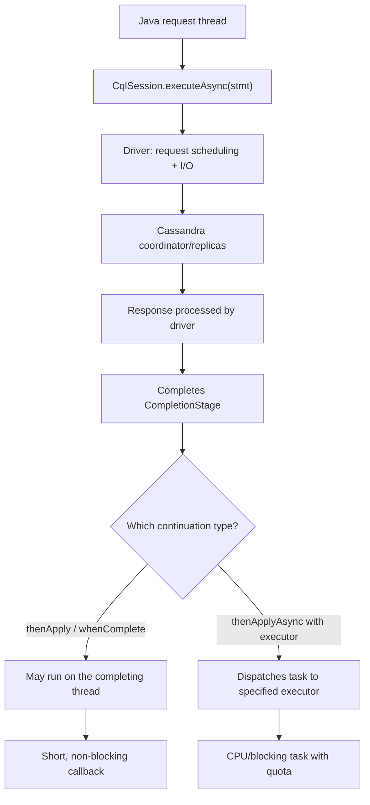
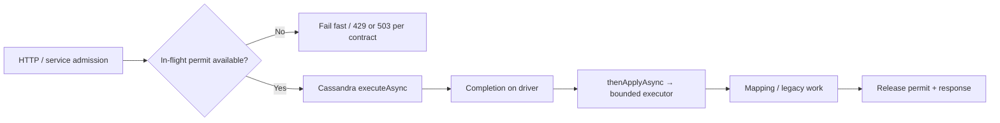
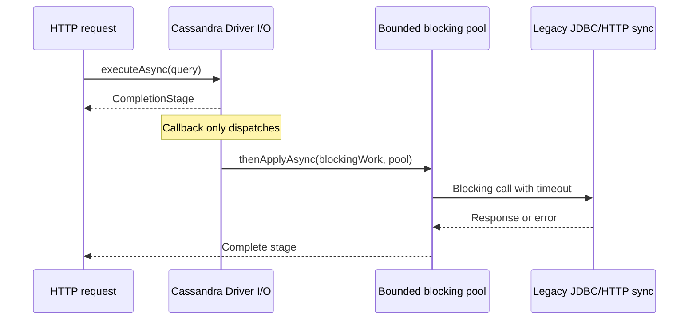
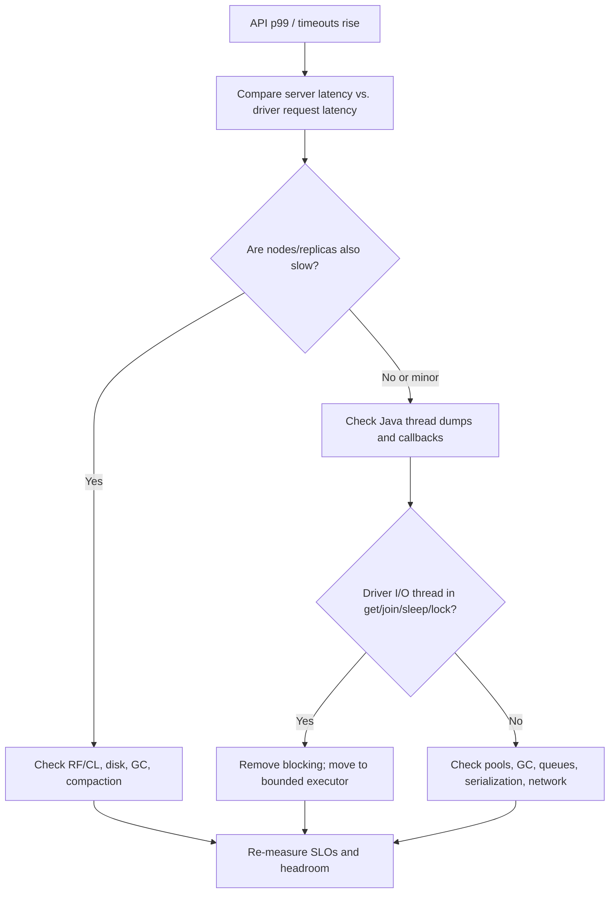

# Driver-Thread Callbacks and Avoiding Blocking Calls in Apache Cassandra

## 1. The Problem: `executeAsync` Does Not Mean Every Step Is Non-Blocking

Apache Cassandra is a **distributed wide-column** database. A Java application's CQL query is sent to a **coordinator**, processed on replicas according to the **partition key** and **replication factor (RF)**, and returns results per the **consistency level (CL)**. Systems with many requests waiting on network or disk I/O typically benefit from asynchronous I/O.

Java Driver 4.x provides `CqlSession.executeAsync(...)` and `CompletionStage<AsyncResultSet>`. Now consider this snippet:

```java
session.executeAsync(statement)
    .thenApply(result -> {
        // BAD: the callback may run on the driver's completion thread.
        try {
            Thread.sleep(200);
        } catch (InterruptedException e) {
            Thread.currentThread().interrupt();
            throw new IllegalStateException(e);
        }
        return result.hasMorePages();
    });
```

An asynchronous Cassandra call **does not guarantee that its inner callback runs on a dedicated long-running worker thread**. Continuations like `thenApply`/`thenCompose`/`whenComplete` can run right on **the thread completing the future**, including a driver I/O or event-loop thread. If a callback sleeps, waits on network, contends on locks, or does heavy CPU work, it can delay handling responses for other queries sharing that resource.

**Lesson goal:** identify which callbacks can run on driver threads, avoid blocking operations on the I/O completion path, offload heavy work to a bounded executor, coordinate with reactive backpressure, and evaluate the impact on p95/p99, timeouts, and retries.

> Short rule: **Callbacks running on the I/O path must be short, non-blocking, and bounded in work.** When blocking is unavoidable, isolate it inside a bounded executor with a time budget and overload rejection.

### What You Will Practice

1. Distinguish `execute`, `executeAsync`, `executeReactive`, and the paging model.
2. Understand `thenApply`, `thenApplyAsync`, `thenCompose`, `whenComplete`, and thread context.
3. Spot blocking operations: `get`/`join`, `Thread.sleep`, JDBC, sync HTTP, file I/O, locks, and heavy computation.
4. Use `thenCompose` for **truly asynchronous** chains instead of calling `join` inside callbacks.
5. Isolate blocking/CPU work using a dedicated executor, semaphore/bulkhead, and bounded queue.
6. Preserve **backpressure, cancellation, timeouts, and error propagation** in reactive pipelines.
7. Use CQL, Java Driver 4.x, and Reactor examples to observe these behaviors and fixes.

## 2. Java Driver 4.x Thread Model: Understanding the Guarantees

Java Driver 4.x uses internal components for I/O, connection management, metadata, request scheduling, and completion. In typical deployments, Netty/event-loop threads handle multiple sockets and events; **an I/O thread is not dedicated to a single query**.



This is a **conceptual** model, not a guarantee of exact thread names or scheduling algorithms across every Java Driver release. With Java `CompletableFuture`, a continuation without the `Async` suffix may run:

- On the thread completing the future, such as a driver I/O thread.
- On the **attaching thread** if the future has already completed.
- On another participating completion thread depending on timing.

Therefore, **never write code assuming `thenApply` always runs on a driver thread**, nor assuming it **never** runs on a driver thread. What you must ensure is that it is **safe if invoked on an I/O processing thread**.

### Driver Threads Are Not Application Worker Threads

A driver event loop can serve responses across many requests. If a callback holds it too long:

1. Responses for other queries are delayed.
2. Client latency climbs even though the database server already finished.
3. Request timeouts, reconnects, or retries can increase.
4. The driver and application keep queuing more work, worsening congestion.

Do not confuse **the Java application's driver threads** with threads inside **Cassandra server nodes**. Blocking a callback can cause client-side timeouts even while `nodetool status` shows all nodes `UN` and zero replication errors.

## 3. How `execute`, `executeAsync`, and Reactive Differ

| API | Result model | Key caveat |
| --- | --- | --- |
| `session.execute(stmt)` | Synchronous `ResultSet` | Calling thread waits for results; iteration may auto-fetch pages |
| `session.executeAsync(stmt)` | `CompletionStage<AsyncResultSet>` | Request does not block caller; callback can run on completing thread |
| `asyncResultSet.currentPage()` | Rows in received page | Iterates current page only; does not auto-fetch all pages |
| `asyncResultSet.fetchNextPage()` | `CompletionStage<AsyncResultSet>` | Fetches next page asynchronously; must pace demand |
| `session.executeReactive(stmt)` | Publisher / Reactive Streams per version API | Demand/backpressure; downstream can still block if written wrong |

**Async does not mean unbounded parallelism**, and **reactive does not automatically guarantee non-blocking execution**. `Flux.map(row -> legacyJdbcCall(row))` still blocks whichever thread executes that operator unless scheduled elsewhere properly.

### Comparing Three Ways to Handle a Query

```java
// 1. Synchronous: caller waits.
ResultSet result = session.execute(statement);

// 2. Asynchronous: caller receives a CompletionStage.
CompletionStage<AsyncResultSet> stage =
    session.executeAsync(statement);

// 3. Callback must be designed carefully:
CompletionStage<Integer> counts =
    stage.thenApply(rs -> countCurrentPageQuickly(rs));
```

Variables/methods here are structural illustrations. The trailing `thenApply` **must only perform lightweight work**, never calling another DB or serializing hundreds of MB to JSON inside the callback.

## 4. Table for Spotting Blocking Operations Inside Callbacks

| Operation inside callback | Risk | Alternative |
| --- | --- | --- |
| `future.get()` or `join()` | Thread blocks on another future; risks pipeline stalls or starvation | `thenCompose` or non-blocking future combinators |
| `session.execute(...)` | Synchronous CQL call waiting on network/server | `session.executeAsync(...)` chained with `thenCompose` |
| `Thread.sleep(...)` | Ties up thread doing no useful work | External scheduler/timer; non-blocking deadlines/backoff |
| Sync HTTP client, JDBC, sync RPC | Prolonged I/O wait | True async client, or offload to a dedicated pool |
| `Files.readAllBytes`, file writes, sync object storage | Blocking I/O and memory spikes | Async APIs or a bounded worker executor |
| Multi-MB JSON serialization / hashing / zip | Heavy CPU and allocations | Dedicated CPU executor; cap payload sizes |
| `synchronized` / lock contention | Indirect blocking via lock waits | Shrink lock scope, use actors/queues or async coordination |
| Heavy synchronous logging/tracing | Blocking I/O or lock contention in appender | Small logs, async appenders, and rate limiting |
| Sync `ResultSet` full iteration | Can auto-fetch pages and wait on network | `AsyncResultSet.currentPage()` and `fetchNextPage` |
| `Mono.block()` in reactive pipeline | Defeats non-blocking; sometimes forbidden by runtime | `flatMap`/`Mono`/`Flux` composition |

**Not every field read from `Row` is dangerous.** For example, `row.getUuid("event_id")` or building a tiny DTO is usually fast enough. The boundary is **CPU time, blocking potential, row count, and memory allocation**, not merely "this is Java code."

### Be Careful Calling Library Code

A method innocently named `format(...)` or `enrich(...)` might:

- Read a configuration file if uncached.
- Perform HTTP/JDBC calls underneath.
- Initialize connections or acquire locks on first call.
- Run reflection/serialization over huge objects.
- Emit synchronous logs.

Review callbacks along their **full call graph**, rather than glancing at a one-line lambda and concluding "no `sleep`, so it's safe."

## 5. Anti-Pattern: Waiting on Another Result Inside `thenApply`

Suppose you fetch an event and then fetch details for one event. The snippet below is **broken from a scheduling standpoint**:

```java
CompletionStage<String> bad = session.executeAsync(findEvent)
    .thenApply(firstResult -> {
        UUID eventId = firstResult.currentPage()
            .iterator().next().getUuid("event_id");

        // BAD: Blocking right inside the callback, which may run on an I/O thread.
        AsyncResultSet second = session.executeAsync(
            findDetails.bind(eventId)
        ).toCompletableFuture().join();

        return second.currentPage()
            .iterator().next().getString("details");
    });
```

Risks:

1. The callback occupies a thread handling completion of the first request.
2. The second request needs the driver to handle network/completion while the callback **is blocked waiting**.
3. If many requests do this concurrently, I/O or completion resources can saturate.
4. `join` sets no overall request deadline and may wrap exceptions in `CompletionException`.

This is not claiming every case immediately deadlocks; **thread starvation and p99 regressions** alone are enough to forbid this pattern on driver I/O paths.

### Fixing Properly with `thenCompose`

```java
CompletionStage<String> good = session.executeAsync(findEvent)
    .thenCompose(firstResult -> {
        Row first = firstResult.currentPage().iterator().next();
        UUID eventId = first.getUuid("event_id");

        // Return the next future; DO NOT block waiting here.
        return session.executeAsync(findDetails.bind(eventId));
    })
    .thenApply(secondResult -> {
        Row row = secondResult.currentPage().iterator().next();
        return row.getString("details"); // Lightweight, non-blocking work.
    });
```

`thenCompose` **flattens** `CompletionStage<CompletionStage<T>>` into a single stage that continues asynchronously. It **does not automatically move the callback to a worker executor**, but it eliminates synchronous waiting. Small single-row/ID extraction can stay on the completion thread; long operations must still be offloaded.

### Preconditions Before Using This Example

`findEvent` and `findDetails` are hypothetical prepared statements; production code must handle empty pages, timeouts, authorization, and partition-key querying. Calling `iterator().next()` without checking emptiness here only highlights the threading issue and is **not a complete production repository pattern**.

## 6. `thenApply` and `thenApplyAsync` Differ in More Than Name

`CompletableFuture` continuations have distinct threading semantics:

| API | How callback is typically scheduled | When appropriate |
| --- | --- | --- |
| `thenApply(fn)` | Completing thread, or attaching thread if already complete | Very short, non-blocking mapping |
| `thenCompose(fn)` | May run on completing thread; `fn` returns another stage | True async I/O chaining without `join` |
| `whenComplete(fn)` | May run on completing thread; preserves success/failure | Lightweight telemetry/cleanup; non-blocking |
| `handle(fn)`, `exceptionally(fn)` | May run synchronously on the completion path | Fast error classification; avoid heavy I/O |
| `thenApplyAsync(fn)` | Without an executor, uses `CompletableFuture`'s **default async executor** (typically common pool) | Do not use default pool to isolate production blocking |
| `thenApplyAsync(fn, executor)` | Callback dispatched to **specified executor** | Heavy CPU work or bounded legacy blocking |
| `thenComposeAsync(fn, executor)` | Composition callback scheduled on specified executor | When constructing the next stage itself needs offloading |

Do not assume `thenComposeAsync` forces **all I/O inside the returned future** to run on that executor: the returned future still has its own lifecycle and completion threads.

### Why Avoid Executor-less `thenApplyAsync` for Everything?

On many JVMs, `CompletableFuture.thenApplyAsync(...)` without an executor uses `ForkJoinPool.commonPool()`. That pool is shared with unrelated async tasks across the process. Putting blocking work there:

- Can slow down unrelated tasks.
- Makes queue depth and latency hard to bound per endpoint.
- Provides no isolated quota for Cassandra result mapping.
- Makes it hard to diagnose when one callback type monopolizes workers.

**Moving from driver I/O threads to the common pool does not solve overload.** Use an executor with a clear owner, bounded threads/queues/in-flight limits, and bounded execution time.

## 7. Proper Offloading: Bounded Executors and Bulkheads



Executor design essentials:

- **Fixed-size thread pool** sized for CPU cores and allowable blocking concurrency.
- **Bounded queue**, never an unbounded queue.
- **Bulkhead/semaphore** capping total logical operations admitted into the pipeline.
- **Explicit rejection policy**: when full, reject and measure rather than silently running on the wrong thread.
- **Graceful shutdown**: stop accepting requests, drain valid tasks, then shut down the executor.
- **Timeouts/deadlines**: requests must not hold resources indefinitely.

### Special Warning About `CallerRunsPolicy`

`ThreadPoolExecutor.CallerRunsPolicy` runs the task directly on **the thread calling `execute(...)` when the queue is full**. If `thenApplyAsync(..., executor)` is dispatched from a driver I/O completion thread, this policy can **push blocking work right back onto the driver thread**.

Therefore, **never use `CallerRunsPolicy` as "free backpressure"** for executors handling Cassandra callbacks. Prefer bounded admission and an explicit rejection policy, and test rejection paths rather than only testing under light load.

### Offloading Does Not Create Capacity

If 500 concurrent requests each need a 200 ms synchronous JDBC call, an 8-thread executor cannot serve all 500 instantaneously. It only isolates driver I/O from blocking. You still must:

- Reduce concurrency.
- Bound queues and deadlines.
- Switch downstream clients to async where possible.
- Check underlying database/JDBC connection pool limits.
- Reject/shed load when headroom runs out.

## 8. Lab CQL: Partition-Keyed Table for Testing Async

This isolated lab uses DC `dc1` and three nodes for RF3. On a single-node lab, adjust RF/CL accordingly; do not misdiagnose `Unavailable` caused by missing replicas as a callback bug.

```sql
CREATE KEYSPACE IF NOT EXISTS async_lab
WITH replication = {
    'class': 'NetworkTopologyStrategy',
    'dc1': 3
}
AND durable_writes = true;

CREATE TABLE IF NOT EXISTS async_lab.events_by_tenant_day (
    tenant_id text,
    event_day date,
    occurred_at timestamp,
    event_id uuid,
    event_type text,
    payload text,
    PRIMARY KEY ((tenant_id, event_day), occurred_at, event_id)
) WITH CLUSTERING ORDER BY (
    occurred_at DESC,
    event_id ASC
);
```

Partition key `(tenant_id, event_day)` groups data by tenant/day; clustering `occurred_at DESC` favors recent events within the partition. If any tenant has huge volume, review partition sizes and use smaller buckets; **paging or `executeAsync` cannot fix a hot or oversized partition**.

### Load Sample Data

```sql
INSERT INTO async_lab.events_by_tenant_day (
    tenant_id, event_day, occurred_at, event_id, event_type, payload
) VALUES (
    'tenant-01', '2026-11-20',
    '2026-11-20T10:00:00Z',
    11111111-1111-4111-8111-111111111111,
    'OPEN', 'event-1'
);

INSERT INTO async_lab.events_by_tenant_day (
    tenant_id, event_day, occurred_at, event_id, event_type, payload
) VALUES (
    'tenant-01', '2026-11-20',
    '2026-11-20T09:00:00Z',
    22222222-2222-4222-8222-222222222222,
    'CLICK', 'event-2'
);

INSERT INTO async_lab.events_by_tenant_day (
    tenant_id, event_day, occurred_at, event_id, event_type, payload
) VALUES (
    'tenant-01', '2026-11-20',
    '2026-11-20T08:00:00Z',
    33333333-3333-4333-8333-333333333333,
    'CLOSE', 'event-3'
);
```

In `cqlsh`:

```text
CONSISTENCY LOCAL_QUORUM;
```

Verify the query:

```sql
SELECT occurred_at, event_id, event_type, payload
FROM async_lab.events_by_tenant_day
WHERE tenant_id = 'tenant-01'
  AND event_day = '2026-11-20'
LIMIT 100;
```

No `ALLOW FILTERING` is needed because the full partition key is supplied. **`LIMIT 100` caps total logical query rows; `setPageSize(20)` tunes page size, not API concurrency limits.**

## 9. Java Code Example: Small Callbacks and Non-Blocking Chains

The repository below uses Java Driver 4.x and prepares the query once. The application supplies a `CqlSession` with contact points, local DC, auth/TLS, timeouts, and external lifecycle management:

```java
import java.time.LocalDate;
import java.util.UUID;
import java.util.concurrent.CompletionStage;

import com.datastax.oss.driver.api.core.CqlSession;
import com.datastax.oss.driver.api.core.DefaultConsistencyLevel;
import com.datastax.oss.driver.api.core.cql.AsyncResultSet;
import com.datastax.oss.driver.api.core.cql.BoundStatement;
import com.datastax.oss.driver.api.core.cql.PreparedStatement;
import com.datastax.oss.driver.api.core.cql.Row;

public final class AsyncEventRepository {
    private final CqlSession session;
    private final PreparedStatement select;

    public AsyncEventRepository(CqlSession session) {
        this.session = session;
        this.select = session.prepare(
            "SELECT occurred_at, event_id, event_type, payload " +
            "FROM async_lab.events_by_tenant_day " +
            "WHERE tenant_id = ? AND event_day = ? LIMIT 100"
        );
    }

    public CompletionStage<Integer> countFirstPage(
            String tenantId, LocalDate day) {
        BoundStatement statement = select.bind(tenantId, day)
            .setConsistencyLevel(DefaultConsistencyLevel.LOCAL_QUORUM)
            .setPageSize(20)
            .setIdempotent(true);

        return session.executeAsync(statement).thenApply(rs -> {
            // Read only the current page; no extra network calls,
            // no sleep/get/join, and no large object serialization.
            int count = 0;
            for (Row ignored : rs.currentPage()) {
                count++;
            }
            return count;
        });
    }

    public CompletionStage<Integer> countFirstTwoPages(
            String tenantId, LocalDate day) {
        BoundStatement statement = select.bind(tenantId, day)
            .setConsistencyLevel(DefaultConsistencyLevel.LOCAL_QUORUM)
            .setPageSize(20)
            .setIdempotent(true);

        return session.executeAsync(statement).thenCompose(first -> {
            int firstCount = countPage(first);
            if (!first.hasMorePages()) {
                return java.util.concurrent.CompletableFuture
                    .completedFuture(firstCount);
            }
            return first.fetchNextPage().thenApply(second ->
                firstCount + countPage(second));
        });
    }

    private static int countPage(AsyncResultSet result) {
        int count = 0;
        for (Row ignored : result.currentPage()) {
            count++;
        }
        return count;
    }
}
```

Notable points:

1. `thenApply` only counts rows already in the page; it does not wait on the network or read the entire dataset.
2. `thenCompose` returns the `fetchNextPage()` stage; it **never calls `join()`** to fetch page two.
3. `setIdempotent(true)` is valid for read-only `SELECT`s, but **not** automatically safe for retried counters, list appends, or LWTs.
4. `pageSize=20` is a fetch target, not a guarantee every page holds exactly 20 rows.
5. Errors on later queries/pages flow into **exceptional completion** of the returned stage.

This example counts **at most two pages**, not the entire query. Scanning more pages in batches requires an async loop with page/byte/time caps, cancellation, and backpressure.

## 10. Complete Java Example: Bounded Executor and In-Flight Limits

The example below models a service mapping a page to DTOs whose business logic cost can grow. To keep heavy mapping off driver I/O threads, it uses `thenApplyAsync(..., mappingPool)` with a **bounded pool and bounded queue**.

```java
import java.time.Instant;
import java.time.LocalDate;
import java.util.ArrayList;
import java.util.Collections;
import java.util.List;
import java.util.UUID;
import java.util.concurrent.ArrayBlockingQueue;
import java.util.concurrent.CompletableFuture;
import java.util.concurrent.CompletionStage;
import java.util.concurrent.RejectedExecutionException;
import java.util.concurrent.Semaphore;
import java.util.concurrent.ThreadFactory;
import java.util.concurrent.ThreadPoolExecutor;
import java.util.concurrent.TimeUnit;
import java.util.concurrent.atomic.AtomicInteger;

import com.datastax.oss.driver.api.core.CqlSession;
import com.datastax.oss.driver.api.core.DefaultConsistencyLevel;
import com.datastax.oss.driver.api.core.cql.AsyncResultSet;
import com.datastax.oss.driver.api.core.cql.BoundStatement;
import com.datastax.oss.driver.api.core.cql.PagingState;
import com.datastax.oss.driver.api.core.cql.PreparedStatement;
import com.datastax.oss.driver.api.core.cql.Row;

public final class BoundedEventPageService {
    private static final int PAGE_SIZE = 20;

    private final CqlSession session;
    private final PreparedStatement select;
    private final Semaphore inFlight = new Semaphore(64);
    private final ThreadPoolExecutor mappingPool;

    public BoundedEventPageService(CqlSession session) {
        this.session = session;
        this.select = session.prepare(
            "SELECT occurred_at, event_id, event_type, payload " +
            "FROM async_lab.events_by_tenant_day " +
            "WHERE tenant_id = ? AND event_day = ? LIMIT 100"
        );

        AtomicInteger nextId = new AtomicInteger();
        ThreadFactory threads = task -> {
            Thread thread = new Thread(
                task, "cassandra-page-mapper-" +
                nextId.incrementAndGet());
            thread.setDaemon(true);
            return thread;
        };

        mappingPool = new ThreadPoolExecutor(
            4, 4, 0L, TimeUnit.MILLISECONDS,
            new ArrayBlockingQueue<Runnable>(64),
            threads,
            new ThreadPoolExecutor.AbortPolicy()
        );
    }

    public CompletionStage<Page> readPage(
            String authorizedTenant, LocalDate day) {
        if (!inFlight.tryAcquire()) {
            CompletableFuture<Page> denied = new CompletableFuture<>();
            denied.completeExceptionally(new RejectedExecutionException(
                "Read concurrency budget exhausted"));
            return denied;
        }

        try {
            BoundStatement statement = select.bind(
                    authorizedTenant, day)
                .setConsistencyLevel(DefaultConsistencyLevel.LOCAL_QUORUM)
                .setPageSize(PAGE_SIZE)
                .setIdempotent(true);

            return session.executeAsync(statement)
                .thenApplyAsync(this::mapPage, mappingPool)
                .whenComplete((page, error) -> inFlight.release());
        } catch (RuntimeException failure) {
            inFlight.release();
            throw failure;
        }
    }

    private Page mapPage(AsyncResultSet result) {
        List<EventItem> items = new ArrayList<>();
        for (Row row : result.currentPage()) {
            items.add(new EventItem(
                row.getInstant("occurred_at"),
                row.getUuid("event_id"),
                row.getString("event_type"),
                row.getString("payload")
            ));
        }

        String next = null;
        if (result.hasMorePages()) {
            PagingState state =
                result.getExecutionInfo().getSafePagingState();
            if (state == null) {
                throw new IllegalStateException(
                    "Missing paging state for next page");
            }
            next = state.toString();
        }
        return new Page(items, next);
    }

    public void closeMappingPool() {
        // Call after the service stops accepting requests; wait for
        // remaining tasks within the application's shutdown deadline.
        mappingPool.shutdown();
    }

    public static final class EventItem {
        public final Instant occurredAt;
        public final UUID eventId;
        public final String type;
        public final String payload;

        public EventItem(
                Instant occurredAt, UUID eventId,
                String type, String payload) {
            this.occurredAt = occurredAt;
            this.eventId = eventId;
            this.type = type;
            this.payload = payload;
        }
    }

    public static final class Page {
        public final List<EventItem> items;
        public final String nextPagingState;

        public Page(List<EventItem> items, String nextPagingState) {
            this.items = Collections.unmodifiableList(
                new ArrayList<>(items));
            this.nextPagingState = nextPagingState;
        }
    }
}
```

### Why Is This Better Than an Unbounded Pool?

- `Semaphore(64)` bounds accepted logical `readPage` calls, **spanning both Cassandra wait time and mapping time**.
- `ThreadPoolExecutor(4,4,...)` caps concurrent mapping tasks.
- `ArrayBlockingQueue(64)` prevents unbounded queuing; `AbortPolicy` avoids falling back onto I/O threads when full.
- `thenApplyAsync` creates an explicit scheduling boundary.
- `whenComplete` only releases the permit, staying very short.
- `closeMappingPool` has its own lifecycle; never shut down the executor while requests are still arriving.

This is a **learning pattern**, not a full production framework. Production needs tests for **executor rejection**, shutdown races, cancellation, timeouts, backpressure, metrics, and error mapping when `CompletableFuture` completes exceptionally. If the mapping pool is shared with other tasks, admission no longer guarantees queue capacity.

### Sample Limitation: Never Use Raw Paging State as a REST Token

`Page.nextPagingState` is only for **repository-level** illustration. When exposing cursors over HTTP, validate tenant/query/role, include version/TTL, encrypt or sign against tampering, and re-bind to **the exact same CQL and parameters**. `PagingState` is neither an authorization token nor a data snapshot.

### Size Limits to Real Resources, Never Pick 64 Blindly

Thread counts, queue sizes, and permits must reflect latency, throughput, page sizes, CPU/memory quotas, and node/connection capacity. If each mapping task takes 200 ms, 4 threads can complete only a fixed rate per second; a 64-item queue can introduce **long wait times** rather than making the system faster.

Production practice should measure **executor active count, queue depth, rejected count, in-flight permits, queue wait time, and end-to-end p99**, rather than raising numbers until memory runs out.

## 11. When Blocking Calls Are Unavoidable: Isolate and Control

Async SDKs are not always available. A service may have to call legacy JDBC, a synchronous cloud SDK, or a PDF/zip library.

Design:



### Minimum Requirements for an Offloaded Blocking Call

1. **Timeout on the blocking library itself**: a sync JDBC/HTTP call can stay hung even after the outer `CompletionStage` times out.
2. **Separate pools by dependency/workload**: a slow legacy API must not starve workers needed by other endpoints' mapping.
3. **Bounded concurrency and queues**: never accumulate unbounded requests when downstream is down.
4. **Circuit breaking / fail fast** when a dependency persistently fails, preventing the whole JVM from backing up.
5. **Do not hold Cassandra state locks** while calling a blocking library.
6. **Propagate cancellation and deadlines** wherever the dependency supports them.
7. **Separate metrics** for queue wait and blocking duration.

If the blocking dependency is the bottleneck, the long-term fix may be migrating to an async client or decoupling via queues/events. Offloading only **isolates blast radius**; it does not turn a blocking call into a non-blocking one.

## 12. Reactive Streams: Backpressure Does Not Replace Non-Blocking Design

Java Driver 4.x provides a **Reactive Streams** API; applications can consume the publisher from `session.executeReactive(statement)` and integrate Reactor/RxJava via compatible artifacts.

In a reactive pipeline:

- **Publisher** emits items.
- **Subscriber** requests items via demand `request(n)`.
- Operators like `map`, `filter`, and `flatMap` may run on the upstream emission thread unless a scheduler boundary is inserted.
- **Backpressure** limits downstream demand, but does not magically make a `map` containing JDBC or `Thread.sleep` non-blocking.
- Prefetching, buffering, and page fetching depend on connector/operator/driver implementation; **do not assume `request(1)` means every upstream component holds just one row**.

### Wrong Example: Blocking Directly Inside `map`

```java
Flux<String> bad =
    Flux.from(session.executeReactive(statement))
        .map(row -> legacyClient.lookupSync(
            row.getUuid("event_id")
        ));
```

Here `legacyClient.lookupSync` is a hypothetical synchronous dependency. If the operator runs on a driver I/O-related thread, it can block emitting subsequent events.

### Better Direction: Bounded Per-Item Offload

```java
import java.util.UUID;

import reactor.core.publisher.Flux;
import reactor.core.publisher.Mono;
import reactor.core.scheduler.Scheduler;
import reactor.core.scheduler.Schedulers;

// Create scheduler at startup; dispose cleanly at shutdown.
Scheduler blockingScheduler =
    Schedulers.newBoundedElastic(
        8, 100, "legacy-lookup");

Flux<String> enriched =
    Flux.from(session.executeReactive(statement))
        .flatMap(row -> {
            UUID eventId = row.getUuid("event_id");
            return Mono.fromCallable(
                () -> legacyClient.lookupSync(eventId)
            ).subscribeOn(blockingScheduler);
        }, 8); // At most 8 concurrent lookups requested by flatMap.
```

This Reactor example requires compatible Reactor dependencies and assumes `legacyClient` exists. `Schedulers.newBoundedElastic(...)` bounds workers and queues, while `flatMap(..., 8)` bounds enrichment concurrency within this subscription. Across multiple concurrent subscriptions, you still need a **service-wide quota** and downstream caps. Do not treat 8 as a universal production default.

`subscribeOn` inside `Mono.fromCallable` moves the **blocking work** onto that scheduler. To shift an entire downstream CPU stage onto another scheduler, use `publishOn` with an appropriate prefetch; understand operator boundaries and measure memory.

### What to Avoid

- `Flux.from(publisher).collectList()` over an unbounded dataset pulls every row into memory.
- `flux.blockLast()` or `mono.block()` on an event loop/reactive thread blocks and may trigger runtime errors.
- `flux.subscribe(...)` without handling errors/cancellation creates unmanaged "fire-and-forget" work.
- Unbounded `flatMap` concurrency paired with large driver requests causes CPU/GC/queue overload.
- `onErrorResume` returning an empty list for all errors hides real `Unavailable`/timeout failures.

Reactive APIs pay off when the **end-to-end data path handles demand and errors explicitly**—not when you merely swap `executeAsync` for a publisher and call it backpressured.

## 13. `publishOn`, `subscribeOn`, and Key Differences

In Reactor:

| Operator | Primary meaning | Common mistake |
| --- | --- | --- |
| `map(fn)` | Synchronous transformation on the operator's executing thread | Putting blocking I/O inside `fn` |
| `flatMap(fn, concurrency)` | Merges inner publishers concurrently | Unbounded concurrency, or losing order when business requires it |
| `concatMap(fn)` | Preserves order; sequential per operator/prefetch | Stalls when one blocking call hangs |
| `subscribeOn(scheduler)` | Affects subscription and wrapped source thread | Placing it wrong and expecting all callbacks to switch |
| `publishOn(scheduler)` | Switches execution context for downstream operators | Placing it **after** a blocking `map`, too late |
| `onBackpressureBuffer` | Buffers items when downstream lags | Using an unbounded buffer instead of real load control |
| `limitRate(n)` | Tunes demand requested from upstream | Mistaking it for a concurrency cap on HTTP/JDBC calls |
| `timeout(...)` | Enforces deadline at reactive layer | Assuming server work rolled back or blocking calls aborted |

`publishOn` works well when placed **before** heavy CPU mapping, though queuing many rows still consumes memory. For per-row blocking I/O, wrapping each call in `Mono.fromCallable(...).subscribeOn(boundedScheduler)` usually makes the boundary clearer.

**Result ordering:** `flatMap` can emit items out of upstream order. If an API requires Cassandra's clustering order, use an order-preserving operator or attach a sequence key rather than trading correctness for concurrency without a merge policy.

## 14. Cancellation and Timeouts: Stopping Waiting Does Not Mean "Not Written"

For reads, cancelling a subscriber or future stops you from processing further results. For CQL mutations, however, Cassandra may **have already applied the write** before the client observes a timeout or cancel.

```text
T0  Java calls executeAsync(UPDATE ...)
T1  Coordinator sends mutation to replicas
T2  HTTP caller cancels request
T3  Client cancels stage / reactive subscription
T4  Replicas may have written data before or after T2
```

**Cancellation is not rollback.** For non-idempotent mutations—counter increments, list appends, time-sensitive TTLs, or LWTs—never blindly re-issue just because a subscriber cancelled.

### Distinguish Three Deadlines

1. **Driver request timeout:** deadline for the driver's request execution.
2. **HTTP/request deadline:** total time the caller agrees to wait.
3. **Downstream blocking timeout:** deadline on the JDBC/HTTP/file call inside the worker pool.

A short outer deadline cannot interrupt a hung synchronous call by itself. Enforce timeouts on the dependency itself or use true cancellation where supported.

### Retries Can Make Things Worse

When callbacks block driver I/O:

- Responses are processed late, causing driver-side timeouts.
- Each retry sends another request to Cassandra.
- `LOCAL_QUORUM` still requires enough replicas—never drop to `ONE` just to mask visible errors.
- Misconfigured retries or speculative execution can double load; on non-idempotent writes they can double mutations.

Fixes must start by **removing blocking callbacks and throttling load**, not by cranking up timeouts and retries.

## 15. Handling Exceptions in the Chain Without Hiding Root Causes

`CompletionStage` finishes in one of two ways: **normal completion** or **exceptional completion**. If a `thenApply` callback throws, the downstream stage fails; never catch every exception and return an "empty" result silently.

```java
CompletionStage<Page> stage =
    service.readPage(authorizedTenant, day)
        .whenComplete((page, error) -> {
            // Only O(1) non-blocking telemetry.
            // Never log credentials, raw partition keys, or payloads.
            metrics.recordCompleted(error == null);
        });
```

This snippet assumes `service`, `Page`, `metrics`, `authorizedTenant`, and `day` exist in scope. Ensure `metrics.recordCompleted` is genuinely fast and non-blocking; if it makes synchronous HTTP calls, that is still a design bug.

### Errors to Keep Separate

| Signal | Possible failure layer | What to check |
| --- | --- | --- |
| `ReadTimeoutException` | Replicas failed to satisfy read CL in time | RF/CL, disk/GC/network, node latency |
| `WriteTimeoutException` | Write lacked enough ACKs within deadline | Outcome may be uncertain; avoid retrying non-idempotent mutations |
| `UnavailableException` | Insufficient replicas available for CL | `nodetool status`, DC/rack, RF/CL |
| `DriverTimeoutException` | Driver exceeded request deadline | Driver/connection/pool issues or slow server |
| `AllNodesFailedException` | No node completed the request; per-node causes | Auth, TLS, network, pools, and driver routing |
| `RejectedExecutionException` | Local executor/pipeline overloaded or shut down | Queue/permits, rejections, admission control |
| `CompletionException` | Wrapper around `CompletableFuture` failures | Unwrap root cause; never retry based on wrapper alone |
| `OutOfMemoryError` / extreme GC | Unbounded buffers / `collectList` / huge payloads | Heap, allocations, demand, page size, queues |

Exact exception classes and how the driver attaches root causes depend on version; always inspect the **cause** before deciding to retry. `Unavailable`/timeout alone does not prove a callback is at fault; measure both client and server.

### A Telemetry Error Can Also Break the Pipeline

If `whenComplete` invokes code that throws or blocks for a long time, the resulting stage can be impacted or delayed. Telemetry should:

- Only update lightweight counters/timestamps on the completion path.
- Never serialize entire `Row` objects into logs.
- Never perform synchronous network calls in the name of metrics.
- Batch/ship metrics out-of-band with bounded quotas.

## 16. Performance Observability: Separating Slow Cassandra from Blocking Callbacks



### Layer-by-Layer Observability Table

| Layer | Metrics / observations | Diagnostic clue |
| --- | --- | --- |
| Java API | Logical QPS, p95/p99, cancellations, HTTP deadlines | Did spikes start after a callback deployment? |
| Java Driver | Request latency, timeouts, attempts, in-flight, connection pools | Are requests stuck on the client or server? |
| Driver threads | Thread dumps, event-loop blocked duration, callback stacks | Any `join`/`sleep`/JDBC/locks present? |
| Mapping executor | Active threads, queue depth, rejections, queue wait | Is the offload pool saturated? |
| Reactor | Demand/prefetch, in-flight `flatMap`, buffers, scheduler queues | Is a reactive operator buffering unboundedly? |
| Cassandra | `nodetool tpstats`, `compactionstats`, `tablestats` | Is the node genuinely overloaded? |
| JVM / OS | GC pauses, heap, CPU, disk await, network | Is there another concurrent bottleneck? |

In a controlled lab or incident:

```bash
nodetool status
nodetool tpstats
nodetool compactionstats
nodetool tablestats async_lab.events_by_tenant_day
nodetool tablehistograms async_lab events_by_tenant_day
```

`nodetool` figures reflect **per-node** server views and do not directly measure time spent inside Java callbacks. If local Cassandra p99 looks healthy while API p99 is bad, inspect thread dumps and executor queues before tweaking compaction or raising RF without evidence.

### Key Thread Dump Signals

In the **Java application's** thread dump, search stacks involving Netty/driver callbacks for:

- `CompletableFuture.join`, `CompletableFuture.get`, `LockSupport.park`.
- `Thread.sleep`.
- JDBC socket reads / synchronous HTTP clients.
- `Files` or filesystem calls.
- Monitor contention / `synchronized` locks.
- Heavy CPU serializers/encoders.

**Do not rely solely on thread names.** Names vary across drivers/runtimes, and already-completed callbacks can run on caller threads; inspect stack traces, timing, and actual call paths.

## 17. Safe Lab Performance Experiments

### Experiment A — Lightweight Callback

1. Use `AsyncEventRepository.countFirstPage(...)` from section 9.
2. Run moderate lab load; record API latency and driver request latency.
3. Verify row/page counts and confirm zero callback blocking.
4. Establish a baseline before introducing anti-patterns.

### Experiment B — Simulating a Blocking Callback in the Lab

In an **isolated lab**, you can place `Thread.sleep(100)` inside a callback after a query to observe p99 and thread dumps; **never run this in production** and never use it as a timeout mechanism.

```java
// LAB ONLY: never deploy to a real service.
return session.executeAsync(statement).thenApply(rs -> {
    try {
        Thread.sleep(100);
    } catch (InterruptedException e) {
        Thread.currentThread().interrupt();
        throw new IllegalStateException(e);
    }
    return countCurrentPage(rs);
});
```

`countCurrentPage` is an illustrative helper. Results vary with I/O thread counts, request volume, callback scheduling, and environment. **Do not predict a fixed p99 ratio.**

### Experiment C — Offloading with Small Concurrency

1. Move heavy callbacks to `thenApplyAsync(..., executor)`.
2. Fix thread count, queue size, and in-flight permits.
3. Sweep QPS from low to high while tracking queue wait and rejections.
4. Confirm driver I/O threads no longer show blocking stacks.
5. Above capacity, require **observable fail-fast behavior** instead of unbounded queue growth.

### Experiment D — Reactive Demand and Slow Processing

1. Use `executeReactive` with bounded subscriber demand and buffers.
2. Compare blocking `map` against `flatMap` offloaded onto a bounded scheduler.
3. Slow downstream enough to observe queues and concurrency bounds.
4. Never use `collectList` over an unbounded dataset.
5. Cancel the subscription and verify resource cleanup; never assume cancel rolls back writes.

### Lab Success Criteria

| Criterion | Expected |
| --- | --- |
| Driver callbacks | Zero blocking I/O, `join/get`, or `sleep` |
| Request latency | No large tail spikes from callbacks holding I/O threads |
| Executor | Queue/active/rejection metrics remain within configured bounds |
| Bounded demand | Memory does not grow endlessly with rows/pages |
| Errors | Timeouts, rejections, and cancellations properly classified |
| CQL correctness | Queries still use valid partition keys, CL, and paging |
| Shutdown | No orphaned tasks when stopping the service |

## 18. Common Pitfall Scenarios

### Scenario A — `thenApply` Calls JDBC

`executeAsync` succeeds; the callback makes a 300 ms synchronous JDBC call. Under peak traffic, API p99 spikes even though Cassandra nodes stay `UN`. Why?

**Suggested answer:** The callback can run on a driver completion/I/O thread and block processing other responses. Move JDBC to a bounded executor or switch to async JDBC/HTTP; inspect thread dumps and queues.

### Scenario B — `join` on Another Cassandra Query

Inside `thenApply`, a developer calls `session.executeAsync(queryB).toCompletableFuture().join()` to fetch secondary data.

**Suggested answer:** Blocks the callback while the driver still needs to complete `queryB`, causing starvation/latency or deadlocks in worst cases. Use `thenCompose` to return `queryB`'s stage and perform lightweight mapping next.

### Scenario C — Using `thenApplyAsync` Without Specifying a Pool

A team switches all callbacks to `thenApplyAsync(...)` with a sync HTTP client inside; p99 degrades across many unrelated endpoints too.

**Suggested answer:** Tasks likely run on the default common pool, contending with the rest of the system. Use a dedicated bounded executor, HTTP client timeouts, admission control, and explicit rejections.

### Scenario D — `CallerRunsPolicy` to Avoid Rejections

The mapping pool fills up, and `CallerRunsPolicy` runs mapping directly on the submitting thread; logs show heavy callbacks executing on I/O threads.

**Suggested answer:** The rejection policy itself bounced work back onto the submitting thread, which can be driver I/O. Replace with bounded admission + `AbortPolicy`/overload handling rather than a blocking fallback.

### Scenario E — Reactive Code Calling `Mono.block()`

A Reactor API calls `block()` inside an operator or handler to wait for Cassandra.

**Suggested answer:** Turns the reactive pipeline into a synchronous wait, blocking event loops or failing runtime checks. Return the publisher/`CompletionStage` and compose asynchronously, or isolate legacy sync code on an appropriate scheduler.

### Scenario F — `collectList` on a Huge Partition

Reads `Flux<Row>` from Cassandra, calls `collectList()`, and serializes everything for a single HTTP response.

**Suggested answer:** Backpressure cannot help if downstream insists on buffering everything. Bound the query/pages, stream responses with quotas, or move to an export job with backpressure and checkpoints.

### Scenario G — Timeout After Cancelling a Write

A client cancels an HTTP request issuing `UPDATE counter = counter + 1`. The service assumes "cancelled means not written" and re-sends it.

**Suggested answer:** Cancellation does not roll back mutations on replicas. Outcome may be UNKNOWN; never blindly retry counters—use operation IDs, event logs, or reconciliation workflows.

### Scenario H — Offloaded With an Unbounded Queue

Driver I/O is no longer blocked, but the mapping executor has an unbounded queue; at peak, thousands of pages pile up and the JVM OOMs.

**Suggested answer:** Offloading merely moved the bottleneck. Add in-flight quotas, bounded queues, deadlines/rejections, smaller payloads, and downstream pacing.

### Scenario I — `flatMap` Scrambles Order

A reactive pipeline enriches rows concurrently with `flatMap`, and client results arrive out of order despite Cassandra's clustering order.

**Suggested answer:** `flatMap` can complete out of upstream order. If ordering matters, use `concatMap`, `flatMapSequential`, or bounded sequence-key re-sorting.

### Scenario J — One Node Down in RF3

`LOCAL_QUORUM` with RF3, one node down; two remain up, yet API timeouts surge after adding a blocking callback. Should you drop CL to `ONE`?

**Suggested answer:** Not if the contract requires quorum. First separate Java callback latency from replica/server latency; remove blocking, check node health, CPU/disk, and retries. Weakening CL erodes guarantees without fixing the callback bug.

## 19. Runbook When Production Shows Callback Starvation

1. **Confirm scope:** affected APIs, query templates, release, DC, read/write p95/p99, timeout counts, and start time.
2. **Inspect Cassandra:** `nodetool status`, replica CL, dropped messages, disk/GC/compaction; rule out genuinely down or overloaded nodes.
3. **Take Java thread dumps:** look for driver completion/I/O stacks stuck in `get/join`, `sleep`, sync JDBC/HTTP, or locks.
4. **Audit callbacks:** check `thenApply`, `thenCompose`, `handle`, `whenComplete`, `exceptionally`, reactive operators, and callback telemetry.
5. **Inspect executors:** pool type, queue size, rejection policy, `CallerRunsPolicy`, shared common pool, and pending tasks.
6. **Stop load amplification:** curb retries/speculation, throttle concurrency, and pause non-essential jobs per change process.
7. **Recover safely:** remove blocking from I/O, offload with quotas; canary and measure post-fix performance.
8. **Verify SLOs:** client/server latency, request attempts, executor queues, memory/GC, and Cassandra pending tasks.
9. **Audit data correctness:** for timed-out/cancelled writes, never assume non-execution; reconcile counters/lists/TTLs/LWTs per semantics.
10. **Prevent recurrence:** code review/lint rules banning `join/get/block/sleep` on async paths, load testing, bounded concurrency, and alerts.

Never run `nodetool flush`, repair, or compaction to "fix callback blocking"; it is a **Java client code/scheduling bug**, even if the cluster also suffers secondary retry-storm load.

## 20. Production Checklist for Async/Reactive Cassandra

**Code design**

- [ ] Use `executeAsync` or `executeReactive` for async I/O without assuming downstream is also non-blocking.
- [ ] `thenApply`/`thenCompose`/`whenComplete`/`handle` do only small, non-blocking work safe on driver completion threads.
- [ ] Zero `get`/`join`/`sleep`/sync `session.execute` calls inside driver callbacks.
- [ ] Use `thenCompose` to chain async DB/API calls rather than waiting on futures inside callbacks.
- [ ] Offload heavy CPU or legacy blocking work with `thenApplyAsync(..., explicitExecutor)` or proper reactive schedulers.
- [ ] Never use `CallerRunsPolicy` on an executor fed by driver completion threads if tasks can block.
- [ ] Never rely on the default common pool as a production bulkhead.

**Resource limits**

- [ ] Bounded thread counts, queues, and in-flight permits with monitored rejections.
- [ ] Timeouts enforced on sync HTTP/JDBC/file dependencies, not only outer HTTP deadlines.
- [ ] Request/page/byte/time budgets enforced; no unbounded `collectList`/`fetchNextPage`.
- [ ] Reactive demand, prefetch, and concurrency bounded; no unbounded `flatMap`.
- [ ] Backpressure, cancellation, and shutdown lifecycles tested.
- [ ] Never create a new `CqlSession` per request; prepare statements once where appropriate.

**Data and distributed behavior**

- [ ] Queries use proper partition/clustering keys; never rely on async to mask full scans.
- [ ] RF/CL, local DC, auth/TLS, and paging properly designed and verified.
- [ ] Mutation timeouts/cancellations never treated as rollbacks.
- [ ] Retries and speculative execution enabled only for proven idempotent operations.
- [ ] Never downgrade CL to hide callback starvation.

**Observability and operations**

- [ ] Measure API p95/p99 and driver request latency separately.
- [ ] Monitor thread dumps, blocked event-loop indicators, executor queues/rejections, and GC.
- [ ] Track driver attempts, timeouts, connection pools, and Cassandra `tpstats`/`compactionstats`.
- [ ] Have canary rollout, overload/rejection tests, and code rollback procedures.
- [ ] Maintain a runbook separating client callback issues from replica/disk/network bottlenecks.

**Remember:** `executeAsync` and reactive APIs keep Java from blocking request threads while waiting on Cassandra, yet **callbacks without the `Async` suffix may run on the driver's future-completion thread**. Never place `join/get`, `sleep`, sync JDBC/HTTP, or heavy CPU work there. **Compose async work with `thenCompose`**, or offload to a **bounded executor/scheduler** with explicit backpressure, deadlines, and rejections. That keeps slow enrichment tasks from choking shared I/O threads while preserving RF/CL, paging, retry, and mutation correctness across a distributed Cassandra cluster.
