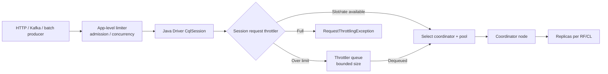
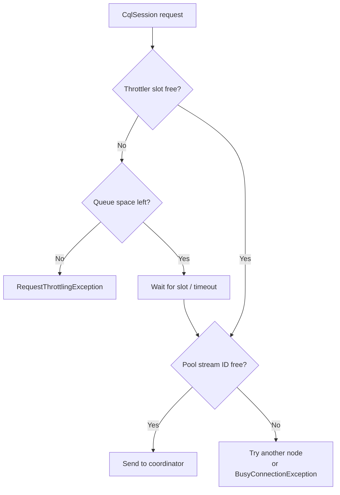
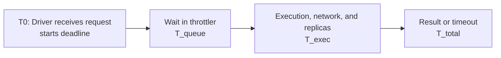
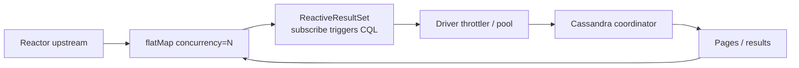
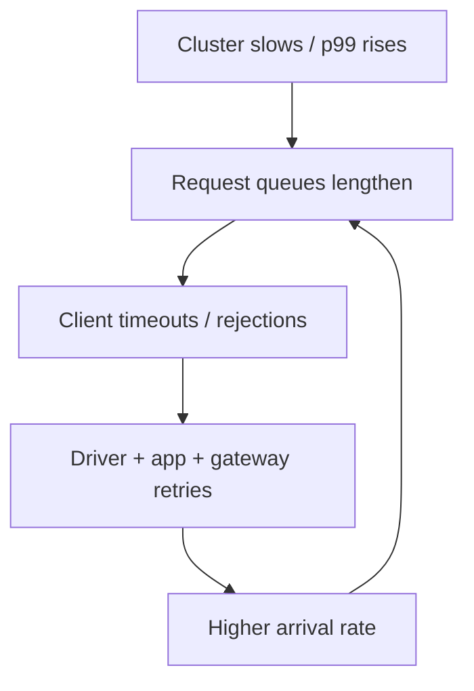

# Request Throttlers, Queues, and Timeouts

**Chapter:** Async and Reactive  
**Module:** `DATABASE_ENGINE_WIDE_COLUMN_CASSANDRA` — Apache Cassandra

A Java application uses `CqlSession.executeAsync()` to send thousands of mutations into Apache Cassandra. At first, response times look steady. When event volume spikes suddenly, pending requests climb, p99 degrades, and some operations receive `DriverTimeoutException` even though Cassandra CPU may not be saturated. Switching to Reactive Streams can make the code look "non-blocking," yet if upstream emits unbounded mutations, **non-blocking does not mean end-to-end backpressure down to Cassandra**.

In Java Driver 4.x, a **request throttler** is a **client-side session-level** mechanism that bounds how many requests may proceed or the rate at which requests start. Above the threshold, requests enter a **bounded queue** or are rejected. This directly interacts with **request timeouts**, connection pools, stream IDs, retries, speculative execution, and recovery under cluster overload.

This lesson integrates the `DATABASE_ENGINE_WIDE_COLUMN_CASSANDRA` module context: distributed wide-column architecture, partition keys/tokens, query-driven table design, CQL, replication/consistency levels, compaction/repair, error handling, and Java application connectivity. The goal is choosing **load limits, queue lengths, and timeouts** aligned with business contracts—not merely tweaking config to silence exceptions.

> **Scope:** Based on Apache Cassandra Java Driver **4.18.1** and Cassandra 4.1/5.x. All numbers below are for lab exercises or illustrative calculations, **not production defaults**. Verify your JDK, driver/server versions, reactive framework behavior, metrics exports, and active config before applying. Never induce overload against a production cluster.

## 1. Learning Objectives

After this lesson, you will be able to:

1. Distinguish `execute()`, `executeAsync()`, `executeReactive()`, and their backpressure scopes.
2. Explain the three request throttlers: **pass-through**, **concurrency-limiting**, and **rate-limiting**.
3. Identify **in-flight**, **queue capacity**, **request rate**, and pool/stream ID limits as separate resources.
4. Explain why **the request timeout starts before the request enters the throttler**, so requests can expire before ever reaching a node.
5. Distinguish `RequestThrottlingException`, `DriverTimeoutException`, `BusyConnectionException`, server timeouts, and server overload.
6. Interpret the three metrics `throttling.delay`, `throttling.queue-size`, and `throttling.errors` alongside `pool.available-streams`.
7. Choose a concurrency window based on throughput, latency, and memory rather than growing queues indefinitely.
8. Use Java Driver 4.x and `CompletionStage` with **admission control** that never blocks I/O threads.
9. Use Reactor `flatMap(..., concurrency)` to cap write concurrency; explain the boundaries of Reactive Streams.
10. Design deadlines, overload responses, retries/idempotence, and testing/rollback plans when changing policies.

## 2. Why Does Higher Load Cause Queueing?

### 2.1. Path of a Request



This is a conceptual diagram, not an exact internal callback order for any specific driver version. Key takeaway: **a request can spend time inside the application/driver before a coordinator ever sees the CQL**.

A request passes multiple potential wait points: HTTP server, worker queue, executor, throttler queue, connection pool/stream IDs, coordinator queue, and disk/compaction. Adding another queue does not create throughput; it shifts waiting time from one place to another.

### 2.2. Async Does Not Make Cassandra Process Faster

`CqlSession.executeAsync()` returns `CompletionStage<AsyncResultSet>` so Java threads avoid blocking on network I/O. If the application generates requests faster than the system drains them, live futures, payloads, and contexts still accumulate, causing memory pressure and latency.

**Non-blocking ≠ unbounded concurrency.** Reactive Streams manages demand between supporting publishers/subscribers, yet the Cassandra native protocol does not carry a general end-to-end backpressure signal from storage servers back to an upstream write producer.

### 2.3. What Does a Queue Protect?

A small queue can absorb short bursts when the backend still has headroom to recover. A large queue can accept requests for a few extra seconds, but drives up **end-to-end latency** and memory held in flight.

| State | Potential benefit | Risk |
| --- | --- | --- |
| No queue | Fail fast on overload | Even tiny bursts get rejected |
| Small / bounded queue | Absorbs brief bursts | Needs timeouts and memory bounds |
| Very large queue | Fewer immediate rejections | Requests expire in queue; huge p99; retains payloads/futures, spreads overload |
| Unbounded upstream queue | Producer never blocked initially | OOM/GC; hard to know which requests remain valid |
| Explicit in-flight cap | Backend protected, predictable capacity | Needs sizing/telemetry to avoid under-utilization |

**The goal is not a queue that never fills**, but predictable behavior when capacity is exceeded: accept within bounds or reject cleanly so upstream slows down.

## 3. Three Request Throttlers in Java Driver 4.18.1

Java Driver configures throttling under `datastax-java-driver.advanced.throttler`. It is **session-wide**, not a separate queue per partition, table, or replica.

### 3.1. `PassThroughRequestThrottler`

The default is pass-through: requests proceed immediately with **no throttler wait queue**.

```hocon
datastax-java-driver {
  advanced.throttler {
    class = PassThroughRequestThrottler
  }
}
```

This **does not mean every request is guaranteed to send**. If pools run out of stream IDs or no suitable node exists, the driver still fails—e.g., `AllNodesFailedException` wrapping `BusyConnectionException`. Pass-through simply adds no throttling at the throttler layer.

### 3.2. `ConcurrencyLimitingRequestThrottler`

Allows up to `max-concurrent-requests` active requests; requests beyond the cap queue up to `max-queue-size`. Whenever an active request finishes (success, error, or timeout), the driver dequeues the oldest waiting request.

```hocon
# LAB: small values to observe queueing, NOT a production baseline.
datastax-java-driver {
  basic.request.timeout = 2 seconds

  advanced.throttler {
    class = ConcurrencyLimitingRequestThrottler
    max-concurrent-requests = 32
    max-queue-size = 64
  }
}
```

| Parameter | Meaning | What it does NOT mean |
| --- | --- | --- |
| `max-concurrent-requests = 32` | At most 32 requests concurrently past the session's concurrency gate | Does not mean Cassandra executes only 32 mutations cluster-wide |
| `max-queue-size = 64` | At most 64 requests **waiting in the throttler queue** | Not 64 connections, 64 threads, or 64 replicas |
| `basic.request.timeout = 2 seconds` | Driver-enforced deadline per request | Not a separate 2 seconds starting after leaving the queue |
| `RequestThrottlingException` | Queue could not accept a new request when the limit was hit | Does not mean the server processed the request |

If 32 requests are active and 64 are queued, the 97th request (assuming none complete in between) can be rejected at the throttler layer. Under real concurrent execution, timing shifts instantaneous counts continuously.

### 3.3. `RateLimitingRequestThrottler`

Caps **requests started per second** rather than active concurrency. Excess requests queue up; a periodic drain runs every `drain-interval`.

```hocon
# ALTERNATIVE for lab; DO NOT enable alongside the config above.
datastax-java-driver {
  basic.request.timeout = 2 seconds

  advanced.throttler {
    class = RateLimitingRequestThrottler
    max-requests-per-second = 40
    max-queue-size = 80
    drain-interval = 5 milliseconds
  }
}
```

With rate limiting, **an active request finishing does not immediately grant new quota**: quota depends on how many requests started in the time window. Hence the driver re-checks the queue periodically.

Too small a `drain-interval` adds wake-up/processing overhead; too large delays requests even when rate budget is available. There is no universally optimal "5 ms"; measure `throttling.delay` and request latency.

### 3.4. Quick Comparison

| Aspect | Pass-through | Concurrency-based | Rate-based |
| --- | --- | --- | --- |
| Primary limit | None in throttler | Active requests | Requests started/sec |
| Queue trigger | None | Active slots full | Rate exceeded |
| When dequeued? | N/A | When an active request completes | Per rate window / `drain-interval` |
| Burst protection | No | Yes, if queue is bounded | Yes, if queue is bounded |
| Protects in-flight when backend slows | No | **Yes** | **Not guaranteed**; constant rate can still pile up active requests |
| Tuning complexity | Low | Depends on latency/concurrency/pool | Depends on ingest rate/burst/drain |
| Common pitfall | Still fails when stream IDs exhaust | Queue does not raise throughput | Rate limit does not replace concurrency limit |

You do not necessarily need both limits inside the Driver layer itself: an upstream producer can also enforce rate or concurrency control. In reactive apps, it is often better to throttle the source in the pipeline rather than letting the Driver hold large pending backlogs.

## 4. Throttler Queues Differ from Connection Pool Queues

A common diagnostic mistake is seeing `BusyConnectionException` and raising `max-queue-size` without checking the connection pool.

### 4.1. Stream IDs Are a Separate Resource

The Cassandra native protocol multiplexes concurrent requests over one connection using stream IDs. The driver bounds requests per connection and connections per node. When all streams to suitable nodes are busy, the driver tries other nodes; if none remain usable, `AllNodesFailedException` may contain `BusyConnectionException`.



Pool and throttler limits must **align**: if pools run out of stream IDs **before** hitting the concurrency threshold, you still get busy-connection errors regardless of how large the throttler queue is.

### 4.2. Options to Know

Relevant Driver 4.x option names/units:

```text
advanced.throttler.max-concurrent-requests
advanced.throttler.max-queue-size
advanced.connection.pool.local.size
advanced.connection.pool.remote.size
advanced.connection.max-requests-per-connection
advanced.metrics.node.enabled = [pool.available-streams]
```

Check your version's reference configuration and actual metrics. Never treat `node_count × connection_count × streams_per_connection` as production request capacity: replica health, coordinator routing, speculative executions, network, disk/CPU, and CL can impose much lower ceilings.

### 4.3. Why Not Simply Add More Connections?

Adding connections can help if **pool stream IDs** are genuinely the bottleneck and the server has headroom. Overdoing it causes:

- More network sockets and TLS overhead.
- Deeper coordinator/server queues.
- More active in-flight requests causing memory pressure.
- A hot partition still has the same fixed token owners/replicas.
- Worse write p99 when disk/compaction is already saturated.
- More retry/speculative execution attempts under heavy load.

**Never optimize a single metric in isolation.** Compare `throttling.queue-size`, `pool.available-streams`, client p99, request rate, disk I/O, and server errors together.

## 5. Timeouts: Where Does the Clock Start?

### 5.1. The Most Important Rule

In Java Driver 4.x, **the request timeout includes time spent waiting in the throttler queue**. The timeout clock starts **before** the request enters the throttler.

Thus, a request can time out without **ever being sent to a coordinator**. Conversely, a request that was sent and timed out may have already been applied by replicas without the client getting an ACK; never lump both cases together as "DB returned an error."



Model:

\[
T_{\mathrm{request}} \approx
T_{\mathrm{queue}} +
T_{\mathrm{execute/network}} +
T_{\mathrm{retry/speculate}}
\]

In practice, some parts can overlap (such as speculative executions), so the equation is a **budget-analysis tool**, not an exact sum for every execution.

### 5.2. Example of a Request Expiring in the Queue

Suppose request timeout is `1,000 ms`:

| Component | Illustrative duration |
| --- | ---: |
| Wait in throttler queue | 850 ms |
| Prepare/send + coordinator and replica execution | 250 ms |
| Total | 1,100 ms |

The request **lacks enough deadline** to finish, even though 250 ms of server work is normal. Enlarging the queue only makes requests wait longer before reaching the server; to fix it, reduce arrival rate, increase true throughput, or fail fast on deadlines.

Another case: `1,100 ms` queue wait with a `1,000 ms` timeout. The request can **time out right inside the queue**, leaving no server trace. That is not evidence that Cassandra's query engine was slow.

### 5.3. Multiple Timeout Layers

| Layer | Example timeout | Meaning |
| --- | --- | --- |
| HTTP / API gateway | 1.5 seconds for full request | User / end-to-end deadline |
| Application business logic | 1.2 seconds remaining after auth/validation | May span multiple DB calls |
| Java Driver `basic.request.timeout` | e.g., 900 ms | Covers throttling and retries/speculation per request |
| Per-statement `setTimeout` | Overrides per query | Useful for distinct workload classes |
| Cassandra coordinator read/write timeout | Server/replica execution bounds | Distinct from client timeout |
| Kafka / queue job lease | Processing deadline / visibility timeout | Job may be redelivered upon expiry |
| JDK / Netty connection init/connect timeout | Connection setup | Not the SLA for an active CQL call |

**Never add nested timeouts linearly** when clocks overlap. To enforce deadlines cleanly, set each layer's timeout **smaller than the remaining budget**, and propagate remaining time downward wherever supported.

### 5.4. Timeouts Do Not Guarantee Mutation Cancellation

- **Request expired in throttler queue:** Driver likely never sent the mutation.
- **Request sent and timed out:** Mutation may already be accepted by some or enough replicas.
- **App cancels `CompletionStage`/subscriber:** Never assume Cassandra rolled back or halted an in-flight mutation.
- **HTTP client closes connection:** Java service may still have Cassandra requests running without integrated cancellation.
- **Queue redelivery after timeout:** Worker may re-send the same mutation.

For `counter + 1`, list appends, payment events, or non-idempotent mutations, **never blindly retry** after timeouts. Rely on stable event IDs, a source of truth, idempotent design, and reconciliation.

## 6. When the Queue Is Full: Rejection vs. Timeout

### 6.1. `RequestThrottlingException`

When a request cannot run immediately and the queue is full, the throttler rejects it with `RequestThrottlingException`. This is a **session/client-side overload signal**, not a replica saying the CQL is invalid.

Actions to consider:

1. Record metrics and log by query class/endpoint without logging sensitive payloads.
2. For HTTP APIs, return `429` (client exceeded quota) or `503` (service overloaded) **per API contract**; include `Retry-After` if backed by a sound estimate.
3. For queue consumers, slow down/pause by partition/topic or apply bounded deferral.
4. Never immediately retry on the same session in a tight loop.
5. Never enlarge queues indefinitely to "silence exceptions"; measure performance and deadline budgets.
6. Prefer load shedding/admission **before** allocating heavy objects or payloads.

### 6.2. `DriverTimeoutException`

A request may have been queued, sent to the server, or waiting on a response when the client deadline expired. You cannot tell from this exception alone whether a mutation was applied.

Correlate `throttling.delay` metrics with the application timeline to assess queue wait likelihood. Even if `throttling.delay` is high and no server trace appears, never treat a single timeout as certainty that a request was never sent.

### 6.3. `BusyConnectionException` and `AllNodesFailedException`

If the driver cannot acquire a stream ID on connections to any eligible coordinator, you may see `AllNodesFailedException` containing `BusyConnectionException` in the per-node error map.

This is **distinct** from a full throttler queue. Inspect `pool.available-streams`, in-flight count, retry/speculative concurrency, connection count, node health, and capacity. Merely raising `max-queue-size` can leave the error unresolved.

### 6.4. `ReadTimeoutException`, `WriteTimeoutException`, `OverloadedException`

These originate on the server/replica/coordinator path, not solely from client queues.

| Exception | Primary origin / meaning | Avoid |
| --- | --- | --- |
| `RequestThrottlingException` | Driver throttler rejected due to session overload | Tight retry loops |
| `DriverTimeoutException` | Client-side request deadline expired | Assuming request was definitely never sent |
| `AllNodesFailedException` + `BusyConnectionException` | Could not acquire a suitable connection/stream | Increasing queues without checking pools |
| `ReadTimeoutException` | Coordinator lacked enough read responses in time | Arbitrary CL downgrades to "stop timeouts" |
| `WriteTimeoutException` | Write lacked required ACKs in time | Blindly retrying non-idempotent mutations |
| `OverloadedException` | Server signaled overload | Adding concurrency/retries that cause storms |
| `UnavailableException` | Insufficient live replicas for CL | Violating business consistency contracts |

**Never lump them all together as "network timeouts."** Proper classification shows whether the issue lies in **client admission**, **connection pools**, **nodes/replicas**, or **deadline design**.

## 7. How to Choose Concurrency

### 7.1. Little's Law for Reasoning About In-Flight Work

In a near-steady-state system:

\[
L \approx \lambda W
\]

where:

- `L`: average requests inside the measured system.
- `λ`: throughput in requests/second.
- `W`: average residence time in seconds.

For example, if the app completes **200 requests/s** averaging **40 ms** (0.04 s) in the measured stage:

\[
L \approx 200\times 0.04=8
\]

Roughly **8 average in-flight requests** sustain that ideal throughput; you cannot conclude `max-concurrent-requests=8` is optimal, because bursts, p99 tails, retries, node skew, and mixed workloads require headroom. Choose via **empirically measured throughput–latency curves**, not formula alone.

### 7.2. If Latency Rises, Concurrency Climbs Even at Constant Rate

Suppose arrivals hold at 200/s while service time rises from 40 ms to 200 ms:

\[
L \approx 200\times 0.2=40
\]

If the limit is 16, requests begin queueing. Raising the limit to 64 when disks are saturated makes the server even slower. **Concurrency limits are guardrails, not throughput-recovery tools**.

### 7.3. Rate Limits Do Not Cap All In-Flight Requests

A 100 requests/s rate limit at 5 s latency creates roughly 500 concurrent active requests if upstream keeps sending and no other cap exists. Thus:

- Rate limits fit when budgeting **requests/s**.
- Concurrency limits fit when budgeting **work-in-progress**.
- With variable slow backends, never assume rate limits alone protect memory or in-flight counts.
- You can pair **app-level admission control** with the Driver throttler; avoid stacking two unmonitored queues.
- Raising request timeout from 2 s to 30 s holds requests and stream IDs longer, inflating backlogs.

### 7.4. Estimating Queue Wait

If 80 requests sit queued while the backend drains 40 requests/s **with zero new arrivals**, a rough drain estimate is:

\[
T_{\mathrm{drain}}\approx \frac{80}{40}=2\,\mathrm{s}
\]

This is not a per-request SLA, because server latency, token distribution, retries, and new arrivals shift drain rate continuously. With a 1 s request timeout, many queued requests can **expire before ever executing**.

## 8. Java Driver Config: Keep Option Groups Distinct

### 8.1. Illustrative Lab Concurrency-Based Config

```hocon
datastax-java-driver {
  basic.request.timeout = 2 seconds
  basic.request.default-idempotence = false

  advanced.throttler {
    class = ConcurrencyLimitingRequestThrottler
    max-concurrent-requests = 32
    max-queue-size = 64
  }

  advanced.metrics.session.enabled = [
    throttling.delay,
    throttling.queue-size,
    throttling.errors,
    cql-requests
  ]

  advanced.metrics.node.enabled = [
    pool.available-streams
  ]
}
```

**Important:**

- Tune `max-concurrent-requests`, `max-queue-size`, and `request.timeout` **together** against p99 and SLOs.
- Throttlers are **session-wide**, not per-execution-profile quotas. Per reference docs, the throttler class cannot simply be overridden arbitrarily per profile; verify your exact version.
- Exporting metrics requires configuring the metrics library/integration and enabling the right metrics; having an enabled list in HOCON alone does not guarantee numbers appear in Prometheus.
- `default-idempotence=false` avoids treating risky mutations as safe-to-retry by default.
- `cql-requests` measurements may include wait intervals per driver semantics; verify instrumentation/histograms in your release.

### 8.2. Alternative Rate-Based Lab Config

```hocon
datastax-java-driver {
  basic.request.timeout = 2 seconds

  advanced.throttler {
    class = RateLimitingRequestThrottler
    max-requests-per-second = 40
    max-queue-size = 80
    drain-interval = 5 milliseconds
  }
}
```

Do not paste both blocks into one file expecting the driver to combine two throttlers: `class` selects one implementation. If you need both rate and concurrency control, look at upstream pipelines/admission controllers or a carefully reviewed custom throttler tested explicitly under overload.

### 8.3. Per-Statement Timeout

```java
BoundStatement query = prepared.bind(deviceId)
    .setConsistencyLevel(DefaultConsistencyLevel.LOCAL_QUORUM)
    .setTimeout(Duration.ofMillis(800))
    .setIdempotent(true);
```

800 ms is illustrative. If a request already spent 100 ms in HTTP validation under a 1 s client deadline, budget the remainder across layers. `setTimeout` is not an end-to-end SLA for a workflow issuing **multiple** CQL requests.

### 8.4. Effect of Multiple Application Replicas

With 6 Java pods, each running a `CqlSession` limited to 32 concurrent requests, the combined theoretical gate permits roughly **6 × 32 = 192** active requests before hitting per-session throttlers. This is **not a cluster-wide quota**.

When autoscaling grows replicas from 6 to 12, total request pressure can **double** even with identical per-pod config. Plan capacity across **sessions/pods/tenants/regions** and aggregate workload, not one pod's config.

## 9. Lab CQL: Table Design to Avoid Artificial Hot Partitions

### 9.1. Lab Prerequisites

- Compatible Cassandra 4.1/5.x, Java Driver 4.x, reachable CQL port.
- Assumed DC name `datacenter1`; adjust if yours differs.
- Single-node/RF1 suffices to observe throttler queues, but cannot test replica failures/quorum; use three nodes if RF3 is needed.
- Disposable data with **explicitly bounded** request rates and concurrency.
- Access to `nodetool`, `cqlsh`, and node metrics.
- Never use production dashboards/data or stress-test to disk-full or OOM.

### 9.2. Query-Driven DDL

```sql
CREATE KEYSPACE IF NOT EXISTS lab_async_throttle
WITH replication = {
  'class': 'NetworkTopologyStrategy',
  'datacenter1': 1
}
AND durable_writes = true;

CREATE TABLE IF NOT EXISTS lab_async_throttle.events_by_device_day (
    device_id text,
    bucket_day date,
    event_ts timestamp,
    event_id uuid,
    event_type text,
    payload text,
    PRIMARY KEY ((device_id, bucket_day), event_ts, event_id)
) WITH CLUSTERING ORDER BY (event_ts DESC, event_id ASC);

CREATE TABLE IF NOT EXISTS lab_async_throttle.device_status_by_id (
    device_id uuid PRIMARY KEY,
    state text,
    updated_at timestamp
);
```

- `(device_id, bucket_day)` groups events by device/day for single-day lookups.
- Do not direct every event to `device_id='device-01'` when measuring general capacity: a hot partition skews results.
- Generate `event_id` **once per business event** so retries never create two logical rows.
- `device_status_by_id` enables deterministic key lookups for the Java async demo.
- In real workloads, daily buckets can grow too large; pick smaller buckets matching access patterns and measured partition sizes.

### 9.3. Small CQL Baseline

```sql
CONSISTENCY ONE

INSERT INTO lab_async_throttle.device_status_by_id
    (device_id, state, updated_at)
VALUES (
    10000000-0000-4000-8000-000000000001,
    'ONLINE',
    '2026-11-21T00:00:00Z'
);

INSERT INTO lab_async_throttle.device_status_by_id
    (device_id, state, updated_at)
VALUES (
    10000000-0000-4000-8000-000000000002,
    'OFFLINE',
    '2026-11-21T00:01:00Z'
);

SELECT state, updated_at
FROM lab_async_throttle.device_status_by_id
WHERE device_id = 10000000-0000-4000-8000-000000000001;
```

`CONSISTENCY ONE` fits only the RF1 lab example. In RF3 production requiring stronger read/write consistency, `LOCAL_QUORUM` may be required; never downgrade CL to "speed up" a slow system.

### 9.4. Capture Baseline Before Generating Load

```bash
nodetool status
nodetool info
nodetool tpstats
nodetool compactionstats
nodetool tablestats lab_async_throttle.device_status_by_id
nodetool tablestats lab_async_throttle.events_by_device_day
```

Record client p50/p95/p99, throttling error counts, queue-size, available-streams, and node CPU/GC/disk I/O. Without an exporter/metrics library, the lab still demonstrates the APIs and timeouts, but **never claim "queue full" without actual measurements**.

## 10. Async Java: Bound Concurrency Before Sending

### 10.1. Why Not Loop Firing One Million Futures?

Pattern to avoid:

```java
// ANTI-PATTERN: spawns huge numbers of live requests
// even though I/O is non-blocking; increases memory and queues.
for (UUID id : millionsOfIds) {
    session.executeAsync(read.bind(id));
}
```

It offers no guarantee Cassandra or the driver has enough concurrency/memory. Holding millions of `CompletionStage` objects is just a massive in-app backlog moved onto the heap.

### 10.2. A Bounded Async Pattern with Explicit Admission

The Java snippet below uses non-blocking `Semaphore.tryAcquire()`, rejecting immediately when too many requests hit **this service instance**. This is **supplementary** admission control and does not replace the Driver throttler. The cap of 16 is for lab illustration only.

```java
import com.datastax.oss.driver.api.core.CqlSession;
import com.datastax.oss.driver.api.core.DefaultConsistencyLevel;
import com.datastax.oss.driver.api.core.cql.AsyncResultSet;
import com.datastax.oss.driver.api.core.cql.BoundStatement;
import com.datastax.oss.driver.api.core.cql.PreparedStatement;
import com.datastax.oss.driver.api.core.cql.Row;

import java.time.Duration;
import java.util.Optional;
import java.util.UUID;
import java.util.concurrent.CompletableFuture;
import java.util.concurrent.CompletionException;
import java.util.concurrent.CompletionStage;
import java.util.concurrent.RejectedExecutionException;
import java.util.concurrent.Semaphore;

public final class BoundedAsyncDeviceReader {
    private final CqlSession session;
    private final PreparedStatement read;
    private final Semaphore permits = new Semaphore(16);

    public BoundedAsyncDeviceReader(CqlSession session) {
        this.session = session;
        this.read = session.prepare(
            "SELECT state, updated_at " +
            "FROM lab_async_throttle.device_status_by_id " +
            "WHERE device_id = ?"
        );
    }

    public CompletionStage<Optional<String>> readState(UUID deviceId) {
        // Try immediately; never call blocking acquire() on I/O callbacks.
        if (!permits.tryAcquire()) {
            CompletableFuture<Optional<String>> rejected =
                new CompletableFuture<>();
            rejected.completeExceptionally(
                new RejectedExecutionException(
                    "application admission: all 16 slots busy"));
            return rejected;
        }

        try {
            BoundStatement request = read.bind(deviceId)
                .setConsistencyLevel(DefaultConsistencyLevel.ONE)
                .setTimeout(Duration.ofSeconds(2))
                .setIdempotent(true);

            CompletionStage<AsyncResultSet> execution =
                session.executeAsync(request);

            // Handler reads only one cell; no heavy I/O or CPU
            // inside callbacks that may run on a Netty I/O thread.
            return execution.handle((result, error) -> {
                permits.release();

                if (error != null) {
                    throw new CompletionException(error);
                }

                Row row = result.one();
                return row == null
                    ? Optional.empty()
                    : Optional.ofNullable(row.getString("state"));
            });
        } catch (RuntimeException ex) {
            // In case executeAsync throws synchronously before returning a stage.
            permits.release();
            throw ex;
        }
    }
}
```

**Interpretation:**

- At most 16 `readState` calls await results on **this instance**; multi-instance deployments have a higher combined limit.
- When out of permits, the method returns a failed future **immediately** instead of queueing indefinitely. The HTTP layer maps this to 503/429 per contract.
- `setTimeout(2s)` bounds Driver time including throttler queue wait for that request.
- The handler releases the permit upon completion (success or failure). A request already sent that timed out may still consume server resources; never equate permit release with server halt.
- `readState` reads one row; for multi-page queries, tie permit release to **the entire fetch scope** being bounded, not just the first page.
- `setIdempotent(true)` fits read-only CQL; it **never** authorizes lowering CL.
- Single-node/RF1 lab uses `ONE`. Production must use a CL matching RF/DC/business contracts.
- Never log sensitive data on errors.

### 10.3. A Bad Callback Pattern

```java
// ANTI-PATTERN: never call blocking APIs inside driver callbacks.
session.executeAsync(read.bind(deviceId))
    .thenApply(result -> {
        // Driver may run this callback on an I/O thread.
        return session.execute("SELECT * FROM system.local");
    });
```

The driver may detect synchronous API calls on driver threads and fail fast to prevent deadlock. Even without crashing, heavy CPU inside callbacks stalls the event loop and hurts latency for unrelated requests.

Use `thenApplyAsync(..., boundedExecutor)` for heavy computation, or chain `thenCompose` for additional non-blocking async queries. Never spawn a new thread per row or request.

### 10.4. Separating Threads and Queues

| Component | Should do | Should NOT do |
| --- | --- | --- |
| HTTP worker | Validate, enforce admission, propagate deadlines | Create unbounded futures |
| Driver I/O callback | Small mappings, error propagation, permit release | `Thread.sleep`, `join`, blocking DB/HTTP, heavy CPU |
| Bounded compute executor | Bounded heavy data transforms | Unbounded queues with no metrics |
| Ingest pipeline | Bound in-flight, rate-limit, pause upstream | Unbounded `flatMap` on endless sources |
| Cassandra server | Serve load within capacity; monitor disk/GC | Rely on clients to guess node overload |

## 11. Reactive Streams: Where Does Backpressure Actually Apply?

### 11.1. Reactive Queries Are Lazy Publishers

Java Driver supports `session.executeReactive(statement)`, returning `ReactiveResultSet`, a publisher. Per Driver 4.18.1 docs, the default publisher is **cold, unicast, single-subscription**. The query executes **upon subscription**, not when calling the method.



Subscribing multiple times to the same unsupported publisher causes errors or unexpected executions when rebuilding pipelines. Never treat a publisher like a reusable `List<Row>`.

### 11.2. Read Backpressure Is Stronger Than Write Backpressure

On reads, the downstream subscriber requests a specific row count; the Driver adjusts fetching subsequent pages to match consumption speed. Still:

- Already-fetched pages consume memory.
- Very slow subscribers can trigger query timeouts.
- Rows/pages can carry huge payloads, wide partitions, or tombstones.
- There is no **native-protocol backpressure guarantee** from Cassandra servers back to a write producer.
- `request(n)` does not automatically cap write statements coming from another upstream source.

For writes, producers can generate statements faster than the server absorbs them. **Bounding `flatMap` concurrency, buffers, and upstream rate** is essential.

### 11.3. Bounded-Concurrency Reactive Write Pattern

Assume `lab_async_throttle.events_by_device_day` exists. This sample uses Reactor 3.x and Driver 4.18.1. It sends **50 writes**, capping at **8 concurrent CQL executions**; `blockLast` is strictly for the lab entrypoint, **never** inside driver callbacks or WebFlux event loops.

```java
import com.datastax.oss.driver.api.core.CqlSession;
import com.datastax.oss.driver.api.core.DefaultConsistencyLevel;
import com.datastax.oss.driver.api.core.cql.BoundStatement;
import com.datastax.oss.driver.api.core.cql.PreparedStatement;
import com.datastax.oss.driver.api.core.data.CqlDate;
import reactor.core.publisher.Flux;
import reactor.core.publisher.Mono;

import java.nio.charset.StandardCharsets;
import java.time.Instant;
import java.time.LocalDate;
import java.util.UUID;

public final class BoundedReactiveIngest {
    public static void runLab(CqlSession session) {
        PreparedStatement insert = session.prepare(
            "INSERT INTO lab_async_throttle.events_by_device_day " +
            "(device_id, bucket_day, event_ts, event_id, " +
            "event_type, payload) VALUES (?, ?, ?, ?, ?, ?)"
        );

        CqlDate day = CqlDate.fromDaysSinceEpoch(
            (int) LocalDate.of(2026, 11, 21).toEpochDay());
        Instant start = Instant.parse("2026-11-21T00:00:00Z");

        Flux<Integer> completed = Flux.range(0, 50)
            .flatMap(i -> {
                UUID eventId = UUID.nameUUIDFromBytes(
                    ("lab-event-" + i).getBytes(StandardCharsets.UTF_8));

                // Deterministic data, eventId, and PK; avoid generating new IDs
                // on retries of the same business event.
                BoundStatement request = insert.bind(
                    "device-" + (i % 10),
                    day,
                    start.plusSeconds(i),
                    eventId,
                    "LAB_EVENT",
                    "payload-" + i
                )
                .setConsistencyLevel(DefaultConsistencyLevel.ONE)
                .setIdempotent(true);

                // Write publisher emits no rows;
                // .then completes only when execution finishes.
                return Flux.from(session.executeReactive(request))
                    .then(Mono.just(i));
            }, 8); // at most 8 concurrent inner subscriptions

        // ONLY on the lab main thread, never in reactive server callbacks.
        completed
            .doOnNext(i -> System.out.println("ACK lab event " + i))
            .doOnError(e -> System.err.println(
                "Reactive write error: " + e.getClass().getSimpleName()))
            .blockLast();
    }
}
```

**Key points:** `flatMap(..., 8)` bounds inner publisher concurrency; it does not enforce a **cluster-wide quota** across multiple pods. `setIdempotent(true)` is safe here only assuming PK, payload, and timestamp remain identical across replays with no other side effects. For counters or list appends, use `setIdempotent(false)` and never blindly retry.

Unbounded `flatMap` or too many `parallel()` rails lets upstream overwhelm capacity despite the driver throttler. A large driver queue merely hides missing upstream bounds rather than providing real backpressure.

### 11.4. Avoid Unbounded `onBackpressureBuffer`

A reactive pipeline can look "backpressured" while holding an unbounded default/configured operator buffer. When the producer outpaces the consumer, heap grows. You must:

- Bound max queue/buffer sizes.
- Define drop/reject/defer policies matching data semantics.
- Cap concurrency by query cost and latency.
- Enforce deadlines per task.
- For durable data, use durable brokers and consumer pausing rather than an unbounded in-memory buffer.
- Never drop billing/ledger records simply because a queue filled; rely on proper retry protocols, idempotence, and durable storage.

### 11.5. Reactive Reads and Paging

```java
// Illustrative reactive read logging a small set of rows:
Flux.from(session.executeReactive(
    "SELECT event_ts, event_type " +
    "FROM lab_async_throttle.events_by_device_day " +
    "WHERE device_id = 'device-01' " +
    "AND bucket_day = '2026-11-21' LIMIT 20"
)).take(20)
 .doOnNext(row -> System.out.println(
     row.getString("event_type")))
 .blockLast(); // lab/main thread only
```

For multi-page result sets, each page fetch can hit the throttler, yet **a single request timeout** does not automatically enforce a total deadline across multi-page streaming. Set separate end-to-end job deadlines, app cancellation, and memory budgets alongside per-page request timeouts.

## 12. Multi-Tier Queues: Where Should Admission Sit?

A real pipeline may look like:

```text
HTTP/TCP accept queue
  -> API framework pending requests
  -> Executor / application admission
  -> Driver throttler queue
  -> Connection pool / stream IDs
  -> Cassandra coordinator
  -> Replica read/write path
  -> Disk, memtable flush, compaction, network
```

If every tier maintains a large queue, one request queues repeatedly. Even if no single tier is "full," the end-to-end SLA can already be breached.

### 12.1. Design Rules

1. Pick **one or a few explicit upstream admission points** where requests can be rejected before allocating large buffers/state.
2. Use bounded queues only to absorb brief bursts, never to mask sustained overload.
3. Monitor every queue individually; never merge HTTP queues with `throttling.queue-size`.
4. Never set a single layer's timeout equal to or larger than the remaining end-to-end deadline.
5. For Kafka/queues, cap polled-but-unacked records; pause/resume or adjust consumer concurrency as backlogs grow.
6. Use per-workload bulkheads when critical reads share a cluster with analytics ingestion; prevent batch jobs from exhausting all slots.
7. Define explicit rejection behavior: retry later, durable defer, fallback read, or fail closed.

### 12.2. Fairness When Sharing a `CqlSession`

The throttler is session-wide. Suppose one session serves:

- An authorization check API (very tight latency).
- A 100,000-event import job (heavy load).
- A scheduled reporting job (many pages).

If the import fills all active slots and the queue, the critical API suffers `RequestThrottlingException` or timeouts **even though its queries are tiny**.

Solutions include:

- Per-endpoint/workload admission/bulkheads **before** the Driver.
- Dedicated concurrency/rate budgets for import jobs.
- Separate instances/sessions or deployments by workload when strict isolation justifies connection/metadata overhead.
- SLAs/quotas/priorities at the gateway or job scheduler.
- A custom throttler if prioritization is required, thoroughly reviewed for thread safety and failure handling.

Never open a new `CqlSession` per HTTP request "to get a separate queue": frequent connection/TLS/metadata churn overloads nodes and leaks resources. `CqlSession` is a long-lived shared object.

## 13. Error Handling: Fail Fast, Controlled Retries, and Unknown Outcomes

### 13.1. Decision Table

| Case | What to verify | Sensible action |
| --- | --- | --- |
| App admission limit reached before Driver | Load rejected prior to Cassandra | `429`/`503` or durable upstream enqueue |
| `RequestThrottlingException` | Driver refused request because queue was full | Throttle producer, fail fast/backoff, monitor queue |
| Timeout in throttler queue | Request may never have been sent | Check `throttling.delay`/traces; don't blindly blame DB |
| Timeout after request was sent | Mutation may have executed | Preserve event ID, reconcile; never blind-retry non-idempotent ops |
| `BusyConnectionException` | Stream IDs/connections exhausted | Inspect pool metrics and retries/speculation |
| `ReadTimeoutException` | Replicas/coordinator missed read deadline | Inspect RF/CL, node health, tail latency |
| `WriteTimeoutException` | ACKs missed condition in time | Unknown outcome, especially counters/list appends |
| `OverloadedException` | Server signaled overload | Reduce concurrency/rate; investigate bottleneck |
| `UnauthorizedException` / invalid query | Auth/schema/CQL bug | Fix code/policy; never retry load |
| Upstream deadline expired | Caller/job no longer waiting | Stop generating further work if possible; audit running side effects |

### 13.2. Idempotence Is Necessary for Retries, Not Sufficient

Pure `SELECT`s can normally be marked idempotent. `INSERT`s with deterministic primary keys and payloads can be safely retried under matching assumptions. However:

- `counter = counter + 1` is **not idempotent**.
- `list = list + ['event']` is **not idempotent**.
- `INSERT` generating a fresh UUID per attempt creates distinct events/PKs.
- Writing new values with different TTLs/timestamps can alter semantics.
- LWT/counter workflows require checking `[applied]` and handling unknown outcomes specifically.
- Driver-level retries do not stop gateways or Kafka from redelivering.
- Retries must never silently downgrade consistency levels when quorum is required.

**Never "fix" `RequestThrottlingException` with an unbounded retry loop.** It fires because the session is overloaded; immediate retries add more pressure and worsen the outage.

### 13.3. Retry Storms



Stability comes from **bounded attempts**, jittered backoff, enforced deadlines, circuit breakers, and admission limits—and above all fixing root causes: hot partitions, capacity shortfalls, disk I/O, GC, compaction, or replica/network problems.

## 14. Observability: Never Optimize Around a Single Number

### 14.1. Official Driver Metrics

Per 4.18.1 documentation:

| Metric | Type / meaning | Diagnostic question |
| --- | --- | --- |
| `throttling.delay` | Timer: time requests wait in throttler | How much does queue wait inflate p99? |
| `throttling.queue-size` | Gauge: requests currently waiting | Is the queue growing continuously? |
| `throttling.errors` | Counter: `RequestThrottlingException` count | When does the session start shedding load? |
| `pool.available-streams` | Remaining stream IDs per node/pool | Do stream IDs run out before the concurrency gate? |
| `cql-requests` | Client request latency distribution | How is total client latency shifting? |

`throttling.queue-size` applies to **built-in concurrency/rate throttlers**; pass-through or custom implementations may report 0 or differ. `throttling.delay` requires proper timer/histogram export configuration. Never assume metrics are enabled by default.

### 14.2. Related App and Server Metrics

| Layer | Examples |
| --- | --- |
| API | Arrival RPS, admitted RPS, rejected RPS, 429/503, p50/p95/p99 |
| Application | In-flight, semaphore permits, executor queues, heap/RSS, GC |
| Driver | Throttle delay/queue/errors, retries, timeouts, available streams |
| Cassandra | `nodetool tpstats`, client read/write latency, pending tasks, dropped messages |
| Disk / storage | Read/write IOPS, `await`, disk free, compaction backlog |
| Topology | `nodetool status`, replica health, RF/CL, hints/streaming |
| Business data | Event loss/duplicates, lag, deadline misses, stale reads |

Observe **over time and per node**. A 20 ms cluster-wide mean can mask a multi-second hot-partition p99. If Driver queues grow while node CPU stays low, check whether limits are too tight or upstream spiked; if disks are saturated, raising concurrency rarely helps.

### 14.3. Minimum Dashboard Set

```text
TIME_UTC:
DEPLOYMENT / INSTANCE_COUNT:
CASSANDRA_VERSION / DRIVER_VERSION:
THROTTLER_CLASS:
REQUEST_RATE_IN / REQUEST_RATE_COMPLETED:
ACTIVE_IN_FLIGHT:
THROTTLER_QUEUE_SIZE:
THROTTLING_DELAY_P50 / P95 / P99:
THROTTLING_ERRORS_PER_SEC:
POOL_AVAILABLE_STREAMS_PER_NODE:
CLIENT_REQUEST_P50 / P95 / P99:
REQUEST_TIMEOUT / REJECTION / BUSY_CONNECTION:
RETRIES / SPECULATIVE_EXECUTIONS:
NODE_CPU / GC / DISK_IO:
CASSANDRA_READ_WRITE_P99:
RF / CL / DC:
EVENT_BACKLOG / AGE:
DATA_DUPLICATES / UNKNOWN_OUTCOMES:
```

Never declare "no bottleneck" from a single snapshot showing `queue-size = 0`. Compare high and low ingest windows with proper min/max/percentiles. When exporting to Prometheus, avoid high-cardinality or sensitive labels like raw request IDs or partition keys.

## 15. Capacity Planning and Queue Wait: Three Problems

### 15.1. Absorbing a Short Burst

Suppose upstream spikes briefly to 120/s for 5 seconds while the backend drains 100/s under the same metric. Approximate backlog:

\[
(120-100)\times5=100\ \text{requests}
\]

A queue capacity of 64 cannot hold the burst without admission rejections or throttling upstream. A capacity of 128 holds the **count**, yet you must check deadlines and memory: at 100/s drain rate, draining those 100 queued requests still takes extra time.

### 15.2. Sustained Imbalance

Upstream 150/s vs. backend 100/s for 60 seconds:

\[
(150-100)\times60=3{,}000\ \text{requests}
\]

Raising the queue from 64 to 3,000 just moves the outage into heap/deadlines. Infinite RAM cannot cure sustained imbalance. Throttle upstream, add true capacity, scale out, or fix the write/partition model.

### 15.3. Deadlines and Queue Length

With 32 in-flight slots and 200 ms average active duration, ideal throughput is roughly `32/0.2 = 160 requests/s` assuming the server truly processes them in parallel. An 80-request queue adds substantial wait time whenever full. If active p99 climbs to 1 s under disk contention, throughput drops and queued items begin timing out.

**Math alone cannot set production limits.** Measure request distributions, read/write ratios, CL, partition hotspots, and real node capacity.

## 16. Failure Modes and Diagnosis

### A. Queue-Size and `throttling.delay` p99 Rise While Server CPU Is Low

The concurrency limit may be set too low for a cluster with spare headroom, or a few slow queries are holding slots too long. Check active request latency, `pool.available-streams`, and disk before raising limits. Canary incrementally and roll back if p99 worsens.

### B. Low Queue-Size Yet Frequent `BusyConnectionException`

Pools/stream IDs are exhausting **before** the throttler limit hits. Inspect connection pool sizing, retries/speculative executions, `available-streams`, and unreachable nodes. Raising `max-queue-size` will not fix it.

### C. `RequestThrottlingException` Rises While Cassandra Looks Healthy

The session throttler may be tuned too tightly, or one job is flooding the shared session. Evaluate per-use-case quotas and adjust upstream/admission/fairness rather than opening queues indefinitely.

### D. Many `DriverTimeoutException`s With No Server Query Logs

Requests likely expired in the throttler queue **before dispatch**, or failed on the client/network path. Check `throttling.delay`, trace sampling, and attempt logs before raising server read/write timeouts.

### E. Heap/RSS Climbs After Raising Timeout from 2 s to 30 s

Requests, payloads, and futures live longer; queues and stream IDs stay occupied longer instead of failing fast. Restore contract-aligned timeouts, tighten admission, and fix workload/cluster capacity instead of waiting indefinitely.

### F. Java Async Callback Uses `Thread.sleep` or `join`

The callback may run on a Driver Netty I/O thread; blocking stalls unrelated requests and risks deadlock. Switch to async chaining or offload computation to a bounded executor.

### G. Reactive `flatMap` Sends More Writes Than Cassandra Tolerates

Upstream `Flux` opens too many concurrent inner subscriptions, causing write timeouts/overload. Cap `flatMap(..., concurrency)`, throttle the source, and avoid unbounded buffers. A bounded driver throttler is a backstop, not the primary flow control.

### H. Reactive Read Subscriber Consumes Very Slowly

The driver slows next-page fetches, yet request or page timeouts can still fire. Avoid blocking inside `onNext`, bound page sizes, and use appropriate downstream scheduling; do not mistake timeouts for server corruption.

### I. Autoscaling from 4 to 20 Pods Overloads Cassandra

Each pod has its own throttler, multiplying global in-flight budgets while the cluster gained zero replicas. Recompute `N × per-instance limit`, cap producers, and align capacity planning.

### J. Batch Import Causes Status API Timeouts

A shared session-wide throttler suffers head-of-line blocking. Add per-workload bulkheads/quotas, slow down the importer, and track API p99. Never create a session per HTTP request.

### K. Throttler Rejections Immediately Retried Three Times by Middleware

Each rejected request spawns extra arrivals, preventing queues from draining and burning app CPU. Replace tight retries with jittered backoff, circuit breakers, or upstream rejection, backed by idempotence and deadlines.

### L. Mutation Times Out, Then Kafka Consumer Redelivers

The server may have already applied the mutation before timeout. For counters or list appends, redelivery causes double effects. Use event IDs, deduplication / transactional sources of truth, and reconciliation; never rely on a throttler for exactly-once delivery.

## 17. Safe Tuning Workflow

### P0 — Lock Down Business Requirements

Document p95/p99 SLAs, deadlines, query classes, RF/CL, durability, read-after-write needs, loss/duplicate tolerances, pod counts, and burst sources. Never arbitrarily lower CL just to reduce timeouts.

### P1 — Capture a Baseline

Observe at least one normal period and one peak period: incoming/completed RPS, throttle delay/queue/errors, available streams, app heap/GC, Cassandra CPU/disk/compaction, and timeouts by error class.

### P2 — Choose Limits and Queue Sizes

Decide whether each tier needs concurrency limits, rate limits, or both. Size bounded queues from **deadlines + burst budgets**—never pick 100,000 merely because an example used it.

### P3 — Lab Test with Disposable Data

Use representative schemas/queries, payloads, partition distributions, and CLs. Start at low load and step up carefully; note exactly when queueing, timeouts, and rejections start. Never drive to OOM or disk full.

### P4 — Fault Tests

In a disposable cluster, test a slow/down node, upstream bursts, worker cancellations, slow page fetches, and controlled network delays. Verify error classification and confirm the service never blindly retries unsafe mutations.

### P5 — Canary and Rollback

Roll out to a subset of instances; watch p99, queue wait, rejections, server errors, and business correctness. If errors climb or cluster health degrades, reduce upstream/admission and revert to known-safe settings—never open unbounded queues.

### P6 — Production Runbook

Assign owners, dashboards, stop criteria, scale/failover plans, and review triggers whenever pod counts, RF/CL, or traffic shift. Document for on-call: **a full queue is protective behavior**, not automatically a bug requiring disabling the throttler.

## 18. Configuration Decision Table

| Measured symptom | Check first | Action to avoid |
| --- | --- | --- |
| Throttle delay rises while server has headroom | Concurrency limit, hot queries, fairness | Raising timeouts without measuring |
| Throttle queue full, frequent 503s | Upstream rate, queue budget, admission | Tight-loop retries |
| `BusyConnectionException`, available streams ≈ 0 | Pool/stream IDs, retries, node health | Only raising `max-queue-size` |
| Disk/compaction saturated, p99 rising | Workload, partition design, storage capacity | Continually raising concurrency |
| Rate-limit queue grows at normal latency | Rate target < incoming RPS | Unbounded queues |
| Timeouts even when queue isn't full | Driver request timeout, server response, network | Blaming the throttler for everything |
| Reactive writes cause overload | `flatMap` concurrency and upstream rate | Unbounded `subscribe`/`flatMap` |
| Strict API starved by importer | Bulkheads/quotas/session isolation | Shared unbounded queue |
| Autoscaling slows down cluster | Total `sessions × per-session limits` | Inspecting only one pod's config |
| Counter/list append timeouts | Idempotence, dedup/reconciliation | Blind retries / speculative execution |

## 19. Practice Exercises

### Exercise A — Queue Model

Concurrency gate = 16, queue size = 32; 16 requests are active and 32 are queued. What happens to the next arriving request? When one active request finishes, where does an old queued request go? When did the queued request's deadline start?

### Exercise B — Little's Law

An app processes 250 requests/s with 80 ms mean in-flight time. Compute mean in-flight count. Explain why you cannot simply set production `max-concurrent-requests` to that exact number.

### Exercise C — Timeout in Queue

Request budget = 800 ms, queue wait = 700 ms, normal server work = 180 ms. Why can the app time out even though Cassandra is healthy? List at least three fixes that do not rely on raising the deadline.

### Exercise D — Classifying Errors

Identify the likely layer causing `RequestThrottlingException`, `BusyConnectionException`, and `WriteTimeoutException`. For which can you conclude the mutation definitely never reached replicas? Which must be treated as uncertain outcome?

### Exercise E — Load Across Multiple Pods

One pod uses `max-concurrent-requests=40`. With 12 pods, each holding one session, compute the theoretical combined gate maximum and explain why it does not equal Cassandra's safe concurrency ceiling.

### Exercise F — Rate Limit vs. Concurrency Limit

A job emits 100 requests/s, and p99 jumps from 100 ms to 5 s. Does a 100/s rate limit guarantee only 10 in-flight requests? Illustrate with Little's Law and propose an additional admission mechanism.

### Exercise G — Reactive `flatMap`

A `Flux` holds 500 events. Compare unbounded `flatMap(stmt -> executeReactive(stmt))` against `flatMap(..., 8)`. Which fits when Cassandra tolerates only small bursts? When is rate limiting still needed?

### Exercise H — Retries and Lost Idempotence

A Kafka record triggers `counter + 1`. The driver times out after sending, and the job redelivers. Why can't the throttler tell whether the delta applied? Propose a design using event IDs or a source of truth.

### Exercise I — Paging

A SELECT spans 1,000 pages, each fetch subject to the throttler. Does a 1 s request timeout mean the whole job must finish within 1 s? How do you design application-level deadlines and cancellation?

### Exercise J — API Overload Contracts

A catalog-read API accepts `503` under overload. A payment-creation API must never lose events. Design two distinct rejection/queue strategies, specifying durable storage and retry conditions.

## 20. Self-Check Questions

1. Which layer owns the request throttler: client session, coordinator, or replica?
2. Which throttler does Java Driver 4.x use by default?
3. Does `ConcurrencyLimitingRequestThrottler` limit in-flight requests or requests/s?
4. What does `RateLimitingRequestThrottler` use `drain-interval` for?
5. Why does rate limiting fail to keep in-flight counts small when latency spikes?
6. Is `max-queue-size` a count of threads, connections, or SSTables?
7. Does the request timeout start before or after a request is dequeued?
8. Can a request time out before ever reaching the server?
9. How does `RequestThrottlingException` differ from `DriverTimeoutException`?
10. Why doesn't `BusyConnectionException` automatically prove the throttler queue is full?
11. What does `pool.available-streams` help diagnose?
12. Does raising queue size from 100 to 100,000 increase real throughput?
13. Why shouldn't you spawn millions of `CompletionStage` objects at once?
14. Which threads typically run Driver async callbacks?
15. Why are `join` or `session.execute()` dangerous inside async callbacks?
16. Does `executeReactive()` send the query when called or when subscribed?
17. Does `ReactiveResultSet` allow multiple subscribers by default?
18. How does Cassandra read backpressure differ from write backpressure?
19. What does `flatMap(..., 8)` limit? Does it enforce a quota across all pods?
20. Why can an unbounded `onBackpressureBuffer` cause OOM?
21. Does a per-page request timeout replace a total streaming job timeout?
22. Does cancellation guarantee Cassandra rolled back an already-sent write?
23. Why must counters and list appends never be blindly retried after timeouts?
24. How can a session-wide throttler let an import job hurt a critical API?
25. What is Little's Law, and what assumptions does it rely on?
26. What metric types are `throttling.delay`, `queue-size`, and `errors`?
27. If autoscaling doubles pod count, how does the combined concurrency gate change?
28. When server disks are saturated, what happens if you raise concurrency limits?
29. Why is watching HTTP 200 rate alone insufficient when queue wait and p99 climb?
30. Outline stop conditions and a rollback plan for a production throttler change.

### Pre-Production Throttler Checklist

- [ ] Query shapes, payload sizes, RF/CL, TTLs, and hot partitions classified.
- [ ] Business SLOs/deadlines and overload behavior clearly defined.
- [ ] Aware of default pass-through; chose throttler class for a concrete goal.
- [ ] Distinguished concurrency limits, rate limits, queue capacity, and pool/stream IDs.
- [ ] Queues bounded and sized using bursts and deadlines.
- [ ] Request timeout **includes throttling queue wait**.
- [ ] Upstream admission control prevents creating unbounded futures.
- [ ] Overall timeouts cover HTTP/jobs/reactive paging, not just per-request driver calls.
- [ ] Zero blocking or heavy CPU on Netty I/O callbacks.
- [ ] Reactive write `flatMap` concurrency and buffers bounded.
- [ ] Reactivity not mistaken for end-to-end native-protocol backpressure.
- [ ] Zero blind retries on counters, list appends, or non-idempotent mutations.
- [ ] Never downgrade consistency level to mask queueing or timeouts.
- [ ] Metrics enabled for `throttling.delay`, `throttling.queue-size`, `throttling.errors`.
- [ ] `pool.available-streams` monitored and `BusyConnectionException` distinguished.
- [ ] App/Driver/Cassandra CPU, GC, disk, compaction, and p99 tracked together.
- [ ] Session/pod counts factored in so fleet quotas are not accidentally multiplied.
- [ ] Batch jobs isolated with bulkheads/rate budgets to protect critical requests.
- [ ] Tested rejections, in-queue timeouts, and recovery on a disposable cluster.
- [ ] Stop conditions, rollback plan, and change owner established.
- [ ] Lab numbers never extrapolated directly as guaranteed production throughput.

**Remember:** **A request throttler does not make Cassandra faster**; it decides which requests run, wait, or get rejected to **protect load bounds**. In Java Driver 4.x, time in the throttler queue counts toward the request timeout, so oversized queues can trigger timeouts **before CQL is ever sent**. Use **bounded concurrency, bounded queues, deadlines, and metrics** to keep behavior predictable; for reactive writes, enforce bounds right at upstream. Never use infinite retries, endless timeouts, or lower consistency levels to hide bottlenecks.

## Technical References

- [Apache Cassandra Java Driver 4.18.1 — Request throttling](https://apache.github.io/cassandra-java-driver/4.18.1/core/throttling/).
- [Apache Cassandra Java Driver 4.18.1 — Async programming and threading](https://apache.github.io/cassandra-java-driver/4.18.1/core/async/).
- [Apache Cassandra Java Driver 4.18.1 — Reactive Streams and backpressure](https://apache.github.io/cassandra-java-driver/4.18.1/core/reactive/).
- [Apache Cassandra Java Driver 4.18.1 — Pooling and stream IDs](https://apache.github.io/cassandra-java-driver/4.18.1/core/pooling/).
- [Apache Cassandra Java Driver 4.18.1 — Metrics](https://apache.github.io/cassandra-java-driver/4.18.1/core/metrics/).
- [Apache Cassandra Java Driver 4.18.1 — Retries and idempotence](https://apache.github.io/cassandra-java-driver/4.18.1/core/retries/).
- [Apache Cassandra Java Driver 4.18.1 — DefaultDriverOption API](https://apache.github.io/cassandra-java-driver/4.18.1/api/com/datastax/oss/driver/api/core/config/DefaultDriverOption.html).

**Operational note:** These URLs and examples verify Driver 4.18.1 behavior and do not replace checking your exact version/distribution, testing your own workload, and verifying data correctness on the running cluster.
