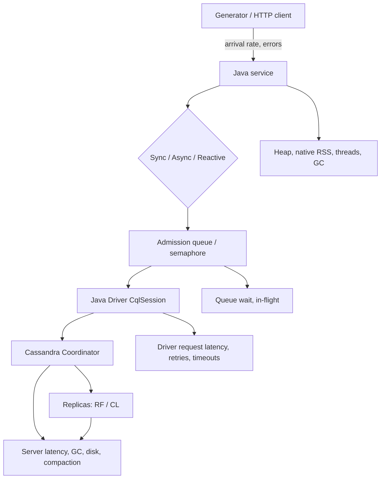

# Measuring Memory, Latency, and Throughput When Choosing Sync vs. Async in Apache Cassandra

## 1. Why Measure Instead of Assuming "Async Is Always Faster"?

In the **DATABASE_ENGINE_WIDE_COLUMN_CASSANDRA** module, Apache Cassandra is a distributed wide-column database. Tables are modeled around query patterns, data is placed by **partition key** and replicated by **replication factor (RF)**, and each read or write must satisfy a **consistency level (CL)** across coordinators and replicas. Query latency can stem from network hops, slow replicas, compaction, tombstones, GC, or oversized partitions—not just Java code.

Java applications can call Cassandra **synchronously**, **asynchronously**, or via **reactive streams**. The exact same CQL query:

```sql
SELECT order_id, status, updated_at
FROM commerce.orders_by_id
WHERE order_id = ?;
```

can run via blocking `session.execute(...)` or non-blocking `session.executeAsync(...)`. Both still require Cassandra to serve the exact same data. Async **does not make CQL run faster on replicas**, and sync **is not automatically slower** under low load, small payloads, or an appropriately sized worker pool.

For instance, a service handling 50 requests/s where each `SELECT` finishes in a few milliseconds sees little benefit from async—future/callback overhead is small, yet adds complexity without clear gains. Conversely, 2,000 concurrent requests each waiting 30 ms on network I/O can force a **one-blocking-thread-per-request** model to burn heavy thread stack memory and context-switching overhead; async can sustain the same in-flight concurrency with fewer application threads, **provided** concurrency, queues, and memory stay bounded.

**The practical question is not "Is sync or async more modern?"—it is "Which model meets our p99, throughput, memory, and reliability goals under our workload?"**

After this lesson, you will know how to:

1. Distinguish requests submitted, **successful** requests, throughput, and concurrency.
2. Measure **p50/p95/p99 latency**, end-to-end latency, and the effects of queueing, paging, and retries.
3. Measure **heap, non-heap/native memory, thread counts, and GC** without mistaking one number for the full memory footprint.
4. Compare sync, async, and reactive fairly using identical CQL, RF/CL, datasets, and cluster states.
5. Build a Java Driver 4.x benchmark with **bounded in-flight work**, avoiding an uncontrolled load generator.
6. Interpret results and pick a model against SLOs rather than a single average metric.
7. Spot common bugs: `CompletableFuture.join()`, unbounded queues, blocking callbacks, `ResultSet.all()`, and retry storms.

## 2. Three Execution Models in Java Driver

### 2.1. Synchronous: Call Blocks the Current Thread

```java
import com.datastax.oss.driver.api.core.cql.BoundStatement;
import com.datastax.oss.driver.api.core.cql.Row;

BoundStatement query = selectById.bind(orderId);
Row row = session.execute(query).one();
```

The thread calling `execute(...)` waits for the result. The driver still uses pooled connections and internal async I/O; "blocking API" **does not mean the driver opens a new socket per request**.

**Pros:** linear, readable code, easy business-workflow correlation, clear stack traces. **Trade-offs:** needs enough application threads to hold concurrent network waits; too small a worker pool queues requests, while too large a pool bloats RAM and context switching.

### 2.2. Asynchronous: Result Completes via Future/Callback

```java
import java.util.concurrent.CompletionStage;
import com.datastax.oss.driver.api.core.cql.AsyncResultSet;

CompletionStage<AsyncResultSet> future = session.executeAsync(query);
future.whenComplete((page, error) -> {
    if (error != null) {
        recordFailure(error); // App helper: must be fast, non-blocking.
    } else {
        recordSuccess(page);  // App helper: lightweight work only.
    }
});
```

`recordFailure` and `recordSuccess` are **hypothetical helpers**, not driver APIs. The dispatching thread does not sit blocked awaiting the result, yet the request still consumes memory, socket buffers, timeout budget, and replica capacity.

**Pros:** fewer I/O-waiting threads, easier controlled fan-out. **Trade-offs:** requires managing futures, callbacks, error propagation, cancellation, queues, backpressure, and session lifecycles.

### 2.3. Reactive: Async Plus a Demand-Regulation Protocol

The reactive model builds on `Publisher/Subscriber` and `request(n)` signals to express **data demand**. With Java Driver 4.x and a compatible Reactive Streams library, reactive queries integrate with Reactor/RxJava or framework reactive layers.

```text
Subscriber -- request(n) --> Publisher
Subscriber <-- onNext(row) -- Publisher
Subscriber <-- onError/onComplete
```

**Distinguish two kinds of backpressure:**

- **Data-stream backpressure:** how many rows/events a subscriber requests before proceeding.
- **Admission control over concurrent queries:** how many CQL statements may remain in flight. A publisher supporting `request(n)` **does not automatically limit** concurrent Cassandra queries if the app calls `flatMap` across thousands of publishers at once.

Pseudocode illustrating the Reactor concept—**not standalone compilable code without the corresponding reactive APIs/dependencies**:

```java
// PSEUDOCODE: verify exact reactive API names against Driver/Reactor versions.
Flux.from(driverReactiveQuery(statement))
    .limitRate(64)
    .map(this::toOrder)
    .subscribe(this::consume, this::handleError);
```

`limitRate(64)` paces a single stream's demand under Reactor semantics; it **does not replace** CQL concurrency limits where many statements are dispatched. If `consume` performs blocking I/O, update thread scheduling and capacity planning accordingly.

### 2.4. Initial Model-Selection Matrix

| Criterion | Sync | Async | Reactive |
|---|---|---|---|
| Sequential control code | Simplest | Futures/callbacks/compose | Pipelines/operators |
| Many I/O-waiting requests | More worker threads | Fewer waiting threads | Fewer waiting threads, plus demand signals |
| Per-request memory | Can include thread stacks when workers block | Futures, callbacks, context, buffers | Subscriptions, operators, queues/buffers |
| Overload protection | Bounded thread pool/queue | In-flight cap/semaphore/bulkhead | Concurrency limit **and** demand |
| Blocking Servlet fit | Natural | Needs async servlet or callback boundary | May add needless complexity |
| WebFlux / event-loop fit | Must offload blocking calls | Fits when event loop isn't blocked | Fits end-to-end reactive pipelines |
| Debuggability | Easy linear stack traces | Needs trace context/callback tracking | Requires understanding signals, schedulers, operators |
| Cassandra server p99 | Depends on CQL/replicas | Basically the same server path | Basically the same server path |

**Choose based on the whole architecture**, rather than swapping `execute` for `executeAsync` blindly. Calling async and immediately calling `join()` on the same request thread reverts to blocking while adding future overhead.

## 3. Measure Four Outcomes Properly: Latency, Throughput, Concurrency, Memory

### 3.1. Latency Is the Duration of One Logical Operation

`Latency` is normally measured from when a request is **accepted** into the system until it completes normally or fails. Define the exact boundary:

- **CQL attempt latency:** from when the driver sends an attempt until it gets a response.
- **Driver logical request latency:** from calling `execute/executeAsync` to final outcome, possibly including retries/speculative attempts.
- **Application operation latency:** from when the API/worker accepts work, including queue wait, encoding, CQL, and callbacks.
- **End-to-end HTTP latency:** adds frontend network, middleware, auth, serialization, and response transmission.

**Never compare async CQL-attempt p99 against sync full-HTTP-endpoint p99.** Always use identical start/end boundaries and identical definitions of success.

### 3.2. Percentiles Matter More Than Averages

Common metrics across many requests:

| Measure | Interpretation | Purpose |
|---|---|---|
| p50 | 50% of observations are at or below this value | Typical experience |
| p95 | 95% are at or below this value | Common tail latency |
| p99 | 99% are at or below this value | Catches tails causing timeouts / SLO misses |
| Maximum | Slowest observation | Sensitive to outliers; never use alone |
| Error / timeout rate | Failure fraction | Prevents "raising throughput" by dropping failures |
| Queue wait | Time waiting before dispatch | Diagnoses worker/admission saturation |

Hypothetical example where both models achieve 5,000 queries/s:

| Model | p50 | p95 | p99 | Error rate |
| --- | ---: | ---: | ---: | ---: |
| Sync (bounded 128 threads) | 12 ms | 38 ms | 90 ms | 0.1% |
| Async (bounded 256 in-flight) | 11 ms | 50 ms | 240 ms | 1.8% |

You **cannot** conclude async is better just because more requests were sent; p99 and error rate worsened. These are **hypothetical numbers for analysis practice**, not real Cassandra/Driver benchmarks.

### 3.3. Throughput: Count Completions, Not Submissions

Distinguish:

\[
\text{Attempted rate}=\frac{\text{requests sent}}{\text{observed seconds}}
\]

\[
\text{Successful throughput}=\frac{\text{logical operations completed correctly}}{\text{observed seconds}}
\]

If a producer submits 20,000 req/s while the cluster completes only 7,000 successfully—with queues/in-flight climbing and 13,000 pending or timing out—**never claim 20,000 throughput**. Report attempted, completed, successful, failed, timed-out, retry attempts, and backlog separately.

### 3.4. Memory: Heap Is Not Total RSS

| Metric | Covers / represents | Common pitfall |
|---|---|---|
| Java heap used/committed | Objects, futures, callbacks, heap rows/buffers | A single `used` sample right after GC hides peaks |
| Non-heap | Metaspace, JIT code cache, other VM areas | Excluded from `MemoryMXBean.getHeapMemoryUsage()` |
| Direct / native buffers | Netty/network buffers and native allocations | Often invisible in heap metrics |
| Thread stacks | Java/native thread stacks | Many blocking threads inflate RSS |
| JVM process RSS / container memory | OS/container resident memory | Can include mapped files and page caches per env |
| GC allocation rate / pauses | Object churn and stop-the-world pauses | High throughput with heavy GC degrades p99 |
| Peak in-flight / pending queue | Waiting requests | Predicts memory spikes under overload |

**Measure at least three layers:** heap, process/container memory, and GC/threads. Calling `Runtime.totalMemory() - freeMemory()` alone misses direct buffers and thread stacks.

## 4. Little's Law: Connecting In-Flight, Throughput, and Latency

In a relatively steady-state queuing system where assumptions hold:

\[
L=\lambda W
\]

Where:

- `L`: **average requests inside the system** (in-flight + queued within the measured boundary).
- `λ`: average completion throughput (operations/second).
- `W`: average residence time per operation (seconds).

Example:

\[
\lambda=1{,}500\ \text{req/s},\quad W=0.04\ \text{s}
\Rightarrow L\approx60\ \text{requests}
\]

Targeting 3,000 req/s at the same 40 ms mean latency means sustaining around **120 active requests** inside the measured boundary. If overload pushes latency to 200 ms, pending work climbs to roughly **600** at the same throughput; that explains memory growth—not async "inherently eating RAM."

### 4.1. Illustrative Memory Calculation

Suppose each async request retains on average 16 KiB of Java objects/buffers inside the measured boundary; 10,000 in-flight requests hold roughly:

\[
10{,}000\times16\ \mathrm{KiB}\approx156.25\ \mathrm{MiB}
\]

This number is **illustrative only**, since object graphs, row sizes, Netty buffers, and callback chains vary. If sync uses one thread per request, add **thread stacks and OS scheduler overhead** on top of per-request data. Yet never spawn 10,000 threads "to benchmark fairly": that tests OS thread scheduling far more than Cassandra.

**Lesson:** async enables higher in-flight concurrency with fewer threads, **not unbounded in-flight concurrency**.

## 5. Designing a Fair Experiment

Before writing a benchmark, lock down the major variables:

| Group | Must match between sync and async |
|---|---|
| Cluster | Same Cassandra version, topology, RF/DC, node health, data, compaction/repair state |
| CQL | Same prepared statement, partition key, payload/row size, page size, consistency level |
| Java Driver | Same driver version, session config, contact points, local DC, pool/retry/speculative policies |
| Benchmark host | Same CPU, RAM, JVM, GC, container limits, network path |
| Dataset | Same key distribution (hot/cold), hit/miss ratio, partition sizes |
| Workload | Same read/write mix, target successful ops, concurrency cap |
| Measurement | Same start/end boundaries, warmup, sampling, duration, error accounting |
| Interference | Zero concurrent schema/RF changes, major compactions, or heavy backfills/repairs |

**For read benchmarks, pre-seed data and query known valid IDs**; if every SELECT returns zero rows, you are benchmarking a completely different workload from production. Never generate random UUIDs per query if that alters hit rates and token distributions.

### 5.1. Baseline CQL for Point Reads

```sql
CREATE KEYSPACE IF NOT EXISTS commerce
WITH replication = {
  'class': 'NetworkTopologyStrategy',
  'dc1': 3
};

CREATE TABLE IF NOT EXISTS commerce.orders_by_id (
  order_id uuid PRIMARY KEY,
  customer_id uuid,
  status text,
  updated_at timestamp
);
```

On a single-node cluster, adjust RF **before** testing. This table serves queries by `order_id`; listing by `customer_id` needs its own query-driven table—never add `ALLOW FILTERING` to create an artificially slow benchmark.

### 5.2. Closed-Loop vs. Open-Loop Experiments

- **Closed-loop:** sends a new request only when an old one finishes or an in-flight slot opens. Easy on memory, yet when the server slows down, send rate drops automatically. Offered load falls **below** target.
- **Open-loop:** generates requests on a scheduled arrival rate independent of prior completion time. Exposes overload cleanly, though requires queue/admission policies so the generator itself does not OOM.

Closed-loop benchmarks can **hide tail latency** via `coordinated omission`: when the server pauses for 500 ms, the client never sends the requests that should have arrived during that pause, under-reporting real user latency.

**Run both:** closed-loop to gauge processing efficiency at fixed concurrency, and open-loop to validate SLOs at target arrival rates and overload. For open-loop, measure from **scheduled/admitted arrival time**, including queue wait, using HDR Histogram or load tools that correct for coordinated omission.

## 6. Where to Place Instrumentation



**Four collection points:**

1. **Load generator:** scheduled arrival time, HTTP p50/p95/p99, status codes, external queueing.
2. **Java service / JVM:** request successes, active requests, thread count, heap, direct/native memory, GC, CPU.
3. **Java Driver:** in-flight requests, connection health, coordinator latencies, retries, timeouts, pending queues per driver metrics API.
4. **Cassandra Server:** read/write latency, dropped messages, pending compactions, disk I/O, GC, tombstones/SSTables, node availability, network.

Running benchmarks **on the Cassandra node itself** causes generator CPU/RAM/network to contend with the database; isolate load generators on separate machines or resource-capped containers and document the setup.

## 7. Measuring Memory and Thread Counts via JMX / Java

### 7.1. Reading Heap, Non-Heap, and Thread Counts

Runs with standard JDK APIs, zero external libraries required:

```java
import java.lang.management.ManagementFactory;
import java.lang.management.MemoryMXBean;
import java.lang.management.MemoryUsage;
import java.lang.management.ThreadMXBean;

public final class JvmSnapshot {
    public static void print(String label) {
        MemoryMXBean memory = ManagementFactory.getMemoryMXBean();
        ThreadMXBean threads = ManagementFactory.getThreadMXBean();
        MemoryUsage heap = memory.getHeapMemoryUsage();
        MemoryUsage nonHeap = memory.getNonHeapMemoryUsage();

        System.out.printf(
            "%s heapUsed=%dMB heapCommitted=%dMB " +
            "nonHeapUsed=%dMB threads=%d peakThreads=%d%n",
            label,
            heap.getUsed() / 1024 / 1024,
            heap.getCommitted() / 1024 / 1024,
            nonHeap.getUsed() / 1024 / 1024,
            threads.getThreadCount(),
            threads.getPeakThreadCount());
    }
}
```

Sample at key points: **pre-warmup, post-warmup, steady load, right after peak, and after cooldown**. Never compare a single random `heapUsed` snapshot, as GC may have just run.

### 7.2. Measuring Direct Buffers via `BufferPoolMXBean`

```java
import java.lang.management.BufferPoolMXBean;
import java.lang.management.ManagementFactory;

for (BufferPoolMXBean pool :
        ManagementFactory.getPlatformMXBeans(BufferPoolMXBean.class)) {
    System.out.printf(
        "bufferPool=%s count=%d memoryUsed=%d capacity=%d%n",
        pool.getName(),
        pool.getCount(),
        pool.getMemoryUsed(),
        pool.getTotalCapacity());
}
```

Pool counters show part of JVM-managed buffers. **Do not treat them as total Netty/native memory or process RSS.** For Netty's specific allocator metrics, check your driver/runtime configuration. Pair with container metrics:

```text
# Metrics to pull from existing observability:
process_resident_memory_bytes
jvm_memory_used_bytes{area="heap"}
jvm_memory_used_bytes{area="nonheap"}
jvm_threads_live_threads
jvm_gc_pause_seconds_count/sum
jvm_memory_allocated_bytes_total (if supported by runtime/exporter)
container_memory_working_set_bytes
```

Metric names are **illustrative Prometheus/Micrometer conventions**; exporters and versions vary. Never confuse **`-Xmx`** with process RSS: RSS can exceed `-Xmx` due to native allocations, stacks, metaspace, and memory-mapped files.

### 7.3. Allocation Rate and GC

Two models can deliver equal throughput with very different allocation rates:

- Sync allocates fewer future/callback objects, yet requires more waiting threads.
- Async allocates `CompletionStage`s, closures, contexts, and queue nodes; deep chains raise allocation rates.
- Reactive adds operators, subscriptions, and buffers, though can save resources when backpressure prevents pileups.

Measure **bytes allocated/op**, GC pause p95/p99, GC frequency, CPU, and live heap. A single post-GC heap drop **is not proof** throughput will stay healthy under sustained load.

## 8. Measuring Latency Accurately With `System.nanoTime()`

Use `System.nanoTime()` for **elapsed intervals** within one process; never subtract `System.currentTimeMillis()` for nanosecond durations because wall clocks can jump.

### 8.1. Sync: Measure From Before Send Until Row Received

```java
import java.util.concurrent.TimeUnit;
import com.datastax.oss.driver.api.core.cql.Row;

long startedAt = System.nanoTime();

try {
    Row row = session.execute(selectById.bind(orderId)).one();
    long elapsedNs = System.nanoTime() - startedAt;

    recordSuccessLatency(elapsedNs, row != null);
} catch (RuntimeException error) {
    long elapsedNs = System.nanoTime() - startedAt;
    recordFailureLatency(elapsedNs, error);
}
```

`recordSuccessLatency` / `recordFailureLatency` are application collectors, not Driver APIs. Record **failure latencies too**; histograms recording only successes can show pristine p99 even while 20% of requests time out.

### 8.2. Async: Measure From Submission, Not From Callback Start

```java
long startedAt = System.nanoTime();

session.executeAsync(selectById.bind(orderId))
    .whenComplete((page, error) -> {
        long elapsedNs = System.nanoTime() - startedAt;
        if (error == null) {
            recordAsyncSuccessLatency(elapsedNs);
        } else {
            recordAsyncFailureLatency(elapsedNs, error);
        }
    });
```

Starting the timer inside the callback **measures only callback execution**, omitting network and coordinator time.

If requests also wait in a **queue/admission gate** before `executeAsync`, the timer above misses queue wait. For end-to-end service SLOs, timestamp at **work acceptance** and track queue wait separately from driver execution.

### 8.3. Use a Proper Bounded Histogram for Percentiles

Never compute p99 by keeping millions of `Long`s in an `ArrayList` inside your benchmark: that inflates heap and GC, skewing memory results. Use a bounded-memory histogram (e.g., HDR Histogram) or a proper percentile metrics backend. Retain counts, sums, error counts, and histogram buckets, exporting **off the hot path**.

**Warning:** p99 from 100 samples has very low statistical confidence; run longer, repeat trials, report intervals, and compare at matched throughput and error budgets.

## 9. Comparing Sync and Async at Equal In-Flight Caps

A fair initial method runs **closed-loop** across in-flight concurrency levels `C = 8, 32, 64, 128, 256`. Each mode holds at most `C` pending Cassandra queries with identical datasets, statements, retry policies, CLs, and page sizes.

### 9.1. Sync Bounded by a Worker Pool

This benchmark helper uses `ExecutorCompletionService` to avoid an unbounded task queue. It takes a prepared list of UUIDs, a `PreparedStatement`, and `concurrency` workers. Real runs must add explicit warmup/measurement windows and full histograms.

```java
import java.util.List;
import java.util.UUID;
import java.util.concurrent.*;
import com.datastax.oss.driver.api.core.CqlSession;
import com.datastax.oss.driver.api.core.DefaultConsistencyLevel;
import com.datastax.oss.driver.api.core.cql.PreparedStatement;

public final class BoundedSyncBench {

    public static final class Sample {
        public final long nanos;
        public final boolean success;

        public Sample(long nanos, boolean success) {
            this.nanos = nanos;
            this.success = success;
        }
    }

    public static void run(
            CqlSession session, PreparedStatement prepared,
            List<UUID> ids, int concurrency) throws Exception {

        ExecutorService pool = Executors.newFixedThreadPool(concurrency);
        CompletionService<Sample> completion =
            new ExecutorCompletionService<>(pool);

        int submitted = 0;
        int completed = 0;
        long success = 0;
        long errors = 0;
        long start = System.nanoTime();

        try {
            while (completed < ids.size()) {
                while (submitted < ids.size()
                        && submitted - completed < concurrency) {
                    UUID id = ids.get(submitted++);
                    long born = System.nanoTime();

                    completion.submit(() -> {
                        try {
                            session.execute(
                                prepared.bind(id)
                                    .setConsistencyLevel(
                                        DefaultConsistencyLevel.LOCAL_QUORUM)
                                    .setIdempotent(true)
                            ).one();
                            return new Sample(
                                System.nanoTime() - born, true);
                        } catch (RuntimeException e) {
                            return new Sample(
                                System.nanoTime() - born, false);
                        }
                    });
                }

                Sample sample = completion.take().get();
                completed++;
                if (sample.success) success++; else errors++;

                // In a real benchmark, record sample.nanos into a bounded histogram.
            }
        } finally {
            pool.shutdown();
        }

        double seconds = (System.nanoTime() - start) / 1e9;
        System.out.printf(
            "sync completed=%d ok=%d err=%d throughput=%.1f ops/s%n",
            completed, success, errors, completed / seconds);
    }
}
```

**Properties to understand:**

- This is **closed-loop**: the producer keeps at most `C` submitted incomplete tasks.
- `born` is captured before `submit`, so latency includes executor queue wait; to isolate **driver time**, record an additional timestamp right before `execute`.
- `ExecutorCompletionService` holds completed futures until consumed; pending tasks are capped by `C`, not by dataset size.
- `success` here means **CQL did not throw**, without verifying row contents; real correctness tests must verify returned rows against expected data.
- `throws Exception` simplifies interruption/failure handling in the demo; production must propagate/cancel cleanly without swallowing errors.
- `pool.shutdown()` stops new submissions; if cancelled mid-run, drain/await running workers properly before closing the session.
- Never log per row, as log I/O distorts measurements.

### 9.2. Async Bounded Without Blocking Driver Callbacks

The snippet below paces at most `C` concurrent `executeAsync` calls. The callback pushes a small `Sample` onto a short queue while the coordinator loop drains completions and submits next items. It **never** calls `join()` on driver threads and never retains one future per UUID across the whole dataset.

```java
import java.util.List;
import java.util.UUID;
import java.util.concurrent.BlockingQueue;
import java.util.concurrent.LinkedBlockingQueue;

import com.datastax.oss.driver.api.core.CqlSession;
import com.datastax.oss.driver.api.core.DefaultConsistencyLevel;
import com.datastax.oss.driver.api.core.cql.PreparedStatement;

public final class BoundedAsyncBench {

    static final class Sample {
        final long nanos;
        final boolean success;

        Sample(long nanos, boolean success) {
            this.nanos = nanos;
            this.success = success;
        }
    }

    public static void run(
            CqlSession session, PreparedStatement prepared,
            List<UUID> ids, int maxInFlight) throws InterruptedException {

        BlockingQueue<Sample> completions = new LinkedBlockingQueue<>();
        int started = 0;
        int completed = 0;
        long success = 0;
        long errors = 0;
        long start = System.nanoTime();

        while (completed < ids.size()) {
            while (started < ids.size()
                    && started - completed < maxInFlight) {
                UUID id = ids.get(started++);
                long born = System.nanoTime();

                try {
                    session.executeAsync(
                        prepared.bind(id)
                            .setConsistencyLevel(
                                DefaultConsistencyLevel.LOCAL_QUORUM)
                            .setIdempotent(true)
                    ).whenComplete((result, error) -> {
                        completions.add(new Sample(
                            System.nanoTime() - born, error == null));
                    });
                } catch (RuntimeException e) {
                    completions.add(new Sample(
                        System.nanoTime() - born, false));
                }
            }

            Sample sample = completions.take();
            completed++;
            if (sample.success) success++; else errors++;

            // In a real benchmark, add sample.nanos into a bounded histogram.
        }

        double seconds = (System.nanoTime() - start) / 1e9;
        System.out.printf(
            "async completed=%d ok=%d err=%d throughput=%.1f ops/s%n",
            completed, success, errors, completed / seconds);
    }
}
```

Conditions of use:

- `maxInFlight > 0` and `ids` is sensibly sized; pre-generate benchmark input IDs during setup so UUID generation is excluded from measurements.
- `LinkedBlockingQueue` is unbounded by default, though bounded indirectly here because **at most `C` requests exist in flight**; production services should use an explicitly bounded queue with a clear overflow policy that never blocks driver callbacks.
- The callback only constructs `Sample` and calls `add`; never parse/serialize huge payloads, query the DB again, or perform HTTP/blocking I/O in the callback.
- As in the sync example, "success" only checks absence of exceptions; verify row correctness in separate runs or lightweight checks.
- On interruption/cancellation, track remaining in-flight requests and session lifecycle cleanly—never close the session mid-flight and count self-inflicted benchmark errors.
- Queue + callback allocation is **part of the implementation's real cost**; keep instrumentation consistent at the business-service boundary for fair comparisons.

### 9.3. A Fairness Point Worth Explaining

Sync holds **`C` worker threads** waiting on I/O, while async holds **fewer threads** alongside `C` futures/callbacks. Comparing at equal in-flight `C` reveals the memory and threading cost of each model for identical concurrent work.

To compare **SLO compliance**, also run open-loop tests at identical arrival rates, max queue waits, and admission policies. Two models might differ at `C=256`, yet if the service only needs 500 ops/s, both may meet SLOs comfortably.

## 10. How Retries, Timeouts, and Uncertain Writes Skew Benchmarks

A common mistake is measuring throughput by attempts, whereas real applications count **correctly completed logical operations**.

Consider an update:

```sql
UPDATE commerce.orders_by_id
SET status = 'PAID'
WHERE order_id = ?;
```

If the client times out and retries three times, Cassandra may process multiple mutations for one business intent. Setting a fixed column value can look idempotent, yet concurrent writes/timestamps, TTLs, LWTs, and business side effects can still make retries distort results.

**When benchmarking sync vs. async:**

1. Start with **read-only prepared `SELECT`s** to isolate API, network, and memory costs.
2. Keep retry and speculative execution policies identical across both modes; report attempt counts and error rates.
3. For write benchmarks, use isolated test data, explicit keys/idempotence, and correctness verification.
4. Never set `setIdempotent(true)` on every mutation just to boost throughput; that metadata enables retries/speculation, **not** safety.
5. Never treat `WriteTimeout` as "write failed" and retry immediately in a benchmark; apparent gains may come from duplicate writes.
6. Report `Unavailable`, `ReadTimeout`, `WriteTimeout`, and driver request timeouts separately—each has distinct causes.
7. Never drop CL from `LOCAL_QUORUM` to `ONE` just to make async graphs look prettier: that changes the consistency contract.

**Proper constraint:** compare at matched logical request counts and verified success rates. High throughput with wrong results is not an improvement.

## 11. How Page Size and Row Size Affect Memory

For multi-row queries, each CQL page consumes memory for buffers and decoded objects. Larger page sizes cut round-trips, yet can cause:

- Memory spikes when many large response pages arrive simultaneously.
- Higher decoding/conversion overhead inside callbacks.
- Worse tail page latency on large partitions, wide rows, or heavy tombstones.
- Queueing when HTTP layers buffer entire row sets for serialization.

Example:

```java
BoundStatement listOrders = listByCustomer.bind(customerId)
    .setPageSize(100)
    .setConsistencyLevel(DefaultConsistencyLevel.LOCAL_QUORUM);
```

`setPageSize(100)` is a **target CQL page size**, not `LIMIT 100` and not a cap on total rows. Measure:

| Scenario | Estimated memory load | Caveat |
|---|---|---|
| 100 requests holding one 50 KiB page each | ~5 MiB raw page payloads | Excludes Java objects, Netty, decode/serialization |
| 1,000 requests holding one 500 KiB page each | ~488 MiB raw payloads | Heavy GC / native memory risk |
| Demand-driven multi-page streaming | Only a few pages live at once | Must watch `fetchNextPage()` and downstream queues |

These figures merely **illustrate capacity multiplication**, not actual memory profiling.

### 11.1. Sync `ResultSet` vs. Async `AsyncResultSet` Paging

A sync iterator can **auto-fetch** subsequent pages as code iterates:

```java
for (Row row : session.execute(statement)) {
    consume(row);
}
```

If `consume(row)` is slow, the thread stays pinned. Calling `ResultSet.all()` on an unbounded dataset loads huge row counts onto the heap.

Async `AsyncResultSet.currentPage()` returns only the current page; fetching the next requires `fetchNextPage()` when `hasMorePages()` is true:

```java
CompletionStage<AsyncResultSet> first =
    session.executeAsync(statement);

CompletionStage<Integer> count =
    first.thenCompose(page -> countPages(page, 0));

// Hypothetical helper countPages must fetch next pages on demand with
// row/page caps, never recursing unboundedly.
```

This illustrates control flow, **not a complete program** since `countPages` is undefined. With reactive streams, backpressure paces row signals, yet you must still audit **actual operator prefetch/buffering** and concurrent publishers.

### 11.2. Paging Memory Takeaway

Do not look solely at `pageSize`. Measure **concurrently held pages**, bytes per page, active subscriptions/futures, and how long data stays in memory. Async saves thread stacks, yet increases total memory if 10,000 result pages land at once.

## 12. Choosing a Model by Workload Type

| Workload | Start with | Why | When to switch |
|---|---|---|---|
| Admin CLI, migration runner, sequential job | Sync | Clear, low frequency, simple | When many independent CQL calls must run in parallel |
| Small/medium REST API on thread-per-request | Sync with bounded pool; measure first | Matches existing stack | When thread counts, queue waits, or p99 climb under load |
| Gateway / service with heavy I/O waits | Async with in-flight cap | Cuts waiting threads; composes multiple I/O calls | If callbacks/allocations/GC or complexity outweigh gains |
| End-to-end WebFlux / reactive pipeline | Reactive with backpressure and concurrency cap | Consistent non-blocking across layers | If an un-offloadable blocking SDK or unbounded buffer interferes |
| Multi-partition bulk ETL | Bounded async/reactive | Hides round-trip latency; maximizes slot throughput | Must prevent unbounded scans and Cassandra overload |
| Very fast single-row lookup at low load | Sync or async both fine | Server latency dominates | Pick by SLOs, simplicity, and framework fit |
| LWT / counter / side-effecting ops | Strict workflow in all three | Idempotency and `UNKNOWN` handling matter more than API style | Never raise concurrency when contention/timeouts climb |

**There is no default rule that "reactive beats async beats sync."** If your entire HTTP stack is already reactive and every dependency is non-blocking, reactive cuts thread overhead. For one small Cassandra lookup inside a synchronous service, async can add complexity with zero measurable gain.

## 13. A Reviewable Benchmark Report Template

After every run, record **configuration** alongside **results**—never share a chart screenshot without knowing the load parameters.

### 13.1. Experiment Manifest

```yaml
experiment: cassandra-java-sync-vs-async
environment: staging
cassandra:
  version: "<server-version>"
  datacenter: dc1
  replication_factor: 3
  consistency: LOCAL_QUORUM
  table: commerce.orders_by_id
driver:
  family: "java-driver-4.x"
  exact_version: "<pin-exact-version>"
  retry_policy: "<same-for-both>"
  speculative_execution: "<same-for-both>"
  request_timeout_ms: 2000
query:
  prepared: true
  type: SELECT_BY_PARTITION_KEY
  page_size: 100
dataset:
  known_existing_keys: 100000
  hot_key_fraction: "<measured>"
load:
  warmup_seconds: 120
  measurement_seconds: 300
  model: closed_loop
  concurrency_levels: [8, 32, 64, 128, 256]
jvm:
  version: "<exact-build>"
  heap_max: "<same-for-both>"
  gc: "<same-for-both>"
```

This is a **template**, not real output. Warmup/measurement durations and `C` levels are starting points; workloads with caches, compactions, or long GC cycles need longer windows.

### 13.2. Illustrative Results Table (Hypothetical Numbers)

| Mode | In-flight cap | Successful ops/s | p50 (ms) | p95 (ms) | p99 (ms) | Error % | Peak RSS (MiB) | Live threads |
| --- | ---: | ---: | ---: | ---: | ---: | ---: | ---: | ---: |
| Sync | 32 | 750 | 18 | 39 | 65 | 0.0 | 610 | 85 |
| Async | 32 | 755 | 19 | 41 | 70 | 0.0 | 603 | 56 |
| Sync | 128 | 2,550 | 26 | 80 | 135 | 0.2 | 830 | 182 |
| Async | 128 | 2,610 | 25 | 76 | 128 | 0.2 | 715 | 66 |
| Sync | 256 | 3,100 | 64 | 220 | 510 | 2.0 | 1,110 | 311 |
| Async | 256 | 3,050 | 60 | 250 | 600 | 3.1 | 930 | 71 |

**Do not treat the values above as real Cassandra benchmarks.** They merely illustrate interpretation: at `C=128`, async looks attractive if measured memory and p99 remain stable; at `C=256`, both show saturation—p99 and errors surge, and raising concurrency further stops helping.

### 13.3. What Else to Record Beyond the Table

- Java app CPU and per-node Cassandra CPU (mean + peak).
- Heap used/committed/peak, process RSS, direct memory, GC pauses.
- Retry attempts and speculative attempts per successful operation.
- Queue wait, pending counts, admission-rejected requests.
- Bytes/query, row sizes, page counts, query correctness checks.
- `nodetool status`/node health, disk I/O, compaction tasks, tombstone metrics.
- Errors broken down by `Unavailable`/`ReadTimeout`/`WriteTimeout`/`DriverTimeout`.
- Run-to-run variance, with confidence intervals or at least multiple repeat runs.

**Publish the full methodology**; never compare a run with 0.5% errors directly against a 0%-error run as if they were equivalent.

## 14. Reading Charts: Saturation Knee and Optimization Decisions

As concurrency rises, throughput initially climbs by hiding network wait time. Past a threshold, coordinators/replicas, thread pools, network, or disks saturate:

```text
Throughput
   ^
   |                      ________  (saturation)
   |                  ___/
   |              ___/
   |          ___/
   |      ___/
   |__ ___/
   +---------------------------------> In-flight concurrency

Latency p99
   ^
   |                              /
   |                          __/
   |                    _____/
   |       ____________/
   +---------------------------------> In-flight concurrency
```

The sweet spot sits **before the steep p99 knee**, not at absolute peak completed ops/s. If target throughput is 2,000 ops/s, `C=64` meeting the target with low p99 and lean memory beats `C=256` hitting 3,100 ops/s with 2% timeouts.

### 14.1. Symptom-Based Root Cause Analysis

| Observation | Likely cause | Check next |
|---|---|---|
| Sync spawns many threads, RSS climbs; throughput matches async | Thread stacks / context switching | Thread dumps, process RSS, CPU scheduler |
| Async uses few threads, yet heap/GC climbs | Retained future chains / queues / rows | Allocation profiler, retained objects, queue sizes |
| Both show rising p99 and busy server disks | Cassandra / storage bottleneck | Compaction, SSTables/tombstones, hot partitions |
| Driver latency rises while server latency stays flat | Client queues / routing / network | Queue wait, connection saturation, event-loop blocking |
| Async callbacks slow; driver I/O threads stall | Blocking work inside callbacks | Thread dumps, callback timing, offload executor |
| Errors climb with concurrency | Overload, unmet CL, retry storm | Exception types, in-flight counts, replica health |
| Suspiciously low closed-loop p99, awful open-loop | Coordinated omission or unmeasured queueing | Arrival timestamps, ingress latency, queue depth |

An optimized design is only truly better when **SLOs, error budgets, memory limits, and correctness** all pass together.

## 15. Common Traps When Migrating From Sync to Async

### 15.1. Immediate `executeAsync(...).toCompletableFuture().join()`

```java
// Anti-pattern on a non-blocking execution path:
AsyncResultSet page = session.executeAsync(statement)
    .toCompletableFuture()
    .join();
```

`join()` blocks the calling thread; if that thread is a WebFlux/Netty event loop, it causes high tail latency or indirect deadlocks when dependent tasks share the pool. In synchronous services, `join()` inside a blocking worker thread may be valid, yet produces **zero non-blocking benefit**.

### 15.2. Firing 100,000 Futures at Once

```java
// Anti-pattern: spawning unbounded requests/futures per input item.
for (UUID id : allIds) {
    session.executeAsync(prepared.bind(id));
}
```

Triggers huge RAM spikes, saturated connections/replicas, timeouts, and retry storms. Fix with a `Semaphore`, bounded work queue, `maxInFlight`, or Reactor `flatMap(..., concurrency)` per your API/stack.

### 15.3. Putting CPU or Blocking I/O Inside Callbacks

```java
session.executeAsync(statement).whenComplete((rows, error) -> {
    // Wrong if slow I/O runs on a driver callback thread:
    // Thread.sleep(1000);
    // blockingHttpClient.call(...);
    // doHugeJsonSerialization(rows);
});
```

Callbacks can execute on internal driver threads; slow code stalls unrelated requests. When heavy CPU or blocking external calls are unavoidable, **offload to a separate bounded-queue executor** and measure that executor's queue wait too.

### 15.4. Losing Trace Context and Swallowing Exceptions

Async chains can complete on different threads, so HTTP `ThreadLocal`/MDC values do not propagate automatically. Propagate trace context explicitly, observe errors at the terminal `CompletionStage`, and classify root causes—never log an error and return HTTP 200.

### 15.5. Mistaking "Cancel Future" for Rollback

Once a write reaches a coordinator, Java cancellation **does not guarantee cancelling the mutation**. For counters, LWTs, or external side effects, the outcome may be `UNKNOWN`. Retries require idempotency keys and read-back/reconciliation per business contract—never rely on async speed to repeat writes carelessly.

### 15.6. Raising Page Size to Cut Round-Trips Without Measuring Bytes

A page size of 1,000 reduces fetches, yet wide rows inflate per-response memory and latency. Always measure row bytes, direct buffers, p99, and concurrently retained pages.

## 16. Workflow for Applying This in a Real Java Project

### Phase A — Establish SLOs and Baseline

1. Identify critical endpoints/workers and consistency contracts (`RF/DC/CL`).
2. Classify queries: PK lookups, multi-row pagination, LWTs, mutations, and bounded scans.
3. Set targets for **successful throughput**, p95/p99, timeout/error budgets, and process RSS limits.
4. Measure the **existing sync baseline** under typical and peak load, including queue waits, threads, and GC.
5. Record Cassandra Server version, Java Driver, JDK, data model, table options, and compaction/repair schedules.

### Phase B — Isolated Async/Reactive Testing

1. Keep `CqlSession` config, prepared CQL, CL, timeouts, page sizes, and datasets identical.
2. Run async with bounded `maxInFlight`; never dispatch unboundedly.
3. If reactive, verify `request(n)`, operator concurrency, buffers/prefetch, and schedulers.
4. Run warmup, closed-loop concurrency sweeps, and open-loop arrival-rate tests.
5. Measure end-to-end latency (including admission queues), successful throughput, heap/RSS, threads/GC, and errors.
6. Verify row/write correctness and timeout handling before comparing speed.

### Phase C — Canaries and Decision

- Shift a monitored traffic slice onto the new mode with matching routing and CL.
- Compare p99, error rates, CPU/memory/GC, queue backlogs, retry attempts, and server metrics.
- If the new mode only improves memory while worsening p99 or errors, tune concurrency/callback scheduling or stick with sync.
- If it cuts p99/memory at equal successful throughput with acceptable operational complexity, expand rollout.
- Keep feature flags/config rollback ready, and avoid changing partition keys, RF, or compaction strategies simultaneously.

### Phase D — Post-Rollout Tuning

- Pick `maxInFlight` safely ahead of the saturation knee, matched to partition shapes and cluster headroom.
- Isolate heavy queries/background jobs into dedicated workload profiles/bulkheads.
- Reduce object allocations and serialization inside callbacks.
- Instrument internal queues created by reactive operators (`publishOn`/`flatMap`/`buffer`).
- Re-benchmark whenever changing JDK, Java Driver, topology, schema, GC, instance size, or data ratios.

**Never treat a short run on an idle cluster as proof of readiness for high-load production.**

## 17. Exercises and Analysis Scenarios

### Exercise 1 — Little's Law

A Cassandra API sustains 2,400 operations/s at 50 ms mean latency.

1. On average, how many operations reside in the measured system?
2. If latency rises to 250 ms at constant throughput, by how much does average active operations grow?
3. If each operation holds ~24 KiB, roughly how much extra memory is held?

**Hint:** `L=λW`. Initially `L=120`, then `L=600`—a jump of 480 operations, or ~11.25 MiB at 24 KiB/op before counting buffers and overhead.

### Exercise 2 — Choosing Sync vs. Async From Metrics

Assume **hypothetical data** for the same 2,000 successful operations/s:

| Metric | Sync | Async |
| --- | ---: | ---: |
| p50 | 15 ms | 16 ms |
| p99 | 120 ms | 105 ms |
| Process RSS | 920 MiB | 740 MiB |
| Active threads | 240 | 68 |
| Error rate | 0.1% | 0.1% |
| Server CPU | 75% | 75% |

Which do you pick for a service with an 800 MiB memory limit and a <150 ms p99 SLO? Why? What extra evidence is needed before production rollout?

**Hint:** async meets both RSS and p99 in these hypothetical figures, whereas sync breaches the memory cap. Still verify peak duration, repeatability, GC, queue wait, failure modes, correctness, and a canary rollout.

### Exercise 3 — Unbounded Async

A worker dispatches 50,000 concurrent `executeAsync` calls; Java heap climbs, GC pauses spike, and `ReadTimeout` erupts. A developer suggests raising `-Xmx`.

1. Why won't raising heap likely fix the root cause?
2. How does adding a `maxInFlight` limit help?
3. Which metrics show whether Cassandra itself is saturated vs. the client/load generator?
4. Should you increase retry attempts while errors surge?

**Hint:** inspect queues/in-flight counts, driver callbacks, Netty buffers, client GC/CPU, and server disk/compaction/latency. Apply backpressure and bounded concurrency first—never a retry storm.

### Exercise 4 — Closed-Loop Hiding Tail Latency

You run 64 in-flight requests for 10 minutes and report p99 = 80 ms. Under open-loop at 5,000 arrivals/s, end-to-end p99 hits 900 ms and queues grow.

1. Why do the two numbers differ?
2. Which distortion does timing from ingress/arrival eliminate?
3. How should admission control ensure graceful degradation?

**Hint:** closed-loop throttles down automatically when the server slows, failing to record requests that should have arrived. Open-loop exposes queue wait and overload; enforce bounded queues, load shedding, and retry budgets.

### Exercise 5 — Large Pages and Reactive Subscribers

A stream returns ~100 KiB rows. Publishers prefetch multiple pages across 200 concurrent subscriptions. Why can a "non-blocking" reactive tier still hit OOM?

**Hint:** buffered pages/rows, operator prefetch, upstream concurrency, and bytes held in heap/direct memory. Reduce in-flight/row buffers, check backpressure, memory, and page size.

### Exercise 6 — Write Benchmark Validity

Two `UPDATE` tests:

- A: sync achieves 1,200 successful logical requests/s at 0.05% errors.
- B: async issues 2,400 CQL attempts/s with 30% timeouts, and middleware retries every request twice more.

Does B truly achieve double A's throughput? Can you verify data state after retries?

**Hint:** no. Counting attempts and altering retry semantics skews the test; count **successful logical operations**, classify ambiguous write outcomes, and enforce idempotency and reconciliation.

## 18. Testing and Production Decision Checklist

- [ ] Held CQL, prepared statements, partition keys, RF/CL, datasets, timeouts, page sizes, and retry policies constant across modes.
- [ ] Defined identical **latency** boundaries, including queue wait for end-to-end SLOs.
- [ ] Measured p50/p95/p99, error/timeout rates, and **successful throughput**—not attempted rate or averages alone.
- [ ] Ran both closed-loop concurrency sweeps and open-loop arrival-rate tests.
- [ ] Included warmup, long measurement windows, repeat runs, and recorded Cassandra state during tests.
- [ ] Measured heap used/peak/committed, process RSS/container memory, direct/native buffers, GC, and thread counts.
- [ ] Measured Java and Cassandra CPU, disk/compaction, network, dropped messages, and replica health.
- [ ] Enforced concurrency caps, bounded queues, and explicit overload/backpressure policies in every mode.
- [ ] Zero blocking I/O or heavy CPU inside driver callbacks / event loops.
- [ ] Zero `join()` calls on async/reactive event loops; controlled allocation of futures and subscriptions.
- [ ] Measured pages/bytes for multi-row queries; never called `ResultSet.all()` on unbounded results.
- [ ] Measured callback/operator buffers, reactive prefetch, and fan-out concurrency when using `Publisher`s.
- [ ] Measured retries and speculative executions; never traded correctness for throughput.
- [ ] Treated write timeouts as potentially uncertain outcomes; added idempotency/reconciliation when needed.
- [ ] Separated client queue/network/driver latency from Cassandra/replica latency.
- [ ] Ran a canary against SLO metrics with a ready mode/config rollback path.
- [ ] Recorded results with a manifest of versions, hardware, workload, tools, and percentile methodology.
- [ ] Selected the mode based on the **full constraint set**: p99, successful throughput, RSS, errors, operational cost, correctness, and framework fit.

**Conclusion:** `executeAsync` and reactive APIs cut the number of threads blocked waiting on I/O, helping applications sustain higher concurrency, yet **never make Cassandra answer a CQL query faster merely by switching APIs**. Choosing sync, async, or reactive must be backed by measurements of **full-operation latency (especially p99), successful throughput, heap + native/RSS memory, threads/GC, and error rates** under matched workloads and consistency levels. Keep **in-flight work bounded**, separate queue wait from server latency, control pagination, and verify retries/correctness—then pick the approach that meets SLOs with acceptable operational risk and complexity.
