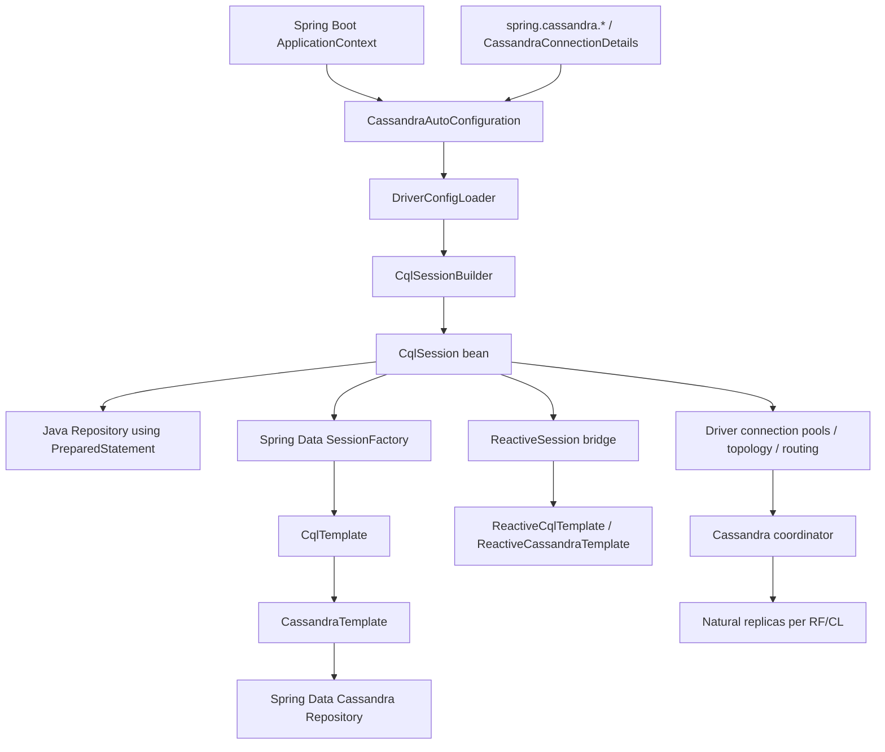
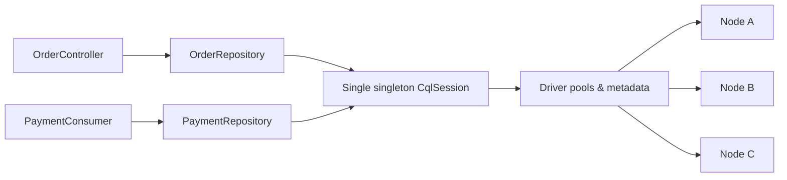
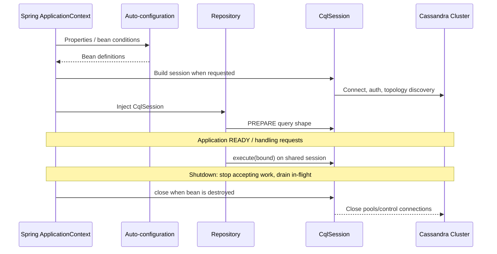
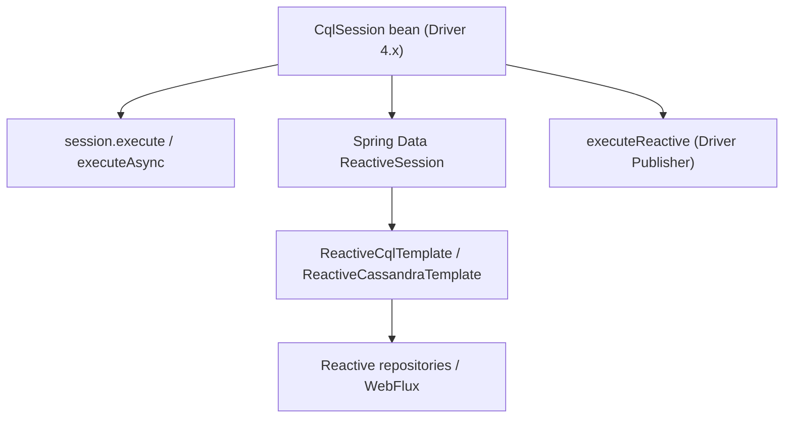

# `CqlSession` Bean, Auto-Configuration, and Lifecycle Management

## 1. The Problem: Who Creates, Uses, and Closes Cassandra Connections in Spring Boot?

In a plain Java application, you might write `CqlSession.builder().build()`, hold onto that object, and call `session.close()` on exit. In Spring Boot, **dependency injection**, **auto-configuration**, and **application lifecycle** should replace that manual management. Multiple controllers, services, repositories, and scheduled jobs can use Cassandra concurrently; if each object creates its own session, the system multiplies connections, metadata/control connections, thread pools, and prepared statement caches.

The key takeaway of this lesson: **`CqlSession` is a long-lived, thread-safe connection object, not a short-lived connection dedicated to a single query**. Spring Boot normally manages one shared `CqlSession` bean; each query creates its own `BoundStatement`, while the session handles token-aware routing, pooling, and communication with coordinators.

This lesson belongs to the **Spring Boot and Spring Data** chapter of the `DATABASE_ENGINE_WIDE_COLUMN_CASSANDRA` module. Concepts to connect include distributed/wide-column architecture, partition keys, query-driven tables, read/write consistency, CQL, replication, compaction, repair, error handling, and Java integration.

**Learning Objectives:**

1. Explain how the `CqlSession` bean, `CqlSessionBuilder`, Spring Data `SessionFactory`, and `CassandraTemplate` differ.
2. Use the starter and `spring.cassandra.*` for **Spring Boot auto-configuration**, rather than manually building sessions in every service.
3. Know when to use `CqlSessionBuilderCustomizer`, `DriverConfigLoaderBuilderCustomizer`, or a self-managed `@Bean CqlSession`.
4. Manage startup, readiness, prepared statements, graceful shutdown, and closing the session by its proper owner.
5. Identify the consequences of multiple sessions, multiple clusters/DCs, missing TLS/auth, wrong local DC, and auto-creating/dropping schemas at startup.
6. Verify bean wiring and CQL read paths in Spring Boot using integration tests, metrics, and a runbook.

> **Version scope:** Java code examples and Spring Boot imports are anchored to **Spring Boot 3.5.x + Spring Data Cassandra 4.5.x + Apache Cassandra Java Driver 4.x**. Spring Boot **4.x** still uses `spring.cassandra.*` and similar concepts, but **the packages of some auto-configuration/customizer types have moved** to a new namespace; do not copy imports verbatim into Boot 4 without checking the API of the version in use. CQL snippets are for **lab clusters only**; never modify production schemas ad hoc.

## 2. Architecture Diagram: One Session Serving Multiple Layers



**Reading the diagram top-down:**

- **Spring Boot** inspects config and the classpath to create the appropriate beans; you do not need to instantiate a session per repository.
- **Java Driver** owns the network connections, driver metadata, prepared cache, routing, and retries.
- **Spring Data Cassandra** adds mapping, templates, repositories, and exception translation. It **is not another database connection** that must be opened.
- **Cassandra** receives CQL through a coordinator; even though Spring code only calls a method, you still need a valid partition key/query pattern, proper CL, and healthy replicas.

**Do not confuse:** Java Driver's `CqlSession` **differs** from Spring Data's `SessionFactory`. `SessionFactory` is an abstraction templates use to obtain the managed session; it does not mean opening a new TCP connection on every call.

## 3. Project Setup: Starters and Dependencies Have Distinct Roles

With Spring Boot 3.5.x, typical dependencies are:

```xml
<!-- pom.xml: illustrative dependencies section, versions managed by the Spring Boot BOM -->
<dependencies>
  <dependency>
    <groupId>org.springframework.boot</groupId>
    <artifactId>spring-boot-starter-data-cassandra</artifactId>
  </dependency>
  <dependency>
    <groupId>org.springframework.boot</groupId>
    <artifactId>spring-boot-starter-actuator</artifactId>
  </dependency>
  <dependency>
    <groupId>org.springframework.boot</groupId>
    <artifactId>spring-boot-starter-test</artifactId>
    <scope>test</scope>
  </dependency>
</dependencies>
```

The Cassandra starter brings Java Driver and Spring Data Cassandra onto the classpath in compatible versions managed by Spring Boot. If an application **uses only pure Java Driver**, you can choose a smaller dependency, but you must understand the Boot version's auto-configuration conditions and explicitly decide whether templates/repositories are needed.

**Do not force an independent Java Driver version outside the BOM** just to grab a new API without verifying compatibility with Spring Data, Cassandra server, and the native protocol. For Spring Boot 4.x, also check the Java/Jakarta baseline, auto-configuration modules, and new package locations before upgrading.

### Comparing Three Usage Levels

| Need | Java-Side API | Benefits | Limitations to Remember |
| --- | --- | --- | --- |
| Direct CQL query control | `CqlSession`, `PreparedStatement` | Explicit binding, CL, paging, driver features | Manual row mapping and exception handling |
| CQL queries with Spring helpers | `CqlTemplate` | Callbacks/query helpers and exception translation | Still must design CQL with proper partition keys |
| Entity/repository mapping | `CassandraTemplate`, `CassandraRepository` | Entity mapping, repository CRUD | Does not turn Cassandra into JPA/RDBMS; no arbitrary joins/transactions |
| Reactive | `ReactiveCqlTemplate`, `ReactiveCassandraTemplate`, or driver `executeReactive` | Publisher/Reactor integration and nonblocking | Must manage subscription/backpressure/errors; still uses the underlying session |

## 4. Lab CQL: Data by Single Partition Key

Example keyspace `spring_cassandra_lab` in DC named `dc1`, RF3 when the lab has enough nodes:

```sql
CREATE KEYSPACE spring_cassandra_lab
WITH replication = {'class': 'NetworkTopologyStrategy', 'dc1': 3}
AND durable_writes = true;

CREATE TABLE spring_cassandra_lab.orders_by_id (
    order_id uuid PRIMARY KEY,
    customer_id text,
    status text,
    total decimal,
    updated_at timestamp
);

INSERT INTO spring_cassandra_lab.orders_by_id
    (order_id, customer_id, status, total, updated_at)
VALUES (
    11111111-2222-4333-8444-555555555555,
    'synthetic-customer-01',
    'CREATED',
    125.50,
    '2026-11-21T08:00:00+0000'
);

SELECT order_id, status, total
FROM spring_cassandra_lab.orders_by_id
WHERE order_id = 11111111-2222-4333-8444-555555555555;
```

**Why does this model fit?** `order_id` is the partition key; a query `WHERE order_id=?` can route by token/replica. The `CqlSession` bean **does not make a badly modeled table fast**: if an API needs to list by customer/time range, design another query-driven table rather than arbitrarily adding `ALLOW FILTERING` to a repository.

**Test data** uses synthetic UUIDs and customer IDs. Never run keyspace creation/deletion commands in production or grant `CREATE/DROP` to a regular application role.

## 5. What Does Spring Boot Auto-Configuration Do?

Per the Spring Boot 3.5 API, `org.springframework.boot.autoconfigure.cassandra.CassandraAutoConfiguration` configures three main stages:

```text
CassandraProperties / CassandraConnectionDetails
  -> DriverConfigLoader
  -> CqlSessionBuilder (prototype, customizable)
  -> CqlSession (lazy, conditional on missing bean)

Spring Data (when classpath/conditions match)
  -> SessionFactory + CqlTemplate / CassandraTemplate
  -> Cassandra repositories / reactive alternatives
```

Points to understand:

1. **`@ConditionalOnClass(CqlSession.class)`:** Java Driver must be on the classpath.
2. **`@ConditionalOnMissingBean`:** if the application declares its own `CqlSession` bean, auto-configuration normally **backs off from creating the default session**. Changing one bean can alter the entire graph.
3. **`@Lazy` on the default session in Boot 3.5:** the bean may be created when a dependent asks for it, not necessarily the moment config classes are discovered. If a `@Service` injects it at startup, connections can open during startup.
4. **`CqlSessionBuilder` has prototype scope:** this is a **mutable** builder; do not reuse a builder customized for cluster A to build session B without isolation.
5. Spring Data auto-configuration layers **on top of the existing session**; it does not create a new Cassandra cluster connection.

### Class Names Commonly Seen in the Conditions Report

| Layer | Spring Boot 3.5 Class | Responsibility |
| --- | --- | --- |
| Java Driver connection | `CassandraAutoConfiguration` | Loader, builder, `CqlSession` |
| Data mapping | `CassandraDataAutoConfiguration` | Converters, session factory, CQL/data templates |
| Imperative repositories | `CassandraRepositoriesAutoConfiguration` | Spring Data repository beans |
| Reactive | `CassandraReactiveDataAutoConfiguration` | Reactive session/template bridge |
| Reactive repositories | `CassandraReactiveRepositoriesAutoConfiguration` | Reactive repository beans |

In Boot 3.5 these classes live in `org.springframework.boot.autoconfigure...`; **Boot 4 moves some packages**. Check the documentation/API/JAR of the exact version when inspecting an auto-configuration report.

### What Does Auto-Config Mean for Availability?

Having a `CqlSession` bean in the ApplicationContext **does not automatically prove** three Cassandra nodes are `UN`, quorum is satisfied, or the application role can read the table. A successful connection to one coordinator also does not prove `LOCAL_QUORUM` for every query will meet SLOs. Separate **bean wiring**, **connectivity**, **authorization**, **availability**, and **business correctness**.

## 6. Minimal `application.yml` in the Right Namespace

Example Spring Boot 3.5.x configuration:

```yaml
spring:
  application:
    name: orders-api
  cassandra:
    contact-points:
      - cassandra-1.example.invalid:9042
      - cassandra-2.example.invalid:9042
    local-datacenter: dc1
    keyspace-name: spring_cassandra_lab
    username: ${CASSANDRA_APP_USER}
    password: ${CASSANDRA_APP_PASSWORD}
    request:
      timeout: 2s
      consistency: LOCAL_QUORUM
      page-size: 500
    connection:
      connect-timeout: 5s
    schema-action: none
```

**This is an illustrative configuration, not a reachable endpoint:** `example.invalid` is a reserved example domain; replace it with valid addresses/DNS names, proper trust/TLS, and lab credentials. Never commit passwords to Git. In production, load secrets from a secret manager with access controls and a rotation process.

| Boot 3.5 Property | Meaning | Common Mistake |
| --- | --- | --- |
| `spring.cassandra.contact-points` | Seed addresses for the driver to bootstrap topology | Listing only a decommissioned node or contact points in another DC |
| `spring.cassandra.local-datacenter` | DC name the driver treats as local | Using a location/alias that mismatches the snitch's real DC |
| `spring.cassandra.keyspace-name` | Default keyspace for the session | Assuming it auto-creates the keyspace |
| `spring.cassandra.username/password` | Credentials for the authenticator | Hardcoding passwords or using superuser |
| `spring.cassandra.request.consistency` | Driver default CL | Changing CL merely to mask missing replicas or timeouts |
| `spring.cassandra.request.timeout` | Driver-level request timeout | Confusing it with end-to-end API deadline or connect timeout |
| `spring.cassandra.request.page-size` | Page-size hint | Confusing it with CQL `LIMIT` or a byte limit |
| `spring.cassandra.connection.connect-timeout` | Limit for opening a connection | Confusing it with per-query read/write timeout |
| `spring.cassandra.schema-action` | Spring Data schema behavior at startup | Accidentally enabling create/recreate/drop in production |
| `spring.cassandra.ssl.*` | TLS/bundle/hostname verification | Flipping the flag without providing a proper trust chain |

**Watch the prefix name:** in modern Spring Boot, use `spring.cassandra.*`. Some **very old** guides use `spring.data.cassandra.*` for connection settings; never copy old Boot 1.x/2.x configs verbatim without checking the current version's metadata.

### Boot Properties vs. Driver Config File

Spring Boot can load a separate Java Driver configuration via `spring.cassandra.config` when advanced parameters are needed. Per Boot docs, if a property is set in both the driver file and `spring.cassandra.*`, the Spring Boot property takes **higher precedence**.

```yaml
# Example selecting an additional config source:
spring:
  cassandra:
    config: classpath:custom-cassandra-driver.conf
    request:
      timeout: 2s
```

Do not build an extra loader/session just to tune one timeout; prefer **properties → driver config/customizer → custom session**, in increasing order of specialization.

## 7. `CqlSession` Bean: Shared Singleton and Clear Ownership

Spring Boot provides singleton-scoped beans by default, and the driver designs `CqlSession` to be **thread-safe and long-lived**. That does not mean every helper object is safe to share:

- One `CqlSession` shared across controllers/repositories is **correct**.
- One `PreparedStatement` per query shape shared across requests is typically **correct**.
- Driver 4.x's immutable `BoundStatement` is thread-safe, though each request should **bind its own values**.
- A mutable `CqlSessionBuilder` customized for two clusters without cloning/creating a new builder is **dangerous**.
- A `ResultSet`/iterator or mutable accumulator collection shared across requests is **wrong**.



**Never** create a new session inside a request-handling method:

```java
// ANTI-PATTERN: every request creates and closes its own session.
Order findOrder(UUID id) {
    try (CqlSession session = CqlSession.builder().build()) {
        return query(session, id);
    }
}
```

This inflates handshakes, authentication, discovery, and pool allocations, and can spawn hundreds of control connections/threads under load; it can also pick up different local DC/credentials than Boot. The right approach is **constructor injection** of the container-managed bean.

## 8. Using the Auto-Configured Bean via Constructor Injection

Example pure Java Driver repository using the schema from Section 4:

```java
import java.math.BigDecimal;
import java.util.Optional;
import java.util.UUID;

import com.datastax.oss.driver.api.core.CqlSession;
import com.datastax.oss.driver.api.core.DefaultConsistencyLevel;
import com.datastax.oss.driver.api.core.cql.BoundStatement;
import com.datastax.oss.driver.api.core.cql.PreparedStatement;
import com.datastax.oss.driver.api.core.cql.Row;
import org.springframework.stereotype.Repository;

@Repository
public final class OrderLookupRepository {
    private final CqlSession session;
    private final PreparedStatement byId;

    public OrderLookupRepository(CqlSession session) {
        this.session = session;
        this.byId = session.prepare(
            "SELECT order_id, status, total " +
            "FROM spring_cassandra_lab.orders_by_id WHERE order_id = ?");
    }

    public Optional<OrderView> findById(UUID orderId) {
        BoundStatement request = byId.bind(orderId)
            .setConsistencyLevel(DefaultConsistencyLevel.LOCAL_QUORUM)
            .setIdempotent(true);

        Row row = session.execute(request).one();
        if (row == null) {
            return Optional.empty();
        }
        return Optional.of(new OrderView(
            row.getUuid("order_id"),
            row.getString("status"),
            row.getBigDecimal("total")));
    }

    public record OrderView(UUID orderId, String status, BigDecimal total) {}
}
```

**Benefits:** there is only one `CqlSession`; the repository bean is Spring-managed, and the prepared statement is created once for the repository's lifecycle. The driver uses the bound partition key to optimize routing when the necessary metadata is present.

**Trade-off to consider:** `session.prepare(...)` in the constructor touches Cassandra while Spring creates the repository. If the cluster is temporarily unavailable, the application may **fail startup**. That can be desirable for a service that cannot operate without the DB, provided it fits your deployment readiness/retry strategy; if startup must succeed independently of Cassandra, prepare statements **on demand with caching and error control** in a dedicated component, never by rebuilding a whole session per request.

Never call `session.close()` inside `findById` or a `@PreDestroy` on this repository. The session is a **shared Spring-owned bean**, not a resource the repository has authority to close.

## 9. Which Resources Do `CqlTemplate`, `CassandraTemplate`, and Repositories Share?

If Spring Data dependencies are present, the application can inject templates:

```java
import com.datastax.oss.driver.api.core.CqlSession;
import org.springframework.data.cassandra.core.CassandraTemplate;
import org.springframework.stereotype.Service;

@Service
public class OrderService {
    private final CqlSession session;
    private final CassandraTemplate template;

    public OrderService(CqlSession session, CassandraTemplate template) {
        this.session = session;
        this.template = template;
    }
}
```

Spring Data obtains the session through `SessionFactory`; it **does not close the session after each query** because the session is long-lived. You can use Java Driver directly for CQL needing fine-grained CL/statement control and templates/repositories where simpler mapping fits; both should still share a unified **connection path and security role**.

### Entity Mapping Example

```java
import java.math.BigDecimal;
import java.util.UUID;
import org.springframework.data.cassandra.core.mapping.PrimaryKey;
import org.springframework.data.cassandra.core.mapping.Table;
import org.springframework.data.cassandra.core.mapping.Column;

@Table("orders_by_id")
public class OrderEntity {
    @PrimaryKey("order_id")
    private UUID orderId;

    @Column("status")
    private String status;

    @Column("total")
    private BigDecimal total;

    // Getters/setters/constructors per chosen mapper.
}
```

```java
import java.util.UUID;
import org.springframework.data.cassandra.repository.CassandraRepository;

public interface OrdersRepository
        extends CassandraRepository<OrderEntity, UUID> {
}
```

**Do not assume** JPA annotations, lazy joins, cascade transactions, or Spring Data auto-generated schemas work for every Cassandra design. `Repository.findById` by primary key fits; a derived query filtering on non-primary-key columns may require indexes or perform poorly. Always design tables around **query patterns** first before writing repositories.

### Schema Ownership Conflicts

`spring.cassandra.schema-action: none` is the safe choice when production schemas are managed by dedicated migrations/runbooks. Schema actions like create/recreate/drop **should never be enabled in production** when multiple Spring Boot instances start concurrently. DDL changes need a single owner, schema agreement, and an expand/contract plan for parallel application versions.

## 10. Lightweight Customization: `CqlSessionBuilderCustomizer`

Per the Spring Boot 3.5 API, this customizer is invoked by auto-configuration before building the session, letting you tweak the builder **while preserving the rest of the connection details/configuration**.

```java
import org.springframework.context.annotation.Bean;
import org.springframework.context.annotation.Configuration;
import org.springframework.boot.autoconfigure.cassandra.CqlSessionBuilderCustomizer;

@Configuration(proxyBeanMethods = false)
public class CassandraDriverCustomization {

    @Bean
    CqlSessionBuilderCustomizer applicationIdentity() {
        return builder -> builder.withApplicationName("orders-api");
    }
}
```

`withApplicationName` is a Java Driver 4.x API used in connection initialization metadata/observability when supported by the server. This approach **does not create a new session** and does not discard `spring.cassandra.*` properties applied by Boot.

### When to Use a Customizer?

- Need direct builder configuration not covered by Boot properties.
- Need to attach a version-compatible plugin/listener/driver-specific option.
- Want to preserve auto-config, dependency injection, Spring Data wiring, and Spring-managed lifecycle.

**Do not** call `builder.build()` inside the customizer callback: the callback only **configures the builder**, while Boot builds the session. Never store this builder in a static field and mutate it from request threads, as the builder is mutable.

## 11. Customizing Driver Config: `DriverConfigLoaderBuilderCustomizer`

For timeouts, connection pooling, request throttling, request consistency, or driver metrics, **prefer supported Boot properties**. When an unmapped option is needed, use a driver config loader customizer.

```java
import java.time.Duration;
import org.springframework.context.annotation.Bean;
import org.springframework.context.annotation.Configuration;
import org.springframework.boot.autoconfigure.cassandra.DriverConfigLoaderBuilderCustomizer;
import com.datastax.oss.driver.api.core.config.DefaultDriverOption;

@Configuration(proxyBeanMethods = false)
public class DriverTimeoutConfig {

    @Bean
    DriverConfigLoaderBuilderCustomizer loaderSettings() {
        return builder -> builder.withDuration(
            DefaultDriverOption.REQUEST_TIMEOUT,
            Duration.ofSeconds(2));
    }
}
```

In this example, the 2s timeout **could also be set via `spring.cassandra.request.timeout: 2s`**, and the simpler approach is usually preferred. If the same option is set in multiple places, verify **actual configuration precedence** for your Boot/Driver version to avoid tuning one place only to have another override it.

**Two distinct customizer types:**

| Type | Operates On | Example | Do Not Do |
| --- | --- | --- | --- |
| `CqlSessionBuilderCustomizer` | `CqlSessionBuilder` | Application name, driver extensions | Call build/close session inside callback |
| `DriverConfigLoaderBuilderCustomizer` | `ProgrammaticDriverConfigLoaderBuilder` | Driver execution options | Mutate live request connections by creating a new loader |

**Namespace note:** both customizers live in `org.springframework.boot.autoconfigure.cassandra` on Boot 3.5. On Boot 4, look up `org.springframework.boot.cassandra.autoconfigure`. Same interface names, **old imports will not compile** on the newer release.

## 12. When a Manual `@Bean CqlSession` Is Truly Needed

If you need a special authentication mechanism, multiple clusters, custom certificate rotation, or must construct `CqlSession` outside auto-config, you can declare the bean:

```java
import com.datastax.oss.driver.api.core.CqlSession;
import com.datastax.oss.driver.api.core.CqlSessionBuilder;
import org.springframework.context.annotation.Bean;
import org.springframework.context.annotation.Configuration;

@Configuration(proxyBeanMethods = false)
public class ExplicitCqlSessionConfig {

    @Bean(destroyMethod = "close")
    CqlSession applicationSession(CqlSessionBuilder builder) {
        // Boot 3.5 can provide a prototype CqlSessionBuilder.
        // Modify the builder here only when confirmed necessary.
        return builder.build();
    }
}
```

**Execution note:** this configuration **replaces the auto-configured session**; do not add it to a healthy app just to "be sure a bean exists". Spring Boot 3.5 uses `@ConditionalOnMissingBean`, so once it detects an application-declared `CqlSession` bean, it typically **backs off from creating the default session**. Templates and repositories will depend on the session you create.

If you declare **two `CqlSession` beans**, injection by type becomes **ambiguous**. You must use `@Primary`/`@Qualifier` and explicit Spring Data/template wiring rather than expecting Boot to guess which cluster is "orders" and which is "archive".

### Do Not Duplicate Creation/Closing

Wrong:

```java
@Service
class BadOrderService {
    private final CqlSession injected;

    BadOrderService(CqlSession injected) {
        this.injected = injected;
    }

    @PreDestroy
    void stop() {
        injected.close(); // Wrong ownership: service closes shared session.
    }
}
```

Better: Spring owns the session bean; in manual configs use `@Bean(destroyMethod="close")` or the equivalent lifecycle contract, **closing once when ApplicationContext stops**, after draining in-flight work per shutdown policy. When Boot creates the session bean, the container manages its disposal too; do not add an extra shutdown hook closing the same object.

## 13. Real Lifecycle: From Startup to Shutdown



### 13.1. Startup

1. Spring reads properties, profiles/environment, `CassandraConnectionDetails` (if using service connections), and customizers.
2. Auto-config registers bean definitions; in Boot 3.5, the default session bean method is **lazy**.
3. When a component requests the session, the driver builds it and begins connecting/authenticating/discovering nodes. **Network/auth errors can surface during startup** if a bean triggers it at startup.
4. If a repository prepares statements in its constructor, the schema/keyspace/table must exist and the role must have permissions; `schema-action: none` will not create them.
5. The application should only be marked **ready** once essential conditions are met, not merely when the HTTP port binds.

### 13.2. Runtime

A session typically manages:

- topology/metadata and local DC selection for routing;
- connection pools to nodes and the control connection for cluster discovery;
- prepared statement cache and re-preparing after restarts;
- request timeouts, consistency, retries/idempotence, and paging/tracing/metrics per version.

Application logic must construct statements and bind values per request; never switch keyspaces with `USE` per request, because the session is shared. Prefer **fully qualified table names** `keyspace.table` in CQL and least-privilege roles.

### 13.3. Shutdown

1. Stop accepting new requests/messages or remove readiness from traffic routing.
2. Wait for/bound in-flight requests and business acknowledgements per SLA.
3. Stop scheduled jobs/consumers in dependency order.
4. Container destroys beans and closes the session; connection pools and driver threads are released.

Do not assume `close()` rolls back mutations already sent. For write timeouts or cancellations, the outcome may be unknown and requires business idempotency/reconciliation.

## 14. Graceful Shutdown: Closing Too Early Causes Real Errors

Configure shutdown appropriately for a web app, for example:

```yaml
server:
  shutdown: graceful
spring:
  lifecycle:
    timeout-per-shutdown-phase: 30s
```

This gives Spring Boot a chance to drain web requests during server shutdown; **it does not automatically prove** every Kafka consumer, background executor, reactive stream, or CQL request has finished draining. Background workloads require their own stop policies.

| Shutdown Event | Risk | Action |
| --- | --- | --- |
| Kubernetes sends SIGTERM | Pod still has in-flight HTTP requests | Remove from routing, wait for graceful stop |
| Kafka consumer processing write | Offset acked before CQL completes | Ack after business completion; checkpoint/idempotency |
| Reactive stream still subscribed | Session closes while publisher fetches next page | Define cancel/drain and deadlines |
| Scheduled job running batch | Closing session from an arbitrary job breaks the whole app | Job does not own the session; orchestrator handles stop lifecycle |
| Write request times out near shutdown | Unclear whether it was applied | Recover via event ID/outbox after restart |

**Never use `@PreDestroy` on individual repositories to close an injected session.** A single bean may be shared by many repositories; whoever creates the session is responsible for closing it. When multiple contexts/child contexts share an instance, define ownership explicitly to avoid double-closing.

## 15. Health Checks and Readiness: Do Not Let Liveness Trigger Restart Loops

Spring Boot Actuator provides a Cassandra health contributor when configured and conditions match. It helps check database availability to a degree; **it is not proof that every table/partition/CL and DC meets SLOs**.

```yaml
management:
  endpoints:
    web:
      exposure:
        include: health,info
  endpoint:
    health:
      show-details: never
  health:
    cassandra:
      enabled: true
```

**Separate the two meanings:**

- **Liveness:** is the process alive and free of severe deadlocks? Avoid letting a transient Cassandra outage cause Kubernetes to restart all healthy pods simultaneously, creating a connection storm.
- **Readiness:** should this instance receive new traffic? For APIs needing Cassandra reads/writes, define a policy verifying capability to serve. Checking `LOCAL_QUORUM`, service role permissions, or a lightweight canary query **can** be part of readiness if kept low-load and free of PII.

A default health indicator does not necessarily test the application's actual `SELECT ... WHERE pk=?` query. If query-driven tables span multiple DCs or use special authorization, add a **bounded, periodic functional smoke test** with separate alerting rather than querying heavily on every kube probe.

### Do Not Expose Topology/Credentials via Actuator

`/actuator/health`, `/actuator/env`, `/actuator/configprops`, and debug conditions can leak infrastructure/config details if exposed carelessly. Restrict endpoints, RBAC, and details; never include raw Cassandra passwords, sensitive contact points, or query bind values in public responses.

## 16. TLS, Authentication, and Authorization Across the Session Lifecycle

**A Spring bean does not create security automatically.** If CQL traffic must be encrypted, configure the driver trust chain/TLS and ensure certificate hostnames match contact points. Production example:

```yaml
spring:
  cassandra:
    ssl:
      enabled: true
      verify-hostname: true
      # bundle: cassandra-client  # Only when the matching SSL bundle is configured.
    username: ${CASSANDRA_APP_USER}
    password: ${CASSANDRA_APP_PASSWORD}
```

**Enabling TLS without providing the proper CA/truststore/SSL bundle** causes handshake failures, not keyspace errors. Client-to-node TLS and Cassandra inter-node encryption are separate configuration scopes; role `app_orders` needs table permissions, not superuser.

Example in a **lab with `CassandraAuthorizer` enabled**:

```sql
-- Execute only via an approved security admin account in LAB.
CREATE ROLE app_orders
WITH LOGIN = true AND SUPERUSER = false
AND PASSWORD = '<LAB_RANDOM_SECRET>';

GRANT SELECT ON TABLE spring_cassandra_lab.orders_by_id
TO app_orders;
```

If `app_orders` only has `SELECT`, `INSERT/UPDATE/DELETE` or schema DDL will be rejected per the active authorizer config. Spring creating the bean and logging in **does not prove** the service has permissions on every table. Across Cassandra versions, role metadata in `system_auth` is subject to RF/topology/caches; granted or revoked permissions may take time to propagate and should be tested across multiple coordinators.

## 17. Why "One Keyspace = One Session" Is Not Absolute

`CqlSession` can have a **default keyspace**, yet CQL can readily use **fully qualified names** across multiple keyspaces if the role has permissions. You do not need an extra session just because an app reads `orders_ks.orders_by_id` and `audit_ks.audit_by_id` on the **same cluster with the same credentials/security/driver config**.

When does separating sessions make sense?

| Scenario | Can Share Session? | Reason |
| --- | --- | --- |
| Two tables, same keyspace | **Yes** | Same cluster and policy |
| Two keyspaces, same cluster, same credentials | **Usually yes** | Use fully qualified table names; avoid extra control connections |
| Two physically separate clusters | **Should not share** | A session manages one cluster topology |
| Same cluster, two distinct identities/roles | **May need separation** | Session authentication/permissions are bound to identity |
| Different DC, distinctly different routing policy | **Evaluate individually** | Driver local DC/routing and failover/WAN strategy must be explicit |
| Multi-tenant isolation via per-tenant roles | **Do not assume sharing** | Cassandra RBAC is table/keyspace-level, with no default row-level ACL |

**Cost of a new session:** extra connection pools, control connection, topology listeners, memory/threads, and prepared caches. With thousands of tenants, **one session per tenant** usually exhausts resources; reconsider the isolation and security architecture.

## 18. Multi-Cluster: `@Qualifier` and Proper Bean Management Are Required

If connecting to two clusters is unavoidable, each session must have its own name/credentials/local DC. Structural example (abbreviated to illustrate ownership only):

```java
import java.net.InetSocketAddress;
import com.datastax.oss.driver.api.core.CqlSession;
import org.springframework.beans.factory.annotation.Qualifier;
import org.springframework.context.annotation.Bean;
import org.springframework.context.annotation.Configuration;
import org.springframework.context.annotation.Primary;

@Configuration(proxyBeanMethods = false)
public class TwoClustersConfig {

    @Bean(name = "primaryClusterSession", destroyMethod = "close")
    @Primary
    CqlSession primary() {
        return CqlSession.builder()
            .addContactPoint(new InetSocketAddress("192.0.2.11", 9042))
            .withLocalDatacenter("dc1")
            .withAuthCredentials("orders_role", System.getenv("ORDERS_DB_PASS"))
            .build();
    }

    @Bean(name = "archiveClusterSession", destroyMethod = "close")
    CqlSession archive() {
        return CqlSession.builder()
            .addContactPoint(new InetSocketAddress("192.0.2.22", 9042))
            .withLocalDatacenter("archive_dc")
            .withAuthCredentials("archive_role", System.getenv("ARCHIVE_DB_PASS"))
            .build();
    }
}

// In repository:
// ArchiveRepository(@Qualifier("archiveClusterSession") CqlSession session)
```

`192.0.2.0/24` is an illustrative TEST-NET range; **there is no TLS in this abbreviated snippet**, so it is **not a secure production configuration**. In a real system, configure TLS, truststores, failure policies, metrics/session names, and secrets per cluster; never copy-paste bare snippets.

**Common pitfall:** Boot's default auto-config may back off once it sees a `CqlSession` bean; Spring Data template/repository auto-config may pick the `@Primary` session. If you want two truly separate sets of repositories, explicitly configure separate `SessionFactory`/template/repository beans by name/qualifier rather than defining two `CqlSession` beans and hoping auto-config separates them.

## 19. Reactive and Async: No Need for a Second Session Just for a Different API

Spring Data Cassandra supports both imperative and reactive layers. When classpath/conditions match, Spring Boot can create `ReactiveSession`/`ReactiveCqlTemplate`/`ReactiveCassandraTemplate` backed by the **underlying `CqlSession`**.



**Key rules:**

- A reactive publisher only executes upon **subscription**; never build a `Publisher` and return HTTP 200 / ack a message before the pipeline completes.
- Never call `block()/join()` on a Netty/Reactor event-loop or driver I/O callback.
- With many rows/pages, preserve backpressure; avoid unbounded `collectList()`.
- When a subscriber cancels or times out, **never assume Cassandra rolled back the mutation**.
- When using Spring Data reactive/templates, do not close `CqlSession` inside individual subscriptions; the bean/container owns its lifecycle.

### Example Using Driver 4.x with WebFlux

```java
import reactor.core.publisher.Mono;
import reactor.core.publisher.Flux;
import com.datastax.oss.driver.api.core.cql.Row;

public Mono<OrderLookupRepository.OrderView> findReactive(UUID id) {
    return Flux.defer(() ->
        Flux.from(session.executeReactive(byId.bind(id)
            .setConsistencyLevel(DefaultConsistencyLevel.LOCAL_QUORUM)
            .setIdempotent(true))))
        .next()
        .map(row -> new OrderLookupRepository.OrderView(
            row.getUuid("order_id"),
            row.getString("status"),
            row.getBigDecimal("total")));
}
```

This snippet belongs to a hypothetical repository with `session`/`byId` in scope; it applies only to a single-primary-key SELECT returning at most one row. `Flux.defer` creates a fresh publisher per subscription (the driver reactive publisher has a single-subscription constraint). When using `Mono.empty()` for "not found", the controller must distinguish it from real `onError` failures. Never use `onErrorResume(e -> Mono.empty())` to hide outages.

## 20. Observability: When Seeing Too Many Connections, Check Beans Before Compaction

A Spring Boot service creating **more `CqlSession` instances** than expected can cause:

- Multiple control connections, connection pools, and metadata refresh events.
- Multiple prepared caches, generating extra PREPARE/reprepare traffic.
- Higher thread counts/memory, CPU/GC pressure, and connection churn.
- Connection storms against Cassandra when 100 pods deploy together, delaying startup/readiness.

Metrics to monitor:

| Layer | Metric | Used to Conclude |
| --- | --- | --- |
| Spring | `CqlSession` bean count, bean names, auto-config conditions | Did a custom bean cause Boot to back off? |
| Startup | Session init duration, auth/TLS/topology errors | Cluster unready or misconfigured? |
| Driver | Connections, in-flight requests, pool saturation, retries, p95/p99 | Is the client side causing latency? |
| CQL | Successful QPS, timeouts/errors, CL, paging, query shapes | Are queries using proper partition keys and returning expected rows? |
| Cassandra | `nodetool status/tpstats/compactionstats`, table read metrics | Are replicas/compaction/repair causing latency? |
| Shutdown | Unfinished in-flight work, consumer acks, driver connection closes | Is business work being lost or duplicated? |

**Never log the entire `CqlSession`, raw CQL bind values, or Cassandra credentials** while debugging bean wiring. Actuator conditions/beans are helpful in protected environments; in production restrict access to authorized roles and redact sensitive config values.

### Read-Only Cassandra Diagnostic Commands

```bash
nodetool status
nodetool describecluster
nodetool tpstats
nodetool compactionstats
nodetool tablestats spring_cassandra_lab.orders_by_id
```

These commands inspect the **queried node** and cluster within tool scope; they do not turn an app's health indicator into proof every replica/CL is healthy. If `CqlSession` builds fine yet `LOCAL_QUORUM` fails, investigate RF/DC/rack/replicas alongside driver and host metrics.

## 21. Testing Auto-Config and Lifecycle Without Touching Production

### 21.1. Unit Testing Bean Wiring

With Spring Test/ApplicationContext, verify the count of `CqlSession` beans, names/qualifiers, and applied customizers; test a case with a custom `@Bean` to confirm auto-config backoff. Unit tests **do not need real Cassandra** when mocking session creation/bean definitions properly; never test protocol behavior with a mock and claim real connectivity works.

### 21.2. Integration Testing with Testcontainers

Spring Boot 3.5 supports `@DataCassandraTest` and Testcontainers `@ServiceConnection`. You must include the corresponding test dependencies such as `spring-boot-testcontainers` and a compatible Testcontainers Cassandra module.

```java
import com.datastax.oss.driver.api.core.CqlSession;
import org.junit.jupiter.api.Test;
import org.springframework.beans.factory.annotation.Autowired;
import org.springframework.boot.test.autoconfigure.data.cassandra.DataCassandraTest;
import org.springframework.boot.testcontainers.service.connection.ServiceConnection;
import org.testcontainers.containers.CassandraContainer;
import org.testcontainers.junit.jupiter.Container;
import org.testcontainers.junit.jupiter.Testcontainers;
import org.testcontainers.utility.DockerImageName;

import static org.assertj.core.api.Assertions.assertThat;

@Testcontainers
@DataCassandraTest(properties = "spring.cassandra.schema-action=none")
class CassandraSessionWiringIT {
    @Container
    @ServiceConnection
    static CassandraContainer<?> cassandra =
        new CassandraContainer<>(
            DockerImageName.parse("cassandra:4.1"));

    @Autowired CqlSession session;

    @Test
    void createsDriverSession() {
        assertThat(session).isNotNull();
        assertThat(session.execute(
            "SELECT release_version FROM system.local").one()).isNotNull();
    }
}
```

**Version note:** this example uses Testcontainers 1.x APIs and Boot 3.5. Newer Testcontainers may change packages/modules, and Spring Boot 4 changes the `@DataCassandraTest` package. Align dependencies with the BOM and **do not** treat `cassandra:4.1` as a mandatory production pin. If a test checks lab tables, create schema fixtures inside the container before repositories run; `schema-action: none` **does not auto-generate keyspaces/tables**.

### 21.3. Testing Lifecycle and Single Close

In tests using a verified fake/wrapped `CqlSession` or lifecycle hook, confirm:

- Context creates at most one session for a single-cluster configuration.
- Two services inject the **exact same session instance**.
- Closing a repository does not close the session.
- On context shutdown, the session bean is closed **once**.
- Scheduled jobs/consumers stop with the lifecycle and send no requests after the session closes.

You do not need to kill a production Cassandra node to test this. Use lifecycle test doubles and isolated containers for integration.

## 22. Common Issues and How to Distinguish Root Causes

| Symptom | Causes to Check | Resolution Path |
| --- | --- | --- |
| `NoSuchBeanDefinitionException: CqlSession` | Missing driver/starter, excluded auto-config, unmatched profile/condition | Check classpath and controlled `--debug`/conditions report |
| `NoUniqueBeanDefinitionException: CqlSession` | Two cluster sessions, injection missing qualifier | `@Qualifier`/`@Primary` and template/repo wiring |
| Slow startup / fails to start | Wrong auth/TLS/contact points/local DC, unavailable nodes | Cross-check driver logs + topology; do not blindly open firewalls |
| Boot app starts but first query fails | Lazy session not initialized earlier, missing role/table | Proper readiness checks, controlled warmup |
| `CqlSession` bean created twice | Custom config + auto-config/child context, manual factory in service | Audit bean graph and `CqlSession.builder()` calls |
| Connections grow after every HTTP request | Creating/closing session per request scope | Constructor-inject singleton; never instantiate per request |
| Java Driver throws `UnauthorizedException` | Role lacks `SELECT/MODIFY` | Test table permissions; never grant superuser |
| Query reports missing table | Wrong keyspace or schema migration not run | Check fully qualified CQL and schema agreement |
| Bad p99 despite healthy Spring beans | Query misses PK, hot partition, compaction/repair, CL | Trace/metrics in right scope; do not raise session count |
| Spring Data template hits wrong cluster | Multiple sessions, wrong `@Primary`, or `SessionFactory` wiring | Explicit factories/qualifiers and integration tests |
| Reconnect/timeout after secret rotation | Credentials/TLS changed while old session still active | Controlled rollout/session recreation strategy |
| Events lost on shutdown | Message acked before DB success or session closed before drain | Lifecycle stop → await → close, idempotent retries |
| Actuator health UP while P0 query fails | Health check does not cover query/CL/business correctness | Add bounded smoke test and contract-based readiness |
| App creates/drops tables on startup | Dangerous `schema-action` | Set `none`; manage schema separately per change |
| Boot 4 code rejects customizer import | Class namespace changed | Consult Boot 4 API; do not copy 3.5 imports |

## 23. Spring Boot + Cassandra Deployment Runbook

### P0 — Lock Topology and Contracts

Inventory clusters/DCs, contact points, keyspace, RF/CL, partition keys/query patterns, roles, and TLS. Pin Spring Boot/Driver/Spring Data versions; do not let a service silently fail over to another DC without design approval.

### P1 — Let Boot Manage One Session

Declare starter, `spring.cassandra.*`, `schema-action: none`, and secrets. Prefer auto-config; use customizers only when needed. If replacing with `@Bean CqlSession`, document why, who owns closing it, and session count per cluster.

### P2 — Separate Schema Migrations from Multi-Pod Startup

Create/alter keyspaces and tables via approved changes; verify schema agreement, compatible app versions, and role permissions. Never allow every pod to create/drop schemas simultaneously during rollout.

### P3 — Test Context and Connectivity

Verify `CqlSession` beans and `SessionFactory`/templates/qualifiers, TLS/auth connectivity, local DC, and queries by partition key/CL. Run integration tests with fixtures and Testcontainers, not mocks alone.

### P4 — Readiness and Startup

Verify the driver session actually connects, permissions are valid, and run app-level smoke tests when needed. Do not tie liveness to transient Cassandra failures. If the session is lazy, decide explicitly between warming up before ready or letting the first request surface errors.

### P5 — Canary and Monitoring

Track startup time, connections/node, in-flight requests, retries, p95/p99, successful QPS, errors, and pool saturation. On Cassandra, correlate compaction/repair/hot partitions; do not blame Spring for every slowdown.

### P6 — Safe Shutdown

Configure graceful shutdown, stop job intake, drain/bound in-flight work, preserve business idempotency, and let the container close the session once. Monitor post-close requests and ambiguous write outcomes.

### P7 — Periodic Operational Review

Audit version mismatches, cert/secret rotation, overly broad permissions, redundant beans, `schema-action`, and driver config overrides. Rehearse node loss/DC failure per RF/CL requirements and measure application-level RTO, not just process status.

## 24. Self-Check Exercises

1. Why should `CqlSession` be a shared singleton, while `BoundStatement` should be bound per request?
2. Which `DriverConfigLoader`/`CqlSessionBuilder`/property components can Spring Boot use to create `CqlSession`?
3. What does `@ConditionalOnMissingBean` mean when you declare `@Bean CqlSession` yourself?
4. Why can `@Lazy` on the default session bean in Boot 3.5 cause connection errors to surface later than startup?
5. What are the differences between Java Driver `CqlSession`, Spring Data `SessionFactory`, `CqlTemplate`, and `CassandraTemplate`?
6. What costs does a repository incur if it calls `CqlSession.builder().build()` inside every method?
7. Why should you never use `try (CqlSession s = injectedSession)` inside a business method?
8. What is the role of `spring.cassandra.local-datacenter` in a multi-DC cluster? Does it change RF?
9. Does setting `spring.cassandra.keyspace-name` automatically create the keyspace?
10. Why is `schema-action: none` typically right for production, especially when many pods start simultaneously?
11. When should you use `CqlSessionBuilderCustomizer` instead of declaring your own session bean?
12. What is the difference between `DriverConfigLoaderBuilderCustomizer` and `CqlSessionBuilderCustomizer`?
13. If a driver option appears in both a driver config file and `spring.cassandra.*`, which precedence rule must you check?
14. Why does `CassandraTemplate` not imply opening a new Cassandra connection?
15. If an app reads two keyspaces on the same cluster with the same role, are two `CqlSession` instances mandatory?
16. With two cluster sessions, why are `@Qualifier` and possibly manual `SessionFactory`/repository configs required?
17. Does Boot Actuator Cassandra health UP prove a `LOCAL_QUORUM` query on a hot partition will be accurate and fast?
18. Why should a transient Cassandra outage not be wired directly into a liveness probe that restarts pods repeatedly?
19. What happens when a Kafka consumer acks an offset before a reactive write completes?
20. Why do token-aware routing and query design still matter even when Spring Data provides CRUD repositories?
21. Design an integration test proving the `CqlSession` bean actually works with Cassandra Testcontainers.
22. List the steps to rotate credentials/TLS without dropping all connections across every pod simultaneously.
23. If a Java service has two `CqlSession` instances after a new deploy, outline a process to find the creation source and metrics to evaluate overhead.
24. When upgrading an app from Boot 3.5 to Boot 4, where should customizer packages be reviewed?

### Capstone Exercise: An Order API Application

Build a Spring Boot application with `GET /orders/{orderId}`:

- Use the Cassandra starter, configure `spring.cassandra.contact-points`/`local-datacenter`/`keyspace-name`, `schema-action: none`, credentials from a secret manager, and TLS.
- Inject one `CqlSession` into `OrderLookupRepository`; prepare `SELECT order_id,status,total ... WHERE order_id=?`, bind the UUID, and execute with CL `LOCAL_QUORUM`.
- Return 404 when the row is absent; distinguish timeout, unavailable, and unauthorized rather than masking them as empty results.
- Use Actuator health/readiness carefully, avoiding liveness coupling to transient Cassandra errors; never expose secrets.
- Run `@DataCassandraTest` with Testcontainers to verify bean wiring, fixture queries, `SELECT` role, and exact keyspace.
- Canary and measure p95/p99, successful QPS, driver pools, compaction, cleanup, and graceful shutdown under in-flight requests.
- Add an archive cluster **only if genuinely needed**, using a separate session and explicit qualifier; verify no accidental extra sessions are created.

**Completion criteria:** learners can explain **who creates and who closes `CqlSession`**, configure a single Boot-managed session without multiplying connections, distinguish customizers from bean overrides, map Spring Data vs. driver sessions, handle startup/readiness/shutdown, and test real connections in an isolated environment.

## 25. References

- [Spring Boot 3.5 — Working with NoSQL Technologies: Cassandra](https://docs.spring.io/spring-boot/3.5/reference/data/nosql.html): starter, `CqlSession`, properties, and customizers.
- [Spring Boot 3.5 — CassandraAutoConfiguration API](https://docs.spring.io/spring-boot/3.5/api/java/org/springframework/boot/autoconfigure/cassandra/CassandraAutoConfiguration.html): `@ConditionalOnMissingBean`, `@Lazy`, prototype `CqlSessionBuilder`, loader, and session.
- [Spring Boot 3.5 — Cassandra properties](https://docs.spring.io/spring-boot/3.5/appendix/application-properties/): `spring.cassandra.*`, timeout, consistency, schema-action, SSL.
- [Spring Boot 3.5 — Testing Spring Boot Applications](https://docs.spring.io/spring-boot/3.5/reference/testing/spring-boot-applications.html): `@DataCassandraTest`.
- [Spring Boot 3.5 — Testcontainers Service Connections](https://docs.spring.io/spring-boot/3.5/reference/testing/testcontainers.html): `@ServiceConnection`, CassandraContainer, and connection details.
- [Spring Boot 3.5 — Actuator Endpoints](https://docs.spring.io/spring-boot/3.5/reference/actuator/endpoints.html): cassandra health, liveness/readiness, and endpoint security.
- [Spring Boot 4.x — CassandraAutoConfiguration](https://docs.spring.io/spring-boot/4.0/api/java/org/springframework/boot/cassandra/autoconfigure/CassandraAutoConfiguration.html): namespace change on Boot upgrade.
- [Spring Data Cassandra 4.5 — CQL Template API](https://docs.spring.io/spring-data/cassandra/reference/4.5/cassandra/cql-template.html): long-lived `CqlSession`, `SessionFactory`, and disposal responsibility.
- [Spring Data Cassandra 4.5 — CqlSessionFactoryBean](https://docs.spring.io/spring-data/cassandra/docs/4.5.x/api/org/springframework/data/cassandra/config/CqlSessionFactoryBean.html): `FactoryBean`, init/destroy, thread-safe singleton, and exception translation.
- [Apache Cassandra Java Driver 4.x — Session / Builder](https://apache.github.io/cassandra-java-driver/4.18.1/api/com/datastax/oss/driver/api/core/session/SessionBuilder.html): building sessions, application name, authentication, and connection details.
- [Apache Cassandra — Data Modeling](https://cassandra.apache.org/doc/stable/cassandra/data_modeling/): query-driven partitioning, replication, and the wide-column model.

**Conclusion:** In Spring Boot, proper Cassandra management starts with **one `CqlSession` bean with a clear owner and lifecycle**, usually auto-configured from `spring.cassandra.*`. Controllers, services, CQL templates, and Spring Data repositories **reuse that session**, never creating and closing a connection per request. Customize via properties/customizers before overriding the bean; with multiple clusters, wiring and closing each session must be explicit. Finally, **the existence of a bean does not mean the cluster is serving properly**: you must verify partition keys, RF/CL, permissions, TLS, schema, readiness, graceful shutdown, and end-to-end latency/error/throughput metrics.
