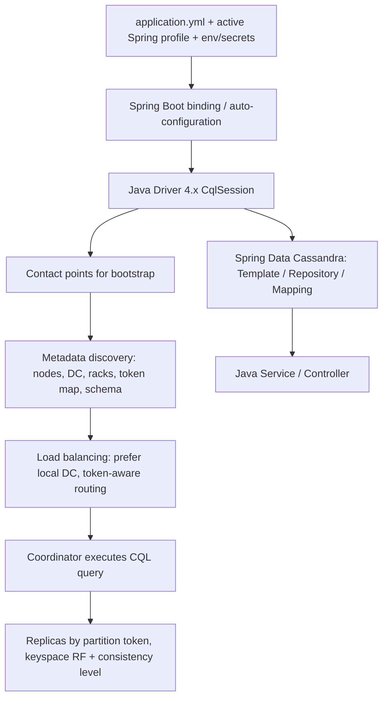

# Contact Points, Local Datacenter, Keyspace, and Environment-Specific Configuration

> **Chapter:** Spring Boot and Spring Data  
> **Module:** `DATABASE_ENGINE_WIDE_COLUMN_CASSANDRA` — understand Apache Cassandra's distributed architecture and wide-column model; master partition keys, query-driven table design, read/write consistency levels, CQL, replication, compaction, repair, error handling, and Java application connectivity.  
> **Scope:** Configuring Cassandra connectivity for **Spring Boot + Spring Data Cassandra** applications across local/staging/production environments; distinguishing **contact points**, **local datacenter**, **keyspace**, and replication/consistency; managing secrets/TLS, Spring profiles, Java Driver `CqlSession`, testing, and operational runbooks.
>
> **Version note:** Property examples use **Spring Boot 3.x/4.x** (`spring.cassandra.*`); Spring Boot 2.7 uses the **`spring.data.cassandra.*`** prefix. References cite Spring Boot 4.2/Spring Data Cassandra 5.x and 3.5/4.5 to illustrate cross-checking. When deploying, confirm property metadata, Java/JDK, Driver, and APIs against the **exact running version**.

An application configuration can look deceptively simple:

```yaml
spring:
  cassandra:
    contact-points: "cassandra-1.internal:9042,cassandra-2.internal:9042"
    local-datacenter: "dc1"
    keyspace-name: "orders_service"
```

Yet those three values answer **three different questions**:

- **Contact points:** "At initialization, which Cassandra nodes should the driver contact to **discover the cluster**?"
- **Local datacenter:** "For this application, which Cassandra DC is considered **local/preferred for serving requests**?"
- **Keyspace:** "By default, which **CQL namespace and replication strategy** does the application work with?"

They are not interchangeable. Getting the first two right with the wrong keyspace can still read data from the wrong environment if the role has permissions. Conversely, a right keyspace with the wrong local DC can leave no node eligible as coordinator, inflate inter-DC latency, or break `LOCAL_QUORUM` assumptions.

This lesson aims to **clearly separate their meanings**, then combine them into a verifiable configuration that is safe to deploy across environments.

## 1. Learning Objectives

After this lesson, you will be able to:

1. Explain the roles of contact points, local DC, and keyspace, and **their relationship to Cassandra topology**.
2. Explain why contact points are **not** a fixed list of coordinators or replicas.
3. Obtain the real DC name from `nodetool status`/CQL metadata instead of inventing names from cloud regions.
4. Distinguish the default keyspace in Spring Data/`CqlSession` from the **actual keyspace in Cassandra**, RF, and CL.
5. Use `spring.cassandra.contact-points`, `spring.cassandra.local-datacenter`, and `spring.cassandra.keyspace-name` accurately in Spring Boot 3.x/4.x.
6. Recognize the `spring.data.cassandra.*` difference in Boot 2.x to avoid upgrade mistakes.
7. Configure `application.yml`, `application-local.yml`, `application-staging.yml`, and `application-prod.yml`; understand override order via environment variables/CLI.
8. Keep secrets/CQL credentials and TLS certificates outside source code and build artifacts.
9. Use Spring Boot auto-configuration to obtain `CqlSession`/`CassandraTemplate`/Spring Data repositories without creating redundant sessions.
10. Design a lab keyspace with `NetworkTopologyStrategy`, partition-keyed tables, and CQL/Java queries.
11. Understand the impact of local DC on routing, `LOCAL_QUORUM`, availability, and WAN cost.
12. Diagnose DNS/TCP/TLS/auth errors, wrong DC, missing keyspace, missing permissions, schema drift, and timeouts.
13. Build configuration tests/health checks per environment before rollout.
14. Create a deployment, canary, monitoring, and rollback checklist when changing contact points, DC, or keyspace.

## 2. A Mental Map: Spring Boot, Java Driver, and Cassandra

### 2.1. Configuration Layers and Responsibilities



Distinguish clearly:

- `application.yml` is **input to Spring Boot**.
- Spring Boot translates properties into **Java Driver/`CqlSession` configuration**.
- `CqlSession` manages connections/metadata/request execution within **one cluster context**.
- Keyspace replication is managed by the Cassandra server; it is **not** created merely by a `spring.cassandra.keyspace-name` line.
- Consistency level is a read/write policy, not automatically inferred from contact points or keyspace name.
- Spring Data provides mapping, `CassandraTemplate`, and repositories; it does not turn Cassandra into an RDBMS with JOINs or cross-table ACID transactions.

### 2.2. A Multi-DC Example

```text
                      Cassandra cluster: prod-east-west
                             (one cluster, two DCs)
                    
              DC: dc-east                         DC: dc-west
       ┌──────────────────────┐          ┌──────────────────────┐
       │ east-1, east-2       │          │ west-1, west-2       │
       │ east-3               │          │ west-3               │
       └──────────────────────┘          └──────────────────────┘
                  ▲                                  ▲
                  │ bootstrap & local queries        │
     Spring Boot app in East                Spring Boot app in West
     contact-points: east-1,east-2          contact-points: west-1,west-2
     local-datacenter: dc-east              local-datacenter: dc-west
     keyspace-name: orders_prod             keyspace-name: orders_prod
                  └─────── Same keyspace, per-DC RF ───────────┘
```

When both DCs belong to the same cluster, **the keyspace name can be identical** across both app deployments. However, `local-datacenter` must reflect the local DC, and contact points should belong to that DC. Do not create "one keyspace per DC" just because apps run in two regions — unless the business genuinely requires separate namespaces/datasets.

### 2.3. Three Concepts That Cannot Be Conflated

| Setting | Belongs To | Defines | Does Not Directly Determine |
|---|---|---|---|
| `contact-points` | Driver/bootstrap | Node addresses tried at discovery start | RF, token owners, all allowed coordinators |
| `local-datacenter` | Driver/load balancing | DC preferred for choosing local nodes | Cluster name, keyspace, replication |
| `keyspace-name` | CQL session/Spring Data | Default CQL namespace | Replica count, consistency level, CQL permissions |
| `spring.cassandra.port` | Driver transport | CQL native transport port when host omits port | Cassandra gossip/internode ports |
| `spring.cassandra.request.consistency` | Request default | Default CL if not overridden | Topology, RF, or snapshot isolation |
| `schema-action` | Spring Data mapping | Startup schema behavior | Migration permissions, backups, deployment order |
| `ssl.*`, `username` | Security boundary | TLS/CQL identity | App-level tenant authorization |

## 3. Check Your Spring Boot Version Before Configuring

### 3.1. Why Copying YAML from Old Articles Easily Breaks

Projects using Spring Boot 2.7, 3.x, and 4.x may all include Spring Data Cassandra, yet **the configuration prefix changed**.

| Spring Boot Line | Example Cassandra Properties | Notes |
|---|---|---|
| **2.7.x** | `spring.data.cassandra.contact-points`, `spring.data.cassandra.local-datacenter`, `spring.data.cassandra.keyspace-name` | From Spring Boot 2.7 reference |
| **3.x** | `spring.cassandra.contact-points`, `spring.cassandra.local-datacenter`, `spring.cassandra.keyspace-name` | Configuration line published by Spring Boot 3.x |
| **4.x** | `spring.cassandra.contact-points`, `spring.cassandra.local-datacenter`, `spring.cassandra.keyspace-name` | Spring Boot 4.x documentation keeps this group |
| **Direct Java Driver** | `datastax-java-driver.basic.contact-points` and `basic.load-balancing-policy.local-datacenter` | Driver HOCON config, **not** Spring Boot binding |

If you copy `spring.data.cassandra.contact-points` from Boot 2.7 into Boot 4.x, the property may not be bound by the current binder/auto-configuration as intended. If the app still connects to `127.0.0.1:9042`, it may be using the **default contact point** or a manually configured bean rather than your new profile taking effect.

### 3.2. Do Not Infer Versions from Package Names in Code

In Spring Data Cassandra and Java Driver 4.x, some packages keep historical names like `com.datastax.oss.driver.api.*` even when artifacts or ecosystem lines change. To verify:

- Which Spring Boot parent/BOM version is in use?
- Which release train does the Boot BOM-managed Spring Data Cassandra belong to?
- Is the Java Driver version compatible?
- Does the JDK version meet Boot/Spring Data requirements?
- Do the property keys exist in the **configuration metadata** of that Boot version?
- Does any custom `@Configuration` or `@Bean CqlSession` override auto-configuration?

**Do not upgrade a single dependency independently** to a newer version just because a snippet uses that API; manage compatibility via the BOM and release notes.

### 3.3. Spring Data Can Work Without Spring Boot

`AbstractCassandraConfiguration`, `CqlSessionFactoryBean`, and Java-based beans are standalone Spring Data Cassandra configuration paths. However, if a project **already uses Spring Boot auto-configuration**, needlessly adding a class that `extends AbstractCassandraConfiguration` can lead to:

- Duplicate bean definitions.
- One session built from properties and another built from hardcoded Java.
- `CassandraTemplate`/repositories using a different session/keyspace than expected.
- Complexity when testing Spring profiles and managing shutdown.

**Rule:** prefer **one primary configuration source**. Use Spring Boot auto-config by default; customize only with clear justification and knowledge of which beans are replaced.

## 4. Contact Points: Entry Gates for Discovery, Not a Replica List

### 4.1. Valid Configuration Example

```yaml
spring:
  cassandra:
    contact-points: "cass-a.dc1.internal:9042,cass-b.dc1.internal:9042"
    local-datacenter: "dc1"
    keyspace-name: "orders_service"
```

Spring Boot supports a list of `host:port` entries, or `host` entries paired with `spring.cassandra.port`. Per Boot 4.x docs, if a port is omitted on a contact point, it defaults to `9042` unless another port is configured.

Common equivalent configuration:

```properties
spring.cassandra.contact-points=cass-a.dc1.internal,cass-b.dc1.internal
spring.cassandra.port=9042
spring.cassandra.local-datacenter=dc1
spring.cassandra.keyspace-name=orders_service
```

### 4.2. Contact Points Are "Seeds" for the Driver

Typical sequence:

1. The application builds `CqlSession`.
2. The driver connects to one or more contact points and completes TCP/TLS/auth.
3. The driver reads topology/schema metadata from `system.local`/`system.peers*`.
4. The driver discovers the other nodes and determines local DC/rack/token map.
5. When a query executes, the load-balancing policy selects an appropriate coordinator; it does not have to be an initial contact point.

```text
App bootstrap → seed A
                   └── Metadata: A, B, C in same local DC
                                  └── Query #1 → B
                                  └── Query #2 → C
                                  └── Query #3 → A
```

Thus, a session bootstrapped via node A **is not forced to send every query through A**. Token-aware routing can also prefer coordinators close to the replicas holding the partition being read or written.

### 4.3. Why Are Multiple Contact Points Commonly Used?

If node A is Down right at app startup, having only contact point A leaves the session unable to bootstrap. A list A/B/C reduces single-point-of-bootstrap-failure. However:

- Three contact points **do not increase the replication factor**.
- Three contact points do not guarantee those three nodes are always replicas for a given partition.
- Three contact points do not replace RF, rack placement, and repair design.
- You do not need to list every single node if unnecessary; a few stable nodes in the **local DC** are usually enough.
- All contact points specified for `DefaultLoadBalancingPolicy` should belong to the **local DC** per Cassandra metadata.

Seed node count is an **operational decision**, not a rigid rule of "always use exactly three".

### 4.4. Difference Between Seed Address and Discovered Address

A common cloud/Kubernetes failure:

```text
Application connects to seed via DNS:
  cass-seed.service:9042  → OK

Driver discovers Cassandra peers:
  10.90.0.17:9042
  10.90.0.18:9042  → app has no route to these IPs
```

Result: bootstrap may succeed, yet subsequent requests hit `AllNodesFailedException`/connection errors because metadata advertises addresses **unreachable from the app**. Check:

- Cassandra native transport / broadcast RPC address.
- DNS, service discovery, advertised endpoints, and network policies/firewalls.
- NAT/proxies and SSL certificate SANs for the addresses the driver actually dials.
- Whether the app can connect directly to every discovered node (not just the seed).
- Kubernetes pod DNS / headless service configuration if applicable.

**Do not try to fix this by stuffing unroutable endpoints into contact points.** Fix topology/address translation/networking or use a gateway/translator supported by the driver/distribution.

### 4.5. Avoid Confusing Ports

| Port / Endpoint | Used For | Put in `contact-points`? |
|---|---|---|
| **9042** default | CQL native transport | **Yes**, if the server listens on it |
| 7000/7001 (config-dependent) | Internode communication | **No** |
| JMX port (config-dependent) | `nodetool`/JMX | **No** |
| HTTP 8080 | REST application port | **No** |
| Optional TCP load balancer | Proxy access | Only if the deployment preserves driver topology/routing |

SSL for CQL native protocol does not necessarily change the port; the exact port depends on Cassandra version and environment configuration. Do not hardcode 9042 when a managed Cassandra platform provides a different port/endpoint.

### 4.6. Do Not Use Public Internet When a Private Network Exists

Production Cassandra clusters should restrict CQL endpoints to a VPC/private network or approved paths, with TLS/auth and network ACLs. Just because a seed hostname resolves on the Internet does not make it a safe access path for a service.

## 5. Local Datacenter: The Boundary for Choosing Coordinators

### 5.1. The DC Name Must Match Real Cassandra Topology

Example Cassandra output:

```text
Datacenter: dc-east
===================
Status=Up/Down
|/ State=Normal/Leaving/Joining/Moving
-- Address      Load      Tokens  Owns    Host ID  Rack
UN 10.0.1.11    ...       ...     ...     ...      rack1
UN 10.0.2.12    ...       ...     ...     ...      rack2
UN 10.0.3.13    ...       ...     ...     ...      rack3
```

Then the app colocated in East configures:

```yaml
spring:
  cassandra:
    local-datacenter: "dc-east"
```

**Do not** set `local-datacenter: ap-southeast-1` just because the app runs in that cloud region, unless the Cassandra snitch also names the DC `ap-southeast-1`.

### 5.2. Where to Check the DC?

On a node/cluster with permissions:

```bash
nodetool status
```

Or via CQL depending on version/role:

```sql
SELECT data_center, rack
FROM system.local;
```

Or Java Driver metadata after the session connects:

```java
session.getMetadata().getNodes().forEach((id, node) -> {
    System.out.println(
        node.getEndPoint() + " / dc=" + node.getDatacenter()
        + " / rack=" + node.getRack()
    );
});
```

Client-side metadata can be momentarily stale during topology changes. Cross-check with the Cassandra admin view and avoid printing internal IPs to public logs.

### 5.3. Why Is Setting Local DC Mandatory?

Driver 4.x's `DefaultLoadBalancingPolicy` normally requires a local DC when contact points are explicit; it prioritizes/classifies nodes by DC. Java Driver 4.19 documentation confirms the built-in default policy only uses **local** or **ignored** nodes to avoid unintended cross-DC network traffic.

Getting the DC wrong can cause:

- The driver finds no local nodes to pick as coordinators, failing bootstrap/queries.
- Sending traffic across the WAN if a policy is mis-customized.
- Elevated p95/p99 latency and cross-region network dependency.
- Higher egress costs.
- Broken application assumptions about `LOCAL_QUORUM` and replica responses.

### 5.4. One Multi-DC Cluster, Multiple App Deployments

```text
Spring service east:
  contact-points = east1,east2
  local-datacenter = dc-east
  keyspace = orders_prod

Spring service west:
  contact-points = west1,west2
  local-datacenter = dc-west
  keyspace = orders_prod
```

Both apps can access **one multi-DC cluster**, each targeting its nearest DC. Per-DC replication factor is defined by `NetworkTopologyStrategy` on the keyspace. **Changing `local-datacenter` does not move data or increase RF in the new DC.**

### 5.5. Local QUORUM Is Not Cross-DC QUORUM

Example keyspace:

```sql
CREATE KEYSPACE orders_prod
WITH replication = {
  'class': 'NetworkTopologyStrategy',
  'dc-east': 3,
  'dc-west': 3
};
```

With a coordinator in `dc-east` and CL `LOCAL_QUORUM`, the local threshold is typically **2 of 3 full replicas in dc-east**. Do not assume 2 in dc-west have also ACKed. For the app colocated in West, `LOCAL_QUORUM` evaluates against dc-west accordingly.

Quorum formula:

\[
Q_{\mathrm{local}} =
\left\lfloor \frac{RF_{\mathrm{local}}}{2}\right\rfloor + 1
\]

This applies to full replicas in the DC per Cassandra's CL semantics; understand transient replication or newer features if in use.

### 5.6. DC Failover Requires a Plan, Not Just Editing One YAML Line

If all of East goes down, do not blindly point all pods to `local-datacenter: dc-west` without a plan:

- Are there enough full replicas in West?
- Have recent writes reached West?
- Are there RPO/read-your-write or tenant residency requirements?
- Does the app have network/TLS/credentials to reach West endpoints?
- Are service accounts and keyspace schemas consistent on the cluster?
- Has the driver reinitialized with stable metadata?
- Does West have enough capacity to absorb East traffic?

If all conditions are satisfied, a failover config can be part of a runbook. Still, **local DC is a routing setting**, not a magic data-recovery switch.

## 6. Keyspace: CQL Namespace and Replication Policy

### 6.1. A Keyspace Is Not a Separate Database Connection

In Cassandra, a keyspace holds tables, types, and a replication strategy. `spring.cassandra.keyspace-name` chooses the **default keyspace** for Spring Data and the session context; it does not create a separate database or "log into a keyspace".

Example:

```yaml
spring:
  cassandra:
    keyspace-name: "orders_service"
```

and:

```sql
SELECT order_id, state
FROM orders_service.orders_by_id
WHERE order_id = 11111111-1111-4111-8111-111111111111;
```

One session can execute fully qualified queries against another keyspace if the CQL role has permissions; the default keyspace **does not replace authorization**.

### 6.2. Configuring Keyspace Does Not Create the Schema

`spring.cassandra.keyspace-name: orders_service` **is not** the command:

```sql
CREATE KEYSPACE orders_service ...;
```

The keyspace must already exist with the right RF/DC before the service uses it. If the keyspace is missing:

- `CqlSession` with a default keyspace may fail initialization.
- `CassandraTemplate`/repositories may fail with missing keyspace/table errors.
- Early-initializing beans can prevent the whole Spring context from starting.

Schemas should be created by a controlled migration/deployment process with `schema-action: none` in production; never expect every app instance to perform schema changes.

### 6.3. Default Keyspace Does Not Make a Query Have a Partition Key

If `orders_by_id` has `PRIMARY KEY(order_id)`:

```sql
-- Valid query:
SELECT order_id, state
FROM orders_service.orders_by_id
WHERE order_id = ?;
```

You cannot make the query:

```sql
SELECT order_id, state
FROM orders_service.orders_by_id
WHERE state = ?;
```

efficient merely by changing keyspaces. Cassandra requires **query-first data modeling**; querying by `state` may require a separate lookup table or suitable index/search, with careful evaluation of cardinality and hot partitions.

### 6.4. Be Careful with `USE` in Applications Sharing `CqlSession`

`USE orders_service;` is a valid CQL command in interactive contexts, but **never use it to switch "current keyspace" per HTTP request** on a shared driver session. Query routing, preparation, and metadata need a stable context. Instead use:

- `spring.cassandra.keyspace-name` for services primarily targeting one namespace.
- Fully qualified `keyspace.table` when querying another keyspace.
- Statement/prepare-level keyspace context via the driver API if genuinely needed.
- A separate session **only when** cluster/security/config/lifecycle actually differs; never create sessions per row or request.

### 6.5. Prod and Staging Must Never Accidentally Point to the Same Keyspace

An extremely dangerous mistake:

```yaml
# application-staging.yml (WRONG)
spring:
  cassandra:
    contact-points: "prod-node-1.internal"
    local-datacenter: "prod-dc"
    keyspace-name: "orders_prod"
```

If the staging role has `MODIFY` permissions, tests can **write directly to production data**. Prevention:

- Isolate clusters/credentials/networks wherever environments require separation.
- Enforce keyspace naming policy and fail fast if environment/keyspace combination is invalid.
- Staging roles must have zero privileges in prod.
- Verify expected cluster identity, keyspace, and local DC at startup.
- Display environment and a clear **logical cluster label** in logs/metrics, never secrets.
- Canary with read-only queries before enabling write traffic.

### 6.6. Summary Table: Keyspace vs. Cassandra Server

| Goal | Where Must It Be Done? |
|---|---|
| Choose default keyspace for Spring Data | `spring.cassandra.keyspace-name` |
| Create keyspace if absent | CQL `CREATE KEYSPACE` / schema migration tool |
| Change RF across DCs | CQL `ALTER KEYSPACE`, followed by appropriate streaming/repair operations |
| Inspect active RF | `system_schema.keyspaces` or `DESCRIBE KEYSPACE` |
| Grant `SELECT`/`MODIFY` | CQL `GRANT` by an admin role |
| Change read/write CL | Spring/Driver request config or statement level |
| Choose local DC | Driver `local-datacenter` matching topology |
| Optimize `WHERE` queries | Design table primary keys/indexes per query |

## 7. Lab CQL: Keyspace and Table Used from Spring

### 7.1. Assumptions

The lab has Cassandra at `127.0.0.1:9042` or a real endpoint, plus compatible Java/JDK and Spring Boot. The Cassandra DC name is `dc1`. If there is only **one node**, use RF=1; an RF=3 example applies only when there are genuinely at least three full replicas in the DC.

### 7.2. Creating a Keyspace with `NetworkTopologyStrategy`

```sql
CREATE KEYSPACE IF NOT EXISTS lab_spring
WITH replication = {
  'class': 'NetworkTopologyStrategy',
  'dc1': 3
};
```

With RF=3 in `dc1`, `LOCAL_QUORUM` typically requires 2 local full replicas. On a single-node lab with RF=3, CQL requests at `LOCAL_QUORUM` will lack sufficient replicas — that is a misconfigured lab, not a Spring bug.

### 7.3. Creating a Point-Lookup Table

```sql
CREATE TABLE IF NOT EXISTS lab_spring.accounts_by_id (
    account_id text PRIMARY KEY,
    display_name text,
    account_state text,
    updated_at timestamp
);
```

The application queries via `WHERE account_id = ?`, routed by the token of partition key `account_id`.

### 7.4. Lab Data

```sql
CONSISTENCY LOCAL_QUORUM;

INSERT INTO lab_spring.accounts_by_id (
    account_id, display_name, account_state, updated_at
) VALUES (
    'user-001', 'Spring User',
    'ACTIVE', '2026-11-21 08:00:00+0000'
);

SELECT account_id, display_name, account_state
FROM lab_spring.accounts_by_id
WHERE account_id = 'user-001';
```

`CONSISTENCY` here is for `cqlsh`, **not** a CQL statement sent directly through `CqlSession.execute("CONSISTENCY ...")`.

### 7.5. Inspecting Keyspace Metadata

```sql
SELECT keyspace_name, replication
FROM system_schema.keyspaces
WHERE keyspace_name = 'lab_spring';
```

If the keyspace's NTS config lists a DC named `dc1` while the real Cassandra nodes report `dc-east`, that is a **schema/topology** mismatch to fix properly, not by faking display names in YAML.

### 7.6. Testing a Wrong Keyspace in the Lab

Point `spring.cassandra.keyspace-name` to `lab_spring_missing` without creating it and observe the startup/session failure. Then restore `lab_spring`. Never test this in production with multiple app pods, as it can make the entire rollout unhealthy.

## 8. Adding Dependencies and Leveraging Auto-Configuration

### 8.1. Maven Starter

In a Spring Boot app using Spring Data Cassandra:

```xml
<!-- Maven: illustrative dependency; use the version from the Boot BOM. -->
<dependency>
  <groupId>org.springframework.boot</groupId>
  <artifactId>spring-boot-starter-data-cassandra</artifactId>
</dependency>
```

Depending on your stack, you can use the Reactive Cassandra starter or pure driver core. Do not randomly pin separate versions for the driver and Spring Data when the Boot BOM already manages them: this can cause `NoSuchMethodError` or incompatible APIs.

### 8.2. Gradle Dependency

```groovy
dependencies {
    implementation 'org.springframework.boot:spring-boot-starter-data-cassandra'
}
```

This is a build configuration *snippet*, **not a requirement to run Gradle during study**. The application must choose a Java language level matching its Spring Boot version.

### 8.3. Which Beans Does Boot Create?

When dependencies/conditions match and no override causes backoff, Spring Boot can auto-configure:

- `CqlSession` — shared Java Driver entry point.
- `CqlTemplate` — low-level CQL operations.
- `CassandraTemplate` — Spring Data object mapping/operations.
- Spring Data repository infrastructure when enabled and scanning the right packages.
- Connection/driver health indicator when Actuator is on the classpath and conditions are met.

**Do not** also define a manual `@Bean CqlSession` **just to pass contact points** when `spring.cassandra.*` properties already exist. Doing so alters auto-config behavior and the effective metadata source.

### 8.4. Scope of `CqlSession`

`CqlSession` is designed to be shared per process/cluster/security context. In Spring Boot, it is normally an application-scoped singleton bean, injected into repositories/services and closed with the application context lifecycle.

Do not do this:

```java
// ANTI-PATTERN: every HTTP request builds a new session.
@GetMapping("/account/{id}")
public String load(@PathVariable String id) {
    try (CqlSession session = CqlSession.builder()
            .addContactPoint(new InetSocketAddress("127.0.0.1", 9042))
            .withLocalDatacenter("dc1")
            .build()) {
        // ...
    }
}
```

Instead: inject the auto-configured `CqlSession` bean and reuse prepared statements; avoid connection churn, metadata bootstrapping, TLS/auth handshakes, and resource leaks.

## 9. Common `application.yml`: One Template, Multiple Environments

### 9.1. Pick Required Values and Fail Fast

Example for Spring Boot 3.x/4.x:

```yaml
# application.yml (illustrative example)
spring:
  application:
    name: account-service
  cassandra:
    contact-points: "${CASSANDRA_CONTACT_POINTS}"
    local-datacenter: "${CASSANDRA_LOCAL_DC}"
    keyspace-name: "${CASSANDRA_KEYSPACE}"
    port: 9042
    schema-action: none
    request:
      consistency: LOCAL_QUORUM
      timeout: 3s
    connection:
      connect-timeout: 5s

management:
  endpoint:
    health:
      show-details: never
```

Environment variables are referenced using Spring's `${NAME}` placeholder syntax. **Never set localhost or prod defaults for environment-sensitive production values.** If a required variable is missing, the app should fail startup rather than silently connecting to the wrong target.

The YAML above is *one option*, not a mandate that every service must use a 3-second request timeout. SLOs, row widths, multi-DC latency, and retry policies determine appropriate values.

### 9.2. Explaining Each Property

| Boot 3/4 Property | Meaning |
|---|---|
| `spring.cassandra.contact-points` | Seed hosts/IPs and optional ports |
| `spring.cassandra.local-datacenter` | DC name preferred by driver per Cassandra metadata |
| `spring.cassandra.keyspace-name` | Default keyspace |
| `spring.cassandra.port` | Port when a contact point omits its port |
| `spring.cassandra.username/password` | CQL credentials if the cluster requires auth |
| `spring.cassandra.ssl.enabled` | Enable client-to-node TLS |
| `spring.cassandra.ssl.bundle` | Select SSL bundle with appropriate trust/key material |
| `spring.cassandra.request.consistency` | Default request consistency, overridable per statement |
| `spring.cassandra.request.timeout` | Driver request deadline, not business workflow lifetime |
| `spring.cassandra.connection.connect-timeout` | Timeout when establishing transport connections |
| `spring.cassandra.schema-action` | Spring Data startup schema management behavior |

Use the configuration metadata for your exact Boot version to verify available key names/values; do not assume every Java Driver HOCON key has a `spring.cassandra.*` counterpart.

### 9.3. Three Misconceptions to Clear Up

- `port: 9042` **does not** mean Cassandra nodes listen for CQL on every address; networking/TLS must match.
- `keyspace-name: orders_prod` **does not** create the keyspace or grant role permissions.
- `schema-action: none` keeps the app from modifying schemas at startup; it **does not** guarantee source/target schemas are already deployed properly. Migrations must precede app deployment.

## 10. Local Profile: Easy to Run, Never Copy Directly to Production

### 10.1. `application-local.yml`

```yaml
# application-local.yml
spring:
  cassandra:
    contact-points: "127.0.0.1:9042"
    local-datacenter: "dc1"
    keyspace-name: "lab_spring"
    schema-action: none
    request:
      consistency: LOCAL_QUORUM
      timeout: 5s
```

If running a single Cassandra node, use RF=1 in `lab_spring` as noted; `LOCAL_QUORUM` with RF=1 needs 1 replica, suitable for syntax testing but **does not** prove RF=3 fault tolerance.

### 10.2. Activating a Profile

```bash
# Shell/POSIX syntax example when running Spring Boot.
java -jar account-service.jar --spring.profiles.active=local
```

PowerShell equivalent:

```powershell
$env:SPRING_PROFILES_ACTIVE = 'local'
java -jar account-service.jar
```

Never commit `spring.profiles.active=prod` as a baked-in default in the artifact forcing every instance to hit production. Environment activation belongs to the deployment manifest/launcher; verify `active profiles` at runtime without leaking secrets.

### 10.3. Docker/Testcontainers Do Not Share `localhost`

If Spring Boot runs inside a container:

`127.0.0.1:9042` points to **the app container itself**, not the host or another Cassandra container. You need:

- Docker Compose service DNS, such as `cassandra:9042` on the same bridge network.
- Or the platform's host gateway hostname.
- Or connection details supplied by Testcontainers/`@ServiceConnection` during tests.
- Crucially: discovered Cassandra node endpoints must be routable from the app container.

Changing the contact point from `localhost` to `cassandra` only fixes bootstrap; it does not automatically fix cluster network topology or advertised addresses.

### 10.4. Local Differs from Production in RF/CL Too

A single-node Cassandra lab lacks:

- Multi-rack placement.
- Real RF=3 quorum failure modes.
- DC-local vs. remote-DC traffic.
- Cross-DC WAN latency/replica lag.
- Production repair/streaming/topology dynamics.

Therefore, never treat local benchmarks or health checks as proof that production will meet SLOs.

## 11. Staging: Production-Like Topology, Isolated Data

### 11.1. `application-staging.yml`

```yaml
# application-staging.yml
spring:
  cassandra:
    contact-points: "stage-cass-a.internal:9042,stage-cass-b.internal:9042"
    local-datacenter: "stage-dc1"
    keyspace-name: "orders_stage"
    schema-action: none
    ssl:
      enabled: true
      verify-hostname: true
    request:
      consistency: LOCAL_QUORUM
      timeout: 3s
```

These are **illustrative addresses**, not real infrastructure. Staging must have independent identities/permissions/networks from production when risk requirements demand isolation.

### 11.2. Why Should Staging Mirror Production?

- Test real NTS/DC/rack placement, not just RF=1 queries.
- Test TLS SANs and endpoint discovery.
- Test secret rotation and new session initialization.
- Test behavior when one contact point is Down.
- Test Spring Data mapping against real schema migrations.
- Test `LOCAL_QUORUM` when one replica is slow.
- Test startup when a keyspace or new table does not yet exist.
- Verify observability/Actuator does not leak node addresses/credentials.
- Test blue/green rollouts with distinct profile configs.

**Structural similarity** never permits **sharing production data or keyspaces**.

### 11.3. The "Fail Closed" Principle

A staging deployment missing `CASSANDRA_LOCAL_DC` must fail/alert, **never** fall back to a laptop's `dc1`. If staging DNS accidentally points to production, denying staging roles permissions reduces wrong-write risk, but network/cluster identity and deployment policy must block it upfront.

## 12. Production: Configuration Without Secrets

### 12.1. `application-prod.yml`

```yaml
# application-prod.yml; contains no passwords or certificate private keys.
spring:
  cassandra:
    contact-points: "${CASSANDRA_CONTACT_POINTS}"
    local-datacenter: "${CASSANDRA_LOCAL_DC}"
    keyspace-name: "${CASSANDRA_KEYSPACE}"
    username: "${CASSANDRA_USERNAME}"
    password: "${CASSANDRA_PASSWORD}"
    schema-action: none
    ssl:
      bundle: cassandra-client
      verify-hostname: true
    request:
      consistency: LOCAL_QUORUM
      timeout: 2s
```

**Note:** `spring.cassandra.ssl.bundle` selects the `cassandra-client` bundle configured under `spring.ssl.bundle.*` shown below. Never put PEM private keys or truststore passwords directly in Git.

Values like `2s` and `LOCAL_QUORUM` are **examples** to evaluate against RF, SLOs, p99, and retry budgets. With cloud-managed Cassandra, ports, identities, and SSL requirements may differ.

### 12.2. Deployment Env Example Without Hardcoded Secrets

```text
SPRING_PROFILES_ACTIVE=prod
CASSANDRA_CONTACT_POINTS=prod-east-1.internal:9042,prod-east-2.internal:9042
CASSANDRA_LOCAL_DC=dc-east
CASSANDRA_KEYSPACE=orders_prod
CASSANDRA_USERNAME=<injected-secret>
CASSANDRA_PASSWORD=<injected-secret>
```

This is an **illustrative table of runtime variables**, not a real env file, and contains no credentials. In Kubernetes, inject credentials from Secrets/secret managers or access-controlled volumes; never store secrets in container images, public ConfigMaps, script logs, or pipeline build artifacts.

### 12.3. Multi-Region Production

A cluster spanning `dc-east` and `dc-west` typically serves two app deployment groups:

| App Deployment | Contact Points | Local DC | Keyspace |
|---|---|---|---|
| `account-service-east` | East CQL seed nodes | `dc-east` | `orders_prod` |
| `account-service-west` | West CQL seed nodes | `dc-west` | `orders_prod` |
| `account-service-stage` | Staging cluster seeds | `stage-dc1` | `orders_stage` |

The exact same Java image can run in all three places via **environment-specific config**, without building three binaries embedding different IPs or passwords.

### 12.4. Never Set a Dangerous Production Fallback

```yaml
# VERY DANGEROUS as a production default:
spring:
  cassandra:
    keyspace-name: "${CASSANDRA_KEYSPACE:orders_prod}"
```

If an operator forgets `CASSANDRA_KEYSPACE`, the app silently uses the production keyspace. In production configs, critical cluster/DC/keyspace identifiers should be **required** and cross-validated.

## 13. Spring `Environment`, Profiles, and Override Order

### 13.1. Common Configuration Sources

Spring Boot's `Environment` merges multiple property sources, including:

- Common `application.yml`.
- `application-{profile}.yml` for local/staging/prod.
- OS/container environment variables.
- Java system properties.
- Command-line arguments.
- Config imports/volumes/config trees/secret managers.
- Java Driver's `application.conf` HOCON **if** Boot is configured to load it.

**Do not** memorize an absolute precedence table across every source without checking your Boot version and deployment layout. The key principle is **verifying resolved runtime config** and knowing which source overrides which.

### 13.2. Overriding via Environment Variables

In Spring Boot 3.x/4.x:

```text
Property: spring.cassandra.local-datacenter
Environment variable: SPRING_CASSANDRA_LOCAL_DATACENTER

Property: spring.cassandra.keyspace-name
Environment variable: SPRING_CASSANDRA_KEYSPACE_NAME

Property: spring.cassandra.contact-points
Environment variable: SPRING_CASSANDRA_CONTACT_POINTS
```

Meanwhile, `${CASSANDRA_LOCAL_DC}` in YAML is a **custom placeholder name we chose**, not the only way Boot binds environment variables. These two mechanisms are **distinct**:

1. Relaxed property binding via `SPRING_CASSANDRA_*`.
2. Explicit `${CASSANDRA_*}` placeholders declared in YAML.

Avoid configuring both paths simultaneously without a clear precedence/owner, as conflicting values are easy to introduce.

### 13.3. Command-Line Overrides

Example:

```bash
java -jar account-service.jar \
  --spring.profiles.active=staging \
  --spring.cassandra.keyspace-name=orders_stage
```

When CLI overrides exist, track whether jobs/deployments are allowed to swap keyspaces. Never let an uncontrolled wrapper script pass `--spring.cassandra.keyspace-name=orders_prod` while running with production write credentials.

### 13.4. Lab Config Files Do Not Modify Existing Host Files

In this lesson, `application.yml`, `application-local.yml`, `application-staging.yml`, and `application-prod.yml` snippets are **templates learners create in their own project**, not edits to config files on the current machine. In practice, put them in `src/main/resources` where appropriate, keeping secrets out.

### 13.5. Avoid Setting `spring.profiles.active` Inside Profile-Specific Files

A common config error is trying to declare or switch active profiles inside `application-prod.yml`. Activate profiles via environment/launcher or root `application.yml` per Boot version guidelines without creating complex self-referential loops.

### 13.6. Logging Resolved Configuration — Safely Bounded

A helpful startup log:

```text
app=account-service
profile=prod
dbCluster=prod-east-west
dbLocalDatacenter=dc-east
dbKeyspace=orders_prod
dbSeedCount=2
tlsEnabled=true
cqlCredentialsPresent=true
```

**Never** log:

- Passwords/tokens.
- Private key/certificate contents.
- Full environment variables.
- Full config sources containing secrets.
- All contact-point IPs in public responses.
- Raw Java Driver auth exception messages to HTTP callers.

Read settings via Spring `Environment`/`@ConfigurationProperties`; validation should **prevent startup** when required fields are missing or mismatch the expected environment.

## 14. TLS and CQL Authentication per Environment

### 14.1. Two Independent Layers

TLS answers: **"Is the transport encrypted and does the server have the right identity?"**  
CQL auth answers: **"Which identity/role is the service using to send CQL?"**

A correct CQL username/password **cannot** fix a TLS handshake `PKIX path building failed` error. A valid CA/truststore **does not** grant `SELECT`/`MODIFY` privileges to a role.

### 14.2. SSL Bundle with PEM Trust CA

In Spring Boot 3.1+/4.x, you can declare an SSL bundle:

```yaml
spring:
  ssl:
    bundle:
      pem:
        cassandra-client:
          truststore:
            certificate: "file:/etc/cassandra/tls/ca-chain.pem"
  cassandra:
    ssl:
      bundle: "cassandra-client"
      verify-hostname: true
```

This pattern supplies trust material for **application → Cassandra** connections. `/etc/cassandra/tls/ca-chain.pem` must genuinely be mounted into the app container; never fake it with a placeholder and disable validation.

If the cluster requires **mTLS**, the client also needs a valid private key + client certificate in the keystore/bundle. Consult SSL bundle docs for your exact Boot version and Cassandra/distribution policy.

### 14.3. `ssl.enabled` vs. `ssl.bundle`

`spring.cassandra.ssl.enabled=true` enables TLS support on the auto-configured session; if the cluster uses a custom CA, you must supply proper **trust material**. `spring.cassandra.ssl.bundle=cassandra-client` selects a specific bundle. Exact options/precedence must be verified per Boot version; do not mix two configuration styles blindly and guess which wins.

### 14.4. Hostname Verification and Discovered Nodes

The Cassandra Java Driver may bootstrap via a seed hostname yet dial other nodes via IPs or advertised hostnames. Certificate SANs must match the **addresses the driver actually connects to**. If seed TLS succeeds while node B fails certificate validation:

- Check node B's DNS/IP SANs.
- Check endpoint metadata/discovery/address translation.
- Check CA chain and expiration.
- Never disable `verify-hostname` as a production workaround.
- Never share a single mismatched-identity certificate across all nodes just to pass handshakes.

### 14.5. CQL Credentials from a Secret Manager

Production template:

```yaml
spring:
  cassandra:
    username: "${CASSANDRA_USERNAME}"
    password: "${CASSANDRA_PASSWORD}"
```

This is a **template**, not credentials. When rotating secrets:

1. Update the secret source per policy.
2. Ensure the app receives the new value in time.
3. Test **new connections**, not just queries over an existing connection.
4. Monitor auth failures and driver reconnections.
5. Never log secrets while diagnosing.
6. Keep a change-plan rollback ready; avoid rotating credentials continuously on every request.

### 14.6. Which Environments Should Enable TLS?

In production and security-sensitive staging environments, enable client-to-node TLS per policy. An isolated local lab without TLS can serve basic learning; **never** make that plaintext setup the default in production. Even on private networks, access control and identity verification remain critical.

### 14.7. Keyspace Access Permissions

After authentication, the service role should have **least-privilege** access to the tables it uses:

```sql
-- Run by an admin after reviewing role names and permissions:
GRANT SELECT ON TABLE lab_spring.accounts_by_id TO app_reader;
```

Never grant `ALL PERMISSIONS ON ALL KEYSPACES` just to get a repository working. If the app calls `CassandraRepository.save(...)`, it needs write permissions matching the CQL actions and policy; check role grants instead of retrying `UnauthorizedException`.

## 15. Spring Boot Properties vs. Java Driver `application.conf`

### 15.1. Two Configuration Layers Can Coexist

Java Driver 4.x uses HOCON configuration:

```hocon
# Sample driver config (when Boot is configured to load it).
datastax-java-driver {
  basic {
    request {
      timeout = 3 seconds
      consistency = LOCAL_QUORUM
      page-size = 500
    }
  }
}
```

Spring Boot 3/4 provides `spring.cassandra.config` to instruct Boot to load an explicit driver config file; Spring Boot **does not automatically** load arbitrary HOCON files from the classpath the way you might expect. Boot 4.x documentation notes that when the same option is set in both `spring.cassandra.*` and the driver config file, **the Spring Boot property takes precedence**.

### 15.2. Example of a Value Defined in Two Places

```yaml
spring:
  cassandra:
    config: "classpath:my-driver.conf"
    request:
      timeout: 2s
```

And the HOCON file:

```hocon
datastax-java-driver {
  basic.request.timeout = 8 seconds
}
```

Per Spring Boot precedence, the `2s` value in the Boot property wins. Do not see `8 seconds` in HOCON and assume jobs have an 8s timeout when Boot properties override it.

### 15.3. Keep One Source per Responsibility

An auditable policy:

- Boot `spring.cassandra.*`: cluster, DC, keyspace, SSL, credentials, and common request settings.
- Driver HOCON: advanced details **not exposed by Boot**, verified for version compatibility.
- Secret manager/SSL bundles: passwords, CA/client cert private material.
- CQL schema deployments: keyspace RF, tables, indexes, roles.
- CI/CD manifests: environment/profile selection and rollout gates.
- Application code: typed queries, statement-level consistency/idempotency overrides if truly needed.

Do not scatter three copies of contact points across Boot YAML, HOCON, and a custom Java bean with no clear owner.

### 15.4. Timeouts Cannot Fix Bad Queries

If a CQL query lacks a partition key or `ALLOW FILTERING` forces a broad scan:

- Raising `request.timeout` just piles up more in-flight requests.
- Changing contact points does not turn a scan into a point lookup.
- Changing local DC does not create an index.
- Raising page size can increase memory and latency.
- Lowering CL does not preserve business correctness.

Fix the **query-first schema** and bound query scope before tuning driver settings.

## 16. Spring Data Cassandra Mapping: How Is the Keyspace Config Used?

### 16.1. From CQL Table to Java Entity

Assume `lab_spring` has table `accounts_by_id` in the lab. Spring Data entity:

```java
import java.time.Instant;

import org.springframework.data.annotation.Id;
import org.springframework.data.cassandra.core.mapping.Column;
import org.springframework.data.cassandra.core.mapping.PrimaryKey;
import org.springframework.data.cassandra.core.mapping.Table;

@Table("accounts_by_id")
public class Account {

    @PrimaryKey("account_id")
    private String accountId;

    @Column("display_name")
    private String displayName;

    @Column("account_state")
    private String accountState;

    @Column("updated_at")
    private Instant updatedAt;

    public Account() { }

    public Account(String accountId, String displayName,
                   String accountState, Instant updatedAt) {
        this.accountId = accountId;
        this.displayName = displayName;
        this.accountState = accountState;
        this.updatedAt = updatedAt;
    }

    public String getAccountId() { return accountId; }
    public void setAccountId(String accountId) {
        this.accountId = accountId;
    }

    public String getDisplayName() { return displayName; }
    public void setDisplayName(String displayName) {
        this.displayName = displayName;
    }

    public String getAccountState() { return accountState; }
    public void setAccountState(String accountState) {
        this.accountState = accountState;
    }

    public Instant getUpdatedAt() { return updatedAt; }
    public void setUpdatedAt(Instant updatedAt) {
        this.updatedAt = updatedAt;
    }
}
```

`@Table("accounts_by_id")` only specifies the table name; by default mapping uses the **session keyspace**. `@PrimaryKey("account_id")` maps the lab's full PK, and `@Column` explicitly maps Java camelCase to CQL snake_case. Never assume naming strategies get every schema identifier right automatically.

**Spring Boot does not** create the table from the class merely because `@Table` is present. With `schema-action: none`, the schema must already exist via migrations/CQL.

### 16.2. Repository Extending `CassandraRepository`

```java
import org.springframework.data.cassandra.repository.CassandraRepository;

public interface AccountRepository
        extends CassandraRepository<Account, String> {
}
```

Because `account_id` is `text PRIMARY KEY`, the ID type is `String`. Spring Data uses the configured mapping metadata and session/Cassandra infrastructure. For composite primary keys, the ID type and annotations differ — do not copy this interface verbatim for a `((tenant_id,day),event_id)` table.

### 16.3. Service Receiving Repository via Constructor

```java
import java.time.Instant;
import java.util.Optional;

import org.springframework.stereotype.Service;

@Service
public class AccountService {
    private final AccountRepository accounts;

    public AccountService(AccountRepository accounts) {
        this.accounts = accounts;
    }

    public Optional<Account> find(String accountId) {
        return accounts.findById(accountId);
    }

    public Account createOrUpdate(
            String accountId, String displayName) {
        Account account = new Account(
            accountId, displayName, "ACTIVE", Instant.now());
        return accounts.save(account);
    }
}
```

This is a simple mapping example, **not** a complete secure REST API. A real product requires authentication, authorization, validation, idempotency/TTL policy, and use-case-appropriate consistency.

In Cassandra, `save()` normally has primary-key upsert semantics, not an SQL `INSERT` with a unique constraint. A matching `accountId` overwrites columns. For a business invariant like "create only if absent", design with LWT/`IF NOT EXISTS` where appropriate.

### 16.4. Does Each Repository Need Its Own Session?

**No.** When repositories share the same cluster/CQL identity/keyspace config, Boot/Spring Data normally share one session and connection pool. If every repository calls `CqlSession.builder().build()`, you create redundant sessions/connection pools and inflate startup latency.

### 16.5. Does Repository Mapping Hardcode the Keyspace?

One session can query multiple keyspaces if the role has permissions. However, Spring Data entity/repository mapping has a **keyspace context**, so a single repository may not dynamically switch keyspaces per HTTP request. If you need per-keyspace multi-tenancy:

- Check whether multi-tenancy patterns are supported in your Spring Data Cassandra version.
- Never issue `USE` on a shared session per request.
- Account for the number of keyspaces/tables and schema metadata overhead at high tenant counts.
- Consider qualified CQL queries or custom routing/`SessionFactory` only with clear justification.
- Enforce tenant authorization boundaries in the app/DB roles; the session default is not a security sandbox.

## 17. Using `CqlSession` Directly Alongside Spring Data

### 17.1. Lower-Level Repository Using `PreparedStatement`

When fine-tuned CQL is needed, inject Boot's `CqlSession` instead of building a new one:

```java
import java.util.Optional;

import com.datastax.oss.driver.api.core.CqlSession;
import com.datastax.oss.driver.api.core.DefaultConsistencyLevel;
import com.datastax.oss.driver.api.core.cql.PreparedStatement;
import com.datastax.oss.driver.api.core.cql.Row;

import org.springframework.stereotype.Repository;

@Repository
public final class AccountCqlLookup {
    private final CqlSession session;
    private final PreparedStatement find;

    public AccountCqlLookup(CqlSession session) {
        this.session = session;
        this.find = session.prepare(
            "SELECT account_id, display_name " +
            "FROM lab_spring.accounts_by_id " +
            "WHERE account_id = ?");
    }

    public Optional<String> findDisplayName(String id) {
        Row row = session.execute(
            find.bind(id).setConsistencyLevel(
                DefaultConsistencyLevel.LOCAL_QUORUM)
        ).one();

        return row == null
            ? Optional.empty()
            : Optional.ofNullable(
                row.getString("display_name"));
    }
}
```

Key takeaways:

- `@Repository` is a singleton bean by default; Spring injects **the single auto-configured session**.
- `PreparedStatement` is prepared once in the constructor and reused across requests.
- Each request creates a new `BoundStatement` binding `id`.
- `LOCAL_QUORUM` is appropriate only if keyspace RF/DC and business needs align; it is not universally mandatory.
- The `SELECT` includes the full partition key.
- The query uses the fully qualified `lab_spring.accounts_by_id` so it **does not depend** on the session's default keyspace, which is useful when verifying context.
- The repository **never calls `session.close()`** because Boot owns the resource.
- If the keyspace/table/permissions are missing, `session.prepare` fails during bean creation: valid fail-fast behavior, though it requires proper deployment order and diagnostics.

### 17.2. Changing the Session Keyspace Just to "Fix a Query" Fixes the Wrong Layer

If a query references `lab_spring.accounts_by_id` while YAML sets `keyspace-name=orders_prod`, the query **still hits `lab_spring`** because it is fully qualified. That helps debugging, yet can mask config drift. Production needs a clear policy:

- Pin approved queries to approved keyspaces.
- Or consistently rely on the session default keyspace for Spring Data.
- Never allow raw request input to choose arbitrary namespaces.
- Add startup validation comparing expected keyspaces so two mechanisms cannot silently diverge.

### 17.3. `CqlSession` and `CassandraTemplate` Coexisting

An application can inject both:

```java
import com.datastax.oss.driver.api.core.CqlSession;
import org.springframework.data.cassandra.core.CassandraTemplate;
import org.springframework.stereotype.Component;

@Component
public final class DataAccessDiagnostics {
    private final CqlSession session;
    private final CassandraTemplate template;

    public DataAccessDiagnostics(
            CqlSession session, CassandraTemplate template) {
        this.session = session;
        this.template = template;
    }
}
```

`CassandraTemplate` provides higher-level mapping; `CqlSession` provides lower-level CQL/metadata. Both normally share the same driver context when Boot auto-configures them. Do not assume each bean opens an independent TCP connection.

## 18. Verifying the Three Resolved Values at Startup

### 18.1. Checking Keyspace/DC via Metadata

You can add a metadata-only `ApplicationRunner` that fails fast on mismatch:

```java
import com.datastax.oss.driver.api.core.CqlIdentifier;
import com.datastax.oss.driver.api.core.CqlSession;

import org.springframework.boot.ApplicationRunner;
import org.springframework.context.annotation.Bean;
import org.springframework.context.annotation.Configuration;
import org.springframework.core.env.Environment;

@Configuration(proxyBeanMethods = false)
public class CassandraStartupCheck {

    @Bean
    ApplicationRunner checkCassandraSettings(
            CqlSession session, Environment env) {
        return args -> {
            String dc = env.getRequiredProperty(
                "spring.cassandra.local-datacenter");
            String expectedKeyspace = env.getRequiredProperty(
                "spring.cassandra.keyspace-name");

            String sessionKeyspace = session.getKeyspace()
                .map(CqlIdentifier::asInternal)
                .orElseThrow(() -> new IllegalStateException(
                    "CqlSession has no default keyspace"));

            if (!expectedKeyspace.equals(sessionKeyspace)) {
                throw new IllegalStateException(
                    "Session keyspace does not match config");
            }

            boolean hasNodeInDc =
                session.getMetadata().getNodes().values()
                    .stream()
                    .anyMatch(node ->
                        dc.equals(node.getDatacenter()));

            if (!hasNodeInDc) {
                throw new IllegalStateException(
                    "No discovered nodes in configured local DC");
            }

            CqlIdentifier keyspaceId =
                CqlIdentifier.fromCql(expectedKeyspace);

            if (session.getMetadata()
                    .getKeyspace(keyspaceId).isEmpty()) {
                throw new IllegalStateException(
                    "Required keyspace not found in metadata");
            }

            // Log only logical labels, never passwords/secrets.
            System.out.println(
                "Cassandra config verified: keyspace=" +
                expectedKeyspace + ", localDC=" + dc);
        };
    }
}
```

**Important limitations:**

- This code illustrates a **startup check**; it does not replace CL/replica checks, backups, repairs, or real business queries.
- `getNodes()` reflects client metadata at a point in time; a discovered node is not guaranteed Up/Normal, nor does it prove RF/quorum.
- `getKeyspace(...)` depends on schema metadata being enabled and refreshed; in setups with metadata filtering or restricted permissions, adapt the check accordingly.
- If a keyspace uses a **quoted mixed-case identifier**, `CqlIdentifier.fromCql(expectedKeyspace)` requires exact syntax or `fromInternal` with the known internal name; the lab uses lowercase `lab_spring`.
- If running Boot 2.7, the property keys in code must also use `spring.data.cassandra.*` or a separate config abstraction.
- If a service intentionally runs without a default keyspace, do not enforce "session must have a keyspace"; check service resources/queries instead.

### 18.2. Verifying Node and Cluster Identity Safely

Seed contact points could share a hostname that points to the wrong cluster. Add a deployment-controlled **expected cluster environment identity**. Options:

- Network isolation and DNS policies.
- CQL service roles granted permissions only on the right keyspace/cluster.
- A cluster logical ID verified by app/ops from trusted metadata/platform tags.
- A canary read against a non-PII, environment-specific **sentinel record**.
- Keyspace namespacing by policy (e.g., `orders_stage` vs. `orders_prod`).

Never log raw sentinel secrets; never treat cluster name alone as a security boundary if another cluster can clone the same name.

### 18.3. Testing the API at Business CL

A representative health query:

```java
import com.datastax.oss.driver.api.core.DefaultConsistencyLevel;
import com.datastax.oss.driver.api.core.cql.SimpleStatement;

var query = SimpleStatement.newInstance(
        "SELECT account_id FROM lab_spring.accounts_by_id " +
        "WHERE account_id = ?",
        "health-sentinel")
    .setConsistencyLevel(
        DefaultConsistencyLevel.LOCAL_QUORUM);

var row = session.execute(query).one();
```

Even when `health-sentinel` has no row, succeeding at the target CL signals **query-path availability**, though it does not prove all data/replicas are consistent. Never run full-table `COUNT(*)` as a health probe.

### 18.4. Avoid Heavy Health Checks When All Pods Start Together

If 100 pods start simultaneously after a deployment and each fires heavy checks across endpoints, they can trigger a startup stampede. Keep checks lightweight, bounded, TTL-cached/deadlined, and roll out gradually.

**Never** let a health check auto-create schemas or `GRANT` permissions at startup; schema administration and application runtime privileges must stay separated.

## 19. When Are `CqlSessionBuilderCustomizer` or Java Config Needed?

### 19.1. Prefer Properties for the Three Core Connection Values

If you only need contact points, local DC, keyspace, auth, and basic SSL, `application.yml` is enough. Spring Boot handles binding/auto-config; avoid Java configuration for settings Spring already exposes.

### 19.2. Customizers Can Add Specialized Metadata/Behavior

For example, **Spring Boot 4.x** provides `CqlSessionBuilderCustomizer`:

```java
import org.springframework.boot.cassandra.autoconfigure.CqlSessionBuilderCustomizer;
import org.springframework.context.annotation.Bean;
import org.springframework.context.annotation.Configuration;

@Configuration(proxyBeanMethods = false)
public class CassandraDriverIdentity {

    @Bean
    CqlSessionBuilderCustomizer applicationNameCustomizer() {
        return builder ->
            builder.withApplicationName("account-service");
    }
}
```

In Boot 3.x, this interface's package may be `org.springframework.boot.autoconfigure.cassandra.CqlSessionBuilderCustomizer`. **Adjust imports for your actual Boot version**, never copying 4.x imports into 3.x code. In both cases, Boot pre-populates the builder with cluster/DC/keyspace from properties; the customizer adjusts a specific detail rather than hardcoding topology.

### 19.3. Why Not Create a `@Bean CqlSession` per Service Class?

```java
// Illustrative ANTI-PATTERN:
@Bean
CqlSession orderSession() {
    return CqlSession.builder()
        .addContactPoint(...)
        .withLocalDatacenter("dc1")
        .build();
}
```

If Boot already auto-configures a `CqlSession`, a new bean can make auto-config back off or create injection ambiguity. A service should **consume the managed bean**, not spin up a new session just to read another table.

### 19.4. When Is Defining Custom Beans Justified?

- Connecting to **two independent clusters**.
- Requiring distinct CQL credentials/TLS identities within the same process.
- Using custom driver codecs/policies/configs not expressible via properties.
- Using a managed Cassandra platform requiring a secure connect bundle/gateway.
- Implementing an explicit tenant/session isolation design with measured connection budgets.

In those cases:

1. Give each session explicit bean names, `@Qualifier`s, and clear ownership.
2. Handle Spring Boot auto-config backoff/exclusions and wire `CassandraTemplate`/repositories to the exact session.
3. Close all sessions cleanly on shutdown.
4. Test for absence of bean ambiguity, wrong clusters, and credential leaks.
5. Never share one mutable `CqlSessionBuilder` instance concurrently to build multiple sessions; build each session with its own independent builder/config.

## 20. Multi-Cluster and Migration: Why One Session Won't Do

### 20.1. One Multi-DC Cassandra Cluster vs. Two Cassandra Clusters

```text
One cluster:
    DC-east + DC-west
    └── Shared system metadata/token ring, keyspaces/replication

Two clusters:
    Source cluster  ─────┐
                         ├── Java migration application
    Target cluster  ─────┘
    └── Independent metadata/token rings/keyspaces
```

One `CqlSession` is designed for **one cluster context**. If a migration app reads from cluster A and writes to cluster B, it needs two sessions, each with its own:

- Cluster contact points.
- Local DC for that cluster.
- Keyspace/schema/credentials.
- Appropriate TLS trust material.
- Separate metrics/lifecycle/connection budget.

### 20.2. Small Code Sketch Showing Scope

```java
import com.datastax.oss.driver.api.core.CqlSession;
import java.net.InetSocketAddress;

public final class TwoClusterMigration {
    public static void main(String[] args) {
        try (CqlSession source = CqlSession.builder()
                .addContactPoint(new InetSocketAddress(
                    "source-node.internal", 9042))
                .withLocalDatacenter("source-dc")
                .withKeyspace("orders_source")
                .build();

             CqlSession target = CqlSession.builder()
                .addContactPoint(new InetSocketAddress(
                    "target-node.internal", 9042))
                .withLocalDatacenter("target-dc")
                .withKeyspace("orders_target")
                .build()) {

            // Skeleton only: CQL prep, backfill, CDC,
            // timestamps/TTL/tombstones, checkpoints, and reconciliation
            // are mandatory separate steps for online migrations.
        }
    }
}
```

**There is no atomic transaction across two clusters**, even if both sides use `LOCAL_QUORUM`. During cutover, handle change streams, dual-write failures, backfill races, tombstones, idempotency, and rollback.

This snippet is **conceptual** and omits auth/TLS, making it fit only for simple test setups. Production requires injected secrets/config.

### 20.3. Do Not Assume Two Clusters Are Identical Just Because Keyspace Names Match

`orders_prod` on source and `orders_prod` on target may have:

- Different schemas.
- Different RF/DC topologies.
- Data from different points in time.
- Different partitioners/topologies.
- Different CQL roles.

Always verify **cluster identity, schema, and data version/cutover watermark**, not just the keyspace name.

## 21. Deploying in Kubernetes, Containers, and Cloud

### 21.1. Keep the Application Close to Its Local DC

Placing pods/services in the same network region/DC as Cassandra's local DC lowers WAN latency and egress, but mind the boundaries:

- A Kubernetes node region is not automatically a Cassandra `datacenter`.
- A Cassandra rack does not equal a Kubernetes `zone` unless the snitch is configured accordingly.
- Pods rescheduled to another region while keeping `local-datacenter=dc-east` can suffer high latency.
- Infrastructure needs topology-aware placement strategies and per-region configs.

### 21.2. StatefulSet / Service DNS

With Cassandra running on Kubernetes, you can use stable pod/headless-service DNS names for contact points **when** supported by the Cassandra operator/distribution. Still:

1. Verify bootstrap endpoints are routable.
2. Verify Cassandra advertise/broadcast addresses match pod DNS/network.
3. Verify SAN certificates cover every discovered hostname.
4. Verify network policies permit app-to-node TCP CQL connections.
5. Verify pod restarts/rescheduling do not leave metadata stale for too long.
6. Use the recommended operator to avoid inconsistent vnodes/racks/replicas.

Do not put a random-balancing `ClusterIP Service` in front of Cassandra and assume driver token-aware routing still works optimally; understand server topology discovery and driver address translation.

### 21.3. ConfigMap and Secret Have Different Roles

| Channel | Good For | Should Not Contain |
|---|---|---|
| ConfigMap | Logical cluster label, DC name, seed DNS, non-secret keyspace | Passwords, private keys |
| Kubernetes Secret / secret manager | Username/password, certificate/private key, tokens | Public non-secret config unnecessarily hidden |
| Mounted cert volume | CA chain/client certificate/private key per policy | Uncontrolled world-readable files |
| Environment / CLI args | Profile, seed names, keyspace, policy-approved secret refs | Secrets in public process args / `/proc` logs if avoidable |
| Image | Java app and safe shared config | Prod credentials, hardcoded cluster IPs |

A Kubernetes `Secret` is just an API storage object; real protection still depends on encryption at rest, RBAC, and auditing. Never equate "stored in a Secret" with absolute security.

### 21.4. Startup Order and Readiness

If the app starts before the Cassandra cluster/schema:

- `CqlSession` may fail to reach contact points.
- A Spring Data repository may fail prepare/mapping when tables do not exist yet.
- The service may crash-loop due to fail-fast config.
- Readiness may go Down due to the Cassandra health indicator.
- Aggressive Kubernetes liveness probes can trigger restart loops that hinder recovery.

Design readiness/liveness and startup probes carefully; never open write traffic before schema/auth/TLS and quorum are ready. Increasing retry counts infinitely does not replace proper orchestration/readiness gates.

### 21.5. Managed Cassandra / Cloud Bundles

Some managed Cassandra services require a secure connect bundle or custom endpoint/SSL/driver options. In those cases, a plain contact-points string is insufficient. Use the provider/Driver 4.x supported config method and verify SSL/credential policies. You still must understand **local DC, keyspace, and roles** in managed environments; never apply self-managed examples blindly.

## 22. Do Not Conflate Connection Config with CL/RF

### 22.1. A Table Read with a Valid Partition Key

With keyspace `lab_spring`, table `accounts_by_id`, query:

```sql
SELECT account_id, display_name
FROM lab_spring.accounts_by_id
WHERE account_id = ?;
```

The driver computes a routing key from `account_id` and picks a suitable coordinator. Initial contact points **do not** determine where that partition lives; the server places replicas using the partition token and `NetworkTopologyStrategy`.

### 22.2. Scenario: RF=3 in `dc1`

When three full replicas are Up in `dc1`:

| CL | ACKs/Reads Needed in Local DC | Does Changing Contact Point Change CL? |
|---|---|---|
| `ONE` | Typically 1 eligible replica | No |
| `LOCAL_QUORUM` | Typically 2/3 full replicas | No |
| `ALL` | Every replica per CL across DCs/total RF | No |

**Note:** `ONE` may prefer a local replica via coordinator policy; exact rules depend on Cassandra version and placement. `ALL` does not mean "only local replicas" when a keyspace spans multiple DCs.

### 22.3. One Node Down

With local RF=3 and one full replica Down, `LOCAL_QUORUM` can still achieve 2/3. When two replicas are Down, requests at this CL throw `UnavailableException`. Creating another `CqlSession` or changing seeds **does not add a replica** to restore quorum.

### 22.4. Wrong Keyspace RF Cannot Be Fixed in Application Config

If `orders_prod` was created with:

```sql
CREATE KEYSPACE orders_prod
WITH replication = {
  'class': 'NetworkTopologyStrategy',
  'dc-east': 1
};
```

then setting `spring.cassandra.request.consistency=LOCAL_QUORUM` in Java with RF=1 only requires one local replica — **it does not create RF=3 fault tolerance**. To get RF=3, alter keyspace replication with sufficient nodes/racks and run streaming/repair per procedure.

### 22.5. `LOCAL_QUORUM` and Multi-DC Data Freshness

A `LOCAL_QUORUM` write in East does not guarantee West has ACKed enough replicas. If business failover to West demands RPO=0 or cross-DC strong read-your-write, design consistency/replication/failover accordingly rather than simply keeping the same `keyspace-name`.

### 22.6. Static Contact Points Do Not Replace Repair

Driver routing is a client/coordinator concern. Repair, compaction, hints, tombstones, and streaming are Cassandra server mechanisms; `application.yml` does not automate them.

## 23. Actuator Health, Metrics, and Topology Checks

### 23.1. Built-In Health Indicator

When Spring Boot Actuator is installed and auto-configuration conditions are met, Spring Boot provides `CassandraDriverHealthIndicator` (or its reactive counterpart) to observe Cassandra connectivity.

Example dependency:

```xml
<dependency>
  <groupId>org.springframework.boot</groupId>
  <artifactId>spring-boot-starter-actuator</artifactId>
</dependency>
```

`/actuator/health` can report Cassandra status; **never** assume green health means every keyspace/table/replica/CL/repair is healthy.

### 23.2. Separating Three Health Layers

| Level | Example | Limitation |
|---|---|---|
| Transport/session | Some node answers a basic query | May hit only one node or a different keyspace |
| Business readiness | Representative query on key PK/keyspace/CL succeeds | Does not prove the whole dataset is intact |
| Data/operational health | RF/quorum, replica lag, repair, compaction, disk | Requires dedicated Cassandra metrics/runbooks |

When Actuator returns an aggregate status, do not ignore layer-specific root causes and diagnostics.

### 23.3. Do Not Let Health Checks Cause Overload

Never use:

```sql
-- ANTI-PATTERN for health checks:
SELECT COUNT(*) FROM orders_prod.orders_by_id;
```

A Cassandra full-table `COUNT` can scan vast amounts of data. Health checks should query a known primary key with bounded timeouts. If you must check whether a table has recent data, use a dedicated sentinel/counter rather than scanning the raw table.

### 23.4. Metrics to Track

| Layer | Metric | Purpose |
|---|---|---|
| App config | Active profile, expected DC, expected keyspace logical label | Detect drift |
| Driver | Connected local nodes, in-flight requests, retries, request latency | Connection quality |
| Cassandra | Client reads/writes p95/p99, timeouts, dropped messages | Server load |
| Topology | Node Up/Down, Joining/Leaving, RF/DC/racks | Replica availability |
| Storage | SSTables-per-read, compaction backlog, disk utilization | Read amplification |
| Security | TLS handshake/auth failures, Unauthorized | Secrets/cert/role drift |
| Business | Request success, read-your-write, error budget | Real SLOs |
| Deployment | Image/schema/config version | Isolate regressions |

Never use raw usernames/passwords, full query parameters, or PII as metric labels. Bound metric cardinality.

### 23.5. Checking Cassandra Server Independently of the App

```bash
nodetool status
nodetool describecluster
nodetool compactionstats
nodetool tpstats
nodetool tablestats lab_spring.accounts_by_id
```

Run on hosts with JMX access and matching tool versions; these results do not come from Spring Boot Actuator. If the app reports timeouts while `nodetool status` shows all nodes `UN`, the cause can still be client networking, driver config, TLS, GC, oversized partitions, or CL behavior.

## 24. Testing Configuration: What Must Be Asserted

### 24.1. Do Not Only Test "Application Context Loads"

A `@SpringBootTest` that merely passes bean creation can **still target the wrong cluster/keyspace** if validation is missing. Integration tests should verify:

- Active profile.
- Contact points/endpoints resolved from the test environment.
- Local DC matches snitch metadata.
- Session keyspace is correct.
- Required keyspaces/tables exist.
- CQL queries with expected primary keys and CL execute cleanly.
- CQL service role has only required permissions.
- TLS trust/SAN matches discovered nodes.
- Driver/request metrics and readiness behave properly when a node goes Down.

### 24.2. `@SpringBootTest` + `@ActiveProfiles`

```java
import com.datastax.oss.driver.api.core.CqlIdentifier;
import com.datastax.oss.driver.api.core.CqlSession;
import org.junit.jupiter.api.Test;
import org.springframework.beans.factory.annotation.Autowired;
import org.springframework.boot.test.context.SpringBootTest;
import org.springframework.core.env.Environment;
import org.springframework.test.context.ActiveProfiles;

import static org.assertj.core.api.Assertions.assertThat;

@SpringBootTest
@ActiveProfiles("test")
class CassandraConnectionIT {

    @Autowired
    private CqlSession session;

    @Autowired
    private Environment environment;

    @Test
    void configuredKeyspaceIsTheSessionKeyspace() {
        String expected = environment.getRequiredProperty(
            "spring.cassandra.keyspace-name");

        assertThat(session.getKeyspace())
            .contains(CqlIdentifier.fromCql(expected));
    }
}
```

This test requires a **running Cassandra cluster/companion test container and a test profile with matching contact points/keyspace**; without a real environment it fails by design. To test property binding without a live cluster, use `ApplicationContextRunner` or `@ConfigurationProperties` unit tests, paired with a separate suite of integration tests.

### 24.3. Testcontainers

An integration test strategy:

1. Start a version-appropriate Cassandra container/test cluster.
2. Retrieve the host/mapped port assigned by Testcontainers.
3. Inject those values into the Spring test environment (`@DynamicPropertySource` or `@ServiceConnection` if supported by your Boot/module version).
4. Determine the test cluster's actual local DC.
5. Create keyspace/tables via CQL setup.
6. Inject `CqlSession` and run repository tests.
7. Never hardcode `127.0.0.1:9042` against Testcontainers when ports are mapped dynamically.
8. Clean up resources after the test suite.

**Never** copy Testcontainers configuration into production. Container API classes vary across Testcontainers versions; check your dependency docs.

### 24.4. Unit Testing Profile Guards

Example policy:

```text
if profile == "prod":
    require CASSANDRA_CONTACT_POINTS
    require CASSANDRA_LOCAL_DC
    require CASSANDRA_KEYSPACE
    require TLS trust bundle
    require service role credentials
    assert expected cluster logical identity
    assert schema-action == none

if profile == "staging":
    reject keyspace names reserved for production
    reject production-only secret path
    verify isolated role permissions
```

This is **policy pseudocode**, not default Spring Boot behavior. Implement it via `@ConfigurationProperties` + validation or an application startup guard per project standards. Never rely on checking "name contains prod" as the sole security boundary.

### 24.5. Testing Contact Point Resilience When One Seed Is Down

Goal: the app still bootstraps when one seed is Down **provided remaining seeds/cluster are reachable**. Also test that when all seeds/discovered nodes are unroutable, the app reports a clear failure rather than silently returning HTTP 200.

### 24.6. Testing Wrong Local DC

Set `local-datacenter: dc-does-not-exist` in lab/test. The driver will find no local nodes and fail. Verify the app aborts before serving traffic while logging only safe metadata categories.

### 24.7. Testing Wrong Keyspace

Set `keyspace-name: lab_missing`. Context/session/repository readiness should fail when the keyspace does not exist, though the exact exception depends on auto-config/Driver. Crucially, **never silently fall back to a system keyspace or prod keyspace**.

### 24.8. Testing Wrong Profile After Upgrade

When upgrading Boot 2.7 → 3/4:

- Switch property prefixes to `spring.cassandra.*`.
- Write a test asserting resolved properties and actual session keyspace.
- Never treat the app starting via default localhost as proof of a successful migration.
- Check custom configuration classes/imports after package refactoring.
- Read the startup condition evaluation report if beans are missing or auto-config backed off.

## 25. Common Failure Matrix

| Symptom | Possible Cause | Check | Remediation |
|---|---|---|---|
| App tries localhost despite hosts in YAML | Using `spring.data.cassandra.*` in Boot 3/4 or profile inactive | Active profile, bound properties, config report | Fix prefix/profile, test runtime values |
| Session bootstrap `AllNodesFailedException` | Unreachable seeds/TLS/auth/DC metadata | Per-node errors and cause chain | Fix network/TLS/credentials/DC |
| `NoNodeAvailableException` | Load balancer selected no eligible nodes | Local DC, node distance, connected nodes | Configure matching DC/topology |
| Startup fails when keyspace is specified | Missing keyspace or missing permissions | `system_schema.keyspaces`, role/grants | Deploy schema before app |
| `InvalidQueryException` on table | Missing table/column, wrong PK/version query | `DESCRIBE`, schema agreement | Fix schema/query |
| `UnauthorizedException` | CQL role lacks `SELECT/MODIFY` | Grants, role inheritance | Grant least privilege |
| `AuthenticationException` opening connection | Wrong password/LOGIN/auth provider | Secret version, authenticator | Fix secret/role; test new connections |
| `SSLHandshakeException`/PKIX | Wrong CA/SAN/expired cert | Trust bundle, node endpoints | Fix CA/cert; never disable verification |
| Works locally, fails in Docker | localhost hits app container; wrong DNS/advertise | Exec inside container, DNS routes | Fix service DNS/advertise address |
| Seed connects, other nodes fail | Advertised node IP unroutable | Driver discovered nodes, network policies | Fix endpoints/NAT/operator |
| High latency after deploying in West | Local DC still East, traffic crosses WAN | Local DC, coordinator metrics | Fix deployment routing per DC |
| `LOCAL_QUORUM` unavailable | RF and Up replicas insufficient | RF/DC, `nodetool status` | Recover replicas or fix RF |
| One app opens many sessions | Duplicate config beans/repos building sessions | Bean graph, connection counts | Use shared auto-configured session |
| Health green yet business queries fail | Health query hits different keyspace/CL or schema | Business sentinel query | Align readiness to use case |
| Staging writes to prod | Environment/secret/DNS/keyspace drift | Cluster identity/role/Canary | Block deploy, revoke access, audit |
| Secret rotation fails later | Existing connections stay alive; new auth fails | New-connection canary, secret version | Rolling secret rollout |
| Timeouts rise on heavy queries | Large partitions, tombstones, compaction | Query trace, p99, table stats | Fix query/capacity, not just timeouts |
| Schemas created/dropped unexpectedly | Unsafe `schema-action` | Effective value, migration logs | `none` in prod, separate migration pipeline |

### 25.1. No Single Exception Always Means "Wrong Contact Point"

`AllNodesFailedException` is a **node-selection/connection aggregate wrapper**, not automatic proof of bad DNS. It can wrap:

- Per-node authentication errors.
- TLS handshake/hostname mismatches.
- TCP resets/firewall timeouts.
- Local DC/load-balancing mismatches.
- Startup query/metadata failures.

Inspect the driver's `getAllErrors()` and classify failures per node. Do not keep tweaking contact points when the real problem is a bad secret.

### 25.2. Never Use Retries to Cure Config Errors

`UnauthorizedException`, `SyntaxError`, and `InvalidQueryException` are query-validation errors that driver retry policies do not fix as transient errors. When keyspace or role is wrong:

- Fix the config/schema/permissions.
- Deploy safely.
- Re-test new session/prepare/execute.
- Never raise request timeouts or retry counts indefinitely.

### 25.3. When the App Runs Fine Yet Hits the Wrong Data

A successful query does not mean it targeted the right dataset. If staging accidentally reads prod with an authorized role, **no exception is thrown**. That is why expected environment identity, keyspace guards, network isolation, and audits are essential.

## 26. Multi-Environment Configuration Rollout Runbook

### Phase A — Preparation

- [ ] Confirm Boot version, Spring Data/Java Driver compatibility, and JDK.
- [ ] Choose the right property prefix: `spring.cassandra.*` or `spring.data.cassandra.*`.
- [ ] Verify cluster, local DC, racks, contact point endpoints, and native port.
- [ ] Verify keyspace exists and replication strategy/RF matches target DCs.
- [ ] Verify least-privilege `SELECT/MODIFY` role permissions.
- [ ] Verify TLS/SSL bundle, CA/SANs/client cert if mTLS.
- [ ] Verify network routes from app/container to **every discovered node**.
- [ ] Verify no custom session bean collides with Boot auto-config.
- [ ] Set `schema-action: none` in production; run schema migrations separately.

### Phase B — Environment-Specific Configuration

- [ ] Shared config has no dangerous prod endpoints or prod keyspace fallbacks.
- [ ] Local profile points to lab cluster and lab keyspace.
- [ ] Staging profile points to isolated staging cluster/role/schema.
- [ ] Prod profile uses per-region secrets/SSL bundles/labels.
- [ ] Required variables are enforced with fail-fast behavior, no silent fallbacks.
- [ ] Expected cluster identity/DC/keyspace guard is active.
- [ ] Config rollback path exists if deployment fails.

### Phase C — Canary Validation

1. Start one application instance with the target profile.
2. Log logical environment/DC/keyspace and credential presence **without logging secrets**.
3. Verify `CqlSession` creation, local node metadata, and keyspace.
4. Verify one PK-based `SELECT` at the business CL.
5. If testing writes, use only an authorized sandbox/test record, never real user data.
6. Verify TLS auth, role permissions, and p99/readiness.
7. Verify zero unintended cross-DC traffic.
8. Check Cassandra server metrics and driver errors.
9. Only then gradually open real traffic.

### Phase D — Production Rollout

- [ ] Roll pods/instances gradually per rollout policy.
- [ ] Avoid initializing hundreds of sessions simultaneously if Cassandra is under heavy load.
- [ ] Monitor driver connected nodes, timeouts, retries, and authentication failures.
- [ ] Monitor Cassandra RF/CL, compaction, GC, and disk.
- [ ] Halt rollout if local DC mismatches or SSL errors spike.
- [ ] Never alter `schema-action` to force the app to create tables.
- [ ] When a single seed is Down, confirm remaining seeds/peers keep serving.
- [ ] Watch app query SLOs, not just Actuator "UP".

### Phase E — Incident Rollback

- [ ] Isolate whether the issue is config, schema, network, TLS, or replica availability.
- [ ] For wrong DC/contact points: revert to approved config and rolling-restart as needed.
- [ ] For wrong keyspace: **halt writes immediately** and assess affected data; do not just flip the keyspace back and declare victory.
- [ ] For schema/role drift: remediate via audited migration/permission changes.
- [ ] For secret rotation issues: canary new connections and roll back secrets per policy.
- [ ] If mutations hit the wrong cluster/keyspace, execute data reconciliation/compensation/backup restore per procedure.
- [ ] Re-verify error budgets, role permissions, and data correctness after rollback.

### Phase F — Post-Incident Review

- [ ] Update config version/owner manifest and environment records.
- [ ] Write a postmortem for any environment mismatch or credential exposure.
- [ ] Add automated tests covering the failure mode.
- [ ] Audit network policies and granted secret scopes.
- [ ] Review bootstrap DNS, TLS SANs, topology changes, and expected DC guards.
- [ ] Ensure no temporary elevated permissions or plaintext TLS exceptions remain.

## 27. Practice Exercises

### Exercise 1 — Three Properties

Explain the differences between `spring.cassandra.contact-points`, `local-datacenter`, and `keyspace-name`. Which one determines the replication factor?

### Exercise 2 — Seed Node Down

An app lists contact points A, B, and C in the same DC. A goes Down before startup. Must YAML be edited for the app to connect? Which conditions must hold?

### Exercise 3 — Coordinator vs. Seed

A session bootstraps through node A, yet a query by `account_id` executes on B. Is this a bug? Explain via token-aware/load balancing.

### Exercise 4 — Spring Boot 2.7 Config

A project upgrades from Boot 2.7 to Boot 4.x while keeping `spring.data.cassandra.contact-points`. What can happen? How should you check?

### Exercise 5 — Datacenter Name

Cassandra `nodetool status` reports `Datacenter: dc-east`, while YAML sets `local-datacenter: us-east-1`. What is the problem? How do you fix it?

### Exercise 6 — Missing Keyspace

Boot YAML sets `keyspace-name: payments_prod` before the keyspace is created. Does Spring Boot create the keyspace from the name alone? Who should create it?

### Exercise 7 — RF/CL

Keyspace has `dc1:3`, app uses `LOCAL_QUORUM`, and two replicas are Up. Can queries succeed? What if only one replica is Up?

### Exercise 8 — Local vs. Remote DC

A cluster has `dc-east:3`, `dc-west:3`. A service in East writes at `LOCAL_QUORUM`. Is West guaranteed to have ACKed 2/3?

### Exercise 9 — Local Profile

An app runs in a Docker container with YAML `contact-points: 127.0.0.1`, while Cassandra is in another container. Why can't it connect?

### Exercise 10 — TLS Truststore

The CQL password is correct, yet `SSLHandshakeException` reports `PKIX path building failed`. Should you change the password, disable verification, or fix the truststore/CA?

### Exercise 11 — SAN Mismatch After Discovery

Seed `cass-seed.internal` passes TLS, yet discovered `10.90.0.18` fails SAN validation. Why isn't testing the seed alone sufficient? Propose a fix.

### Exercise 12 — Staging Accidentally Reading Prod

Staging points to the prod cluster/keyspace and the service role has permissions. Could it run without throwing any exception? Which controls prevent this early?

### Exercise 13 — One `CqlSession` or Many?

One Spring Boot process has three Spring Data repositories targeting the same cluster and role. Should you create three `@Bean CqlSession` instances? When might separate sessions be needed?

### Exercise 14 — Auto-Configuration

A team creates a custom `@Bean CqlSession` in Java config while keeping `spring.cassandra.*`. What are the risks to auto-config, keyspace, and beans?

### Exercise 15 — Green Health

Actuator reports Cassandra UP while a business query at `LOCAL_QUORUM` fails. Is this contradictory? Explain how to verify.

### Exercise 16 — Timeouts

A query on a regular column without a partition key frequently times out. Are changing contact points or raising timeout to 2 minutes root-cause fixes?

### Exercise 17 — Secrets

`application-prod.yml` has hardcoded passwords. Propose a safer configuration and a rotation check testing **new connections**.

### Exercise 18 — Config Override

`application.yml` sets request timeout to 3s, while Boot-loaded HOCON sets 8s; Boot properties take precedence. What is the effective timeout? How do you verify it?

### Exercise 19 — Multi-DC Cluster

Two Spring Boot deployments in East and West share the same cluster and keyspace. Must they use the same `local-datacenter`? Why or why not?

### Exercise 20 — Upgrade Migration

An app upgraded from Boot 2.7 → 4.2 starts up, yet connects to localhost instead of production seeds. Propose a checklist to inspect properties, overrides, and session beans.

### Exercise 21 — Keyspace and Permissions

Does changing `keyspace-name` alter CQL role grants? If the role lacks `SELECT` on the new keyspace, what error occurs?

### Exercise 22 — `CREATE TABLE` at Startup

A team changes `schema-action` so Spring auto-creates or drops/recreates schemas in production for speed. What are the risks and the right deployment path?

### Exercise 23 — Token-Aware Routing

A query `WHERE account_id=?` includes the full partition key. Which metadata does the driver use to prefer a coordinator? What happens if the app runs `WHERE account_state=?` on a table with only PK `account_id`?

### Exercise 24 — Kubernetes Networking

Service A opens routes only to the seed service, blocking individual Cassandra pods. Why do post-bootstrap queries fail? Where should you inspect?

### Exercise 25 — Rollback After Wrong-Target Writes

A staging deployment wrote 100 orders into the production keyspace. Is fixing the staging config immediately enough? What are the next steps?

## 28. Answer Hints

1. Contact points = bootstrap seeds; local DC = routing preference; keyspace = CQL namespace/default replication context. RF is determined by `CREATE/ALTER KEYSPACE`, not these three properties.
2. Not necessarily. If B/C are reachable, in the same cluster/local DC, and topology/discovered nodes are valid, the driver bootstraps cleanly.
3. No. A is a seed; load balancing/token-aware routing can pick B based on partition token, load, and local DC.
4. The old prefix may be ignored by Boot 3/4, causing the app to fall back to localhost/defaults. Check Boot metadata, active profiles, resolved properties, and session endpoints.
5. Cloud region names do not automatically match the Cassandra snitch. Update YAML to match `dc-east`, or change topology via an operational plan if design requires it.
6. No. Schema migrations/admins create the keyspace with proper NTS RF ahead of the app. Use `schema-action: none` in prod.
7. Two Up replicas satisfy 2/3 for `LOCAL_QUORUM`; one Up replica is insufficient and throws unavailable.
8. No. `LOCAL_QUORUM` requires quorum in the coordinator's local DC, with no guarantee remote DCs have ACKed.
9. `127.0.0.1` is the **app container's** loopback; use proper Docker/Kubernetes service DNS and ensure discovered nodes are routable.
10. Fix trust CA/SAN/SSL bundle and endpoints. Never disable hostname verification/TLS to "get past the error".
11. The driver connects to discovered nodes, not just seeds; certificate SANs must cover actual dialed IPs/DNS or network/address translation must be fixed.
12. Yes. Network isolation, role permissions, startup expected cluster/keyspace checks, and audits must block cross-environment access.
13. Normally one shared session. Separate sessions only when clusters, credentials, TLS/configs, or intentional isolation differ.
14. A custom bean can make auto-config back off or create ambiguity, causing Spring Data repositories and direct CQL to hit different sessions. Stick to one config source and test bean wiring.
15. No. Basic health indicators do not verify queries at specific RF/CL/schemas/keyspaces. Check a business sentinel and node/server metrics.
16. No. Fix the query-first table/index around the PK, bound partition/clustering keys, and measure read amplification.
17. Keep secrets out of source/images; use env injection/secret managers/volumes with access audits; canary new connections after rotation and watch auth failures.
18. Per Boot precedence, the Boot property (3s) typically wins. Verify effective driver config/Boot metadata and safe startup logs.
19. No. East uses East's local DC, West uses West's, each with contact points in its local DC; the keyspace name can be the same.
20. Rename `spring.data.cassandra.*` to `spring.cassandra.*`, check active profiles, env/CLI precedence, auto-config/custom overrides, and driver-discovered DC.
21. No. CQL grants are bound to resources/roles; queries fail with `UnauthorizedException` if permissions are missing.
22. Auto schema actions can alter/drop tables and lose data. Use controlled migrations/expand-contract, schema agreement, backups, and `none` in prod.
23. The driver uses schema partition keys, the token map, and load balancing; a `WHERE` on a regular column without an access path is rejected via `InvalidQuery` or scans with `ALLOW FILTERING` rather than token-routed point lookups.
24. Seeds only bootstrap; the driver must dial discovered peers. Inspect native broadcast addresses, service DNS, network policies, and TLS SANs.
25. Not enough. Stop/block erroneous writes, audit the 100 records and downstream effects, verify backups, reconcile/compensate with approval, and only then close the incident.

## 29. Official References

Documents referenced during authoring, to be cross-checked against your project's exact versions:

- [Spring Boot 4.2 — Working with NoSQL Technologies: Cassandra](https://docs.spring.io/spring-boot/reference/data/nosql.html): `spring.cassandra.*`, contact points, local DC, keyspace, SSL bundles, session auto-config, and driver config precedence.
- [Spring Boot — Common Application Properties](https://docs.spring.io/spring-boot/appendix/application-properties/index.html): `contact-points`, `keyspace-name`, `local-datacenter`, `ssl.*`, `schema-action`, `request.*`.
- [Spring Boot 3.5 — NoSQL Technologies](https://docs.spring.io/spring-boot/3.5/reference/data/nosql.html): equivalent 3.x configuration.
- [Spring Boot 2.7 — Common Application Properties](https://docs.spring.io/spring-boot/docs/2.7.x/reference/html/application-properties.html): legacy `spring.data.cassandra.*` properties.
- [Spring Boot — Externalized Configuration](https://docs.spring.io/spring-boot/reference/features/external-config.html): profiles, environment variables, config import, property source order, and binding.
- [Spring Boot — SSL Bundles](https://docs.spring.io/spring-boot/reference/features/ssl.html): PEM/JKS truststores and keystores.
- [Spring Boot — Actuator Health Endpoints](https://docs.spring.io/spring-boot/reference/actuator/endpoints.html): Cassandra health indicators and detail access controls.
- [Spring Data Cassandra — Connecting to Cassandra with Spring](https://docs.spring.io/spring-data/cassandra/reference/cassandra/configuration.html): `CqlSession`, `AbstractCassandraConfiguration`, `CqlSessionFactoryBean`, Spring Data beans.
- [Spring Data Cassandra — Mapping](https://docs.spring.io/spring-data/cassandra/reference/object-mapping.html): `@Table`, `@PrimaryKey`, and entity mapping.
- [Spring Data Cassandra — Repositories](https://docs.spring.io/spring-data/cassandra/reference/repositories.html): `CassandraRepository`, ID mapping.
- [Apache Cassandra Java Driver 4.19 — Core](https://apache.github.io/cassandra-java-driver/4.19.0/core/): session, seed contact points, keyspace, local DC.
- [Java Driver 4.19 — Load Balancing](https://apache.github.io/cassandra-java-driver/4.19.0/core/load_balancing/): local DC policy, node distance, and coordinator routing.
- [Java Driver 4.19 — Configuration](https://apache.github.io/cassandra-java-driver/4.19.0/core/configuration/): HOCON/DriverConfigLoader, request timeouts, profiles.
- [Apache Cassandra — CQL Data Definition](https://cassandra.apache.org/doc/latest/cassandra/developing/cql/ddl.html): `CREATE KEYSPACE`, `NetworkTopologyStrategy`, CQL schemas.
- [Apache Cassandra — Data Modeling](https://cassandra.apache.org/doc/latest/cassandra/developing/data-modeling/): partition keys, clustering keys, and query-driven tables.
- [Apache Cassandra — Operations](https://cassandra.apache.org/doc/latest/cassandra/managing/operating/): topology, repair, security, metrics, and troubleshooting.

**Version verification before use:** Spring Boot 2.7 and Boot 3/4 use different property namespaces. Spring Boot 4.x changes some auto-configuration packages compared to 3.x. Spring Data 4.x/5.x and Java Driver APIs have specific release compatibility; copy code snippets only after confirming your BOM, JDK, imports, and CQL schema.

## 30. Conclusion and Operational Principles

1. **Contact points = starting points for the driver to discover the cluster**, not a fixed list of all nodes/coordinators/replicas. Verify network routes to **discovered endpoints**, not just seeds.
2. **Local datacenter = the real Cassandra DC** used by the driver to prefer local nodes. Get the name from snitch/`nodetool status`/metadata; never guess from AWS/Azure/Kubernetes region names.
3. **Keyspace = CQL namespace / default session context**. A keyspace name in YAML does not create tables, set RF, or grant permissions.
4. **Cassandra placement/consistency is a separate layer**: partition key → token → RF/DC replica placement → CL required ACKs. Changing seeds never adds replicas or fixes `Unavailable` caused by missing quorum.
5. **Spring Boot 2.7 uses `spring.data.cassandra.*`; Boot 3.x/4.x uses `spring.cassandra.*`.** Upgrades must migrate properties properly and verify effective config.
6. **Local/staging/prod share the same binary but differ in config/credentials/network**. Fail fast when cluster/DC/keyspace is missing; never fall back dangerously to localhost or prod.
7. **TLS and CQL authentication are separate**. Use SSL bundles/trusted CAs, preserve hostname verification, and inject secrets; never log passwords/private keys or disable TLS to bypass errors.
8. **Prefer Boot's shared auto-configured `CqlSession`**, injected into Spring Data repositories/`CassandraTemplate`/services; create extra sessions only when clusters or security configs genuinely differ.
9. **`schema-action: none` in production** and manage schemas/roles/RF via controlled migrations with backups and rollback.
10. **Readiness must cover business query paths** per keyspace/CL, not just basic Actuator connectivity. Monitor driver errors, node health, latency, compaction, and SLOs.
11. **Config rollback does not roll back data**: if an app wrote to the wrong keyspace/cluster, audit, reconcile/compensate, and verify correctness.
12. Every change to contact points/DC/keyspace requires **canarying, runtime validation, observability, and a stop/recovery plan**.

Good Spring Boot configuration for Cassandra is more than three strings in YAML. It is **a contract between the application, the driver, the Cassandra topology, and the deployment environment**: right cluster, right DC, right keyspace, right permissions, right consistency level, and verifiable in operations.
