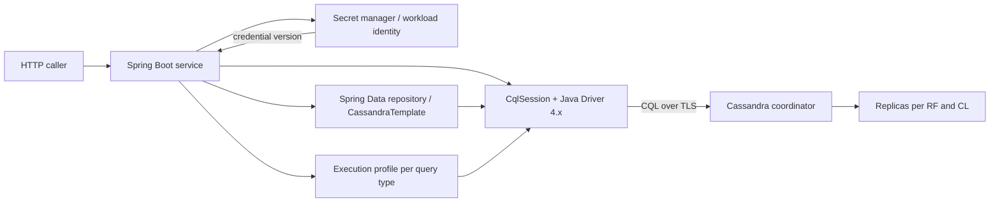
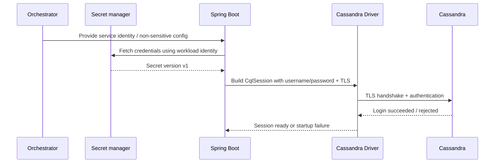
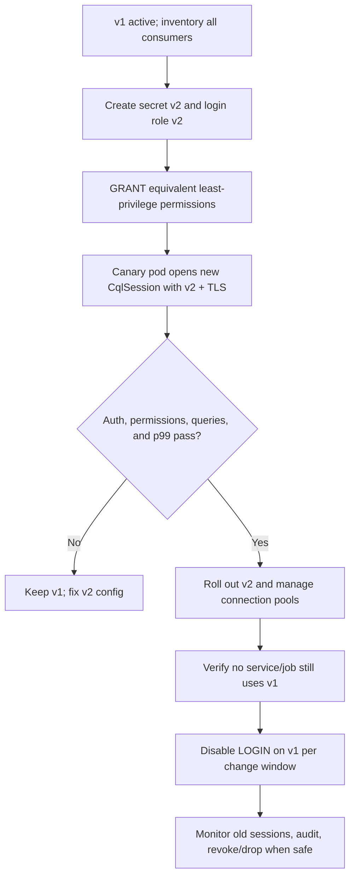

# Secrets, Authentication, TLS, and Execution Profiles in Spring Boot Applications Connecting to Cassandra

## 1. The Problem: Configuration That Runs Is Not Necessarily Secure

Apache Cassandra is a **distributed wide-column** database. A Java application sends CQL through a driver to a coordinator, data lives on replicas chosen by **partition key** and **replication factor (RF)**, and read/write results are acknowledged per **consistency level (CL)**. In Spring Boot and Spring Data Cassandra, connection wiring is often auto-configured, yet that does not automatically satisfy three distinct requirements:

1. **Secrets and authentication:** the service uses the right identity, password, or approved login mechanism without leaking sensitive data.
2. **TLS:** CQL connections protect traffic on the wire and verify valid server identities.
3. **Execution profiles:** each query group uses timeouts, CL, page sizes, and driver behaviors suited to its SLO and business semantics.

For example, `orders-api` has two query paths:

- `GET /orders/{id}` needs a partition-key lookup with low latency, `LOCAL_QUORUM`, and a tight timeout.
- A backfill job reading via controlled keys/manifests can tolerate longer timeouts and a different page size, yet **must never downgrade CL** just to run faster.

Sharing one default configuration across every operation can accidentally let critical `SELECT`s run with weak consistency, allow backfill jobs to saturate connection pools, or expose test credentials in production.

### Learning Outcomes

- Distinguish **Spring Boot application profiles** (`dev`, `staging`, `prod`) from **Java Driver execution profiles** (`interactive-read`, `backfill`).
- Connect Spring Boot 3.x/Spring Data to Cassandra via Java Driver 4.x without putting passwords in Git.
- Understand `PasswordAuthenticator`, `CassandraAuthorizer`, least-privilege roles, and TLS boundaries.
- Configure TLS trust material, verify server identities, and rotate secrets safely.
- Apply `setExecutionProfileName(...)` for CQL queries needing dedicated policies.
- Know the boundaries of Spring Data `Repository`/`CassandraTemplate` versus direct `CqlSession` APIs.
- Test startup, authorization, TLS, RF/CL, SLOs, retries, and failover before deployment.

**Principle:** *One session can serve multiple query types, but identity, TLS, and execution policies for each query type must be modeled explicitly and verified through real behavior.*

## 2. Trust Boundary Diagram in the Application



Each layer has its own responsibility:

| Component | Primary Responsibility | What It Does Not Guarantee Alone |
| --- | --- | --- |
| Spring Boot configuration | Inject environment config, build beans/sessions | Secret safety merely because `@Value` is used |
| Secret manager | Control secret issuance, versioning, and audit | That Cassandra changes passwords when a secret version changes |
| Cassandra authenticator | Verify login identity | `SELECT`/`MODIFY` privileges on individual tables |
| Cassandra authorizer | Enforce role permissions on resources | Row-level authorization by `tenant_id` |
| TLS | Protect transport and, when properly configured, verify server identity | Prevent a valid role from reading tables outside its allowed scope |
| `CqlSession` / Java Driver | Connectivity, routing, prepared queries, request policies | Understanding business SLOs of every request |
| Execution profile | Named driver policy for a request group | Altering schemas, RF, or creating missing replicas |
| Spring Data repository | Entity/query mapping abstraction | Providing ACID transactions across multiple partitions |

Do not treat Spring Actuator reporting `UP` as proof that TLS, permissions for every service account, consistency across every keyspace, and availability during a replica outage have all been verified.

## 3. Version Gate: Boot, Spring Data, and Java Driver May Differ

Spring Boot and Spring Data change property namespaces, auto-configuration, and driver versions across releases. For a production project, document explicitly:

| Check | Reason |
| --- | --- |
| Spring Boot version | Determines property namespace, auto-configuration, and supported customizers |
| Spring Data Cassandra version | Determines entity annotations, repository/template APIs, and reactive integration |
| Java Driver 4.x version/distribution | Determines `CqlSession`, execution profiles, retries, TLS, and driver config |
| Apache Cassandra server version | Determines native protocol/CQL features, auth, TLS, and clustering behavior |
| JDK version | Spring Boot 3.x requires a matching Java baseline; TLS/cryptography and `SSLContext` depend on the JVM |
| Cassandra distribution/operator | Managed services or distributions may have different auth/TLS/config than upstream |

Example configuration distinctions:

| Technology Branch | Common Property Prefix | Note |
| --- | --- | --- |
| Spring Boot 2.x with Spring Data Cassandra | `spring.data.cassandra.*` | Check exact minor version |
| Spring Boot 3.x Cassandra auto-configuration | `spring.cassandra.*` | Examples in this lesson use this branch |
| Java Driver 4.x config | `datastax-java-driver.*` in HOCON | Not an alias for Spring Boot properties |

**Do not copy a Boot 2.x `application.yml` to Boot 3.x without verifying binding.** A stale unbound property can silently leave the app running with unexpected defaults.

### Minimal Dependencies via the Spring Boot BOM

Maven example using Spring Boot's built-in dependency management:

```xml
<dependency>
    <groupId>org.springframework.boot</groupId>
    <artifactId>spring-boot-starter-data-cassandra</artifactId>
</dependency>

<dependency>
    <groupId>org.springframework.boot</groupId>
    <artifactId>spring-boot-starter-actuator</artifactId>
</dependency>
```

Do not mix arbitrary versions of Spring Data, Netty, and Java Driver alongside the starter. If a driver override is needed for a bugfix, consult the **compatibility matrix of your running Spring Boot release** and regression-test auth/TLS/serialization.

## 4. Lab CQL: Keyspace, Table, and Least-Privilege Permissions

Assume a lab with a DC named `dc1` and at least three nodes. `NetworkTopologyStrategy` with RF3 lets us test `LOCAL_QUORUM` when at least two local replicas are healthy.

```sql
CREATE KEYSPACE IF NOT EXISTS commerce
WITH replication = {
    'class': 'NetworkTopologyStrategy',
    'dc1': 3
}
AND durable_writes = true;

CREATE TABLE IF NOT EXISTS commerce.orders_by_id (
    order_id uuid PRIMARY KEY,
    customer_id text,
    status text,
    total_cents bigint,
    updated_at timestamp
);

INSERT INTO commerce.orders_by_id (
    order_id, customer_id, status, total_cents, updated_at
) VALUES (
    11111111-1111-4111-8111-111111111111,
    'customer-42', 'CREATED', 125000,
    '2026-11-20T10:00:00Z'
);
```

Here, the **partition key** is `order_id`; lookups by ID need no `ALLOW FILTERING`. If you need a list of orders by customer/day, create a separate query-driven table rather than scanning `orders_by_id` across all partitions.

### Permissions for a Read-Only Service

Run role management commands only in a **lab with authentication/authorization configured** over an authorized admin connection. Passwords in examples are placeholders — **never use them literally**:

```sql
CREATE ROLE IF NOT EXISTS orders_reader
WITH LOGIN = false AND SUPERUSER = false;

GRANT SELECT ON TABLE commerce.orders_by_id
TO orders_reader;

-- TEMPLATE: password must be generated and provisioned safely by a secret manager.
CREATE ROLE app_orders_read_v1
WITH PASSWORD = '<GENERATED_LAB_SECRET>'
AND LOGIN = true
AND SUPERUSER = false;

GRANT orders_reader TO app_orders_read_v1;
```

In a **fresh** login session using `app_orders_read_v1`:

```sql
SELECT order_id, status, total_cents
FROM commerce.orders_by_id
WHERE order_id = 11111111-1111-4111-8111-111111111111;

-- Negative test: a read-only role must not be permitted to UPDATE.
UPDATE commerce.orders_by_id
SET status = 'PAID'
WHERE order_id = 11111111-1111-4111-8111-111111111111;
```

In this test, `UPDATE` being rejected by authorization is the **expected outcome**. If the update succeeds, check grants/inheritance and superuser flags before concluding the service has least privilege.

### Authenticator and Authorizer Are Two Separate Layers

Common configuration choices in self-managed Cassandra deployments:

```yaml
# cassandra.yaml, conceptual illustration only.
authenticator: PasswordAuthenticator
authorizer: CassandraAuthorizer
role_manager: CassandraRoleManager
```

Never toggle these options directly on a live production cluster without a migration plan, fallback admin credentials, and a proper rolling deployment. `system_auth` requires appropriate replication/availability; healthy business data does not guarantee auth metadata is always available.

## 5. Secrets Do Not Belong in Git, Images, or Logs

In a Spring Boot app, credentials can enter the JVM in several ways. The best choice depends on the platform, yet the core rules stay constant:

1. **Random passwords unique per service and environment**; never use superuser.
2. The secret manager handles issuance/versioning/auditing; code sees only a **secret reference**.
3. Workload identity/RBAC allows the service to read only its assigned secrets.
4. Permission to **read a secret** and permission to **rotate secrets/roles** belong to separate roles.
5. Never put plaintext secrets in `application.yml`, `application-prod.yml`, Dockerfiles, Git history, CI output, logs, metrics, traces, or tickets.
6. Have rotation/revocation procedures and a plan for when the secret manager is unreachable.

### Startup Flow



The diagram shows fetching secrets at startup as one pattern. Platforms can also inject secrets via mounted files/volumes or environment variables. **Injection does not automatically refresh a live `CqlSession`.**

### Comparing Ways to Deliver Secrets to the App

| Method | Benefits | Risks to Control |
| --- | --- | --- |
| Workload identity + secret manager SDK | IAM, audit trail, versioning, rotation workflows | Startup/refresh depends on network/secret manager; needs caching and backoff |
| Mounted secret volume | Files can be updated by platform mechanisms | File permissions, atomic replacement, live session does not re-authenticate |
| Environment variables | Simple Boot integration | Process environment, debug/heap dumps, requires rollout/restart on change |
| Kubernetes Secret | Common distribution mechanism | Base64 **is not encryption**; requires etcd encryption/RBAC/audits |
| Command-line arguments | Easy for manual testing | Exposed via process list/shell history; **avoid in production** |
| Secrets in `application.yml` | Quick to run locally | Easily committed, copied, printed, or snapshotted; **unacceptable** |

Do not treat storage encryption alone as sufficient if a service account can read too broadly. **The secret manager protects credentials, while `CassandraAuthorizer` governs what that role can do after logging in.**

## 6. Spring Boot 3.x: Configuring Connections via Properties

Example `application-prod.yml` for **Spring Boot 3.x matching the verified property prefix**:

```yaml
spring:
  cassandra:
    contact-points: ${CASSANDRA_CONTACT_POINTS}
    local-datacenter: ${CASSANDRA_LOCAL_DC}
    keyspace-name: commerce
    username: ${CASSANDRA_USERNAME}
    password: ${CASSANDRA_PASSWORD}
    request:
      timeout: 3s
    ssl:
      enabled: true

management:
  endpoint:
    health:
      show-details: never
```

The environment placeholders in the example **must be injected by the platform via a protected secret mechanism**. Never put defaults like password `admin123` or `ssl.enabled=false` in the prod profile. Exact property names—especially for TLS and request timeouts—must be verified against your **running Spring Boot minor version**.

### Important Caveats

- `contact-points` should list valid nodes/addresses per topology; do not rely on a single node undergoing maintenance.
- `local-datacenter` must match the DC name seen by the driver, not an arbitrary cloud region name.
- `keyspace-name` sets the default keyspace; it **does not grant permissions** to the role on that keyspace.
- `username/password` are used by the Java Driver when opening connections; **changing a secret externally does not make an active session re-authenticate with the new credentials**.
- `request.timeout` is configured on the Spring Boot side; named driver execution profiles can set per-request timeouts independently.
- `ssl.enabled` only activates SSL; you must still configure proper **trust material and server identity verification**.
- Never enable public config dumps or Actuator `/env` endpoints just to "check whether the password loaded".

### Do Not Hardcode Secrets in Environment Profile Files

`application-dev.yml` and `application-prod.yml` may hold different hosts/DCs or policies, yet the prod file **must contain no real secrets**. If local dev uses Cassandra without auth for learning, isolate it strictly; never copy that convenience into production defaults.

If using Spring Cloud or another secret manager connector, verify **property source precedence**. A stale environment variable or CLI flag can override the intended secret config, causing login with an unexpected version.

## 7. Two Kinds of "Profile": Spring Profile vs. Execution Profile

Similar names, completely different operational layers:

| Aspect | Spring Profile | Java Driver Execution Profile |
| --- | --- | --- |
| Purpose | Select configs/beans per deployment environment | Select policy for **each CQL request** |
| Examples | `dev`, `test`, `prod` | `interactive-read`, `backfill`, `audit-write` |
| How selected | `spring.profiles.active`, `@Profile`, config data | `setExecutionProfileName("...")` on statement |
| Scope | Application context and property sources | Request/driver config within one `CqlSession` |
| Secrets | Can reference environment-specific secret paths | **Should not hold per-query usernames/passwords** |
| Changing CL | Does not directly set request CL | Can define default CL for a group of statements |
| Risk | Running prod config in staging by mistake | Sensitive queries using wrong CL/timeout profile |

**Do not name a driver execution profile `prod` and assume Spring Boot activates it when `spring.profiles.active=prod`.** No automatic link exists unless the application explicitly wires it.

### Two Configuration Dimensions Working Together

```text
Spring profile = prod
  → Selects prod cluster, prod secret ref, prod trust store
  → Builds one CqlSession connected to prod

Driver execution profile = interactive-read
  → Selects consistency LOCAL_QUORUM, timeout 2 s, page size 100

Driver execution profile = backfill
  → Selects consistency LOCAL_QUORUM, timeout 10 s, page size 250
  → Still uses the same cluster/role unless a separate session is configured
```

A Java Driver execution profile **is not a new identity**. If backfill needs a broader role or a different cluster, you normally need a **separate controlled session/configuration**, rather than trying to bypass authorization with a profile named `admin`.

## 8. TLS: Enable Encryption and Trust the Right Server

When using password authentication, protect **client ↔ Cassandra coordinator** traffic with TLS. Understand both aspects:

1. **Confidentiality/integrity:** traffic does not traverse the wire in cleartext; tampering within the TLS session is detected.
2. **Server authentication:** the client trusts the proper CA/certificates and verifies endpoint identity per policy.

Merely calling `withSslContext(...)` with a custom trust manager **does not guarantee hostname verification is enabled**. Explicitly verify that the **actual driver/SSL engine path** checks certificate DNS/IP/SANs and runs required validation.

### TLS Layers to Distinguish

| Traffic Path | Where It Lives | Relevant Settings |
| --- | --- | --- |
| CQL client TLS | Spring Boot/Java Driver ↔ Cassandra node | Client encryption, trust material, server identity |
| Internode TLS | Replica/coordinator ↔ replica | Server encryption, separate certs/trust per topology |
| Secret manager TLS | JVM/orchestrator ↔ secret manager | CA/endpoint/identity of the secret store |
| Actuator/HTTP TLS | User/API gateway ↔ Spring Boot | Web server/gateway TLS |

**Enabling CQL TLS does not automatically enable internode TLS or secret-manager TLS.** Each path needs independent configuration, certificate policies, and monitoring.

### Certificate Rotation Differs from Password Rotation

Password rotation changes credentials for a role. Certificate rotation may change the **CA, trust store, leaf certificate, or node identity**. Both can require opening new connections and testing before/after rollout, yet cutover and rollback differ:

- Add the new CA to the trust store before servers serve the new cert when policy allows.
- Verify valid hostnames/SANs on every contact point.
- Canary new connections from a clean instance.
- Never remove trust for the old CA before the planned transition completes.
- Never disable certificate validation as a "quick fix" for handshake errors.

## 9. Customizing TLS and Driver Config in Spring Boot

With a compatible Spring Boot `CqlSessionBuilderCustomizer` bean, you can customize the session builder instead of constructing an extra standalone `CqlSession`. The sample below configures an **`SSLContext` from a PKCS#12 trust store** and tells the driver to read an execution-profile file from the classpath.

```java
import java.io.InputStream;
import java.nio.file.Files;
import java.nio.file.Path;
import java.security.KeyStore;
import java.security.SecureRandom;
import java.util.Arrays;

import javax.net.ssl.SSLContext;
import javax.net.ssl.TrustManagerFactory;

import org.springframework.beans.factory.annotation.Value;
import org.springframework.boot.autoconfigure.cassandra.CqlSessionBuilderCustomizer;
import org.springframework.context.annotation.Bean;
import org.springframework.context.annotation.Configuration;

import com.datastax.oss.driver.api.core.config.DriverConfigLoader;

@Configuration(proxyBeanMethods = false)
public class CassandraClientSecurityConfiguration {

    @Bean
    CqlSessionBuilderCustomizer cassandraSessionCustomizer(
            @Value("${app.cassandra.tls.trust-store-path}")
            String trustStorePath,
            @Value("${app.cassandra.tls.trust-store-password}")
            String trustStorePassword) throws Exception {

        SSLContext trustedTls = loadTrustContext(
            Path.of(trustStorePath), trustStorePassword);
        DriverConfigLoader loader = DriverConfigLoader.fromClasspath(
            "cassandra-driver.conf");

        return builder -> {
            builder.withConfigLoader(loader);
            builder.withSslContext(trustedTls);
        };
    }

    private static SSLContext loadTrustContext(
            Path path, String password) throws Exception {
        char[] passwordChars = password.toCharArray();
        try {
            KeyStore trustStore = KeyStore.getInstance("PKCS12");
            try (InputStream input = Files.newInputStream(path)) {
                trustStore.load(input, passwordChars);
            }

            TrustManagerFactory factory =
                TrustManagerFactory.getInstance(
                    TrustManagerFactory.getDefaultAlgorithm());
            factory.init(trustStore);

            SSLContext context = SSLContext.getInstance("TLS");
            context.init(null, factory.getTrustManagers(),
                new SecureRandom());
            return context;
        } finally {
            Arrays.fill(passwordChars, '\0');
        }
    }
}
```

This is a **technical example**, not a complete hardening recipe:

- `app.cassandra.tls.trust-store-password` is a runtime-injected secret; **never commit its value** to the repository.
- The trust store must trust only **appropriate CA/server certificates**, never an unconditional "trust all" list.
- The `SSLContext` here focuses on the trust chain. **You must verify hostname/SAN validation on your exact Driver 4.x and SSL engine setup**; if needed, configure an engine factory per version docs rather than assuming `SSLContext` alone suffices.
- If the cluster requires **mutual TLS**, configure client key material/certificates via a separate process; a trust store alone is not enough.
- Avoid accidentally creating two `CqlSession` beans or having another customizer overwrite SSL/config loaders.
- `DriverConfigLoader` must preserve Boot-configured contact points, local DC, auth, and pools; verify effective config when combining multiple config sources.
- `String` credentials linger on the heap until GC; never print `trustStorePassword`, `CassandraProperties`, or environment snapshots.

### Properties Used by the TLS Customizer Example

In `application-prod.yml`:

```yaml
app:
  cassandra:
    tls:
      trust-store-path: ${CASSANDRA_TRUST_STORE_PATH}
      trust-store-password: ${CASSANDRA_TRUST_STORE_PASSWORD}
```

These variables must be injected by a controlled secret/certificate distribution system. Some Spring Boot versions support **SSL bundles** or declarative TLS config; if using those, you do not need to write manual `SSLContext` loading code. **Choose one version-supported TLS configuration mechanism and test it thoroughly.**

## 10. Driver Execution Profiles: Named and Inherited HOCON

Java Driver 4.x can load a HOCON file from the classpath. For example, place `cassandra-driver.conf` in resources, loaded by the customizer in Section 9:

```hocon
datastax-java-driver {
  profiles {
    "interactive-read" {
      basic.request {
        consistency = LOCAL_QUORUM
        timeout = 2 seconds
        page-size = 100
      }
    }

    "backfill" {
      basic.request {
        consistency = LOCAL_QUORUM
        timeout = 10 seconds
        page-size = 250
      }
    }
  }
}
```

In this example, both profiles **inherit remaining default driver settings** per the running version's config loader behavior. Config keys, profile-eligible options, and duration syntax should be verified via startup tests and effective driver config. Never invent HOCON keys hoping the driver picks them up.

| Profile | Example Query | Policy | Why? |
| --- | --- | --- | --- |
| `interactive-read` | Read one order by `order_id` | `LOCAL_QUORUM`, 2 s, page size 100 | Prioritizes HTTP API SLOs |
| `backfill` | Job-managed manifest/token-range reads | `LOCAL_QUORUM`, 10 s, page size 250 | Different latency budget while keeping required CL |
| Default profile | Queries without an explicit profile | Session default configuration | Must be verified to avoid accidentally weak policies |

**2 s and 10 s timeouts are illustrative only, not universal recommendations.** Cross-WAN multi-DC workloads, compacting nodes, or APIs with 500 ms deadlines need tailored budgets.

### A Profile Does Not Create a Bulkhead or Capacity

Setting `timeout=10 seconds` on `backfill` **does not automatically limit** concurrent requests. A job firing 10,000 requests can cause:

- Connection pool saturation.
- Rising pending read/write tasks on nodes.
- Increased disk I/O, heap/GC pressure, and compaction backlogs.
- Degraded interactive API p99 even though the two query types use different profile names.

For backfill, you still need **rate limits, bounded concurrency, checkpoints, retry budgets, and headroom measurement**. Stronger isolation requires architectural pool/session or workload separation.

## 11. Applying an Execution Profile to a `BoundStatement`

In Java Driver 4.x, a statement selects a profile by name:

```java
BoundStatement statement = prepared.bind(orderId)
    .setExecutionProfileName("interactive-read")
    .setIdempotent(true);

session.executeAsync(statement);
```

`setExecutionProfileName` does not switch Cassandra roles or grant permissions. It selects a preconfigured policy inside the driver session.

If statement-level calls like `setConsistencyLevel(...)` or `setTimeout(...)` (per supported driver APIs) are also applied, **per-statement overrides** can supersede the profile for that request. Standardize rules:

1. Profiles define **defaults per query class**.
2. Per-statement overrides are used only with justification and tests.
3. Avoid multiple layers overriding CL/timeouts in hard-to-trace ways.
4. Metrics/logs record `queryTemplate` and `executionProfileName` instead of passwords or sensitive columns.
5. Startup or integration tests must catch **wrong or missing profile names** before production traffic.

### Do Not Treat a Profile Name as a New Consistency Level

`interactive-read` is not a Cassandra CL; `LOCAL_QUORUM` is. Naming a profile "strong-read" proves nothing about quorum if the HOCON is wrong or overridden on the statement.

## 12. Spring Service Using the Driver Directly to Select Per-Request Profiles

Spring Data repositories are handy for CRUD/mapping, yet when a query needs **explicit execution profile control**, injecting `CqlSession` and preparing `PreparedStatement` makes the policy visible right at the call site.

```java
import java.util.Optional;
import java.util.UUID;
import java.util.concurrent.CompletionStage;
import java.util.Iterator;

import org.springframework.stereotype.Service;

import com.datastax.oss.driver.api.core.CqlSession;
import com.datastax.oss.driver.api.core.cql.AsyncResultSet;
import com.datastax.oss.driver.api.core.cql.BoundStatement;
import com.datastax.oss.driver.api.core.cql.PreparedStatement;
import com.datastax.oss.driver.api.core.cql.Row;

@Service
public final class OrderLookupService {
    private final CqlSession session;
    private final PreparedStatement selectById;

    public OrderLookupService(CqlSession session) {
        this.session = session;
        this.selectById = session.prepare(
            "SELECT order_id, status, total_cents " +
            "FROM commerce.orders_by_id WHERE order_id = ?"
        );
    }

    public CompletionStage<Optional<OrderSummary>> findById(
            UUID orderId) {
        BoundStatement statement = selectById.bind(orderId)
            .setExecutionProfileName("interactive-read")
            .setIdempotent(true);

        return session.executeAsync(statement).thenApply(result -> {
            Iterator<Row> rows = result.currentPage().iterator();
            if (!rows.hasNext()) {
                return Optional.empty();
            }
            Row row = rows.next();
            return Optional.of(new OrderSummary(
                row.getUuid("order_id"),
                row.getString("status"),
                row.getLong("total_cents")
            ));
        });
    }

    public static final class OrderSummary {
        public final UUID orderId;
        public final String status;
        public final long totalCents;

        public OrderSummary(UUID orderId, String status, long totalCents) {
            this.orderId = orderId;
            this.status = status;
            this.totalCents = totalCents;
        }
    }
}
```

This example returns a `CompletionStage` to avoid blocking HTTP threads; a Spring WebFlux controller can adapt it to `Mono` when appropriate. **Never call `join()` or synchronous JDBC inside `thenApply`**: the continuation may run on a driver completion thread.

### Technical Details to Verify

- `session.prepare(...)` in the constructor hits Cassandra when the bean initializes; startup may fail if the database is not ready yet. Pair with a startup/readiness policy rather than an infinite retry loop.
- `currentPage()` suffices for a primary-key lookup returning at most one row; multi-row queries require explicit paging handling.
- `@Service` does not turn statement preparation or reads into a cross-partition transaction.
- `total_cents bigint` maps to Java `long`; if the column can be null, check `row.isNull(...)` before reading a primitive.
- Never put `orderId` or raw row values into metric labels, causing data leakage or high cardinality.
- `setIdempotent(true)` fits pure reads; never apply it blindly to counters, list appends, or LWTs.

## 13. Spring Data Repository and `CassandraTemplate`: Stay Within Scope

A minimal entity:

```java
import java.util.UUID;

import org.springframework.data.cassandra.core.mapping.PrimaryKey;
import org.springframework.data.cassandra.core.mapping.Table;
import org.springframework.data.cassandra.core.mapping.Column;

@Table("orders_by_id")
public class OrderRecord {
    @PrimaryKey("order_id")
    private UUID orderId;

    @Column("status")
    private String status;

    @Column("total_cents")
    private Long totalCents;

    public OrderRecord() { }

    public UUID getOrderId() { return orderId; }
    public void setOrderId(UUID id) { this.orderId = id; }
    public String getStatus() { return status; }
    public void setStatus(String value) { this.status = value; }
    public Long getTotalCents() { return totalCents; }
    public void setTotalCents(Long value) { this.totalCents = value; }
}
```

Repository:

```java
import java.util.UUID;
import org.springframework.data.cassandra.repository.CassandraRepository;

public interface OrderRepository
        extends CassandraRepository<OrderRecord, UUID> {
}
```

Spring Data reads and writes mapped entities; e.g., `orderRepository.findById(id)` is convenient for basic CRUD. However:

| Situation | Appropriate Choice |
| --- | --- |
| Primary-key CRUD, straightforward entity mapping | Spring Data `CassandraRepository` |
| Conditional queries/CQL within Spring Data's supported scope | Repository `@Query` or `CassandraTemplate` |
| Need explicit named execution profiles per statement | `CqlSession`/driver statements or version-supported Spring Data integration |
| Need control over paging state, cancellation, or custom read CL | Usually direct Java Driver |
| Need Reactive Streams and backpressure | Spring Data Reactive Cassandra or driver reactive APIs per version |
| Need multiple keyspaces or multiple identities/TLS trusts | Explicitly identified dedicated sessions/templates |

**Do not assume repository annotations automatically select a Java Driver execution profile from method names.** Profile selection is a driver feature; Spring Data is a higher-level abstraction whose exposed options depend on release version. When tight per-request control is mandatory, expose the `CqlSession` path explicitly.

### Schema Action in Production

Spring Data/Spring Boot can support schema initialization or `SchemaAction` per config. In production, **never automatically `DROP`/`RECREATE` tables on service restart**. Manage CQL migrations via a dedicated process, verifying schema agreement and compatibility across old/new app versions.

A correct `@Table` mapping does not mean Spring Boot created the keyspace, replication factor, or role permissions. DBAs/platform engineers must verify those before startup.

## 14. Execution Profiles Must Not Weaken Business RF/CL

Assume `commerce` has `RF(dc1)=3`:

| CL | Local Replicas Needed Normally | When One Replica Stops |
| --- | ---: | --- |
| `LOCAL_ONE` | 1 | Can still serve if a local replica is healthy, but freshness/consistency differs |
| `LOCAL_QUORUM` | 2 | Exactly 2 local replicas remain; both must respond in time |
| `ALL` in single-DC RF3 keyspace | 3 | Fails if any single replica is offline |

An execution profile with a long timeout **cannot compensate for missing replicas**. If an API requires `LOCAL_QUORUM` at RF3, stopping two nodes responsible for a partition breaks quorum. Switching the profile to `LOCAL_ONE` may keep requests succeeding, yet **alters data guarantees**.

### Multiple Datacenters

With `NetworkTopologyStrategy` having RF3 in `dc1` and RF3 in `dc2`:

- `LOCAL_QUORUM` from `dc1` requires quorum **within `dc1`**.
- Keyspace-wide `QUORUM` has different semantics and can cross the WAN.
- `EACH_QUORUM` on writes requires quorum in every DC.
- `LOCAL_SERIAL`/`SERIAL` for LWT/Paxos governs conditional updates.

**Never create a `fast` profile with weak CL and roll it out everywhere just for nicer p99 numbers.** Classify reads, writes, counters, and LWTs by consistency and idempotency requirements, then benchmark timeouts under representative cluster load.

### Never Use Execution Profiles as a Substitute for Business Retry Policies

- Pure `SELECT` reads can normally be marked idempotent.
- `counter = counter + 1` can double-apply on retry.
- `list = list + [?]` can append duplicate elements.
- Replaying `USING TTL` after a delay shifts expiration.
- A timed-out `INSERT ... IF NOT EXISTS` has an indeterminate outcome; retrying may return `[applied]=false` even though the first attempt succeeded.

Execution profiles only configure **how requests execute**; they do not provide exactly-once semantics. `setIdempotent`, retry budgets, and operation IDs must still be designed per mutation.

## 15. Managing Secret Rotation: Staged v1 → v2 → Revoke

In a multi-pod Spring Boot fleet, changing the password on a single role immediately can break **new connections** from pods that haven't received the new secret yet. A more controllable strategy uses **two overlapping login roles** during the rotation window:



### Operational Steps

1. Inventory every consumer: Spring Boot pods, batch jobs, admin tools, ETL, CI, and scheduled workers.
2. Generate the new secret version in the secret manager; never share passwords via chat or tickets.
3. Create the new login role with **least privilege**, e.g., inheriting `orders_reader`.
4. Test **a fresh `CqlSession`** opening TLS connections to multiple nodes and running `SELECT` at the required CL.
5. Canary a small set of pods; track auth failures, connection creation, timeouts, and API p95/p99.
6. Shift traffic gradually; do not merely mutate environment variables inside a running JVM.
7. Ensure cron/batch jobs are no longer using v1 credentials.
8. Only after verification, run `ALTER ROLE old WITH LOGIN = false` and drain/close existing sessions per runbook.
9. After the rollback window expires, revoke/drop the old role per policy and record a secret-free audit log.

**Setting `LOGIN=false` does not guarantee already-authenticated sessions disconnect immediately**; caches and connection lifecycles can linger. Always test fresh connections and follow a policy for retiring old sessions, rather than trusting secret manager status alone.

### If In-Place Password Changes Are Mandatory

When two roles are not allowed, `ALTER ROLE ... WITH PASSWORD = ...` creates a window where the server expects v2 while clients still hold v1. You need a maintenance plan, coordinated client rollout, fresh-auth testing, and rollback **on both Cassandra and the application side**.

Reverting the secret store to v1 **does not revert Cassandra's password to v1**. Never promise zero downtime without measuring against your actual version, topology, and pools.

## 16. Common Configuration Errors and Symptoms

| Symptom | Causes to Check | Action |
| --- | --- | --- |
| Spring Boot fails to create `CqlSession` | Missing property, wrong contact points/DC, blocked DNS/port | Inspect effective config and root cause; never print passwords |
| `AuthenticationException` | Wrong username/password, disabled role, auth backend issue | Check secret version, role, `system_auth`; test fresh connection |
| `UnauthorizedException` or rejected CQL | Authenticated ok, role lacks `SELECT`/`MODIFY` | Inspect grants/inheritance; never grant ALL blindly |
| TLS handshake failed | Trust store, cert chain, hostname/SAN, TLS version | Verify certificate/trust; never disable validation |
| Connects to wrong DC | Wrong `local-datacenter` or discovery | Cross-check `nodetool status`/snitch/DC and driver |
| Profile not found | HOCON not loaded, misspelled profile name | Startup integration test + explicit profile query |
| Queries time out sooner than expected | Per-statement override/profile/default or HTTP deadline | Check config precedence and real latency |
| Running app OK, new connections fail after rotation | Old session still alive; v1 secret not updated everywhere | Check pod/job versions and rollout |
| Spring Data `findById` uses different CL than manual query | Repository and raw driver use different policies | Align default profile/driver config and test both paths |
| API p99 spikes during backfill | High concurrency, disk I/O, pool saturation | Rate-limit/bulkhead; measure nodes and driver |
| `UnavailableException` | Insufficient replicas for CL in DC | Inspect RF/CL/node status; never lower CL casually |
| `AllNodesFailedException` | Multiple auth/TLS/network/connection causes | Analyze per-node root causes; do not assume one error |

**Authentication errors differ from authorization errors:** auth failure means identity could not be verified; authorization failure means the caller was identified but lacks permission for the action. Keep them distinct so you don't grant extra roles when the password is actually wrong.

## 17. Health/Readiness and Safe Observability

Spring Boot Actuator provides health contributors depending on starter/auto-configuration. However:

- `health=UP` may check only one path and does not prove every execution profile works.
- Readiness should confirm the session/driver connects to the right cluster and can run a **lightweight, partition-keyed query** with the required role and CL.
- Never run full scans, `ALLOW FILTERING`, or real business writes inside health probes.
- Never expose configs, environments, passwords, internal contact points, or sensitive stack traces on public endpoints.
- If the secret manager is temporarily unavailable, follow a clear startup/refresh policy; never create a retry storm on every HTTP request.

### Required Metric Groups

| Source | Metric | Meaning |
| --- | --- | --- |
| Spring Boot HTTP | p95/p99, error rate, active requests | User impact |
| Driver request metrics | Latency, timeouts, retries/attempts, pool saturation | Query load or misconfigured profile |
| Profile/query template | Query breakdown across `interactive-read` and `backfill` | Group SLOs and spot profile misuse |
| TLS/auth logs | Redacted handshake/auth failures | Certificates, secret rotation, role availability |
| Secret manager audit | Secret reads/rotations by workload identity | Anomalous secret access |
| Cassandra `tpstats` | Pending/dropped tasks | Coordinator/replica overload |
| Cassandra `compactionstats` | Active/pending compactions | Backfill I/O contention |
| Cassandra `tablestats` | SSTables/memtables/local latency | Per-node/per-table anomalies |
| JVM/OS | Heap/GC/CPU/disk/network | Distinguish client vs. server bottlenecks |

Node observation commands:

```bash
nodetool status
nodetool describecluster
nodetool tpstats
nodetool compactionstats
nodetool tablestats commerce.orders_by_id
```

`nodetool` primarily reflects node and topology state; it **does not know** which secret version or execution profile Spring Boot selected. Correlate it with JVM/driver metrics and secret manager audit logs.

### Never Put Secrets or Sensitive Data in Metric Labels

You may log `service=orders-api`, `profile=interactive-read`, `queryTemplate=ordersById`, and sanitized config versions. Never log:

- Passwords, bearer tokens, key material, or full cursors/paging states.
- `toString()` output of property beans holding secrets.
- Raw CQL with sensitive parameters via driver query logging.
- Unapproved high-cardinality tenant/customer IDs as metric labels.

## 18. Staged Production Deployment Playbook

### Phase A — Preparation

1. Record exact Spring Boot/Spring Data/Driver/JDK/Cassandra versions; verify property prefixes and APIs.
2. Verify RF per DC, effective CL, keyspace, schema, and query shapes.
3. Provision dedicated read/write roles per table/workflow; never use superuser.
4. Configure secret manager IAM, trust CAs, certificate SANs, network rules, and key rotation.
5. Test TLS handshake and authentication from a fresh staging instance.
6. Define execution profiles with clear purposes and keep the default profile safe.

### Phase B — Canary

1. Deploy one pod reading the new secret, opening `CqlSession`, and testing partition-key `SELECT`.
2. Negative-test that the role cannot run `UPDATE` or DDL.
3. Execute queries with `interactive-read` and `backfill`; verify the intended profiles are actually selected.
4. Measure API p99, timeouts, retries, driver connection pools, and Cassandra pending/compaction stats.
5. Restart the canary to force **fresh connections**, avoiding false confidence from stale live connections.
6. If certs/secrets/configs fail, **halt rollout**; never weaken TLS or CL as a temporary fix.

### Phase C — Rollout and Post-Check

1. Expand rollout in rollback-capable instance groups.
2. Verify scheduled jobs/ETL use the matching secret/schema/profile versions.
3. Watch metrics under peak traffic and during node maintenance.
4. Revoke old credentials only after confirming every consumer has migrated.
5. Archive audit records and runbooks, preparing for the next cert/password rotation.

### Stop Criteria

**Halt rollout** if auth/TLS failures rise, `Unavailable` occurs for the required CL, API p99 breaches SLO, profiles fail to load, backfill saturates disk/compaction, or cross-environment credential mix-ups are suspected.

Never turn a configuration bug into a data incident by running `DROP/ALTER KEYSPACE`, lowering RF, forcing repairs, or making unapproved CL changes.

## 19. Self-Assessment Scenarios

### Scenario A — Spring `prod` Does Not Activate `interactive-read`

The app runs with `spring.profiles.active=prod`, yet queries still use the driver's default CL. The team expected the Spring profile to activate `interactive-read` automatically.

**Answer:** Incorrect. A Spring profile selects environment configs/beans; a Java Driver execution profile is selected per statement or via driver config. Call `setExecutionProfileName("interactive-read")` and verify HOCON was loaded.

### Scenario B — YAML File Committed with Password in Git

A repository contained `spring.cassandra.password: "secret-value"`, and the team deleted the line in a newer commit. Is the credential safe now?

**Answer:** No. The password remains in Git history, build artifacts, and caches. Treat it as leaked, **rotate/revoke** it, audit access, and move to a secret manager.

### Scenario C — TLS Enabled Without Hostname Verification

The app trusts a shared CA, yet skips checking server hostnames/SANs. Can it be sure it isn't talking to the wrong server?

**Answer:** No. Trust-chain validation and server identity verification are both required. Inspect the actual driver SSL engine config and never disable validation when certificates fail.

### Scenario D — Secret Manager Rotated to v2, Old Pool Still Uses v1

The secret manager marks v2 as current, while Java pods have been running for days with existing `CqlSession` instances. After restarting one Cassandra node, new connections fail with `AuthenticationException`.

**Answer:** Updating a secret does not re-authenticate active sessions. Roll out pods or recreate sessions with v2 before disabling v1, monitor new-connection success, and keep rollback ready.

### Scenario E — Backfill Profile Given a 30-Second Timeout

A team raises timeout to 30 seconds and lets a job issue 10,000 concurrent queries; interactive API p99 degrades. Is Cassandra at fault despite separate profiles?

**Answer:** An execution profile is not a bulkhead. Bound concurrency/throughput/page size, monitor driver pools and disk I/O, schedule backfill off-peak, and consider architectural workload isolation.

### Scenario F — Spring Data Repository and Driver Query Use Different CLs

`repository.findById` uses the default policy, while `OrderLookupService.findById` uses `interactive-read` with `LOCAL_QUORUM`. Two endpoints observe different data after a write in another DC.

**Answer:** Possible. Different CLs or routing yield different read guarantees. Standardize SLO/CL contracts, test both repository defaults and direct driver calls, and never infer policy from method names.

### Scenario G — Service Authenticates Fine Yet Cannot Update

Role `app_orders_read_v1` opens a session cleanly, yet `UPDATE commerce.orders_by_id` is rejected. The team considers granting `ALL PERMISSIONS ON ALL KEYSPACES`.

**Answer:** Do not do that. Rejection is least privilege working as designed. If the service genuinely needs writes, provision an appropriate role or grant `MODIFY` on that specific table, get approval, and audit it.

### Scenario H — `LOCAL_QUORUM` Under RF2

A keyspace has RF2 in `dc1`, one node goes Down, and `LOCAL_QUORUM` requests fail. Can a `fast` profile using `ONE` be enabled to keep the SLA?

**Answer:** `LOCAL_QUORUM` at RF2 requires both replicas. Lowering CL changes consistency guarantees; it is not a Spring config fix. Address the infrastructure/RF design and availability contract instead.

### Scenario I — Exposing Actuator `env`

A team exposes all Actuator endpoints publicly to debug issues, assuming property masking will always hide secrets.

**Answer:** Unsafe. Expose only required endpoints, enforce authentication/authorization/internal network restrictions, and never use public endpoints to inspect secrets or config dumps.

### Scenario J — Retrying Every Write After Timeout

A Spring Data job adds a retry annotation covering counter increments, list appends, and `INSERT IF NOT EXISTS`. What is dangerous here?

**Answer:** A timeout does not prove the mutation failed to apply; retries can double counters/list elements, or a second LWT attempt can return `[applied]=false`. Classify idempotency, use operation IDs, and reconcile instead of applying blanket retries.

## 20. Production Checklist

**Versions, schema, and connectivity**

- [ ] Verify Boot/Spring Data/Java Driver/Cassandra/JDK versions and compatibility matrix.
- [ ] Use `spring.cassandra.*` or the **matching Boot branch prefix**; never blindly copy legacy configs.
- [ ] Query by proper partition/clustering keys; never use execution profiles to mask full scans.
- [ ] Document RF, DC, and CL as a contract; test single-node outages and failure modes.
- [ ] Reuse a single session with valid contact points/local DC and startup/readiness policies.

**Secrets and authorization**

- [ ] Application role is not superuser; `SELECT`/`MODIFY` granted strictly as needed.
- [ ] Secrets are randomly generated and isolated per service and environment.
- [ ] Secret manager enforces workload identity/IAM, auditing, and clear versioning/rotation.
- [ ] No secrets in Git, images, shell flags, logs, metrics, Actuator output, or CI.
- [ ] Canary a **fresh `CqlSession`** with new credentials before revoking old credentials.
- [ ] Run negative authorization tests to prove least privilege.

**TLS and certificates**

- [ ] Client ↔ coordinator TLS enabled; internode TLS evaluated independently.
- [ ] Valid trust store/CA; no trust-all or insecure verification skips.
- [ ] **Server hostname/SAN** verification confirmed on the active driver SSL engine/version.
- [ ] Trust/certificate rotation, rollover, and pool/restart refresh plan documented.
- [ ] Never disable TLS/hostname validation to bypass startup errors.

**Execution profiles and data**

- [ ] Distinguish Spring profiles from Java Driver execution profiles.
- [ ] HOCON profiles loaded via verified classpath/config loader with startup tests.
- [ ] `setExecutionProfileName(...)` applied on queries requiring distinct policies.
- [ ] Repository default profile verified so it never silently uses a weaker CL than contracted.
- [ ] Timeout/page size tuned to SLOs, never mistaken for consistency guarantees.
- [ ] Backfill enforces rate limits, bounded concurrency, retry budgets, and checkpoints.
- [ ] Counters, lists, TTLs, and LWTs have explicit idempotency and reconciliation policies.

**Observability and operations**

- [ ] Measure HTTP p95/p99, Cassandra request latency, retries, errors, pool stats, and auth/TLS failures.
- [ ] Monitor `tpstats`, `compactionstats`, disk/GC, and replica health during rollouts.
- [ ] Restrict Actuator/health endpoints so sensitive details never leak.
- [ ] Maintain a rollout stop and secret/config rollback runbook validated with fresh connections.
- [ ] Test invalid profile names, expired certificates, secret manager outages, and insufficient role permissions.

**Remember:** When connecting Spring Boot to Cassandra, the **secret manager** stores credentials but does not automatically rotate Cassandra passwords; **TLS** must verify both the trust chain and server identity; **Spring profiles** pick the deployment environment while **Java Driver execution profiles** pick per-statement request policies. Spring Data simplifies mapping/CRUD, yet queries needing strict CL/timeout/page-size control can use `CqlSession` with `setExecutionProfileName`. Only after thoroughly testing roles, TLS, effective config, RF/CL, connection lifecycles, and SLOs is the application configuration truly production-ready.
