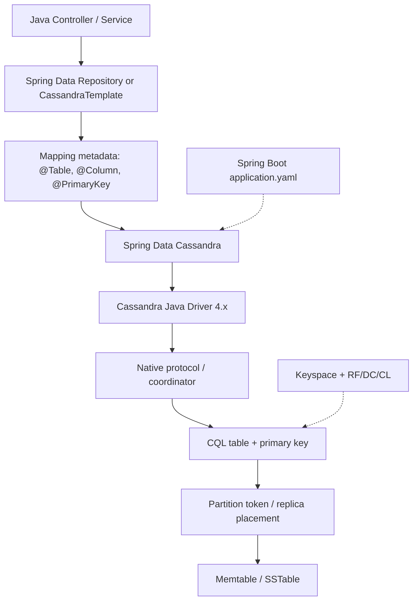

# `@Table`, `@Column`, and Identifier Name Mapping

> **Chapter:** Spring Boot and Spring Data  
> **Context:** Apache Cassandra — a distributed *wide-column* database with query-driven table design, partition keys, replication, and consistency levels — accessed from Java applications using Spring Boot, Spring Data Cassandra, and Cassandra Java Driver 4.x.
>
> **Learning Objectives:** Understand why Java class/field names are not automatically CQL table/column names; use `@Table`, `@Column`, `@PrimaryKey`, and composite key annotations for explicit mapping; distinguish unquoted lowercased CQL identifiers from case-sensitive quoted identifiers; inspect effective mapping and real schemas; design safe migrations, test repositories, and avoid keyspace, column, or partition-key mistakes.

## 1. Opening Scenario: Java Has `displayName`, Yet Cassandra Stores `display_name`

Suppose the actual table in Cassandra is:

```cql
CREATE TABLE lab.customer_profile_by_id (
    customer_id uuid PRIMARY KEY,
    display_name text,
    email_address text,
    created_at timestamp
);
```

In Java, property names use camelCase:

```java
public class CustomerProfile {
    private UUID customerId;
    private String displayName;
    private String emailAddress;
    private Instant createdAt;
}
```

A developer might assume: "Spring Data automatically knows `displayName` means `display_name`." That holds only if **that naming rule is actually configured** for that mapping context. If the active default differs from expectations, the app can emit CQL targeting the wrong column name, fail to read data, or error at startup/query time.

The clear solution is to declare the real names explicitly:

```java
@Table("customer_profile_by_id")
public class CustomerProfile {

    @PrimaryKey("customer_id")
    private UUID customerId;

    @Column("display_name")
    private String displayName;

    @Column("email_address")
    private String emailAddress;

    @Column("created_at")
    private Instant createdAt;
}
```

These annotations belong to **Spring Data Cassandra**. A complete Java file requires the right package imports, constructors, and accessors.

**Core lesson:** Java names express the domain in code; CQL names are the contract with the existing schema. `@Table` and `@Column` bridge the two, yet **never modify schema, replication, or access permissions by themselves**.

## 2. Picture from Spring Boot to SSTable



Layers to distinguish:

| Layer | Example | Responsibility |
| --- | --- | --- |
| Java Model | `CustomerProfile`, `displayName` | Application objects and property names |
| Spring Data mapping | `@Table`, `@Column` | Effective CQL table/column names for the entity |
| Driver | `CqlSession` | Connections, prepare/bind, encode/decode, and coordinator selection |
| CQL schema | `lab.customer_profile_by_id`, `display_name` | Actual tables/columns/types/primary keys on the server |
| Keyspace | `lab` | Namespace, replication strategy, and RF |
| Consistency level | `LOCAL_QUORUM` | Replica response requirement per RF/DC |

**Do not conflate** mapping annotations with the other layers. `@Table("x")` does not create an optimal partition key; `@Column("y")` does not turn a query missing a partition key into an efficient query.

## 3. Java Name, CQL Name, and Data Type Are Three Independent Axes

One property carries at least three distinct facts:

```text
Java property name:     displayName
CQL column identifier:  display_name
Java type:              String
CQL type:               text
```

For `createdAt`:

```text
Java property name:     createdAt
CQL column identifier:  created_at
Java type:              java.time.Instant
CQL type:               timestamp
```

`@Column("created_at")` only tells Spring Data the **column name**. It does not guarantee any Java type can be stored in any CQL type; conversion depends on mapping conversions, Cassandra codecs, and the real schema.

If the name is right but the type is wrong, codec/conversion errors still occur. If the type is right but the name is wrong, "undefined column" errors occur or data is read from/written to the wrong target.

## 4. CQL Identifier Rules: Unquoted Normalizes to Lowercase

Cassandra CQL enforces important rules for keyspace, table, and column names:

- **Unquoted** identifiers are typically case-insensitive and normalized to lowercase.
- **Double-quoted** identifiers preserve exact casing and are case-sensitive.
- Reserved keywords or names with characters invalid for bare identifiers may require quoting.
- Two quoted names differing only in case become **two distinct identifiers**.

Example:

```cql
-- Unquoted names: all three spellings refer to the exact same CQL identifier.
SELECT display_name FROM lab.customer_profile_by_id;
SELECT DISPLAY_NAME FROM LAB.CUSTOMER_PROFILE_BY_ID;
SELECT Display_Name FROM Lab.Customer_Profile_By_Id;
```

However:

```cql
-- If the actual schema has a quoted column "DisplayName":
SELECT "DisplayName" FROM lab."CustomerProfile";

-- Not equivalent to:
SELECT displayname FROM lab.customerprofile;
```

Statements in the second block are valid only if tables/columns exist with those exact names. Never run quoted examples against an uncreated schema.

**Recommendation:** use **lowercase_snake_case, unquoted** CQL names, avoiding keywords, spaces, and mixed case. This sharply reduces naming bugs in Java/Spring systems.

## 5. Quoted Schema Example to Illustrate the Difference

Use only in **lab** after keyspace `lab` exists:

```cql
CREATE TABLE IF NOT EXISTS lab."CustomerProfile" (
    "CustomerId" uuid PRIMARY KEY,
    "DisplayName" text
);
```

Queries must quote properly:

```cql
SELECT "CustomerId", "DisplayName"
FROM lab."CustomerProfile"
WHERE "CustomerId" = 11111111-1111-4111-8111-111111111111;
```

Without quotes:

```cql
-- CQL interprets these as unquoted/lowercase identifiers.
-- This is NOT equivalent to the table above.
SELECT customerid, displayname
FROM lab.customerprofile
WHERE customerid = 11111111-1111-4111-8111-111111111111;
```

### Connection to Annotations

Never assume `@Table("CustomerProfile")` is always quoted by Spring Data into `"CustomerProfile"`. How `CqlIdentifier` is built from annotations, quote handling, and naming strategies must be verified against your running Spring Data Cassandra version.

For legacy quoted schemas, inspect **effective mapping metadata / emitted CQL** and run full integration tests; if your release supports force-quoting or custom mapping options, configure them per that exact version's official documentation.

**Never casually drop quotes to "fix" an error**: doing so can target a different table or continue failing with table-not-found errors.

## 6. What Does Spring Data Cassandra `@Table` Do?

Spring Data Cassandra's `@Table` annotation marks a Java class as an entity mapped to a CQL table or compatible structure.

```java
import org.springframework.data.cassandra.core.mapping.Table;

@Table("customer_profile_by_id")
public class CustomerProfile {
    // ...
}
```

In this example, the target CQL table is `customer_profile_by_id`. Key points:

1. `@Table` describes **mapping**; it does not determine the replication strategy.
2. `@Table` does not specify consistency levels for statements.
3. A class can be managed by repositories/templates using Spring Data mapping metadata.
4. The table name in the annotation should reflect a **query-driven CQL table**.
5. Adding `@Table` does not turn the class into a JPA entity; this is Cassandra's model, not an RDBMS.
6. When schemas are managed by migrations, annotations must **match the real schema**.

### The Name in `@Table` Is Not a Keyspace Name

It is a design error to pack two identifiers into one string as a table name:

```java
// Do not assume @Table accepts "keyspace.table"
// as a single table identifier:
@Table("lab.customer_profile_by_id")
public class WrongIdea {
}
```

In Spring Data Cassandra, the default keyspace is normally established in **`CqlSession`/Spring configuration** or release-specific mapping mechanisms. Never embed `lab.` in `@Table` without verifying support.

To work across multiple keyspaces, explicitly design separate session/template/mapping contexts or use fully qualified names in CQL as supported by the framework — never assume a dot in an annotation is standard syntax.

## 7. What Does Spring Data Cassandra `@Column` Do?

The `@Column` annotation sets the CQL column name corresponding to an entity property.

```java
import org.springframework.data.cassandra.core.mapping.Column;

@Column("display_name")
private String displayName;
```

Meaning:

- The Java property remains named `displayName`.
- The CQL column is `display_name` per the mapping.
- Spring Data uses this metadata to build/read statements when repositories/templates access the entity.
- The annotation does not add a column to an existing Cassandra table.
- The annotation does not define a default value when data is missing.
- The annotation does not control `SELECT`/`MODIFY` permissions on the column.
- The annotation does not make Java `String` compatible with arbitrary CQL types.

### Are Columns Without `@Column` Still Persisted?

In object mapping, Spring Data can derive column names for persistent properties lacking `@Column` via the active mapping/naming strategy.

Example:

```java
@Table("customer_profile_by_id")
public class CustomerProfile {

    @PrimaryKey("customer_id")
    private UUID customerId;

    private String displayName; // No explicit CQL column specified
}
```

**Do not assume with certainty** that `displayName` maps to `display_name` without checking the active naming strategy. In this module, with existing snake_case schemas, **explicitly write `@Column("display_name")`** or standardize a naming strategy and verify it with tests.

### Do Not Put `@Column` on the Primary Key Instead of `@PrimaryKey`

If a property is the row's key, use the appropriate **primary key** annotation. `@Column` specifies a column name but does not describe partition/clustering key roles.

## 8. `@PrimaryKey` Must Match the Real Primary Key

Table:

```cql
CREATE TABLE IF NOT EXISTS lab.customer_profile_by_id (
    customer_id uuid PRIMARY KEY,
    display_name text,
    email_address text,
    created_at timestamp
);
```

Entity:

```java
import java.time.Instant;
import java.util.UUID;

import org.springframework.data.cassandra.core.mapping.Column;
import org.springframework.data.cassandra.core.mapping.PrimaryKey;
import org.springframework.data.cassandra.core.mapping.Table;

@Table("customer_profile_by_id")
public class CustomerProfile {

    @PrimaryKey("customer_id")
    private UUID customerId;

    @Column("display_name")
    private String displayName;

    @Column("email_address")
    private String emailAddress;

    @Column("created_at")
    private Instant createdAt;

    public CustomerProfile() {
    }

    public CustomerProfile(
            UUID customerId, String displayName,
            String emailAddress, Instant createdAt) {
        this.customerId = customerId;
        this.displayName = displayName;
        this.emailAddress = emailAddress;
        this.createdAt = createdAt;
    }

    public UUID getCustomerId() {
        return customerId;
    }

    public void setCustomerId(UUID customerId) {
        this.customerId = customerId;
    }

    public String getDisplayName() {
        return displayName;
    }

    public void setDisplayName(String displayName) {
        this.displayName = displayName;
    }

    public String getEmailAddress() {
        return emailAddress;
    }

    public void setEmailAddress(String emailAddress) {
        this.emailAddress = emailAddress;
    }

    public Instant getCreatedAt() {
        return createdAt;
    }

    public void setCreatedAt(Instant createdAt) {
        this.createdAt = createdAt;
    }
}
```

### Why Is `@PrimaryKey("customer_id")` Needed?

In Spring Data Cassandra, `@PrimaryKey` tells mapping which field is the entity's key. When Java's ID is `customerId` while the schema column is `customer_id`, explicit declaration avoids mismatches and gives operations like `findById` a sound basis.

**Annotating a property with `@PrimaryKey` does not make the server change its partition key.** The real definition lives in `CREATE TABLE`; the annotation and schema must agree.

### Constructors / Accessors

This example uses a no-arg constructor + getters/setters for clarity. Spring Data also supports constructor-based materialization, immutable entities, and release-specific features. With Java records, Kotlin, or Lombok, verify constructor binding and mapping metadata for your version.

Never add getters with side effects or transform field values in ways that break write–read symmetry.

## 9. Running Spring Boot with the `lab` Keyspace

A Spring Boot config for a line using the `spring.cassandra` prefix:

```yaml
spring:
  cassandra:
    contact-points: cassandra-1.internal,cassandra-2.internal
    port: 9042
    local-datacenter: dc1
    keyspace-name: lab
    schema-action: none
```

This config **is only a skeleton**, omitting authentication, TLS/truststores, passwords, timeouts, and mapping customization. Exact property names depend on the **Spring Boot release**; older Boot lines may use `spring.data.cassandra`. Check configuration metadata for the exact release being deployed.

Core principles:

- `keyspace-name` sets the application's default keyspace.
- `local-datacenter` lets the Java Driver select appropriate coordinators.
- `contact-points` are starting points for cluster discovery, **not all fixed replicas**.
- `schema-action: none` states the policy **not to auto-create/alter schemas** at startup, where supported by that release.
- The table name in `@Table("customer_profile_by_id")` does not switch the app to another keyspace.

In production, provision auth/TLS via secret management and matching configs. Never store passwords or private keys in the repo just because the YAML example omits them.

## 10. Creating the Real Keyspace and Schema in the Lab

Assume the lab cluster has an actual DC named `dc1` and enough nodes/replicas for RF=3:

```cql
CREATE KEYSPACE IF NOT EXISTS lab
WITH replication = {
    'class': 'NetworkTopologyStrategy',
    'dc1': 3
}
AND durable_writes = true;
```

Next:

```cql
CREATE TABLE IF NOT EXISTS lab.customer_profile_by_id (
    customer_id uuid PRIMARY KEY,
    display_name text,
    email_address text,
    created_at timestamp
);
```

RF=3 **assumes three available lab replicas**; on smaller clusters or different DC names, adjust to match the allowed topology. Never copy lab CQL verbatim into production.

Inspect the schema in `cqlsh`:

```cql
DESCRIBE KEYSPACE lab;
DESCRIBE TABLE lab.customer_profile_by_id;
```

`DESCRIBE` here is a `cqlsh` client helper command; do not treat it as a CQL statement runnable verbatim in every Java API.

### Does Spring Data Auto-Create Schemas?

Depending on `schema-action` and version, Spring Data can support schema operations. However:

- Having `@Table` does not guarantee the table exists.
- Auto-create in multi-node/multi-DC environments is rarely an appropriate migration mechanism.
- Editing a mapping class does not add new columns to the real table.
- Production migrations require privilege control, rollouts, rollbacks, and schema agreement.

**Operational recommendation:** manage schemas with controlled CQL/migrations and keep app startup from altering schemas, except in isolated lab/test setups.

## 11. Repository Reading/Writing Using the Declared Mapping

Create the repository:

```java
import java.util.UUID;

import org.springframework.data.cassandra.repository.CassandraRepository;

public interface CustomerProfileRepository
        extends CassandraRepository<CustomerProfile, UUID> {
}
```

A simple service:

```java
import java.time.Instant;
import java.util.Optional;
import java.util.UUID;

import org.springframework.stereotype.Service;

@Service
public class CustomerProfileService {

    private final CustomerProfileRepository repository;

    public CustomerProfileService(
            CustomerProfileRepository repository) {
        this.repository = repository;
    }

    public Optional<CustomerProfile> findById(UUID id) {
        if (id == null) {
            throw new IllegalArgumentException("customer ID required");
        }
        return repository.findById(id);
    }

    public CustomerProfile upsert(
            UUID id, String displayName, String email) {
        CustomerProfile profile = new CustomerProfile(
            id, displayName, email, Instant.now()
        );
        return repository.save(profile);
    }
}
```

In the lab, verify:

```cql
SELECT customer_id, display_name, email_address, created_at
FROM lab.customer_profile_by_id
WHERE customer_id = 11111111-1111-4111-8111-111111111111;
```

### What to Know About `save`

Cassandra lacks RDBMS-style transactional/constraint `INSERT`s; writes typically have **upsert** semantics. When a row already exists, saving a new entity affects mapped columns, and null handling depends on API/version/config.

**Never use `repository.save` as a safe PATCH by default** when an API supplies only a few fields; confirm exact null/unset/write strategies to avoid creating tombstones or unintentionally erasing data.

### Repositories Do Not Make Every Query Efficient Automatically

`findById` fits when you know the primary key. If you need "find all by email" on a table keyed only by `customer_id`, Spring Data cannot invent an index or reshape your data model.

Cassandra requires **query-driven table design**, such as adding a `customer_profile_by_email` table with an appropriate primary key (with security and uniqueness designed in). Never enable `ALLOW FILTERING` in production just to make a repository method run.

## 12. Mapping Does Not Replace Input Validation

An entity having:

```java
@PrimaryKey("customer_id")
private UUID customerId;
```

does not mean a controller can accept an arbitrary `customer_id` from any user to read every profile.

The application must still:

1. Authenticate the caller.
2. Authorize ownership/read access to the resource.
3. Validate the ID format and non-nullness.
4. Bind the complete key into the partition-key query.
5. Choose a consistency level matching RF/DC.
6. Avoid logging sensitive data casually.

**`@Table` and `@Column` are mapping metadata, not authorization or multi-tenancy boundaries.**

## 13. Implicit Column Names: Do Not Rely on "Smart Guessing"

Suppose an entity is written as:

```java
@Table("customer_profile_by_id")
public class IncompleteMapping {

    @PrimaryKey("customer_id")
    UUID customerId;

    String emailAddress;
}
```

The column name may be inferred by a naming strategy. Yet if the active strategy mismatches the schema, reads/writes will fail or hit the wrong name.

| Java Property | Desired CQL Column | Explicit Mapping |
| --- | --- | --- |
| `customerId` | `customer_id` | `@PrimaryKey("customer_id")` |
| `displayName` | `display_name` | `@Column("display_name")` |
| `emailAddress` | `email_address` | `@Column("email_address")` |
| `createdAt` | `created_at` | `@Column("created_at")` |
| `enabled` | `enabled` | `@Column("enabled")` per convention |
| `isVerified` | `is_verified` | `@Column("is_verified")` |

In codebases with hundreds of entities, explicit annotations carry maintenance overhead. A **consistent `NamingStrategy`** reduces boilerplate, yet still requires integration tests ensuring no exceptions slip through.

**Prioritize predictability** over saving a few lines of annotations in systems storing real data.

## 14. Naming Strategy Is a Configurable Mapping Policy

Spring Data Cassandra supports naming strategies in the mapping layer. They determine default names when a class or property lacks an explicit annotation name.

Common conventions include:

- Keeping/canonicalizing property names per framework release defaults.
- Converting camelCase to snake_case.
- Adding prefixes or following enterprise conventions.
- Separate rules for tables, columns, and user-defined types.

**Do not assert that every Spring Data Cassandra release converts camelCase → snake_case by default.** Treat it as an assumption to verify.

### Strategy for Large Projects

1. Standardize CQL convention: lowercase_snake_case, unquoted.
2. Standardize the configured mapping/naming strategy.
3. Use explicit `@Table`/`@Column` for legacy schemas or exceptions.
4. Add tests inspecting metadata to confirm effective names.
5. Ensure every service sharing tables uses the same convention.
6. Never change a global naming strategy in a deployment without inventorying every affected entity.

If your framework provides `CassandraMappingContext` or naming-strategy extension points, use the API of your exact Spring Data release and verify via integration tests. This lesson avoids presenting a version-specific config signature as universal.

## 15. The Strongest Evidence: Effective Mapping Metadata

Eyeballing annotations is not enough when naming strategies, aliases, custom converters, or version upgrades are involved.

Spring Data Cassandra exposes a mapping context to query effective mapping metadata:

```java
import com.datastax.oss.driver.api.core.CqlIdentifier;

import org.springframework.data.cassandra.core.mapping.CassandraMappingContext;
import org.springframework.data.cassandra.core.mapping.CassandraPersistentEntity;
import org.springframework.data.cassandra.core.mapping.CassandraPersistentProperty;

public final class MappingInspection {

    private final CassandraMappingContext context;

    public MappingInspection(CassandraMappingContext context) {
        this.context = context;
    }

    public void printCustomerProfileMapping() {
        CassandraPersistentEntity<?> entity =
            context.getRequiredPersistentEntity(
                CustomerProfile.class);

        CqlIdentifier tableName = entity.getTableName();
        System.out.println(
            "CQL table = " + tableName.asCql(true)
        );

        CassandraPersistentProperty property =
            entity.getRequiredPersistentProperty("displayName");

        CqlIdentifier columnName = property.getColumnName();
        System.out.println(
            "Java displayName -> CQL " + columnName.asCql(true)
        );
    }
}
```

This snippet illustrates common Spring Data Cassandra APIs compatible with Driver 4. If your project uses a different major release or custom mapping context, verify signatures in the **resolved dependencies**.

### Why Use `asCql(true)`?

`CqlIdentifier` separates the **internal name** from **CQL syntax representation**, including quoting. Printing in CQL form reveals double quotes whenever an identifier requires quoting.

When debugging, capture the **effective table identifier**, **effective column identifiers**, and actual emitted CQL at a safe logging level. Never just print the Java field name and assume the framework uses the same identifier.

## 16. `CqlIdentifier`: Distinguishing "Internal Name" from "CQL Syntax"

Java Driver 4.x provides `com.datastax.oss.driver.api.core.CqlIdentifier`. Examples:

```java
import com.datastax.oss.driver.api.core.CqlIdentifier;

public final class IdentifierExamples {
    public static void main(String[] args) {

        CqlIdentifier a =
            CqlIdentifier.fromCql("customer_profile_by_id");

        CqlIdentifier b =
            CqlIdentifier.fromCql("CustomerProfile");

        CqlIdentifier c =
            CqlIdentifier.fromCql("\"CustomerProfile\"");

        CqlIdentifier d =
            CqlIdentifier.fromInternal("CustomerProfile");

        System.out.println(a.asInternal());
        System.out.println(b.asInternal());
        System.out.println(c.asInternal());
        System.out.println(d.asCql(true));
    }
}
```

Concepts:

- `fromCql(...)` parses an **identifier in CQL syntax**, so **unquoted** names are normalized per CQL rules.
- `fromCql("\"CustomerProfile\"")` represents a quoted name, preserving casing.
- `fromInternal(...)` accepts an **internal name**, not a CQL string to parse.
- `asInternal()` returns the internal name; `asCql(...)` returns a CQL-ready representation.

Thus unquoted `CustomerProfile` is interpreted differently from quoted `"CustomerProfile"`.

**Never construct identifiers by concatenating raw HTTP input into CQL** and adding quotes. For dynamic identifiers, use an allowlist and release-appropriate identifier APIs; prepared statements only bind **data values**, never table/column identifiers as bind variables.

## 17. Quotes Inside Java Strings Are Not Automatic CQL Quoting

Three easily confused forms:

```java
String a = "CustomerProfile";           // Plain Java string
String b = "\"CustomerProfile\"";       // Java string containing literal quotes
String c = "customer_profile_by_id";    // Lowercase_snake_case Java string
```

These are Java strings; **they do not inherently carry Spring Data annotation semantics**. How the framework converts strings into identifiers depends on the specific API and context.

Do not "fix" issues by escaping quotes inside every `@Column`:

```java
// Do not apply arbitrarily without verifying mapping behavior:
@Column("\"DisplayName\"")
private String displayName;
```

For legacy schemas with quoted names, verify your release's annotation/`forceQuote`/naming APIs and test real CQL output. The easiest convention for new schemas remains **unquoted lowercase_snake_case**.

## 18. CQL Names Are a Cross-Service Contract

One table can be accessed by multiple services:

```text
orders-service:    OrderById.customerId
analytics-job:     customer_id
admin-tool:        customer_id
Java driver raw:   row.getUuid("customer_id")
```

If service A changes `@Column("customer_id")` to `@Column("customerId")` without changing the schema, service A breaks its own queries. Conversely, if a migration physically renames the column before service B updates, service B breaks even while service A runs fine.

### Three Distinct Kinds of Renames

| Change | Actual Impact | What Must Be Checked |
| --- | --- | --- |
| Rename Java field while keeping `@Column("customer_id")` | Usually does not change CQL name | Constructors/getters, JSON/API, mapping tests |
| Change `@Column("customer_id")` value to another name | Changes the mapping Spring Data emits | Does the new schema exist? Other clients? |
| Run CQL schema migration | Changes real Cassandra schema/data | Upgrade path, compatibility, backfill, queries, rollback |

**Never equate renaming a Java field with renaming a CQL column.** This is a frequent bug when refactoring entities.

## 19. Safe Java Refactoring Example When CQL Names Stay Unchanged

Before refactoring:

```java
@Table("customer_profile_by_id")
public class CustomerProfile {
    @PrimaryKey("customer_id")
    private UUID customerId;

    @Column("display_name")
    private String displayName;
}
```

After renaming the property for domain clarity:

```java
@Table("customer_profile_by_id")
public class CustomerProfile {
    @PrimaryKey("customer_id")
    private UUID customerId;

    @Column("display_name")
    private String preferredName;
}
```

At the Cassandra layer, both versions read/write `display_name`. At the Java layer, this change can still affect:

- Constructors/setters/getters.
- Derived repository queries referencing property names.
- JSON serialization if returning entities directly.
- DTO mappers, reflection/validation.
- Tests and callers using the old property name.

Never return persistence entities directly from public APIs if you need stable JSON contracts; prefer independent DTOs so mapping refactors do not alter API payloads unexpectedly.

## 20. Composite Keys: One Java Property Cannot Describe a Partition Key

Cassandra often uses **composite partition keys** or **clustering columns** tailored to access patterns.

Example multi-tenant table:

```cql
CREATE TABLE IF NOT EXISTS lab.orders_by_tenant (
    tenant_id text,
    order_id uuid,
    customer_id uuid,
    status text,
    total decimal,
    PRIMARY KEY ((tenant_id, order_id))
);
```

Here the partition key has **two components**: `tenant_id` and `order_id`. You cannot use a single `@PrimaryKey("order_id")` as in the first example.

Spring Data Cassandra provides **`@PrimaryKeyClass`, `@PrimaryKeyColumn`, and `@PrimaryKey`** to model composite keys.

### Complete Key Class

```java
import java.io.Serializable;
import java.util.Objects;
import java.util.UUID;

import org.springframework.data.cassandra.core.cql.PrimaryKeyType;
import org.springframework.data.cassandra.core.mapping.PrimaryKeyClass;
import org.springframework.data.cassandra.core.mapping.PrimaryKeyColumn;

@PrimaryKeyClass
public class OrderByTenantKey implements Serializable {

    @PrimaryKeyColumn(
        name = "tenant_id",
        ordinal = 0,
        type = PrimaryKeyType.PARTITIONED
    )
    private String tenantId;

    @PrimaryKeyColumn(
        name = "order_id",
        ordinal = 1,
        type = PrimaryKeyType.PARTITIONED
    )
    private UUID orderId;

    public OrderByTenantKey() {
    }

    public OrderByTenantKey(String tenantId, UUID orderId) {
        this.tenantId = tenantId;
        this.orderId = orderId;
    }

    public String getTenantId() {
        return tenantId;
    }

    public void setTenantId(String tenantId) {
        this.tenantId = tenantId;
    }

    public UUID getOrderId() {
        return orderId;
    }

    public void setOrderId(UUID orderId) {
        this.orderId = orderId;
    }

    @Override
    public boolean equals(Object other) {
        if (this == other) {
            return true;
        }
        if (!(other instanceof OrderByTenantKey key)) {
            return false;
        }
        return Objects.equals(tenantId, key.tenantId)
            && Objects.equals(orderId, key.orderId);
    }

    @Override
    public int hashCode() {
        return Objects.hash(tenantId, orderId);
    }
}
```

This snippet uses Java 17 pattern matching for `instanceof`. Adapt to older Java syntax if your project's dependencies/JDK require it.

### Entity Containing the Composite Key

```java
import java.math.BigDecimal;
import java.util.UUID;

import org.springframework.data.cassandra.core.mapping.Column;
import org.springframework.data.cassandra.core.mapping.PrimaryKey;
import org.springframework.data.cassandra.core.mapping.Table;

@Table("orders_by_tenant")
public class OrderByTenant {

    @PrimaryKey
    private OrderByTenantKey key;

    @Column("customer_id")
    private UUID customerId;

    @Column("status")
    private String status;

    @Column("total")
    private BigDecimal total;

    public OrderByTenant() {
    }

    public OrderByTenant(
            OrderByTenantKey key,
            UUID customerId,
            String status,
            BigDecimal total) {
        this.key = key;
        this.customerId = customerId;
        this.status = status;
        this.total = total;
    }

    public OrderByTenantKey getKey() {
        return key;
    }

    public void setKey(OrderByTenantKey key) {
        this.key = key;
    }

    public UUID getCustomerId() {
        return customerId;
    }

    public void setCustomerId(UUID customerId) {
        this.customerId = customerId;
    }

    public String getStatus() {
        return status;
    }

    public void setStatus(String status) {
        this.status = status;
    }

    public BigDecimal getTotal() {
        return total;
    }

    public void setTotal(BigDecimal total) {
        this.total = total;
    }
}
```

Repository:

```java
import org.springframework.data.cassandra.repository.CassandraRepository;

public interface OrderByTenantRepository
        extends CassandraRepository<OrderByTenant, OrderByTenantKey> {
}
```

**Naming takeaway:** `tenantId` and `orderId` reside in the key class yet explicitly map to `tenant_id` and `order_id`. Order, `PARTITIONED` type, and CQL primary key must align.

### Be Careful with `equals`/`hashCode`

Composite IDs are heavily used in repository methods and collections, so they require stable `equals`/`hashCode`. Never mutate a key after it serves as an entity identity or map key in a way that breaks invariants.

## 21. Clustering Columns and Key Ordering: Cannot Be Solved with `@Column`

A wide-column table serving order lists per customer/day:

```cql
CREATE TABLE IF NOT EXISTS lab.orders_by_customer_day (
    tenant_id text,
    customer_id uuid,
    day_bucket date,
    created_at timestamp,
    order_id uuid,
    status text,
    total decimal,
    PRIMARY KEY ((tenant_id, customer_id, day_bucket),
                 created_at, order_id)
) WITH CLUSTERING ORDER BY (
    created_at DESC, order_id ASC
);
```

Composite key mapping must reflect:

- Partition components: `tenant_id`, `customer_id`, `day_bucket`.
- Clustering components: `created_at`, `order_id`.
- Declaration order/`ordinal`.
- Ordering where framework/schema metadata uses it.
- Exact CQL column names per the schema.

`@Column("created_at")` on a regular property **is insufficient** to mark it as a clustering key. Inside a composite key class, use `@PrimaryKeyColumn` with `type = PrimaryKeyType.PARTITIONED` or `CLUSTERED` and the matching ordinal.

### Brief Snippet Showing Mapping Intent

```java
// Concept snippet inside @PrimaryKeyClass.
// All remaining composite key fields must also be declared.
@PrimaryKeyColumn(
    name = "created_at",
    ordinal = 3,
    type = PrimaryKeyType.CLUSTERED
)
private Instant createdAt;
```

This is only a **snippet**, not a complete usable composite key. For `DESC` clustering schemas, check ordering/mapping annotation support in your Spring Data Cassandra release and verify against the **DDL as the source of truth**.

### Why Does This Matter for Performance?

Reading one partition:

```cql
SELECT created_at, order_id, status
FROM lab.orders_by_customer_day
WHERE tenant_id = 'tenant-a'
  AND customer_id = 11111111-1111-4111-8111-111111111111
  AND day_bucket = '2026-11-21'
LIMIT 20;
```

The query aligns with the partition key and clustering order. If primary key mapping is wrong, a repository may bind missing components or emit queries rejected by Cassandra. Never enable `ALLOW FILTERING` merely because annotations omitted key roles.

## 22. `@Column` Does Not Mean Every Field Must Be Persisted

A domain class may hold computed fields:

```java
import java.math.BigDecimal;
import org.springframework.data.annotation.Transient;
import org.springframework.data.cassandra.core.mapping.Column;

public class OrderSummaryView {

    @Column("total")
    private BigDecimal total;

    @Transient
    private String totalLabel;
}
```

`@Transient` indicates a field does not belong in persistence mapping when using the matching Spring Data model/annotation.

Omitting `@Transient` can cause the mapping framework to treat that Java field as a Cassandra column, leading to errors or schema mismatches.

**Never assume a display-only field will be ignored by Spring Data** just because it lacks `@Column`.

For complex DTOs, separating persistence entities from response DTOs keeps contracts cleaner.

## 23. `@Column` Is Not a Converter: CQL Types Must Still Match

Common data mappings:

| Java Type | Typical CQL Type | Notes |
| --- | --- | --- |
| `UUID` | `uuid` | Distinguish standard UUID vs. `timeuuid` |
| `String` | `text`/`varchar` | Column name must match; does not auto-encrypt PII |
| `BigDecimal` | `decimal` | Precision/scale and business rules |
| `Instant` | `timestamp` | UTC instant/precision; format timezones in API |
| `LocalDate` | `date` | Calendar date without timezone |
| `Long`/`long` | `bigint` | Nullable vs. primitive |
| `Boolean`/`boolean` | `boolean` | Null values and primitive defaults |
| Collections | `list`, `set`, `map` | Frozen/non-frozen, nulls, tombstones, codecs |
| Custom class | UDT or custom mapping | Requires release-compatible mapping/converter |

If `@Column("total") BigDecimal total` points to a CQL `text` column, the name matches completely yet conversion still fails.

### Nulls and Partial Updates

An entity materialized from Cassandra can have `null` for a column lacking a live value. That **does not mean** an API client omitted the field in a PATCH.

When calling `save` with a partially populated entity, understand how your Spring Data/driver version encodes null versus unset. Sending CQL `NULL` for a regular column can write tombstones; `UNSET` skips the column in the mutation.

**Never treat `@Column` as a "default value" or "ignore null" annotation**: it carries neither semantic.

## 24. Reserved Keyword Identifiers or Special Characters

Names like `order` or `group` can collide with CQL syntax; names containing spaces, hyphens, or quoted mixed case add quoting burden.

Example CQL:

```cql
-- Quoted names example: conceptually valid, hard to maintain.
CREATE TABLE IF NOT EXISTS lab."Order Ledger" (
    "Order Id" uuid PRIMARY KEY,
    "Status Text" text
);
```

Querying requires:

```cql
SELECT "Order Id", "Status Text"
FROM lab."Order Ledger"
WHERE "Order Id" = 11111111-1111-4111-8111-111111111111;
```

Such names can be mapped via quoted-identifier mechanisms supported by your Spring Data release, but require thorough testing. For new schemas, fix the convention upfront:

```cql
CREATE TABLE IF NOT EXISTS lab.order_ledger_by_id (
    order_id uuid PRIMARY KEY,
    status_text text
);
```

**Never choose hard-to-quote names without a compelling reason.** For legacy schemas, mapping tests and release-specific quoting config are mandatory.

## 25. Check Real CQL Names When Writing Custom `@Query`

Spring Data Repositories support custom methods or explicitly defined queries depending on version.

Raw CQL example:

```cql
SELECT customer_id, display_name
FROM lab.customer_profile_by_id
WHERE customer_id = ?;
```

When writing explicit queries, **use CQL table/column names**, never Java property names:

```cql
-- WRONG if the schema only has display_name:
SELECT customerId, displayName
FROM lab.customer_profile_by_id
WHERE customerId = ?;
```

### Prepared Values vs. Identifiers

The `?` placeholder in CQL binding represents a **data value**, like a UUID. It is not a mechanism for binding column names:

```text
SELECT ? FROM ? WHERE customer_id = ?
       ^      ^
       |      +-- not an arbitrary bound table name
       +--------- not an arbitrary bound column name
```

Dynamic table/column names require allowlists and safe CQL identifier construction in a controlled layer. Never concatenate HTTP client-supplied table names into queries assuming the repository protects you.

## 26. Spring Data Repositories vs. Raw Java Driver at the Mapping Layer

Suppose an entity has:

```java
@Column("display_name")
private String displayName;
```

With Spring Data Repositories/Templates, the mapping layer resolves the property to `display_name`.

With the raw driver:

```java
Row row = session.execute(
    "SELECT display_name FROM lab.customer_profile_by_id " +
    "WHERE customer_id = 11111111-1111-4111-8111-111111111111"
).one();

if (row != null) {
    String value = row.getString("display_name");
}
```

The Cassandra Java Driver **does not read `CustomerProfile.displayName` mapping annotations** when code works directly with `Row` and CQL strings. You must use the real CQL names yourself.

### Both Code Styles Need One Shared Convention

A project may combine:

- `CassandraRepository` for straightforward CRUD.
- `CassandraTemplate` or mapping operations for custom queries.
- Direct `CqlSession` for prepared/batch/async paths needing deep control.

Do not let three layers define conflicting field names. Use constants, schema tests, or mapping inspections as needed — and **never treat an entity field name as a CQL identifier without verifying**.

## 27. Common Naming Errors and Diagnosis

| Symptom | Possible Cause | Verification Step |
| --- | --- | --- |
| `unconfigured table` | Wrong `@Table` name or wrong keyspace | `DESCRIBE TABLE`, effective table identifier, session keyspace |
| `Undefined column name` | `@Column`/strategy mismatches schema | `system_schema.columns`, emitted CQL |
| Quoted table works only when quoted | Case-preserving identifier | `CqlIdentifier.asCql`, quoted schema |
| `findById` returns no row | Wrong ID key mapping, wrong partition, CL | DDL primary key, bound ID, PK query |
| Repository bean not created | Package scan, config, entity/repo setup | Component/repository scan, dependencies, startup logs |
| Reads `null` despite existing data | Wrong column, expired TTL, CL/replica, projection | Schema/name, direct query, TTL/`WRITETIME` |
| Codec/conversion error | Java type and CQL type mismatch | `system_schema.columns.type`, converters, driver |
| Startup creates unexpected tables | Schema action enabled, different mapped name | Effective config and DDL review |
| Java refactor breaks derived query | Method name coupled to old property | Compile/test repository methods, effective CQL |
| `OrderLedger` normalized unexpectedly | Quote handling/case | Quoted vs. unquoted CQL, mapping inspection |
| One service works, another fails | Shared schema changed before all clients migrated | Client inventory, rollout/migration plan |
| Multi-tenant request hits wrong data | `WHERE` lacks tenant/authorization check | Primary key, principal checks, CQL bind |

**Never "fix" errors by disabling schema checks, enabling `ALLOW FILTERING`, or switching to superuser.** Pinpoint whether the root cause is naming, keyspace, data type, or permissions.

## 28. Reading Real Table Metadata from Cassandra

With access to system metadata, you can inspect:

```cql
SELECT keyspace_name, table_name
FROM system_schema.tables
WHERE keyspace_name = 'lab'
  AND table_name = 'customer_profile_by_id';
```

Inspect columns:

```cql
SELECT column_name, kind, position, type
FROM system_schema.columns
WHERE keyspace_name = 'lab'
  AND table_name = 'customer_profile_by_id';
```

`kind` and `position` show partition/clustering/regular roles and key ordering where relevant. Metadata column names/results can vary across releases or CQL-compatible services.

### Evidence Should Compare Three Sources

1. **Spring Data entity mapping:** effective table/column/PK metadata.
2. **Cassandra schema:** `system_schema` or `DESCRIBE` in `cqlsh`.
3. **Actual requests:** emitted CQL, keyspace, bound keys, coordinator, and exceptions.

Comparing only annotations to code misses the real schema. Comparing only the schema to hand-written CQL misses repository naming strategies.

Do not query `system_schema` on every HTTP request; this is a **debug/integration validation** step, not hot-path business logic.

## 29. Designing Tests to Catch Mapping Mismatches Early

An integration test should connect to a real test Cassandra cluster with the CQL schema provisioned, rather than only mocking repositories.

### Test Flow

1. Initialize keyspace/table using fixed test-environment DDL.
2. Save an entity with a unique UUID via `CustomerProfileRepository`.
3. Read back via `repository.findById` and assert Java values.
4. Query directly via CQL using the defined **snake_case names**.
5. Compare against the repository result.
6. Verify table/column name metadata in the Spring mapping context.
7. Use an appropriate role and clean up test data by exact key.
8. Ensure auto-DDL is not silently altering schemas when the goal is contract verification.

### JUnit Repository Example

```java
import static org.junit.jupiter.api.Assertions.*;

import java.time.Instant;
import java.util.UUID;

import org.junit.jupiter.api.Test;
import org.springframework.beans.factory.annotation.Autowired;
import org.springframework.boot.test.context.SpringBootTest;

@SpringBootTest
class CustomerProfileMappingIT {

    @Autowired
    CustomerProfileRepository repository;

    @Test
    void roundTripUsesExplicitCqlColumns() {
        UUID id = UUID.randomUUID();

        CustomerProfile profile = new CustomerProfile(
            id,
            "Mai Nguyen",
            "mai@example.test",
            Instant.parse("2026-11-21T10:00:00Z")
        );

        repository.save(profile);

        CustomerProfile found =
            repository.findById(id).orElseThrow();

        assertEquals("Mai Nguyen", found.getDisplayName());
        assertEquals("mai@example.test",
                     found.getEmailAddress());
        assertEquals(id, found.getCustomerId());

        repository.deleteById(id);
    }
}
```

This illustrates **test semantics**; it requires JUnit/Spring Boot Test dependencies, a running test Cassandra environment, and provisioned schema. Never run this integration test against production because it actively writes and deletes data.

**A repository round-trip test alone is necessary but not sufficient:** if the framework auto-creates a wrong schema and the test never compares against independent DDL, the test can PASS on a schema violating the contract. That is why raw CQL/schema metadata checks above are needed.

## 30. Checking Table/Column Names in Startup Tests

A mapping-context test can assert expected identifiers:

```java
import static org.junit.jupiter.api.Assertions.assertEquals;

import com.datastax.oss.driver.api.core.CqlIdentifier;

import org.junit.jupiter.api.Test;
import org.springframework.beans.factory.annotation.Autowired;
import org.springframework.boot.test.context.SpringBootTest;
import org.springframework.data.cassandra.core.mapping.CassandraMappingContext;
import org.springframework.data.cassandra.core.mapping.CassandraPersistentEntity;

@SpringBootTest
class EntityIdentifierMappingIT {

    @Autowired
    CassandraMappingContext context;

    @Test
    void customerProfileNamesMatchTheSchemaContract() {
        CassandraPersistentEntity<?> entity =
            context.getRequiredPersistentEntity(
                CustomerProfile.class
            );

        assertEquals(
            CqlIdentifier.fromCql("customer_profile_by_id"),
            entity.getTableName()
        );

        assertEquals(
            CqlIdentifier.fromCql("display_name"),
            entity.getRequiredPersistentProperty("displayName")
                  .getColumnName()
        );

        assertEquals(
            CqlIdentifier.fromCql("email_address"),
            entity.getRequiredPersistentProperty("emailAddress")
                  .getColumnName()
        );
    }
}
```

The value of this test is turning **silent naming-strategy shifts into CI failures**. If your Spring Data release uses a different mapping context API, adapt to the actual API; the invariant goal is checking **effective identifiers**, not merely reading raw annotations.

### Why Doesn't This Test Validate the PK Yet?

It verifies the listed table/column names, yet you still need tests for `@PrimaryKey` metadata, composite key ordinals/types, and `findById` partition lookups. Never equate "right column names" with "right primary key model".

## 31. Schema Naming and Migration Strategy

Suppose a legacy system has a quoted `displayName` or legacy column name and we want to move to `display_name`.

Do not do this:

```text
1. Edit @Column in one commit.
2. Deploy every instance.
3. Hope Cassandra renames the column automatically.
```

A safe approach typically includes:

1. Inventory current column names and quoted/unquoted identifier forms.
2. Plan the target CQL schema, DDL permissions, and upgrade path.
3. Verify your CQL release supports the operation; never assume renaming primary keys or changing arbitrary types is safe.
4. For major changes, consider **creating a new query-driven table**, backfilling, and controlled dual-read/dual-write.
5. Maintain a compatibility window so old and new services coexist.
6. Run integrity checks on sample data and measure repair/compaction impact.
7. Canary/cutover the read path to the new mapping while watching p95/p99 and errors.
8. Drop the old schema only after confirming all clients have left it.
9. Keep a backup- and schema-plan-based rollback/restore path.

### Why Do Cassandra Renames Have Constraints?

Partition keys and clustering columns dictate storage layout, tokens, and data ordering. A "name" change can affect prepared statements, schema agreement, drivers, and even require a brand-new table model.

**Never promise "`ALTER TABLE RENAME` always works"** for all cases or releases. Check specific Cassandra docs and test outside production.

## 32. Migrations via Expand–Migrate–Contract

A general workflow for incompatible schema changes:

```text
EXPAND
  |
  +--> Create supported new table/columns or read paths
  +--> Deploy code capable of reading old and new structures if needed
  |
MIGRATE
  |
  +--> Checkpoint-based data backfill
  +--> Controlled dual-write or event-driven sync
  +--> Compare data by partition key
  |
CUTOVER
  |
  +--> Switch read path via feature flag/canary
  +--> Watch consistency, timeouts, p99, compaction
  |
CONTRACT
  |
  +--> Drop old schema only after all clients have migrated
  +--> Update @Table/@Column, tests, and runbooks
```

Not every column rename requires prolonged dual-writes. However, **every change spanning multiple application versions** needs a rolling-deployment compatibility plan.

When the same data is mirrored across multiple query-driven tables, define a source of truth and sync/reconciliation mechanisms; Cassandra does not automatically update denormalized tables when one Spring Data entity changes names.

## 33. Do Not Confuse Table Mapping with JPA Models

Many Spring Boot developers are familiar with Jakarta Persistence's `@Entity`, `@Table`, and `@Column`.

Spring Data Cassandra uses its **own annotation package**:

```java
// CORRECT for Spring Data Cassandra:
import org.springframework.data.cassandra.core.mapping.Table;
import org.springframework.data.cassandra.core.mapping.Column;
import org.springframework.data.cassandra.core.mapping.PrimaryKey;
```

Not:

```java
// These JPA annotations DO NOT substitute for Cassandra mapping:
import jakarta.persistence.Entity;
import jakarta.persistence.Table;
import jakarta.persistence.Column;
```

The annotation names look identical, yet their metadata consumers are completely different.

### Data Model Differences

- Cassandra designs tables around queries, avoiding joins and foreign keys.
- Composite partition keys govern token/replica placement.
- CQL read/write consistency is chosen per request.
- Writes typically use upsert semantics with LSM tombstones/TTL.
- Repositories do not create cross-partition ACID transactions like JPA/RDBMS.
- Schema migrations must account for DCs, RF, compaction, repair, and SSTable behavior.

**Never infer Cassandra performance or transaction semantics from JPA-looking annotations.**

## 34. Spring Boot Version, Dependencies, and Mapping Behavior

In practice, a system spans multiple version layers:

```text
Spring Boot version
  -> Spring Data Cassandra version
     -> Cassandra Java Driver dependency
        -> Negotiated native protocol
           -> Cassandra server / CQL schema
```

There is no equivalence like "Spring Boot 3 ⇒ Cassandra 3 ⇒ Driver 3". Those numbers refer to completely different components.

### What to Record When Debugging

- Spring Boot and Spring Data Cassandra releases.
- Actual Java Driver artifact/version after dependency resolution.
- Cassandra server release on relevant nodes.
- Real keyspace and table/column identifiers.
- Native protocol/TLS/auth config on connection errors.
- Mapping context naming strategy and custom converters.
- `schema-action` and repository scanning packages.
- App image/config digest and deployment timestamp.

Inspect the project's dependency tree:

```bash
mvn dependency:tree
```

Or:

```bash
./gradlew dependencyInsight \
  --dependency spring-data-cassandra \
  --configuration runtimeClasspath
```

These commands are for project operational reference; this lesson does not run repository builds/tests. Never pick an arbitrary set of versions from memory and assume they are supported together.

## 35. Primary Key Mapping Is Right, Yet Queries Are Still Slow?

For example, `@PrimaryKey("customer_id")` on `customer_profile_by_id` enables `findById` lookups. Yet a requirement to "list all customers in a city" cannot be made fast just by adding `@Column("city")`.

To query by city with pagination, consider a dedicated table such as:

```cql
CREATE TABLE IF NOT EXISTS lab.customers_by_city (
    city text,
    customer_id uuid,
    display_name text,
    PRIMARY KEY ((city), customer_id)
);
```

This is a **query-model example**, not a production-ready schema: a `city` partition can grow huge for populous cities; design bucketing/sharding around load and access patterns.

Another Spring Data entity can map to this second table, yet **no automatic relation updates it when the first table changes**. Write fan-out, idempotency, replicated data, and reconciliation must be designed explicitly.

**Correct name mapping is necessary for queries to run; proper partition key design is critical for queries to scale.**

## 36. Access Permissions, Keyspace, and Security

If a service uses role `orders_reader` with `SELECT` on `lab.customer_profile_by_id`, annotations grant no extra permissions to that role.

A "permission denied" error differs completely from "column not found". When debugging, distinguish:

| Layer | Symptom | Right Action |
| --- | --- | --- |
| Authentication | Bad credentials, role cannot log in | Check authenticator and secret |
| Authorization | Role lacks `SELECT`/`MODIFY` | Check RBAC/grants; never use superuser as a workaround |
| TLS | CA/SAN/hostname mismatch | Fix truststore, certificate, or endpoint |
| Keyspace | Table not found despite right name | Verify session keyspace and schema |
| Mapping | Wrong `@Column` name | Fix annotation/strategy to match CQL |
| Schema | Table/column/type not migrated yet | Run controlled DDL |
| Query | Missing partition key | Redesign query-first table; avoid abusing filtering |

In multi-tenant apps, the DB role is usually a service account, while per-tenant/per-customer authorization in the **application** must be checked independently. Never trust a UI-supplied tenant ID blindly as a partition key.

## 37. Impact of Quoted Identifiers During Upgrades

A system using a quoted `"OrderLedger"` table faces risks when:

- Upgrading Spring Data and naming strategies change.
- Switching Java Driver APIs or configuration.
- Changing auto schema creation mechanisms.
- Shared schemas are accessed by Python/Go clients that quote inconsistently.
- Writing raw CQL strings in migrations and forgetting quotes.
- Building a composite key class where `@PrimaryKeyColumn` names use mismatched casing.

Therefore, an upgrade plan needs:

1. A complete inventory of quoted identifiers and their CQL representations.
2. Contracts locked down by integration tests.
3. Verification of Java Driver `CqlIdentifier` semantics in the target release.
4. Schema agreement and mixed-version node testing along supported Cassandra upgrade paths.
5. Changing naming strategies only after auditing all entities.
6. A valid rollback if new app prepared statements mismatch the schema.

**Never infer from a working `SELECT` in `cqlsh` that all repository methods have the right column names.**

## 38. Checklist When Reviewing a Cassandra Entity

When reviewing a PR adding a new entity, ask:

1. Which CQL table serves **which query**?
2. Is the keyspace right, with appropriate RF/DC and replication?
3. Are table names using lowercase_snake_case?
4. Does `@Table` match the real schema?
5. Does every property map to the exact CQL column name?
6. Should any field be marked `@Transient`?
7. Which columns are the partition key and clustering key?
8. Do `@PrimaryKey`/`@PrimaryKeyColumn` have the right roles and ordinals?
9. Are Java types and CQL types compatible?
10. Are there quoted names or reserved keywords needing special handling?
11. Does any global naming strategy affect this entity?
12. Does any repository method generate a query missing the key?
13. Does any raw CQL query bypass Spring mapping?
14. Is there a test comparing against independent DDL?
15. Is production `schema-action` safe?
16. Is a migration needed for column renames?
17. Are other services sharing the keyspace affected?
18. Are tenant isolation, auth, and PII controls in place?
19. Was it tested on a cluster running the target Cassandra version?
20. Were p99 latency and partition sizes measured under representative load?

This is a practical checklist to catch defects **early in code review/CI** before diagnosing production incidents.

## 39. Misconceptions to Avoid

**"Java field `displayName` definitely maps to CQL `display_name`."** Never assume without knowing the active naming strategy.

**"`@Table` is the JPA annotation."** False in this context; use the Spring Data Cassandra package.

**"Changing `@Column` automatically renames the column in Cassandra."** False. Mapping and schema migration are separate steps.

**"`@Column` also declares the partition key."** Incomplete; use the appropriate key-specific mapping annotations.

**"Setting `@Table("lab.orders")` always means keyspace=lab, table=orders."** Do not assume. Keyspace must be configured/qualified properly.

**"CQL is case-sensitive for all identifiers."** False. Unquoted names normally normalize to lowercase; quoted names are case-sensitive.

**"Using `@Table("OrderLedger")` definitely queries table `"OrderLedger"`."** Unproven until you verify the mapping context's quote handling.

**"`CqlIdentifier.fromCql` and `fromInternal` are the same."** False: one parses CQL syntax, the other takes an internal name.

**"Omitting `@Column` means the field is not persisted."** Not a safe rule; persistent properties can be mapped implicitly.

**"Renaming a Java field renames data in Cassandra."** False if mapping keeps the old CQL name; data does not move automatically.

**"Repository `save` is a PATCH that only writes fields sent by the client."** Never assume; verify null/`UNSET` behavior.

**"Having a repository means Cassandra auto-creates indexes for any property query."** False. Query-first design is required.

**"Because `findById` works, other queries also use the partition key properly."** False. Each query's access pattern must be analyzed.

**"One `@Table` annotation equals a relational JPA entity with multi-table joins."** False. Cassandra does not auto-join or cascade like a relational ORM.

**"Quoted camelCase looks nicer and is harmless."** It usually increases quoting errors, migration friction, and client interoperability bugs.

**"Spring Data tests passing with auto-created schemas prove the production schema is right."** Insufficient. Tests must use independent DDL or check real metadata.

**"Changing a global naming strategy affects only the newly edited entity."** False. It can rename many unannotated tables and columns.

**"One query error in Java proves the entire cluster version is incompatible."** Not necessarily; check schema, metadata, permissions, and app build first.

## 40. Practice Exercises

1. Explain the difference between a Java property name and a CQL column identifier.
2. What problem does `@Table("customer_profile_by_id")` solve?
3. How does `@Column("display_name")` differ from `@PrimaryKey("customer_id")`?
4. Write a Java entity mapping `customer_profile_by_id` and its four given columns.
5. If `createdAt` has no annotation, how do you prove its effective mapped name?
6. Why can't you assume every Spring Data release applies the same camelCase→snake_case rule?
7. Compare unquoted `customerprofile` with quoted `"CustomerProfile"`.
8. Given a quoted table `"OrderLedger"`, write a properly quoted `SELECT` statement.
9. How does `CqlIdentifier.fromCql("OrderLedger")` differ from `fromCql("\"OrderLedger\"")`?
10. Why check `CqlIdentifier.asCql(true)` when debugging?
11. If `@Table` uses the right name yet the configured keyspace is wrong, what symptoms appear?
12. What role does `spring.cassandra.schema-action: none` play in a migration workflow?
13. Why shouldn't every pod auto-create/alter schemas at startup in production?
14. Write the `CassandraRepository<CustomerProfile, UUID>` interface.
15. When `repository.findById` returns empty, besides wrong mapping, what else could be the cause?
16. Explain the risk of using `save` to update a single field for a PATCH endpoint.
17. Write CQL to inspect column metadata from `system_schema.columns`.
18. Why can't a unit test mocking the repository catch a wrong column name?
19. How do you inspect the effective table and property names in Spring's mapping context?
20. When code uses raw `CqlSession`, does the driver automatically read entity `@Column` annotations?
21. Build the composite key for `PRIMARY KEY ((tenant_id, order_id))`.
22. In `@PrimaryKeyColumn`, how do `PARTITIONED` and `CLUSTERED` differ?
23. Why isn't `created_at` in a clustering key just a regular `@Column`?
24. When renaming Java field `displayName` to `preferredName` while keeping `@Column`, what stays unchanged?
25. When actually renaming a Cassandra column, why is a migration/rollout required?
26. Propose an expand–migrate–contract workflow for a table shared across multiple services.
27. With a table named `"Order Ledger"`, why are migrations and raw queries error-prone?
28. Java type `BigDecimal` against CQL column `text`: is this a naming error or a conversion error?
29. Why doesn't Spring Data Cassandra auto-generate JOINs like JPA?
30. How would a table designed for city lookups differ from `customer_profile_by_id`?
31. If a city has millions of customers, what risk does partition key `city` carry?
32. Why are Cassandra roles and API multi-tenant authorization two separate layers?
33. List three sources of evidence to diagnose a naming mismatch.
34. Write a round-trip integration test plus a raw CQL check verifying column names.
35. When upgrading Spring Boot/Spring Data, why must mapping be regression-tested across all entities?
36. Why can changing a global naming strategy make multiple tables "disappear" from the app's perspective?
37. If errors occur on only some app instances after a deploy, which versions/configs would you inspect?
38. With `DESC` composite clustering order, how do you keep mapping and DDL consistent?
39. List changes you **must not** attempt merely by editing annotations.
40. Create a go/no-go checklist for rolling out a new column name to production.

## 41. Runbook from Design to Deployment

### A. Design

1. Write business queries first; identify partition keys and clustering keys.
2. Lock down CQL schemas in lowercase_snake_case, avoiding quoted identifiers whenever possible.
3. Lock down replication strategy/RF/DC and CL per data requirements.
4. Create CQL migrations for keyspaces/tables; never rely on annotations to alter schemas.
5. Build entities with explicit `@Table`, `@Column`, and `@PrimaryKey`.
6. For composite keys, declare `@PrimaryKeyClass`/`@PrimaryKeyColumn` with exact ordinals and types.
7. Choose a naming strategy and codify it as a team convention.

### B. Pre-Rollout Verification

8. Verify resolved Spring Boot/Spring Data/Driver artifacts.
9. Run mapping metadata tests and integration tests against independent DDL.
10. Compare `DESCRIBE TABLE` and `system_schema.columns` against annotation mappings.
11. Run repository CRUD with full PKs, checking every column and type.
12. Test null/unset/TTL if APIs support PATCH or expiring data.
13. Verify raw driver CQL and repositories agree on schema names.
14. Confirm `schema-action` is not accidentally enabled.
15. Test `SELECT`/`MODIFY` under the service role and verify TLS/auth.

### C. Canary and Operations

16. Deploy to a small scope by service/region; never switch all clients at once on shared schemas.
17. Monitor error types: undefined column, unconfigured table, codec, auth, and timeouts.
18. Monitor coordinators/DCs, p95/p99, query counts, and partition hot spots.
19. Test old and new clients running concurrently during the compatibility window.
20. Keep app/config rollback and schema/data remediation plans ready if mapping fails.
21. Never drop old columns/tables before inventorying all workloads.
22. Archive the mapping contract, schema migration ID, and test evidence.

**Completion criteria:** annotations, mapping context, CQL schema, and real queries **all agree on the exact same names**, while partition keys/query patterns are sound and the service meets SLOs under representative load.

## 42. Decision Flow When an Entity Mapping Fails

```text
      JAVA ENTITY READ/WRITE TO CASSANDRA FAILS
                       |
                       v
             Using Spring Data Cassandra?
                |                  |
               No                  Yes
                |                  |
          Fix imports/APIs         v
                    Keyspace + table exist?
                        |                |
                       No               Yes
                        |                |
                  Check schema           v
                  /keyspace config   Are CQL names quoted?
                                          |
                                   +------+------+
                                   |             |
                                  Yes            No
                                   |             |
                            Compare case/   Compare naming
                            quoting rules   strategy
                                   |             |
                                   +------+------+
                                          |
                                          v
                               @Column/@PrimaryKey
                               match system_schema?
                                  |             |
                                 No            Yes
                                  |             |
                             Fix mapping/       v
                             migration      Data types/
                                            codecs match?
                                             |         |
                                            No        Yes
                                             |         |
                                        Fix mapping    v
                                        /converters  Query uses
                                                    partition key?
                                                      |       |
                                                     No      Yes
                                                      |       |
                                                Redesign      v
                                                table     RBAC/CL,
                                                          runtime,
                                                          integration
                                                          tests/SLO
```

**Remember:** In Spring Data Cassandra, **`@Table` only maps a Java class to a CQL table, `@Column` maps a property to a CQL column, and `@PrimaryKey`/`@PrimaryKeyColumn` describe keys matching the schema**. **Unquoted** CQL names normalize to lowercase, while **quoted** names can be case-sensitive; **never guess the naming strategy**. Use explicit lowercase_snake_case mappings, inspect `CqlIdentifier` and Spring mapping metadata, cross-check `system_schema`/real DDL, and run integration tests. **Changing annotations does not migrate data, alter replication, or fix query-first partition design** — those are separate decisions requiring careful testing and safe rollout.
