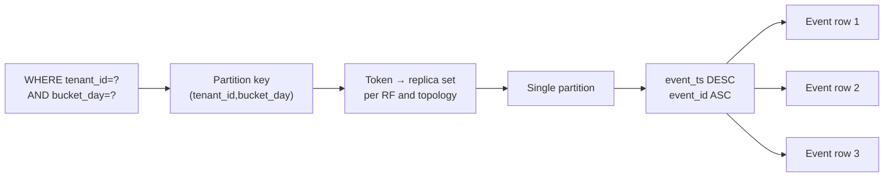
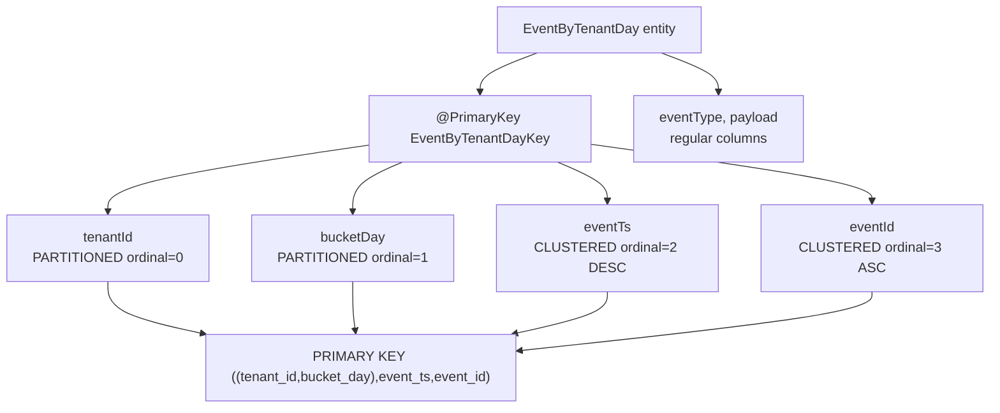

# `@PrimaryKey`, `@PrimaryKeyClass`, `@PrimaryKeyColumn`, and Key Ordering

**Chapter:** Spring Boot and Spring Data  
**Module:** `DATABASE_ENGINE_WIDE_COLUMN_CASSANDRA` — Apache Cassandra

A Java entity may look like a relational table, yet **the primary key in Apache Cassandra does far more than identify a row**. It determines **which replicas hold a partition, which rows live together in one partition, the physical storage/read order within that partition, and which `WHERE` clauses can run efficiently**. Consequently, when using Spring Boot and Spring Data Cassandra, misconfiguring `@PrimaryKey`, `@PrimaryKeyClass`, `@PrimaryKeyColumn`, `ordinal`, or `ordering` can break alignment between the Java model and the CQL schema, generate invalid queries, or cause unexpected load skew.

This lesson focuses on moving **from query requirements → CQL `PRIMARY KEY` → mapping annotations → repository/service → schema and result verification**. Concepts like partition tokens, clustering, consistency levels, replication, operational failures, and Java connectivity are tied in wherever they directly affect key design.

> **Scope:** Imports and examples are based on Spring Data for Apache Cassandra **4.x/5.x** and Spring Boot **3.x/4.x**, with compatible Apache Cassandra and Java Driver versions. Official Spring docs may change between releases; check the BOM/version matrix of your target Spring Boot release. In the lab, create schemas via CQL first and set `spring.cassandra.schema-action: none` so the framework does not mutate schemas. Never run DDL to alter primary keys in production.

## 1. Learning Outcomes

After this lesson, you will be able to:

1. Clearly separate **partition key**, **clustering columns**, and **full primary key** in Cassandra and map them to Spring annotations.
2. Understand how `PRIMARY KEY (a)`, `PRIMARY KEY (a,b)`, and `PRIMARY KEY ((a,b),c)` differ.
3. Use `@PrimaryKey("column_name")` for single keys and `@PrimaryKeyClass` + `@PrimaryKey` for composite keys.
4. Configure `@PrimaryKeyColumn(name, ordinal, type, ordering)` accurately against existing DDL.
5. Know that `ordinal` expresses **key component position**, while `ordering` expresses **clustering column sort direction**.
6. Distinguish nested composite key objects from **flat composite keys** using `MapId`.
7. Use `CassandraRepository<Entity, Key>`, `findById(Key)`, and `@Query` with complete partition keys.
8. Implement consistent `equals/hashCode` on key classes and understand why persisted keys should not be mutated.
9. Read `system_schema.columns` and `DESCRIBE TABLE` to cross-check Spring mapping against Cassandra schemas.
10. Spot key-order mismatches, missing partition predicates, `ALLOW FILTERING`, hot partitions, and schema drift.
11. Design CQL + Java labs with positive verification cases and invalid queries to reject.
12. Build a runbook to change primary keys via a **new table and data migration**, never expecting an annotation edit to restructure stored data.

## 2. How Does a Cassandra Primary Key Differ from a Relational Primary Key?

### 2.1. Three Roles of the Key

A Cassandra `PRIMARY KEY` can have two parts:

- **Partition key:** one or more columns hashed together to determine the token and replica set holding the partition. Every row sharing the **entire** partition key belongs to the same logical partition.
- **Clustering columns:** columns following the partition key that identify rows **within a partition** and govern clustering order.
- **Full primary key:** the combination of the partition key plus all clustering columns uniquely identifying one row in the table.



With a composite primary key, do not treat all four columns identically. The two partition columns bound data access scope and distribution; the clustering columns govern intra-partition position and sort order.

### 2.2. Three DDL Forms

| CQL | Partition Key | Clustering Columns | Consequence |
| --- | --- | --- | --- |
| `PRIMARY KEY (a)` | `a` | None | Each partition holds at most one logical row |
| `PRIMARY KEY (a, b)` | `a` | `b` | Multiple rows inside `a`, ordered by `b` |
| `PRIMARY KEY ((a, b), c)` | **(a, b)** | `c` | Token hashed from both `a` and `b` |
| `PRIMARY KEY ((a, b), c, d)` | **(a, b)** | `c` then `d` | Clustering order is column `c` before `d` |
| `PRIMARY KEY (a, b, c)` | `a` | `b` then `c` | **Not** equivalent to `PRIMARY KEY ((a,b),c)` |

**Parentheses carry structural meaning:** CQL `((a,b),c)` denotes a **composite partition key**, not visual grouping. Within a composite partition key, component order is also part of key/token formation; swapping order is not cosmetic.

### 2.3. Clustering Order Is a Table Property

Example:

```sql
CREATE TABLE lab_spring_keys.events_by_tenant_day (
    tenant_id text,
    bucket_day date,
    event_ts timestamp,
    event_id uuid,
    event_type text,
    payload text,
    PRIMARY KEY ((tenant_id, bucket_day), event_ts, event_id)
) WITH CLUSTERING ORDER BY (event_ts DESC, event_id ASC);
```

Inside **one** `(tenant_id,bucket_day)` partition, rows are ordered newest-to-oldest by `event_ts`, then ascending by `event_id` on ties. `CLUSTERING ORDER BY` **does not alter partition hashing**, does not provide global ordering across tenants/days, and does not allow arbitrary `ORDER BY` on any column.

## 3. Spring Data Cassandra Annotation Map

| Annotation / Attribute | Placed On | Meaning |
| --- | --- | --- |
| `@Table("table_name")` | Entity class | Maps entity to CQL table |
| `@PrimaryKey("column_name")` | Single property on entity | **Single** key, or property holding a key class |
| `@PrimaryKeyClass` | Separate **class** | Class encapsulating all components of a composite primary key |
| `@PrimaryKeyColumn` | Fields in key class or flat model | Declares a key component, its type, and position |
| `@PrimaryKeyColumn(type = PARTITIONED)` | Partition component | Column participating in the partition key |
| `@PrimaryKeyColumn(type = CLUSTERED)` | Clustering component | Column identifying/ordering rows inside the partition |
| `ordinal = 0, 1, 2...` | Each key component | Position in the CQL primary key declaration |
| `ordering = Ordering.DESCENDING` | **Clustering** column | Descending sort direction when DDL specifies it |
| `ordering = Ordering.ASCENDING` | **Clustering** column | Ascending sort direction (default) |
| `@Column("column_name")` | Regular data field | Sets column name when different from Java property |
| `@Id` | Generic Spring Data annotation | Identity marker in some cases; check model/version for flat keys |
| `@CassandraType` | Property needing type override | Extra type mapping; does not set partition/clustering role |

Per Javadoc, `@PrimaryKeyColumn` has notable defaults: `type()` defaults to `PrimaryKeyType.CLUSTERED`, `ordering()` defaults to `Ordering.ASCENDING`, and `ordinal()` defaults to **`Integer.MIN_VALUE`**. Therefore, in lessons and production schemas needing explicit ordering, **always specify `ordinal` and `type` explicitly** instead of relying on Java field declaration order.

**Warning:** The **order of fields in Java source code** does not guarantee Cassandra key order. The two values to verify are **DDL column order** and **annotation `ordinal`**.

## 4. Simple Case: Single Partition Key

### 4.1. Creating the Keyspace and Table in the Lab

Assume a disposable cluster with DC named `datacenter1`. If different, substitute your DC name; RF=1 is only for mapping practice, not production fault tolerance.

```sql
CREATE KEYSPACE IF NOT EXISTS lab_spring_keys
WITH replication = {
  'class': 'NetworkTopologyStrategy',
  'datacenter1': 1
}
AND durable_writes = true;

CREATE TABLE IF NOT EXISTS lab_spring_keys.device_status_by_id (
    device_id uuid PRIMARY KEY,
    state text,
    updated_at timestamp
);
```

`device_id` is the sole partition key. An `INSERT` with the same `device_id` upserts that logical row rather than creating a second row with the same key.

### 4.2. Entity Using `@PrimaryKey`

```java
import java.time.Instant;
import java.util.UUID;

import org.springframework.data.cassandra.core.mapping.Column;
import org.springframework.data.cassandra.core.mapping.PrimaryKey;
import org.springframework.data.cassandra.core.mapping.Table;

@Table("device_status_by_id")
public class DeviceStatus {

    @PrimaryKey("device_id")
    private UUID deviceId;

    @Column("state")
    private String state;

    @Column("updated_at")
    private Instant updatedAt;

    public DeviceStatus() { }

    public DeviceStatus(UUID deviceId, String state, Instant updatedAt) {
        this.deviceId = deviceId;
        this.state = state;
        this.updatedAt = updatedAt;
    }

    public UUID getDeviceId() { return deviceId; }
    public void setDeviceId(UUID deviceId) { this.deviceId = deviceId; }
    public String getState() { return state; }
    public void setState(String state) { this.state = state; }
    public Instant getUpdatedAt() { return updatedAt; }
    public void setUpdatedAt(Instant updatedAt) {
        this.updatedAt = updatedAt;
    }
}
```

**Meaning:** `@PrimaryKey("device_id")` is a simple `UUID` property matching `device_id uuid PRIMARY KEY`. No `@PrimaryKeyClass` is needed just to wrap a single `UUID`.

```java
import java.util.UUID;
import org.springframework.data.cassandra.repository.CassandraRepository;

public interface DeviceStatusRepository
        extends CassandraRepository<DeviceStatus, UUID> {
}
```

The second generic parameter of the repository is the **exact identity type**, here `UUID`. Never put `Long` out of JPA habit.

### 4.3. When a Single `@PrimaryKey` Is Not Enough

If you want multiple events over time for the same device, `device_id PRIMARY KEY` cannot hold **independent rows** per event (writing the same ID updates the row). You need clustering columns like `event_ts` and possibly `event_id` to distinguish events sharing a timestamp.

**Never** annotate an entity field `@Column Instant eventTs` and expect it to become a clustering key; Cassandra must define that column inside the CQL `PRIMARY KEY`.

## 5. Main Scenario: Composite Key with Two Partition Columns and Two Clustering Columns

### 5.1. Query Requirements

Suppose the product logs events and needs to:

- Fetch the **20 newest events** for a tenant on a given day.
- Look up a specific event by full `tenant_id`, `bucket_day`, `event_ts`, `event_id`.
- Bound rows per partition using a daily bucket.
- Avoid scanning the entire cluster to return a timeline.
- Allow multiple events at the same `event_ts`; add `event_id` for uniqueness.

From these requirements, select the key:

```text
PRIMARY KEY ((tenant_id, bucket_day), event_ts, event_id)
             \_____________________/  \_________________/
                 partition key           clustering keys

partition order: tenant_id (0), bucket_day (1)
cluster order:   event_ts  (2), event_id  (3)
sort direction:  event_ts DESC, event_id ASC
```

### 5.2. Source-of-Truth DDL

```sql
CREATE TABLE IF NOT EXISTS lab_spring_keys.events_by_tenant_day (
    tenant_id text,
    bucket_day date,
    event_ts timestamp,
    event_id uuid,
    event_type text,
    payload text,
    PRIMARY KEY ((tenant_id, bucket_day), event_ts, event_id)
) WITH CLUSTERING ORDER BY (event_ts DESC, event_id ASC);
```

This is the **CQL-managed schema**; subsequent Java annotations map **to match it**, never altering the real schema ad hoc.

### 5.3. Deterministic CQL Test Data

```sql
INSERT INTO lab_spring_keys.events_by_tenant_day (
    tenant_id, bucket_day, event_ts, event_id, event_type, payload
) VALUES (
    'tenant-a', '2026-11-21', '2026-11-21T10:00:00Z',
    10000000-0000-4000-8000-000000000001, 'OPEN', 'home'
);

INSERT INTO lab_spring_keys.events_by_tenant_day (
    tenant_id, bucket_day, event_ts, event_id, event_type, payload
) VALUES (
    'tenant-a', '2026-11-21', '2026-11-21T10:03:00Z',
    10000000-0000-4000-8000-000000000002, 'CLICK', 'item-2'
);

INSERT INTO lab_spring_keys.events_by_tenant_day (
    tenant_id, bucket_day, event_ts, event_id, event_type, payload
) VALUES (
    'tenant-a', '2026-11-21', '2026-11-21T10:03:00Z',
    10000000-0000-4000-8000-000000000003, 'CLICK', 'item-3'
);

INSERT INTO lab_spring_keys.events_by_tenant_day (
    tenant_id, bucket_day, event_ts, event_id, event_type, payload
) VALUES (
    'tenant-b', '2026-11-21', '2026-11-21T10:05:00Z',
    10000000-0000-4000-8000-000000000004, 'OPEN', 'other'
);
```

Query:

```sql
SELECT event_ts, event_id, event_type, payload
FROM lab_spring_keys.events_by_tenant_day
WHERE tenant_id = 'tenant-a'
  AND bucket_day = '2026-11-21'
LIMIT 20;
```

Expected in the tenant-a / Nov 21 partition: events at 10:03 appear before 10:00. The two rows sharing `event_ts=10:03` sort by `event_id ASC`. Tenant-b's event **does not appear** because its partition key differs.

## 6. `@PrimaryKeyClass`: Modeling Identity as a Java Type

### 6.1. Complete Key Class

A `@PrimaryKeyClass` should include **every PK component** per CQL, omitting no clustering columns and including no payload fields. Complete example:

```java
import java.io.Serializable;
import java.time.Instant;
import java.time.LocalDate;
import java.util.Objects;
import java.util.UUID;

import org.springframework.data.cassandra.core.cql.Ordering;
import org.springframework.data.cassandra.core.cql.PrimaryKeyType;
import org.springframework.data.cassandra.core.mapping.PrimaryKeyClass;
import org.springframework.data.cassandra.core.mapping.PrimaryKeyColumn;

@PrimaryKeyClass
public class EventByTenantDayKey implements Serializable {

    private static final long serialVersionUID = 1L;

    @PrimaryKeyColumn(
        name = "tenant_id",
        ordinal = 0,
        type = PrimaryKeyType.PARTITIONED)
    private String tenantId;

    @PrimaryKeyColumn(
        name = "bucket_day",
        ordinal = 1,
        type = PrimaryKeyType.PARTITIONED)
    private LocalDate bucketDay;

    @PrimaryKeyColumn(
        name = "event_ts",
        ordinal = 2,
        type = PrimaryKeyType.CLUSTERED,
        ordering = Ordering.DESCENDING)
    private Instant eventTs;

    @PrimaryKeyColumn(
        name = "event_id",
        ordinal = 3,
        type = PrimaryKeyType.CLUSTERED,
        ordering = Ordering.ASCENDING)
    private UUID eventId;

    // No-arg constructor so Spring Data can materialize via property access.
    public EventByTenantDayKey() { }

    public EventByTenantDayKey(
            String tenantId,
            LocalDate bucketDay,
            Instant eventTs,
            UUID eventId) {
        this.tenantId = tenantId;
        this.bucketDay = bucketDay;
        this.eventTs = eventTs;
        this.eventId = eventId;
    }

    public String getTenantId() { return tenantId; }
    public void setTenantId(String tenantId) { this.tenantId = tenantId; }

    public LocalDate getBucketDay() { return bucketDay; }
    public void setBucketDay(LocalDate bucketDay) {
        this.bucketDay = bucketDay;
    }

    public Instant getEventTs() { return eventTs; }
    public void setEventTs(Instant eventTs) { this.eventTs = eventTs; }

    public UUID getEventId() { return eventId; }
    public void setEventId(UUID eventId) { this.eventId = eventId; }

    @Override
    public boolean equals(Object other) {
        if (this == other) return true;
        if (!(other instanceof EventByTenantDayKey that)) return false;
        return Objects.equals(tenantId, that.tenantId)
            && Objects.equals(bucketDay, that.bucketDay)
            && Objects.equals(eventTs, that.eventTs)
            && Objects.equals(eventId, that.eventId);
    }

    @Override
    public int hashCode() {
        return Objects.hash(tenantId, bucketDay, eventTs, eventId);
    }
}
```

**Key points:**

1. `type = PARTITIONED` appears **twice**, matching the two columns in `(tenant_id, bucket_day)`.
2. `type = CLUSTERED` is set for `event_ts` and `event_id`; they **do not** participate in partition hashing.
3. `ordinal 0,1,2,3` defines **component position** in the CQL `PRIMARY KEY`, not ASC/DESC sorting.
4. `ordering DESCENDING` is set only on `event_ts` because the DDL specifies `event_ts DESC`.
5. `LocalDate` maps CQL `date`; `Instant` maps CQL `timestamp`; `UUID` maps `uuid`. Never use `LocalDateTime` and rely implicitly on the JVM's timezone.
6. Keys should generally be **stable value objects**. Setters are shown here for mapping convenience; business code **must not mutate the key of a persisted entity**. Constructor-only/immutable mapping can be used after checking your Spring Data version's materialization rules.
7. `equals/hashCode` must include **the exact identity components** and align with CQL type equality. Never include `payload` in `equals`, and never omit `event_id`.
8. `Serializable` is a common convention for key classes, not Cassandra's "data distribution mechanism".

### 6.2. Why Must `equals/hashCode` Be Consistent?

With Java objects:

```java
var t = java.time.Instant.parse("2026-11-21T10:03:00Z");
var d = java.time.LocalDate.of(2026, 11, 21);
var e = java.util.UUID.fromString(
    "10000000-0000-4000-8000-000000000002");

var k1 = new EventByTenantDayKey("tenant-a", d, t, e);
var k2 = new EventByTenantDayKey("tenant-a", d, t, e);

assert k1.equals(k2);
assert k1.hashCode() == k2.hashCode();
```

If `k1` and `k2` hold identical CQL values yet Java considers them unequal, repository identity/caches/collections in the app can misbehave. Conversely, overly loose Java equality that diverges from Cassandra equality can fool the app into treating two distinct PK rows as one.

If a key contains types with normalization or special comparisons (e.g., scaled numeric types), inspect Java/Cassandra semantics and write tests per type. This example uses types with unambiguous equality.

## 7. `@PrimaryKey` on the Entity Referencing the Key Class

### 7.1. Entity Holding a Single `key` Property

```java
import org.springframework.data.cassandra.core.mapping.Column;
import org.springframework.data.cassandra.core.mapping.PrimaryKey;
import org.springframework.data.cassandra.core.mapping.Table;

@Table("events_by_tenant_day")
public class EventByTenantDay {

    @PrimaryKey
    private EventByTenantDayKey key;

    @Column("event_type")
    private String eventType;

    @Column("payload")
    private String payload;

    public EventByTenantDay() { }

    public EventByTenantDay(
            EventByTenantDayKey key,
            String eventType,
            String payload) {
        this.key = key;
        this.eventType = eventType;
        this.payload = payload;
    }

    public EventByTenantDayKey getKey() { return key; }
    public void setKey(EventByTenantDayKey key) { this.key = key; }

    public String getEventType() { return eventType; }
    public void setEventType(String eventType) {
        this.eventType = eventType;
    }

    public String getPayload() { return payload; }
    public void setPayload(String payload) { this.payload = payload; }
}
```

**Correct reading:** `@PrimaryKey` on `EventByTenantDay.key` **does not create a CQL column named `key`**. Spring Data uses the `@PrimaryKeyClass` metadata to map the 4 inner fields to the **4 real table columns**.

For composite keys, never put `@PrimaryKey("tenant_id")` on an `EventByTenantDayKey` field expecting only tenant to be partitioned: for a key class, passing a string to `@PrimaryKey` does not replace the four-component schema.

### 7.2. Data Flow from Java to CQL



When creating a new event, all four key fields must be populated with valid types. Cassandra forbids `null` in primary key columns. Never call `UUID.randomUUID()` for `eventId` **on every retry of the same business event** if duplicates are unacceptable; generate the event ID once at the authoritative source.

## 8. Spring Data Repository with a Composite ID

### 8.1. The Second Repository Type Parameter Is the Key Class

```java
import java.time.LocalDate;
import java.util.List;

import org.springframework.data.cassandra.repository.CassandraRepository;
import org.springframework.data.cassandra.repository.Query;

public interface EventByTenantDayRepository
        extends CassandraRepository<EventByTenantDay, EventByTenantDayKey> {

    @Query("SELECT * FROM events_by_tenant_day " +
           "WHERE tenant_id = ?0 AND bucket_day = ?1 LIMIT 20")
    List<EventByTenantDay> latest20(String tenantId, LocalDate bucketDay);
}
```

The inherited `findById` accepts **`EventByTenantDayKey`**, not just `UUID eventId` or `String tenantId`:

```java
import java.time.Instant;
import java.time.LocalDate;
import java.util.Optional;
import java.util.UUID;

public final class EventReadExample {
    public static Optional<EventByTenantDay> getExact(
            EventByTenantDayRepository repository) {
        EventByTenantDayKey id = new EventByTenantDayKey(
            "tenant-a",
            LocalDate.of(2026, 11, 21),
            Instant.parse("2026-11-21T10:03:00Z"),
            UUID.fromString("10000000-0000-4000-8000-000000000002")
        );
        return repository.findById(id);
    }
}
```

**Never write** `CassandraRepository<EventByTenantDay, UUID>` and call `findById(eventId)`; Cassandra has no index to locate an event by clustering column `event_id` without the partition key and preceding PK components.

### 8.2. Querying Latest Rows in a Partition

`latest20` supplies the complete **partition key** without needing `event_ts`/`event_id`, reading a **partition prefix** with `LIMIT`. To bound by time range:

```sql
SELECT event_ts, event_id, event_type, payload
FROM lab_spring_keys.events_by_tenant_day
WHERE tenant_id = 'tenant-a'
  AND bucket_day = '2026-11-21'
  AND event_ts >= '2026-11-21T10:00:00Z'
  AND event_ts < '2026-11-21T11:00:00Z'
LIMIT 50;
```

This predicate is valid because `event_ts` is the **first clustering column**. A query providing only `event_id` without `event_ts` normally cannot run as a direct lookup on this table. Design **another query-driven table** (such as `event_by_id`) if looking up solely by `event_id` is required.

### 8.3. Do Not Mistake `findAll()` for a Safe "Full Table" List

Spring Data repositories expose convenience methods like `findAll()`, yet calling them on large Cassandra tables triggers full scans and massive I/O/latency. Design repositories around **known query patterns**, typically supplying the complete partition key. Never slap `ALLOW FILTERING` onto a rejected query to make it "feel like SQL".

## 9. `@PrimaryKeyColumn`: Exact Attributes and Ordering

### 9.1. Reading Every Parameter

```java
@PrimaryKeyColumn(
    name = "event_ts",
    ordinal = 2,
    type = PrimaryKeyType.CLUSTERED,
    ordering = Ordering.DESCENDING
)
private Instant eventTs;
```

- **`name`:** CQL column name; not the Java property name, and they do not have to match.
- **`ordinal`:** PK component position relative to other `@PrimaryKeyColumn` fields.
- **`type`:** `PARTITIONED` or `CLUSTERED`, deciding whether the column belongs to the partition key or clustering key.
- **`ordering`:** meaningful only for **`CLUSTERED`**, specifying sort direction. On `PARTITIONED`, this attribute is **unused** for partition hashing.

### 9.2. `ordinal` Is Not Sort Direction

These two annotations:

```java
@PrimaryKeyColumn(name = "event_ts", ordinal = 2,
    type = PrimaryKeyType.CLUSTERED,
    ordering = Ordering.DESCENDING)

@PrimaryKeyColumn(name = "event_id", ordinal = 3,
    type = PrimaryKeyType.CLUSTERED,
    ordering = Ordering.ASCENDING)
```

state **compare by `event_ts` first**, and on ties **compare `event_id` second**; each column's sort direction is separate. `ordinal = 3` does not mean ascending or descending.

### 9.3. Java Field Order Does Not Define the Schema

Ordering fields like this in Java source code is hard to read:

```java
// READABILITY ANTI-PATTERN (not a syntax error):
@PrimaryKeyColumn(name="event_id", ordinal=3, type=PrimaryKeyType.CLUSTERED)
private UUID eventId;

@PrimaryKeyColumn(name="tenant_id", ordinal=0, type=PrimaryKeyType.PARTITIONED)
private String tenantId;
```

The mapper uses `ordinal` metadata, not source line order. Still, maintainable codebases declare fields **in ordinal order 0→N** so reviewers can verify against CQL quickly.

### 9.4. Never Omit `type` Because the Default Is Not `PARTITIONED`

Javadoc shows `type` defaults to `CLUSTERED`. Omitting `type = PrimaryKeyType.PARTITIONED` on `tenantId` or `bucketDay` misclassifies key components in mapping metadata. Against an existing table, this causes **mapping mismatches or broken queries** — Cassandra does not "auto-correct" it.

### 9.5. `name`, `value`, and Quoting

`@PrimaryKeyColumn(name = "tenant_id")` maps `tenantId` to `tenant_id`. Javadoc also offers `value` as an alias for the column name; pick one style consistently.

Avoid case-sensitive or reserved-word key column names when possible. Unquoted CQL identifiers normalize to lowercase; when using quoted names like `"TenantID"`, verify your naming strategy and `CqlIdentifier` handling. **Never** edit annotations to "rename a column in place" when the schema/data has not migrated.

## 10. Composite Partition Key vs. Multiple Clustering Columns

### 10.1. Three Cases Side by Side

```sql
-- A. Partition by tenant; bucket_day is clustering:
CREATE TABLE lab_spring_keys.sample_a (
    tenant_id text,
    bucket_day date,
    event_id uuid,
    value text,
    PRIMARY KEY (tenant_id, bucket_day, event_id)
);

-- B. Partition by (tenant, bucket_day); event_id is clustering:
CREATE TABLE lab_spring_keys.sample_b (
    tenant_id text,
    bucket_day date,
    event_id uuid,
    value text,
    PRIMARY KEY ((tenant_id, bucket_day), event_id)
);

-- C. Partition by tenant; event_id is clustering:
CREATE TABLE lab_spring_keys.sample_c (
    tenant_id text,
    event_id uuid,
    value text,
    PRIMARY KEY (tenant_id, event_id)
);
```

A and B share the same **column names** yet have vastly different distribution strategies.

| Schema | Partition Key | Data Sharing a Partition | When Appropriate |
| --- | --- | --- | --- |
| A | `tenant_id` | All days for one tenant | Only if partition size is proven small and queries target the tenant |
| B | `(tenant_id,bucket_day)` | Events for one tenant on one day | Daily timelines, preventing unbounded partition growth |
| C | `tenant_id` | Every `eventId` for the tenant | Looking up across all tenant events in one partition; risks growing too wide |

Putting `bucket_day` in clustering (A) **does not bound partition size per day**; only making `bucket_day` **part of the partition key** (B) splits partitions by day.

### 10.2. Impact on Tokens, Replicas, and RF

Cassandra hashes the **entire composite partition key**. In B, `(tenant-a, 2026-11-21)` and `(tenant-a, 2026-11-22)` can land on different replica sets on the token ring. `NetworkTopologyStrategy` and RF govern replica counts per DC; annotations **never alter RF**.

A code review that checks `@PrimaryKeyColumn` names while ignoring `type` can break daily bucketing and trigger hot partitions.

## 11. Flat Composite Key: Without Creating `@PrimaryKeyClass`

Spring Data Cassandra supports an **alternative mapping**: placing `@PrimaryKeyColumn` directly on entity fields.

> **Pick one style in the main app:** `EventByTenantDay` (with key class) and `EventFlat` below are **two ways to map the same schema for comparison**; do not register two entities for the same table when using schema auto-generation.

### 11.1. Flat Entity

```java
import java.time.Instant;
import java.time.LocalDate;
import java.util.UUID;

import org.springframework.data.cassandra.core.cql.Ordering;
import org.springframework.data.cassandra.core.cql.PrimaryKeyType;
import org.springframework.data.cassandra.core.mapping.Column;
import org.springframework.data.cassandra.core.mapping.PrimaryKeyColumn;
import org.springframework.data.cassandra.core.mapping.Table;

@Table("events_by_tenant_day")
public class EventFlat {

    @PrimaryKeyColumn(
        name = "tenant_id", ordinal = 0,
        type = PrimaryKeyType.PARTITIONED)
    private String tenantId;

    @PrimaryKeyColumn(
        name = "bucket_day", ordinal = 1,
        type = PrimaryKeyType.PARTITIONED)
    private LocalDate bucketDay;

    @PrimaryKeyColumn(
        name = "event_ts", ordinal = 2,
        type = PrimaryKeyType.CLUSTERED,
        ordering = Ordering.DESCENDING)
    private Instant eventTs;

    @PrimaryKeyColumn(
        name = "event_id", ordinal = 3,
        type = PrimaryKeyType.CLUSTERED,
        ordering = Ordering.ASCENDING)
    private UUID eventId;

    @Column("event_type")
    private String eventType;

    @Column("payload")
    private String payload;

    public EventFlat() { }

    // Getters/setters for the fields above
    // per Spring Data conventions; omitted to focus on mapping.
}
```

Spring Data documentation shows flat composite keys using `@PrimaryKeyColumn` on individual fields and lookups via predicates/`MapId`. Javadoc also describes pairing `@Id` when marking **a single property** as identity; **do not** add `@Id` onto every component of a flat composite key. Verify flat mapping behavior on your exact **Spring Data version** before adopting it. When strong repository ID typing is desired, `@PrimaryKeyClass` is usually easier to govern.

### 11.2. Using `MapIdCassandraRepository`

```java
import org.springframework.data.cassandra.repository.MapIdCassandraRepository;

public interface EventFlatRepository
        extends MapIdCassandraRepository<EventFlat> {
}
```

With `MapId`, the app supplies **a map of values for all PK properties**:

```java
import java.time.Instant;
import java.time.LocalDate;
import java.util.UUID;

import org.springframework.data.cassandra.core.mapping.BasicMapId;
import org.springframework.data.cassandra.core.mapping.MapId;

// Example findById call using Java mapping property names.
MapId id = BasicMapId.id("tenantId", "tenant-a")
    .with("bucketDay", LocalDate.of(2026, 11, 21))
    .with("eventTs", Instant.parse("2026-11-21T10:03:00Z"))
    .with("eventId", UUID.fromString(
        "10000000-0000-4000-8000-000000000002"));

// eventFlatRepository.findById(id);
```

`BasicMapId.id(...).with(...)` is the identifier builder documented by Spring Data. **Names in `MapId` must match the property names expected by the mapper**; test behavior whenever Java property names differ from CQL column names.

### 11.3. Choosing Flat vs. Key Class?

| Criterion | `@PrimaryKeyClass` | Flat `@PrimaryKeyColumn` + `MapId` |
| --- | --- | --- |
| Repository ID type | Strongly typed `EventByTenantDayKey` | Flexible `MapId`, less type-safe |
| Passing identity across services | Single value object | Multiple fields or map |
| `equals/hashCode` | Defined by the key class | Managed by `MapId`/map structure |
| Self-documentation | Clear for multi-component keys | Good when entity has few fields |
| Risk of missing key component | Compiler helps via constructor/type | Missing `MapId` key surfaces only at runtime/test |
| Partition-scoped read queries | Repository/custom queries | Custom queries or `MapId` |
| Recommendation for many clustering columns | Usually easier to review | Use when model simplification is justified |

Do not make this an aesthetic ORM choice; decide based on **how repositories, services, and the team pass identities**, plus testability against the real schema.

## 12. Key Order Governs Valid Queries

### 12.1. For the Main Events Table

```text
Partition:  (tenant_id, bucket_day)
Clustering: event_ts DESC, event_id ASC
```

| Query | Valid for Access Pattern? | Why |
| --- | --- | --- |
| `WHERE tenant_id=? AND bucket_day=?` | Yes | Full partition key supplied |
| `WHERE tenant_id=? AND bucket_day=? AND event_ts>=?` | Yes | Clustering prefix/range |
| `WHERE tenant_id=? AND bucket_day=? AND event_ts=? AND event_id=?` | Yes | Full primary key |
| `WHERE tenant_id=?` | Unsuitable for point partition read | Missing `bucket_day` from composite partition key |
| `WHERE bucket_day=?` | No | Missing `tenant_id` |
| `WHERE event_id=?` | No | Only last clustering column given, partition unknown |
| `WHERE tenant_id=? AND bucket_day=? AND event_id=?` | Normally no | Skips `event_ts` before `event_id` |
| `WHERE payload=?` | No on this schema | Regular column, unindexed and not in PK |
| `WHERE ... ALLOW FILTERING` | Avoid | Expensive scan/filter; does not fix data model |

Define an **additional table** for standalone `event_id` lookups rather than forcing a repository to emit invalid queries.

### 12.2. Supported Sorting

Table definition:

```sql
WITH CLUSTERING ORDER BY (event_ts DESC, event_id ASC)
```

Examples:

```sql
-- Defined order:
SELECT event_ts, event_id
FROM lab_spring_keys.events_by_tenant_day
WHERE tenant_id = 'tenant-a'
  AND bucket_day = '2026-11-21'
ORDER BY event_ts DESC, event_id ASC;

-- Fully REVERSED direction:
SELECT event_ts, event_id
FROM lab_spring_keys.events_by_tenant_day
WHERE tenant_id = 'tenant-a'
  AND bucket_day = '2026-11-21'
ORDER BY event_ts ASC, event_id DESC;
```

Cassandra supports ordering matching the table's clustering order or its **exact reverse**. Do not assume arbitrary combinations like `event_ts ASC, event_id ASC` are valid. `ORDER BY payload` does not become valid just because `payload` is a Java property.

### 12.3. Sort Order Is Not a "Cluster-Wide Latest" Column

`ORDER BY event_ts DESC LIMIT 20` applies to **one specified partition**, not "the 20 newest events across all tenants". If the business needs a global feed, build a separate query-driven read model/materialized projection and evaluate load distribution. Clustering order does not create a global index.

### 12.4. Why Not JPA `@OrderBy`?

`@PrimaryKeyColumn(ordering=...)` is **Spring Data Cassandra** metadata for schema clustering. It is not Spring Data JPA's collection `@OrderBy`. Cassandra has no general sorting on arbitrary columns like an RDBMS; design from the `PRIMARY KEY`.

## 13. Illustrative Java Service Saving and Reading

```java
import java.time.Instant;
import java.time.LocalDate;
import java.util.List;
import java.util.UUID;

import org.springframework.stereotype.Service;

@Service
public class EventByTenantDayService {

    private final EventByTenantDayRepository repository;

    public EventByTenantDayService(
            EventByTenantDayRepository repository) {
        this.repository = repository;
    }

    public EventByTenantDay appendEvent(
            String tenantId,
            Instant occurredAt,
            UUID stableEventId,
            String eventType,
            String payload) {

        // Bucket day computed in UTC, independent of host default timezone.
        LocalDate bucketDay = occurredAt.atOffset(
            java.time.ZoneOffset.UTC).toLocalDate();

        EventByTenantDayKey key = new EventByTenantDayKey(
            tenantId, bucketDay, occurredAt, stableEventId);

        EventByTenantDay entity = new EventByTenantDay(
            key, eventType, payload);

        return repository.save(entity);
    }

    public List<EventByTenantDay> latest20(
            String tenantId, LocalDate day) {
        return repository.latest20(tenantId, day);
    }
}
```

**Important limitations of this example:**

- `stableEventId` must be generated **once per business event**; generating a new UUID on retry creates a different PK and duplicates rows.
- `occurredAt` supplies both `event_ts` and the UTC `bucket_day`. If another writer uses a local timezone, the same event lands in the wrong partition.
- `repository.save(...)` follows Cassandra semantics (mutation/upsert) and is not a general SQL transaction.
- Never add `@Transactional` expecting multi-partition atomicity. Cassandra's atomicity/LWT limits differ from RDBMS.
- If `LOCAL_QUORUM` is required, configure CL via driver/session/execution profiles/queries; key annotations do not set consistency levels.
- Avoid logging raw `payload` when it contains PII; never put secrets/credentials into DTOs.

### 13.1. Checking `INSERT` Idempotency

Saving the exact same `EventByTenantDayKey` twice with deterministic payload/data normally **does not create two distinct CQL rows**. However, if payload, timestamp, or TTL changes, it updates data at that key. Worse, if `eventId` is regenerated per attempt, it is **no longer the same key**.

**Lesson:** A well-chosen primary key helps deduplicate events logically, yet does not replace end-to-end workflow exactly-once handling or external side-effect control.

## 14. Spring Boot: Dependencies and Connection Config

### 14.1. Use the Version-Managed Starter

Illustrative `pom.xml` dependency snippet (parent/BOM must be configured in the real project):

```xml
<dependency>
    <groupId>org.springframework.boot</groupId>
    <artifactId>spring-boot-starter-data-cassandra</artifactId>
</dependency>
```

Do not pick arbitrary Spring Data Cassandra and Java Driver versions outside the Spring Boot BOM; it risks API/mapping/runtime errors. In Gradle, use the equivalent Boot plugin/BOM-managed dependency.

### 14.2. `application.yml` for the Lab Environment

In modern Spring Boot (3.x/4.x), the namespace is **`spring.cassandra.*`**, not `spring.data.cassandra.*` seen in old Boot 2.x examples:

```yaml
spring:
  cassandra:
    contact-points: "127.0.0.1:9042"
    local-datacenter: "datacenter1"
    keyspace-name: "lab_spring_keys"
    schema-action: none
```

- `contact-points` let the driver discover the cluster; they do not mean every query hits the first node.
- `local-datacenter` must match the real DC.
- `keyspace-name` must exist with an appropriate RF; RF=1 here is lab-only.
- `schema-action: none` avoids creating/dropping tables on app startup. Production needs reviewed schema migrations.
- For auth/TLS, use a secret manager and valid SSL trust material; never put real passwords in Git or lab examples.
- Spring Boot auto-configures `CqlSession`, `CassandraTemplate`, and repositories per classpath/config; never create a new session per HTTP request.

### 14.3. `schema-action` and Source of Truth

| Value | Meaning | Risk |
| --- | --- | --- |
| `none` | Do not auto-create/drop CQL tables at startup | Schema must be provisioned separately |
| `create` | Create schema from entities | Hard to control when other tables/schemas exist |
| `create_if_not_exists` | Create if missing | **Does not** fix drift on existing tables |
| `recreate` | Drop/recreate managed objects | **Data loss** |
| `recreate_drop_unused` | Broader drop/recreate | **Extremely dangerous in environments with data** |

Never set `recreate` or `recreate_drop_unused` in production to "fix a key-order annotation mistake". **Changing primary key column order/types requires redesigning the table and migrating data**, not just deploying code.

## 15. Cross-Check the Real Schema Before Running the Service

### 15.1. `DESCRIBE TABLE`

In `cqlsh`:

```sql
DESCRIBE TABLE lab_spring_keys.events_by_tenant_day;
```

Expect to see:

```sql
PRIMARY KEY ((tenant_id, bucket_day), event_ts, event_id)
WITH CLUSTERING ORDER BY (event_ts DESC, event_id ASC)
```

This is the **relevant excerpt to verify**, not the full literal `DESCRIBE TABLE` output (Cassandra also prints table options).

### 15.2. Reading `system_schema.columns`

```sql
SELECT column_name, kind, position, clustering_order, type
FROM system_schema.columns
WHERE keyspace_name = 'lab_spring_keys'
  AND table_name = 'events_by_tenant_day';
```

Metadata rows report `kind` as `partition_key`, `clustering`, or `regular`, per-group `position`, and `clustering_order` for clustering columns. Do not assume `position` runs continuously 0→3 like Java `ordinal`: **partition** and **clustering** positions are numbered separately.

Comparison table:

| Java Key Property | CQL Column | Java `type` | Java `ordinal` | Expected CQL Metadata |
| --- | --- | --- | ---: | --- |
| `tenantId` | `tenant_id` | PARTITIONED | 0 | partition key position 0 |
| `bucketDay` | `bucket_day` | PARTITIONED | 1 | partition key position 1 |
| `eventTs` | `event_ts` | CLUSTERED | 2 | clustering position 0, DESC |
| `eventId` | `event_id` | CLUSTERED | 3 | clustering position 1, ASC |

**Verification rule:** `ordinal` is a **contiguous order inside Java mapping metadata**; CQL `system_schema.columns.position` **restarts at 0** for the clustering group. Do not compare the two numbers 1-to-1 without separating groups.

### 15.3. Checking Data Types

- Java `String` ↔ CQL `text`.
- Java `LocalDate` ↔ CQL `date`.
- Java `Instant` ↔ CQL `timestamp`.
- Java `UUID` ↔ CQL `uuid`.

If the schema uses CQL `timeuuid` instead of `uuid`, do not assume identical semantics or ordering; use appropriate converters/type mapping. `@CassandraType` helps specify CQL types where needed; never use it in place of `@PrimaryKeyColumn(type=...)` since those two `type`s represent **two different concepts**: CQL data type vs. key role.

## 16. Verifying Java ↔ Cassandra Round-Trips

### 16.1. Positive Test Suite

In the lab:

1. Create the CQL keyspace/table per Sections 4–5.
2. Run the app with `schema-action=none`.
3. `repository.save(new EventByTenantDay(...))` with a specific four-component key.
4. `repository.findById(sameKey)` returns the exact logical row.
5. `repository.latest20("tenant-a", day)` returns the right partition/day and event order.
6. CQL `SELECT` verifies the PK columns directly.
7. Use two separate key object instances with identical values to verify `equals/hashCode`.
8. Test that tenant-b records never leak into tenant-a queries.

JUnit pseudocode example:

```java
// Assumes a @SpringBootTest or integration test with a lab Cassandra.
// Do not run inside unit tests lacking a real cluster.
@Test
void compositeKeyRoundTrip() {
    UUID id = UUID.fromString(
        "10000000-0000-4000-8000-000000000091");

    EventByTenantDayKey key = new EventByTenantDayKey(
        "tenant-test",
        LocalDate.of(2026, 11, 21),
        Instant.parse("2026-11-21T12:00:00Z"),
        id);

    EventByTenantDay saved = repository.save(
        new EventByTenantDay(key, "TEST", "payload"));

    assertEquals(key, saved.getKey());

    EventByTenantDay loaded = repository.findById(key).orElseThrow();
    assertEquals("TEST", loaded.getEventType());
    assertEquals(key, loaded.getKey());
}
```

This test snippet needs JUnit/`repository` from a test fixture plus a disposable Cassandra cluster. It is not a claim that tests were executed or that the snippet compiles unchanged on every version.

### 16.2. Negative Test Suite

Test cases that should be rejected or drive a different table design:

- `bucket_day` without `tenant_id`: incomplete partition key.
- Querying by `event_id` alone: last clustering key cannot perform a point lookup.
- `ORDER BY payload`: not a clustering column.
- Querying by `event_ts` across all tenants/days: needs a separate table/index.
- Creating an entity with null `eventId`: null PK column.
- Changing Java `ordinal` order without changing CQL schema: mapping mismatch.
- `schema-action=create_if_not_exists` against a table with a different PK: old table remains unfixed.
- Using `LocalDateTime` without defining UTC/timezone bucketing rules.
- Adding `ALLOW FILTERING` to a partition-less query to "get past the error": never acceptable as a performance solution.

**Note:** Negative tests must never hit production. Use only disposable keyspaces with lab-appropriate RF/CL.

## 17. Data Distribution and Performance Consequences

### 17.1. Composite Partition Keys Split Days, Not Every Hotspot

One `(tenant-a, 2026-11-21)` partition can still grow huge if `tenant-a` emits millions of events per day. Adding `bucket_day` does not guarantee small partitions. When workload metrics exceed thresholds, consider hourly buckets or deterministic sharding, then redesign tables and queries accordingly.

**Never** flip `tenantId` from `PARTITIONED` to `CLUSTERED` expecting to "reduce a hot partition": that changes the **real data model** and access patterns without automatic migration.

### 17.2. Clustering Keys Affect Read Amplification and Pagination

When fetching the 20 newest events in a partition, `event_ts DESC` avoids sorting the whole table. Yet if a partition accumulates heavy tombstones/TTL expirations, queries still suffer read amplification. Inspect compaction strategy and partition size instead of blaming `@PrimaryKeyColumn(ordering)`.

### 17.3. Key Size and Memory

Overly long text primary key columns inflate index/network/memory overhead. Never let arbitrary user input become an unbounded `tenant_id`. Keys with too many components complicate queries/repositories and raise the odds of missing predicates.

### 17.4. Wide Rows and Buckets

Clustering columns allow many rows inside one partition. Yet a partition is a unit of storage and distribution — **it is not spread across every node**. Daily buckets bound growth over time, still requiring sizing around volume and retention. For TTL events, track tombstones and compaction per runbook.

## 18. Replication/Consistency Is Not Controlled by Annotations

Spring Data mapping defines **keys**, not:

- Keyspace `NetworkTopologyStrategy` RF.
- `LOCAL_QUORUM`, `ONE`, or `ALL` on reads/writes.
- Driver timeout/retry policies.
- Snitch, DC/rack placement, or token ownership.
- Anti-entropy repair, hints, streaming, or compaction.

With a composite partition key, each partition is placed by token under the same replication strategy. With RF=3 in one DC, a `LOCAL_QUORUM` read requires two replicas per quorum rules — not because the partition key has two columns.

A `repository.findById(key)` call can time out or throw unavailable; **never** catch it, strip `bucketDay`/`eventTs`, and "retry a broader query". When full-PK lookups fail, classify cluster/driver/CL causes rather than breaking key semantics.

## 19. Common Mistakes

### A. Putting `@PrimaryKey` on Multiple Fields of a Composite Key

`@PrimaryKey` marks **one identity property** on an entity. Never place `@PrimaryKey` on four separate fields. Use `@PrimaryKeyClass` containing `@PrimaryKeyColumn` fields with one `@PrimaryKey` on the entity, or supported flat composite mapping.

### B. Forgetting `type = PARTITIONED`

`@PrimaryKeyColumn.type` defaults to `CLUSTERED`. Mapping may produce the wrong PK or clash with the existing schema. Check `DESCRIBE TABLE` and annotate explicitly.

### C. Swapping `ordinal` 0/1 Between Tenant and Day

`(tenant_id,bucket_day)` and `(bucket_day,tenant_id)` are not the same composite partition key; changing order alters token encoding and identity. That is a **schema migration**, not code formatting.

### D. Confusing `ordinal=2` with `ordering=DESCENDING`

Ordinal states **which position** the column occupies in the primary key; ordering states sort direction for a **clustering column**. Never use negative ordinals to mean descending.

### E. Setting `ordering=DESCENDING` on a Partition Column

`ordering` is ignored on `PARTITIONED` columns; token hashes have no ASC/DESC ordering. Apply `ordering` only to clustering columns.

### F. Ordering Java Fields Differently from CQL

Java field declaration order does not override `ordinal`. Arrange fields in DDL order for readability and metadata checks.

### G. Repository ID Type Is `UUID` Despite a 4-Column Key

`findById(UUID)` cannot construct the full CQL `PRIMARY KEY ((tenant,bucket),ts,id)`. Use `CassandraRepository<Event, EventKey>` or `MapIdCassandraRepository` for flat models.

### H. Adding `@Column eventId` Assuming It Becomes Clustering

`@Column` does not turn a property into a primary key column. Both CQL DDL and `@PrimaryKeyColumn` must match.

### I. Querying by `event_id` Alone and Adding `ALLOW FILTERING`

Omitting the partition key forces Cassandra into broad scans. Create a dedicated read-model table keyed by `event_id` if frequent point lookups are needed.

### J. Writing `@PrimaryKey("key")` on a Key Class Property

For composite keys, passing a name to `@PrimaryKey` does not create a CQL column named `key`. Key columns are defined inside `@PrimaryKeyClass`; never rely on an annotation string to change mapping mechanics.

### K. Omitting `equals/hashCode` on the Key Class

Two objects with identical PK values will not compare equal in Java collections or domain logic. Implement and test using only key fields; never include `payload`.

### L. Mutating Key Fields After Saving an Entity

A persisted key represents a physical row address. Changing `bucketDay` or `eventId` changes identity; there is no safe general relational "UPDATE PRIMARY KEY". Create/migrate the new row and delete the old one cleanly if business logic demands it.

### M. Java `LocalDateTime` Lacks Timezone

CQL timestamps represent instants. Never rely on default JVM timezones to guess UTC. Use `Instant` and UTC `LocalDate` buckets, testing across timezones and DST.

### N. Enabling `schema-action=recreate` to Fix Annotations

This can **drop all data**. Use approved schema migrations, explicit DDL, shadow tables, and validation.

### O. Mapping Two Entities to the Same Table During Auto-Generation

Registering both a key-class entity and a flat entity for **the same table** under schema auto-generation causes hard-to-diagnose metadata conflicts. Pick one canonical mapping for production and keep the alternative strictly for learning or isolated tests.

### P. Assuming `@PrimaryKeyColumn` Creates an Index

This annotation describes **primary key components**, not secondary indexes on payload or arbitrary column lookups. Do not confuse it with `@Indexed`, SAI, or secondary indexing.

## 20. When Changing a Primary Key Is Necessary: Safe Workflow

In Cassandra, changing partition/clustering keys means **changing physical layout and query paths**. You generally cannot `ALTER TABLE` to change PK order or column roles on a populated table.

### P0 — Redesign Around Queries

Inventory active CQL queries, frequencies, tenant sizes, time buckets, and latencies. Pick new DDL with full partition predicates and clustering order avoiding hotspots.

### P1 — Create the New Table

For example, moving from daily buckets to hourly buckets:

```sql
CREATE TABLE IF NOT EXISTS lab_spring_keys.events_by_tenant_hour_v2 (
    tenant_id text,
    bucket_hour timestamp,
    event_ts timestamp,
    event_id uuid,
    event_type text,
    payload text,
    PRIMARY KEY ((tenant_id, bucket_hour), event_ts, event_id)
) WITH CLUSTERING ORDER BY (event_ts DESC, event_id ASC);
```

Create a **new key class/entity** matching v2 precisely; never edit v1's entity annotations and deploy before migrating data.

### P2 — Controlled Backfill

Read source partitions/key ranges and write target rows with deterministic event IDs/timestamps within rate and timeout budgets using an approved streaming/ETL pipeline. Never run uncontrolled full-table `SELECT *` or assume a single transaction spans v1/v2.

### P3 — Dual Write / CDC or Catch-Up

During transition, the app may dual-write or run a CDC/reconciliation pipeline. Handle partial failures (one side succeeds, the other fails) using idempotency keys. Never claim dual-writes are automatically atomic or exactly-once.

### P4 — Reconcile and Cut Over

Compare row counts **by partition/range** (not just totals), sample keys, timestamps, tombstones/TTL, latency, and consistency. Shift read traffic gradually while monitoring p99/timeouts/replica health.

### P5 — Rollback and Cleanup

Retain the old table per approved retention until v2 is proven stable; roll back routing/read logic if needed. Drop the old table only after verifying backups/restore capability and formal deprecation. **Never** drop tables inside a Spring Boot startup hook.

## 21. Pre-Merge Annotation Review Runbook

1. Document **use cases and CQL query shapes** in priority order.
2. Author CQL DDL first, including `PRIMARY KEY` and `CLUSTERING ORDER BY`.
3. Underline the partition key tuple and list clustering columns in exact order.
4. Populate every `@PrimaryKeyColumn` with **explicit** `name`, `ordinal`, and `type`.
5. Set `ordering` on clustering columns matching DDL; never attach it to partition columns.
6. When using a key class, put **one** `@PrimaryKey` on the entity pointing to the key class.
7. Implement `equals/hashCode`, constructors/mapping, and identity unit tests.
8. Use the matching repository ID type (`KeyClass` or `MapId`); never use a bare `UUID`.
9. Verify all key queries include the full partition key and valid clustering prefixes.
10. Verify timestamp/timezone/bucketing, deterministic event IDs, and non-null PK fields.
11. Cross-check the real schema via `DESCRIBE TABLE` and `system_schema.columns`.
12. Set `schema-action: none` in environments with existing data.
13. Run round-trip integration tests against a disposable cluster of the same version.
14. Review RF/CL, hot partitions, TTL/tombstones, compaction, and paging under realistic load.
15. Document rollback/migration steps whenever key structures change.

### Mapping Verification Template

```text
CHANGE_ID:
CASSANDRA_VERSION:
SPRING_BOOT_VERSION:
SPRING_DATA_CASSANDRA_VERSION:
KEYSPACE / TABLE:
REPLICATION_STRATEGY / RF / DC:
CQL_PRIMARY_KEY_LITERAL:
CQL_CLUSTERING_ORDER:
QUERY_PATTERNS:
JAVA_ENTITY:
JAVA_PRIMARY_KEY_CLASS_OR_MAPID:
PARTITION_COLUMNS / ORDINALS:
CLUSTERING_COLUMNS / ORDINALS / ORDERING:
COLUMN_TYPE_MAPPING:
EQUALS_HASHCODE_TEST:
SCHEMA_ACTION:
DESCRIBE_TABLE_VERIFIED:
SYSTEM_SCHEMA_POSITION_VERIFIED:
FIND_BY_ID_TEST:
PARTITION_QUERY_TEST:
ORDERING_TEST:
INVALID_QUERY_TEST:
PARTITION_SIZE / HOT_KEY_CHECK:
BACKUP_AND_MIGRATION_PLAN:
REVIEWER / DECISION:
```

If a check has not been measured yet, mark **unverified** — never pre-fill "PASS". Lab exercises should be reviewed by the production schema owner before migrating real data.

## 22. Scenario Exercises

### Scenario A — One UUID per Device

A table has `PRIMARY KEY (device_id)`. Pick the Java annotations, generic repository ID type, and explain why `@PrimaryKeyClass` is unnecessary.

### Scenario B — Multi-Day Timeline

Table `PRIMARY KEY (tenant_id, bucket_day, event_ts)` and table `PRIMARY KEY ((tenant_id,bucket_day),event_ts)` share the same three columns. Explain which partition grows larger under a tenant's multi-day workload.

### Scenario C — Swapped Ordinals

In CQL, `PRIMARY KEY ((tenant_id,bucket_day),event_ts,event_id)`. In Java, `eventId.ordinal=2` and `eventTs.ordinal=3`. Identify the mismatch and contrast the risks under schema generation vs. connecting to an existing schema.

### Scenario D — Wrong Sort Direction

CQL specifies `WITH CLUSTERING ORDER BY (event_ts DESC,event_id ASC)`; Java sets `eventTs.ordering=ASCENDING`. Explain how results can diverge on an existing schema and why editing the annotation alone does not change physical storage order.

### Scenario E — Lookup by `eventId`

The product team only knows `event_id` and wants to call `repository.findById(eventId)` on the composite-key table. Propose a new projection table and how to keep data synchronized.

### Scenario F — Flat Composite Key

You want to avoid creating a key class while keeping repository lookups. Choose `MapIdCassandraRepository`, list all required `MapId` fields, and explain the risk of misspelled map keys.

### Scenario G — Hot Partition

One tenant emits 100 million events/day, making daily buckets too large. Propose hourly bucketing or sharding and describe the impact on APIs reading latest events and cross-bucket queries.

### Scenario H — Changing Schema in Production

A developer changes `type=PARTITIONED` to `CLUSTERED` and sets `spring.cassandra.schema-action=recreate` so the app boots. State what could be lost, the right migration path, and stop criteria.

### Scenario I — Java Timestamp Off by One Day

An event occurs at `2026-11-21T23:59:59Z`, yet the server runs in UTC+7 and code computes the bucket using `LocalDate.now()`. How can the event land in the wrong partition? Propose a stable bucketing rule.

### Scenario J — Consistency Level

A key class has two `PARTITIONED` fields, local RF=3, and reads use `LOCAL_QUORUM`. How many replicas in the local DC must respond? Why doesn't that number depend on the number of partition key columns?

## 23. Self-Check Questions

1. What does the partition key determine on the Cassandra ring?
2. What do clustering columns determine within a partition?
3. How does `PRIMARY KEY (a,b,c)` differ from `PRIMARY KEY ((a,b),c)`?
4. In `PRIMARY KEY ((tenant_id,bucket_day),event_ts,event_id)`, which columns participate in partition hashing?
5. In the example schema, can two events with the same `event_ts` but different `event_id` coexist?
6. When is `@PrimaryKey("device_id")` appropriate?
7. Why should an entity have only one `@PrimaryKey` property when using `@PrimaryKeyClass`?
8. Is `@PrimaryKeyClass` placed on a class or a field?
9. What metadata does `@PrimaryKeyColumn` describe?
10. What is the default value of `PrimaryKeyColumn.type`? Why specify it explicitly?
11. How do `ordinal` and `ordering` differ?
12. Does `Ordering.DESCENDING` on a partition key change its token?
13. Is Java field declaration order sufficient to define key order?
14. What generic ID type does `CassandraRepository<Entity, Key>` take for a composite key?
15. Why is `findById(UUID eventId)` wrong for a four-column composite PK?
16. In which mapping style is `MapIdCassandraRepository` useful?
17. Why does a key class need consistent `equals/hashCode`?
18. Why shouldn't you mutate a key object already stored in a Java `HashMap`/repository cache?
19. Which CQL types correspond to `LocalDate` and `Instant`?
20. Why is `WHERE tenant_id=?` incomplete for a composite partition key containing `bucket_day`?
21. Does Cassandra allow `ORDER BY payload` like an RDBMS on the example table?
22. Given `event_ts DESC,event_id ASC`, what is the allowed reversed sort order?
23. Why isn't adding `ALLOW FILTERING` a fix for a query missing the partition key?
24. Does `@CassandraType(type=...)` replace `PrimaryKeyType.PARTITIONED`?
25. Does `schema-action=create_if_not_exists` fix an existing table with the wrong keys?
26. What is the risk of `schema-action=recreate` in production?
27. How do you verify PK column `kind`/`position` on a real cluster?
28. Why might `system_schema.columns.position` not form a continuous `0...3` sequence matching `ordinal`?
29. When changing a primary key, what minimum steps must a migration plan include?
30. Design a table, query, and entity for "the 20 newest events for a tenant per hour".

### Checklist Before Marking an Entity Mapping Complete

- [ ] CQL DDL and access patterns reviewed before writing annotations.
- [ ] Partition key, clustering columns, and full primary key clearly distinguished.
- [ ] Composite partition key parentheses match bucketing/distribution goals.
- [ ] `@PrimaryKey` used only for single keys or properly referencing a key class.
- [ ] `@PrimaryKeyClass` holds all PK components and zero payload fields.
- [ ] Every `@PrimaryKeyColumn` specifies explicit `name`, `ordinal`, and `type`.
- [ ] `ordinal` matches CQL order; `ordering` matches clustering direction.
- [ ] ASC/DESC is not confused with partition key hash order.
- [ ] Java ↔ CQL types match; timestamps/buckets computed consistently in UTC.
- [ ] Key class implements `equals/hashCode` with tests.
- [ ] Repository ID type matches the mapped key class or `MapId`.
- [ ] Critical queries include the full partition key.
- [ ] Never relies on `ALLOW FILTERING` to patch missing predicates.
- [ ] `DESCRIBE TABLE`, `system_schema.columns`, and sort orders verified.
- [ ] Round-trip tests executed on a disposable cluster.
- [ ] Partition size/hot keys, TTL/tombstones, compaction, and paging reviewed for workload.
- [ ] `schema-action=none` in environments with existing data; migrations governed properly.
- [ ] Never modifies PK annotations on an old table without data migration.
- [ ] Key mapping distinguished from RF/CL, retries, and repair.
- [ ] Owner, rollback plan, and verification evidence documented before production.

**Remember:** **CQL `PRIMARY KEY` is the source of truth for data organization.** `@PrimaryKey` marks the identity property; `@PrimaryKeyClass` encapsulates composite keys; `@PrimaryKeyColumn` specifies **which columns are partition vs. clustering, their positions, and their sort directions**. `ordinal` is not `ordering`; changing annotations does not alter physical schemas. Design keys **around queries**, and verify CQL against Java using tests and controlled migrations.

## Technical References

- [Spring Data Cassandra — Object Mapping, Working with Primary Keys](https://docs.spring.io/spring-data/cassandra/reference/object-mapping.html).
- [Spring Data Cassandra — Javadoc `PrimaryKey`](https://docs.spring.io/spring-data/cassandra/docs/current/api/org/springframework/data/cassandra/core/mapping/PrimaryKey.html).
- [Spring Data Cassandra — Javadoc `PrimaryKeyColumn`](https://docs.spring.io/spring-data/cassandra/docs/current/api/org/springframework/data/cassandra/core/mapping/PrimaryKeyColumn.html).
- [Spring Data Cassandra — `Ordering` enum](https://docs.spring.io/spring-data/cassandra/docs/current/api/org/springframework/data/cassandra/core/cql/Ordering.html).
- [Spring Data Cassandra — `MapIdCassandraRepository`](https://docs.spring.io/spring-data/cassandra/docs/current/api/org/springframework/data/cassandra/repository/MapIdCassandraRepository.html).
- [Spring Data Cassandra — `BasicMapId` Javadoc](https://docs.spring.io/spring-data/cassandra/docs/current/api/org/springframework/data/cassandra/core/mapping/BasicMapId.html).
- [Spring Data Cassandra — Schema Management](https://docs.spring.io/spring-data/cassandra/reference/4.5/cassandra/schema-management.html).
- [Spring Boot — Cassandra connection properties](https://docs.spring.io/spring-boot/reference/data/nosql.html).
- [Spring Boot — Application Properties, `spring.cassandra.schema-action`](https://docs.spring.io/spring-boot/appendix/application-properties/index.html).
- [Apache Cassandra — CQL primary key, partition/clustering columns](https://cassandra.apache.org/doc/stable/cassandra/developing/cql/ddl.html).
- [Apache Cassandra — CQL SELECT and restrictions](https://cassandra.apache.org/doc/stable/cassandra/developing/cql/dml.html).

These examples illustrate **mapping and key design**. Production outcomes also depend on deployed schemas, Spring Boot/Spring Data/Cassandra versions, RF/CL, partition sizes, and permissions. Nothing here replaces Java compilation, integration tests, and formal verification on a real cluster.
