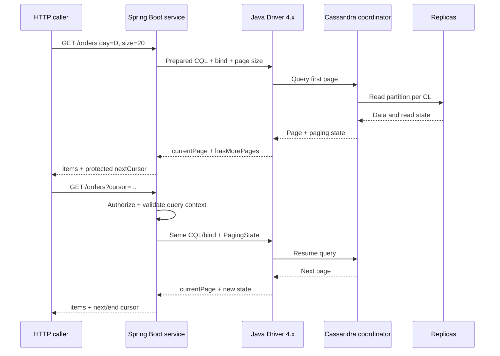
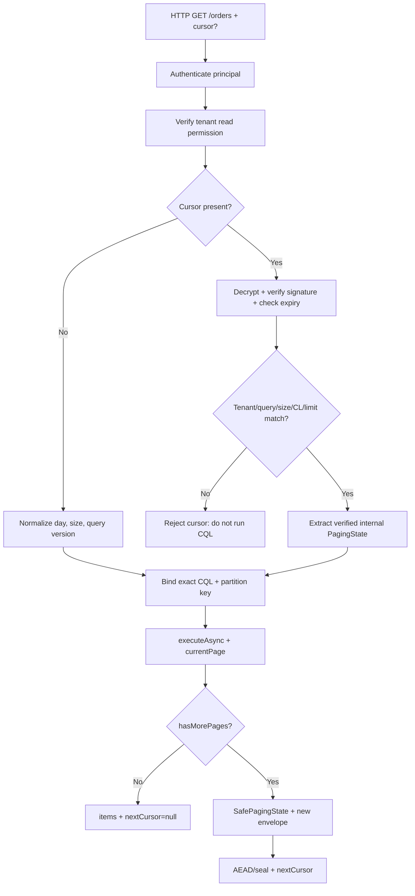

# `Slice`, Paging State, and the Cost of Counting Total Results in Spring Boot and Spring Data Cassandra

## 1. Why Does Cassandra Paging Differ from SQL Paging?

Apache Cassandra is a **distributed wide-column** DBMS: **partition keys** determine where data resides, **clustering columns** sort data within a partition, replicas are placed by **replication factor (RF)**, and reads/writes require meeting the **consistency level (CL)**. When a Java application uses Spring Boot, Spring Data Cassandra, or Java Driver 4.x to display an order list, a seemingly familiar request carries deep implications:

```text
GET /tenants/tenant-01/orders?day=2026-11-20&size=20
→ 20 orders, is there a next page?
→ what is the total order count?
→ how many pages exist, and can we jump to page 500?
```

In relational databases, apps often reach for `LIMIT ... OFFSET ...` plus a `COUNT(*)` for the total. In Cassandra, resuming a large query relies on **paging state**, not random-access offsets. Meanwhile, `COUNT(*)` is not guaranteed to be answered from cheap metadata; it can force scanning vast amounts of data.

This topic centers on three ideas:

1. **`Slice<T>`:** needs the current items and **whether a next page may exist**, without requiring a total row count.
2. **`PagingState`:** opaque state to continue **the exact same CQL query with its original parameters**, not an arbitrary-jump page number.
3. **Cost of `Page<T>` / `COUNT(*)`:** displaying total row and page counts can make an API perform vastly more work than fetching a slice.

> **Design principle:** For Cassandra APIs that only need a "Load more" button, prefer a **Slice + cursor** contract. Publish `totalElements` and `totalPages` only when you have a reliable count source, acceptable cost, and clearly defined count freshness.

### Learning Outcomes

- Distinguish `List<T>`, `Slice<T>`, and `Page<T>` in Spring Data Commons.
- Understand why `PageRequest.of(pageNumber, size)` is not equivalent to seeking to any Cassandra page.
- Use Java Driver 4.x `AsyncResultSet`, `currentPage()`, `hasMorePages()`, and `PagingState` to resume a slice.
- Design keyspaces, partitions, and clustering around query shapes before adding pagination.
- Integrate a `CqlSession`-backed repository into Spring Boot; know Spring Data repository boundaries.
- Protect REST cursors, bound resources, and avoid treating pagination as snapshot isolation.
- Choose exact counts, estimates, or omitting totals based on business requirements.

## 2. `List`, `Slice`, and `Page`: Three Different Contracts

Spring Data Commons provides pagination abstractions, yet they carry very different costs and guarantees:

| Return Type | Contents | Common Metadata | Needs Total Count? |
|---|---|---|---|
| `List<T>` | List of returned items | No continuation state required | No |
| `Slice<T>` | Items for one chunk | `hasNext()`, `getNumberOfElements()`, `getSize()`, `nextPageable()` per implementation | **No** |
| `Page<T>` | A slice plus total info | `getTotalElements()`, `getTotalPages()`, plus `Slice` fields | **Yes** |
| Custom cursor response | Current items and `nextCursor` | Opaque token, query version, expiry per API | **No**, unless explicitly added |

`Page<T>` is helpful when the backend can obtain matching row totals at reasonable cost. However, **never construct `PageImpl` with a fabricated total**, such as passing `items.size()` as the total while more pages remain.

### One UI, Two Backend Designs

**Design 1 — "Load more":**

```json
{
  "items": [
    {"orderId": "11111111-1111-4111-8111-111111111111", "status": "PAID"}
  ],
  "hasNext": true,
  "nextCursor": "<protected-opaque-token>"
}
```

**Design 2 — "Page 1/1458, 29,160 orders total":**

```json
{
  "items": [
    {"orderId": "11111111-1111-4111-8111-111111111111", "status": "PAID"}
  ],
  "page": 1,
  "totalElements": 29160,
  "totalPages": 1458
}
```

In Design 2, **29160 is a factual assertion about data**. The backend must have a source computing/maintaining that figure, a freshness timestamp, and defined semantics under concurrent writes or TTL. These JSON snippets illustrate contracts only, not real measurements.

**Recommendation:** If the product does not genuinely need a total, do not turn a "Load more" UI into two queries: one fetching 20 rows and another running `COUNT(*)` across the entire set.

## 3. What Is Paging State? It Is Not SQL `OFFSET`

The Cassandra Java Driver uses an **opaque paging state** managed by the protocol/driver describing how to resume a query. It is not an arbitrary editable copy of the last key, nor is it a count of skipped rows.



This diagram is simplified: exact coordinator and replica requests depend on Cassandra version, CL, and read path. The takeaway is that **each page fetch can be a new network round-trip** with a matching continuation state.

### Why Not "Skip the First 10,000 Rows"?

Cassandra does not offer SQL-style random-access `OFFSET 10000 LIMIT 20` across general CQL queries. Paging state captures the continuation point from prior traversal; to "reach page 500", a service must either walk through preceding pages sequentially or use a **different data/query model**.

Never design a UI promising "jump straight to page 500" if the backend only has sequential `PagingState` and no random-access index/manifest/snapshot.

### One State Cannot Be Reused Across Different Queries

```text
State A:
  query = orders_by_tenant_day
  tenant = tenant-01
  day = 2026-11-20
  size = 20
  CL = LOCAL_QUORUM

State A MUST NOT automatically be applied to:
  tenant-02; day=2026-11-21; different SELECT columns;
  different filter; different LIMIT; different cluster or query version.
```

In multi-user APIs, even if the driver detects a statement mismatch, **enforcing tenant authorization remains the Spring service's job**. `PagingState` is not an access token.

## 4. Page Size, `LIMIT`, and Returned Row Count Differ

| Concept | Example | What Does It Bound? | Common Misconception |
|---|---|---|---|
| Driver page size | `statement.setPageSize(20)` | Target rows per fetch | "Every page always has exactly 20 rows" |
| CQL limit | `LIMIT 200` | Maximum total rows for one logical query | "Each request gets 200 rows" |
| Client output limit | API serializes at most N items | HTTP payload/contract | "DB definitely read only N cells" |
| Max API pages | E.g., 10 cursor continuations | Cost/abuse policy cap | "Can alter CQL `LIMIT` per page" |
| `hasMorePages()` | `true`/`false` | Whether the driver has another page to fetch | "Guarantees the next page has 20 items" |

**Page size is normally a target, not a strict guarantee of N rows.** A page can return fewer than N items—or even zero items in special cases—while more state remains, depending on data, version, and query shape. Rely on `hasMorePages()` and state, never solely on `items.size() < pageSize`.

For instance, with `LIMIT 200` and page size 20, one logical query returns at most 200 rows across its pages. When resuming from state, **keep `LIMIT 200` unchanged** rather than changing it to 180 because "the first page already read 20 rows".

### What Page Size Should You Pick?

There is no single magic number for Cassandra. Payload per page depends on:

- Size of each row, collection, blob, and UDT.
- Partition size and SSTables touched per read.
- Tombstones from TTL/deletes.
- Local/WAN network latency.
- p95/p99 targets and request timeouts.
- JVM memory/serialization, HTTP response bytes, and concurrency.

Benchmark on representative data: page sizes 20/50/100 are **starting test points**, not universal baselines. With huge rows, even page size 20 can produce heavy payloads.

## 5. Design Tables Around Queries Before Wrapping in `Slice`

An API reading orders for **one tenant on one day**, newest first:

```text
GET /tenants/{tenantId}/orders?day=2026-11-20
→ query partition (tenant_id, order_day)
→ clustering created_at DESC, order_id ASC
→ resume pages via paging state
```

The lab CQL below assumes Cassandra has DC `dc1` and at least three replicas for RF3. On a single-node lab, adjust RF/CL to match reality:

```sql
CREATE KEYSPACE IF NOT EXISTS slice_lab
WITH replication = {
    'class': 'NetworkTopologyStrategy',
    'dc1': 3
}
AND durable_writes = true;

CREATE TABLE IF NOT EXISTS slice_lab.orders_by_tenant_day (
    tenant_id text,
    order_day date,
    created_at timestamp,
    order_id uuid,
    status text,
    total_cents bigint,
    PRIMARY KEY ((tenant_id, order_day), created_at, order_id)
) WITH CLUSTERING ORDER BY (
    created_at DESC,
    order_id ASC
);
```

**Partition key:** `(tenant_id, order_day)`. Both values must appear in queries under this design.

**Clustering key:** `created_at` and `order_id`. Cassandra returns rows inside a partition in the declared clustering order. When two orders share `created_at`, `order_id` breaks ties; UUID v4 does not carry chronological order itself.

### Lab Data

```sql
INSERT INTO slice_lab.orders_by_tenant_day (
    tenant_id, order_day, created_at, order_id, status, total_cents
) VALUES (
    'tenant-01', '2026-11-20', '2026-11-20T10:00:00Z',
    11111111-1111-4111-8111-111111111111, 'PAID', 125000
);

INSERT INTO slice_lab.orders_by_tenant_day (
    tenant_id, order_day, created_at, order_id, status, total_cents
) VALUES (
    'tenant-01', '2026-11-20', '2026-11-20T09:00:00Z',
    22222222-2222-4222-8222-222222222222, 'CREATED', 48000
);

INSERT INTO slice_lab.orders_by_tenant_day (
    tenant_id, order_day, created_at, order_id, status, total_cents
) VALUES (
    'tenant-01', '2026-11-20', '2026-11-20T08:00:00Z',
    33333333-3333-4333-8333-333333333333, 'CANCELLED', 99000
);

INSERT INTO slice_lab.orders_by_tenant_day (
    tenant_id, order_day, created_at, order_id, status, total_cents
) VALUES (
    'tenant-01', '2026-11-20', '2026-11-20T07:00:00Z',
    44444444-4444-4444-8444-444444444444, 'PAID', 72000
);
```

Test read:

```text
CONSISTENCY LOCAL_QUORUM;
```

```sql
SELECT created_at, order_id, status, total_cents
FROM slice_lab.orders_by_tenant_day
WHERE tenant_id = 'tenant-01'
  AND order_day = '2026-11-20'
LIMIT 200;
```

With four lab rows, test page size 2 in Java to observe page continuation. **Never use `ALLOW FILTERING`** on this query because the full partition key is supplied.

### Oversized Partitions Are Not Cured by Paging

If `tenant-01` has millions of orders in a single day, the daily partition can grow too large. A small page size does not change the fact that the cluster still serves a hot partition, large SSTables, and tombstones. Consider:

- Smaller buckets (hourly or deterministic sharding per business rules).
- Bounding the history an API scans in one query.
- Separate tables for distinct query/sort shapes.
- Bounded fan-out/merge when spanning multiple buckets.

Never count an entire partition on every request to mask a poor partitioning model.

## 6. `Slice<T>` in Spring Data: Has `hasNext`, No Mandatory `COUNT`

In Spring Data Commons, `Slice<T>` tells the UI:

```java
import org.springframework.data.domain.Slice;

// slice obtained from an appropriately configured repository/service:
int displayed = slice.getNumberOfElements();
boolean showNextButton = slice.hasNext();
boolean first = slice.isFirst();
boolean last = slice.isLast();
```

This is a **snippet** inside a method holding `slice`, not a standalone program. It needs no `totalElements` number to answer "should we show the Next button?".

**Subtlety:** `Slice` is a **Spring Data Commons abstraction**. It does not magically carry a protocol-neutral Cassandra cursor across every implementation. On SQL backends, `nextPageable()` increments an offset. On Cassandra, advancing requires the **paging state from the previous query**.

### Spring Data Cassandra: Check Version and `Pageable` Type

Some Spring Data Cassandra lines provide `CassandraPageRequest`/paging-state mechanisms to step sequentially, with APIs/packages varying by release. Principles:

1. Use the paging request/support type provided by your **actual Spring Data Cassandra version**.
2. Resubmit the **exact same query and bound parameters** on the next call.
3. Preserve paging state across calls; never keep only `pageNumber`.
4. Verify `Slice.nextPageable()` actually carries the Cassandra state your repository consumes.
5. Never assume `PageRequest.of(50, 20)` makes Cassandra "jump" to row 1000.

### Illustrating `nextPageable` Intent

```java
// Pseudocode: repository and initialPageable must be built
// per your running Spring Data Cassandra version's API.
Slice<OrderEntity> first = repository.findOrdersForDay(
    tenantId, orderDay, initialPageable);

if (first.hasNext()) {
    // Use only if nextPageable preserves Cassandra paging state
    // per the repository implementation's contract.
    Pageable next = first.nextPageable();
    Slice<OrderEntity> second = repository.findOrdersForDay(
        tenantId, orderDay, next);
}
```

This is **pseudocode explaining control flow**, not a claim that every method name or `Slice` implementation carries a valid Cassandra cursor. For stateless HTTP APIs returning cursors across independent requests, the following sections show direct `PagingState` control via Java Driver 4.x.

### When Is a Spring Data Repository Sufficient?

| Need | Approach |
|---|---|
| Simple primary-key CRUD/reads | `CassandraRepository` and entity mapping |
| Sequential paging in a flow with version-matched Cassandra support | `Slice<T>` + Spring Data's state carrier |
| Stateless REST cursors with signing/encryption, versioning, tenant binding | Service managing `PagingState` directly |
| Fine-grained `LOCAL_QUORUM`, timeout, and page size per request | Java Driver `BoundStatement` / execution profiles |
| Exact row totals for dashboards | Dedicated counting mechanism with cost/consistency contract |
| Multi-partition queries with merged ordering | Redesigned data model or bounded fan-out paginator |

Never assume Spring Data repositories add **multi-partition ACID transactions** or global snapshots during pagination.

## 7. `Page<T>` Needs a Total: Why Is That a Separate Cost?

`Page<T>` exposes `getTotalElements()` and `getTotalPages()`. On SQL backends, frameworks run a separate count query or optimize away counts in trivial cases. In Cassandra, **counting all rows matching a query is a completely different problem from fetching one page**.

Suppose a partition holds roughly two million rows while the UI shows only the first 25. To know whether another page exists, the driver uses the current fetch's paging state. To know **exactly two million**, the backend must either scan/count vast amounts of data or query a pre-maintained aggregate source.

### Qualitative Cost Comparison

```text
Fetching the first slice:
  Query by (tenant_id, order_day)
  Fetch ~25 rows + paging state
  Does not require knowing total rows in the partition

Fetching a page plus exact totalElements:
  Fetch ~25 rows
  Plus work to count all rows matching the filter
  Counting may traverse many SSTables and tombstones
  Total may already be stale the moment the response returns
```

**Illustrative arithmetic:** 2,000,000 / 25 = 80,000. This only illustrates the order-of-magnitude gap in **rows examined**, not a literal claim that `COUNT(*)` is 80,000x slower. Real cost depends on caching, storage layout, tombstones, compaction, topology, and cluster load.

### Reading `COUNT(*)` Accurately

```sql
-- Run ONLY on small lab tables/partitions to observe behavior.
SELECT COUNT(*)
FROM slice_lab.orders_by_tenant_day
WHERE tenant_id = 'tenant-01'
  AND order_day = '2026-11-20';
```

On the four lab rows, this returns 4 assuming no concurrent mutations and live rows. On a massive partition, this query **is not a cheap instant metadata read**.

```sql
-- WARNING: full-table count can be extremely expensive.
-- Never run casually on large production tables.
SELECT COUNT(*) FROM slice_lab.orders_by_tenant_day;
```

Full-table counts touch many partitions/token ranges, multiple nodes, network bandwidth, and foreground read capacity. Never use `ALLOW FILTERING` or infinite timeouts trying to make `COUNT` look cheap.

## 8. Why Don't Cassandra Tables Have an "Instant Exact Row Count" for Every Query?

Distributed execution makes counting far trickier than it appears:

- **Concurrent writes:** new rows arrive while counting is underway.
- **Deletes/TTLs:** expired data leaves tombstones and compacts asynchronously.
- **Replication:** each partition has multiple replicas; you cannot sum per-node local counts into a logical total without accounting for replication, range ownership, and consistency.
- **Read CL:** a count query can observe a different replica set than the display query.
- **Wide partitions:** counting even a single partition can traverse huge row/cell/SSTable counts.
- **Secondary indexes / SAI:** filtered indexes carry their own limits and costs; having an index does not make `COUNT` instant or free.
- **Schema/query evolution:** changing predicates, TTLs, or bucketing invalidates older aggregate definitions.

### Never Use `nodetool tablestats` as `totalElements`

Operational stats are typically **per-node/table estimates** or storage metrics, not exact logical row counts for a tenant/day filter. Node A and Node B both store replicas of the same partition, so summing their rows **double-counts replicas**.

Similarly, `estimatedPartitionSize`, estimated partition counts, or histograms are no substitute for `COUNT(*)` under a specific filter.

### Why Might `COUNT(*)` Not Share the Slice's Snapshot?

Suppose a service executes:

```text
T1: SELECT 25 rows for tenant-01 / day D.
T2: Another client inserts 3 rows and deletes 2 rows.
T3: SELECT COUNT(*) to compute totalElements.
T4: Return T1 items alongside T3 totalElements.
```

The two parts of the response **do not share a transactional snapshot**. `LOCAL_QUORUM` governs replica acknowledgments; it **does not provide snapshot isolation** across two independent queries. The reported "total" can contradict the returned list even when both queries succeed.

## 9. Choosing a Total-Count Strategy per Business Need

| UI / Business Need | Approach | Freshness & Accuracy |
|---|---|---|
| Just "Are there more items?" | `Slice`/cursor, `hasMorePages` | No total; fits mutating data cleanly |
| "Approximately N results" | Trusted estimate / analytics source | Must clearly label **estimate** and timestamp |
| Per-tenant/day dashboard | Maintained aggregate/projection table | Typically eventual consistency; needs reconciliation |
| Financial/close-of-period exact total | Snapshot / export / analytics pipeline | Explicit snapshot version and cutoff point |
| Admin page filtering a strictly bounded small set | Budgeted, measured `COUNT(*)` | Only when the dataset is proven small |
| Multi-attribute ad-hoc search | Dedicated search/analytics engine | Define index lag and semantics clearly |

### Option A — Do Not Display Totals

Often the cheapest, cleanest, and least misleading choice for infinite scroll or "Load more". The API returns `items`, `hasNext`, and `nextCursor`, omitting `totalElements`.

### Option B — Maintain a Separate Aggregate

Example per-tenant/day count table:

```sql
CREATE TABLE IF NOT EXISTS slice_lab.order_counts_by_tenant_day (
    tenant_id text,
    order_day date,
    total_orders bigint,
    calculated_at timestamp,
    PRIMARY KEY ((tenant_id), order_day)
);
```

This is a **projection table**: a trusted pipeline computes and writes the count. It does not auto-increment on inserts into `orders_by_tenant_day`; Cassandra has no transactional triggers to update two tables atomically across partitions.

If considering a `counter` column instead of `bigint` to increment/decrement events:

- `counter = counter + 1` is **not idempotent**: retrying after a timeout can double-count.
- At-least-once event queues can deliver duplicates.
- Deletes, TTL expirations, and corrections must be reflected explicitly in aggregates.
- You need event IDs, appropriate deduplication guarantees, and periodic reconciliation/rebuilds.

Never claim a `counter` is always an **exact real-time `totalElements`** merely because Cassandra replicates counters.

### Option C — Reporting Snapshots

When requirements demand "exact total as of 00:00 UTC cutoff":

1. Define the exact **cutoff watermark** and included dataset.
2. Run a checkpointed export/analytics job verifying ranges and records.
3. Store a report version / snapshot ID.
4. Serve both `totalElements` and pages from that same snapshot.

This is a separate reporting/data-engineering workload; never run live OLTP table scans/`COUNT`s on every user page load.

## 10. Java Driver 4.x: Fetching One Page via `AsyncResultSet`

Spring Boot normally creates the `CqlSession` bean via its starter, and Spring Data uses the same driver foundation. To implement REST cursors cleanly, inject `CqlSession` into a dedicated repository.

Key APIs:

- `session.prepare(...)`: prepares partition-scoped CQL.
- `BoundStatement.setPageSize(...)`: sets target page size.
- `session.executeAsync(...)`: executes without blocking the calling thread.
- `AsyncResultSet.currentPage()`: iterates only rows **already fetched for the current page**.
- `AsyncResultSet.hasMorePages()`: checks whether more pages can be fetched.
- `ExecutionInfo.getSafePagingState()`: driver-validated "safe" state tied to the statement.
- `PagingState.fromString(...)` and `setPagingState(...)`: restores state from an **app-protected and verified** token string.

### Synchronous `execute` vs. `executeAsync`

```java
// Synchronous: iterating ResultSet can make the driver auto-fetch additional pages.
ResultSet rs = session.execute(stmt);
for (Row row : rs) {
    consume(row);
}

// Asynchronous: explicitly processes only the single current page.
session.executeAsync(stmt).thenApply(page -> {
    for (Row row : page.currentPage()) {
        consumeSmall(row);
    }
    return page.hasMorePages();
});
```

These are **snippets**, not a copy-paste class. `consumeSmall(...)` must be fast and non-blocking; the continuation can run on a driver completion/I/O thread. For heavy mapping or blocking JDBC/HTTP calls, offload to a bounded executor.

For REST APIs returning "one slice per HTTP request", prefer `currentPage()` instead of iterating a synchronous `ResultSet` hoping only one page is read.

## 11. Spring Boot Java Service: Implementing `CursorSlice<T>`

This example uses **Spring Boot 3.x + Java 17 + Java Driver 4.x**, assuming `slice_lab` is provisioned and `CqlSession` is injected with proper contact points, local DC, and TLS/auth. It intentionally returns **DTO + cursor**, never fabricating a `Page<T>` total.

```java
import java.time.Instant;
import java.time.LocalDate;
import java.util.ArrayList;
import java.util.Collections;
import java.util.List;
import java.util.UUID;
import java.util.concurrent.CompletionStage;

import org.springframework.stereotype.Repository;

import com.datastax.oss.driver.api.core.CqlSession;
import com.datastax.oss.driver.api.core.DefaultConsistencyLevel;
import com.datastax.oss.driver.api.core.cql.AsyncResultSet;
import com.datastax.oss.driver.api.core.cql.BoundStatement;
import com.datastax.oss.driver.api.core.cql.PagingState;
import com.datastax.oss.driver.api.core.cql.PreparedStatement;
import com.datastax.oss.driver.api.core.cql.Row;

@Repository
public final class OrderCursorRepository {
    private static final int MAX_PAGE_SIZE = 100;
    private final CqlSession session;
    private final PreparedStatement query;

    public OrderCursorRepository(CqlSession session) {
        this.session = session;
        this.query = session.prepare(
            "SELECT created_at, order_id, status, total_cents " +
            "FROM slice_lab.orders_by_tenant_day " +
            "WHERE tenant_id = ? AND order_day = ? LIMIT 200"
        );
    }

    public CompletionStage<CursorSlice<OrderItem>> read(
            String authorizedTenant,
            LocalDate orderDay,
            int pageSize,
            String verifiedInternalPagingState) {

        if (pageSize < 1 || pageSize > MAX_PAGE_SIZE) {
            throw new IllegalArgumentException(
                "pageSize outside allowed range");
        }

        BoundStatement statement = query
            .bind(authorizedTenant, orderDay)
            .setConsistencyLevel(DefaultConsistencyLevel.LOCAL_QUORUM)
            .setPageSize(pageSize)
            .setIdempotent(true);

        if (verifiedInternalPagingState != null) {
            PagingState saved = PagingState.fromString(
                verifiedInternalPagingState);
            statement = statement.setPagingState(saved);
        }

        return session.executeAsync(statement).thenApply(page -> {
            List<OrderItem> items = new ArrayList<>();
            for (Row row : page.currentPage()) {
                Long totalCents = row.isNull("total_cents")
                    ? null : row.getLong("total_cents");
                items.add(new OrderItem(
                    row.getInstant("created_at"),
                    row.getUuid("order_id"),
                    row.getString("status"),
                    totalCents
                ));
            }

            boolean hasNext = page.hasMorePages();
            String nextState = null;
            if (hasNext) {
                PagingState state =
                    page.getExecutionInfo().getSafePagingState();
                if (state == null) {
                    throw new IllegalStateException(
                        "More pages but no safe paging state");
                }
                nextState = state.toString();
            }

            return new CursorSlice<>(items, hasNext, nextState);
        });
    }

    public static final class OrderItem {
        public final Instant createdAt;
        public final UUID orderId;
        public final String status;
        public final Long totalCents;

        public OrderItem(
                Instant createdAt, UUID orderId,
                String status, Long totalCents) {
            this.createdAt = createdAt;
            this.orderId = orderId;
            this.status = status;
            this.totalCents = totalCents;
        }
    }

    public static final class CursorSlice<T> {
        public final List<T> items;
        public final boolean hasNext;
        // Service-internal only: NEVER expose raw state directly over HTTP.
        public final String internalPagingState;

        public CursorSlice(
                List<T> items, boolean hasNext,
                String internalPagingState) {
            this.items = Collections.unmodifiableList(
                new ArrayList<>(items));
            this.hasNext = hasNext;
            this.internalPagingState = internalPagingState;
        }
    }
}
```

### Why Doesn't This Design Use `PageImpl`?

The repository knows only the **current page's items** and **whether the driver has more pages**. It does not know the total. Returning `CursorSlice` honestly represents available facts and lets the HTTP layer mint a protected `nextCursor`.

Intentional design choices:

1. `authorizedTenant` must already be verified by authentication/authorization, never trusted straight from a `cursor`.
2. Fixed CQL `LIMIT 200` bounds **one logical query** in this example; keep `LIMIT` identical across resumed pages.
3. `LOCAL_QUORUM` fits RF3 in `dc1`, requiring two healthy local replicas; never drop to `ONE` to mask timeouts.
4. `setIdempotent(true)` fits pure `SELECT`s; **never** apply it blindly to counters, list appends, or LWTs.
5. `currentPage()` never auto-fetches remaining pages, preventing giant heap allocations.
6. `getSafePagingState()` adds driver-level statement checks; you still need API-level cursor security.
7. `Long` preserves nullability instead of silently turning null into `0L`.

### What Has This Sample Not Solved Yet?

It omits HTTP authorization, anti-tamper token protection, cursor TTLs, request deadlines, per-tenant rate limiting, and cancellation. Those concerns **cannot be delegated entirely to the Java Driver**.

Also, a `CompletionStage` failing inside `PagingState.fromString` or `setPagingState` should be mapped by the HTTP layer to **invalid cursor**, not automatically treated as a transient Cassandra error to retry.

## 12. How Can Spring Data `Slice` and `CursorSlice` Work Together?

Spring Data Commons' `SliceImpl<T>` holds `items`, a `Pageable`, and `hasNext`. Yet if you pass an ordinary `PageRequest` lacking paging state, `nextPageable()` **lacks the state needed** to resume CQL on a new HTTP request.

To avoid broken contracts:

- At the **domain/UI layer**, `Slice` describes `items + hasNext`.
- At the **Cassandra layer**, preserve `PagingState` and CQL/bind context.
- At the **HTTP layer**, return a protected `nextCursor`.
- If a framework contract requires `Slice<T>`, construct `SliceImpl` only when `nextPageable` carries real Cassandra state per supported APIs — never pretend incrementing an integer offset works.

### What Types Can an API Expose?

```text
REST DTO:          CursorSliceResponse<OrderDto>
Application:       CursorSlice<OrderItem>
Repository:        AsyncResultSet + PagingState
Spring Data layer: Slice<T> (if integration preserves real Cassandra state)
```

Abstractions can coexist, yet never force every layer into `Page<T>` merely because a frontend was originally built for SQL.

## 13. Protecting `nextCursor` in REST APIs

**Never send raw `PagingState.toString()` over the Internet and call it a secure token.** The driver's safe state guards against certain statement mismatches, yet **does not encrypt, sign, bind tenants, or enforce expiration**.

A logical cursor envelope might look like:

```json
{
  "version": 1,
  "queryId": "orders-by-tenant-day-v1",
  "tenantId": "tenant-01",
  "day": "2026-11-20",
  "pageSize": 20,
  "limit": 200,
  "consistency": "LOCAL_QUORUM",
  "issuedAt": "2026-11-20T10:00:00Z",
  "expiresAt": "2026-11-20T10:15:00Z",
  "driverState": "<opaque-string>"
}
```

**This JSON is illustrative payload structure, not a signed/encrypted bearer token.** Two implementation approaches:

1. **AEAD envelope:** authenticated encryption using keys stored in a secret manager, with key ID/rotation, expiration, and size caps.
2. **Server-side cursor registry:** store query context + state in a TTL-bounded cache/store and return an unguessable random ID; easy to revoke immediately at the cost of stateful storage.

### Cursor Validation Sequence Must Be Exact



Constraints to verify:

- Principal, tenant, and roles/authorization scope on **every HTTP request**.
- Query fingerprint/version, filter values, partition key, `LIMIT`, page size, and CL.
- Environment/cluster or namespace so staging cursors cannot replay in production.
- TTL, `issuedAt`, nonce/key ID, and replay policies where needed.
- Token/request length caps, rate limits, concurrent cursor chains, and endpoint identity.

**Base64-encoded JSON is not security.** Never log raw tokens in logs, metrics, traces, or broadly shared URLs; if an API must pass cursors in query parameters, enforce log redaction, short TTLs, and transport encryption.

### How Should Cursor Errors Be Returned?

| Case | API Suggestion | What to Avoid |
|---|---|---|
| Tampered/corrupt token or bad signature | `400` with code `INVALID_CURSOR` | Silently dropping cursor and returning page 1 |
| Expired token | `EXPIRED_CURSOR` error per API contract | Keeping stale states alive across upgrades |
| Tenant/authorization mismatch | `403` or matching security policy | Trusting tenant inside the cursor |
| Query version changed | `CURSOR_VERSION_UNSUPPORTED`, ask client to restart | Applying old state to new CQL |
| Cassandra timeout/unavailable | Service error with telemetry and retry policy | Blaming the token or lowering CL |

Exact HTTP status codes are an **organizational API contract choice**; the key is telling clients clearly whether to **restart pagination** or **retry the current request**.

## 14. Spring Boot Controller Example: Separating Cursor Security from the Repository

In a Spring Boot 3.x app, responsibilities can be separated cleanly:

```java
import java.time.LocalDate;
import java.util.concurrent.CompletionStage;

import org.springframework.format.annotation.DateTimeFormat;
import org.springframework.http.ResponseEntity;
import org.springframework.security.core.Authentication;
import org.springframework.web.bind.annotation.GetMapping;
import org.springframework.web.bind.annotation.PathVariable;
import org.springframework.web.bind.annotation.RequestMapping;
import org.springframework.web.bind.annotation.RequestParam;
import org.springframework.web.bind.annotation.RestController;

@RestController
@RequestMapping("/tenants/{tenantId}/orders")
public class OrdersController {
    private final OrderCursorRepository orders;
    private final CursorProtector cursorProtector;
    private final TenantAccessControl accessControl;

    public OrdersController(
            OrderCursorRepository orders,
            CursorProtector cursorProtector,
            TenantAccessControl accessControl) {
        this.orders = orders;
        this.cursorProtector = cursorProtector;
        this.accessControl = accessControl;
    }

    @GetMapping
    public CompletionStage<ResponseEntity<OrdersResponse>> list(
            Authentication user,
            @PathVariable("tenantId") String tenantId,
            @RequestParam("day")
            @DateTimeFormat(iso = DateTimeFormat.ISO.DATE) LocalDate day,
            @RequestParam(value = "size", defaultValue = "20") int size,
            @RequestParam(value = "cursor", required = false)
            String cursor) {

        if (size < 1 || size > 100) {
            throw new IllegalArgumentException("Invalid page size");
        }
        accessControl.requireRead(user, tenantId);

        // Accept state ONLY from a fully verified cursor.
        String verifiedState = cursor == null ? null :
            cursorProtector.openAndVerify(
                cursor, user.getName(), tenantId, day, size,
                "orders-by-tenant-day-v1");

        return orders.read(tenantId, day, size, verifiedState)
            .thenApply(slice -> {
                String nextCursor = slice.hasNext
                    ? cursorProtector.seal(
                        slice.internalPagingState,
                        user.getName(), tenantId, day, size,
                        "orders-by-tenant-day-v1")
                    : null;
                return ResponseEntity.ok(
                    new OrdersResponse(slice.items, nextCursor));
            });
    }

    public static final class OrdersResponse {
        public final java.util.List<OrderCursorRepository.OrderItem> items;
        public final String nextCursor;

        public OrdersResponse(
                java.util.List<OrderCursorRepository.OrderItem> items,
                String nextCursor) {
            this.items = items;
            this.nextCursor = nextCursor;
        }
    }

    // Interfaces to implement with real system IAM/AEAD policies.
    public interface CursorProtector {
        String openAndVerify(String token, String principal,
            String tenant, LocalDate day, int size, String queryId);
        String seal(String driverState, String principal,
            String tenant, LocalDate day, int size, String queryId);
    }

    public interface TenantAccessControl {
        void requireRead(Authentication principal, String tenantId);
    }
}
```

**Warning:** `CursorProtector` and `TenantAccessControl` here are **unimplemented interfaces**, with no fake encryption or hardcoded keys; this sample only shows responsibility boundaries. Compiling requires Spring Web, Spring Security, and real bean implementations. Production must provide approved AEAD cryptography, key protection, expiration, tenant scoping, error mapping, and anti-tamper tests.

Never call `CompletableFuture.join()` inside the controller to "get the page". The `thenApply` callback only builds a lightweight response; for large serialization, bound payloads and consider framework-managed executors.

## 15. No Snapshot Across Pages: `hasNext` Is a Point-in-Time Signal

A pagination sequence spans multiple HTTP requests and Cassandra queries. In between, data can change:

- New rows inserted ahead of the cursor position.
- Rows deleted or TTL-expired.
- Updates moving a row's clustering position (deleting old key, inserting new key).
- Recovering replicas, hints/repairs, or WAN flakiness.
- Query/schema changes from a new release.

```text
T1  Page 1 reads [O5, O4], cursor after O4.
T2  A customer creates O6 with timestamp newer than O5.
T3  Page 2 resumes from old cursor.

There is no guarantee O6 appears in the ongoing traversal,
because its position may lie ahead of the already-walked range.
```

**`Slice.hasNext() == true` is not a promise that the next call will return 20 items**, and `hasNext() == false` does not guarantee no new row will arrive moments later.

### Can RF/CL Solve This?

`LOCAL_QUORUM` with RF3 in one DC requires two local replica responses on a read. It strengthens single-read guarantees per CL, yet **does not create a snapshot across requests/pages**.

Even when two consecutive `SELECT`s both achieve `LOCAL_QUORUM`, the list can shift due to concurrent writers. When clients span two DCs, freshness also depends on WAN replication and read routing.

### "Zero Missing, Zero Duplicates" Needs Extra Architecture

When paginating a live mutating list, you cannot guarantee exactly-once traversal from paging state alone. When strict completeness is mandatory:

1. Use a **snapshot/versioned dataset** or an explicit manifest of IDs to export.
2. Define a fixed cutoff watermark and stable sort order.
3. Checkpoint progress by ID/range with resume support.
4. Deduplicate/reconcile when underlying records mutate.
5. Verify counts/hashes against the frozen source — never run `COUNT(*)` on a live mutating cluster expecting it to match a snapshot.

Keyset/seek pagination on clustering keys helps, yet **does not create a snapshot either**. Seeking by `created_at` without `order_id` when two rows share a timestamp drops rows; include full tie-breakers and valid CQL predicates.

## 16. Multiple Partitions or Multiple DCs: One State Cannot Cover All Data

An API needing a tenant's 20 latest orders across seven days:

```text
Partition A: (tenant-01, 2026-11-20)
Partition B: (tenant-01, 2026-11-19)
Partition C: (tenant-01, 2026-11-18)
...
Partition G: (tenant-01, 2026-11-14)
```

`PagingState` from partition A **cannot automatically continue into partition B**. An API spanning multiple partitions needs:

- Per-query/per-bucket cursors **or** a table modeled for the full range.
- Deterministic merge ordering by clustering/timestamp and tie-breaker.
- Bounds on partition count, concurrent queries, bytes, and total rows.
- Checkpointing both source states and the last item emitted to the client.
- Explicit acknowledgment that no consistent snapshot exists while partitions mutate.

**Never build a `Page<T>` total by summing per-node estimated counts without handling replica duplication and query filters.**

### Multi-DC and Freshness

With `NetworkTopologyStrategy` RF3 in `dc1` and `dc2`, `LOCAL_QUORUM` in `dc1` requires local `dc1` quorum; `LOCAL_QUORUM` in `dc2` requires local `dc2` quorum. During WAN lag, the same tenant/day can read differently across DCs.

When a cursor sequence fails over across DCs:

- Verify cluster/query compatibility and driver protocol.
- Evaluate missing/duplicate risk from unreplicated writes.
- If continuation semantics cannot be upheld, return an error asking the client to restart.
- Never silently change CL mid-pagination just to read from another location.

## 17. Error Handling: Cursor Mismatch vs. Cassandra Timeouts

| Symptom | Root Cause Category | Appropriate Response |
|---|---|---|
| `PagingState.fromString` fails to decode | Corrupt/malformed token | Reject cursor; do not retry CQL |
| `setPagingState` reports incompatibility | Query/bind/version mismatch | Check `queryId`/params/schema; return invalid cursor |
| Page 1 succeeds, next page fails tenant check | Authorization/envelope mismatch | `403`/invalid cursor; do not execute query |
| Page size changes between requests | API contract mismatch | Start a fresh query or reject |
| `ReadTimeoutException` | Insufficient replica speed or deadline | Check CL/latency; bounded read retry if safe |
| `UnavailableException` | Insufficient replicas for CL | Fix nodes/replication; never drop CL blindly |
| `AllNodesFailedException` | Auth/TLS/network/routing or multi-node failures | Inspect per-node root causes |
| Page 2 returns 0 rows while `hasMorePages` is true | Paging/tombstones/filtered results | Avoid infinite loops; enforce page/time budgets |
| Duplicate/missing rows during live writes | No cross-page snapshot | Document UI semantics; snapshot/dedup if mandatory |
| Cursor expires after deploy | TTL/query version/protocol incompatibility | Return reset code to restart from page 1 |
| `COUNT(*)` times out or CPU/disk spikes | Counting too many rows/tombstones | Remove count from HTTP path; use projections/reports |

Cursor errors generally **cannot be fixed by retrying the exact same token** once invalid or expired. Conversely, on a transient `ReadTimeoutException` for an idempotent `SELECT`, a bounded retry within budget can make sense — never use retry storms to hide hot partitions or read amplification.

### Version Compatibility Note

`PagingState` serialization/validation and Spring Data paging APIs can change across driver/Cassandra versions. When upgrading:

1. Include a versioned `queryId` inside cursors.
2. Test fetching page 1 on the old version and resuming page 2 on the new version if rolling compatibility is required.
3. If compatibility is not guaranteed, invalidate old cursors **by contract**.
4. Keep cursor TTLs short and guide clients to refresh the list.

Never store paging state as a "permanent bookmark" across schema migrations.

## 18. Integration Testing: Verify Both Contents and State

### Lab A — One Query, Two Slices

On the four-row table from Section 5, call the repository with `pageSize=2`:

```text
read("tenant-01", 2026-11-20, 2, null)
→ ~2 rows + internalPagingState

read("tenant-01", 2026-11-20, 2, state-1)
→ remaining rows + new state or null
```

Expected `created_at DESC` order is 10:00, 09:00, 08:00, 07:00. Because **page size is a target**, assert using `hasNext` rather than assuming every page always has exactly two rows.

### Lab B — Original Parameters Unchanged

Take a state from `tenant-01`/day 20 and try applying it to `tenant-02` or day 21. The API must **reject it via envelope authorization/query binding** before touching the driver. At the repository layer, safe state may catch mismatches per driver behavior — never confuse that driver guard with authorization.

### Lab C — Mutating Data

After page 1, insert a new order with `created_at` newer than already-read rows, or delete a row from the remaining slice. Observe page 2: never write tests assuming snapshot isolation. Document UI behavior when lists change.

### Lab D — Counts

On the four lab rows, compare `COUNT(*)` against slice size. Next, build a larger isolated test dataset with representative TTLs/tombstones and **measure separately** page-fetch latency versus count latency. Never run full-table counts in production just to collect benchmark numbers.

### Lab E — Forged Tokens

Test byte-flipped, truncated, expired, wrong-tenant, wrong-page-size, wrong-query-version, and staging-originating tokens. Expect:

- Zero CQL queries issued for invalid tokens.
- Zero cross-tenant data reads.
- Clear error codes exposing no internal paging state details.
- Metrics counting invalid cursors without logging raw tokens.

### Lab F — Spring Data and Driver

If the project uses Spring Data `Slice<T>`, test `nextPageable()` with your real dependency versions: it must carry real Cassandra paging state to the next request, not merely increment an offset. Cross-check results against the Section 11 Java Driver repository under the same query shape and CL.

### Lab G — Resuming Across Node Restarts

On an RF3 lab with enough replicas, obtain a cursor and restart one node per runbook. While the other two replicas stay healthy, `LOCAL_QUORUM` continues serving, though latency and retries may rise. **Never intentionally stop two nodes on a shared cluster** just to induce failures.

## 19. Cost Observability: Page Latency and Count Latency Are Two Separate Metrics

A reliable dashboard separates:

| Layer | Metric to Track | Why |
|---|---|---|
| HTTP API | `GET /orders` p50/p95/p99 | Direct user impact |
| Repository | Page query duration and rows/page | Compare payloads and read cost |
| Dedicated count | `COUNT(*)` duration, timeouts, call rate | Catch counts slowing requests |
| Driver | Request attempts, timeouts, in-flight, pool saturation | Separate network/driver from server |
| Cursor | Invalid/expired/mismatch counts, query version | Diagnose continuation failures |
| Cassandra | Read latency, SSTables/read, tombstones, pending reads | Assess read amplification |
| Cluster | RF/CL, nodes Up/Down, DC/rack | Verify availability for CL |
| JVM | Heap/GC, payload bytes, serialization CPU | Large pages causing client pressure |
| Aggregate projection | Last updated, divergence, reconciliation count | Confirm total estimates/counts keep up |

Common observation commands:

```bash
nodetool status
nodetool tpstats
nodetool compactionstats
nodetool tablestats slice_lab.orders_by_tenant_day
nodetool tablehistograms slice_lab orders_by_tenant_day
```

These statistics are typically **per-node**, not direct metrics of `Spring Data Slice`. `tablestats` provides SSTable/memtable stats and estimates, **not an exact row count for a query**.

### Illustrative SLO Example

| Query | Hypothetical p99 | Action |
|---|---|---|
| First page, size 25 | 45 ms | Within API budget |
| Next page, size 25 | 60 ms | Watch growth across partition |
| `COUNT(*)` on large partition | 8,000 ms | Keep off the HTTP hot path |
| Read `total_orders` projection | 12 ms | Display with `calculated_at` and freshness semantics |

Numbers are illustrative only to show architectural trade-offs, **not universal Cassandra benchmarks**.

### Runbook When `Page` Slows Down the API

1. Check whether the endpoint runs `COUNT(*)` **on every page fetch**.
2. Separate `SELECT page` latency from count and serialization latency.
3. Verify the query includes the full partition key, proper clustering order, and zero `ALLOW FILTERING`.
4. Measure partition size, tombstones, SSTables/read, and node disk/GC.
5. Check driver page size, request counts, retries, and Java threads/blocking.
6. If totals are optional, switch the API to **Slice + cursor** rather than faking `totalElements`.
7. If totals are mandatory, pick an appropriate projection/snapshot and surface freshness clearly.
8. Canary, compare p95/p99 to baseline, and alert if counts creep back onto the hot path.

## 20. Common Mistakes

### Mistake 1 — Thinking `PageRequest.of(10,20)` Jumps to Page 11

In Cassandra, page number and page size alone cannot restore position; you need paging state or a custom seek mechanism. Never "jump" to SQL offsets.

### Mistake 2 — Returning `PageImpl` with `totalElements=items.size()`

This fools frontends into thinking the entire result set was counted. Whenever more pages remain, that `totalElements` is wrong. Use `Slice` or a cursor DTO instead of faking totals.

### Mistake 3 — Light Page Query Paired with Full-Table Count

An API fetches 20 rows by partition key and then runs an unfiltered `SELECT COUNT(*) FROM table`. The count scans many partitions and overloads the cluster even though the page fetch is fast.

### Mistake 4 — Treating `hasNext()` as a Snapshot

Between page 1 and page 2, rows can be inserted, deleted, or TTL-expired. `hasNext` reflects continuation at read time, without locking the result set.

### Mistake 5 — Inferring End-of-Results from `items.size() < pageSize`

The driver/server can return fewer rows than `pageSize` under certain conditions. Always check `hasMorePages`/safe state.

### Mistake 6 — Returning Raw State as a Bearer Token

Driver safe state lacks application-level AEAD, TTLs, authorization, and query-version binding. Protect cursors explicitly.

### Mistake 7 — Changing Query or `LIMIT` Between Pages

State is tied to the prior CQL and bound values; altering projections, filters, or limits causes wrong resumes or driver rejections. Keep query contracts immutable across a cursor chain.

### Mistake 8 — Treating `nodetool tablestats` as Exact `totalElements`

Node-level storage metrics do not reflect filtered logical row counts, include replica duplication, and use estimates. Never surface them as `totalElements`.

### Mistake 9 — Treating Counters as Exact Absolute Totals

Counter increments can apply and then time out; blind retries double-count. Reliable aggregates require event IDs, deduplication, and reconciliation.

### Mistake 10 — Using One Cursor Across Seven Partition Queries

Each query/partition has its own paging state. Merging across partitions requires a composite cursor or a query-driven table redesign.

## 21. Scenario Exercises

### Scenario A — Counting 2 Million Rows Just to Show a Next Button

An app needs the first 20 orders and a "Load more" button; the backend runs `SELECT ... LIMIT 20` followed by `COUNT(*)` over 2 million rows.

**Guided Answer:** No total is needed. Use `Slice` or `AsyncResultSet.hasMorePages()` with a cursor, enforcing page/time budgets. `COUNT` creates unnecessary work.

### Scenario B — Fetching Page 10 via Offset

A developer builds `PageRequest.of(9, 25)` expecting the driver to jump straight to row 226. What is wrong?

**Guided Answer:** Cassandra paging state is an opaque continuation token, not an `OFFSET`. Traverse sequentially via state from prior pages or design an appropriate seek/index/snapshot.

### Scenario C — Changing the Date While Reusing the Cursor

A client reads `tenant-01`/day 20, then changes `day=21` while sending the old cursor. How should the service respond?

**Guided Answer:** Reject the cursor mismatch and require restarting pagination. Never feed state from an old query into a new day's query.

### Scenario D — `Slice.hasNext` Reports True, Next Page Is Empty

Between two calls, many rows expire via TTL. Is Spring Data `Slice` broken?

**Guided Answer:** Not necessarily. Live data mutates; page size and state provide no snapshot. Inspect server paging behavior/tombstones and guard against infinite loops.

### Scenario E — Needing Exact Totals for a Financial Dashboard

Accounting requires exact order counts as of 00:00 on month-end, plus pagination to inspect every order. Should you run live `COUNT(*)` on every page click?

**Guided Answer:** No. Generate a versioned snapshot/manifest/report at the cutoff, serving both totals and pages from that exact source with checksums/reconciliation. Live counts at varying timestamps won't match the cutoff.

### Scenario F — App Slows Down Because of Totals

Page query p99 is 40 ms while count p99 is 6 s; because the endpoint uses `Page<T>`, HTTP p99 exceeds 6 s. Why?

**Guided Answer:** The `Page` contract demands a total; `COUNT` dominates latency. Switch the product contract to `Slice` if possible, or query a separate aggregate with an explicit staleness policy.

### Scenario G — Missing/Duplicate Rows Even with Quorum

RF3, `LOCAL_QUORUM`: an app notices a newly inserted order missing from an ongoing cursor traversal. Does this contradict quorum?

**Guided Answer:** No. Per-read quorum does not provide cross-page snapshots. An insert ahead of the current cursor position may not appear in subsequent pages.

### Scenario H — Summing Estimates Across Replicas

Two nodes each report an estimated 1 million local rows, so a team sums them to 2 million `totalElements`. Is that accurate?

**Guided Answer:** No. Replication puts copies of the same partitions on multiple nodes; metrics are estimates that can also include tombstones/cells. Never sum per-node stats as a query total.

### Scenario I — Querying Three Partitions by Status

An API wants all `PAID` orders across three days; the team passes `PagingState` from day 1's query into day 2's query.

**Guided Answer:** Each query has its own state. Use bounded multi-source merge pagination or design a status/day table suited to the query — never reuse state blindly.

### Scenario J — Valid State Token After User Permissions Are Revoked

An admin revokes a user's access to `tenant-01` after page 1. The user keeps `nextCursor` and calls again.

**Guided Answer:** The API must authenticate/authorize **every request** and reject the call. `PagingState` is not a permanent permission grant.

## 22. Production Checklist: `Slice`, Paging State, and Count Costs

**Data and Query Design**

- [ ] Queries use proper partition/clustering keys; never rely on paging to cure full scans.
- [ ] Partition sizes and bucket counts are bounded per tenant/day load.
- [ ] `LIMIT`, page size, and total page/byte/time budgets are clearly defined.
- [ ] Never promise random page N access when the backend only holds continuation state.
- [ ] Intra-partition clustering order and timestamp tie-breakers are well defined.
- [ ] Multi-partition/multi-DC merges have dedicated designs.

**Spring Boot, Spring Data, and Java Driver**

- [ ] Spring Boot, Spring Data, Java Driver, and Cassandra versions verified compatible.
- [ ] Use `Slice<T>` when only items + `hasNext()` are needed, avoiding mandatory counts.
- [ ] Use `nextPageable()` only when the implementation preserves real Cassandra paging state.
- [ ] Never construct `PageImpl` with fabricated or unlabeled estimated `totalElements`.
- [ ] For REST cursors, use `AsyncResultSet.currentPage()` and `getSafePagingState()`.
- [ ] Subsequent pages keep CQL, bound values, filters, `LIMIT`, page size, and CL identical.
- [ ] Never treat `PagingState` as an offset or modify raw bytes.
- [ ] Reuse `CqlSession` and prepared statements; avoid blocking callbacks.

**Totals and Counting**

- [ ] Never run `COUNT(*)` per page when the UI does not genuinely need totals.
- [ ] Benchmark count cost separately from page queries on data with representative tombstones/TTLs.
- [ ] Never treat `tablestats` or estimated counts as exact `totalElements`.
- [ ] When using aggregates, state freshness/as-of semantics and implement reconciliation/dedup.
- [ ] For exact cutoff totals, build snapshots/reports serving both totals and pages from one source.
- [ ] Never rely on blindly retried counter increments as authoritative counts.

**Security, Consistency, and Operations**

- [ ] Authenticate callers and verify tenant authorization on **every** resume call.
- [ ] Cursors include integrity/confidentiality protection, expiry, query version, and scope binding.
- [ ] Never log raw cursors, secrets, or PII as metric labels.
- [ ] Verify RF/CL/DC; never drop CL solely to bypass timeouts.
- [ ] Document clearly that live-data pagination lacks cross-page snapshot isolation.
- [ ] Handle corrupt, expired, and version-mismatched tokens cleanly after rollouts/upgrades.
- [ ] Enforce rate limits, bounded concurrency, and monitoring for p95/p99, tombstones, and disk/GC.
- [ ] Write integration tests for first/next pages, mutating data, node restarts, and revoked permissions.

**Remember:** `Slice` fits Cassandra because it delivers **current items + whether more pages exist** without `COUNT(*)`. `PagingState` resumes **the exact same query**, supports neither random offsets nor snapshots. `Page` is justified only when totals come from a source with clearly defined **cost, freshness, and correctness**. In Spring Boot, combine version-matched Spring Data with Java Driver 4.x, protected cursors, partition-scoped queries, and RF/CL/SLO budgets so your API stays fast, secure, and honest about data totals.
