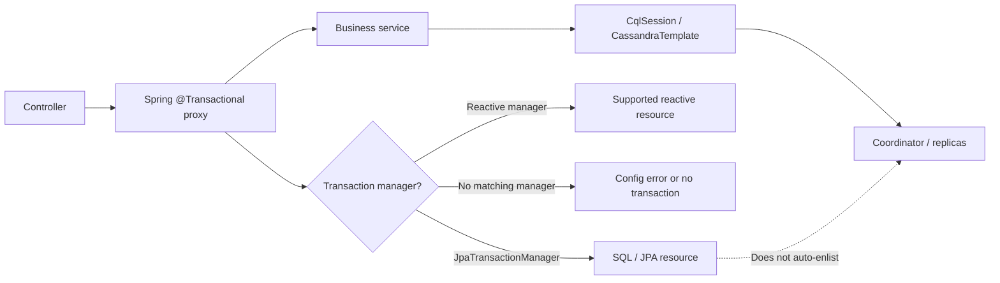
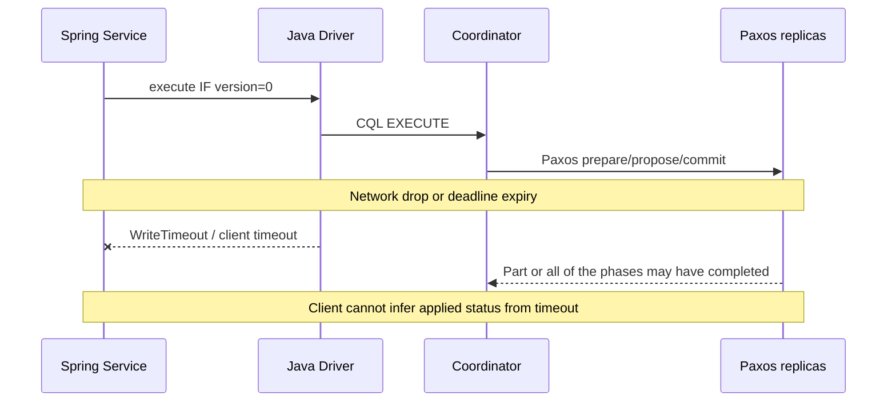
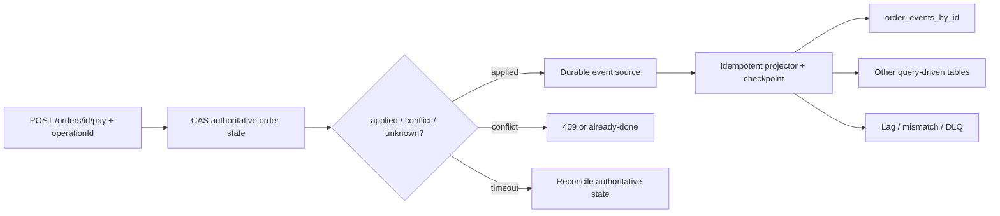

# `@Transactional` Boundaries vs. Supported CQL/LWT Guarantees

## 1. The Problem: Does Adding `@Transactional` Roll Back Cassandra?

Suppose Spring Boot receives a payment request for an order. The service runs three steps: switch the order status from `CREATED` to `PAID`, append a `PAYMENT_CONFIRMED` event to a timeline table, and send a notification. A developer used to Spring Data JPA might put `@Transactional` on the method, assuming that if the notification step fails, the earlier CQL statements will roll back. On Apache Cassandra 4.1/5.x with Spring Data Cassandra/Java Driver 4.x under standard configuration, that assumption is **false**.

**Core message:** `@Transactional` requires a **Spring transaction manager** coordinating resources that the manager **actually supports**. It does not turn multiple CQL statements into a SQL transaction, does not create a rollback log for Cassandra, and does not automatically enlist Cassandra into a JPA, PostgreSQL, Kafka, or HTTP transaction.

Mechanisms to distinguish:

- **Normal CQL mutations:** `UPDATE`/`INSERT`/`DELETE` by primary key under the chosen replication/consistency.
- **CQL `BATCH`:** groups mutations with atomicity/isolation **scoped by partition**, not a general JDBC transaction.
- **LWT (Lightweight Transaction, `IF ...`):** Paxos-based compare-and-set on supported partition/row state.
- **Spring Data `@Version`:** LWT-backed optimistic locking for **single-entity operations**, not extending by default to multi-entity batches.
- **Event log/outbox and reconciliation:** step-by-step recovery mechanisms when workflows span multiple tables, partitions, or services.
- **Accord in newer Cassandra lines, when enabled/supported:** a separate release-specific transaction option, never a default guarantee of `@Transactional`.

This lesson belongs to the **Spring Boot and Spring Data** chapter in the `DATABASE_ENGINE_WIDE_COLUMN_CASSANDRA` module, connecting distributed/wide-column architecture, partition keys, query-driven table design, CQL, replication, read/write consistency, compaction/repair, error handling, and Java connectivity.

**After this lesson, learners will:** identify transaction managers and resource boundaries, write LWT/CQL and read `wasApplied()`, apply `@Version` properly, classify timeouts/unknown outcomes, avoid confusing `LOGGED BATCH` with multi-partition isolation, use event IDs/replays, and measure correctness and latency in failure tests.

> Main scope: Spring Boot 3.x, Spring Data Cassandra 4.x, Java Driver 4.x, Cassandra 4.1/5.x. Accord in Cassandra 6 is noted only as a **conditional branch** per release/configuration; never assume it exists in older Cassandra or is automatically orchestrated by Spring annotations.

## 2. Commitment Matrix: Choosing Guarantees at the Right Layer

| Mechanism | Boundary | Primary Guarantee | What It Does **Not** Guarantee Automatically |
| --- | --- | --- | --- |
| Spring `@Transactional` with `JpaTransactionManager` | Manager-managed JDBC/JPA resources | Commit/rollback in the SQL engine | Does not roll back CQL sent via `CqlSession` |
| Spring `@Transactional` with no matching manager | No resource enlisted | May fail if interceptor demands a manager | Does not create a Cassandra transaction |
| Normal Cassandra mutation | Single CQL statement to replicas per RF/CL | Read/write per Cassandra semantics | Does not lock other statements in the workflow |
| **Same-partition** `BATCH` | Mutations within one partition per CQL | Single-partition atomicity and isolation | No general multi-step read-before-write |
| **Multi-partition** `LOGGED BATCH` | Batchlog and multiple mutations | Protects **eventual completion** once accepted | Does not guarantee cross-partition snapshot/atomic visibility |
| Multi-partition `UNLOGGED BATCH` | Multiple writes, no batchlog | Request grouping | Partial writes possible on failure |
| LWT `IF col=?`/`IF NOT EXISTS` | State within supported CAS scope | Detects when condition no longer holds | Not transactional with Kafka or other tables |
| Spring Data `@Version` | Single entity | LWT-backed optimistic locking | No batch optimistic locking by default |
| Outbox/event log/replay | Architecturally designed boundary | Idempotent recovery/retries; handles partial success | Not automatically ACID if event source is also decoupled |
| Accord/CQL transactions, **if version supports** | Enabled protocol/transactional tables | Can be atomic across partitions | Not present by default in Cassandra 4.x/5.x or via `@Transactional` |

Before picking a mechanism, state the invariant clearly: do you want to prevent **a lost update on one order**, ensure **one same-partition batch**, or ensure **multiple tables/services** always observe a single consistent state?

## 3. Spring `@Transactional`: Proxy + Transaction Manager + Resource

When a method is invoked **through a properly configured proxy**, Spring's transaction interceptor looks up a `PlatformTransactionManager` (imperative) or `ReactiveTransactionManager` (reactive), establishes a transaction context, and commits/rolls back resources integrated with that manager.



**Three mandatory checks:**

1. **Which manager?** Auto-configuring `CqlSession`/`CassandraTemplate` does not mean Spring registered a transaction manager that rolls back CQL statements.
2. **Did the call go through the proxy?** `this.method()` self-invocation, misconfigured proxies, or mismatched reactive return types can skip advice execution.
3. **Which resources actually participate?** With `JpaTransactionManager`, SQL/JPA is in scope, yet Cassandra Java Driver is **not** automatically enlisted.

| Spring Attribute | Meaning When Supported by Manager | Not Equivalent in Cassandra |
| --- | --- | --- |
| `readOnly=true` | Hint/restriction per manager | Does not prevent CQL `UPDATE` via Cassandra RBAC |
| `Isolation.SERIALIZABLE` | SQL manager transaction isolation | Not LWT `SERIAL` |
| `REQUIRES_NEW` | New transaction on compatible resource | Does not start a Cassandra transaction |
| `timeout=5` | Manager transaction timeout | Does not replace Java Driver request timeout |
| `rollbackFor=Exception.class` | Rollback rules for managed resources | Does not undo ACKed CQL writes |

### Anti-Pattern: JPA Rolls Back, Cassandra Stays Written

```java
import org.springframework.stereotype.Service;
import org.springframework.transaction.annotation.Transactional;
import com.datastax.oss.driver.api.core.CqlSession;
import java.util.UUID;

@Service
class WrongPaymentService {
    private final SqlPaymentRepository sqlRepo; // Hypothetical JPA interface.
    private final CqlSession cassandra;

    WrongPaymentService(SqlPaymentRepository sqlRepo, CqlSession cassandra) {
        this.sqlRepo = sqlRepo;
        this.cassandra = cassandra;
    }

    @Transactional(transactionManager = "jpaTransactionManager")
    public void confirm(UUID orderId) {
        sqlRepo.markPaid(orderId);
        // Only to illustrate the anti-pattern; production must use prepared/bind.
        cassandra.execute(
            "UPDATE txn_lab_ks.orders_by_id SET status='PAID' " +
            "WHERE order_id=" + orderId);
        throw new IllegalStateException("simulated later failure");
    }
}
```

When the exception rolls back the SQL transaction, the CQL `UPDATE` **may already have applied and persisted**. Never run this against real data; use lab fixtures to demonstrate. Even inside one Java method, Cassandra does not participate in distributed two-phase commit with JPA.

## 4. CQL Fixture: Authoritative Row, Timeline, and Operation Guard

These examples run only in a **lab cluster** with DC `dc1` and enough nodes for RF3. All IDs/data are synthetic. If your topology differs, adjust DC/RF; never let normal apps create/drop production schemas.

```sql
CREATE KEYSPACE txn_lab_ks
WITH replication = {'class': 'NetworkTopologyStrategy', 'dc1': 3}
AND durable_writes = true;

-- Look up an order by order_id:
CREATE TABLE txn_lab_ks.orders_by_id (
    order_id uuid PRIMARY KEY,
    customer_id text,
    status text,
    version bigint,
    total decimal,
    updated_at timestamp
);

-- Timeline is a separate table with its own query-driven primary key:
CREATE TABLE txn_lab_ks.order_events_by_id (
    order_id uuid,
    event_ts timestamp,
    event_id uuid,
    event_type text,
    PRIMARY KEY ((order_id), event_ts, event_id)
) WITH CLUSTERING ORDER BY (event_ts DESC, event_id DESC);

-- Idempotency guard partitioned by operation_id:
CREATE TABLE txn_lab_ks.operations_by_id (
    operation_id uuid PRIMARY KEY,
    order_id uuid,
    state text,
    updated_at timestamp
);

-- Used to practice BATCH within the same partition of the same table:
CREATE TABLE txn_lab_ks.order_properties_by_id (
    order_id uuid,
    property_name text,
    property_value text,
    PRIMARY KEY ((order_id), property_name)
);

INSERT INTO txn_lab_ks.orders_by_id
    (order_id, customer_id, status, version, total, updated_at)
VALUES (
    11111111-2222-4333-8444-555555555555,
    'synthetic-customer-1', 'CREATED', 0, 125.50,
    '2026-11-21T08:00:00+0000'
);

INSERT INTO txn_lab_ks.order_properties_by_id
    (order_id, property_name, property_value)
VALUES (
    11111111-2222-4333-8444-555555555555,
    'status', 'CREATED'
);
```

`orders_by_id` and `order_events_by_id` share a business order, yet **do not share a single CQL partition**, because partitions belong to **table + partition key**. Cassandra does not automatically keep them synchronized just because they share `order_id`.

## 5. Normal Mutations and Lost Updates

```sql
CONSISTENCY LOCAL_QUORUM

UPDATE txn_lab_ks.orders_by_id
SET status = 'PAID', updated_at = '2026-11-21T08:10:00+0000'
WHERE order_id = 11111111-2222-4333-8444-555555555555;
```

With RF3 in DC `dc1`, `LOCAL_QUORUM` normally requires 2 in-DC responses to satisfy CL. **CL is an acknowledgment threshold**, not row locking or isolation. Cassandra reconciles by write timestamp; `updated_at` is a business column and **does not** perform CAS.

```text
t0: App A reads status=CREATED, version=0
t1: App B reads status=CREATED, version=0
t2: App A writes status=PAID via normal UPDATE
t3: App B writes status=CANCELLED via normal UPDATE
t4: winning value depends on writetime/reconciliation, not @Transactional
```

If the invariant is "a stale writer must not change `PAID` to `CANCELLED`", move the condition into Cassandra (LWT) or another supported serialization protocol.

## 6. LWT `IF ...`: Server-Side Condition Checking

```sql
UPDATE txn_lab_ks.orders_by_id
SET status = 'PAID',
    version = 1,
    updated_at = '2026-11-21T08:10:00+0000'
WHERE order_id = 11111111-2222-4333-8444-555555555555
IF status = 'CREATED' AND version = 0;
```

The response includes a special `[applied]` column:

| Response | Reading the Outcome |
| --- | --- |
| `[applied]=true` | CAS condition passed and the write was confirmed per request semantics |
| `[applied]=false` | State/version mismatched; contention or a prior change occurred |
| Timeout / transport error | **Unknown outcome**; cannot tell from the error alone whether CAS won |

**LWT/Paxos** prevents races on the guarded state, yet **creates no atomicity** with timelines in another table, SQL transactions, or Kafka. `[applied]=false` is a **valid business outcome**, not an infrastructure failure; timeouts require recovery rather than assuming `false`.

## 7. Java Driver 4.x: `wasApplied()` and Two Consistency Levels

Shared Spring-managed `CqlSession`, repository preparing statements once:

```java
import java.time.Instant;
import java.util.UUID;
import com.datastax.oss.driver.api.core.CqlSession;
import com.datastax.oss.driver.api.core.DefaultConsistencyLevel;
import com.datastax.oss.driver.api.core.cql.*;
import org.springframework.stereotype.Repository;

@Repository
public class OrderCasRepository {
    private final CqlSession session;
    private final PreparedStatement transition;

    public OrderCasRepository(CqlSession session) {
        this.session = session;
        this.transition = session.prepare(
            "UPDATE txn_lab_ks.orders_by_id " +
            "SET status=?, version=?, updated_at=? " +
            "WHERE order_id=? IF status=? AND version=?");
    }

    public boolean markPaidIfCreated(UUID orderId, long observedVersion) {
        BoundStatement stmt = transition.bind(
            "PAID",
            observedVersion + 1,
            Instant.now(),
            orderId,
            "CREATED",
            observedVersion)
            .setConsistencyLevel(DefaultConsistencyLevel.LOCAL_QUORUM)
            .setSerialConsistencyLevel(DefaultConsistencyLevel.LOCAL_SERIAL)
            .setIdempotent(false);
        ResultSet result = session.execute(stmt);
        return result.wasApplied();
    }
}
```

`LOCAL_SERIAL` governs the **serial/Paxos phase**, while `LOCAL_QUORUM` governs the regular write/commit consistency. `SERIAL` has a different scope from `LOCAL_SERIAL` in multi-DC setups; choose per invariant/replication strategy and test on real topology. Never equate Spring's `Isolation.SERIALIZABLE` with CQL `SERIAL`.

`setIdempotent(false)` here is a conservative choice because this is a state transition with business side effects. Never enable speculative executions/retries blindly. After a timeout, read state and verify operation IDs before retrying.

### Mapping Results to HTTP / Service

```java
import org.springframework.stereotype.Service;
import java.util.UUID;

@Service
class OrderTransitionService {
    private final OrderCasRepository repository;

    OrderTransitionService(OrderCasRepository repository) {
        this.repository = repository;
    }

    void markPaid(UUID id, long expectedVersion) {
        boolean applied = repository.markPaidIfCreated(id, expectedVersion);
        if (!applied) {
            throw new OrderConflictException("State/version changed");
        }
    }
}
```

`OrderConflictException` is an application-defined domain exception. The HTTP controller can map conflicts to 409, yet **must never** map timeouts to 409 or 404. After a write timeout, the mutation may have committed and must be reconciled.

## 8. `IF NOT EXISTS`: An Idempotency Key Does Not Create a Distributed Transaction

```sql
INSERT INTO txn_lab_ks.operations_by_id
    (operation_id, order_id, state, updated_at)
VALUES (
    99999999-aaaa-4bbb-8ccc-dddddddddddd,
    11111111-2222-4333-8444-555555555555,
    'RECEIVED',
    '2026-11-21T08:15:00+0000'
) IF NOT EXISTS;
```

For the same operation ID, CAS lets only one create win on that primary key. However, a sequence of **two CQL statements**:

```text
(1) INSERT operations_by_id IF NOT EXISTS -> applied=true
(2) UPDATE orders_by_id ... -> timeout / process crash
```

can leave state `RECEIVED` while the order never transitioned. Because `operations_by_id` partitions by `operation_id` and `orders_by_id` by `order_id`, two separate LWTs **are not atomic with each other**. You need a state machine `RECEIVED → APPLYING → APPLIED/FAILED`, retries/checkpoints, timeout recovery, and stuck-work alerting.

## 9. Spring Data `@Version`: Single-Entity Optimistic Locking

Spring Data Cassandra 4.5 supports `org.springframework.data.annotation.Version`. On a single entity, Spring Data uses **LWT** so updates/deletes succeed only if the version still matches; conflicts throw `OptimisticLockingFailureException`. The lab table has `version bigint`, matching `Long`.

```java
import java.math.BigDecimal;
import java.util.UUID;
import org.springframework.data.annotation.Version;
import org.springframework.data.cassandra.core.mapping.PrimaryKey;
import org.springframework.data.cassandra.core.mapping.Table;
import org.springframework.data.cassandra.core.mapping.Column;

@Table("orders_by_id")
public class OrderEntity {
    @PrimaryKey("order_id")
    private UUID orderId;

    @Column("status")
    private String status;

    @Column("total")
    private BigDecimal total;

    @Version
    @Column("version")
    private Long version;

    // No-arg constructor, getters/setters per mapping.
}
```

```java
import org.springframework.data.cassandra.core.CassandraTemplate;
import org.springframework.dao.OptimisticLockingFailureException;

OrderEntity copyA =
    template.selectOneById(orderId, OrderEntity.class);
OrderEntity copyB =
    template.selectOneById(orderId, OrderEntity.class);

copyA.setStatus("PAID");
template.save(copyA); // Checks current version, then increments version.

copyB.setStatus("CANCELLED");
try {
    template.save(copyB); // Copy holds stale version.
    throw new AssertionError("Unexpected stale update success");
} catch (OptimisticLockingFailureException expected) {
    // Read latest state and apply business policy. Never blindly retry stale objects.
}
```

`template` is the Spring-managed `CassandraTemplate`, using a **clean fixture** unmutated by the prior LWT example. If an entity maps only a subset of columns, mind `save()` null handling so other columns are not wiped accidentally. Verify real methods via integration tests rather than treating sample code as a rollback transaction.

**Explicit Spring Data limit:** optimistic locking with `@Version` supports **single-entity operations only**, **not batch operations**. Never put `@Version` on an entity assuming multiple repository calls roll back together.

## 10. Same-Partition CQL `BATCH`: Narrowly Scoped Atomicity

```sql
BEGIN UNLOGGED BATCH
    UPDATE txn_lab_ks.order_properties_by_id
    SET property_value = 'PAID'
    WHERE order_id = 11111111-2222-4333-8444-555555555555
      AND property_name = 'status';

    UPDATE txn_lab_ks.order_properties_by_id
    SET property_value = 'updated-by-service'
    WHERE order_id = 11111111-2222-4333-8444-555555555555
      AND property_name = 'source';
APPLY BATCH;
```

Here both mutations target the **same partition of the same table**, so CQL batch provides single-partition atomicity/isolation per documentation. It does not extend a transaction boundary to `orders_by_id`, `order_events_by_id`, or SQL.

`UNLOGGED` fits single-partition batches because no cross-partition batchlog is needed; never infer from this example that **multi-partition `UNLOGGED BATCH`** guarantees all-or-none on failure.

## 11. Multi-Partition `LOGGED BATCH`: Eventual Completion Is Not Isolation

```sql
BEGIN LOGGED BATCH
    UPDATE txn_lab_ks.orders_by_id
    SET status = 'PAID'
    WHERE order_id = 11111111-2222-4333-8444-555555555555;

    INSERT INTO txn_lab_ks.order_events_by_id
        (order_id, event_ts, event_id, event_type)
    VALUES (
        11111111-2222-4333-8444-555555555555,
        '2026-11-21T08:20:00+0000',
        22222222-3333-4444-8555-666666666666,
        'PAYMENT_CONFIRMED');
APPLY BATCH;
```

**`LOGGED BATCH`** uses a batchlog to protect **eventual completion** (accepted mutations in the batch will eventually be applied), yet provides **no cross-partition isolation**. Readers can observe the new order status temporarily before the timeline event appears. On client timeout, Cassandra does not roll back applied mutations, and a Java exception after the batch triggers no `ROLLBACK`.

**Never equate** CQL batch eventual atomic completion with snapshot atomic visibility or RDBMS ACID. `BATCH` does not support general-purpose state reads, arbitrary logic, or JDBC-style multi-partition commit/rollback. Grouping unrelated partitions in batches just "for throughput" adds batchlog/coordinator overhead and overload risk.

When batching, avoid multiple updates to the same column/timestamp that create non-deterministic tie-breaking, and never use giant batches instead of checkpointed, rate-limited backfills.

## 12. Conditional Batches: Bounded to Where CAS Actually Protects

CQL supports conditional batches with `IF` within allowed version/table/partition scopes. Never assume they enforce general business conditions across **two tables in different partitions**:

```sql
-- ILLUSTRATING OUT-OF-SCOPE PATTERN, intentionally commented:
-- BEGIN BATCH
-- UPDATE txn_lab_ks.orders_by_id ... IF status='CREATED';
-- INSERT INTO txn_lab_ks.order_events_by_id ...;
-- APPLY BATCH;
```

Instead, keep invariants within **one partition/table** where feasible using `UPDATE ... IF version=?` or `INSERT IF NOT EXISTS`, and drive projection tables to converge via an event source, retries, and reconciliation. When stronger multi-partition transactions are truly needed, verify whether a **supported protocol/feature exists in your running release**, never trying to fake it with LWTs.

## 13. Consistency and LWT Across Multiple DCs: Two Separate Parameters

Cassandra separates **regular consistency** for normal CQL operations from **serial consistency** for LWT Paxos. In Driver 4.x:

```java
BoundStatement conditional = transition.bind(
        "PAID", 1L, Instant.now(),
        orderId, "CREATED", 0L)
    .setConsistencyLevel(DefaultConsistencyLevel.LOCAL_QUORUM)
    .setSerialConsistencyLevel(DefaultConsistencyLevel.LOCAL_SERIAL);
```

| Setting | Question Answered | Warning |
| --- | --- | --- |
| `LOCAL_QUORUM` | How many local-DC responses are needed to satisfy CL? | Depends on per-DC RF and replica health |
| `SERIAL` | Serial/Paxos consistency scoped across DCs | Can incur WAN latency and availability sensitivity |
| `LOCAL_SERIAL` | Serial/Paxos consistency scoped to local DC | Does not guarantee global linearizable ordering across all DCs |
| Spring `Isolation.SERIALIZABLE` | Isolation level of a matching transaction manager | **Not** an alias for CQL `SERIAL` |

If writers across multiple DCs run LWTs and business rules demand global uniqueness/linearizability, define the consistency strategy **around your exact version, topology, and failover policy**. Never set `LOCAL_SERIAL` in every DC assuming all DCs share one global linear order. Test under partitions and failovers per runbook.

### Cost of Paxos

LWTs involve extra round-trips and contention compared to regular writes. On hot partitions, many CAS requests return `[applied]=false` or time out. Measure **LWT applied rates, CAS p95/p99, contention, coordinator/replica CPU, and pending tasks**; never overuse `@Version` as a substitute for sound state-machine design.

## 14. Unknown Write Outcomes: Timeouts Do Not Mean Rollback



A `WriteTimeoutException` or driver timeout means only that **the client received no confirmation within the deadline**. The mutation may never have reached the server, may still be running, or may have applied while the response was lost.

**Four consequences to handle:**

1. Never blindly retry non-idempotent mutations like counter increments, list appends, or operations with external side effects.
2. On a CAS transitioning `version=0 → 1`, a second retry can return `[applied]=false` because **the first attempt already won**, not because the action failed.
3. Re-read state and **check operation/event IDs** to distinguish "this exact request already succeeded" from "another request altered the row".
4. Canceling an HTTP request or Reactor subscription **does not roll back** mutations already dispatched to Cassandra.

| Outcome | Is Final State Known? | Handling |
| --- | --- | --- |
| LWT `[applied]=true` | Confirmed CAS succeeded per CL | Continue normal workflow |
| LWT `[applied]=false` | Condition failed at CAS evaluation | Read/resolve conflict or already-processed |
| `UnavailableException` | Insufficient replicas to serve request | Classify error/attempts; bounded retry if safe |
| `WriteTimeoutException` | **Unknown** how far mutation applied | Reconcile by key/operation ID; no blind retries |
| Driver client-side timeout/cancel | **Unknown** whether server still executes | Keep recovery independent of HTTP lifecycle |
| `UnauthorizedException` / invalid CQL | Missing permissions or schema/query bug | Fix permissions/query; never mask as not-found |

### Never "Cure Timeouts" by Lowering CL

If the contract requires `LOCAL_QUORUM`, switching to `ONE` to boost success rates **breaks consistency guarantees** without fixing replica, bandwidth, or compaction bottlenecks. For CAS, serial CL also matters; never "optimize latency" by weakening consensus without approval.

## 15. Reactive Spring Data and Reactor: Annotations Do Not Create CQL Transactions Either

In Spring WebFlux, reactive pipelines execute only upon subscription. Reactive `@Transactional`, when backed by a compatible manager, uses `ReactiveTransactionManager` and Reactor Context to manage **supported resources** — it does not enlist the Java Driver into transactions.

```java
import java.util.UUID;
import reactor.core.publisher.Mono;
import org.springframework.stereotype.Service;

@Service
class ReactiveOrderService {
    private final ReactiveOrderRepository repository;

    ReactiveOrderService(ReactiveOrderRepository repository) {
        this.repository = repository;
    }

    Mono<Boolean> markPaid(UUID orderId) {
        return repository.casMarkPaid(orderId)
            .flatMap(applied -> {
                if (!applied) {
                    return Mono.error(
                        new OrderConflictException("Concurrent change"));
                }
                return Mono.just(true);
            });
    }
}
```

`ReactiveOrderRepository` is an app-defined abstraction returning `Mono<Boolean>` from an LWT result; the code assumes no Cassandra transaction manager. Even if a method has `@Transactional` backed by an R2DBC manager, it coordinates **R2DBC resources**, never `CqlSession`.

### Multi-Step Chains Can Partially Succeed

```java
Mono<Void> workflow =
    repository.casMarkPaid(orderId)
        .flatMap(applied -> applied
            ? sendNotificationAsync(orderId)
            : Mono.error(new OrderConflictException("Not applied")))
        .then();
```

If CAS succeeds and `sendNotificationAsync` fails, the pipeline emits `onError` **without rolling back the CAS**. Applying `retryWhen` to the whole pipeline re-runs already-succeeded steps; implement **per-step retries**, idempotency keys, and checkpoints.

Driver reactive publishers are cold and single-subscription. When retrying a CQL read, create a fresh publisher per subscription (e.g., `Flux.defer`). For conditional writes, add outcome-checking logic and avoid duplicate side effects.

## 16. Spring `@TransactionalEventListener`: `AFTER_COMMIT` Still Has a Crash Gap

A common pattern:

```text
BEGIN SQL transaction via JPA
    update SQL payment
COMMIT SQL transaction
    @TransactionalEventListener(AFTER_COMMIT)
        -> send Kafka / update Cassandra
```

Good: the listener does not fire before SQL commits when properly configured. However:

- If the process **crashes after SQL commit and before the listener finishes**, the event is lost.
- If the Cassandra update fails, the SQL transaction **already committed** and cannot roll back.
- If the listener runs yet downstream ack fails, the event may be re-emitted.
- The listener depends on the **SQL transaction manager**; it does not make Cassandra commit atomically with SQL.

**When SQL is the source of truth:** write an **outbox row in the same SQL transaction** as the state change, then let a worker/CDC relay it to Cassandra/Kafka with checkpoints, event IDs, and idempotent retries. When **Cassandra is the source of truth**, design a durable event source and explicit recovery boundaries; never assume adding an outbox table in another partition makes Cassandra updates atomic.

## 17. Multi-Table Denormalized Workflows: Pick a Source of Truth



**This diagram depicts a target architecture**, not a claim that CAS and an event source in two partitions are atomic. The crash gap **after CAS and before event persistence** must be closed with a durable protocol, such as:

1. Keeping **state + event** inside one partition/table when invariants, sizes, and CQL conditional limits allow.
2. Choosing a single **authoritative event log** with clear commit boundaries from which projections are derived.
3. Periodically **reconciling** authoritative rows against events/projections, replaying missing events, and managing DLQs/checkpoints.
4. For external resources outside Cassandra, using step-tracked **sagas/compensations**; compensation is a business action, **not a physical rollback** of all side effects.

### What Does a Stable Event ID Do?

Retrying an event with a fresh random UUID duplicates timeline entries. When producers assign a **stable operation ID** at ingress, projectors can deduplicate/idempotently upsert on the right key. Still account for TTL, writetime, collection appends/counters, and external actions: **re-running an `INSERT` with the same key is not automatically idempotent for every business flow**.

## 18. Practical Selection Matrix

| Requirement | Primitive / Design | Why | Avoid |
| --- | --- | --- | --- |
| Order ID created at most once | `INSERT ... IF NOT EXISTS` | Key-scoped CAS | `@Transactional` alone |
| Prevent overwriting stale entities | `@Version` or `IF version=?` | Optimistic locking | Plain `UPDATE` with `updated_at` |
| Two rows in same partition/table updated together | Single-partition CQL batch | Narrow atomicity/isolation | Two separate `UPDATE`s pretending ACID |
| Two tables read as one consistent snapshot | Change data model or use supporting txn engine | `LOGGED BATCH` lacks multi-partition isolation | Annotations or multi-partition batches |
| Coordinate SQL and Cassandra reliably | SQL outbox / saga / event log | No default shared transaction | One `@Transactional` method touching both |
| Mutate state then publish to Kafka | Durable outbox, relay + idempotent consumer | Closes crash gap | Fire-and-forget listeners |
| Strong multi-partition read-modify-write in newer releases | Verify Accord support/feature flags | Different mechanism from LWT/batch | Copying preview syntax into 4.x |
| Retries might duplicate events | Stable event ID + dedup/reconcile | Separates retries from new business events | Random event ID per retry |

If **"all tables always show identical state instantaneously at every instant"** is a hard requirement, never adopt an **eventual** solution without changing the contract, architecture, or supporting engine.

## 19. Cassandra 6 / Accord: Conditional Exception, Not `@Transactional`

The Cassandra 6 development line includes docs/code for **Accord**, enabling stronger multi-partition transactions when protocol, cluster, tables, and CQL support it. Even so:

- No equivalent multi-partition CQL transaction syntax exists by default in Cassandra 4.1/5.x.
- Stability, `accord.enabled`, `transactional_mode`, supported consistency levels, and syntax limits must be verified for your **exact release/vendor**; preview/alpha features are not automatically production-ready.
- Spring Boot/Spring Data Cassandra **does not automatically map `@Transactional` to Accord** merely because the server supports it. Use the **corresponding CQL/Driver APIs** and explicit transaction boundaries.
- Never run `BEGIN TRANSACTION` from draft docs against unsupported clusters, and never assume new transactions roll back in lockstep with JPA/Kafka.

This is an upgrade/feature branch **outside the main hands-on scope**, requiring dedicated testing of performance, failure modes, multi-DC semantics, driver capabilities, and operational rollback.

## 20. Common Symptoms

| Symptom | Possible Cause | Check |
| --- | --- | --- |
| Spring throws exception yet CQL persisted | JPA manager does not enlist Cassandra | Check manager bean; lab-test SQL vs. Cassandra rollback |
| Missing transaction manager at runtime | Annotation present without matching manager | Check conditions/bean graph; never write a fake manager |
| `@Transactional` not applied | Self-invocation / bypassed proxy | Call through Spring bean/proxy; test transaction scope |
| LWT `wasApplied=false` | Version/status already changed | Read authoritative state; handle conflict or already-done |
| LWT timeout yet row changed | Lost response or expired deadline | Reconcile by operation ID |
| `LOGGED BATCH` timeout, one table visible first | No multi-partition visibility isolation | Observe recovery; reconcile both tables |
| Multi-partition `UNLOGGED BATCH` partial write | No batchlog protection | Switch to checkpoints/replay or another design |
| `@Version` conflict | Another writer updated the entity | `OptimisticLockingFailureException`, business conflict |
| `@Version` did not guard batch | Single-entity optimistic locking only | Test separately; never assume global transactions |
| Timeline missing event despite `PAID` status | Projection/capture failure or lag | Durable source, offsets, DLQ, reconciliation |
| p99 spikes after LWT | Paxos contention / hot partitions / network | LWT latency, applied/false rates, CPU/network |
| Two DCs observe different state | CL/serial CL/replication and read paths | Per-DC RF, coordinator traces, failover policy |
| Event sent twice after retry | Failed to preserve stable event ID | Dedup by operation ID; compare side effects |
| Giant batch slows cluster | Batchlog/disk/CPU across many partitions | Shrink scope, throttle; never batch for bulk imports |

## 21. Testing Must Verify the Exact Promised Property

### 21.1. Two Writers Both Reading Version 0

In the lab, create a **fresh order ID** with `status=CREATED`/`version=0`; have two clients read it. A tries `IF version=0` → `PAID`; B tries `IF version=0` → `CANCELLED`. When both receive valid LWT outcomes, **at most one CAS wins for the guarded state**. Read back the final state rather than just asserting no exception, and repeat many times to observe contention.

### 21.2. `false` Differs from Timeout

```java
boolean applied = repository.markPaidIfCreated(orderId, 0L);
if (!applied) {
    // Conflict: state/version already changed.
}
```

With injected timeouts, tests **must not return a fake `false`**. Enter the "unknown outcome" branch and verify state/event IDs; retry policies must never turn timeouts into conflicts.

### 21.3. `@Version` with Two Entity Snapshots

Create a dedicated fixture, read two copies, let A update cleanly, and let B save later with the stale version. Assert the optimistic locking exception or failure per API. Read final state to confirm only the valid update persisted; never assume events in another table also rolled back.

### 21.4. Manager Boundary with SQL and Cassandra

In an isolated test DB, write to SQL then CQL and throw an exception. Confirm the SQL transaction manager rolled back while the Cassandra mutation may already be ACKed and **did not auto-rollback**. Clean up fixtures cleanly; **never** test with production payment/order IDs.

### 21.5. Crash Between Steps

Simulate a crash after CAS and before writing the timeline event; assert recovery/reconciliation replays the missing event with the **exact same operation ID**. Simulate duplicate retries and post-commit timeouts; assert zero duplicate notifications or corrupted business state.

### 21.6. RF1 Testcontainers Does Not Prove RF3/DC

A **single-node RF1** Cassandra Testcontainer can test CQL syntax, LWT `wasApplied`, and `@Version` mapping, yet cannot prove RF3 quorum, node-loss survival, or multi-DC serial semantics. Test those on approved multi-node lab clusters with fault injection.

## 22. Observability and Acceptance Criteria

| Level | Metric | Why |
| --- | --- | --- |
| Business | Success/failure, 409s, unknown outcomes, event lag | Measure business requests, not just CQL ACKs |
| Driver/CQL | p95/p99, timeouts, retries, CL/serial CL | Separate transport issues from CAS conflicts |
| LWT | `applied=true/false`, CAS latency, contention | Weigh the cost of preserving invariants |
| Batch | `LOGGED`/`UNLOGGED` type, size/partition count, errors | Spot mis-scoped or oversized batches |
| Cassandra | CPU, disk await, GC, compaction/repair, node health | Coordinator/replica context |
| Workflow | Event offsets, DLQs, replay counts, duplicates/mismatches | Confirm denormalized data converges |
| Security | Unauthorized attempts, roles, audits | Never confuse RBAC with isolation |

**Compare under identical workloads:** when replacing plain `UPDATE`s with LWTs, compare **correctness, end-to-end p99, conflicts, errors, and successful business throughput** under identical RF/CL, partition distributions, offered load, and retry policies. Higher latency may be the necessary price for eliminating lost updates.

~~~bash
# Read-only commands on authorized lab nodes/clusters:
nodetool status
nodetool describecluster
nodetool tpstats
nodetool proxyhistograms
nodetool tablestats txn_lab_ks.orders_by_id
nodetool compactionstats
~~~

These commands inspect the queried node; multi-DC evaluation requires logs/metrics from relevant coordinators and replicas. Never disable repair, drop CL, or enable 100% production tracing just to make benchmark numbers look prettier.

## 23. Transaction Boundary Design Runbook

### P0 — State the Invariants

Distinguish "an order transitions `CREATED→PAID` at most once", "the timeline **eventually** contains the event", and "two tables **always** match instantaneously on read". Lock down strength, acceptable lag, and error cost.

### P1 — Inventory Resources and Boundaries

Map SQL resources, Cassandra keyspaces/tables/partition keys, brokers, and HTTP providers. Check active Spring transaction managers, AOP proxies, and local DC/RF/CL.

### P2 — Choose the Minimal Sufficient Primitive

- Single-entity contention: LWT `IF` or `@Version`.
- Rows in the same partition/table: consider single-partition batches.
- Denormalized tables/partitions: event source + replay/reconciliation, or a **genuinely supported** transaction engine.
- SQL/broker/HTTP: outbox/saga and idempotency; never infer global transactions from annotations.

### P3 — Define Errors and Retries

Specify `wasApplied` true/false, optimistic conflicts, timeouts/unknown outcomes, regular/serial CL, and driver + application retry budgets. Never silently downgrade CL.

### P4 — Lab Failure/Race Testing

Use synthetic data, two competing writers, pre/post-ACK timeouts, mid-step crashes, duplicate deliveries, and projection lag; assert both authoritative state and event recovery.

### P5 — Canary Under Representative Load

Hold query mix, partition distribution, driver version, RF/CL, and API SLOs steady. Watch LWT latency, p99/conflicts, outbox lag, retries, and mismatches. Halt rollout on correctness failures even if p99 looks fine.

### P6 — Post-Recovery Verification

Run checkpointed replays by operation ID, drain DLQs and indeterminate timeouts, verify role permissions, and record server/version evidence. Rolling back a Spring binary never rolls back already-ACKed Cassandra writes.

## 24. Self-Check Exercises

1. How does `@Transactional` relate to `PlatformTransactionManager`? Who owns rolled-back resources?
2. When JPA and Cassandra appear in the same Spring method, why doesn't a JPA rollback roll back Cassandra?
3. Without a matching transaction manager, how can Spring's transaction interceptor behave?
4. How does `this.doWork()` bypass the transaction proxy, and does that affect CQL semantics?
5. How does Spring's `Isolation.SERIALIZABLE` differ from Cassandra's `SERIAL`/`LOCAL_SERIAL`?
6. Explain RF3/`LOCAL_QUORUM`. Why does it not replace LWT?
7. If two writers both read `version=0` and issue plain writes, what risk occurs?
8. How does LWT `[applied]=false` differ from `WriteTimeoutException`?
9. Why can a retry after a timeout return `false` even when the first attempt won CAS?
10. What does "Spring Data `@Version` supports single-entity operations but not batches" mean?
11. Why does a single-partition `UNLOGGED BATCH` have different properties from a multi-partition `UNLOGGED BATCH`?
12. What does a multi-partition `LOGGED BATCH` protect, and what isolation does it lack?
13. Do two tables sharing `order_id` share one CQL partition?
14. Why isn't an `operations_by_id IF NOT EXISTS` guard atomic with updating `orders_by_id`?
15. What crash gap exists with `@TransactionalEventListener(AFTER_COMMIT)`?
16. Why can `retryWhen` over an entire reactive workflow trigger side effects twice?
17. When must you use reconciliation instead of relying solely on driver retry policies?
18. If a contract requires all tables to be instantaneously consistent, does an eventual projection satisfy it?
19. Can a single-node RF1 Testcontainer prove multi-DC CL? What additional tests are needed?
20. What must be verified before adopting new transaction features like Accord?
21. How does saga compensation differ from physical rollback?
22. List metrics for CAS conflicts, timeouts, projection lag, errors, and p99.

### Capstone Exercise: Payment Service

Design `POST /orders/{orderId}/pay` with a stable `operationId`:

- Authoritative order state in `orders_by_id` keyed by `order_id`.
- LWT `UPDATE ... IF status='CREATED' AND version=?` preventing competing transitions; inspect `wasApplied()`.
- Map `false` separately from timeouts; on timeout, check state and operation ID before replaying.
- Timeline in `order_events_by_id` is a separate table/partition: never assume atomicity with the authoritative row; use a durable source + replay + dedup.
- If a SQL transaction or payment provider is also involved, use explicit outbox/saga boundaries rather than promising global ACID.
- Test two writers, crash gaps, duplicate deliveries, timeouts, permissions, and correctness/p99 under load.
- On rollout, record Cassandra/Spring Data/driver versions, RF/CL/serial CL, retry budgets, event lag, and rollback limits.

**Completion criteria:** learners can identify Spring transaction managers and their managed resources; distinguish `@Transactional`, CQL batches, LWT, and `@Version`; handle `wasApplied()` and unknown outcomes properly; design resilient multi-table workflows; and never promise atomicity or isolation beyond what the underlying system genuinely supports.

## 25. References

- [Spring Framework — Declarative Transaction Management](https://docs.spring.io/spring-framework/reference/data-access/transaction/declarative.html): `@Transactional`, proxies, transaction managers, and rollback rules.
- [Spring Framework — Transaction Strategies](https://docs.spring.io/spring-framework/reference/data-access/transaction/strategies.html): transaction abstractions and resource boundaries.
- [Spring Boot 3.5 — Cassandra](https://docs.spring.io/spring-boot/3.5/reference/data/nosql.html): auto-config `CqlSession` and Spring Data Cassandra.
- [Spring Data Cassandra 4.5 — Persisting Entities](https://docs.spring.io/spring-data/cassandra/reference/4.5/cassandra/template.html): `CassandraTemplate`, `@Version`, optimistic locking for single-entity operations.
- [Spring Data Cassandra 4.5 — CQL Template](https://docs.spring.io/spring-data/cassandra/reference/4.5/cassandra/cql-template.html): template APIs, exception translation, and batches.
- [Apache Cassandra 4.1 — CQL DML/BATCH](https://cassandra.apache.org/doc/4.1/cassandra/cql/dml.html): `BATCH`, logged/unlogged, timestamps, isolation limits.
- [Apache Cassandra — CQL Reference](https://cassandra.apache.org/doc/latest/cassandra/developing/cql/cql_singlefile.html): `INSERT IF NOT EXISTS`, `UPDATE ... IF`, CAS, and CQL `BATCH`.
- [Apache Cassandra Java Driver 4.x — Consistency](https://apache.github.io/cassandra-java-driver/4.18.1/core/consistency/): CL and serial CL in LWTs.
- [Apache Cassandra Java Driver 4.x — Idempotence](https://apache.github.io/cassandra-java-driver/4.18.1/core/idempotence/): retries/speculative execution and unknown outcomes.
- [Apache Cassandra Jira CASSANDRA-20857](https://issues.apache.org/jira/browse/CASSANDRA-20857): transaction feature milestone in the Cassandra 6 line; verify release status.

**Conclusion:** **Spring `@Transactional` coordinates transactions only for resources actually supported by its transaction manager; it never auto-rolls back CQL.** On Cassandra 4.1/5.x, use LWT/`@Version` for single-entity concurrency control, same-partition batches where appropriate, keep in mind `LOGGED BATCH`'s lack of multi-partition visibility isolation, and build event IDs/outboxes/replays/reconciliation across tables or systems. If newer Cassandra releases support stronger transactions, use them via their **verified APIs, configs, and scopes**, never inferring guarantees from a Java annotation alone.
