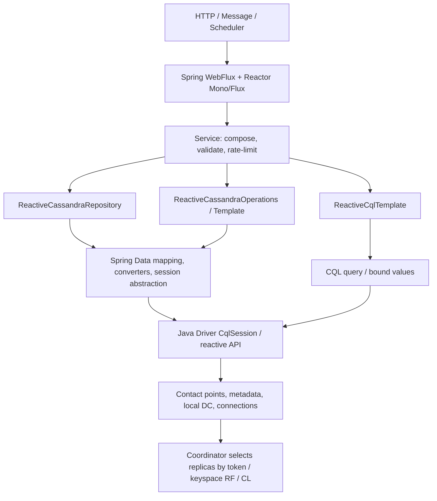
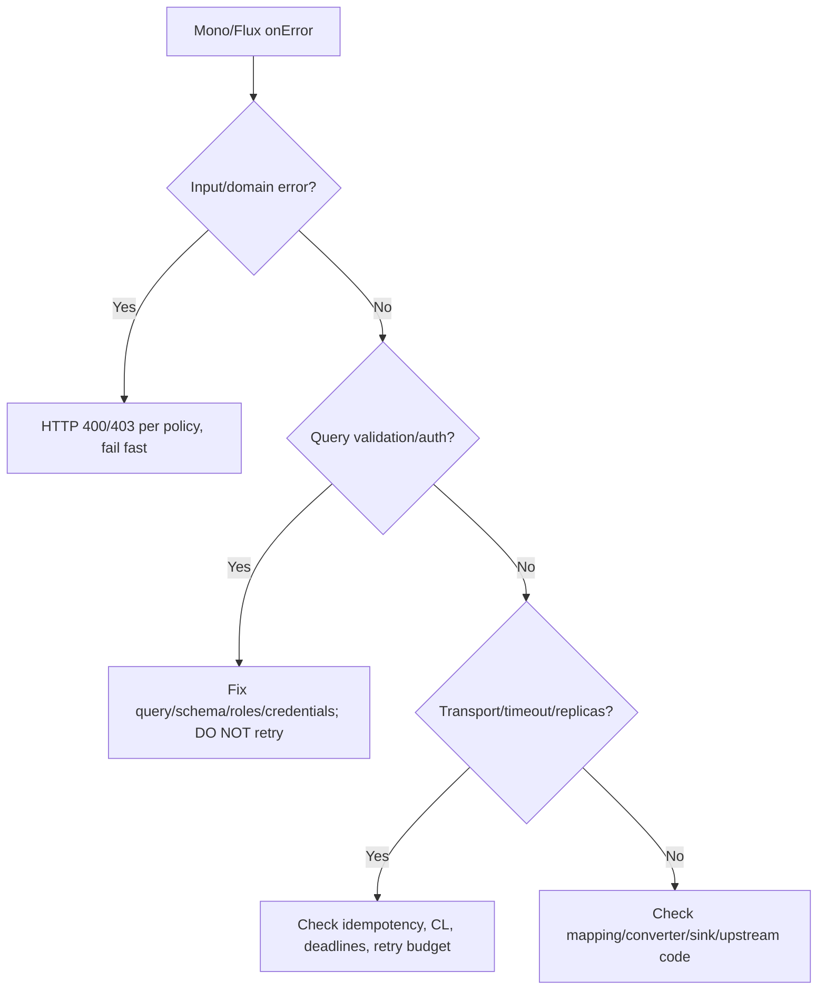

# ReactiveCassandraTemplate/Repository and Controlling Load, Errors, and Subscriptions

> **Chapter:** Spring Boot and Spring Data  
> **Module:** `DATABASE_ENGINE_WIDE_COLUMN_CASSANDRA` — understand Apache Cassandra's distributed architecture and wide-column model, especially partition keys, query-driven table design, consistency levels, CQL, replication, compaction, repair, errors, and Java applications.  
> **Focus:** Using **Spring Data Cassandra reactive** with `ReactiveCassandraTemplate`, `ReactiveCassandraOperations`, and `ReactiveCassandraRepository`; understanding the **composition → subscription → execution → terminal signal** lifecycle, managing backpressure/concurrency, pagination, errors, timeouts, cancellation, idempotency, and request lifecycles in Spring WebFlux.  
> **Version context:** Content illustrates Spring Boot 3.x/4.x, Spring Data Cassandra 4.x/5.x, Project Reactor 3.x, and Java Driver 4.x. Verify your exact BOM, JDK, Cassandra server, and APIs before copying code.

A WebFlux application can look completely reactive yet **perform no Cassandra operations at all**:

```java
public Mono<Void> wrongSave(Account account) {
    accountRepository.save(account); // Creates a Mono and discards it.
    return Mono.empty();             // No subscription for save.
}
```

Another variation is even more dangerous:

```java
public Mono<Void> wrongBatch(Flux<Account> accounts) {
    return accounts
        .doOnNext(account -> accountRepository.save(account))
        .then(); // onComplete of source, DOES NOT await save() Mono.
}
```

Reason: `Mono`/`Flux` objects are **descriptions of asynchronous work**, not proof that work has run. Here `doOnNext` creates an inner publisher but **never connects it to the subscription chain**. When HTTP returns success, the database may not have received a single `INSERT` statement.

The proper approach must **compose** the Cassandra operation into the pipeline subscribed by the framework:

```java
public Mono<Void> saveBatch(Flux<Account> accounts) {
    return accounts
        .concatMap(accountRepository::save) // Await each save.
        .then();                            // Complete once all saves complete.
}
```

However, `concatMap` only solves **waiting and ordering**; it does not automatically protect against all business errors. If the input can be unbounded, the endpoint still needs validation, quotas, capacity bounds, and deadlines. If `save` times out, the mutation may already have been applied on some replicas even though the client received no ACK. To raise throughput with `flatMap(..., concurrency)`, you must evaluate ordering, idempotency, and resources.

**Core message:** *Reactive* is a model for non-blocking orchestration and demand propagation; **it does not replace** partition-aware data modeling, CQL consistency, load control, retry policies, security, or Cassandra monitoring.

## 1. Learning Objectives

After this lesson, you will be able to:

1. Distinguish `ReactiveCqlTemplate`, `ReactiveCassandraTemplate`, `ReactiveCassandraOperations`, `ReactiveCassandraRepository`, and `CqlSession`.
2. Add the version-appropriate Spring Boot reactive Cassandra starter and use auto-configured beans.
3. Map `@Table`, `@PrimaryKey`, and composite primary keys onto Java entities.
4. Return `Mono<T>` for single results/writes and `Flux<T>` for multi-row streams; understand empty, success, and error signals.
5. Explain *cold publishers*: calling a repository method only **composes**; subscription executes the CQL.
6. Use Spring WebFlux so the framework owns the subscription, avoiding arbitrary `subscribe()`/`block()` calls in services/controllers.
7. Chain multiple operations purposefully with `flatMap`, `concatMap`, `then`, and `switchIfEmpty`.
8. Recognize why `doOnNext` does not await asynchronous writes and why `Mono<Void>` can complete without writing.
9. Bound concurrent queries/in-flight writes and understand that backpressure **does not reduce** the CPU/disk scan of a bad CQL query.
10. Distinguish first-page success from full result consumption and downstream commit.
11. Use `Query`/`Criteria`, CQL prepared parameters, page sizes, and `LOCAL_QUORUM` appropriately.
12. Classify query validation/authentication/authorization errors vs. timeout/unavailable errors and decide safe retries.
13. Handle cancellation on HTTP client disconnect, timeouts, and shutdown without falsely marking jobs `COMPLETED`.
14. Write `StepVerifier` unit tests and integration tests with Cassandra/Testcontainers.
15. Define SLOs, metrics, alerts, and runbooks for high-load reactive Cassandra pipelines.

## 2. Technology Map: Four Layers Not to Mix

### 2.1. Components



| Component | Role | Common return types |
|---|---|---|
| `CqlSession` | Java Driver session/connection pools/metadata | `ResultSet`, `CompletionStage<AsyncResultSet>`, reactive publishers |
| `ReactiveCqlTemplate` | Lower-level CQL, raw CQL text/rows handling, and exception translation | `Mono`, `Flux` |
| `ReactiveCassandraTemplate` | Object mapping, `Query`/`Criteria`, insert/select/update/delete | `Mono<Entity>`, `Flux<Entity>`, other API-specific results |
| `ReactiveCassandraOperations` | Interface preferred for injection to reduce coupling to implementation | `Mono`/`Flux` |
| `ReactiveCassandraRepository<T,ID>` | Spring Data repository interface; CRUD and derived/`@Query` methods | `Mono<T>`, `Flux<T>` |
| Project Reactor | Compose publishers, demand, cancellation, timeout, schedulers | `Flux`/`Mono`/operators |
| Spring WebFlux | Subscribes to controller-returned publishers, serializes/streams HTTP | `Mono<Response>`/`Flux<Response>` |

`ReactiveCassandraTemplate` is thread-safe once configured and can be **shared**; never instantiate templates or sessions per HTTP request. Spring Data performs exception translation into the `org.springframework.dao` hierarchy; underlying exceptions may still hold Java Driver causes. Spring Data's reactive API leverages Cassandra Driver's non-blocking support—it does not turn Cassandra's storage engine into an event-driven transaction coordinator.

### 2.2. Mono and Flux Are Not "Already-Executed Results"

```text
Service calls repository.save(account)
    ↓
Returns Mono<Account> representing work to perform
    ↓
Controller RETURNS Mono to WebFlux
    ↓
WebFlux subscribes while handling HTTP
    ↓
Driver sends CQL according to demand
    ↓
Coordinator and replicas execute per CL
    ↓
Mono: onNext(account) / onComplete, or onError
```

For a read method:

```java
Mono<Account> result = repository.findById("user-001");
```

Declaring `result` does not prove a network request has occurred. In particular, doing the following is wrong if you intend to persist a record:

```java
Mono<Account> ignored = repository.save(account);
return Mono.just("OK"); // Creates a reactive publisher without subscribing/saving.
```

### 2.3. Reactive Is Not Unbounded Multi-Threading

Non-blocking means threads do not wait on socket responses per request in a blocking style. It **does not** permit:

- Firing 100,000 unbounded queries into the driver.
- Running `SELECT *` on a multi-billion-row table assuming low RAM because of "Flux."
- Mixing blocking JDBC/file I/O onto the Reactor Netty event loop.
- Retrying all writes indefinitely when ACKs are lost.
- Automatically grouping `save` calls into atomic transactions across Cassandra partitions/tables.

Think of reactive as **a way to express flow and backpressure**, while resource bounding remains a separate architectural problem.

## 3. Setting Up Spring Boot Reactive Cassandra

### 3.1. Maven Starter

With the Spring Boot BOM/parent configured, for example:

```xml
<dependencies>
    <dependency>
        <groupId>org.springframework.boot</groupId>
        <artifactId>spring-boot-starter-data-cassandra-reactive</artifactId>
    </dependency>
    <dependency>
        <groupId>org.springframework.boot</groupId>
        <artifactId>spring-boot-starter-webflux</artifactId>
    </dependency>
    <dependency>
        <groupId>org.springframework.boot</groupId>
        <artifactId>spring-boot-starter-actuator</artifactId>
    </dependency>
    <dependency>
        <groupId>io.projectreactor</groupId>
        <artifactId>reactor-test</artifactId>
        <scope>test</scope>
    </dependency>
</dependencies>
```

Spring Boot 4.2 provides the `spring-boot-starter-data-cassandra-reactive` artifact. For Boot 3.x projects, check the corresponding release BOM. Do not override the Java Driver version managed by Spring Data without checking compatibility.

If the project is solely a background reactive worker, `spring-boot-starter-webflux` is optional; WebFlux is included here to illustrate HTTP endpoints.

### 3.2. Gradle Starter

```groovy
dependencies {
    implementation 'org.springframework.boot:spring-boot-starter-data-cassandra-reactive'
    implementation 'org.springframework.boot:spring-boot-starter-webflux'
    implementation 'org.springframework.boot:spring-boot-starter-actuator'
    testImplementation 'io.projectreactor:reactor-test'
}
```

This is only a learning snippet; it does not require running Gradle or editing the build of the module being authored.

### 3.3. Connection Properties

```yaml
spring:
  cassandra:
    contact-points: "127.0.0.1:9042"
    local-datacenter: "dc1"
    keyspace-name: "lab_spring_reactive"
    schema-action: none
    request:
      consistency: LOCAL_QUORUM
      timeout: 3s
```

In Spring Boot 3.x/4.x, use the `spring.cassandra.*` group; Spring Boot 2.7 uses `spring.data.cassandra.*`. The local DC name must match real Cassandra metadata rather than being chosen arbitrarily. Contact points are **seeds for cluster discovery**, not the full replica list.

Setting `schema-action: none` requires the keyspace/tables to be created via separate CQL/migrations. `keyspace-name` does not auto-create the namespace or set a replication factor.

### 3.4. Auto-Configuration and Ownership

When the starter, profiles, and conditions match, Spring Boot can supply `CqlSession`, reactive session/template infrastructure, and repositories. Prefer injecting managed beans:

```java
import org.springframework.data.cassandra.core.ReactiveCassandraOperations;
import org.springframework.stereotype.Service;

@Service
public final class AccountQueryService {
    private final ReactiveCassandraOperations operations;

    public AccountQueryService(ReactiveCassandraOperations operations) {
        this.operations = operations;
    }
}
```

Never call `CqlSession.builder().build()` per request or instantiate `new ReactiveCassandraTemplate(...)` inside every repository. If multiple clusters or genuinely separate credentials exist, explicitly design named sessions, lifecycles, converters, and repository/template mappings.

### 3.5. Distinguishing Reactive and Imperative Starters

`spring-boot-starter-data-cassandra` is typically used for imperative repositories, `CassandraTemplate`, and blocking calls. `spring-boot-starter-data-cassandra-reactive` enables the reactive stack.

Never make a WebFlux service return `Mono.just(blockingRepository.findById(...))` and treat it as non-blocking: `blockingRepository.findById(...)` executes **before** the Mono is created. When temporary compatibility with blocking code is unavoidable, isolate it on a bounded executor and measure its cost explicitly; ideally, use the reactive API consistently.

## 4. Data Modeling Determines Load Safety More Than API Choice

### 4.1. Two Tables Serving Two Queries

Using a lab keyspace:

```sql
CREATE KEYSPACE IF NOT EXISTS lab_spring_reactive
WITH replication = {
    'class': 'NetworkTopologyStrategy',
    'dc1': 3
};

CREATE TABLE IF NOT EXISTS lab_spring_reactive.accounts_by_id (
    account_id text PRIMARY KEY,
    display_name text,
    account_state text,
    updated_at timestamp
);

CREATE TABLE IF NOT EXISTS lab_spring_reactive.events_by_tenant_day (
    tenant_id uuid,
    event_day date,
    event_time timestamp,
    event_id uuid,
    event_type text,
    payload text,
    PRIMARY KEY ((tenant_id, event_day), event_time, event_id)
) WITH CLUSTERING ORDER BY (
    event_time DESC, event_id DESC
);
```

For a **single-node** lab cluster, lower RF to 1. Do not configure RF=3 with one full replica and expect every `LOCAL_QUORUM` query to succeed.

### 4.2. Querying by Partition Key

```sql
-- Point lookup, finding one account:
SELECT account_id, display_name, account_state
FROM lab_spring_reactive.accounts_by_id
WHERE account_id = 'user-001';

-- Reading events in ONE tenant/day partition:
SELECT tenant_id, event_day, event_time, event_id, event_type
FROM lab_spring_reactive.events_by_tenant_day
WHERE tenant_id = 11111111-1111-1111-1111-111111111111
  AND event_day = '2026-11-21'
LIMIT 100;
```

The partition key of the events table is `(tenant_id,event_day)`, not `tenant_id` alone. With CL `LOCAL_QUORUM` in a DC with RF=3, the server normally needs two local full replicas to respond. Reactive only changes how the client awaits results; **it does not alter** this requirement.

### 4.3. Common Query-First Mistakes

```sql
-- Do not treat this as a point lookup on accounts_by_id:
SELECT *
FROM lab_spring_reactive.accounts_by_id
WHERE account_state = 'ACTIVE';
```

`account_state` is a regular column and has no supporting access path on this example table. A Spring Data repository can generate a finder method named `findByAccountState`, but **a plausible method name does not ensure valid or efficient CQL**. Create an appropriate `accounts_by_state` table, index, or search path after evaluating cardinality and hotspots instead of defaulting to `ALLOW FILTERING`.

### 4.4. Controlling Hot Partitions

If a tenant generates millions of events per day, the `(tenant_id,event_day)` partition can grow too large. Reactive paging transfers data in chunks, yet:

- It does not reduce SSTable/read amplification on a hot partition.
- It does not reduce tombstone scans caused by TTLs/deletes.
- It does not distribute wide partitions across multiple replicas per clustering row.
- It does not replace compaction, repair, or streaming management.

Consider hourly buckets, controlled sharding, or a different query-specific table. Schema design must stem from read/write patterns and volume.

### 4.5. Lab Practice Data

```sql
CONSISTENCY LOCAL_QUORUM;

INSERT INTO lab_spring_reactive.accounts_by_id (
  account_id, display_name, account_state, updated_at
) VALUES (
  'user-001', 'Reactive Learner', 'ACTIVE',
  '2026-11-21 08:00:00+0000'
);

INSERT INTO lab_spring_reactive.events_by_tenant_day (
  tenant_id, event_day, event_time, event_id, event_type, payload
) VALUES (
  11111111-1111-1111-1111-111111111111,
  '2026-11-21', '2026-11-21 08:01:00+0000',
  22222222-2222-4222-8222-222222222222, 'LOGIN', 'payload-1'
);

INSERT INTO lab_spring_reactive.events_by_tenant_day (
  tenant_id, event_day, event_time, event_id, event_type, payload
) VALUES (
  11111111-1111-1111-1111-111111111111,
  '2026-11-21', '2026-11-21 08:02:00+0000',
  33333333-3333-4333-8333-333333333333, 'VIEW', 'payload-2'
);
```

Here `CONSISTENCY` is a `cqlsh` command, not a CQL statement sent through `ReactiveCqlTemplate`. Never practice schema creation or deletion in production.

## 5. Mapping Entities and Composite Primary Keys

### 5.1. Single-Key Accounts Table

```java
import java.time.Instant;

import org.springframework.data.cassandra.core.mapping.Column;
import org.springframework.data.cassandra.core.mapping.PrimaryKey;
import org.springframework.data.cassandra.core.mapping.Table;

@Table("accounts_by_id")
public class Account {

    @PrimaryKey("account_id")
    private String accountId;

    @Column("display_name")
    private String displayName;

    @Column("account_state")
    private String accountState;

    @Column("updated_at")
    private Instant updatedAt;

    public Account() { }

    public Account(String accountId, String displayName,
                   String accountState, Instant updatedAt) {
        this.accountId = accountId;
        this.displayName = displayName;
        this.accountState = accountState;
        this.updatedAt = updatedAt;
    }

    public String getAccountId() { return accountId; }
    public void setAccountId(String value) { accountId = value; }

    public String getDisplayName() { return displayName; }
    public void setDisplayName(String value) { displayName = value; }

    public String getAccountState() { return accountState; }
    public void setAccountState(String value) { accountState = value; }

    public Instant getUpdatedAt() { return updatedAt; }
    public void setUpdatedAt(Instant value) { updatedAt = value; }
}
```

Entity mapping does not create transactions or validate domain states like `ACTIVE/SUSPENDED`; that belongs in the service layer. `save` performs an upsert on the same PK. If you need "insert once," apply an appropriate LWT/idempotency policy.

### 5.2. Events Table with Composite Partition/Clustering Keys

Primary keys can be expressed directly on the entity via `@PrimaryKeyColumn`:

```java
import java.time.Instant;
import java.time.LocalDate;
import java.util.UUID;

import org.springframework.data.cassandra.core.cql.Ordering;
import org.springframework.data.cassandra.core.cql.PrimaryKeyType;
import org.springframework.data.cassandra.core.mapping.Column;
import org.springframework.data.cassandra.core.mapping.PrimaryKeyColumn;
import org.springframework.data.cassandra.core.mapping.Table;

@Table("events_by_tenant_day")
public class TenantEvent {

    @PrimaryKeyColumn(name = "tenant_id", ordinal = 0,
        type = PrimaryKeyType.PARTITIONED)
    private UUID tenantId;

    @PrimaryKeyColumn(name = "event_day", ordinal = 1,
        type = PrimaryKeyType.PARTITIONED)
    private LocalDate eventDay;

    @PrimaryKeyColumn(name = "event_time", ordinal = 2,
        type = PrimaryKeyType.CLUSTERED,
        ordering = Ordering.DESCENDING)
    private Instant eventTime;

    @PrimaryKeyColumn(name = "event_id", ordinal = 3,
        type = PrimaryKeyType.CLUSTERED,
        ordering = Ordering.DESCENDING)
    private UUID eventId;

    @Column("event_type")
    private String eventType;

    @Column("payload")
    private String payload;

    public TenantEvent() { }

    // Add constructors/getters/setters as required by mapping
    // and your Spring Data version.
}
```

`ordinal` paired with `PrimaryKeyType.PARTITIONED` defines the two partition key components, and the next two fields define clustering keys. `Ordering.DESCENDING` mirrors `WITH CLUSTERING ORDER BY` in the lab table. If a real schema uses a different order, adjust the annotations accordingly. For advanced applications, `@PrimaryKeyClass` and `@PrimaryKey` encapsulate composite keys as a dedicated type usable as the repository ID.

**Do not** declare `ReactiveCassandraRepository<TenantEvent, UUID>` when the PK has four components; the ID type must reflect the full mapping—or use custom queries/templates—rather than arbitrarily treating `event_id` as the entire primary key.

### 5.3. Nulls and Tombstones

When persisting mapped entities, null/unset handling and generated CQL depend on the Spring Data operation/options:

- Null on a column can carry tombstone semantics.
- TTLs apply per cell and require recalculation on retries, especially during migrations/CDC.
- UDTs/collections have codecs and size limits.
- Mapping may generate different update statements across `insert`, `update`, and `save`.

Run integration tests against real schemas, especially when data involves many nulls or TTLs. The reactive API does not make such writes idempotent.

## 6. ReactiveCassandraRepository: CRUD and Constrained Queries

### 6.1. Basic Interface

```java
import org.springframework.data.cassandra.repository.ReactiveCassandraRepository;
import reactor.core.publisher.Flux;
import reactor.core.publisher.Mono;

public interface AccountRepository
        extends ReactiveCassandraRepository<Account, String> {

    // findById(String) -> Mono<Account> is inherited from the base interface.
    // save(Account) -> Mono<Account> is inherited from the base interface.
}
```

`ReactiveCassandraRepository` extends `ReactiveCrudRepository`; the method name `save` does not mean an INSERT occurred before the publisher is subscribed to. Repository beans use the Spring Data mapping and Boot-managed driver session.

### 6.2. Methods Returning Mono, Flux, and Mono\<Void\>

```java
Mono<Account> account = accountRepository.findById("user-001");
Mono<Boolean> exists = accountRepository.existsById("user-001");
Mono<Long> count = accountRepository.count();
Mono<Void> deleted = accountRepository.deleteById("user-001");
```

**Do not use full-table `count()`** as a health check or dashboard metric on large tables. In Cassandra, counting an entire table typically scans a huge amount of data just to return a single number. Similarly, `findAll()` can scan massive datasets and is unsuitable for OLTP hot paths.

### 6.3. Derived Queries Do Not Guarantee Efficiency

For example:

```java
Flux<Account> findByAccountState(String state);
```

A valid Java method name **does not** prove the server has an index or partition key for `WHERE account_state = ?`. On the example `accounts_by_id` table, that query shape requires dedicated data modeling. Only declare finders matching patterns supported by the Cassandra schema.

### 6.4. \@Query with Partition Restrictions

```java
import java.time.LocalDate;
import java.util.UUID;

import org.springframework.data.cassandra.core.mapping.MapId;
import org.springframework.data.cassandra.repository.Query;
import org.springframework.data.cassandra.repository.ReactiveCassandraRepository;
import reactor.core.publisher.Flux;

public interface TenantEventRepository
        extends ReactiveCassandraRepository<TenantEvent, MapId> {

    @Query(
        "SELECT tenant_id, event_day, event_time, event_id, " +
        "event_type, payload " +
        "FROM events_by_tenant_day " +
        "WHERE tenant_id = ?0 AND event_day = ?1"
    )
    Flux<TenantEvent> findByTenantDay(
        UUID tenantId, LocalDate eventDay);
}
```

For entities using flat `@PrimaryKeyColumn` fields as in Section 5.2, `MapId` is the matching repository ID type. When calling `findById` or `deleteById`, you must supply **all four key components**. For example:

```java
import org.springframework.data.cassandra.core.mapping.BasicMapId;
import org.springframework.data.cassandra.core.mapping.MapId;

MapId fullId = BasicMapId.id()
    .with("tenant_id", tenantId)
    .with("event_day", eventDay)
    .with("event_time", eventTime)
    .with("event_id", eventId);

Mono<TenantEvent> exact = eventRepository.findById(fullId);
```

`tenantId`, `eventDay`, `eventTime`, `eventId`, and `eventRepository` are variables already present in the calling service method. If you want a strongly typed ID with structural checks, switch to `@PrimaryKeyClass` with `@PrimaryKey` on the entity and replace `MapId` with that key class. Never use `UUID event_id` alone as the repository ID for a table with a **composite primary key**.

### 6.5. Enforcing Tenant Scope from Identity

`findByTenantDay(UUID tenantId, LocalDate day)` binds CQL parameters properly, yet can still be abused if HTTP callers supply someone else's tenantId. Derive the tenant from the authenticated principal/authorization policy; do not treat bind markers as a complete security boundary.

## 7. ReactiveCassandraTemplate and ReactiveCassandraOperations

### 7.1. When to Use Template?

Repositories fit straightforward CRUD and low-variation derived methods. Templates fit when you need:

- To build `Query`/`Criteria` dynamically across designed filter options.
- Control over projections, tables, ordering, page size limits, and request options.
- Row ↔ entity conversion without proliferating repository methods.
- `SimpleStatement`/prepared CQL for specialized queries while keeping object mapping.
- Insert/update/delete operations with explicit write options.

Spring Data documentation recommends injecting `ReactiveCassandraOperations` instead of coupling code to the `ReactiveCassandraTemplate` implementation when implementation-specific methods are not needed.

### 7.2. SELECT by Primary Key via Query + Criteria

```java
import org.springframework.data.cassandra.core.ReactiveCassandraOperations;
import org.springframework.data.cassandra.core.query.Query;
import org.springframework.data.cassandra.core.query.Criteria;
import org.springframework.stereotype.Service;
import reactor.core.publisher.Mono;

@Service
public final class AccountTemplateService {

    private final ReactiveCassandraOperations cassandra;

    public AccountTemplateService(ReactiveCassandraOperations cassandra) {
        this.cassandra = cassandra;
    }

    public Mono<Account> findById(String id) {
        if (id == null || id.isBlank()) {
            return Mono.error(
                new IllegalArgumentException("Invalid account ID"));
        }

        Query query = Query.query(
            Criteria.where("account_id").is(id));

        return cassandra.selectOne(query, Account.class);
    }
}
```

`selectOne` reflects a query expected to return at most one row; with `PRIMARY KEY(account_id)`, that assumption holds. If a query does not constrain the full key and matches multiple rows, `selectOne` neither makes the read transactional nor inspects the entire table; design query semantics explicitly.

### 7.3. SELECT by Composite Partition Key

```java
import java.time.LocalDate;
import java.util.UUID;
import org.springframework.data.cassandra.core.query.Query;
import org.springframework.data.cassandra.core.query.Criteria;
import reactor.core.publisher.Flux;

public Flux<TenantEvent> findEvents(
        UUID tenant, LocalDate day) {

    Query query = Query.query(
        Criteria.where("tenant_id").is(tenant)
            .and("event_day").is(day)
    ).limit(100);

    return cassandra.select(query, TenantEvent.class);
}
```

This method snippet assumes `cassandra` is a `ReactiveCassandraOperations` field; place it inside a complete service class with imports. `LIMIT 100` caps **total rows** for the API, does not replace page size, and does not protect a very wide partition from SSTable/tombstone read amplification.

### 7.4. selectById/insert/update/save

```java
Mono<Account> found =
    cassandra.selectOneById("user-001", Account.class);

Mono<Account> saved =
    cassandra.insert(new Account(
        "user-002", "Reactive", "ACTIVE", java.time.Instant.now()));
```

The `insert` API accepts an entity and returns `Mono<Account>`; here it only creates a publisher. To actually persist it, compose the publisher into the request/job and subscribe at the entrypoint. On a write timeout, never assume the mutation did not apply.

### 7.5. Prepared CQL and Driver-Level Statements

Spring Data supports statement preparation, including `ReactiveCassandraTemplate.setUsePreparedStatements(true)` when custom configuration is needed. Query- and bind-value-based methods generally use prepared statements per configured policy; never concatenate HTTP input into CQL text. When per-statement CL is needed, compatible `SimpleStatement` instances can be used:

```java
import com.datastax.oss.driver.api.core.DefaultConsistencyLevel;
import com.datastax.oss.driver.api.core.cql.SimpleStatement;

SimpleStatement stmt = SimpleStatement.newInstance(
        "SELECT account_id, display_name, account_state, updated_at " +
        "FROM lab_spring_reactive.accounts_by_id " +
        "WHERE account_id = ?",
        "user-001")
    .setConsistencyLevel(
        DefaultConsistencyLevel.LOCAL_QUORUM);

Mono<Account> queryResult =
    cassandra.selectOne(stmt, Account.class);
```

**Note:** This API illustrates `selectOne(Statement, Class)` in Spring Data Cassandra 5.x; verify compilation and prepared-statement policies in your project's version. Fixed **constant** raw CQL strings with bind markers are safe; never interpolate table names, column names, or literals from HTTP input.

## 8. ReactiveCqlTemplate: When Lower-Level CQL Control Is Needed

### 8.1. Differences from POJO-Mapping Template

`ReactiveCqlTemplate` operates closer to CQL queries, row mapping, callbacks, and query/update execution. When full entity mapping is unnecessary or specific CQL functions are needed, it is the right choice.

Example:

```java
import org.springframework.data.cassandra.core.cql.ReactiveCqlTemplate;
import org.springframework.stereotype.Repository;
import reactor.core.publisher.Mono;

@Repository
public final class AccountStateQuery {
    private final ReactiveCqlTemplate cql;

    public AccountStateQuery(ReactiveCqlTemplate cql) {
        this.cql = cql;
    }

    public Mono<String> readState(String accountId) {
        return cql.queryForObject(
            "SELECT account_state FROM lab_spring_reactive.accounts_by_id " +
            "WHERE account_id = ?",
            String.class,
            accountId);
    }
}
```

`queryForObject` passes bind arguments to execute a parameterized query per Spring Data's API. When no row is found, whether an empty Mono or an exception is produced depends on the method, version, and mapping expectations; test the exact return contract and never mask errors with `defaultIfEmpty("ACTIVE")` unless business rules permit it.

### 8.2. UPDATE via CQL Bind Values

```java
import org.springframework.data.cassandra.core.cql.ReactiveCqlOperations;
import org.springframework.stereotype.Service;
import reactor.core.publisher.Mono;

@Service
public final class StateUpdater {

    private final ReactiveCqlOperations cql;

    public StateUpdater(ReactiveCqlOperations cql) {
        this.cql = cql;
    }

    public Mono<Boolean> updateState(String id, String state) {
        if (!"ACTIVE".equals(state) && !"SUSPENDED".equals(state)) {
            return Mono.error(
                new IllegalArgumentException("Unsupported state"));
        }

        return cql.execute(
            "UPDATE lab_spring_reactive.accounts_by_id " +
            "SET account_state = ? WHERE account_id = ?",
            state, id);
    }
}
```

In `ReactiveCqlTemplate`, `execute(String,Object...)` returns `Mono<Boolean>` per the API; understand the boolean meaning for the CQL operation. For regular writes, "completes normally" reflects request outcome under the configured CL, **not** an atomic commit across all replicas/DCs. For conditional writes/LWTs, check the applied/condition semantics before reporting business success.

### 8.3. When to Drop Down Directly to the Java Driver?

Scenarios:

- Customizing token-aware routing, request profiles, or low-level execution info.
- Controlled reading of paging state for an exporter.
- Accessing driver-specific schema/cluster metadata.
- Detailed diagnostic exception inspection.
- Query DSL/operations not exposed by Spring Data APIs.

In such cases, inject `CqlSession` or the version-appropriate reactive session wrapper; do not assume calling `session.executeAsync` with a single `thenApply` constitutes a "reactive full drain."

### 8.4. Do Not Ignore Exception Translation

Spring Data typically maps driver errors to Spring's `DataAccessException` hierarchy. If a service writes:

```java
.onErrorResume(e -> {
    if (e instanceof com.datastax.oss.driver.api.core.DriverException) {
        ...
    }
    return Mono.empty();
})
```

some errors already translated by Spring may fail to match the original driver exception class. Classify across **the Spring abstraction + bounded cause chain** and retain observability on errors. Never use `Mono.empty()` as blanket error swallowing.

## 9. Composition → Subscription → Execution: Rule Number One

### 9.1. Cold Publishers and Laziness

```java
Mono<Account> planned = repository.findById("user-001");

// The line above only describes the reactive operation.
// When the controller returns planned to WebFlux, the framework subscribes.
return planned;
```

Spring Data Cassandra describes reactive usage in terms of **composition** and **execution**, triggered when a subscriber registers. This expresses pipelines cleanly without blocking application threads.

### 9.2. Manual subscribe() in Controllers Is Error-Prone

```java
// ANTI-PATTERN:
@PostMapping("/accounts")
public Mono<ResponseEntity<Void>> create(@RequestBody Account a) {
    repository.save(a).subscribe(); // Detached lifecycle and errors from HTTP.
    return Mono.just(ResponseEntity.accepted().build());
}
```

When the framework processes the HTTP exchange, `repository.save(a)` is subscribed outside the pipeline and the response can finish **before** the write. If `save` fails, the controller never knows; if the client cancels, the `save` subscription may keep running, breaking cancellation semantics.

Correct:

```java
@PostMapping("/accounts")
public Mono<ResponseEntity<Void>> create(@RequestBody Account a) {
    return repository.save(a)
        .thenReturn(ResponseEntity.noContent().build());
}
```

Here the response completes after the `save` publisher completes normally. Still, HTTP 204 only means "the write was ACKed at the configured consistency level," not that every replica is immediately synchronized.

### 9.3. Mono.empty() vs. Mono.error()

```java
Mono<Account> notFound =
    repository.findById("does-not-exist");

Mono<Account> forbidden =
    Mono.error(new SecurityException("Access denied"));
```

Not finding a primary key is represented by `Mono.empty()`, whereas permission/query failures must propagate via `onError`. Using `onErrorResume(error -> Mono.empty())` causes the app to return 404 when Cassandra is down or a role lacks SELECT—a **major bug in API semantics and observability**.

### 9.4. defer When Per-Subscription State Creation Is Needed

```java
Mono<Account> source =
    Mono.defer(() -> repository.save(
        new Account(
            "user-002", "Reactive", "ACTIVE", java.time.Instant.now()
        )));
```

`Mono.defer` defers entity creation and Mono construction until each subscription. This is helpful when an ID or timestamp must be created per subscription; at the same time, it introduces risk if retries generate a **new** timestamp/ID on every attempt. For idempotent writes, IDs/timestamps usually need to be fixed at the business-command boundary rather than regenerated arbitrarily on retries.

### 9.5. Avoid Double Subscription

```java
Mono<Account> save = repository.save(account);
save.subscribe();
return save; // Framework subscribes again: may send 2 writes.
```

A cold publisher can re-execute on every subscription; depending on backend/caching behavior, each subscription may emit a CQL request. Never double-subscribe just to "log immediately" while still returning to HTTP. Use `doOnSuccess`/`doOnError` inside a **single pipeline**; if multicasting/caching is genuinely required, explicitly design lifecycle, size, and error behavior.

## 10. Chaining Operations with Reactor Operators

### 10.1. flatMap Awaits Dependent Publishers

```java
public Mono<Account> updateName(String id, String newName) {
    return repository.findById(id)
        .switchIfEmpty(Mono.error(
            new IllegalArgumentException("Unknown account")))
        .flatMap(existing -> {
            existing.setDisplayName(newName);
            return repository.save(existing);
        });
}
```

`flatMap` chains the save step so returning `Mono<Account>` makes the caller wait for the save result. Note that this is a **non-CAS read-then-write**: two concurrent requests can read the same state and overwrite each other. When optimistic concurrency is required, use specifically designed LWT/versioning.

### 10.2. thenReturn Emits Only After Upstream Completes

```java
Mono<String> saved =
    repository.save(account)
        .thenReturn("stored");
```

It will not emit `"stored"` if `save` signals `onError`. `thenReturn` ignores emitted entities and awaits normal upstream completion. With LWT `IF NOT EXISTS`, inspect the applied flag rather than equating normal terminal completion with condition success.

### 10.3. switchIfEmpty for Not Found

```java
public Mono<Account> requireAccount(String id) {
    return repository.findById(id)
        .switchIfEmpty(Mono.error(
            new AccountNotFoundException(id)));
}
```

`AccountNotFoundException` is an application-defined domain exception, not a Spring Data class. An HTTP adapter can map it to 404. Crucial rule: **use this only for legitimate empty completion**; never convert timeouts into empty.

### 10.4. doOnNext Is for Small Synchronous Side Effects

```java
return repository.findById(id)
    .doOnNext(a -> metrics.incrementFound())
    .flatMap(this::validateAndTransformAsync);
```

`doOnNext` fits lightweight logging/metrics, **not creating a Mono and dropping it**. If the side effect itself is asynchronous, use `flatMap`/`concatMap` to await it.

### 10.5. concatMap vs. flatMap

```java
Flux<Account> ordered =
    sourceAccounts.concatMap(repository::save);

Flux<Account> concurrent =
    sourceAccounts.flatMap(
        repository::save,
        8 // Limit to at most 8 concurrent inner subscriptions.
    );
```

- `concatMap` subscribes to each inner publisher sequentially, useful when writes to the same partition must avoid client-side reordering.
- `flatMap(...,8)` raises throughput but **does not preserve emission order** when writes finish at different times.
- `flatMapSequential` preserves downstream emission order, **which does not mean server writes executed in order** because upstream still runs concurrently.
- CQL last-write-wins resolves by timestamp, not by the completion order of Java Monos.
- `flatMap` neither creates transactions nor guarantees exactly-once writes.

## 11. Spring WebFlux Controllers: One Owned Subscription

### 11.1. GET Single Account Endpoint

```java
import org.springframework.http.ResponseEntity;
import org.springframework.web.bind.annotation.GetMapping;
import org.springframework.web.bind.annotation.PathVariable;
import org.springframework.web.bind.annotation.RequestMapping;
import org.springframework.web.bind.annotation.RestController;

import reactor.core.publisher.Mono;

@RestController
@RequestMapping("/api/accounts")
public final class AccountController {

    private final AccountRepository repository;

    public AccountController(AccountRepository repository) {
        this.repository = repository;
    }

    @GetMapping("/{id}")
    public Mono<ResponseEntity<Account>> get(
            @PathVariable String id) {
        return repository.findById(id)
            .map(ResponseEntity::ok)
            .defaultIfEmpty(ResponseEntity.notFound().build());
    }
}
```

Here WebFlux subscribes to the publisher returned by the controller. **Do not call `block()` or `subscribe()` inside controllers.** `defaultIfEmpty` handles successful queries where no account was found; driver/Spring Data exceptions must be mapped separately via an error handler.

### 11.2. Bounded GET Events Endpoint

```java
@GetMapping("/tenants/{tenant}/events")
public Flux<TenantEvent> listEvents(
        @PathVariable UUID tenant,
        @RequestParam LocalDate day) {

    return eventService.findEvents(tenant, day);
}
```

This snippet belongs in a controller with an injected `eventService` and WebFlux imports. `findEvents` must constrain `tenant_id` using caller identity/authorization and validate `event_day`, enforcing `LIMIT`/page sizes. Never allow callers to query arbitrary tenants merely because a bind marker exists.

### 11.3. Returning Flux to an HTTP Client Does Not Mean a DB Transaction Committed

If a response stream emits 100 events and the client disconnects:

- The reactive subscription may be cancelled.
- Only part of the data reached HTTP.
- Cassandra may already have executed requests/pages prior to cancellation.
- Never mark a full export DONE solely from the initial HTTP status.
- If this is an independent job, give it a dedicated queue/job lifecycle rather than tying ownership to a short-lived HTTP subscriber.

### 11.4. Do Not Use Controllers as Batch Schedulers

```java
// ANTI-PATTERN: launch one million writes and hold an HTTP connection indefinitely.
@PostMapping("/import")
public Mono<String> importHuge(@RequestBody Flux<Account> accounts) {
    return accounts.flatMap(repository::save)
        .thenReturn("DONE");
}
```

Issues: no bounds on concurrency, request size/latency, retries, checkpoints, or downstream backpressure. For large bulk imports, use tracked async jobs (`202 Accepted` + jobId), workers with rate/concurrency budgets, retry/idempotent sinks, auditing, and `RUNNING/FAILED/COMPLETED` state tracking.

## 12. Load Control: Bounding Concurrent CQL Requests

### 12.1. Reactive Is Not Capacity Magic

Suppose each app pod receives 1,000 msg/s, 20 pods run concurrently, and each message generates three CQL writes:

\[
Q_{\mathrm{planned}} = 1{,}000 \times 20 \times 3
= 60{,}000\ \text{CQL requests/s}.
\]

If the Cassandra cluster only sustains ~20,000 req/s within target SLOs (illustrative assumption), switching to WebFlux **does not make the cluster absorb 3× the load**. Apps can actually emit even more in-flight requests because they are no longer constrained by blocked thread counts.

### 12.2. Limiting flatMap Concurrency

```java
public Mono<Long> importAccounts(Flux<Account> input) {
    return input
        .flatMap(
            account -> repository.save(account),
            16, // At most 16 concurrent writes WITHIN this subscription.
            1   // low prefetch; still subject to upstream/driver buffers.
        )
        .count();
}
```

`count()` counts `Account` items emitted by the save pipeline through terminal completion. It does not guarantee all replicas or downstream systems are synchronized. If upstream is unbounded and 200 HTTP clients run concurrently with per-request concurrency=16, **one pod alone could accumulate 3,200 in-flight writes**. Enforce a **global concurrency budget**/queue/rate limit at the service level, not just a per-request `flatMap(...,16)`.

### 12.3. Write Ordering Within a Partition

Cassandra uses last-write-wins timestamps (with specific conflict resolution rules). If two mutations targeting the same primary key are issued in parallel, you cannot infer the final state from `flatMap` emission order.

Example:

```text
event A: UPDATE state='PENDING'
event B: UPDATE state='PAID'
A and B sent concurrently with different timestamps
→ Do not assume the last-completing Java Mono wins LWW.
```

To guarantee monotonic versioning, use explicit event versions, conditional updates/LWTs when appropriate, per-key serialization, and idempotency. `concatMap` preserves subscription order within a single stream, yet still does not replace Cassandra's distributed consistency mechanisms.

### 12.4. Separating QoS for Hot Paths and Background Jobs

An application might handle:

- HTTP point lookups, 50 ms SLO.
- Event ingestion at 20,000 rows/s.
- Multi-million-row exports/backfills.

If they share unprioritized concurrency budgets and connection pools, exports can push interactive p99 latency upward. Mitigations:

- Bound in-flight work per workload.
- Use appropriate driver execution profiles if supported.
- Deploy separate worker pools/quotas when needed.
- Apply app/API rate limits and bulkheads.
- Monitor Cassandra read/write queues, tombstones, and disk health.
- Use query-first tables and budgeted token-range scans rather than unconstrained `findAll()`.

### 12.5. Rate Limits vs. Concurrency Limits

A semaphore capping 100 in-flight requests **does not guarantee** fewer than 1,000 requests/s; when latency is low, throughput can still be huge. Conversely, a 1,000 requests/s token bucket **does not cap** in-flight concurrency when latency spikes. Production systems generally need **both limits**.

## 13. Backpressure and Paging: A Subscriber Does Not Bound Server Scans

### 13.1. Downstream Demand

Project Reactor and Reactive Streams use `request(n)` to propagate demand. The driver's reactive API delivers rows across Cassandra pages; the server does not read one physical row per `request(1)`.

```text
Subscriber request(8)
    ↓
Reactor/Spring Data pulls rows from driver publisher
    ↓
Driver may already have fetched a page with multiple rows
    ↓
When page drains and demand remains: driver fetches next page
    ↓
Downstream receives up to 8 items
```

Backpressure throttles **how fast downstream consumes and triggers the next page fetch**; it does not eliminate read amplification or tombstone scanning in a query lacking a partition key.

### 13.2. Page Size vs. LIMIT

| Mechanism | Meaning |
|---|---|
| CQL `LIMIT 100` | Logical query returns at most 100 rows per CQL semantics |
| Driver/statement fetch size | Target number of rows per response page |
| Reactor `take(100)` | Subscriber stops after 100 emitted items, potentially cancelling early |
| `flatMap(...,8)` | Caps active inner publisher subscriptions |
| Global rate limit | Caps requests/s or bytes/s |
| Partition/clustering restrictions | Narrows the Cassandra dataset that must be read |

When an endpoint needs at most 100 rows, combine **CQL LIMIT + proper partition/clustering keys** first, then tune fetch size appropriately. Applying `take(100)` on `findAll()` does not turn a cluster-wide scan into a point lookup. Even `LIMIT` will not guarantee cheap scans if `ALLOW FILTERING` or heavy tombstones are involved.

### 13.3. Spring Data Flux and Pagination

When `ReactiveCassandraTemplate.select(Query,Class)` returns `Flux<Entity>`, the template and driver paginate on demand. Consuming the Flux to terminal `onComplete` fetches pages as needed along the way. However:

- `Flux.take(n)` can terminate downstream before the source finishes reading.
- `Flux.next()`/`Mono.from` takes only the first element and usually cancels upstream.
- Source errors on page N emit `onError` **provided the pipeline hasn't swallowed errors**.
- `doOnNext(row -> persistAsync(row))` does not await external persistence.
- A cold `Flux` may replay CQL on each new subscription; never assume caching.

When **one page only** is desired, use the version-appropriate `Slice`/`CassandraPageRequest` API or paging state rather than assuming `Flux` represents a single page.

### 13.4. Slice and Keyset/Paging State

Spring Data Cassandra repositories support `CassandraPageRequest`/`Slice`-style pagination, distinct from RDBMS `Page`/OFFSET patterns. Illustrative example:

```java
import org.springframework.data.cassandra.core.query.CassandraPageRequest;
import org.springframework.data.domain.Slice;
import reactor.core.publisher.Mono;

// For repositories/operations supporting findAll(Pageable),
// verify query scope and avoid full-table findAll in production.
Mono<Slice<Account>> firstPage =
    repository.findAll(CassandraPageRequest.first(20));

Mono<Slice<Account>> nextPage =
    firstPage.flatMap(slice ->
        slice.hasNext()
            ? repository.findAll(slice.nextPageable())
            : Mono.empty());
```

`CassandraPageRequest` carries paging state/cursor progress, not a server-side OFFSET. **Warning:** `findAll` scans the accounts table and is intended only for small labs; production should use **partition-key-scoped paged queries** and explicit APIs. Never blindly cast `PageRequest.of(pageIndex, size)` as a Cassandra paging state.

### 13.5. First-Page Success vs. Full-Drain Success

A driver `CompletionStage<AsyncResultSet>` completes as soon as the **first page** is ready. Spring Data reactive `Flux` hides paging while emitting rows, yet the underlying distinction holds:

```text
Cassandra page #1 success
      ≠ all pages fetched
      ≠ downstream persistence ACKed
      ≠ export job committed/checkpointed
```

A job may only be marked `COMPLETED` after the entire `fetch → process → sink ack → manifest commit` chain succeeds. Never infer full dataset completion from an initial HTTP 200 or first-page result.

### 13.6. Paging Is Not Snapshot Isolation

If concurrent INSERT/DELETE/TTL activity happens between two pages, reactive traversal does not create an immutable point-in-time snapshot at page 1. `LOCAL_QUORUM` defines per-DC replica acknowledgment rules for individual requests, **not multi-page ACID transactions**.

For exports/migrations needing a stable cut, use write fences, immutable time buckets, CDC replay/reconciliation, or backup snapshots per procedure. Paging state is an **opaque continuation**, not a commit log or version timestamp.

## 14. Thread Model: Never Block Reactor or Driver Event Loops

### 14.1. Blocking in the Pipeline Breaks Hot Paths

```java
@GetMapping("/{id}")
public Mono<Account> wrongGet(@PathVariable String id) {
    Account account = accountRepository.findById(id).block();
    return Mono.just(account);
}
```

On WebFlux Reactor Netty threads, `block()` throws "blocking is not supported" or causes thread starvation. With `Mono.empty()`, it also produces an invalid `Mono.just(null)`. Return the publisher directly.

### 14.2. Blocking I/O Inside map Is Also Wrong

```java
return repository.findById(id)
    .map(account -> {
        legacyFileClient.writeBlocking(account); // Blocking.
        return account;
    });
```

`map` runs on whichever thread emits the signal—which may be a driver/Netty I/O thread. Blocking file or socket I/O stalls unrelated requests and inflates p99.

### 14.3. When Legacy Blocking Code Is Unavoidable

```java
import reactor.core.publisher.Mono;
import reactor.core.scheduler.Schedulers;

Mono<Account> data = repository.findById(id)
    .flatMap(account ->
        Mono.fromCallable(() -> {
            legacyFileClient.writeBlocking(account);
            return account;
        }).subscribeOn(Schedulers.boundedElastic()));
```

`boundedElastic` is intended for relatively short blocking tasks with version-defined thread/queue limits. Do not turn it into an unbounded dump for millions of writes; isolate separate workers/queues and monitor memory, thread counts, and saturation.

For CPU-bound work (heavy serialization, encryption), use an appropriately sized CPU executor with concurrency limits rather than defaulting everything heavy to `boundedElastic`.

### 14.4. subscribeOn vs. publishOn

- `subscribeOn(scheduler)` affects where subscription and source execution start; it does not guarantee every downstream callback stays on that scheduler across all async hops.
- `publishOn(scheduler)` switches the execution context for downstream operators with queuing/prefetching.
- Spring Data reactive Cassandra already uses non-blocking driver APIs; **you do not need** to wrap every repository call in `subscribeOn(boundedElastic)`.
- Only introduce schedulers when genuine blocking/CPU-bound work must be offloaded within an explicit budget.

### 14.5. Context Propagation

In reactive streams, request `ThreadLocal` state does not automatically propagate across every scheduler switch. Tenant IDs, correlation IDs, and security principals should come from the **Spring Security Reactor Context** or explicit method parameters. If a repository wrapper reads tenantId from `ThreadLocal` and subscribes on another thread, it can pick the wrong tenant or bypass authorization checks.

Never attach raw user credentials to logs or event contexts; pass only logical identities or scoped tenant labels per security policy.

## 15. Reactive Error Classification: onError Is Not One Monolith

### 15.1. Distinguishing Fault Layers



Do not assume every `onError` means Cassandra is unavailable. It can come from:

- API input validation (`IllegalArgumentException`) before querying.
- Entity conversion/mapping (`MappingException`, type mismatches).
- Cassandra CQL authorization (`UnauthorizedException`), syntax (`SyntaxError`), or invalid queries (`InvalidQueryException`).
- Authentication/TLS failures during driver connection setup.
- Coordinator timeouts/unavailable errors (RF/CL/replica pressure).
- Driver request timeouts when client deadlines expire.
- Reactor operator failures in `map`, `flatMap`, `doOnNext`, or sinks.
- HTTP caller cancellations/timeouts disposing the publisher.

### 15.2. Spring Data Exception Translation

Spring Data `ReactiveCassandraTemplate`/repositories perform **exception translation** from Java Driver exceptions into Spring's `org.springframework.dao.DataAccessException` hierarchy. Caller code should therefore not rely solely on:

```java
.onErrorResume(
    com.datastax.oss.driver.api.core.servererrors.InvalidQueryException.class,
    e -> ... )
```

Some errors will already be wrapped into another `DataAccessException` before reaching downstream operators. Inspect:

1. The exception class at the service boundary.
2. Nested `getCause()` entries up to a safe depth limit.
3. Exact Spring Data/Driver versions and exception translator behavior.
4. CQL operation names, schema version, CL, and endpoint metadata.
5. Never log raw secrets, PII, or bound parameter values.

**Never** infer error types via substring matching on `e.getMessage()`, as message text can change and leak sensitive data.

### 15.3. Error and Action Matrix

| Category | Common symptoms | Retry? | Right action |
|---|---|---|---|
| Authentication/TLS | Session bootstrap or new connections fail | Do not retry CQL indefinitely | Fix secret/CA/SAN/LOGIN role, canary new connections |
| Unauthorized | Missing SELECT/MODIFY on keyspace/table | **No** | Inspect CQL roles/grants, apply least privilege |
| SyntaxError | Invalid query grammar or version feature | **No** | Fix CQL/QueryBuilder, test deployment |
| InvalidQuery | Missing PK, schema/column mismatch, unsupported restriction | **No** | Fix data model/schema/query |
| Codec/mapping | Java type and CQL column incompatible | No | Fix entity/converter/typed binds |
| Unavailable | Insufficient full replicas for CL/RF | Workload-dependent; not solved by long retries | Check `nodetool status`, RF/local DC |
| ReadTimeout | Insufficient responses within coordinator deadline | Bounded retry possible for **idempotent reads** | Check p99, replicas, disk/GC, budget |
| WriteTimeout | Mutation may have applied partially or fully | Only when truly idempotent | Reconcile via command ID/timestamp |
| DriverTimeout | Client deadline expired | Outcome uncertain | Distinguish client timeout vs. server state |
| Overloaded/Busy | Cluster/driver under overload | Shed load first; jittered retry only if safe | Rate/concurrency limits and bulkheads |
| Cancellation | Subscriber dispose/timeout/take | Do not report full success | Separate CANCELLED from COMPLETED |

Java Driver's `QueryValidationException` includes `UnauthorizedException`, `SyntaxError`, and `InvalidQueryException`; these are normally **rethrown directly** by the driver without retrying other nodes. Application-level `retryWhen` can still cause pointless loops **if misconfigured**.

### 15.4. Do Not Turn Database Failures into 404

Wrong:

```java
return repository.findById(id)
    .onErrorResume(error -> Mono.empty());
```

This hides:

- Cassandra being down.
- Revoked CQL role privileges.
- Schema mismatches.
- Broken TLS certificates.
- Timeouts.

The controller would then return HTTP 404 "account not found" when the real cause is infrastructure failure. Only convert **successful `Mono.empty()`** into 404; classify `onError` into 500/503/504 per your error contract and record metrics.

### 15.5. Separate Domain Errors from Storage Errors

```java
public Mono<Account> getRequired(String accountId) {
    return repository.findById(accountId)
        .switchIfEmpty(Mono.error(
            new AccountNotFoundException(accountId)));
}
```

`AccountNotFoundException` is defined by your application. Never wrap `Unavailable` inside it, or outage alerts get masked as normal business not-found responses.

## 16. RetryWhen: Safe Conditions and Bounds

### 16.1. Reactor Retries Differ from Driver Retries

The driver has retry policies for certain protocol/replica errors. Reactor's `retryWhen` operates **on the publisher**: on matching errors, it typically **resubscribes** to the entire upstream chain.

```text
HTTP request
  └── Mono<Account> = repository.save(account)
        ├── Driver retry (if allowed by retry policy)
        └── Reactor retryWhen -> resubscribes to operation from scratch
```

If both layers retry, total attempts can multiply unexpectedly—especially when HTTP gateways and message brokers retry too. Maintain a **shared retry budget**, correlation/command IDs, and attempt metrics.

### 16.2. Example Bounded Read-Only Retry

```java
import java.time.Duration;

import org.springframework.dao.TransientDataAccessException;
import reactor.core.publisher.Mono;
import reactor.util.retry.Retry;

public Mono<Account> findWithBoundedRetry(String accountId) {
    return repository.findById(accountId)
        .retryWhen(
            Retry.backoff(2, Duration.ofMillis(100))
                .maxBackoff(Duration.ofMillis(500))
                .jitter(0.5)
                .filter(error ->
                    error instanceof TransientDataAccessException)
        );
}
```

**Important warning:** `TransientDataAccessException` is only an initial filter example for **read-only** paths; specific Spring Data mappings can use other classes, and not every transient-classified exception is safe to retry. Production must **whitelist verified exception groups**, enforce request deadlines/budgets, honor cancellation, and count total attempts **across the whole stack**. Never retry Unauthorized/Syntax/InvalidQuery.

### 16.3. A Timeout Does Not Prove a Write Never Happened

If `save` emits `onError` due to timeout:

```text
App sends INSERT account_id='user-010'
    → some replicas apply the mutation
    → response ACK is lost / coordinator times out
    → Mono emits onError
    → retryWhen resubscribes and re-issues INSERT
```

Retrying with a **different ID/timestamp**, a counter increment, or external side effects can corrupt or duplicate data. Idempotent upserts require stable PK, payload, and write timestamp/version semantics; LWTs require handling condition outcomes and contention.

**Never** attach `retryWhen(Retry.indefinitely())` to `saveAll` assuming every record will somehow become "eventually exactly once."

### 16.4. Retrying a Flux Can Replay Already-Processed Items

```java
Flux<Account> processed =
    repository.findAll()
        .concatMap(sink::persist)
        .retryWhen(Retry.backoff(2, Duration.ofMillis(200)));
```

If row #1001 fails, retry can **restart reading from row #1** and re-persist rows #1–#1000. Beyond `findAll` being a broad table scan, this demonstrates why retrying a stream from the top is **not** "resume from page 1001."

Use **idempotent sinks, deterministic keys, post-ACK checkpoints, deduplication/reconciliation**, and bounded queries. Multi-page exports need explicit chunk/partition-range strategies, not just a `retry` operator.

### 16.5. Preventing Retry Storms

Controls:

- Cap attempt counts and total deadline.
- Apply backoff + jitter plus appropriate circuit breakers/bulkheads.
- Retry only recoverable error classes and idempotent operations.
- Throttle/shed incoming traffic when the cluster is overloaded.
- Monitor retry rates, replica p99, queue depths, and error budgets.
- Never silently downgrade `LOCAL_QUORUM` to `ONE` if business rules require quorum.
- Never open a fresh session on every retry.

## 17. Timeouts and Cancellation in WebFlux

### 17.1. Reactor Timeout Is a Deadline Outside CQL

```java
return repository.findById(id)
    .timeout(java.time.Duration.ofSeconds(2));
```

`timeout` emits an error and **cancels the subscription** if no signal arrives in time. It **does not** guarantee the Cassandra server cancelled the query, does not revert an already-sent write, and does not imply source data is immutable.

Multiple deadlines may coexist:

| Deadline | Location | On expiration |
|---|---|---|
| Spring Gateway/ingress | HTTP edge | Client may receive 504/connection close |
| WebFlux/Reactor `timeout` | Reactive pipeline | Subscription cancelled/failed |
| Java Driver request timeout | Client driver | Request fails per client deadline |
| Coordinator read/write timeout | Cassandra server | Insufficient replica responses within timeout |
| Job worker deadline | Background orchestration | Job retried/paused/cancelled per policy |

Deadlines must be **coordinated** so app retries do not keep running unobserved long after the HTTP deadline has already expired.

### 17.2. doFinally for Observing Terminal States

```java
import reactor.core.publisher.SignalType;

return repository.findById(id)
    .doFinally(signal -> {
        if (signal == SignalType.CANCEL) {
            metrics.increment("cassandra_subscription_cancelled");
        } else if (signal == SignalType.ON_ERROR) {
            metrics.increment("cassandra_subscription_failed");
        } else if (signal == SignalType.ON_COMPLETE) {
            metrics.increment("cassandra_subscription_completed");
        }
    });
```

`metrics.increment` is an illustrative helper, not a Reactor/Driver method. **Never** call a blocking database writer inside `doFinally`, as it may run on an event loop. If job completion must persist state, compose that write explicitly into the workflow with clear ownership.

### 17.3. Client Disconnecting an HTTP Stream

For a WebFlux endpoint returning `Flux<TenantEvent>`, when the client disconnects:

- The subscription is usually cancelled.
- The driver may already have fetched pages/rows prior to cancellation.
- Some response bytes may already have been written.
- Never automatically record `exportStatus=COMPLETED`.
- If the export must run independently of the HTTP client, move to a durable job queue/worker and return HTTP 202 + job ID.
- Define dedicated job resume/cancel policies independent of HTTP request lifetime.

### 17.4. take(n) Completes Only a Bounded Pipeline

```java
Mono<Long> countTen =
    repository.findAll()
        .take(10)
        .count();
```

This can return 10 even if the table holds one million rows. `take(10)` **cancels upstream**. Never rely on downstream `onComplete` of a `take`-truncated stream to claim the entire data source was read.

Use CQL `LIMIT 10` with a partition-keyed query when only 10 results are needed. Never run `findAll().take(10)` on hot paths just to fetch top-ten items.

### 17.5. onErrorResume Is Contracted Recovery, Not Error Erasure

```java
// Genuine fallback allowed when a cache holds suitable data:
return repository.findById(id)
    .onErrorResume(knownRecoverableFailure -> {
        // Only when error is properly classified, cache data meets SLOs,
        // and security policy allows fallback.
        return safeReadOnlyCache.lookup(id);
    });
```

This is pseudocode where `safeReadOnlyCache` is an abstraction. Never fall back on Unauthorized errors or tenant-scope violations; never serve stale data to read-your-write callers unless permitted by contract.

## 18. Cassandra Write Semantics and Idempotency

### 18.1. Reactive Does Not Create Multi-Table Transactions

```java
return accounts.save(account)
    .then(events.save(event));
```

This chains **two sequential operations** in subscription order, not an ACID transaction across two tables/partitions. If the account write succeeds and the event write fails, the account already exists; automatic rollback **does not** happen merely because both sit in one reactive chain.

Putting Spring `@Transactional` on a reactive Cassandra method **does not** turn Cassandra into an RDBMS with multi-statement ACID transactions. Cassandra offers atomicity at single-mutation/batch and LWT scopes where appropriate, subject to specific partition/CL bounds.

### 18.2. Idempotent Writes via Deterministic Primary Keys

Suppose an event source provides a stable `eventId`:

```text
Source event id = 00000000-0000-4000-8000-000000000042
Cassandra PK = (tenant_id, event_day, event_time, event_id)

Retry with same eventId + same version/timestamp/value
    → Can be designed not to create a new logical record.
Retry generating UUID.randomUUID() each attempt
    → Can create N distinct events for the same command.
```

Distinguish CQL's internal last-write-wins timestamp, remaining TTL, tombstones, and application event identity. If a retry mutates the value or timestamp, the resulting row may not be as idempotent as assumed.

### 18.3. LWTs and Conditional Writes

```sql
INSERT INTO lab_spring_reactive.accounts_by_id (
    account_id, display_name, account_state
) VALUES ('user-099', 'First', 'ACTIVE')
IF NOT EXISTS;
```

An LWT can return network-level request success while **the condition was not applied**. Whether using `ReactiveCqlTemplate`, `ReactiveCassandraTemplate`, or the driver directly, inspect the return type and applied flag per your API/version—**never** rely on terminal `onComplete` alone to claim a conditional insert created data.

LWT/Paxos incurs coordination overhead and higher latency than normal writes; do not apply it to every record just to "feel like SQL transactions."

### 18.4. Careful with Counter Increments

`UPDATE counters SET value=value+1 WHERE id=?` is not normally idempotent. On timeout, the client cannot tell whether the increment applied; blanket retries can double-count.

If business logic needs exact counting, consider an event-ID dedup ledger, an aggregation pipeline, or specialized tooling rather than relying blindly on Reactor retries.

### 18.5. TTLs, Deletes, and Reactive Retries

If an event is written with `TTL 3600`, retrying 10 minutes later with a fresh TTL **extends the data's lifetime**. Tombstones and deletes also carry timestamp/compaction/repair semantics. For CDC/backfill pipelines, preserve original write timestamps, remaining TTL/expiration deadlines, and delete markers rather than issuing generic `save` calls that lose delete/TTL intent.

## 19. Coordinating Ingestion Load with Hot Partitions

### 19.1. A Large Batch Targeting One Partition Is Not Free

If `Flux<Event>` holds millions of events for the same `(tenant_id,event_day)`:

- Everything routes to the same token replica set.
- One partition can grow oversized and trigger read/tombstone pressure.
- Driver/Reactive `flatMap` concurrency is purely client-side scheduling.
- Pushing 64 concurrent writes into one partition can create a hotspot.
- Repair, compaction, and streaming still pay the cost.

Design sensible tenant/day/bucket partitioning, run capacity tests, and cap per-key concurrency where required.

### 19.2. Per-Partition Serialization

When per-account ordering is needed:

```java
// PSEUDOCODE – source already ensures grouping/ordering by account.
Flux<Command> commands = sourceCommands();

Mono<Void> done = commands
    .groupBy(Command::accountId)
    .flatMap(
        group -> group.concatMap(this::applyCommand),
        8
    )
    .then();
```

`Command`, `sourceCommands`, and `applyCommand` are application-defined. **Warning:** `groupBy` over unbounded keys can retain huge numbers of groups/buffers and stall demand. Production needs bounded key cardinality, partitioned queues/worker assignments, ordering, and eviction—never unbounded `groupBy` across millions of tenants.

### 19.3. Do Not Use BATCH to Solve Throughput Problems

Cassandra `BATCH` is not an RDBMS-style bulk-loading API. Multi-partition batches strain coordinators and incur logged-batch overhead. To ingest many rows efficiently:

- Use prepared/bound statements.
- Cap concurrent writes appropriately.
- Group by single partition only when semantics and measurements justify it.
- Optimize schema and partition distribution.
- Measure p99 latency, dropped messages, and disk/compactions.
- Use dedicated bulk-import tooling/pathways for large backfills.

### 19.4. Kafka or Message Broker Sources

When a consumer processes a message:

```text
Receive message
  → Validate / compute deterministic ID
  → Execute Cassandra write (reactive)
  → Wait for normal completion + business semantics
  → Commit broker offset/checkpoint
```

If offsets commit **before** Cassandra ACKs, crashes lose data. If Cassandra commits before broker offsets commit, messages can be replayed and re-written. Handlers must therefore be **idempotent** or use appropriate dedup/outbox strategies. Reactor `then()` only orders stages; it creates no atomic commit between Kafka and Cassandra.

### 19.5. When to Use Separate Workers?

If ingestion is a job running for hours, never make an HTTP subscriber own its state. Use durable job state, leased schedulers, deterministic partitions, checkpoints, idempotent sinks, and retry budgets. Keep WebFlux focused on API orchestration.

## 20. Full Exports and Verifying Complete Writes

### 20.1. A Proper Pipeline Needs Two Completion Chains

Suppose events for a tenant/day must be exported to a sink:

```text
Reactive Cassandra Flux<TenantEvent>
      ↓ fetch/emit rows across multiple pages
      ↓ transform / validate
      ↓ sink.persist() Mono<Void>, await ACK
      ↓ next row/page
      ↓ source onComplete
      ↓ sink flush / verify
      ↓ commit manifest
      ↓ JOB_COMPLETED
```

Never mark `JOB_COMPLETED` when creating the `Flux`, finishing page 1, or calling `sink.persist` without awaiting it.

### 20.2. Composing Both Source and Sink

```java
// PSEUDOCODE – sink and manifest are application abstractions.
public Mono<Void> exportDay(UUID tenant, LocalDate day, String jobId) {
    return eventService.findEventsForExport(tenant, day)
        .concatMap(event -> sink.persistIdempotently(event))
        .then(Mono.defer(() -> sink.flushAndVerify()))
        .then(Mono.defer(() -> manifest.markCompleted(jobId)));
}
```

Here `findEventsForExport` must have clear scope/fetch/query semantics: if it specifies `LIMIT 100`, the whole job exports **100 rows**, not the entire partition. Align query shapes with reconciliation runbooks. `sink.persistIdempotently` must complete only after a real ACK; if it merely enqueues asynchronously and returns `Mono.empty()`, claiming "fully persisted" remains false.

### 20.3. Checkpoint Only After Sink ACK

To resume after page N, save paging state/last key **after** page N has been persisted/committed. Saving the checkpoint beforehand can skip rows if a crash happens mid-page. If the sink commits before checkpointing, a restart may reprocess the page—making idempotent primary keys or sink deduplication essential.

Paging state is opaque and tied to a specific statement, bind values, and schema; **it is not a snapshot of all of Cassandra at T0**. Concurrent writes/deletes/TTLs require separate reconciliation and cutoff/CDC plans.

### 20.4. When HTTP Returns Only a Single Page

An API `GET /events?limit=100&continuation=...` has a **single-page** contract. Returning after page 1 is right as long as the response includes the continuation token and makes no claim of reading the entire history. Distinguish:

- "HTTP page delivered" → not "export job completed."
- "Flux onComplete from take(100)" → not "source drained."
- "Sink Mono completed" → reflects the sink's ACK contract, not necessarily all remote DC replicas.
- "Manifest completed" → still requires evaluating schema/source mutation consistency during reconciliation.

### 20.5. Reactive count() Can Be a Full Scan

`repository.findAll().count()` can read the entire table and take a very long time. Never use it in health endpoints, load-balancer probes, or dashboard refreshes. Use precomputed counters, analytics pipelines, or partition-bounded queries instead.

## 21. Security: Reactive Pipelines Must Preserve Tenant Scope

### 21.1. Parameterization Is Not Authorization

```java
@Query("SELECT * FROM events_by_tenant_day " +
       "WHERE tenant_id = ?0 AND event_day = ?1")
Flux<TenantEvent> findByTenantDay(UUID tenant, LocalDate day);
```

Bind markers prevent CQL string-injection bugs; **they do not prove** the caller is authorized for that tenantId. Never pass a raw `tenant` from a URL unless the application checks authenticated principal scope.

### 21.2. Reactor Context Replaces Simple ThreadLocal

In WebFlux:

- Security principals may live in the Reactor context.
- Subscribers can switch threads/schedulers.
- Traditional `ThreadLocal` values can be lost.
- Service methods should receive an already-authorized tenant ID or read the security context via reactive-aware APIs.
- Audit logs should record logical user labels rather than tokens/secrets.

A mis-scoped subscriber pipeline can cause horizontal privilege escalation even when using a valid CQL service account.

### 21.3. CQL Roles and Spring Security Are Two Distinct Layers

Spring Security governs what the HTTP caller may do; Cassandra's authenticator/authorizer governs which CQL operations the **service role** may execute.

An `UnauthorizedException` from a database role lacking `SELECT` is normally a **backend configuration failure**, not automatically an HTTP 403 for the end user. Return a safe error, alert, and fix permissions; never elevate the service account to superuser as a "fix."

### 21.4. TLS, Secret Rotation, and Reactive Startup

`CqlSession` is normally created by Boot during application context startup. If a TLS certificate or secret is invalid, the app can fail **before any repository Mono is ever subscribed**. You cannot catch bootstrap failures with `repository.findById(...).retryWhen(...)` if the session bean itself never started.

Moreover, new connections after secret rotation can fail while older connections remain alive. Canary **new connections** and monitor driver logs, not just existing HTTP traffic.

### 21.5. Never Put CQL Values into Metrics Labels

Metrics labels should consist of fixed operation names, error categories, local DC labels, and consistency levels. Never expose raw accountIds, tenant UUIDs, CQL strings with bound literals, passwords, access tokens, private certificate material, or full stack traces in metrics or public responses.

## 22. Observability and SLOs for Reactive Cassandra

### 22.1. Separating Three Kinds of Latency

| Metric | Start → end | Do not confuse with |
|---|---|---|
| `first_page_latency` | CQL request → first page ready | Does not prove the full Flux drained |
| `full_stream_latency` | Subscribe → source `onComplete` | Does not prove async sinks ACKed if fire-and-forget |
| `job_commit_latency` | Start → sink ACK/checkpoint/manifest commit | Not a single CQL response |
| `queue_wait_latency` | Job queued → worker starts | Can rise even while Cassandra p99 is low |
| `cancelled_subscription_total` | Subscription cancelled | Not a successful full-stream job |

### 22.2. Suggested Metric Set

```text
app_cassandra_operation_total{operation="FindAccountById",outcome="success"}
app_cassandra_operation_total{operation="FindAccountById",outcome="error"}
app_cassandra_operation_duration_seconds{operation="FindAccountById"}
app_cassandra_inflight_requests{workload="interactive"}
app_cassandra_retry_total{category="read_timeout"}
app_cassandra_subscription_cancel_total{workload="export"}
app_cassandra_rows_consumed_total{workload="export"}
app_cassandra_sink_ack_total{workload="export"}
app_cassandra_full_drain_duration_seconds{workload="export"}
app_cassandra_job_commit_duration_seconds{workload="export"}
```

These are **application-defined metric names**, not guaranteed defaults from Spring Boot/Driver. Configure Micrometer/Actuator/driver metrics per your dependencies while keeping label cardinality bounded.

### 22.3. Observing the Cassandra Side

- Native transport client connections and in-flight requests.
- Read/write request p95/p99 latency and server-side timeouts.
- Dropped messages, thread pool queues, and overloaded responses.
- SSTables-per-read, tombstone scans, and compaction backlogs.
- Node Up/Down/Joining state, RF/CL/DC, and rack placement.
- Repair/streaming/GC/disk usage, token imbalance, and hot partitions.
- Authentication/authorization failures by service identity.

When a `Flux` slows down or fails, never automatically blame the Reactor scheduler; inspect driver, coordinator, and replica metrics together.

### 22.4. Liveness and Readiness

An existing `CqlSession` does not prove `LOCAL_QUORUM` queries work on your business keyspace. A trivial health check might read `system.local` fine while application tables lack schema, permissions, or quorum.

Design readiness checks using **small, PK-scoped, bounded** queries that do not flood Cassandra when hundreds of pods start together. Never use full-table `COUNT(*)` for health checks.

### 22.5. Detecting Dropped Subscriptions

Symptoms:

- HTTP returns 200 immediately while zero writes appear.
- Logs show the repository method ran, yet driver request counts never rise.
- `StepVerifier` tests fail to subscribe to the expected pipeline.
- Code contains `doOnNext(x -> repository.save(x))` or `Mono.just(repository.save(...))`.
- Manual `subscribe()` leaves traces/errors disconnected from the HTTP request.

Add tests proving **exactly one subscription** occurs and operations finish before APIs report success.

## 23. Unit Tests with reactor-test StepVerifier

### 23.1. Testing That Publishers Do Not Run Before Subscribe

```java
import java.util.concurrent.atomic.AtomicInteger;
import reactor.core.publisher.Mono;
import reactor.test.StepVerifier;

AtomicInteger executions = new AtomicInteger();

Mono<String> cold = Mono.defer(() -> {
    executions.incrementAndGet();
    return Mono.just("ok");
});

assert executions.get() == 0;

StepVerifier.create(cold)
    .expectNext("ok")
    .verifyComplete();

assert executions.get() == 1;
```

This unit test illustrates *lazy subscription*. In real test suites, use JUnit/AssertJ assertions instead of Java `assert` so checks run regardless of JVM `-ea`.

### 23.2. Testing Save Completion

```java
import java.util.concurrent.atomic.AtomicInteger;
import reactor.core.publisher.Mono;
import reactor.test.StepVerifier;

AtomicInteger writes = new AtomicInteger();

Mono<Account> fakeRepositorySave =
    Mono.defer(() -> {
        writes.incrementAndGet();
        return Mono.just(account);
    });

Mono<Void> pipeline = fakeRepositorySave.then();

assert writes.get() == 0;

StepVerifier.create(pipeline)
    .verifyComplete();

assert writes.get() == 1;
```

Here `account` is an initialized test entity. Goal: the operation is subscribed to once and the pipeline awaits completion. To verify the response does not finish before save completes, use `Sinks.Empty<Void>` or `TestPublisher` and control the terminal signal explicitly.

### 23.3. Testing Error Propagation (No Swallowing)

```java
import reactor.core.publisher.Mono;
import reactor.test.StepVerifier;

Mono<Account> failed =
    Mono.error(new IllegalStateException("database failed"));

StepVerifier.create(failed)
    .expectErrorMatches(error ->
        error instanceof IllegalStateException
        && error.getMessage().contains("database failed"))
    .verify();
```

In integration adapters, test Spring Data and driver exception classes/cause chains directly. Assert not just "an error happened," but also whether it is classified as retryable or non-retryable.

### 23.4. Testing Concurrency Limits

```java
// PSEUDOCODE: fakeSave returns a Mono using a delayed gate,
// increments inflight on subscribe, and decrements on terminate.
Flux.range(1, 50)
    .flatMap(i -> fakeSave(i), 4)
    .then();

// After StepVerifier subscription:
// assert maxObservedInflight <= 4
// assert all 50 operations completed or failed per contract.
```

Constructing the pipeline alone does not run `fakeSave`; subscribe via `StepVerifier`. Ensure cancellation or errors still decrement the in-flight counter via `doFinally` rather than only `doOnSuccess`.

### 23.5. Testing Cancellation

```java
import java.util.concurrent.atomic.AtomicBoolean;
import reactor.core.publisher.Flux;
import reactor.test.StepVerifier;

AtomicBoolean cancelled = new AtomicBoolean(false);

Flux<Long> stream = Flux.interval(
    java.time.Duration.ofMillis(10))
    .doOnCancel(() -> cancelled.set(true));

StepVerifier.create(stream)
    .expectNextCount(2)
    .thenCancel()
    .verify();

assert cancelled.get();
```

This test **does not touch Cassandra**; it proves terminal `cancel` differs from `onComplete`. Cassandra adapter tests can mock a multi-page Flux, cancel after page 1, and assert the job does not get marked DONE.

### 23.6. Testing That Retry Does Not Trigger on Query Validation

A fake service:

```java
AtomicInteger attempts = new AtomicInteger();

Mono<String> invalid = Mono.defer(() -> {
    attempts.incrementAndGet();
    return Mono.error(
        new IllegalArgumentException("invalid CQL shape"));
});

Mono<String> guarded = invalid.retryWhen(
    reactor.util.retry.Retry.max(2)
        .filter(e -> e instanceof
            org.springframework.dao.TransientDataAccessException));

StepVerifier.create(guarded)
    .expectError(IllegalArgumentException.class)
    .verify();

assert attempts.get() == 1;
```

This is a **taxonomy simulation**: in production, specify exact non-retryable lists and account for Spring Data exception translation. Test timeout/unavailable paths and retry budgets in dedicated tests—never by killing production nodes.

## 24. Integration Tests Against Real Cassandra

### 24.1. Why Mocks Are Not Enough?

Unit tests only verify Reactor composition. They do not prove:

- Spring `@Table/@PrimaryKeyColumn` mappings match the CQL schema.
- Codecs accept CQL bind values.
- Query WHERE clauses cover the full partition key and execute on the server.
- `LOCAL_QUORUM` satisfies RF/replica requirements.
- Paging and driver backpressure behave as expected.
- TTL/tombstone/LWT semantics work accurately.
- CQL roles/TLS/secrets match the target environment.

Maintain an integration test suite using a version-aligned **Cassandra test cluster** or Testcontainers.

### 24.2. Recommended Test Scenarios

1. Use `@SpringBootTest` with a `test` profile and an isolated Cassandra container/cluster.
2. Provide contact point, port, local DC, and keyspace via `@DynamicPropertySource` or `@ServiceConnection` if supported by your Boot version.
3. Create `lab_spring_reactive` and both tables during test setup/migration.
4. Inject auto-configured `ReactiveCassandraOperations`/`AccountRepository`.
5. Insert/read `account_id` with `StepVerifier` and assert values.
6. Test `findByTenantDay` with full partition keys returning matching rows.
7. Test multiple pages using a small fetch size and assert all event IDs arrive.
8. Test unauthorized roles against a cluster with `CassandraAuthorizer` enabled.
9. Test invalid/syntax queries and verify exception/cause classification.
10. Test timeouts/cancellations using test publishers/fault injection **in the lab**.
11. Test shutdown/bean lifecycle to ensure no session leaks.
12. Measure p95/p99 as concurrency rises to ensure the cluster isn't flooded.

### 24.3. Single-Node Lab vs. RF=3 Production

A single-node Cassandra container with NTS `dc1:1` allows queries to succeed, yet never claim such tests prove RF=3 quorum behavior, topology failover, or multi-rack durability.

Testing quorum/repair/failover requires a test cluster with matching node/rack/DC counts, monitoring/rollback, and zero shared production data.

### 24.4. Testing Paging and Completion

Insert 20 events into the same partition and set a small target fetch size. Assert:

- Consuming the entire `Flux` yields all 20 unique logical keys.
- `take(5)` returns 5, representing a **bounded result**, not a full drain.
- An injected error on page N fails the entire export `Mono<Void>`.
- A sink failure prevents marking the job `COMPLETED`.
- Sink success followed by a checkpoint failure is handled via retry/idempotency.
- Cancellation marks `CANCELLED`/`INCOMPLETE`, never `DONE`.

Never assume the server always returns exactly N rows per page matching fetch size; treat fetch size as a hint and observe real behavior.

## 25. Production Failure Scenarios

### 25.1. HTTP Returns 200 Yet Cassandra Has No Data

**Symptom:** Controller runs `repository.save(a).subscribe(); return Mono.just(ok)` or `doOnNext(a -> repository.save(a))`.

**Root cause:** The child publisher is not composed into the pipeline awaited by the framework, or was subscribed fire-and-forget.

**Fix:** Return `repository.save(a).thenReturn(response)` or compose all writes with `concatMap`/`flatMap`; verify subscription and errors via `StepVerifier`.

### 25.2. Cassandra Overloaded After Switching to WebFlux

**Symptom:** CPU/connections/in-flight requests surge, p99 spikes, timeout/retry storms occur.

**Root cause:** Reactive pipelines emit requests faster than the old blocking thread pool could, without a global concurrency budget.

**Fix:** Cap subscriptions per workload, add rate limits and queues/bulkheads, reduce retry amplification; inspect Cassandra disk/compaction/hot partitions and scale/provision based on metrics.

### 25.3. Flux Returns Partial Data and Stops

**Symptom:** Export outputs only 100 rows even though the source has far more.

**Root cause:** CQL `LIMIT 100`, `take(100)`, `next()`, `Mono.from(...)`, or early cancellation.

**Fix:** Check the contract: single-page API or full export? For full exports, consume the full scope and coordinate sink/manifest commits; reconcile if the source is mutating.

### 25.4. Reactor Times Out Yet the Write Appears Anyway

**Symptom:** HTTP times out, client retries, row already exists or counter increments twice.

**Root cause:** Client cancellation does not revert a mutation already dispatched to the coordinator.

**Fix:** Use idempotency keys, fixed versions/timestamps, and conditional state machines/dedup; never blindly retry all writes infinitely.

### 25.5. WebFlux Event Loop Blocked

**Symptom:** Reactor Netty logs blocking warnings, p99 spikes, request queues grow.

**Root cause:** `block()`, synchronous Cassandra queries, or file/JDBC I/O inside `map`/`doOnNext`.

**Fix:** Keep hot paths non-blocking end-to-end; offload legacy blocking I/O to bounded `boundedElastic`/dedicated executors; enable BlockHound tests and relevant metrics.

### 25.6. Retries Produce Duplicate Rows in Sink

**Symptom:** Export fails on page 7, retries the entire `Flux`, and the sink ends up with duplicate rows from pages 1–6.

**Root cause:** Reactor `retryWhen` resubscribes to the entire source rather than resuming mid-stream.

**Fix:** Use deterministic primary keys, idempotent persistence, post-ACK checkpoints, and dedup/reconciliation; never run unbounded `findAll()` exports.

### 25.7. Unauthorized Occurs Only When One Repository Method Runs

**Symptom:** Session connects fine, yet one specific query is rejected.

**Root cause:** The service role can authenticate but lacks `SELECT/MODIFY` on that specific table/keyspace.

**Fix:** Audit roles/grants following least privilege, deploy the right permissions, do not retry validation failures, and avoid exposing raw DB errors to end users.

### 25.8. Multi-Tenant Leak Despite Bind Markers

**Symptom:** API takes a tenant UUID from the URL and returns another tenant's events.

**Root cause:** Bind markers only ensure safe CQL syntax; they do not authorize callers.

**Fix:** Derive tenant scope from the authenticated principal/policy, add authorization tests, tighten CQL roles, and enable auditing. Never replace parameterization with string concatenation or `QueryBuilder` thinking it fixes authorization.

## 26. Reactive Cassandra Operations Runbook

### Phase A — Triage

1. Identify workload type: HTTP read, write, batch import, or export.
2. Identify **who subscribes** and how many times.
3. Confirm expected terminal condition: single item, single page, full stream, or sink commit.
4. Capture operation name, query shape, keyspace/DC/CL, and deployment version.
5. Pinpoint where the error originates: Spring mapping, driver, coordinator, replicas, or downstream sink.
6. Inspect HTTP deadlines, driver timeouts, Reactor timeouts, retry counts, and cancellations.
7. Never raise retries or weaken CL before finding the root cause.

### Phase B — Check Queries and Data Model

- [ ] Full partition key present on read/write paths.
- [ ] Valid clustering restrictions and appropriate LIMIT.
- [ ] No `ALLOW FILTERING` or full-table COUNT in hot paths.
- [ ] Schema and entity mappings align on primary keys and types.
- [ ] RF/CL/local DC/replica availability configured properly.
- [ ] Hot partitions, tombstones, and compaction health checked.

### Phase C — Check Reactive Composition

- [ ] Controllers return publishers with no unintended `subscribe()`.
- [ ] No `block()` on event loops.
- [ ] No `doOnNext(x -> asyncSave(x))` discarding inner publishers.
- [ ] Dependent publishers composed via `flatMap`/`concatMap`.
- [ ] No `onErrorResume(e -> Mono.empty())` swallowing failures.
- [ ] `take`/`next`/`timeout` align with business contracts.
- [ ] No double subscriptions executing duplicate writes.
- [ ] Sinks/jobs await ACKs/manifests before reporting DONE.

### Phase D — Check Load Bounds

- [ ] Global and per-workload max-in-flight limits configured.
- [ ] Per-request `flatMap(..., concurrency)` cannot multiply unsafely across concurrent HTTP callers.
- [ ] Rate limits and bounded queues enforced.
- [ ] Driver connection/in-flight/error alerts active.
- [ ] Reactor schedulers free of blocking/starvation.
- [ ] Retry budgets prevent multi-layer storms across HTTP/broker/driver/Reactor.
- [ ] Background exports rate-limited so they never starve interactive traffic.

### Phase E — Check Errors and Security

- [ ] Authentication, authorization, and TLS cleanly separated.
- [ ] Query validation errors fail fast without retries.
- [ ] Unavailable/timeouts tracked by CL, node/DC, and workload.
- [ ] Potentially retried writes carry idempotent primary keys/versions.
- [ ] Tenant scope sourced from authenticated identity.
- [ ] No secrets/PII/raw bound values logged.
- [ ] Spring Data `DataAccessException` translation tested.

### Phase F — Post-Incident Verification

- [ ] p95/p99 latency, timeouts, and retries back at baseline.
- [ ] In-flight counts, gateway queues, and driver pools within thresholds.
- [ ] Query outputs accurate per partition and CL.
- [ ] No missing/duplicate records after retries or cancellations.
- [ ] Checkpoints, manifests, and sink reconciliations pass.
- [ ] Regression tests added for the exact failure encountered.
- [ ] Close the incident only after both business SLOs and data correctness are verified.

## 27. Anti-Patterns to Spot Early

| Anti-pattern | Why it is wrong | Alternative |
|---|---|---|
| `repository.save(a); return Mono.empty();` | Never subscribes to write | Return/compose the save Mono |
| `doOnNext(a -> repo.save(a))` | Discards inner publisher | `concatMap(repo::save)` |
| `repo.save(a).subscribe(); return ok` | Detached lifecycle and errors | Let WebFlux own one subscription |
| `repo.findById(id).block()` | Blocks event loop | Return Mono |
| `Flux.fromIterable(all).flatMap(repo::save)` unbounded | Unbounded in-flight writes | Concurrency limit + global budget |
| `onErrorResume(e -> Mono.empty())` | Hides outages as 404 | Classify and propagate |
| `retryWhen(Retry.indefinitely())` | Retry storms/duplicates | Whitelist, budget, idempotency |
| `findAll().take(10)` to get 10 rows | Risks scanning the full table | Query-first schema + CQL LIMIT |
| `findAll().count()` for health | Extremely expensive | PK sentinel query |
| Putting `subscribeOn(boundedElastic)` everywhere | Unnecessary scheduler overhead | Offload only real blocking tasks |
| `Mono.cache()` on sensitive/stale data | Stale reads and memory/tenant leaks | Explicitly scoped/bounded caching |
| `Flux.toIterable()`/`collectList()` on large sets | Memory/thread bloat | Chunk streaming with backpressure |
| `take(n).then()` then marking export DONE | Cancels upstream, drops rows | Proper full-drain scope |
| `@Transactional` expecting multi-table ACID | Unsupported semantics | LWT/batch bounds + saga/outbox |
| Reading tenant ID straight from HTTP | IDOR despite CQL binding | Identity-derived tenant scope |
| Retrying writes with a new UUID each time | Duplicate logical events | Deterministic IDs/idempotency |
| Granting superuser after Unauthorized | Violates least privilege | Minimal table/operation GRANTs |
| New session per HTTP request | Connection churn/pool overhead | Shared Boot `CqlSession` |

## 28. Quantitative Exercise: Concurrency Budget

### 28.1. Assumptions

A service runs with:

- 12 pods.
- Each pod receives 150 HTTP requests/second.
- Each HTTP request issues two CQL reads.
- Average single-read latency is 40 ms.
- `flatMap` allows up to 32 concurrent calls **per HTTP request**.

Theoretical CQL load:

\[
Q = 12 \times 150 \times 2 = 3{,}600\ \text{requests/s}.
\]

Minimum steady-state in-flight estimate via Little's Law:

\[
L \approx \lambda W =
3{,}600 \times 0.040
= 144\ \text{in-flight CQL requests}.
\]

This is an **estimate**, excluding queuing, retries, jitter, traffic bursts, and p99 tails. A limit of 32 **per HTTP request** is not a 32/pod global limit; if 200 HTTP requests run concurrently, misconfiguration can admit excessive inner requests.

### 28.2. When Latency Increases 10×

Assume load remains 3,600 req/s while latency rises to 400 ms:

\[
L \approx 3{,}600 \times 0.400
= 1{,}440.
\]

If the app/cluster lacks capacity for 1,440 in-flight requests, queuing, request timeouts, and retries create **positive feedback**: slower → more in-flight → even slower → more retries.

Required safeguards:

- Global max-in-flight limits and bounded queues.
- Per-workload budgets and query deadlines.
- Retry throttling plus upstream backpressure / HTTP 429/503 contracts.
- Load testing at p99, not just 40 ms averages.
- Cassandra capacity, compaction, and hot-partition tuning.

### 28.3. Backpressure Does Not Fully Replace Rate Limiting

If downstream issues `request(32)` and finishes super fast, upstream can still emit thousands of items/s. Conversely, a 1,000 req/s rate limit isn't enough if each request hangs for 5 seconds (5,000 in-flight). Systems near capacity limits therefore require **both request-rate and in-flight budgets**.

## 29. Practice Exercises

### Exercise 1 — Unsubscribed Publisher

A service calls `repository.save(account)` and returns `Mono.empty()`. Will Cassandra reliably receive the write? Write the corrected version.

### Exercise 2 — doOnNext

Does `Flux<Account>.doOnNext(a -> repository.save(a)).then()` await the saves? Which operator should be used?

### Exercise 3 — WebFlux Controller

A controller calls `repository.findById(id).block()`. Why is this inappropriate on the event loop? What return type should the API use?

### Exercise 4 — ReactiveCassandraRepository

What types do `findById` and `save` use on `ReactiveCassandraRepository<Account,String>`? Why can't you assume `save` already ran the moment the Mono is returned?

### Exercise 5 — findAll

An API wants to filter all accounts with state ACTIVE on a table whose only PK is `account_id`. Does writing `findByAccountState` guarantee efficient server queries?

### Exercise 6 — QueryTemplate

What type does `ReactiveCassandraOperations.select(Query.query(Criteria.where("account_id").is(id)),Account.class)` return, and what does it rely on in the lab schema?

### Exercise 7 — Composite Key

An events table has PK `((tenant_id,event_day),event_time,event_id)`. Can `UUID event_id` serve alone as the repository ID? Show the proper `MapId` or `@PrimaryKeyClass` usage.

### Exercise 8 — flatMap vs. concatMap

A stream updates states in order CREATED→PAID→SHIPPED for the **same account**. Should you use `flatMap(save,32)` and trust application ordering will stay intact?

### Exercise 9 — Global Concurrency

Each request limits `flatMap(...,8)`, yet the server handles 500 simultaneous HTTP requests. How many inner subscriptions can exist? What is the fix?

### Exercise 10 — Backpressure

A subscriber calls `request(1)`. Does that guarantee Cassandra reads only one physical row on disk, including tombstones and SSTables?

### Exercise 11 — Pagination

`Flux.take(100).then()` completes. Does that prove the Cassandra result set contained only 100 rows? When is `take(100)` appropriate?

### Exercise 12 — Timeout

A `repository.save` hits `timeout(2s)`. Can you conclude the data was not written? Why does retrying with a fresh UUID cause duplicates?

### Exercise 13 — Error Translation

Spring Data wraps driver errors into `DataAccessException`. Why can catching only `InvalidQueryException` miss validation errors?

### Exercise 14 — RetryWhen

Should `Retry.indefinitely()` apply across `UnauthorizedException`, `InvalidQuery`, and `WriteTimeout`? Propose filters and budgets.

### Exercise 15 — onErrorResume

What response might `repository.findById(id).onErrorResume(e -> Mono.empty())` turn an outage into? Describe the proper handling.

### Exercise 16 — Downstream Sink

An export uses `doOnNext(row -> sink.persistAsync(row)).then()`. Can it safely mark DONE? How should it be fixed?

### Exercise 17 — Cancellation

An HTTP client disconnects after 50 events while the job needed 10,000 events. What state should the scheduler record? What must happen if the job should continue anyway?

### Exercise 18 — LWT

`INSERT IF NOT EXISTS` signals reactive terminal success yet the condition was not applied. Why is this not contradictory, and what must be checked?

### Exercise 19 — Tenant Isolation

An API takes `tenantId` from a query parameter and passes it via a bind marker. Is that enough to protect other tenants' data? Where must the scope come from?

### Exercise 20 — Metrics

A dashboard measures `first_page_latency=25ms`, while the export job takes 5 minutes. What additional metrics are needed and why?

### Exercise 21 — Hot Partitions

One tenant emits 3 million events/day into a single partition. Does raising concurrency to 200 solve the hot partition? How should it be redesigned?

### Exercise 22 — Dual Writes

A pipeline does `accounts.save(a).then(audit.save(e))`. If audit fails, does `account` roll back automatically? What invariants are needed?

### Exercise 23 — StepVerifier

How do you unit-test that a Publisher does not execute before subscription and runs only once in a service pipeline? Which tool/constructs should be used?

### Exercise 24 — Broker Checkpoints

A message broker offset is committed before the reactive Cassandra write ACKs. What risk occurs on crash? What happens if you commit after the ACK?

### Exercise 25 — Threading

What is wrong with `repository.findById(id).map(a -> legacyBlockingHttpClient.call(a))`? When is `boundedElastic` appropriate?

## 30. Suggested Solutions

1. No. You must return/compose `repository.save(account).then()` or `Mono<Account>` so the caller subscribes.
2. No. `doOnNext` discards the inner publisher; use `concatMap(repository::save)` or `flatMap` with a concurrency budget.
3. Blocks I/O/event loops; return `Mono<Account>`/`Mono<ResponseEntity<Account>>`.
4. `Mono<Account> findById(String)` and `Mono<Account> save(Account)`; cold publishers require subscription to execute.
5. No. Method naming creates no partition/index path; only a query-first table/suitable index solves it.
6. `Flux<Account>`; fits lookups on `account_id` partition key, though for a single row `selectOne` returning `Mono<Account>` is clearer.
7. No. The full PK requires all components; flat `@PrimaryKeyColumn` entities can use `MapId`, or use `@PrimaryKeyClass` as the ID type.
8. No. `flatMap` can reorder execution; use per-key serialization/versioning/LWT when needed.
9. Up to \(500\times 8=4{,}000\) inner subscriptions; enforce a global semaphore/bulkhead/rate budget.
10. No. The driver/Reactive Streams regulate downstream demand and page fetches, not single-row physical storage reads.
11. No. `take` cancels upstream after 100 items; fit for top-100 endpoints when paired with proper query scope/`LIMIT`.
12. No. Responses can be lost after mutation; fresh UUIDs create duplicate rows; use deterministic IDs/idempotency.
13. Because of Spring Data exception translation; check Spring Data exception types and a bounded cause chain rather than error messages.
14. No. Validation/auth errors fail fast; transient read-only calls use bounded/jittered retries; writes require idempotency.
15. HTTP 404 even during a DB outage; preserve `onError` and map cleanly to 500/503/504.
16. Not yet. Compose `concatMap(row -> sink.persistAsync(row))` and await flush/verify/manifest commit.
17. `CANCELLED/INCOMPLETE`; if the job must continue, move to an HTTP-independent queue/worker with checkpoints.
18. Normal request completion does not prove the condition was applied; inspect the applied flag/return semantics.
19. No. Authorize against identity/principal scope rather than trusting client input.
20. Full-drain latency, rows/pages processed, sink ACKs, manifest commits, cancellations/errors.
21. No. Use workload bucketing/sharding, bound per-key concurrency, and monitor RF/compaction.
22. No. The two writes are independent; apply business-appropriate saga/outbox/idempotency/compensation patterns.
23. Use `Mono.defer` + `AtomicInteger` with `StepVerifier`, asserting counts before and after subscription.
24. Committing before ACK risks data loss; committing after ACK can replay messages → needs an idempotent sink/dedup.
25. Blocking inside `map` can starve event loops; offload blocking work within capacity on `boundedElastic` or switch to a non-blocking client.

## 31. Official References

Consult documentation for **your exact chosen versions**; some Spring Data/Boot packages, return types, starter artifacts, and constructor APIs vary across releases:

- [Spring Data Cassandra — Reactive Infrastructure](https://docs.spring.io/spring-data/cassandra/reference/cassandra/reactive-cassandra.html): reactive composition/execution, `ReactiveCqlTemplate`, `ReactiveCassandraTemplate`, repositories.
- [Spring Data Cassandra — Mapping](https://docs.spring.io/spring-data/cassandra/reference/object-mapping.html): `@Table`, `@PrimaryKey`, `@PrimaryKeyColumn`, `@PrimaryKeyClass`, `MapId`.
- [Spring Data Cassandra — Reactive repositories](https://docs.spring.io/spring-data/cassandra/reference/cassandra/repositories/repositories.html): `ReactiveCassandraRepository`, `ReactiveCrudRepository`, and paging.
- [Spring Data Cassandra — Cassandra-specific query methods](https://docs.spring.io/spring-data/cassandra/reference/cassandra/repositories/query-methods.html): `@Query`, `QueryOptions`, consistency.
- [Spring Data Cassandra — Template API](https://docs.spring.io/spring-data/cassandra/reference/cassandra/template.html): `ReactiveCassandraOperations`, object mapping, exception translation.
- [Spring Data Cassandra — CQL Template API](https://docs.spring.io/spring-data/cassandra/reference/cassandra/cql-template.html): `ReactiveCqlTemplate`, bound parameters, low-level CQL.
- [Spring Data Cassandra — Prepared Statements](https://docs.spring.io/spring-data/cassandra/reference/cassandra/prepared-statements.html): prepared query execution and defaults.
- [Spring Boot — NoSQL Cassandra](https://docs.spring.io/spring-boot/reference/data/nosql.html): auto-configuration, `spring.cassandra.*`, reactive starter.
- [Spring Boot — Dependency coordinates](https://docs.spring.io/spring-boot/appendix/dependency-versions/coordinates.html): reactive Cassandra starter and BOM versions.
- [Spring Boot — Actuator](https://docs.spring.io/spring-boot/reference/actuator/): health/metrics/security controls.
- [Project Reactor — Reference](https://projectreactor.io/docs/core/release/reference/): `Mono`/`Flux`, `flatMap`, `concatMap`, `retryWhen`, `timeout`, schedulers, and demand.
- [Project Reactor — Reactor Test](https://projectreactor.io/docs/test/release/reference/): `StepVerifier`, `TestPublisher`, and virtual-time tests.
- [Apache Cassandra Java Driver 4.19 — Reactive](https://apache.github.io/cassandra-java-driver/4.19.0/core/reactive/): reactive driver publisher, subscription, backpressure, paging.
- [Apache Cassandra Java Driver 4.19 — Paging](https://apache.github.io/cassandra-java-driver/4.19.0/core/paging/): async pages, `hasMorePages`, paging state, and limitations.
- [Apache Cassandra — CQL](https://cassandra.apache.org/doc/latest/cassandra/developing/cql/): data model, partition restrictions, consistency, and schema.
- [Apache Cassandra — Operations](https://cassandra.apache.org/doc/latest/cassandra/managing/operating/): nodetool, metrics, repair, compaction, and cluster troubleshooting.

## 32. Conclusion: Three Responsibilities Not to Skip

**1. Subscription is the execution boundary.** `ReactiveCassandraRepository` and `ReactiveCassandraTemplate` build composable publishers; **without subscription there is no guarantee any query executed**. Return Mono/Flux to WebFlux, never call `subscribe` arbitrarily, and never discard Monos created inside `doOnNext`.

**2. Backpressure does not replace load limits.** Enforce `flatMap` concurrency, global in-flight/rate budgets, bounded queues, and partition-keyed query-first tables. Page sizes and `take` do not turn full scans into point lookups. Never block driver or Netty event loops.

**3. Terminal signals must match business invariants.** A completed `Mono<Void>` only proves that steps **composed into that pipeline** finished per contract—not that orphaned side effects ran, remote replicas converged, or an export job reconciled cleanly. Model cancellation, timeouts, retries, and sink ACKs explicitly.

When these three responsibilities accompany sound Cassandra design — **partition keys, replication factors, local DC routing, consistency levels, TTL/tombstones, compaction, repair, and idempotent retries** — reactive Spring Data truly enables Java applications to achieve high throughput while keeping latency, load, and correctness under control.
