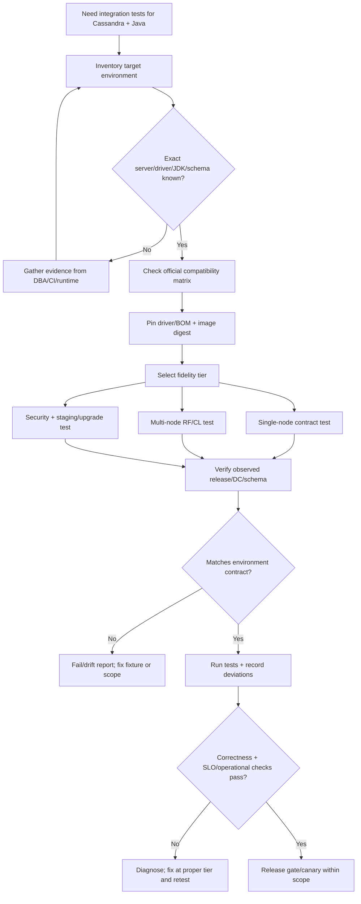

# Choosing Cassandra Versions, Drivers, and Configurations Matching the Target Environment

> **Chapter:** Integration Testing  
> **Scope:** Apache Cassandra — a distributed *wide-column* database — and Java applications using **Cassandra Java Driver 4.x**, Spring Boot/Spring Data Cassandra where applicable, CQL, replication, consistency level, compaction, and repair.
>
> **Learning Objectives:** Select server, driver, JDK, and integration library versions with compatibility evidence; pin Docker images and dependencies; configure tests close to production on aspects affecting correctness; distinguish single-node, multi-node, and staging testing; build tests with Testcontainers; record running versions/protocols/schemas; and establish a test matrix to avoid **“green CI, broken production”**.

## 1. Opening Problem: Tests Pass on One Node, but the Application Fails in Production

A team is developing a Java service that stores events in Cassandra. On a developer's machine:

```text
Docker image:       cassandra:latest
Container nodes:    1
Keyspace RF:        1
Consistency:        LOCAL_ONE
Java Driver:        4.x automatically resolved by dependency resolution
Authentication:     disabled
TLS:                disabled
Schema:             auto-created when tests run
```

Meanwhile, production has:

```text
Cassandra:          fixed operated release/patch
Datacenters:        dc1 + dc2
Keyspace RF:        3 in each DC
Consistency:        LOCAL_QUORUM
Java Driver/JDK:    deployed version per company BOM
Authentication:     dedicated role with RBAC permissions
TLS:                mandatory; CA + hostname verification
Schema:             operations-controlled migrations
Tombstones/TTL:     real data with churn and compaction
```

Tests can PASS yet miss a whole series of issues:

- The driver is incompatible with the target environment's server/protocol.
- The contact point is correct, but the **local datacenter** is misconfigured.
- `LOCAL_QUORUM` cannot be properly tested when the test only has RF=1.
- The application role lacks `SELECT` or `MODIFY` on the real table.
- The truststore/CA/SAN does not match the nodes discovered by the driver.
- Tests auto-generate a table different from the deployed schema.
- Queries run fast on a few test rows but are slow with **large partitions, TTL, and tombstones**.
- A single node cannot reproduce quorum, bootstrap, repair, node loss, or cross-DC latency.

**Key takeaway:** integration testing is valuable when you **know clearly what you are simulating** and have evidence that the critical aspects match the target environment. Not every test needs a miniature production cluster, but you must never use a single-node test to claim multi-replica behavior has been verified.

## 2. What Does “Production-Like” Mean?

It is neither possible nor advisable to replicate every production attribute in CI. We need to prioritize **the similarity axes that affect test conclusions**.

| Similarity Axis | Examples | What Happens When Divergent |
| --- | --- | --- |
| **Server release** | Cassandra major/minor/patch | Changes in CQL, metadata, driver compatibility, features |
| **Java Driver artifact** | Actual runtime group/artifact/version | Different protocol negotiation, retry/paging/codec |
| **JDK and framework** | Java 17, matching Spring Boot/Spring Data | Startup/mapping/serializer differs from production |
| **CQL schema** | Keyspace, table, types, PK, clustering | Test queries run against the wrong schema |
| **RF and datacenter** | `NetworkTopologyStrategy`, `dc1:3` | Quorum and topology remain unverified |
| **Consistency level** | `LOCAL_QUORUM`, serial CL if LWT | Tests miss insufficient-replica errors or different semantics |
| **Security** | TLS, CA, hostname verification, role/RBAC | Tests connect, but production rejects connections |
| **Timeout/retry/paging** | Driver execution profile | Tests skip timeouts, retry storms, extra attempts |
| **Storage behavior** | TTL, tombstone, compaction, disk | Tests pass, but p99/retention fails |
| **Topology/availability** | Multiple nodes, rack, DC, failover | Unknown behavior when losing a replica |
| **Data scale/distribution** | Partition sizes, skew, hot keys | Non-representative tuning |
| **Operations/migrations** | Schema agreement, rolling upgrade | Differs from real environment during deployment |

**The goal is not 100% production parity in every test.** The goal is to document the *fidelity* of each test tier, ensuring **no conclusions exceed the test's scope**.

## 3. Test Tiering: Don't Use One Container to Prove Everything

| Tier | Environment | Suitable for Verifying | Must Not Claim |
| --- | --- | --- | --- |
| **Unit** | Java mocks/stubs | Validation, mapping logic, idempotency key | Compatibility with real Cassandra |
| **Single-node integration** | One Cassandra container, fixed schema | CQL syntax, codec, table mapping, prepared/bind, basic TTL | Quorum/failover/replica repair verified |
| **Multi-node integration** | Multiple Cassandra nodes in a controlled environment | RF, CL, node down, replica consistency, some failure modes | Full parity with multi-DC/production traffic |
| **Security integration** | Test env with TLS/auth/RBAC enabled | Truststore, role permissions, certificate validation | Secure enough if SAN/rotation is skipped |
| **Upgrade compatibility** | Server/driver/versions matrix | Startup, protocol negotiation, schema, query regression | Zero-downtime for every upgrade |
| **Production-like staging** | Representative topology/config/data shape | Canary migration, rolling upgrade, load, operations | Absolute proof for every production scenario |
| **Production canary** | Real traffic/role/schema, limited blast radius | Final verification before wide rollout | Replacement for unit/integration/security tests |

Test suites can be organized as:

```text
pull request
  -> unit
  -> single-node Cassandra integration
  -> API/mapper contract

merge / nightly
  -> multi-node + consistency cases
  -> auth/TLS/RBAC cases
  -> upgrade compatibility matrix

release candidate
  -> staging with equivalent schema, RF/DC, CL
  -> migration/recovery/failover drills
  -> load test + canary + rollback
```

Heavier test tiers generally consume more time and resources. Running a multi-DC cluster on every PR may be unnecessary; however, features involving RF/DC must be tested at the appropriate tier **before release**.

## 4. Inventory the Target Environment Before Picking a Container

Do not start with “which Docker tag is fastest to grab?”. Start with an **inventory sheet** confirmed from the running system.

Example template of information to collect (**illustrative** values, not assumed to be your topology):

```yaml
target:
  cassandra:
    distribution: apache-cassandra
    release: "<exact-major.minor.patch>"
    image-digest-or-package-build: "<immutable-reference>"
    cluster-name: "orders-prod"
    datacenters:
      dc1:
        rf: 3
      dc2:
        rf: 3
    keyspace: "orders"
    replication-strategy: "NetworkTopologyStrategy"
  application:
    jdk: "<exact-runtime-build>"
    spring-boot: "<resolved-version-or-none>"
    spring-data-cassandra: "<resolved-version-or-none>"
    java-driver: "<group:artifact:exact-version>"
    local-datacenter: "dc1"
    default-consistency: "LOCAL_QUORUM"
  security:
    native-tls-required: true
    server-hostname-verification-required: true
    authentication-mechanism: "<actual-authenticator>"
    authorization-mechanism: "<actual-authorizer>"
  migration:
    schema-revision: "<migration-id-or-hash>"
```

This is a **manifest template**, not a default Cassandra or Spring Boot configuration format. Project teams can store it alongside CI artifacts and release metadata for cross-checking; do not record secrets.

### Where to Get This Information?

- SRE/DBA provides topology, release inventory, and approved upgrade policies.
- Package manager/container registry provides **build/image digest**.
- CI/build tool provides the **resolved dependency tree**.
- The running application provides JDK/runtime config.
- Cassandra `system.local`/`system.peers_v2`, `nodetool`, and schema metadata provide evidence from the server.
- Configuration/secret management provides **security policy names**, without exporting passwords/private keys into reports.

Record the **observation date**, cluster, DC, and approver, because the target environment may change between test authoring and deployment.

## 5. Multiple Types of “Cassandra Versions” to Distinguish

Saying “Cassandra version 4” is not enough.

| Component | Example Representation | Meaning |
| --- | --- | --- |
| **Server release** | `4.1.x`, `5.x` | Running server codebase, features/behaviors |
| **Distribution/build** | Self-managed Apache, compatible distribution | May differ in patches, options, support policy |
| **CQL version** | CQL protocol/language metadata | Not synonymous with server release |
| **Native protocol** | Protocol advertised by server and negotiated by driver | Affects wire compatibility and paging/feature support |
| **cqlsh version** | `cqlsh` client version | Not the Java Driver version |
| **Java Driver version** | `4.x.y` of a specific artifact | API/config, bug fixes, and compatibility |
| **JDK runtime** | Java 17/21... per distribution | Affects TLS/codec/compatibility |
| **Spring Data/Boot version** | Version from BOM | Mapping/repository/autoconfiguration |
| **Container image digest** | `sha256:...` | Identifies exact server image bytes |

**Do not infer:** `cqlsh --version` returns X ⇒ Java Driver is X, or `cql_version` is the server release.

### Inspecting Server Metadata via CQL

With appropriate permissions, on a connection to the inspected node:

```cql
SELECT release_version,
       cql_version,
       native_protocol_version,
       data_center,
       cluster_name
FROM system.local;
```

Existing/supported columns may vary by server release/distribution. If a column does not exist, inspect the actual `system.local` schema—never insert an “expected” value into the report.

For Cassandra releases that have `system.peers_v2`:

```cql
SELECT peer, data_center, rack, release_version
FROM system.peers_v2;
```

In older versions, peer metadata may reside in a different table. Do not use the same peer query across all releases without verification.

Use `nodetool` to cross-check:

```bash
nodetool version
nodetool status
```

A SELECT from `system.local` only describes the node serving that query; to assert the entire cluster has upgraded to the new version, you need a **per-node inventory**, not just a single row.

## 6. Server–Driver Compatibility: Don't Guess by Major Version

A Java Driver version must be compatible with at least:

1. The operated **Cassandra server release**/distribution.
2. The **native protocol** negotiated between driver and server.
3. The **JDK runtime** on which the project runs.
4. The **framework/BOM** when using Spring Boot/Spring Data.
5. CQL features actually used by the service: data types, UDT, LWT, paging, SAI, vector search, TLS/auth...
6. Upgrade/mixed-version mechanisms that production may go through.

There is no rule like **server 5 ⇒ driver 5 required** or **driver 4 ⇒ server 4 only**. Compatibility must be confirmed by the **official support documentation of the specific artifact release and actual tests**.

### Decision Matrix

| Environment | Cassandra Server | Driver/Framework | What Must Be Proven |
| --- | --- | --- | --- |
| Current production | `TARGET_CURRENT` | `APP_RUNTIME_CURRENT` | Baseline tests PASS |
| Production after upgrade | `TARGET_NEXT` | `APP_RUNTIME_CURRENT` | Still supported by old driver? Did features/protocol change? |
| App after driver upgrade | `TARGET_CURRENT` | `APP_RUNTIME_NEXT` | API, config, codec, TLS, retry behavior |
| Both changing | `TARGET_NEXT` | `APP_RUNTIME_NEXT` | Data + schema + mapping + migration |
| Mixed-version rolling window | Allowed mixed release set | Released driver | Connection/metadata/CL during the upgrade window |
| Managed service | Provider version/compat level | Provider-recommended driver | Endpoint/auth/bundle/TLS and CQL features |

**Do not mark “PASS” merely because the combination compiles.** Tests must actually connect, prepare/execute CQL, test paging, auth, codecs, and verify at least the business-critical operations.

### Compatibility Does Not Mean Every Feature Works

A driver might connect to an older server while **a new CQL feature** is not yet available on that server, or conversely the driver/runtime may not yet support a new data type. A “SELECT 1 row” test is a smoke test; you must have **feature contract tests** matching real queries.

## 7. Pin Java Dependencies to the Exact Deployed Version

Example Maven dependency for a Cassandra Java Driver 4.x line:

```xml
<!-- Version uses the value approved by the BOM or dependencyManagement.
     Do not paste a placeholder version into a project just to build immediately. -->
<dependency>
  <groupId>com.datastax.oss</groupId>
  <artifactId>java-driver-core</artifactId>
  <version>APPROVED_DRIVER_VERSION</version>
</dependency>
```

`APPROVED_DRIVER_VERSION` is a textual placeholder, **not a verified valid Maven version**. Distributions of driver 4.x may use different group/artifact coordinates depending on the release line. Use the coordinates chosen by **the project and vendor support**, rather than changing namespaces to match a blog post.

### With Spring Boot

If the project uses `spring-boot-starter-data-cassandra`, the Spring Boot BOM typically manages the related dependencies:

```xml
<!-- Common starter coordinates; version is managed by
     the project's Spring Boot dependency management. -->
<dependency>
  <groupId>org.springframework.boot</groupId>
  <artifactId>spring-boot-starter-data-cassandra</artifactId>
</dependency>
```

Do not arbitrarily pull a driver patch while ignoring Spring Data Cassandra's compatibility with that driver. If an override is needed for a security advisory or bug fix, you must **verify the matrix**, resolve the dependency tree, and run regression tests.

### Inspect Resolved Dependencies, Not Just Declaration Files

```bash
mvn dependency:tree
```

Or:

```bash
./gradlew dependencyInsight \
  --dependency java-driver-core \
  --configuration runtimeClasspath
```

These commands illustrate project inspection **during real work**. In this authoring process, no builds are run and no external project files are accessed.

Record:

- Actual driver group/artifact/version.
- Spring Data Cassandra/Boot runtime versions.
- JDK version and vendor/distribution.
- Whether duplicate driver versions are being pulled in.
- Whether test runtime and production runtime share the same dependency graph.
- Whether the application container image actually contains the new artifact.

A `pom.xml` declaring version X does not prove production is running X if the artifact/CI image is stale or transitive resolution differs.

## 8. Pin Docker Images: Floating Tags Are Not Enough

Avoid:

```yaml
# Do not use to prove reproducibility:
image: cassandra:latest
```

`latest` is a mutable label; on another day, a build/pull can fetch a different server release, altering API/config and making bugs hard to reproduce.

Even a tag like:

```text
cassandra:4.1
```

can point to different patches/builds over time. To lock the exact image, use an **immutable digest** when supported by the registry and process:

```text
cassandra:4.1.x@sha256:<verified-immutable-digest>
```

This is **illustrative syntax**; `4.1.x` and the digest placeholder are not used directly. Actual values must come from verified registry/build metadata, never fabricated.

### Items to Pin

- Specific server **major/minor/patch**.
- Container **digest** pulled by CI.
- Architecture/platform if multiple image variants exist.
- JDK build and driver runtime artifact.
- Testcontainers/Spring Boot/Spring Data versions.
- Schema init files and migration revision.

**Pinning does not mean never updating.** Establish an intentional patch-upgrade workflow: update the matrix and re-run tests before changing lockfiles/digests.

## 9. What Is Testcontainers and What Does It Verify?

Testcontainers enables Java tests to automatically start Cassandra in Docker, wait for the service to be ready, and map ports into the test environment.

A containerized test provides these benefits:

- Uses a **real Cassandra server**, not a mocked CQL parser.
- Verifies driver connectivity and native protocol negotiation.
- Verifies schema, prepared statements, codecs, and mapping.
- Runs in CI when Docker/runtime is available.
- Easily isolates test data and reproduces failures by image digest.

However, a single `CassandraContainer` **is not a three-replica cluster**. It is usually only sufficient for *single-node integration*. You must explicitly state that this test **does not prove**:

- RF=3/`LOCAL_QUORUM` when a replica is lost.
- Cross-DC replication and coordinator locality.
- Repair, bootstrap, decommission, or topology changes.
- Throughput and tail latency on production partitions.
- Production-like TLS/roles if the container runs unsecured by default.

## 10. Preparing Testcontainers and JUnit Dependencies

For example, in a Testcontainers Java line there are Cassandra and JUnit Jupiter modules; **coordinates/packages may change between major releases**, so the code below explicitly targets the **Testcontainers 1.x API**:

```xml
<!-- Versions are managed by the project's Testcontainers BOM.
     Verify artifacts and packages against the actual release. -->
<dependency>
  <groupId>org.testcontainers</groupId>
  <artifactId>cassandra</artifactId>
  <scope>test</scope>
</dependency>

<dependency>
  <groupId>org.testcontainers</groupId>
  <artifactId>junit-jupiter</artifactId>
  <scope>test</scope>
</dependency>
```

With newer Testcontainers major versions, API package/module names may change. **Do not copy 1.x example code into another version and conclude “Cassandra is incompatible” if the compiler reports missing classes**; that may be a test library difference.

Do not change the production Java Driver merely to work around a Testcontainers import change.

### Docker/CI Is a Separate Prerequisite

The CI runner must have an authorized container runtime, sufficient memory/disk, valid network policy, and appropriate quotas. Distinguish between:

- Docker is not running.
- Image pull is blocked by registry/network.
- Container OOM / not ready.
- Cassandra started, but native transport is not ready yet.
- Actual CQL test failure.

Do not lump all five cases together as a “Testcontainers flake”.

## 11. CQL Fixture Example: Keyspace and Table in Container

Create a fixture script in the test resources of the **example project** (not a file to be written in this worker step):

```text
src/test/resources/cql/it-schema.cql
```

Example content:

```cql
-- Runs only on a single-node test cluster with predetermined DC datacenter1.
CREATE KEYSPACE IF NOT EXISTS it_lab
WITH replication = {
  'class': 'NetworkTopologyStrategy',
  'datacenter1': 1
}
AND durable_writes = true;

CREATE TABLE IF NOT EXISTS it_lab.events_by_customer_day (
    tenant_id text,
    customer_id uuid,
    day_bucket date,
    event_time timestamp,
    event_id uuid,
    event_type text,
    payload text,
    PRIMARY KEY ((tenant_id, customer_id, day_bucket),
                 event_time, event_id)
) WITH CLUSTERING ORDER BY (
    event_time DESC, event_id ASC
);
```

Notable points:

- `RF=1` is valid **only for a single-node fixture**; do not infer that production should use RF=1.
- `datacenter1` is an **assumption that must be verified against the actual container image**. If the DC differs, both the script and Java config must be updated together; do not hardcode a string without confirming it.
- The table is designed around the `tenant + customer + day` query, not a table generated to fit an ORM.
- `CREATE TABLE IF NOT EXISTS` can mask a pre-existing table with a different definition. Tests must **verify actual metadata** after setup.
- Use version-controlled schemas/migrations; a fixture is just a test seeding mechanism, not a production upgrade mechanism.

## 12. Testcontainers 1.x: Java Integration Example Against a Real Server

The example below uses **Java 17**, JUnit 5, the Testcontainers Cassandra module from the **1.x** line, and Cassandra Java Driver 4.x per the project's supported artifact.

**Before running**, CI must set the system property `it.cassandra.image` to an **approved image reference** (pinned by version/digest). Never default to `latest` in code.

```java
import static org.junit.jupiter.api.Assertions.*;

import java.net.InetSocketAddress;
import java.time.Instant;
import java.time.LocalDate;
import java.util.UUID;

import org.junit.jupiter.api.AfterAll;
import org.junit.jupiter.api.BeforeAll;
import org.junit.jupiter.api.Test;
import org.testcontainers.containers.CassandraContainer;
import org.testcontainers.junit.jupiter.Container;
import org.testcontainers.junit.jupiter.Testcontainers;
import org.testcontainers.utility.DockerImageName;

import com.datastax.oss.driver.api.core.CqlIdentifier;
import com.datastax.oss.driver.api.core.CqlSession;
import com.datastax.oss.driver.api.core.DefaultConsistencyLevel;
import com.datastax.oss.driver.api.core.cql.PreparedStatement;
import com.datastax.oss.driver.api.core.cql.Row;

@Testcontainers
class CassandraDriverContractIT {

    private static final String IMAGE =
        System.getProperty("it.cassandra.image");

    @Container
    static final CassandraContainer<?> cassandra =
        new CassandraContainer<>(
            DockerImageName.parse(requireImage(IMAGE))
        ).withInitScript("cql/it-schema.cql");

    private static CqlSession session;

    private static String requireImage(String image) {
        if (image == null || image.isBlank()) {
            throw new IllegalStateException(
                "Set -Dit.cassandra.image to an approved, pinned image");
        }
        return image;
    }

    @BeforeAll
    static void connect() {
        // datacenter1 must match system.local of the actual image.
        session = CqlSession.builder()
            .addContactPoint(new InetSocketAddress(
                cassandra.getHost(),
                cassandra.getMappedPort(9042)))
            .withLocalDatacenter("datacenter1")
            .withKeyspace(CqlIdentifier.fromCql("it_lab"))
            .build();
    }

    @AfterAll
    static void closeSession() {
        if (session != null) {
            session.close();
        }
    }

    @Test
    void readWriteUsingRealCqlAndDriver() {
        UUID customer = UUID.randomUUID();
        UUID event = UUID.randomUUID();
        LocalDate day = LocalDate.of(2026, 11, 21);
        Instant timestamp = Instant.parse(
            "2026-11-21T09:30:00Z");

        PreparedStatement insert = session.prepare(
            "INSERT INTO events_by_customer_day " +
            "(tenant_id, customer_id, day_bucket, " +
            "event_time, event_id, event_type, payload) " +
            "VALUES (?, ?, ?, ?, ?, ?, ?)"
        );

        session.execute(
            insert.bind(
                "tenant-test",
                customer,
                day,
                timestamp,
                event,
                "CREATED",
                "payload-v1"
            ).setConsistencyLevel(
                DefaultConsistencyLevel.LOCAL_ONE)
        );

        PreparedStatement select = session.prepare(
            "SELECT event_id, event_type, payload " +
            "FROM events_by_customer_day " +
            "WHERE tenant_id = ? " +
            "AND customer_id = ? AND day_bucket = ?"
        );

        Row row = session.execute(
            select.bind("tenant-test", customer, day)
                .setConsistencyLevel(
                    DefaultConsistencyLevel.LOCAL_ONE)
        ).one();

        assertNotNull(row);
        assertEquals(event, row.getUuid("event_id"));
        assertEquals("CREATED",
                     row.getString("event_type"));
        assertEquals("payload-v1",
                     row.getString("payload"));
    }
}
```

### Limitations to State Clearly Before Copying

1. `CassandraContainer`/`@Testcontainers` uses APIs and imports specific to **Testcontainers 1.x**; newer majors may differ.
2. The code above **does not enable TLS/auth**. It only verifies basic driver/schema/codec compatibility with the server image.
3. `LOCAL_ONE` is chosen because of the single-node/RF=1 fixture; **it is not the recommended consistency level for production**.
4. The `datacenter1` default must be verified against `system.local` of the pinned image.
5. The test only uses random keys and a single partition; it does not reproduce heavy load or quorum.
6. `withInitScript` depends on the CQL initialization capability of the chosen Testcontainers release.
7. The test code creates one session for the whole class and closes it on completion; do not create a `CqlSession` per statement.
8. Include a step to verify server release/image digest in the test report as shown in the next section.

**Do not claim this lesson compiled or ran the snippet on a real project.** When integrating, the team must resolve dependencies properly and run in a configured CI environment.

## 13. Verifying the Actual Container Version Inside the Test

Having CI declare “using image X” is good, but **reading back the server release** catches wrong images or silent changes.

Example JUnit method:

```java
@Test
void serverVersionAndDcAreExpected() {
    Row local = session.execute(
        "SELECT release_version, data_center, " +
        "cluster_name FROM system.local"
    ).one();

    assertNotNull(local);

    String release = local.getString("release_version");
    String dc = local.getString("data_center");
    String cluster = local.getString("cluster_name");

    assertEquals("datacenter1", dc);
    assertNotNull(release);
    assertFalse(release.isBlank());
    assertNotNull(cluster);

    // CI should also compare release against the approved manifest.
    // Avoid hardcoding a guessed patch version in the lesson example.
}
```

The snippet above is meant as a **method inserted into the previous test class**, not a standalone program. Real tests should compare `release` against the **expected release from the CI manifest** and fail on mismatch, rather than just calling `assertNotNull`.

### Don't Just Check a Version String Prefix

A condition like `release.startsWith("4.")` could let 4.0 pass instead of 4.1, even when the test targets a specific patch. Declare the expected major/minor/patch/build or an explicit allowlist for each job.

In multi-node environments, iterate the inventory across nodes through an administrative/authorized channel—do not treat a single `system.local` query as cluster-wide proof.

## 14. Recording a Runtime Compatibility Manifest in the Test Report

A minimal record without secrets:

```json
{
  "suite": "cassandra-driver-contract",
  "serverRelease": "<observed-release>",
  "serverImageDigest": "<resolved-image-digest>",
  "javaRuntime": "<observed-jdk>",
  "javaDriverArtifact": "<resolved-driver-version>",
  "springDataCassandra": "<resolved-version-or-none>",
  "localDatacenter": "datacenter1",
  "keyspace": "it_lab",
  "rfInLocalDc": 1,
  "consistency": "LOCAL_ONE",
  "tlsEnabled": false,
  "authEnabled": false,
  "schemaRevision": "<fixture-hash>",
  "testProfile": "single-node-contract"
}
```

Why record `tlsEnabled=false`? Because a PASS result only proves the **non-TLS** scenario; it prevents readers from mistakenly believing production security mechanisms were verified.

### Two Layers of Version Verification

- **Declarative:** CI manifest, lockfile, Docker digest, and Gradle/Maven resolution.
- **Observed:** Server version from `system.local`, actual JDK runtime, effective driver artifact, and config at test runtime.

If declared and observed values differ, the test must **fail or at least flag drift**, never continuing to issue an “environment matched” conclusion.

## 15. Spring Boot: Use Dynamic Properties Instead of Hardcoding Ports

When using Spring Boot/Spring Data Cassandra, tests should not assume the Docker container maps `9042:9042` on the host. Docker may assign a random mapped port.

Example Spring Boot test with **Testcontainers 1.x**:

```java
import org.junit.jupiter.api.Test;
import org.springframework.boot.test.context.SpringBootTest;
import org.springframework.test.context.DynamicPropertyRegistry;
import org.springframework.test.context.DynamicPropertySource;
import org.testcontainers.containers.CassandraContainer;
import org.testcontainers.junit.jupiter.Container;
import org.testcontainers.junit.jupiter.Testcontainers;
import org.testcontainers.utility.DockerImageName;

@Testcontainers
@SpringBootTest
class SpringDataCassandraIT {

    @Container
    static final CassandraContainer<?> cassandra =
        new CassandraContainer<>(
            DockerImageName.parse(
                System.getProperty("it.cassandra.image")
            )
        ).withInitScript("cql/it-schema.cql");

    @DynamicPropertySource
    static void cassandraProperties(
            DynamicPropertyRegistry registry) {

        registry.add(
            "spring.cassandra.contact-points",
            cassandra::getHost);
        registry.add(
            "spring.cassandra.port",
            () -> cassandra.getMappedPort(9042));
        registry.add(
            "spring.cassandra.local-datacenter",
            () -> "datacenter1");
        registry.add(
            "spring.cassandra.keyspace-name",
            () -> "it_lab");
        registry.add(
            "spring.cassandra.schema-action",
            () -> "none");
    }

    @Test
    void springContextStartsAgainstRealContainer() {
        // Add real repository round-trip/schema tests.
    }
}
```

The example uses the **`spring.cassandra`** prefix from a newer Spring Boot line; **older Spring Boot releases may use a different prefix**. Check the project's configuration metadata and resolved Spring Data version. Do not treat a successful context startup as sufficient: include repository CQL round-trip and mapping/schema assertions.

### Why `schema-action: none` Matters

If tests let Spring Data auto-create tables from entities while production uses separate DDL migrations, an incorrect mapping can still PASS because both the test and app **create the same wrong schema**.

Prefer:

- Version-controlled schema fixtures derived from contracts/migrations.
- Running the app without ad-hoc schema modification.
- Repository tests against the pre-existing schema.
- Tests asserting column names, primary keys, data types, and query shapes.

For tests specifically covering the auto-schema feature, enable schema action in a separate suite, but do not use it to validate production migrations.

## 16. A Single Node Cannot Prove `LOCAL_QUORUM` for RF=3

Cassandra consistency levels must be understood in terms of the **actual replication factor and datacenter**.

With `NetworkTopologyStrategy` RF=3 in `dc1`:

```text
LOCAL_QUORUM = floor(3/2) + 1 = 2 local replicas
```

With RF=1:

```text
LOCAL_QUORUM = floor(1/2) + 1 = 1 local replica
```

The CQL label `LOCAL_QUORUM` may look identical, but the **number of replicas awaited is completely different**.

### Environment and Conclusion Matrix

| Setup | Local RF | CL | What Can Be Verified |
| --- | ---: | --- | --- |
| Single node | 1 | `LOCAL_ONE` | CQL/codec/basic read/write |
| Single node | 1 | `LOCAL_QUORUM` | Valid CL, but only one replica; **does not verify 2/3 quorum** |
| Three nodes in same DC | 3 | `LOCAL_QUORUM` | 2/3 quorum, some node-down scenarios |
| Two DCs, three nodes each | 3 + 3 | `LOCAL_QUORUM` | Local coordinator/replication and per-DC behavior |
| Two DCs | 3 + 3 | `EACH_QUORUM` for appropriate writes | Per-DC quorum ACK per policy; WAN cost |

**Do not switch the test consistency level to `LOCAL_ONE` and conclude “the code behaves like production”** if the real application uses `LOCAL_QUORUM`. Document the simulation level and add multi-node tests.

### Testing Controlled Failure Modes

With three nodes at RF=3 and one node down, `LOCAL_QUORUM` can continue succeeding if **two local replicas** remain available and healthy, though in practice this also depends on topology, latency, and request type. This scenario belongs in multi-node integration or staging, not a single-container test.

## 17. Local Datacenter Must Match Actual Topology

Java Driver 4.x must be configured with the local datacenter matching the environment.

Example:

```java
CqlSession session = CqlSession.builder()
    .addContactPoint(new InetSocketAddress(
        "cassandra-1.internal", 9042))
    .withLocalDatacenter("dc1")
    .build();
```

This is a **conceptual configuration** example. Production requires approved TLS/auth, keyspace, timeouts, and contact points.

If tests set `datacenter1` while production uses `dc1`, ensure environment-specific config is not hardcoded into the application artifact.

### Checks to Include

1. `system.local.data_center` on the connected node.
2. Per-DC RF in the keyspace.
3. Driver effective local DC.
4. Coordinator chosen in execution info.
5. DNS/IP endpoints reachable from the test app.
6. TLS certificate SAN matching actual endpoints.
7. Multi-DC failure routing and consistency if functionally required.

**The DC name in code does not alter keyspace replication.** `withLocalDatacenter("dc1")` is the driver's routing policy, whereas `'dc1': 3` in the keyspace defines replica placement.

## 18. Keep CQL/Query Configuration Aligned with Production

A test can use the exact right driver/server version yet behave differently if **the CQL differs from production**.

For example, production runs:

```cql
SELECT event_time, event_id, event_type
FROM events_by_customer_day
WHERE tenant_id = ?
  AND customer_id = ?
  AND day_bucket = ?
LIMIT 50;
```

Whereas the test only runs:

```cql
SELECT * FROM events_by_customer_day;
```

This test fails to verify:

- Full binding of the partition key.
- Codecs for `date`, `timestamp`, and `uuid`.
- Ordering and clustering conditions.
- Page size and LIMIT behavior.
- Statement consistency policy.
- Metadata projection and row mapper.

**Test the exact real CQL statements with matching bind markers/data types and query shapes.** If the app has multiple queries across multiple denormalized tables, every critical query contract should have a regression test.

### Every Test Case Must Know Its Partition Key

Cassandra does not provide general joins/foreign keys like an RDBMS. Tables are typically designed around queries. If tests use tiny datasets that allow `ALLOW FILTERING` to succeed, that does not prove the query will scale on large partitions in production.

## 19. Schema Drift: Same Table Name, Different Columns

Suppose the test fixture has:

```cql
CREATE TABLE it_lab.events_by_customer_day (
    tenant_id text,
    customer_id uuid,
    day_bucket date,
    event_time timestamp,
    event_id uuid,
    event_type text,
    payload text,
    PRIMARY KEY ((tenant_id, customer_id, day_bucket),
                 event_time, event_id)
);
```

Meanwhile production has `payload blob` or a different clustering key. A repository may PASS in CI yet fail codec/query execution in production.

Inspect schema metadata:

```cql
SELECT column_name, kind, position, type
FROM system_schema.columns
WHERE keyspace_name = 'it_lab'
  AND table_name = 'events_by_customer_day';
```

In a real target, substitute the keyspace/table from the approved inventory. Results must be compared against the **canonical schema contract**, not merely printed to logs.

### Schema Hash/Migration ID

A fingerprint can be computed over:

- Keyspace replication/durable writes.
- Table definitions and PK/clustering ordering.
- Column names/types and UDT definitions.
- Index/SAI definitions if used.
- Important compaction/compression/TTL/gc_grace options.
- Migration IDs.

Be sure to normalize ordering/syntax before hashing, since semantically equivalent DDL strings may differ in formatting. **A hash is only a detector**; it does not replace understanding whether a schema difference is breaking.

## 20. Sample Data Must Reflect Key Distribution, Not Just a Few Pretty Rows

A round-trip test with one row proves the driver can read/write one case. It does not represent:

- Hot customers with hundreds of thousands of events/day.
- Partitions differing in size by orders of magnitude.
- Null values, large collections, large blobs.
- Overlapping TTLs and heavy tombstones.
- Write contention on the same partition key.
- Highly skewed traffic across tenants.

### Recommended Test Datasets

| Dataset | Purpose |
| --- | --- |
| **Tiny/contract** | A few rows, basic types, mapping |
| **Boundary** | Null/UNSET, empty collections, Unicode, edge timestamps/UUIDs |
| **Query-shape** | Multiple clustering rows within one partition, paging |
| **Skew/hot-key** | Certain partitions carrying heavy load |
| **TTL/delete** | Expiration, tombstones, and retention |
| **Concurrency** | Concurrent writes, read-after-write, LWT if used |
| **Large-but-bounded** | Approximates production distribution within safe bounds |
| **Sensitive-data-safe** | Synthetic data; never copy production PII |

**Do not copy raw customer data into CI** to look “production-like”. Use synthetic data that preserves the **distribution** and relevant edge cases.

### One Large Row Is Not the Same as Many Rows

Cassandra differentiates partition count, rows per partition, cell/collection size, and tombstone density. Load tests must report data structure, not just “inserted one million rows”.

## 21. TTL, Tombstones, and System Time

An application using TTL needs tests for **actual expiration logic**, but tests relying on `Thread.sleep(1000)` are prone to flakiness due to:

- Unstable timers/test schedulers and CI latency.
- Differences between server clocks and mutation application timestamps.
- Clock skew, GC, compaction, and the read path.
- Polling right at the TTL boundary.

Example CQL for the lab:

```cql
UPDATE it_lab.events_by_customer_day
USING TTL 30
SET payload = 'temporary'
WHERE tenant_id = 'tenant-test'
  AND customer_id = 11111111-1111-4111-8111-111111111111
  AND day_bucket = '2026-11-21'
  AND event_time = '2026-11-21T10:00:00Z'
  AND event_id = aaaaaaaa-aaaa-4aaa-8aaa-aaaaaaaaaaaa;
```

This illustrates **cell TTL**; the record/clustering key must exist per schema, and other columns can remain alive after `payload` expires.

### Better Testing Practices

- Use a sufficiently long TTL to reduce write/read races.
- Poll with an explicit timeout/deadline and reasonable interval.
- Assert both while data is **still alive** and after it has expired.
- Do not rely on `TTL(col)=null` alone to conclude “deleted”, as live values without a TTL also return null.
- Do not indiscriminately run `nodetool compact` or lower `gc_grace_seconds` to test tombstones in production.
- Evaluate repair/compaction semantics in a matching multi-node environment.

**Cassandra TTL is server-side logic** and does not replace purging/protecting data in backups or external indexes per retention policy.

## 22. Compaction, Tombstones, and Repair Must Be Tested at the Right Tier

Even when a single-node test uses the same server release, it usually fails to reproduce conditions that trigger production incidents:

- Many SSTables accumulating over time.
- Write-heavy workloads and compaction backlogs.
- Slow tombstone scans caused by deletes/TTLs.
- Replicas missing deletes and zombie-data risk if repair is incomplete.
- Disk pressure and GC pauses.
- Hinted handoff, repair/streaming, and network partitions.

### Testing Hierarchy for These Mechanisms

| Goal | Single-Node | Multi-Node | Staging/Load |
| --- | --- | --- | --- |
| CQL TTL expiration | Yes | Yes | Yes |
| DELETE reads back null | Yes | Yes | Yes |
| Observing tombstone/read cost | Limited | Better | Best under representative load |
| Repair replica convergence | Insufficient | Suitable | Suitable |
| Node-down failure handling | Does not verify real quorum | Suitable | Suitable |
| Compaction pressure/p99 | Low representativeness | Moderate | Suitable with realistic workload |
| Cross-DC replica lag | No | Requires multiple DCs | Suitable |

Do not build an overly heavy suite that makes CI take hours on every PR. Instead, **place tests in the right tier**, and require them before major releases.

## 23. Security Fidelity: TLS, Authentication, and Authorization

An unsecured default Cassandra container can verify CQL logic, but **does not prove the production application can connect**.

The target environment may enable:

```yaml
# Conceptual snippet; option names/formats depend on the server release:
authenticator: PasswordAuthenticator
authorizer: CassandraAuthorizer

client_encryption_options:
  enabled: true
  optional: false
  require_client_auth: false
```

Do not copy this snippet directly into production `cassandra.yaml`. Keys, server certificates, and rollout order depend on release and security policy.

### What a Security Integration Suite Should Cover

- Valid credentials ⇒ login succeeds.
- Wrong credentials ⇒ login is rejected.
- `reader` role ⇒ SELECT on allowed table succeeds.
- `reader` role ⇒ MODIFY is rejected.
- Valid CA/truststore ⇒ TLS handshake and server verification succeed.
- Wrong CA ⇒ rejected.
- Wrong hostname/SAN ⇒ **must be rejected**, not just “SSLContext created”.
- If mTLS is enabled, only a valid client certificate/key can connect.
- Certificate rotation has proper overlap/rollback.
- Peers discovered by the driver all present valid endpoint certificates.

**Calling `CqlSession.withSslContext(...)` alone is not proof that hostname verification is active**: inspect the SSL engine factory and write negative tests per driver release. Never use a trust-all certificate just to turn tests green.

### Secrets Must Be Controlled

Use a secret manager or test credentials scoped only to isolated environments; never commit passwords or keystore private keys to the repository. CI logs must never print secrets or raw DSNs containing passwords.

## 24. Spring Boot/Test Configs Must Match Where Behavior Is Affected

Key settings to align between test and target:

| Configuration | Why It Matters |
| --- | --- |
| Contact points | Connect to the right cluster with enough endpoints for discovery |
| Local datacenter | Coordinator locality, latency/CL |
| Keyspace | Select the right namespace and RF |
| Request timeout | Timeout semantics, keeping in-flight bounded |
| Retry policy | Attempt budget, idempotency, and overload |
| Speculative execution | Issues extra attempts for slow requests |
| Page size | Paging and memory/network |
| Authentication | Role/login behavior |
| TLS/hostname verification | Connection security |
| Connection pool | Backpressure/throughput |
| Consistency level | Consistency/availability |
| Serial CL for LWT | Paxos semantics |
| Schema action | Whether the app auto-creates/alters schema |
| Converters/codecs | CQL/Java type compatibility |
| Logging/tracing | Overhead and data protection |

### Production Values Do Not Always Need Verbatim Copying

A 5-second production timeout can make CI tests very slow when simulating node failures. Shorter test timeouts may be used for smoke tests, **but** you must have a suite verifying timeout/retry behaviors with the actual policy budget.

If `LOCAL_QUORUM` is replaced with `LOCAL_ONE` for single-node tests, that is **a deviation that must be disclosed**, never hidden under a profile named “prod-like”.

## 25. Distinguishing Configured Overrides from Effective Configuration

An application might declare:

```yaml
spring:
  cassandra:
    keyspace-name: it_lab
    local-datacenter: datacenter1
```

Yet environment variables, an `application-test.yml` profile, system properties, or custom beans can override them.

Verify:

1. **Which Spring Boot profile** is active during tests.
2. Whether the Java Driver's config loader/HOCON is being used.
3. Whether `CqlSession` is created by auto-config or a custom bean.
4. Effective local datacenter, keyspace, and host connectivity.
5. Which secret source supplies credentials/TLS.
6. Whether the runtime dependency graph matches production.

A common bug: Testcontainers starts the right container, but a custom `CqlSession` bean reads the host from an environment variable and connects to **a different cluster**.

**Tests must prove that real queries hit the target container**, not merely that the container started.

## 26. Never Let Integration Tests Accidentally Touch Production

This is a critical safety requirement.

### Essential Guardrails

- Test configs accept only **container** or **dedicated staging** endpoints, rejecting production hosts.
- When using external staging, enforce an explicit cluster-identity allowlist.
- In CI, never mount production secrets without justification and approval.
- Tests use dedicated keyspaces/test accounts with least privilege.
- Fail fast when `it.cassandra.image` is missing or local DC/schema differs from expectations.
- Verify cluster name, endpoint, release, and schema revision **before destructive mutations**.
- Use random keys/test-run IDs; never `TRUNCATE` production tables.
- Separate destructive/chaos tests from smoke tests and require explicit approval.

### Illustrative Code Guard

```java
private static void assertSafeTestTarget(
        String clusterName, String keyspace) {

    if (!"it_lab".equals(keyspace)) {
        throw new IllegalStateException(
            "Refusing destructive test outside it_lab");
    }

    if (clusterName != null &&
        clusterName.toLowerCase().contains("prod")) {
        throw new IllegalStateException(
            "Refusing to operate on a production-like cluster");
    }
}
```

This is **only an illustrative code-level guard**; a cluster name might not contain the substring `prod` even though it is production. Never rely on a substring check as sufficient protection. Enforce network isolation, credentials without production permissions, CI policies, and explicit test-environment allowlists.

**An integration test performing DELETE/TRUNCATE must never be allowed to run against a shared production cluster.**

## 27. Migration Testing Must Cover Both Before and After Schema States

A test that only creates the **latest** schema and runs the new application is insufficient to prove production can upgrade from the existing schema.

### Proper Scenario

```text
Schema v1 (current production schema)
    |
    +--> Seed v1 data
    |
    v
Run v1 -> v2 migration
    |
    +--> Verify schema agreement
    +--> Read old data with new app/queries
    +--> If needed, test old app and new app coexisting
    |
    v
Verify v2 contract
    |
    +--> Rollback plan / compatibility window
```

### Questions to Test

- Is the migration idempotent if re-run?
- During a rolling deploy, can both old and new app versions read/write?
- How do UDT/column/index changes affect prepared statements?
- Is data backfill needed before new queries work?
- Does the partition key change? If so, a new table and data migration are typically needed rather than ad-hoc `ALTER` statements.
- How long does schema agreement take? Could a node lack the new schema when tests begin?
- Is code rollback compatible with the altered schema?

**Never assume `CREATE TABLE IF NOT EXISTS` proves a migration ran completely.** It can silently skip a pre-existing table with the wrong definition.

## 28. Upgrade and Mixed-Version Testing When Cassandra Release Changes

During a Cassandra rolling upgrade, nodes may run **mixed versions within the supported window**. A simple integration test running all nodes on the new version will not verify the transition period.

Example matrix:

| Phase | Node Versions | Driver | Checks |
| --- | --- | --- | --- |
| Pre-upgrade | All `CURRENT` | `DRIVER_CURRENT` | Baseline CRUD, schema, paging |
| Canary node | Some `NEXT`, rest `CURRENT` | `DRIVER_CURRENT` | Driver discovery, queries, CL, metadata |
| Rolling progress | Shifting mixed ratio | `DRIVER_CURRENT` | Latency/errors, repair/streaming constraints |
| Upgrade complete | All `NEXT` | `DRIVER_CURRENT` | Regression of all operations |
| App upgrade | All `NEXT` | `DRIVER_NEXT` | New driver config/codec/retry behavior |

This is a **planning diagram**, not confirmation that any arbitrary `CURRENT`/`NEXT` pair is supported by Cassandra. You must check official upgrade paths, feature flags, and version/rollback limits of the specific release.

### Why Native Protocol Matters Too

Driver and server must negotiate a compatible wire protocol. A combination might open a connection, yet a feature or paging state from a prior version cannot be reused when query/driver/schema changes.

Tests should cover:

- Session startup and node metadata.
- Prepared statements/row codecs.
- Paging state and continuation within supported bounds.
- Schema change/reprepare.
- LWT/serial consistency if used by the application.
- Authentication/TLS handshake.
- Failure/reconnect during the rolling window.

Never attempt to manipulate paging state bytes or “force protocol version” just to make tests pass without official support guidance.

## 29. Testing Consistency and LWT Against Business Requirements

When production requires read-after-write with `LOCAL_QUORUM` and RF=3, tests should include a suite that actually runs that configuration.

Example:

```cql
UPDATE orders.orders_by_id
SET status = 'PAID'
WHERE order_id = 11111111-1111-4111-8111-111111111111;
```

This is only a CQL operation example; the table/keyspace must exist in real tests. Evaluate:

- Which CL is used for writes? Which CL is used for reads?
- Do the replica sets overlap, and is the coordinator in the right DC?
- Does a write timeout mean the mutation was not applied on any replica? **No.**
- How does the application handle retries and idempotency?
- If using LWT `IF ...`, are `[applied]` and contention tested?

### Don't Test Only the Final Value

A counter increment, list append, or payment-status workflow may need to prove **no duplicate side effects** occur under timeouts/retries. Asserting only the final state after a single clean request can miss bugs triggered by retries on flaky networks.

Separate **CQL statement idempotency** from **business workflow idempotency**.

## 30. Latency and Resource Tests: Never Use Tiny Container Results as Production SLOs

Single-node Cassandra in CI has completely different CPU, RAM, disk, cache, and network characteristics from production. Its latency is heavily influenced by Docker, host load, and image warmup.

A measurement like:

```text
Container test: p99 = 25 ms
Production target SLO: p99 <= 100 ms
```

**Cannot imply production will meet the SLO** from those two numbers alone. It only shows how the test environment handled the sample at that moment.

### Conditions to Compare When Benchmarking

- Dataset/partition sizes and hot-key distribution.
- QPS and logical in-flight request count.
- Driver connection pools, retry/speculation policies.
- RF/DC, CL, and coordinator placement.
- Page size, row size, and read/write mix.
- Compaction/repair/background load.
- Node CPU, heap/GC, SSD/HDD, network.
- API admission control/backpressure.
- Warmup duration and p95/p99 measurement methodology.
- Offered QPS, completed QPS, rejected/timeout QPS.

**The primary value of single-node CI is correctness against a real server**, not capacity forecasting.

## 31. Matching Compaction and Retention Configurations Where Risk Exists

A production table may use TWCS/STCS/LCS per approved strategy and a specific retention policy. A test fixture using a different strategy can miss behaviors such as:

- TTL churn and when tombstones are reclaimed.
- SSTable count and read amplification.
- Mixed-TTL data preventing SSTable drops.
- Compaction backlog under high write rates.
- `gc_grace_seconds` and repair scheduling affecting data safety.

If the test target is **simple TTL and delete semantics**, one node may suffice to verify logical expiration. If the test target is **multi-replica safe tombstone reclamation**, you need a multi-node environment, repair workflow, and appropriate time/test-data.

### Don't Lower `gc_grace_seconds` Just to Make Tests Run Fast

Lowering `gc_grace_seconds` without understanding repair and replica outages increases zombie-data risk when a replica misses a delete. The fact that it speeds up lab reclamation **does not mean production should use a low value**.

When measuring compaction, explicitly record both real and test table options; never merge conclusions from two different compaction strategies.

## 32. Multi-DC Testing: What Cannot Be Simulated by Renaming `dc1`

A single-node container with `data_center='dc1'` **is not equivalent to a two-DC cluster**.

Meaningful multi-DC testing requires:

- Enough nodes/topology to satisfy per-DC RF for the scenario.
- Real driver local-DC routing.
- Replication strategy with matching DC names.
- Representative inter-DC network latency/partition behavior.
- Consistency levels: `LOCAL_QUORUM`, `QUORUM`, `EACH_QUORUM` per operation.
- Cross-DC read/write lag and failover tests.
- TLS certificates/advertised addresses for all peers.
- Repair/streaming and bootstrap paths where relevant.

**Two-DC tests are expensive** and usually belong in staging or a dedicated suite. A model simulating latency solely with client-side sleep does not replace full internode protocol behavior.

## 33. Testcontainers, Spring Data, and Native Driver: Choosing Clean Boundaries

There are three common ways to test the same application:

| Approach | What It Verifies | What Must Still Be Tested Separately |
| --- | --- | --- |
| Raw `CqlSession` + container | Native connection, CQL, prepared/bind, codec | Spring mapping/Repositories |
| `CassandraRepository` + Spring Boot context | Entity mapping, repository methods, autoconfig | Complex raw driver config/async paths |
| Full API test + container | HTTP auth, validation, service, persistence path | Multi-node/production capacity and DC failures |

Combine them as needed:

```text
Raw Driver Contract IT
  -> keyspace/table + CQL/codec/paging/LWT

Spring Data Mapping IT
  -> @Table/@Column/@PrimaryKey + repository read/write

API End-to-End IT
  -> auth/tenant + service DTO + Cassandra persisted result

Multi-node/Staging
  -> quorum, node down, TLS/RBAC, repair/migration
```

Do not test only one query path and assume all other access paths use the same timeout, consistency, mapping, or execution profile.

## 34. Reproducing Failures: Keep Metadata, Never Keep Secrets

Useful artifacts when a test fails:

- Test run ID and commit SHA.
- Docker image name + actual pulled digest.
- Cassandra release reported by the server.
- JDK/driver/Spring Data versions.
- Schema/migration revision.
- DC/RF/CL and keyspace.
- Normalized driver config profile/hash, **without passwords**.
- Query identifier or **redacted CQL template**.
- Exception class, coordinator/DC, and correlation ID.
- Container logs redacted as necessary.
- Timestamp, platform/architecture, and CI runner machine type.
- Request count, page size, and test data state.

Do not store:
- Raw passwords/tokens/private keys.
- Real customer data.
- Raw paging state containing internal metadata.
- Unrestricted heap dumps containing PII.
- Sensitive CQL bind values.

### Why Reproducible Builds Matter

A bug that only triggers on a new driver patch when CI uses the `latest` image will be hard to reproduce a week later once the tag moves. **Exact versions + digest + schema revision + test input seed** form the foundation for evidence-based debugging.

## 35. Common Sources of Flakiness

| Symptom | Likely Cause | Remediation |
| --- | --- | --- |
| Slow container startup, test timeout | Cold image, CI CPU/memory, native port not ready | Wait strategy tied to real readiness; increase resources with justification |
| Test intermittently misses newly written row | CL, replica lag, wrong keyspace, race | Use proper CL, verify bound PK, observe coordinator |
| TTL test fails near boundary | Clock/scheduling/rounding | Poll with deadline/interval, increase test TTL |
| Schema undefined on first request | Init script unfinished/schema agreement | Wait for schema init/verification, avoid blind sleep |
| Subsequent test affected by earlier test | Shared data/IDs, concurrent mutation | Test-run isolation and unique keys |
| Fails only in CI, passes locally | Image/JDK/dependency drift, Docker platform | Manifest + observed versions |
| Spring Boot bean fails to reach container | Custom `CqlSession` overrides dynamic props | Inspect effective config/connection endpoints |
| Old paging token rejected | Query/schema/driver/protocol changed | Version query contracts; do not reuse state indefinitely |
| RF3 test on 1 node times out | RF/CL mismatched with topology | Use right suite: RF1 single-node or multi-node |
| TLS test passes despite wrong hostname | Hostname verification not enabled | Negative certificate/SAN tests |
| Release suite very slow | Too many heavyweight suites per PR | Tier CI; keep release gating |
| Cluster fails to stop cleanly | Resource leaks/container teardown | Close CqlSession, container lifecycle, CI cleanup |

**Never fix flaky tests by swallowing all exceptions or retrying indefinitely.** When adding test-harness retries, bound the duration and define which errors are recoverable.

## 36. Test Isolation: Data, Keyspaces, and Container Lifecycle

When multiple tests run in parallel:

- Generate distinct UUIDs/test-run IDs.
- Use dedicated tenant prefixes in keys or separate keyspaces if schema isolation is needed.
- Do not share mutable state across tests without a strategy.
- When cleanup is needed, delete **the exact partition** rather than TRUNCATEing a shared table.
- Avoid running parallel schema mutations against a single cluster.
- Reuse sessions within the same test class/suite per lifecycle.
- Avoid redundant container startups if the framework supports safe reuse.
- Do not enable container reuse across suites that require strict isolation without cleanup.

### How Should Data-Writing Tests Clean Up?

In ephemeral container environments, letting the container be destroyed with the test job is often preferable to deleting rows one by one. This avoids cleanup DELETE tombstones and simplifies reproducibility.

In shared staging, **you cannot assume the environment will be wiped**. Use keyspace/test-run prefixes and approved retention policies to avoid impacting other workloads.

## 37. Testing Query Paging and Resource Limits

The Java Driver has protocol-level paging; `setPageSize(25)` is not the same as `LIMIT 25`.

A paging integration test should prove:

1. Query uses the correct partition key and clustering order.
2. Enough rows (> pageSize) exist to span at least two pages.
3. `AsyncResultSet.currentPage()` returns only the current page.
4. `hasMorePages()`/`fetchNextPage()` work as supported by the driver release.
5. On APIs, raw paging state **is never exposed publicly** if security requirements forbid it.
6. Changing query/filter/bound values with an old cursor is rejected at the application layer.
7. TTL/deletes between pages are not mistaken for a static snapshot.
8. `ResultSet.all()` is never called on large result sets, avoiding accidental full-fetch.

### Cost of a Paging Test

A few dozen rows suffice for a contract test. Load or cursor-abuse tests may need more rows, but volume must be bounded so PR CI does not turn into an extended benchmark.

## 38. Backpressure and Error-Handling Tests Also Need an Appropriate Environment

A Java service calling `executeAsync` can dispatch thousands of requests faster than Cassandra can respond. On a tiny container, that triggers timeouts/OOM differently from production, yet you can still verify the app's **admission control logic**.

Examples of what to test:

- Semaphore/limit is acquired **before** `executeAsync`.
- When slots are exhausted, requests are rejected before issuing CQL.
- Permits are released when the `CompletionStage` completes with success or failure.
- Blocking `Semaphore.acquire()` is never called on the event loop.
- No unbounded pending futures accumulate.
- Driver retry/speculative execution is enabled only on approved idempotent statements.
- Total request budget accounts for application retries, HTTP retries, and driver retries.

For low-level concurrency tests, **incomplete fake stages** can verify pure-Java limiters. Then integration tests against real Cassandra verify connection/timeout behavior, and separate load tests verify throughput/capacity.

**Never use a weak single Docker node to pick absolute production `maxInFlight`.** Choose caps from representative benchmarks and max application instance counts.

## 39. Target-Aligned Compatibility Test Matrix

| Case | Setup | What to Assert |
| --- | --- | --- |
| T1 | Server image pinned to exact release/digest | Observed release matches manifest |
| T2 | Java Driver resolved artifact | Version matches approved baseline |
| T3 | JDK runtime in CI | Compatible and matches test profile |
| T4 | Spring Boot/Spring Data BOM | No version conflicts |
| T5 | Native protocol handshake | CqlSession opens cleanly; required features work |
| T6 | Independent schema fixture | Tables/columns/PK/UDTs match contract |
| T7 | Raw CQL prepared INSERT/SELECT | Round-trip preserves types/values |
| T8 | Spring Repository mapping | @Table/@Column/@PrimaryKey match |
| T9 | Single-node RF=1/LOCAL_ONE | Basic CRUD PASSES; scope limits documented |
| T10 | Multi-node RF=3/LOCAL_QUORUM | Quorum semantics and node failure tested |
| T11 | Two-DC replication | Local DC/CL and cross-DC behavior verified |
| T12 | Valid credentials | Auth passes |
| T13 | Wrong credentials | Auth fails |
| T14 | Reader role writes data | Authorization rejects |
| T15 | Valid CA/valid SAN | TLS handshake/hostname verify passes |
| T16 | Wrong CA/wrong SAN | TLS verification fails |
| T17 | Paging across two pages | No unintended auto-fetch |
| T18 | Null/UNSET | Mutation semantics and tombstone expectations |
| T19 | TTL expiration | Read after expiry per deadline |
| T20 | LWT/CAS if used | `[applied]` and concurrency semantics |
| T21 | Timeout/read failure | Error classification and retry budget |
| T22 | Non-idempotent mutation | No blind speculation/retry |
| T23 | Hot partition dataset | Query/latency behavior observed |
| T24 | Migrations v1→v2 | Data/schema compatibility |
| T25 | Old app + new app | Rolling window works |
| T26 | Server CURRENT→NEXT | Compatibility confirmed by docs/tests |
| T27 | Container/CI restart | No session/container leaks |
| T28 | Wrong keyspace/DC | Fail fast; never touch prod by mistake |
| T29 | Multiple CI workers | Test data isolation; no collisions |
| T30 | Drift between manifest and observed metadata | Job fails and reports discrepancy |
| T31 | Query works only with `ALLOW FILTERING` | Not considered performance-ready |
| T32 | Production config differs from test | List of deviations and compensating suites exist |
| T33 | Connection certificate rotation | Reconnect/CA overlap tested |
| T34 | Load test with compaction | SLO, CPU/disk/GC backed by evidence |
| T35 | CI lacks Docker | Infrastructure error clearly classified |
| T36 | App/driver rollback | Compatibility window and rollback path clear |

**Record which tests run at which tier.** Just because T1–T9 PASS does not mean T10–T36 are verified.

## 40. Examples of “Acceptable Differences” and “Dangerous Differences”

| Difference Between Test and Production | Acceptable in PR CI? | Compensating Tests Required |
| --- | --- | --- |
| Single container RF=1 instead of RF=3 | Yes, for CQL contract tests | Multi-node RF3/CL tests |
| No TLS in smoke tests | Yes, if explicitly documented | Security suite for TLS/CA/SAN/auth |
| Small test dataset | Yes, for codecs/mapping | Staging/load tests with representative data |
| Test server patch differs from production | **No**, if verifying exact patch behavior | Pin image and compatibility matrix |
| Test driver differs from deployed runtime | **No** | Align resolved dependencies |
| Test auto-creates schema differing from migration | **Dangerous** | Canonical DDL + migration tests |
| Changing local DC string without testing | **Dangerous** | Runtime DC assertions |
| Testing `LOCAL_ONE` instead of production `LOCAL_QUORUM` | Yes for smoke, not for consistency assurance | Proper RF/CL in multi-node |
| Skipping RBAC for test convenience | Insufficient for permission-sensitive features | Dedicated authorization suite |
| Skipping TTL/tombstone cases for retention APIs | Insufficient | TTL/delete/repair-specific tests |
| CI uses Docker `latest` | **No** | Pin exact version/digest |
| Managed provider uses custom endpoints/bundles | Self-managed container not fully representative | Provider-supported staging suite |

Honesty in test reports matters as much as test count. **Never label a suite “production equivalent” when it contains uncompensated deviations.**

## 41. Decision Flowchart for Version and Configuration Selection



**Meaning:** choosing versions is not a standalone “install package” step. It is a decision about which **test conclusions are valid to claim**.

## 42. Runbook: Preparing a Trustworthy Test Suite

### A. Before Writing Tests

1. Inventory Cassandra server releases/distributions across observed nodes.
2. Verify Java Driver artifact/JDK/Spring Data/Boot compatibility.
3. Lock down target CQL features and schema/migration revision.
4. Choose pinned image digests and reproducible dependency versions.
5. Specify test type: single-node contract, multi-node, security, upgrade, or staging.
6. Choose DC/RF/CL per suite, explicitly documenting deviations from production.
7. Put guards in place to prevent accidentally connecting to production.
8. Prepare CQL fixtures independent of entity auto-creation.
9. Define test data seeds, IDs, cleanup, and access permissions.
10. Design observability without leaking secrets.

### B. During CI Runs

11. Prove the actual/pulled Docker image digest matches the manifest.
12. Read `system.local` to verify server release/DC.
13. Compare `system_schema` against the schema contract.
14. Run driver CQL/codec/prepared/paging contract tests.
15. Run Spring Data mapping/repository integration tests if applicable.
16. Run negative tests for inputs/schema/permissions per test suite.
17. Measure driver retry/timeout behavior without blindly retrying every error.
18. Separate Docker infrastructure failures from application/CQL failures.
19. Archive versions, schema hashes, test results, and redacted deviations.

### C. Before Release/Staging

20. Run multi-node quorum and failure tests with target RF/CL.
21. Test TLS/auth/RBAC and certificate SANs with negative cases.
22. Test migrations from the actual running schema, not only fresh schemas.
23. Run the upgrade/mixed-version matrix if changing Cassandra/driver.
24. Use representative data distributions for partitions, TTL/tombstones, and paging.
25. Measure API/CQL p95/p99, error rate, CPU/GC/disk/network, and compaction.
26. Drill node-down/reconnect/rollback in an authorized environment.
27. Verify the canary connects to the right cluster/DC/keyspace without leaking secrets.
28. Approve go/no-go based on scope and remaining deviations.

### D. After Release

29. Record observed versions and resolved dependencies from the live runtime.
30. Monitor driver/server errors, schema agreement, DC routing, and SLOs.
31. Update the CI manifest whenever production patches or configs change.
32. Re-evaluate suites after changes to RF/CL, schema, driver, JDK, TLS, or compaction.
33. Archive rollback docs, owners, and test evidence per policy.

## 43. Common Misconceptions

**“Testcontainers runs real Cassandra, so it's already like production.”** False. One container lacks multi-node quorum, DCs, repair, and data scale.

**“Using `cassandra:latest` always tests the newest version, so it's safer.”** False. It makes tests non-reproducible and can diverge from production.

**“Pinning `cassandra:4.1` is enough to pin the patch.”** Uncertain; the tag can move to newer image builds. Use exact digests per process.

**“Server version, native protocol, and cqlsh version are the same thing.”** False. These are distinct versioning layers.

**“Driver 4 only connects to Cassandra 4.”** Not a universal rule; check the official artifact matrix.

**“The Java driver dependency declared in pom is definitely what runtime uses.”** Not always; inspect the resolved graph and deployed image.

**“Spring Boot starter completely determines the Cassandra server version.”** False. Driver/framework and server deployment have separate lifecycles.

**“One node + `LOCAL_QUORUM` already tests RF3 quorum.”** False. With RF=1, local quorum still requires only one replica.

**“Renaming the DC in tests is enough to simulate multi-DC.”** False. Real topology and replica placement are required.

**“Auto-created schema tests passing means production migrations are right.”** False. The app may generate a schema different from the real contract.

**“Testing 5 rows proves the query scales.”** False. Partition size, tombstones, compaction, and skew change cost.

**“One SELECT from system.local tells you every node's version.”** False. It describes the local node answering the query.

**“With TLS enabled, you don't need to test RBAC.”** False. Authentication, authorization, and transport encryption are separate layers.

**“Enabling SSLContext automatically proves hostname/SAN checking works.”** Not sufficient proof; negative certificate tests are required.

**“Passing a test after upgrade means every rolling phase is safe.”** False. Mixed versions and migration phases need dedicated testing.

**“Testing `LOCAL_ONE` is enough because production can bump to QUORUM.”** False. That is a different consistency contract.

**“An async test sending a million requests successfully in CI ⇒ production has enough capacity.”** False. Server capacity/topology, retry/speculation, and load differ.

**“A `sleep(1s)` TTL test is always stable.”** False. You need margin and deadline-based polling.

**“Schema drift is just table/column names.”** False. Data types, PKs, options, UDTs, indexes, and replication all matter.

**“A test failure is always a product bug.”** False. Image pulls, Docker, runner resources, and flaky fixtures can be infrastructure failures.

**“One integration suite replaces all other test types.”** False. Choose the tier matching the hypothesis being proven.

## 44. Exercises and Discussion Questions

1. Name eight configuration factors that must be aligned between Cassandra integration tests and production.
2. Why does the Cassandra server version differ from the Java Driver version?
3. What does `cqlsh --version` tell you, and what does it **not** tell you?
4. How does native protocol negotiation relate to driver compatibility?
5. Why should you record the actual driver group/artifact/version rather than just the major number?
6. A project uses the Spring Boot BOM. When is overriding a driver patch risky?
7. Why does `cassandra:latest` make bugs hard to reproduce?
8. How do an exact version tag and an image digest differ?
9. Why should you retrieve the **observed** version from the server while tests run?
10. Does `system.local` prove the whole cluster is on the same release? Why?
11. When is single-node Testcontainers sufficient?
12. When are multi-node tests mandatory?
13. With RF=3 in dc1, how many local replicas does `LOCAL_QUORUM` require?
14. With RF=1, how many does `LOCAL_QUORUM` wait for? Why does this differ from production RF3?
15. Explain the difference between `withLocalDatacenter` and per-DC replication RF.
16. Why can't Spring Data's `@Table` replace CQL migration tests?
17. Why can `schema-action: none` be useful for contract tests?
18. If the test image uses `datacenter1` while production uses `dc1`, what must be checked?
19. Write CQL to read `release_version` and `data_center` from `system.local`.
20. Write CQL to read `column_name`/`kind`/`type` from `system_schema.columns`.
21. Why does a test running only `SELECT *` fail to verify a service's real prepared queries?
22. What synthetic data helps simulate a hot partition without exposing PII?
23. When testing a single very large row, what aspect of partition cardinality remains unsimulated?
24. Why are TTL tests prone to flakiness near time boundaries?
25. Does `TTL(col)=null` always mean the column has expired?
26. Why shouldn't `gc_grace_seconds` be lowered recklessly just to test tombstones?
27. Does repair require multiple replicas, or is one node enough to verify convergence?
28. Design negative security tests for CA and hostname SAN.
29. Describe how CI prevents accidentally accessing a production cluster.
30. Why is checking whether the cluster name contains `prod` insufficient protection?
31. How do you confirm a Spring Boot test actually connects to Testcontainers rather than an external service?
32. What problem does `@DynamicPropertySource` solve when Docker assigns random ports?
33. What will a migration test miss if it only runs on the latest schema?
34. Why test old and new applications coexisting during a rolling deployment?
35. Is a mixed-version cluster always supported by Cassandra?
36. Can paging state be stored and reused indefinitely across schema/driver upgrades?
37. For workloads with LWT, what must be tested beyond basic CRUD?
38. Why does a write timeout not prove a mutation was never applied?
39. Does a container test with p99=25ms predict production p99=25ms?
40. When benchmarking, why must offered/completed/rejected QPS be recorded separately?
41. Propose a test matrix covering current/next target server and current/next driver.
42. If a CI runner lacks Docker, which tier does that failure belong to?
43. Why shouldn't startup tests retry indefinitely when native transport is not ready?
44. What metadata should be saved to debug a bug that happened only once in CI?
45. When production changes RF, CL, or compaction strategy, which suites must re-run?
46. Compare unit, single-node, multi-node, security, staging, and production canary tiers.
47. An app calls `executeAsync` unboundedly. What test confirms backpressure?
48. Why can multiple HTTP/Kafka retries overload Cassandra even when the driver is configured properly?
49. Write a go/no-go checklist when upgrading Cassandra server without upgrading the Java Driver.
50. Explain why “production-like” is a **scoped, evidence-backed claim**, not a profile name.

## 45. Summary: Test the Right Versions and the Right Assumptions

```text
          START CASSANDRA INTEGRATION TESTING
                            |
                            v
               INVENTORY TARGET ENVIRONMENT
          Server release + image digest + schema
          Driver + JDK + Spring versions + protocol
          DC/RF/CL + TLS/auth + timeout/retry
                            |
                            v
                  SELECT FIDELITY TIER
            /               |                \
       Single-node        Multi-node        Staging
       CQL/codec          RF/CL/failure     Security/load/
       mapping            replica behavior  migration/upgrade
            \               |                /
             +--------------+----------------+
                            |
                            v
                PIN VERSIONS AND TEST DATA
                            |
                            v
               VERIFY REAL RUNTIME + SCHEMA
                            |
                            v
              RUN POSITIVE + NEGATIVE TESTS
                            |
                            v
             RECORD DEVIATIONS, METRICS, SLO
                            |
                            v
                    GO / NO-GO / ROLLBACK
```

**Remember:** A **Cassandra integration test** is trustworthy only when the server release, Java Driver/JDK/Boot dependencies, CQL schema, and settings affecting test conclusions are **verified and recorded**. **Pin image digests, lock dependencies, verify the actual server version**, use single-node Testcontainers for CQL/codec/mapping contracts, and use **multi-node/security/staging suites** to verify RF/DC, `LOCAL_QUORUM`, TLS/RBAC, repair, migrations, and performance. **Green CI does not prove production parity** unless differences are disclosed and compensated with appropriate tests.
