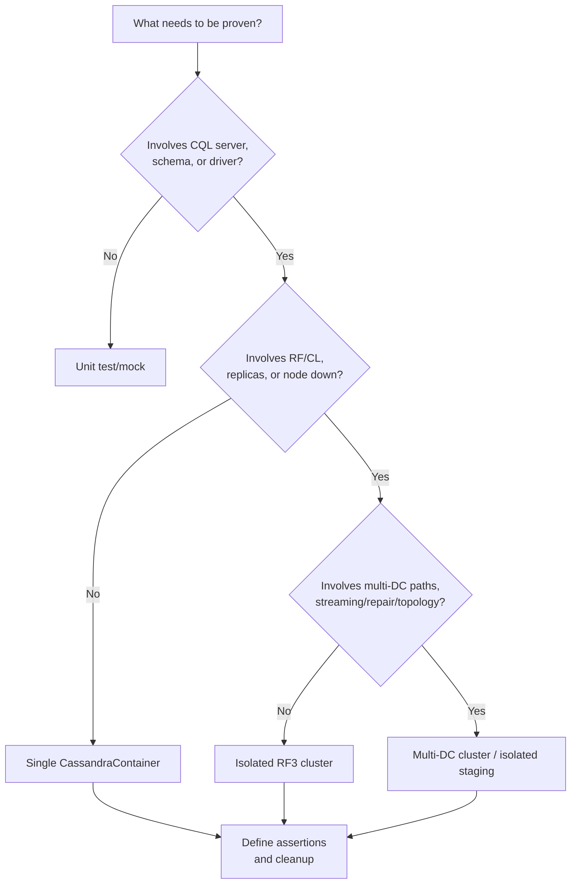
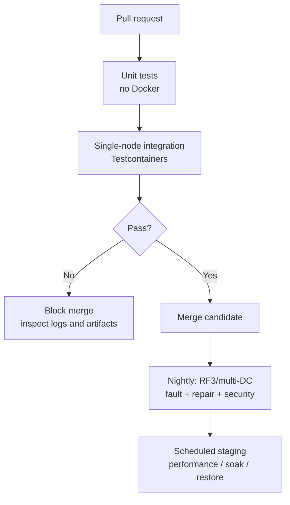

# Container/Testcontainers or an Isolated Test Cluster

**Chapter:** Integration Testing  
**Module:** `DATABASE_ENGINE_WIDE_COLUMN_CASSANDRA` — Apache Cassandra

A unit test using a mocked `CqlSession` can prove that a service calls the right method, but **it does not prove that Cassandra accepts the CQL**, that composite key annotations map accurately, that paging works, that `IF NOT EXISTS` yields the expected result, that TTL creates tombstones, or that a `LOCAL_QUORUM` requirement is actually satisfied by multiple replicas. Those behaviors must be tested **against real Cassandra**.

There are two common options: **running Cassandra via Docker/Testcontainers in Java tests**, or **using an isolated Cassandra test cluster**. Single-node Testcontainers is suitable for most repository/CQL/Driver tests; a multi-node cluster is suitable for replication, consistency levels, node failures, repair, streaming, multi-DC, and distributed scenarios. Picking the wrong environment creates a false sense of security: `LOCAL_QUORUM` on an RF=1 keyspace still only needs **one** replica.

This guide walks from environment-selection strategy, Testcontainers configuration, writing JUnit 5/CQL/Java Driver tests, Spring Boot/Spring Data integration, to schema management, test isolation, CI, and checks that are only meaningful with enough replicas. All examples stay true to the module's principles: wide-column modeling, partition keys, query-driven tables, replication, CL, compaction/repair, error handling, and Java connectivity.

> **Scope and Safety:** Examples focus on Cassandra 4.1/5.x, Java Driver 4.x, JUnit 5, and **Testcontainers Java 2.x**. With Testcontainers 1.x, artifacts and packages differ; Spring Boot 3.x/4.x also have differences in test starters/auto-configuration. You must select a BOM and versions compatible with your project. **Never run tests that stop nodes, alter RF, scrub, or repair in production.** None of the commands in this lesson were executed on a live cluster; execution belongs to a test environment and a dedicated QA step.

## 1. Learning Objectives

After this lesson, you will be able to:

1. Distinguish **unit tests**, **single-node integration tests**, **multi-node integration tests**, **performance/soak tests**, and **chaos/failure tests**.
2. Choose between Testcontainers and an isolated cluster based on **what capability needs to be proven**, not just how fast the environment spins up.
3. Configure `CassandraContainer`, `CqlSession`, CQL schema initialization, and JUnit 5 lifecycle without hardcoding host port `9042`.
4. State the differences between Testcontainers Java **1.x** and **2.x** regarding dependencies and the `CassandraContainer` package.
5. Write CQL round-trip tests for composite partition keys, clustering order, prepared statements, idempotent event IDs, and paging.
6. Test LWT `[applied]` and TTL using time-bounded assertions, avoiding flaky fixed `Thread.sleep` calls.
7. Use `@ServiceConnection` or `@DynamicPropertySource` in Spring Boot tests, and know when to use `@DataCassandraTest` vs `@SpringBootTest`.
8. Ensure each test owns its own data, avoiding `TRUNCATE` when tests run in parallel on a shared table.
9. Recognize what **cannot be proven** on a single RF=1 container: failover, quorum intersection, replica divergence, hints, and repair.
10. Design a three-node/multi-DC test cluster with preflight/cleanup, controlled fault injection, metrics, and reproducible CI reports.

## 2. Choosing the Right Environment for the Test Hypothesis

### 2.1. One Test Tier Does Not Replace Other Tiers

| Environment | What It Proves | What It Does Not Fully Prove | Typical Cost |
| --- | --- | --- | --- |
| **Mock/unit** | Branch logic, DTO validation, query/CL selection in code | CQL parsing, schema, driver handshake, replica behavior | Very low |
| **Single-node CassandraContainer** | Real CQL, mapping, prepared/bound, basic TTL/LWT, paging, errors, schema | Multiple replicas, quorum/repair/hints, DC failover | Moderate; Cassandra startup can take time |
| **3-node test cluster** | RF3, `LOCAL_QUORUM`, one node down, replica convergence, single-DC topology/rack | Multi-DC network behavior if single-DC only | Higher; requires resources and orchestration |
| **Multi-DC test cluster** | Per-DC NTS, `LOCAL_QUORUM`/`EACH_QUORUM`, network paths, local routing | Full production performance if hardware differs | High |
| **Production-like staging** | Security config, backup/restore, operators, workload/capacity | Not automatic proof of peak load if tests lack representativeness | High |
| **Fault/chaos lab** | Error paths under node/network/disk faults | Deterministic behavior for every distributed failure | High; requires reset |

**Rule:** Name tests accurately for what they verify. `testLocalQuorumOnOneNode()` can verify syntax/driver CL, but **must not** be reported as having confirmed quorum survival upon losing a replica.

### 2.2. Environment Selection Flowchart



A test suite can combine **very fast unit tests** with **real integration tests**. You do not need to spin up three nodes to prove `@PrimaryKeyClass` maps correctly, nor can you use one node to claim fault tolerance when a replica is lost.

## 3. Version Differences to Lock Down Before Writing Code

### 3.1. Testcontainers Java 1.x vs 2.x

Testcontainers 2.x moved modules to `testcontainers-`-prefixed artifacts and moved container classes into module-specific packages.

| Item | Testcontainers 1.x | Testcontainers 2.x |
| --- | --- | --- |
| Cassandra dependency | `org.testcontainers:cassandra` | `org.testcontainers:testcontainers-cassandra` |
| JUnit Jupiter dependency | `org.testcontainers:junit-jupiter` | `org.testcontainers:testcontainers-junit-jupiter` |
| `CassandraContainer` import | `org.testcontainers.containers.CassandraContainer` | `org.testcontainers.cassandra.CassandraContainer` |
| `@Container` / `@Testcontainers` | `org.testcontainers.junit.jupiter.*` | `org.testcontainers.junit.jupiter.*` |
| Host/port mapping | `getContactPoint()`, `getLocalDatacenter()` | Similar on the Cassandra module |
| Spring Boot integration | Must match Boot/Testcontainers BOM | Must also match Boot/Testcontainers BOM; verify binary/API compatibility |

**Example dependency in this lesson:** Testcontainers **2.0.5** was the version on the official module documentation page when referenced. Pick **the same** Testcontainers version for Cassandra, JUnit Jupiter, and core; with Spring Boot, prefer the tested compatible BOM. Do not mix 1.x and 2.x lines on the same classpath.

### 3.2. Version Matrix to Record per Test Run

```text
CASSANDRA_IMAGE_TAG:
CASSANDRA_SERVER_VERSION:
JAVA_JDK_VERSION:
SPRING_BOOT_VERSION:
SPRING_DATA_CASSANDRA_VERSION:
APACHE_JAVA_DRIVER_VERSION:
TESTCONTAINERS_VERSION:
JUNIT_JUPITER_VERSION:
DOCKER_OR_CONTAINER_RUNTIME:
TEST_ENVIRONMENT:
```

Cassandra 4.1 and 5.x differ in features, SSTable formats, and compatibility. Tests using an older Cassandra image do not prove the application works when production upgrades to 5.x; you may need to run an **image version matrix** in CI.

**Pin the image tag or digest** in tests. The `cassandra:latest` tag can cause the same commit to run against different server builds at different times, making results hard to trace.

## 4. Preparing the Machine to Run Testcontainers

### 4.1. Minimum Requirements

- JDK compatible with the chosen Spring Boot/Driver/Testcontainers versions.
- Maven/Gradle and JUnit 5.
- Compatible, running container runtime with sufficient access permissions.
- Sufficient RAM/CPU/disk for the Cassandra JVM; Cassandra is not a lightweight container like Redis.
- Permission to pull images from an organization-approved registry; consider rate/egress limits in CI.
- Never point tests at a production Cassandra port or a shared keyspace holding real data.
- Proper network and trust configuration when CI runs inside containers or against a remote Docker host.

### 4.2. Checking Docker Without Guessing Network Endpoints

```bash
docker version
docker info
docker image inspect cassandra:4.1.3
```

`docker image inspect` may report the image is not present locally, which does **not** mean Testcontainers cannot pull it. If tests fail to start, distinguish between: Docker daemon unavailable, permission denied, image pull failed, container JVM out of memory, and Cassandra not ready yet.

### 4.3. Host Ports Are Dynamic

Testcontainers maps container port `9042` to a **runtime-selected host port**. Never hardcode `localhost:9042` in tests:

```java
// Correct: endpoint returned by the container.
cassandra.getContactPoint();
cassandra.getLocalDatacenter();

// Using GenericContainer if fetching host/port manually:
cassandra.getHost();
cassandra.getMappedPort(9042);
```

`getHost()` is not necessarily `localhost` when CI uses a remote Docker daemon. Only call `getMappedPort` **after the container has started**, because no port mapping exists before startup.

### 4.4. Why “Container Running” Is Not Enough

Docker reporting a live process does not prove native transport/CQL is ready. The specialized `CassandraContainer` module has its own wait/readiness strategy; `withInitScript` executes after the container meets initialization conditions. Do not replace it with `Thread.sleep(20_000)` assuming every CI machine boots in 20 seconds.

## 5. Minimum Dependencies for the Java/JUnit 5 Examples

### 5.1. Maven Using Testcontainers 2.x

Assuming the application already includes Apache Java Driver 4.x via the Spring Boot starter/BOM. Illustrative test dependencies:

```xml
<dependency>
    <groupId>org.springframework.boot</groupId>
    <artifactId>spring-boot-starter-test</artifactId>
    <scope>test</scope>
</dependency>

<dependency>
    <groupId>org.testcontainers</groupId>
    <artifactId>testcontainers-cassandra</artifactId>
    <version>2.0.5</version>
    <scope>test</scope>
</dependency>

<dependency>
    <groupId>org.testcontainers</groupId>
    <artifactId>testcontainers-junit-jupiter</artifactId>
    <version>2.0.5</version>
    <scope>test</scope>
</dependency>
```

If not using Spring Boot for pure Java Driver tests, replace the test starter with the appropriate JUnit Jupiter dependencies. If using the Testcontainers 2.0.5 BOM, omit individual versions on the two modules; **do not import multiple conflicting BOMs that skew the dependency tree**.

Example separate BOM import (only when the project decides to use 2.x):

```xml
<dependencyManagement>
  <dependencies>
    <dependency>
      <groupId>org.testcontainers</groupId>
      <artifactId>testcontainers-bom</artifactId>
      <version>2.0.5</version>
      <type>pom</type>
      <scope>import</scope>
    </dependency>
  </dependencies>
</dependencyManagement>
```

If your project's Spring Boot BOM manages Testcontainers 1.x, **do not copy 2.x dependencies verbatim without checking compatibility**. In that case, use 1.x artifacts/imports or plan a tested dependency upgrade.

### 5.2. Gradle Equivalent

```groovy
dependencies {
    testImplementation platform(
        "org.testcontainers:testcontainers-bom:2.0.5")
    testImplementation "org.testcontainers:testcontainers-cassandra"
    testImplementation "org.testcontainers:testcontainers-junit-jupiter"

    testImplementation "org.springframework.boot:spring-boot-starter-test"
}
```

Dependencies go into `testImplementation`, **never** shipping test containers into production runtime. Spring Boot projects using the plugin/BOM may omit the test starter version.

### 5.3. Spring Boot Service Connections Require Another Dependency

When using `@ServiceConnection`, add:

```xml
<dependency>
    <groupId>org.springframework.boot</groupId>
    <artifactId>spring-boot-testcontainers</artifactId>
    <scope>test</scope>
</dependency>
```

With `@DynamicPropertySource`, Spring TestContext can inject dynamic properties without the service connection abstraction. Pick **one primary mechanism** for test connection configuration to reduce the chance of properties overriding each other.

## 6. Lab CQL Schema Managed Independently of Java

### 6.1. DDL for Single-Node RF=1

In the Cassandra container module, the default DC is usually `datacenter1`, though you must check `cassandra.getLocalDatacenter()` and `system.local`; if overriding the DC, update the script accordingly.

Create a hypothetical classpath file `src/test/resources/cql/it-schema.cql` with the **following** content:

```sql
CREATE KEYSPACE IF NOT EXISTS it_cassandra
WITH replication = {
    'class': 'NetworkTopologyStrategy',
    'datacenter1': 1
}
AND durable_writes = true;

CREATE TABLE IF NOT EXISTS it_cassandra.events_by_tenant_day (
    tenant_id text,
    bucket_day date,
    event_ts timestamp,
    event_id uuid,
    kind text,
    payload text,
    PRIMARY KEY ((tenant_id, bucket_day), event_ts, event_id)
) WITH CLUSTERING ORDER BY (event_ts DESC, event_id ASC);

CREATE TABLE IF NOT EXISTS it_cassandra.command_state_by_id (
    command_id uuid PRIMARY KEY,
    state text,
    version int
);

CREATE TABLE IF NOT EXISTS it_cassandra.ttl_by_id (
    item_id uuid PRIMARY KEY,
    ephemeral_value text
);
```

**Why use two key layers?** `(tenant_id,bucket_day)` is the composite partition key, while `event_ts,event_id` are clustering keys. This test verifies more than the Java mapper; it verifies **the DDL and queries aligned with the partition key**. `event_id` ensures two events sharing the same timestamp do not overwrite each other.

### 6.2. Do Not Rely on Framework Schema Auto-Create

`withInitScript("cql/it-schema.cql")` runs after Cassandra is ready per the container module's lifecycle; by the time the Spring context starts, the keyspace and tables already exist.

For applications managing schemas via migrations, use **the same versioned DDL source** in test/staging rather than inventing a test schema different from production. However, if production DDL specifies RF3 or DC names absent in an RF1 container, separate **per-environment replication settings** while keeping the primary key and table options intact.

**Never** enable `spring.cassandra.schema-action=recreate` in shared environments or staging to “clean up tests”; it can drop data. Keep `schema-action=none` where schemas are migration-controlled.

## 7. JUnit 5 + CassandraContainer: Pure Java Driver Example

### 7.1. Container and Session Lifecycle

Example using Testcontainers **2.x**, JUnit 5, Java Driver 4.x:

```java
import com.datastax.oss.driver.api.core.CqlSession;
import org.junit.jupiter.api.AfterAll;
import org.junit.jupiter.api.BeforeAll;
import org.junit.jupiter.api.Test;
import org.testcontainers.cassandra.CassandraContainer;
import org.testcontainers.junit.jupiter.Container;
import org.testcontainers.junit.jupiter.Testcontainers;

import static org.junit.jupiter.api.Assertions.*;

@Testcontainers
class CassandraNativeIT {

    @Container
    static final CassandraContainer CASSANDRA =
        new CassandraContainer("cassandra:4.1.3")
            .withInitScript("cql/it-schema.cql");

    private static CqlSession session;

    @BeforeAll
    static void openSession() {
        session = CqlSession.builder()
            .addContactPoint(CASSANDRA.getContactPoint())
            .withLocalDatacenter(CASSANDRA.getLocalDatacenter())
            .build();
    }

    @AfterAll
    static void closeSession() {
        if (session != null) {
            session.close();
        }
    }

    @Test
    void driverConnectsToRealCassandra() {
        var row = session.execute(
            "SELECT release_version, data_center FROM system.local"
        ).one();

        assertNotNull(row);
        assertNotNull(row.getString("release_version"));
        assertEquals(
            CASSANDRA.getLocalDatacenter(),
            row.getString("data_center"));
    }
}
```

Only **one** `CqlSession` is reused across the class; do not create a session per test or request. With `@Container static`, the JUnit extension starts one container before all methods and stops it after the class finishes. `@BeforeAll` runs once the container has been prepared by the extension. For Testcontainers 1.x, swap the `CassandraContainer` import and dependency per Section 3; the main endpoint/DC methods remain similar.

**Package/import note:** The Java code uses `org.testcontainers.cassandra.CassandraContainer` for 2.x. Do not keep `org.testcontainers.containers.CassandraContainer` from a 1.x example while changing the artifact to 2.x without checking compatibility.

### 7.2. Container Cleanup Managed by Testcontainers

The JUnit extension manages `start()/stop()` of the `@Container` field. Never call `CASSANDRA.stop()` in `@AfterEach`: remaining tests need the container alive. `@AfterAll` closes `CqlSession` so connections are released before the container stops.

Per Testcontainers documentation, the JUnit 5 extension is tested for **sequential execution**; parallel execution sharing a container may have unintended side effects. Enable parallelism only after designing isolated data/resources and testing the specific lifecycle.

### 7.3. Round-Trip Test on a Composite Key

Example placed inside the same `CassandraNativeIT` class:

```java
import com.datastax.oss.driver.api.core.DefaultConsistencyLevel;
import com.datastax.oss.driver.api.core.cql.PreparedStatement;
import com.datastax.oss.driver.api.core.cql.ResultSet;
import com.datastax.oss.driver.api.core.cql.Row;
import com.datastax.oss.driver.api.core.data.CqlDate;

import java.time.Instant;
import java.time.LocalDate;
import java.util.ArrayList;
import java.util.List;
import java.util.UUID;

import static org.junit.jupiter.api.Assertions.*;

@Test
void clusteringOrderIsCorrectInsideOnePartition() {
    String tenant = "tenant-" + UUID.randomUUID();
    LocalDate day = LocalDate.of(2026, 11, 21);
    CqlDate cqlDay = CqlDate.fromDaysSinceEpoch(
        (int) day.toEpochDay());

    PreparedStatement insert = session.prepare(
        "INSERT INTO it_cassandra.events_by_tenant_day " +
        "(tenant_id, bucket_day, event_ts, event_id, kind, payload) " +
        "VALUES (?, ?, ?, ?, ?, ?)"
    );

    Instant older = Instant.parse("2026-11-21T10:00:00Z");
    Instant newer = Instant.parse("2026-11-21T10:03:00Z");
    UUID id1 = UUID.randomUUID();
    UUID id2 = UUID.randomUUID();

    session.execute(
        insert.bind(tenant, cqlDay, older, id1, "OPEN", "first")
            .setConsistencyLevel(DefaultConsistencyLevel.ONE)
            .setIdempotent(true));

    session.execute(
        insert.bind(tenant, cqlDay, newer, id2, "CLICK", "second")
            .setConsistencyLevel(DefaultConsistencyLevel.ONE)
            .setIdempotent(true));

    PreparedStatement read = session.prepare(
        "SELECT event_ts, event_id, kind FROM " +
        "it_cassandra.events_by_tenant_day " +
        "WHERE tenant_id = ? AND bucket_day = ? LIMIT 20"
    );

    ResultSet result = session.execute(
        read.bind(tenant, cqlDay)
            .setConsistencyLevel(DefaultConsistencyLevel.ONE)
            .setIdempotent(true));

    List<Row> rows = new ArrayList<>();
    result.forEach(rows::add);

    assertEquals(2, rows.size());
    assertEquals(newer, rows.get(0).getInstant("event_ts"));
    assertEquals(id2, rows.get(0).getUuid("event_id"));
    assertEquals(older, rows.get(1).getInstant("event_ts"));
    assertEquals(id1, rows.get(1).getUuid("event_id"));
}
```

In this test, `tenant` is generated per method: no `TRUNCATE` of a shared table is needed, and there is no dependency on test execution order. The two `event_ts` values differ so expected ordering is unambiguous; write a separate test for **event_id tie-breaking** if that is a business requirement.

**Practice note:** The code snippets in Section 7 are **parts of the same class** (Section 7.1 declares `session`; Section 7.3 adds the corresponding method/imports), not standalone files where multiple import blocks can be pasted inside a class body. When creating real tests, merge imports per Java syntax.

### 7.4. Idempotency of a Fixed ID

Within the same `tenant/day/event_ts/event_id`, repeating an `INSERT` with a deterministic payload typically upserts into **the same logical row** without creating a second row. If every retry generates a new `UUID.randomUUID()`, the key changes and duplicate events appear. Tests must define **an event ID generated once at the source** and pass it across all attempts.

For counters or list appends, do not use this test to claim idempotent retries: `+1` mutations or appends are **not** idempotent. Nor does RF1 verify behavior when a coordinator loses a response in a distributed environment.

## 8. High-Value Assertions on a Single Container

### 8.1. LWT `IF NOT EXISTS`

Example test with a dedicated key:

```java
import com.datastax.oss.driver.api.core.cql.PreparedStatement;
import com.datastax.oss.driver.api.core.cql.Row;
import java.util.UUID;

import static org.junit.jupiter.api.Assertions.*;

@Test
void lwtRejectsDuplicateCommandId() {
    UUID commandId = UUID.randomUUID();

    PreparedStatement insertOnce = session.prepare(
        "INSERT INTO it_cassandra.command_state_by_id " +
        "(command_id, state, version) VALUES (?, ?, ?) IF NOT EXISTS"
    );

    Row first = session.execute(
        insertOnce.bind(commandId, "CREATED", 1)
    ).one();
    assertNotNull(first);
    assertTrue(first.getBoolean("[applied]"));

    Row second = session.execute(
        insertOnce.bind(commandId, "CREATED", 1)
    ).one();
    assertNotNull(second);
    assertFalse(second.getBoolean("[applied]"));

    Row stored = session.execute(
        session.prepare(
            "SELECT state, version " +
            "FROM it_cassandra.command_state_by_id " +
            "WHERE command_id = ?"
        ).bind(commandId)
    ).one();

    assertNotNull(stored);
    assertEquals("CREATED", stored.getString("state"));
    assertEquals(1, stored.getInt("version"));
}
```

`[applied]=false` means the condition was not met, **not a network failure**. Single-node tests prove CQL correctness on one coordinator; they **do not** prove fault tolerance or the Paxos protocol when replicas lose connectivity.

### 8.2. TTL Requires Flexible Time-Bounded Testing

Do not write:

```java
// FLAKY ANTI-PATTERN:
Thread.sleep(3000);
assertNull(readValue());
```

In CI, clock scheduling, driver latency, and container overhead make an exact 3-second boundary unreliable. Use **upper-bounded polling** and assert only eventual absence. Example using BOM-compatible test dependency `org.awaitility:awaitility`:

```java
import java.time.Duration;
import java.util.UUID;

import static org.awaitility.Awaitility.await;
import static org.junit.jupiter.api.Assertions.*;

@Test
void ttlEventuallyExpires() {
    UUID id = UUID.randomUUID();

    var insert = session.prepare(
        "INSERT INTO it_cassandra.ttl_by_id " +
        "(item_id, ephemeral_value) VALUES (?, ?) USING TTL 5"
    );

    session.execute(insert.bind(id, "temporary"));

    var lookup = session.prepare(
        "SELECT ephemeral_value FROM it_cassandra.ttl_by_id " +
        "WHERE item_id = ?"
    );

    await()
        .pollInterval(Duration.ofMillis(300))
        .atMost(Duration.ofSeconds(30))
        .until(() -> session.execute(lookup.bind(id)).one() == null);
}
```

**Limitation:** A row **no longer being logically visible** after TTL does not prove the tombstone has been physically removed by compaction; `gc_grace_seconds`, repair/compaction, and SSTable state are separate concerns. Do not lower `gc_grace_seconds` in tests hoping to “clean up” without understanding the risks.

### 8.3. Paging Is Not Just `LIMIT`

Test multiple rows in **one** partition (with a dedicated key), set `pageSize=2`, and iterate to completion; verify no rows are missing or duplicated across pages.

```java
import com.datastax.oss.driver.api.core.cql.SimpleStatement;
import com.datastax.oss.driver.api.core.cql.ResultSet;

// Assumes the test already INSERTed 5 rows with the same tenant/day,
// each having a distinct event_ts/event_id.
SimpleStatement query = SimpleStatement.builder(
    "SELECT event_ts, event_id FROM it_cassandra.events_by_tenant_day " +
    "WHERE tenant_id = ? AND bucket_day = ?")
    .addPositionalValues(tenant, cqlDay)
    .setPageSize(2)
    .build();

ResultSet result = session.execute(query);
int count = 0;
for (var row : result) {
    count++;
}
assertEquals(5, count);
```

A synchronous `ResultSet` fetches additional pages on demand; tests should at least exercise **page boundaries** with enough rows. Do not assert that every page holds exactly 2 rows across all query shapes solely because `pageSize=2`, since page size is a **hint** and query/filter/partition behavior can vary. Avoid scanning `SELECT *` across the entire keyspace.

### 8.4. Testing Valid CQL and System Error Cases

| Test Case | Expectation | Key Takeaway |
| --- | --- | --- |
| Insert with full primary key | ACK and row readable | CQL/mapper/schema aligned |
| SELECT by partition key | Returns right partition | Sound query design |
| SELECT missing partition column | Rejected or requires costly filtering | Never “fix” with `ALLOW FILTERING` |
| LWT duplicate key | `[applied]=false` on second call | Business condition, not exception |
| TTL expiration | Row logically disappears within bounded poll | Tombstone may still exist |
| Paging with small pageSize | Iterates all rows in order | Never assume paging auto-creates a consistent snapshot |
| SELECT non-existent key | `Row == null` after successful read | Distinct from timeout/unavailable |
| Invalid auth login | Auth failure when auth enabled | Default single container may have auth **disabled** |

## 9. Spring Boot + Testcontainers: Wiring Into a Real Service

### 9.1. `@DataCassandraTest` vs `@SpringBootTest`

- **`@DataCassandraTest`:** test slice for Cassandra components like `CassandraTemplate`, `@Table`, and repositories; usually lighter than a full application context.
- **`@SpringBootTest`:** full Spring context, suitable for service workflows spanning multiple components/transaction boundaries/serialization.
- **Testcontainers** is still required for real CQL; test slice annotations **do not spin up a Cassandra database automatically**.

In Spring Boot **3.x**, the `@DataCassandraTest` import is typically `org.springframework.boot.test.autoconfigure.data.cassandra.DataCassandraTest`. Spring Boot **4.x** changes testing modules/packages; choose imports matching your BOM/version and never mix snippets across majors.

### 9.2. `@ServiceConnection`: Automatic Connection Details

Spring Boot supports `CassandraConnectionDetails` for `CassandraContainer`. When a container is annotated with `@ServiceConnection` and `spring-boot-testcontainers` is on the test classpath, Boot supplies connection details (endpoint/DC/auth...) from the container instead of hardcoded properties.

**Illustrative example for Spring Boot + Testcontainers 2.x**:

```java
import org.junit.jupiter.api.Test;
import org.springframework.beans.factory.annotation.Autowired;
import org.springframework.boot.test.context.SpringBootTest;
import org.springframework.boot.testcontainers.service.connection.ServiceConnection;
import org.testcontainers.cassandra.CassandraContainer;
import org.testcontainers.junit.jupiter.Container;
import org.testcontainers.junit.jupiter.Testcontainers;

import com.datastax.oss.driver.api.core.CqlSession;

import static org.junit.jupiter.api.Assertions.*;

@SpringBootTest
@Testcontainers
class CassandraSpringContextIT {

    @Container
    @ServiceConnection
    static final CassandraContainer CASSANDRA =
        new CassandraContainer("cassandra:4.1.3")
            .withInitScript("cql/it-schema.cql");

    @Autowired
    CqlSession session;

    @Test
    void bootUsesRealCassandraContainer() {
        var row = session.execute(
            "SELECT release_version FROM system.local").one();

        assertNotNull(row);
        assertNotNull(row.getString("release_version"));
    }
}
```

With test profile:

```yaml
spring:
  cassandra:
    keyspace-name: it_cassandra
    schema-action: none
```

**Do not** assume `@ServiceConnection` creates the keyspace. It provides connection details; the schema is created via init script/migration. Verify whether your Boot version recognizes `CassandraContainer` 2.x (since the class package changed), and keep test auto-DDL disabled so the schema is not overwritten.

### 9.3. `@DynamicPropertySource`: Explicit Property Control

When not using `@ServiceConnection` or when your version lacks the corresponding factory, register dynamic properties:

```java
import org.springframework.test.context.DynamicPropertyRegistry;
import org.springframework.test.context.DynamicPropertySource;
import org.testcontainers.cassandra.CassandraContainer;
import org.testcontainers.junit.jupiter.Container;
import org.testcontainers.junit.jupiter.Testcontainers;

@Testcontainers
class CassandraWithDynamicPropertiesIT {

    @Container
    static final CassandraContainer CASSANDRA =
        new CassandraContainer("cassandra:4.1.3")
            .withInitScript("cql/it-schema.cql");

    @DynamicPropertySource
    static void cassandraProperties(DynamicPropertyRegistry registry) {
        registry.add("spring.cassandra.contact-points",
            () -> CASSANDRA.getHost() + ":" +
                CASSANDRA.getMappedPort(9042));
        registry.add("spring.cassandra.local-datacenter",
            CASSANDRA::getLocalDatacenter);
        registry.add("spring.cassandra.keyspace-name",
            () -> "it_cassandra");
        registry.add("spring.cassandra.schema-action",
            () -> "none");
    }

    // Add @SpringBootTest or @DataCassandraTest and test methods
    // matching the project's Boot version.
}
```

Here the snippet uses `@DynamicPropertySource`, so **do not simultaneously add `@ServiceConnection`** on the same container without a clear reason: Boot service connection details have their own precedence and can shadow the endpoint properties just registered.

**Note:** The container **must already be started** when reading its mapped port. Spring/Testcontainers JUnit lifecycles handle this in the proper pattern; if managing the container manually in a static initializer or bean, verify startup ordering.

### 9.4. Using a Spring Data Repository

Suppose a production entity/repository maps to `it_cassandra.command_state_by_id`:

```java
import java.util.UUID;
import org.springframework.data.cassandra.core.mapping.PrimaryKey;
import org.springframework.data.cassandra.core.mapping.Table;

@Table("command_state_by_id")
public class CommandState {

    @PrimaryKey("command_id")
    private UUID commandId;
    private String state;
    private Integer version;

    public CommandState() { }

    public CommandState(UUID commandId, String state, Integer version) {
        this.commandId = commandId;
        this.state = state;
        this.version = version;
    }

    public UUID getCommandId() { return commandId; }
    public String getState() { return state; }
    public Integer getVersion() { return version; }
}
```

```java
import java.util.UUID;
import org.springframework.data.cassandra.repository.CassandraRepository;

public interface CommandStateRepository
        extends CassandraRepository<CommandState, UUID> {
}
```

Test:

```java
import java.util.UUID;
import org.junit.jupiter.api.Test;
import org.springframework.beans.factory.annotation.Autowired;

import static org.junit.jupiter.api.Assertions.*;

@Autowired
CommandStateRepository repository;

@Test
void repositoryUsesRealCqlSchema() {
    UUID id = UUID.randomUUID();

    CommandState saved = repository.save(
        new CommandState(id, "CREATED", 1));

    assertEquals(id, saved.getCommandId());

    CommandState loaded = repository.findById(id).orElseThrow();
    assertEquals("CREATED", loaded.getState());
    assertEquals(1, loaded.getVersion());
}
```

These are **components** of the same Spring test with a repository bean; the test method snippet does not stand alone outside a class. In a real app, use the production entity/repository and only swap connection/test schema. Never write a “test entity” completely divorced from production metadata and claim mapping has been verified.

### 9.5. Spring Context Caching and `@Container` Caveats

The Testcontainers JUnit extension stops a static container **after the test class finishes**. Spring TestContext may **cache an `ApplicationContext` longer than one test class**; if another class reuses a context whose session points to a stopped container, confusing errors occur.

When multiple test classes share an app context:

- Prefer containers managed by Spring test configuration / `@ServiceConnection` beans whose lifecycle is bound to the context where supported by version.
- Or use a separate test context and controlled `@DirtiesContext`, accepting restart cost.
- Or adopt the singleton container pattern **without `@Container` extension lifecycle**, with explicit cleanup and strict data isolation.
- Never call `stop()` on a shared container in `@AfterEach`.
- Never enable JUnit parallelism carelessly over shared schema/row data.

**Never** mix the singleton pattern with extension-managed lifecycles unintentionally; that is a classic root cause of “test A passes, test B fails when running the full suite”.

## 10. Independent Test Data Strategies

### 10.1. Isolation Is Not Just “One Table per Test”

| Strategy | Pros | Limitations |
| --- | --- | --- |
| Per-test UUID/tenant keys | Fast, minimal DDL, supports controlled parallelism | Data remains in keyspace until container teardown |
| Per-test-class keyspace | Stronger schema and data separation | Schema agreement/DDL takes time; increases metadata |
| Per-class container | Strong process/data isolation | Slow startup, high CPU/RAM |
| Per-method container | Highest isolation | Cassandra startup is very expensive |
| `TRUNCATE` shared tables | Easy to reason about sequentially | Wipes other tests' data; affects tombstones/repair depending on case |
| Cleanup via DELETE by PK | Narrower scope than TRUNCATE | Creates tombstones; requires full primary key |

**Default recommendation for one CassandraContainer:** static container per class, one-time schema init, and **each test generates random tenant/keys**. When testing schema migrations or isolated permissions, use a separate keyspace or container as appropriate.

### 10.2. Tests Must Not Depend on Execution Order

Anti-pattern:

```text
testA() creates row id=1
testB() expects id=1 to exist and modifies it
testC() TRUNCATEs table

Running testB alone -> fails;
running in parallel -> race;
running in reverse order -> non-deterministic.
```

Right way:

```java
UUID id = UUID.randomUUID();  // generated inside each test
String tenant = "it-" + id;
```

Each test creates the data it needs and verifies logic immediately. Avoid `LocalDate.now()` if timezone boundaries can make tests behave differently across midnight; use a fixed `LocalDate.of(...)` plus a unique tenant/UUID.

### 10.3. When Is Cleanup Needed?

If the container is destroyed at the end of the class/suite, disposable data may not need row-by-row `DELETE`s. For long-lived containers shared across classes, enforce a scoped cleanup strategy. **Never run random `TRUNCATE`s in a parallel suite**; if testing TRUNCATE itself as a feature, run it on an unshared dedicated table.

Do not disable Cassandra/GC/repair guardrails just to speed up teardown. TTL/DELETE inherently creates tombstones; cleaning up with millions of DELETEs can skew subsequent performance tests.

## 11. Single-Node RF=1 Cannot Test Quorum or Failover

### 11.1. Quorum on One Node

In `NetworkTopologyStrategy` with DC `datacenter1: 1`:

| CL | Replicas Needed | When Sole Node Up | When Sole Node Down |
| --- | ---: | --- | --- |
| `ONE` | 1 | Can succeed | Unavailable |
| `LOCAL_ONE` | 1 local | Can succeed | Unavailable |
| `LOCAL_QUORUM` | 1 local | Can succeed | Unavailable |
| `QUORUM` | 1 | Can succeed | Unavailable |
| `ALL` | 1 | Can succeed | Unavailable |

`LOCAL_QUORUM` on RF1 **does not require two replicas**. If a test runs `CONSISTENCY LOCAL_QUORUM` against a single-node CassandraContainer and passes, you have only verified CL syntax and reads/writes with **one** replica — **not** availability when losing a node or read-after-write across distinct quorum sets.

### 11.2. RF=3 with Three Replicas

In a single DC with RF3, `LOCAL_QUORUM = floor(3/2)+1 = 2`:

| State | `ONE` | `LOCAL_QUORUM` | `ALL` |
| --- | --- | --- | --- |
| 3/3 replicas healthy | Possible | Possible | Possible |
| 2/3 replicas healthy | Possible | Possible | No |
| 1/3 replicas healthy | Possible | No | No |
| 0/3 replicas healthy | No | No | No |

This table reflects **sufficient responding replicas** in principle. Timeouts, coordinator routing, network partitions, and out-of-sync replicas can still cause failures even when enough nodes appear Up.

### 11.3. Test Cases Must Reflect the Contract

Never name a test `quorumSurvivesOneNodeDown` while running RF1. A meaningful test requires **three nodes, RF3**, verifying topology/CL, deliberately stopping one node in a disposable cluster, verifying `LOCAL_QUORUM` still serves and `ALL` fails. Then bring the node back and evaluate backlog/hints/repair.

## 12. When Should You Use an Isolated Multi-Node Cluster?

### 12.1. Checklist of Behaviors Requiring a Real Cluster

- RF and `NetworkTopologyStrategy` replica placement.
- `LOCAL_QUORUM` when one of three replicas is Down.
- Cluster-wide `QUORUM` vs local quorum in multi-DC.
- `EACH_QUORUM` for writes with RF across multiple DCs.
- Hinted handoff when a replica goes down and returns.
- Anti-entropy `nodetool repair`, streaming/bootstrap, rebuild, replace node.
- Datacenter/rack/topology changes and schema agreement.
- Node/coordinator failover, client load balancing, prepared statement reprepare.
- Internode TLS communication, JMX/OS operational permissions.
- Read/write timeout sensitivity and error budgets under network/GC/disk faults.
- Rolling upgrade mixed-version testing along supported paths.

A single `CassandraContainer` has no multi-node replication. **Three independent `CassandraContainer` instances form three single-node clusters**, not an RF3 cluster; they must share cluster name, seed nodes, snitch, DC/rack, network, and bootstrap properly.

### 12.2. Ways to Build an Isolated Cluster

Three common approaches:

1. **Docker Compose / multiple Testcontainers GenericContainer instances:** requires network aliases/seed nodes, image-appropriate Cassandra config, and per-node readiness orchestration.
2. **Test Kubernetes namespace/operator:** suitable if production runs on K8s, allowing testing of StatefulSets, PVCs, rolling operations, and manifests.
3. **Dedicated staging VMs/cluster:** when testing disk/repair/streaming, security, or throughput requires near-production infrastructure.

All must isolate credentials, networks, storage, cloud accounts, and backup repositories from production; simply naming a keyspace `test` on a live cluster does not make it isolated.

### 12.3. Single-DC Three-Node Blueprint

Draft configuration example for the official Cassandra Docker image. **This is a blueprint requiring adaptation and verification against your pinned image tag**, not a Compose file pre-tested in the learner's environment:

```yaml
services:
  cassandra1:
    image: cassandra:4.1.3
    environment:
      CASSANDRA_CLUSTER_NAME: it-cluster
      CASSANDRA_SEEDS: cassandra1
      CASSANDRA_DC: dc1
      CASSANDRA_RACK: rack1
      CASSANDRA_ENDPOINT_SNITCH: GossipingPropertyFileSnitch
    ports:
      - "127.0.0.1:9042:9042"
    networks: [it-net]

  cassandra2:
    image: cassandra:4.1.3
    environment:
      CASSANDRA_CLUSTER_NAME: it-cluster
      CASSANDRA_SEEDS: cassandra1
      CASSANDRA_DC: dc1
      CASSANDRA_RACK: rack2
      CASSANDRA_ENDPOINT_SNITCH: GossipingPropertyFileSnitch
    networks: [it-net]

  cassandra3:
    image: cassandra:4.1.3
    environment:
      CASSANDRA_CLUSTER_NAME: it-cluster
      CASSANDRA_SEEDS: cassandra1
      CASSANDRA_DC: dc1
      CASSANDRA_RACK: rack3
      CASSANDRA_ENDPOINT_SNITCH: GossipingPropertyFileSnitch
    networks: [it-net]

networks:
  it-net:
```

Add readiness sequencing, resource limits/heap, logging, seed resolution, health checks, and image/DC/snitch adjustments before operating. `depends_on` alone does not guarantee Cassandra CQL is ready or the cluster has reached replica health. Bootstrapping nodes 2 and 3 takes time; never hardcode a fixed sleep.

**Never automatically launch three containers** on a CI worker with only a few GB of RAM. Offload multi-node suites to larger CI runners or nightly pipelines.

### 12.4. Verifying the Cluster Actually Formed

```bash
docker compose ps
docker compose exec cassandra1 nodetool status
docker compose exec cassandra2 nodetool status
docker compose exec cassandra3 nodetool status
```

On each node, verify:

- Same cluster name, expected DC/rack, and version.
- `nodetool status` shows three `UN` nodes with distinct host IDs.
- No nodes stuck joining/leaving/moving.
- Schema agreement after DDL.
- Adequate disk/CPU/RAM with no abnormal backlog/GC.
- Clients are not accidentally connecting to production via stale contact points.

Never rely solely on `docker compose ps` showing `Up` to assert the ring has achieved quorum.

## 13. RF3 Lab: Consistency Levels and One Node Down

### 13.1. Create the RF3 Keyspace

Run only after cluster `dc1` has three healthy nodes:

```sql
CREATE KEYSPACE IF NOT EXISTS it_cassandra_rf3
WITH replication = {
    'class': 'NetworkTopologyStrategy',
    'dc1': 3
}
AND durable_writes = true;

CREATE TABLE IF NOT EXISTS it_cassandra_rf3.state_by_id (
    id uuid PRIMARY KEY,
    state text,
    changed_at timestamp
);
```

Do not set RF3 on a single-node container expecting quorum to work. An existing RF1 keyspace does not automatically replicate completely upon `ALTER KEYSPACE` to RF3; changing RF requires a dedicated streaming/repair plan.

### 13.2. Establish a Baseline at ALL While Three Nodes Are Up

```sql
CONSISTENCY ALL

INSERT INTO it_cassandra_rf3.state_by_id (id, state, changed_at)
VALUES (
    10000000-0000-4000-8000-000000000401,
    'CREATED',
    '2026-11-21T10:00:00Z'
);

SELECT id, state FROM it_cassandra_rf3.state_by_id
WHERE id = 10000000-0000-4000-8000-000000000401;
```

Proceed only if the `ALL` write ACKs cleanly; on timeout, **the write outcome may be unknown**, so do not treat it as a clean baseline. In automated tests, use a unique ID per suite.

### 13.3. Stop One Node and Test Local Quorum

**Only on the disposable Docker cluster** from the blueprint, after confirming the right service:

```bash
docker compose stop cassandra3

# Check from a surviving node
docker compose exec cassandra1 nodetool status
```

In `cqlsh` connected to node 1 or 2:

```sql
CONSISTENCY LOCAL_QUORUM

UPDATE it_cassandra_rf3.state_by_id
SET state = 'PAID',
    changed_at = '2026-11-21T10:05:00Z'
WHERE id = 10000000-0000-4000-8000-000000000401;

SELECT id, state FROM it_cassandra_rf3.state_by_id
WHERE id = 10000000-0000-4000-8000-000000000401;
```

With RF3 local quorum=2, the two surviving healthy replicas can satisfy the request. `CONSISTENCY ALL` while node 3 is Down **cannot** meet CL; that is expected semantics, not proof of data corruption.

### 13.4. Recover the Node and Verify

```bash
docker compose start cassandra3
docker compose exec cassandra1 nodetool status
docker compose exec cassandra3 nodetool netstats
```

After the node returns:

- Wait until the node is stably `UN` and clients can connect.
- Verify data at the approved CL; never assume node 3 received all mutations from a single `LOCAL_QUORUM` SELECT.
- Inspect hints, logs, streaming, and repair schedules.
- If downtime was long or replica divergence is not automatically healed, consult the repair plan in the version-specific documentation.
- **Never** run `nodetool repair` indiscriminately in production; in a test cluster, record scopes/ranges and measure cost.

### 13.5. Two Nodes Down: What Is the Right Outcome?

If only one replica remains alive in an RF3 DC:

- `ONE` can read/write, but is weaker than quorum.
- `LOCAL_QUORUM` needs 2 replicas and thus cannot be satisfied.
- `ALL` definitely cannot be satisfied.
- Timeouts/unavailability from the Driver must be classified accurately; never lower CL just to make tests “green”.

A good test asserts **the contracted failure mode**, not that every request must succeed. For instance, an endpoint requiring a `LOCAL_QUORUM` read must return an error when replicas are insufficient, rather than falling back to `ONE` and claiming fresh data.

## 14. Multi-DC and Assumptions That Cannot Be Simplified Away

### 14.1. Per-DC RF

With:

```sql
WITH replication = {
    'class': 'NetworkTopologyStrategy',
    'dc1': 3,
    'dc2': 3
}
```

`LOCAL_QUORUM` in dc1 needs 2 replicas **inside dc1**. `QUORUM` across total RF6 needs 4 responding replicas, potentially crossing DC links; an `EACH_QUORUM` write needs quorum in every DC. Do not assume two DCs exist merely by assigning different container names: Cassandra topology requires valid seeds/bootstrap/racks and token placement.

### 14.2. Tests Worth Running on a Multi-DC Cluster

- Client `withLocalDatacenter("dc1")` picks coordinators in the right DC per driver load balancing.
- Disrupting some replicas in dc2 while dc1 `LOCAL_QUORUM` reads/writes continue serving per contract.
- Reading from dc1/dc2 after a write, observing eventual consistency and lag.
- Testing network/TLS/inter-DC latency and approved failover routing.
- Verifying `EACH_QUORUM` writes fail with unavailable when dc2 lacks quorum.
- Verifying schema propagation and auth metadata after changes/repair.

**Never** run `LOCAL_QUORUM` with RF1 in each DC and label it “multi-DC quorum tested”. Real RF and healthy replica counts are required.

## 15. Failure Injection: What Is Safe to Simulate?

### 15.1. Failure Matrix

| Fault Tested | Environment | What to Assert | What Must Not Be Inferred |
| --- | --- | --- | --- |
| Schema-invalid CQL | Single container | `InvalidQueryException` or matching error | Data loss |
| Duplicate `IF NOT EXISTS` | Single container | `[applied]=false` | End-to-end exactly-once workflow |
| TTL expiration | Single container | Logical row gone | SSTables cleanly compacted |
| One node Down RF3 | Three-node cluster | LQ can still serve | All replicas are consistent |
| Two nodes Down RF3 | Three-node cluster | LQ unavailable | LQ is a “Driver bug” |
| Coordinator restart | Multi-node cluster | Client switches endpoints/reprepares if supported | Timed-out mutation definitely never ran |
| Block internode network | Fault lab cluster | Timeouts/unavailable/hints and recovery | All network partition types are equivalent |
| Disk pressure | Adequately sized disposable staging | Alert/latency/failure handling | Safe to run on a dev laptop |
| Bad Auth/TLS | Security-configured cluster | Connection rejected | CQL RBAC works when auth is disabled |
| Supported version skew | Staging per release notes | Rolling upgrade gates | Arbitrary Cassandra version pairs support rolling upgrade |

### 15.2. Timeout Means “Unknown Outcome” for Writes

If a test drops responses after a mutation, `WriteTimeoutException`/`DriverTimeoutException` **does not prove the server did not write**. Specifically:

- `counter + 1` and list appends are **not idempotent**.
- A write request may have reached some replicas without achieving the requested CL.
- Retries in the driver, application, gateway, or queue may execute the mutation again.
- Tests should use **stable event/request IDs**, verify state, and log unknown outcomes.
- Tests must never assert “timeout observed → database has no row” in general.

`setIdempotent(true)` only tells the retry policy which operations may be replayed under its assumptions. It does not guarantee exactly-once.

### 15.3. Never Use Physical Data Corruption as a “Lightweight Fault”

Do not delete SSTable files, edit `system.local`, rename commit logs, corrupt volumes, or run `nodetool scrub` to simulate network failures. Such actions can corrupt metadata/data formats; if corruption recovery is the goal, create a **dedicated test plan** with backup/restore and version checks.

## 16. When You Must Test Repair, Compaction, or Backup

### 16.1. Query Correctness Tests Do Not Need Repair

Most repository integration tests only need fresh tables and data. Running `nodetool repair` in every test slows suites and can mask logic bugs. Compaction/repair manage storage/replica state, not schema resets.

### 16.2. Repair Tests Need Multiple Replicas

A repair is meaningful only when at least two replicas hold data to reconcile. Under RF1, `nodetool repair` proves nothing about recovery from peer replicas.

To create controlled divergence in RF3:

1. Write baseline with three nodes Up and ACK at proper CL.
2. Stop node 3; write mutation at LQ on nodes 1/2.
3. Restart node 3 and evaluate hints/convergence.
4. If testing repair, run it only per plan and within the designated scope in a disposable environment.
5. Read back across coordinators/CL and collect logs/metrics/streaming data.
6. Never use a single read at `ONE` as proof that all replicas converged.

Do not intentionally drop tombstones/hints just to manufacture “obvious divergence”; anti-entropy relies on timestamps, `gc_grace_seconds`, and repair schedules.

### 16.3. Compaction Tests Differ from TTL Tests

TTL expiration makes a row logically invisible, while its tombstone may remain in SSTables. To test compaction cost or tombstones scanned:

- Prepare a bounded workload with representative data.
- Monitor `nodetool tablestats`/`tablehistograms`/`compactionstats` and JMX metrics per version.
- Measure read p95/p99, SSTables per read, and tombstone scans.
- Never assume compaction runs immediately upon TTL expiry.
- Never run major compaction inside a test suite that expects stable response times.

### 16.4. Backup/Restore Has Its Own Suite

Backup tests must include **restoring** into a fresh disposable cluster, not merely asserting `nodetool snapshot` exits with code 0. A single-node snapshot may miss replica scope, schemas, or recent writes depending on RPO/CL. Verify manifests, checksums, versions, and retention.

**A “green `CassandraContainer` test” does not prove production backups can restore.**

## 17. Isolating the Test Cluster from Production

### 17.1. Boundaries to Isolate

- Network/VPC/namespace: no routing to production Cassandra.
- Authentication/authorization: dedicated test service accounts with least privilege.
- Secrets: no production passwords/keys; never log tokens in test output.
- Data: synthetic/mock data; never copy customer PII without an authorized process.
- Storage: separate volumes/buckets; never mount production data directories.
- Control plane: JMX, SSH, admin roles, and operators scoped to the test cluster.
- Cleanup: containers/namespaces/VMs with owners and post-suite TTL/retention.
- Billing/capacity: resource quotas for CI and fault tests.

Using a keyspace named `it_cassandra` in production **does not make it an isolated environment**. An errant `TRUNCATE`, `ALTER KEYSPACE`, or heavy query workload can still impact the live cluster.

### 17.2. Disabled Auth/TLS Is a Test Coverage Gap

Default test Cassandra images may allow CQL without username/password. A passing connection test does not prove production TLS/RBAC config works. When security is required:

- Use `withConfigurationOverride(...)` with controlled Cassandra configuration.
- Use `withInitScript(...)` if roles/keyspaces must be created prior to tests.
- For client encryption, configure `withSsl(...)`/certificates and the driver trust chain per module docs.
- Test authenticated/unauthorized paths and certificate verification.
- Never disable TLS or revert to `AllowAllAuthenticator` to turn failing security tests green.

**Caution:** Overriding the entire `cassandra.yaml` can cause startup failures if options are missing or version-mismatched; never copy config from another server without checking it against the image.

## 18. CI: Stable, Reproducible, and Unoverloaded

### 18.1. Layering Suites in the Pipeline



Not every PR needs to boot a heavy multi-DC cluster; however, changes to schema, driver/CL, or topology/repair may require a **mandatory RF3 suite** based on change type. Define test gating by risk—never drop critical tests just to shrink CI time.

### 18.2. CI Resource Planning

Cassandra JVM startup and bootstrap can take tens of seconds or more depending on image/host I/O. With three nodes and parallel jobs, memory/CPU/disk can saturate, causing `OutOfMemoryError` or spurious startup timeouts.

Best practices:

1. Run one `CassandraContainer` per class/group appropriately, not per test method unless needed.
2. Cache/pull images from trusted registries while keeping tags/digests pinned.
3. Cap concurrent Cassandra-heavy CI jobs according to runner capacity.
4. Increase startup timeouts **with justification** and capture logs on failure; never raise request timeouts indefinitely.
5. Collect container logs, JVM/GC stats, `nodetool status`/schema, and CQL errors as test artifacts.
6. Track p95/p99 CI duration, flakiness rate, and job retry counts.
7. Never turn CI green by re-running flaky tests 5 times and ignoring root causes.
8. Enforce cleanup and quotas for disk/volumes/images.

### 18.3. Reusable Containers Are Not Suitable for CI by Default

Testcontainers' **reusable containers** feature is marked **experimental**. It keeps containers alive across test runs, skips normal auto-stop lifecycle, and is not recommended for CI. If used on a personal dev machine, remember stale test data persists and requires manual cleanup.

Do not enable `TESTCONTAINERS_REUSE_ENABLE=true` in CI for speed without accepting state-leakage/isolation risks. Never disable Resource Reaper/Ryuk recklessly to “fix Docker permissions”; investigate the runtime/firewall and CI policy instead.

### 18.4. Container Runtime in CI Differs from a Laptop

CI may use a remote Docker daemon, rootless environments, Docker-in-Docker, or another container runtime. `localhost:9042` may mistakenly hit the **CI runner** instead of the mapped port; use Testcontainers APIs `getContactPoint()` or `getHost()/getMappedPort`.

Do not bind every test Cassandra container to `0.0.0.0:9042` unnecessarily; the test runner only needs the endpoint provided by Testcontainers. Evaluate networking/certificates/port mappings against real infrastructure.

## 19. Common Failures and How to Diagnose Them

### A. Testcontainers Reports No Docker Environment Found

Check the daemon, socket permissions, `DOCKER_HOST`/context, firewalls, and runtime constraints. Never convert integration tests into mocks to “fix” a missing Docker daemon; classify it as an infrastructure failure and fix the runner.

### B. `Connection refused` to `localhost:9042`

The container uses a **random mapped port**; the test hardcoded host port 9042. Use `getContactPoint()`, `getHost()`, and `getMappedPort(9042)` after startup.

### C. `AllNodesFailedException`/Driver Init Fails Even Though Container Is Up

Cassandra may not have CQL ready yet, the local DC may be wrong, or JDK/driver/server are incompatible. In Java Driver 4.x, errors surface via `AllNodesFailedException` wrapping per-node errors. Inspect container logs, `getLocalDatacenter()`, query `system.local`, and check the wait strategy. Do not blindly add `sleep(60s)` to every test.

### D. Two Different Testcontainers Versions on the Classpath

Often caused by Spring Boot BOM vs direct dependencies, or mixing 1.x and 2.x modules. Inspect the dependency tree and align all Testcontainers modules to the same line/version. Note that `CassandraContainer`'s package also moved from `org.testcontainers.containers` to `org.testcontainers.cassandra`.

### E. `@ServiceConnection` Does Not Create the Keyspace

Correct: it provides **connection details**, not business schemas. Use `withInitScript`/migrations and set `spring.cassandra.keyspace-name` properly. Ensure no default keyspace conflicts with your DDL.

### F. Test A Passes Alone, Full Suite Fails

The Spring context cache may hold connections to a previous class's stopped static container, or test B depends on test A's data/`TRUNCATE`. Isolate state, align container/context lifetimes, and review JUnit parallelism.

### G. Test Uses RF1 and Claims Survival of One Replica Down

Quorum on RF1 is one replica; stopping it makes the cluster unavailable. Move failover/quorum tests to a 3-node RF3 cluster.

### H. Three `CassandraContainer` Instances Started, but `nodetool status` on Each Sees Only Itself

They have not formed **one shared cluster**: seed/network/cluster name/snitch/DC config is wrong or bootstrap/join is incomplete. Tests must assert a single ring with all nodes `UN` before injecting faults.

### I. Second LWT Returns `[applied]=false`, and the Test Treats It as an Error

`false` means the condition was not satisfied; for an already-inserted primary key, that is the **expected** outcome. Distinguish business rejection from server exceptions.

### J. TTL Test Waits Exactly 3 Seconds and Fails Intermittently

TTL and scheduling lack exact wall-clock alignment with test timers. Use bounded polling, and do not expect compaction to finish right after expiry.

### K. Paging Test Returns Right Row Count but Unstable Ordering

Missing clustering key/`CLUSTERING ORDER BY`, unconstrained query scope, or concurrent writes. Specify the partition key, clustering columns, ordering, and snapshot assumptions; never rely on cluster-wide token order.

### L. Parallel Tests Both Run `TRUNCATE`

One test wipes another test's data. Use unique keys/tenant names, or dedicated containers/keyspaces if truncation is required.

### M. CI Startup Very Slow When Running Many Cassandra Containers

Cassandra is heavy; reduce CI concurrency, use static per-class lifecycles, cache images, and size resources properly; never disable readiness checks just to look faster.

### N. Timeout After Write Interpreted as “Definitely No Data Written”

In distributed systems, some replicas may already have persisted the write. Log unknown outcomes and reconcile; avoid blind retries on counters or list appends.

### O. Test Wants to Verify Repair with Only One Container

There is no second replica to compare against. You need a cluster with RF≥2 (typically RF3 when studying quorum); stop a node and write data per test plan instead of running repair as a no-op.

### P. Enabling Reusable Containers in CI

Stale state and port/network/resource leaks cause flakiness; this experimental feature is discouraged in CI. Use ephemeral containers with cleanup or dedicated stateful CI infrastructure managed per policy.

## 20. Runbook for Building and Operating an Integration Test Suite

### P0 — Lock Down Claims to Prove

Document query shapes, partition/clustering keys, RF/CL, Java Driver, Cassandra version, and attributes to validate (TTL, LWT, paging, failure/repair...). Select the matching test tier.

### P1 — Pick Image/Dependencies

Pin Cassandra image and Testcontainers version, ensuring a consistent BOM. Record container runtime/CI resources. If using Spring Boot, verify the starter, `@ServiceConnection`, or `@DynamicPropertySource`.

### P2 — Provision Controlled Schema

Create keyspaces/tables via init scripts/migrations and verify schema agreement before tests run. Avoid schema auto-recreate on shared clusters. Test DDL must retain production partition/clustering structure.

### P3 — Design Data Isolation

Each test creates unique IDs/tenants with no order dependency. Separate tests that mutate schema/topology into their own cluster or later phase. Never `TRUNCATE` shared tables in parallel suites.

### P4 — Test Happy Paths

Round-trip INSERT/SELECT, prepared/bound statements, clustering order, paging, LWT, TTL, and repository queries. Assert data and metadata, not merely “did not throw”.

### P5 — Test Failure Paths

Invalid CQL, missing PK, read/write timeout classification, authentication (when enabled), and idempotence. For retries, distinguish known failures from unknown outcomes.

### P6 — RF3 Cluster for Distributed Cases

Verify ring, RF, CL, and health before testing node Down, hints/repair, or multi-DC locality. Save timelines and metrics, with a node recovery plan.

### P7 — Run CI and Export Evidence

Record image versions, test counts, logs, duration, artifacts, and failure causes. Never mask flakiness with infinite test retries. Clean up containers, volumes, and networks per policy.

### P8 — Merge/Deploy Decision

Green tests are **evidence for the executed test scope**, not confirmation of production SLAs/performance or backup/restore readiness. High-risk changes require additional staging/load/fault testing.

### 20.1. Test Execution Record

```text
CHANGE_ID:
TEST_SUITE:
CASSANDRA_IMAGE_TAG_AND_DIGEST:
TESTCONTAINERS_VERSION:
JAVA_DRIVER_VERSION:
SPRING_BOOT_AND_DATA_VERSION:
JDK_VERSION:
CONTAINER_RUNTIME_AND_CI_RUNNER:
ENVIRONMENT_ISOLATED:
KEYSPACE_AND_TABLE_DDL_VERSION:
REPLICATION_STRATEGY_AND_RF:
DC_AND_RACKS:
CL_FOR_READS_AND_WRITES:
TEST_DATA_NAMESPACE:
CONTAINER_LIFECYCLE:
SCHEMA_INIT_RESULT:
RING_HEALTH_AND_SCHEMA_AGREEMENT:
TEST_CASES_EXECUTED:
ASSERTIONS_PASSED_FAILED:
TTL_TEST_POLLING_BOUND:
LWT_AND_PAGING_RESULTS:
NODE_FAILURE_AND_RECOVERY_RESULTS:
HINTS_REPAIR_STREAMING_OBSERVED:
CI_RAM_CPU_DISK:
CONTAINER_LOGS_LOCATION:
DRIVER_ERROR_CLASSES:
KNOWN_LIMITATIONS:
CLEANUP_RESULT:
REVIEWER_AND_NEXT_ACTION:
```

Never mark “PASS” after merely booting the container. For single-node tests, explicitly record `RF=1` and `REPLICA_FAILURE_NOT_TESTED`.

## 21. Hands-On Exercises

### Exercise A — Choosing the Environment

A service uses `CassandraRepository` to save orders and `findById`. Is RF3 required? Which checks can single-node Testcontainers prove, and which remain unproven?

### Exercise B — Clustering Order

Table `PRIMARY KEY ((tenant_id,bucket_day), event_ts,event_id)` has `event_ts DESC`. Write two INSERTs into the same partition and a SELECT asserting order; avoid reading across multiple partitions while expecting a global sort.

### Exercise C — Local Quorum

A single-node `CassandraContainer` with `datacenter1:1` runs a `LOCAL_QUORUM` read and passes. Explain how many replicas must ACK and why failover is not yet proven. Propose the right environment.

### Exercise D — Interfering Tests

Two tests run in parallel on a shared table. Test A runs `TRUNCATE`; test B runs INSERT and SELECT. What can happen? Redesign data isolation.

### Exercise E — Docker Port

On a laptop, container port 9042 maps to host port 32791. On CI, it maps elsewhere. Write `CqlSession.builder()` using the Testcontainers API without hardcoding host ports.

### Exercise F — LWT

An `INSERT ... IF NOT EXISTS` request succeeds; a second call with the same command ID returns `[applied]=false`. Distinguish expected business outcomes from exceptions and write assertions.

### Exercise G — TTL and Tombstones

`TTL 5` causes SELECT to return no row after a short wait. What remains **unproven** about tombstones, compaction, and replication? Write a bounded-poll test.

### Exercise H — Spring Boot Context Cache

Class A uses static `@Container` and `@SpringBootTest`; class B reuses the `ApplicationContext`, but container A has already stopped. Explain how to structure lifecycles to avoid stale connections.

### Exercise I — Multi-Node Fault Test

Under RF3, stop one node, write at `LOCAL_QUORUM`, and restart it. Which test proves availability? Which additional test checks data convergence? Why is one SELECT at `ONE` insufficient?

### Exercise J — Image Version Drift

CI uses `cassandra:latest`. Today it is green; next week it fails with no code changes. List the metadata/versions to record and how to pin the image.

### Exercise K — Backfill and Migration

You must change the partition key from `tenant_id` to `(tenant_id,bucket_day)`. Why is changing Java annotations in a unit test insufficient? Design a CQL/schema migration test on an isolated cluster.

### Exercise L — Overloaded CI

A 4 GB RAM runner boots three Cassandra nodes per test method. Why is it flaky? Propose suite tiering, parallel job limits, and log collection.

## 22. Self-Check Questions

1. What does mocking `CqlSession` prove, and what does it fail to prove about CQL?
2. Why is a single-node `CassandraContainer` still a real integration test?
3. Can one container prove replica divergence or hinted handoff?
4. How does Testcontainers 2.x change the `CassandraContainer` artifact and package compared to 1.x?
5. Why must Testcontainers module BOMs/versions be aligned?
6. What problems do `getContactPoint()` and `getLocalDatacenter()` solve?
7. Why shouldn't `localhost:9042` be hardcoded in CI?
8. Can `getMappedPort(9042)` be called before the container starts?
9. How does `@Container static` differ from an instance `@Container`?
10. Should `CqlSession` lifecycle be bound to the whole class or each statement?
11. What is `withInitScript` used for? Does it automatically create production schemas?
12. Why is `CREATE KEYSPACE ... RF=1` unsuitable for testing quorum failure?
13. What are the two components of the composite partition key in the lab table?
14. What roles do `event_ts` and `event_id` play in clustering?
15. Why should each test use its own `tenant/UUID`?
16. Why is `TRUNCATE` unsuitable when multiple tests share a table?
17. How does `@ServiceConnection` differ from `@DynamicPropertySource`?
18. Does `@ServiceConnection` automatically create keyspaces and tables?
19. How do `@DataCassandraTest` and `@SpringBootTest` differ in scope?
20. Why can Spring context caching break tests in another class once a container stops?
21. When should you test real `MapId`/Spring Data repositories rather than raw Driver CQL alone?
22. Is `[applied]=false` in LWT necessarily a test failure?
23. Why should TTL tests use bounded polling?
24. Does TTL expiry mean the tombstone has been compacted out of SSTables?
25. What should a paging test with a small page size assert?
26. How many local replicas does an RF3 cluster need to satisfy `LOCAL_QUORUM`?
27. With RF3 and one node Down, can `ALL` still succeed?
28. Why don't three independent containers automatically form an RF3 cluster?
29. What checks are needed after a Down replica comes back up?
30. Does a repair test on RF1 prove anti-entropy between replicas?
31. What risk arises when retrying after a timeout on a counter increment?
32. When should tests move to multi-DC staging?
33. What safety requirements apply to Docker/Testcontainers runtimes in CI?
34. Why shouldn't reusable containers be enabled by default in CI?
35. Which versions and limitations should a test report record for reproducibility?

### Lab Completion Checklist

- [ ] Defined test scope per hypothesis, never substituting one node for a distributed cluster.
- [ ] Selected Testcontainers 1.x/2.x and used matching artifacts/packages.
- [ ] Docker/container runtime available, adequate resources, image pinned.
- [ ] Java Driver and Cassandra server versions compatible.
- [ ] `CqlSession` reads `getContactPoint()/getLocalDatacenter()` from the container.
- [ ] No hardcoded host port 9042 or production contact points.
- [ ] Schema initialized before tests without unintended auto-drop of data.
- [ ] Test CQL/mappers share the same partition/clustering structure as production.
- [ ] Each test creates its own keys/data with no test-order dependency.
- [ ] No `TRUNCATE` on shared tables during parallel runs.
- [ ] Assertions cover data, ordering, LWT `[applied]`, TTL, and paging.
- [ ] Logical TTL expiry not confused with physical tombstone cleanup.
- [ ] For Spring Boot, selected `@ServiceConnection` or `@DynamicPropertySource` appropriately.
- [ ] Container lifecycle and Spring context caching do not conflict.
- [ ] Never claimed RF1/`LOCAL_QUORUM` verifies quorum fault tolerance.
- [ ] RF3/multi-DC tests run on a real shared ring with `UN` nodes.
- [ ] Fault tests run only on isolated disposable/staging clusters.
- [ ] Logs/metrics, recovery/cleanup, and CI resource limits in place.
- [ ] No blind retries on non-idempotent mutations after timeouts.
- [ ] Test scope report documents what passed and what remains unverified.

**Remember:** **Testcontainers lets you run real Cassandra inside Java tests, but a single `CassandraContainer` does not replace a distributed cluster.** Run mapping/CQL/TTL/LWT/paging tests against a cleanly initialized single-node container with pinned images/versions, dynamic endpoints, isolated schemas, and isolated test data. When the goal is **RF/CL, failover, hints, repair, streaming, or multi-DC**, switch to a qualified multi-node test cluster and verify the actual ring. Green tests are only valid within **the environment and assertions actually executed**.

## Technical References

- [Testcontainers for Java — Cassandra module (dependencies, CqlSession, init script)](https://java.testcontainers.org/modules/databases/cassandra/).
- [Testcontainers for Java — JUnit 5 lifecycle and parallel limitations](https://java.testcontainers.org/test_framework_integration/junit_5/).
- [Testcontainers for Java — Networking, getHost/getMappedPort](https://java.testcontainers.org/features/networking/).
- [Testcontainers for Java — Manual lifecycle and singleton containers](https://java.testcontainers.org/test_framework_integration/manual_lifecycle_control/).
- [Testcontainers for Java — Reusable Containers (Experimental)](https://java.testcontainers.org/features/reuse/).
- [Testcontainers Java 2.0 migration/release notes](https://github.com/testcontainers/testcontainers-java/releases).
- [Spring Boot — Testcontainers and @ServiceConnection](https://docs.spring.io/spring-boot/reference/testing/testcontainers.html).
- [Spring Boot — Cassandra auto-configuration](https://docs.spring.io/spring-boot/reference/data/nosql.html).
- [Spring Boot 3.5 — @DataCassandraTest and test slices](https://docs.spring.io/spring-boot/3.5/reference/testing/spring-boot-applications.html).
- [Spring Framework — @DynamicPropertySource](https://docs.spring.io/spring-framework/reference/testing/testcontext-framework/ctx-management/dynamic-property-sources.html).
- [Apache Cassandra — Architecture, replication and consistency](https://cassandra.apache.org/doc/stable/cassandra/architecture/dynamo.html).
- [Apache Cassandra — CQL schema and primary keys](https://cassandra.apache.org/doc/stable/cassandra/developing/cql/ddl.html).

**Note:** Examples use illustrative names/paths like `src/test/resources/cql/it-schema.cql` and image `cassandra:4.1.3`. In real deployments, select organization-supported versions with an appropriate CI runtime. This lesson does not constitute test execution results or a STEP 6 academic audit.
