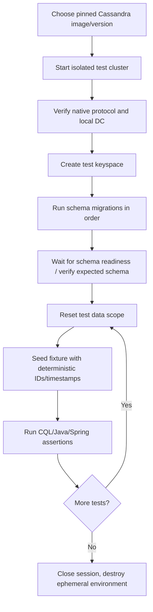

# Creating/Resetting Keyspaces, Schemas, and Sample Data in Apache Cassandra Integration Testing

## 1. Why Does Cassandra Integration Testing Need a Dedicated Data Creation and Reset Workflow?

In the **DATABASE_ENGINE_WIDE_COLUMN_CASSANDRA** module, Apache Cassandra is studied as a **distributed wide-column** database: the **partition key** determines where a partition is stored, tables are designed around queries, data is replicated with a **replication factor (RF)**, and Java applications query with appropriate consistency levels. Those same characteristics appear in integration testing: wrong schemas, missing keyspaces, insufficient replicas, or leftover data from previous tests can all render tests unreliable.

Consider a Java service exposing the API:

```text
GET /orders/{orderId}
POST /orders/{orderId}/paid
GET /customers/{customerId}/orders
```

A unit test using a mocked repository only tests Java logic. It does not reliably catch issues such as:

- Spring Data `@Table`/`@Column` annotations mismatching CQL.
- An incorrectly defined `PRIMARY KEY`, causing Cassandra to reject queries by `customer_id`.
- Java Driver using the wrong datacenter name or a CL incompatible with RF.
- Sample data inserted twice, differing in order across tests, or deleted by another test.
- CQL `CREATE TABLE IF NOT EXISTS` silently keeping an outdated, unexpected schema.
- `TRUNCATE` accidentally run against a shared keyspace.
- A DDL statement completing on the coordinator while metadata has not yet propagated to other nodes.

**Good integration tests must have a deterministic initial state, be repeatable, enforce clear destructive boundaries, and verify real results returned from Cassandra.**

This lesson belongs to the **Integration Testing** chapter and focuses directly on **creating/resetting keyspaces, schemas, and sample data**. Examples use Cassandra CQL, Java Driver 4.x, JUnit 5, Testcontainers, and Spring Boot/Spring Data Cassandra, while explicitly stating the limits of a single-node test cluster.

### Learning Objectives

After this lesson, you will be able to:

1. Design the test lifecycle: **start Cassandra → create keyspace → create schema → seed data → run assertions → reset/teardown**.
2. Choose an isolation model: dedicated container, per-suite keyspace, per-class table, or per-test data.
3. Use CQL to build schemas with partition/clustering keys and create fixtures with deterministic UUIDs, timestamps, and states.
4. Distinguish `TRUNCATE`, `DELETE`, and `DROP TABLE/KEYSPACE` and select the right reset strategy.
5. Write Java Driver/JUnit integration tests against real Cassandra via Testcontainers.
6. Order schema initialization **before** Spring Boot creates `CqlSession`/repositories that depend on the keyspace.
7. Prevent accidental deletion of live data, avoid test contention, and stabilize CI.
8. Identify what a single RF=1 node **cannot** verify regarding quorum, failover, repair, and multi-DC.

## 2. Standard Lifecycle for an Integration Test Suite



**Invariant principle:** in a normal test, the starting data state must be determined by **schema version + fixture**, never by the execution order of other tests. Every delete or reset operation must target an **isolated test environment**, never sharing a keyspace with staging/production.

### Three State Layers to Manage

| Layer | Examples | Suggested Creation/Reset Frequency |
| --- | --- | --- |
| **Cassandra infrastructure** | Container, network, nodes, Cassandra version | Per test class/suite or test run |
| **Schema** | Keyspace, UDT, tables, indexes, table options | When initializing environment or changing migrations |
| **Fixture data** | Order IDs, customer IDs, status, timestamps | Before each test requiring isolation, or per immutable suite |

Do not default to **DROP/CREATE the entire keyspace before every test method**. Cassandra DDL incurs metadata/schema propagation overhead; creating hundreds of keyspaces/tables repeatedly slows tests, causes flakiness, and ends up measuring DDL overhead rather than application behavior.

## 3. Test Keyspaces: Choosing Names, RF, and Replication Strategy

### 3.1. A Dedicated Keyspace for Integration Tests

In a **single-node** Testcontainers environment with verified datacenter `datacenter1`:

```sql
CREATE KEYSPACE IF NOT EXISTS commerce_it
WITH replication = {
    'class': 'NetworkTopologyStrategy',
    'datacenter1': 1
}
AND durable_writes = true;
```

This configuration is **strictly for a single-node lab**, not a production RF template. When real Cassandra uses DC `dc1`, change `datacenter1` to `dc1`. Verify the DC name with:

```sql
SELECT data_center, release_version
FROM system.local;
```

`system.local` reports info for the **connected node only**, not proof that every node in the cluster shares the same version/metadata.

With RF=1:

- A `LOCAL_ONE` statement can succeed while the sole replica is healthy.
- `LOCAL_QUORUM` under RF=1 also requires only one replica and **cannot simulate** surviving a node loss under RF=3.
- It cannot prove replication, coordinator failover, multi-replica quorum, multi-node repair, or cross-DC network partitions.
- It still verifies CQL syntax, schema mapping, prepared statements, data types, TTL, and much application logic.

**Conclusion:** Single-node Testcontainers is suitable for verifying **Java–Cassandra integration**, but never replaces topology/consistency tests on a multi-node cluster.

### 3.2. `SimpleStrategy` vs `NetworkTopologyStrategy`

| Scenario | Consideration | Limitations |
| --- | --- | --- |
| Small lab, CQL checks only | `SimpleStrategy` with RF=1 may suffice | Does not reflect production DC distribution |
| Single-DC Testcontainers wanting schema parity with production | `NetworkTopologyStrategy` with exact DC and RF=1 | Still only one replica |
| Multi-DC staging | `NetworkTopologyStrategy` with real per-DC RF | Resource-heavy, yet verifies cross-DC behavior |
| Testing failover/repair/quorum | Multi-node cluster, RF ≥ 3 per plan | Cannot be done with mocks or single-node RF=1 |

If production uses `NetworkTopologyStrategy`, prefer testing schemas with the same strategy when supported, **but never copy RF=3 into a single-node container** and expect every `LOCAL_QUORUM` query to succeed.

### 3.3. Guards Against Destructive Commands

Naming a keyspace `commerce_it` is only **one safeguard**, not complete protection. The test environment should also enforce:

1. **Ephemeral** Cassandra instances/containers, never real production endpoints.
2. Credentials scoped strictly to the test environment.
3. An allowlist of endpoints/cluster IDs permitted to run resets.
4. Keyspace name checks enforcing a **prefix/allowlist** such as `_it` or `it_` by convention.
5. An explicit test-run flag if the runner permits `DROP`/`TRUNCATE` operations.
6. Audit logging of all reset commands, especially in CI.
7. Production Cassandra roles **forbidden** from running test data resets.

Never build a `resetKeyspace(String name)` helper that accepts an arbitrary string from a request or environment variable and executes `DROP KEYSPACE`.

## 4. Designing CQL Schema for an Orders Fixture

Suppose tests need to verify two query patterns:

- Reading an order by `order_id`.
- Listing a customer's orders by `customer_id` in chronological order.

In Cassandra, each access pattern may require its own table. Create the schema:

```sql
CREATE TABLE IF NOT EXISTS commerce_it.orders_by_id (
    order_id uuid PRIMARY KEY,
    customer_id uuid,
    status text,
    total_minor bigint,
    created_at timestamp,
    updated_at timestamp
);

CREATE TABLE IF NOT EXISTS commerce_it.orders_by_customer (
    customer_id uuid,
    created_at timestamp,
    order_id uuid,
    status text,
    total_minor bigint,
    PRIMARY KEY ((customer_id), created_at, order_id)
) WITH CLUSTERING ORDER BY (created_at DESC, order_id ASC);
```

For `orders_by_id`, the partition key is `order_id`. For `orders_by_customer`, the partition key is `customer_id` and the two clustering columns are `created_at`, `order_id`. Using the full clustering key avoids overwriting records with identical timestamps.

Valid query examples:

```sql
SELECT order_id, status, total_minor
FROM commerce_it.orders_by_id
WHERE order_id = ?;

SELECT created_at, order_id, status
FROM commerce_it.orders_by_customer
WHERE customer_id = ?;
```

**Never** use `ALLOW FILTERING` to patch a test querying the wrong key. A trustworthy test should verify **the repository/service's real CQL matches the partition key** and returns results in the expected clustering order.

### 4.1. Extending Schema with UDTs, Collections, and TTL When Needed

Do not cram every possible data type into one fixture. If a feature needs to test a **UDT**:

```sql
CREATE TYPE IF NOT EXISTS commerce_it.delivery_address (
    street text,
    city text,
    postal_code text
);

CREATE TABLE IF NOT EXISTS commerce_it.order_shipments_by_id (
    shipment_id uuid PRIMARY KEY,
    order_id uuid,
    address frozen<commerce_it.delivery_address>,
    labels set<text>,
    created_at timestamp
);
```

If testing TTL, create a dedicated table or write explicitly with `USING TTL`. **Do not alter `default_time_to_live` on a shared table** just to make one test case expire, as that can cause other test cases to lose their fixtures.

### 4.2. Schema Migrations and Data Seeding Are Separate Phases

- **Migration** defines the DDL that must exist before running the app: keyspaces, tables, types, indexes, and options.
- **Seed/fixture** inserts test rows with verifiable states.
- **Reset** clears data from the previous test without necessarily changing the schema.
- **Assertion** validates CQL, mapper, and business contracts.

Sample data scripts should not embed `CREATE TABLE` inside an arbitrary helper invoked mid-test. Keep initialization order explicit and record the migration version matching the fixture.

## 5. Creating Deterministic Sample Data: UUID, Timestamp, and Currency

Example fixed values for testing:

```sql
INSERT INTO commerce_it.orders_by_id (
    order_id, customer_id, status, total_minor, created_at, updated_at
) VALUES (
    11111111-1111-1111-1111-111111111111,
    22222222-2222-2222-2222-222222222222,
    'CREATED',
    120000,
    '2025-03-10T09:00:00Z',
    '2025-03-10T09:00:00Z'
);

INSERT INTO commerce_it.orders_by_customer (
    customer_id, created_at, order_id, status, total_minor
) VALUES (
    22222222-2222-2222-2222-222222222222,
    '2025-03-10T09:00:00Z',
    11111111-1111-1111-1111-111111111111,
    'CREATED',
    120000
);
```

**Why use fixed values?**

- You can assert exact `order_id`, `total_minor`, `status`, and timestamps.
- Running the test twice yields identical starting inputs.
- Easy to log and compare when CI fails.
- Avoid arbitrary `now()` calls when exact timestamp comparisons are needed.
- Never use `double` for monetary amounts; the example uses **minor units** (`bigint`), and the contract must specify currency and precision.

**Note:** two `INSERT`s across two partitions/tables **do not form a multi-table ACID transaction**. Tests must verify that the service maintains denormalization or uses events/workflows to reconcile divergence; likewise, data resets must not assume “both tables clear atomically”.

### 5.1. Idempotent Seeding Differs from Idempotent Workflows

Re-running an `INSERT` with **the same primary key and fixed values** may produce the same final row state, yet **you must not** infer all retry operations are safe:

- `list_column = list_column + ['x']` can append duplicates.
- Counter updates can double-count.
- Writes using relative TTL shift the expiration time.
- Late-arriving mutations or timestamp contention can overwrite values unexpectedly.

When seeding fixtures, prefer **writing explicit values with fixed keys** onto a freshly reset environment rather than relying on “running it twice won't hurt”.

### 5.2. Use Java Bindings Instead of String-Concatenated CQL

```java
import java.time.Instant;
import java.util.UUID;

UUID orderId = UUID.fromString(
    "11111111-1111-1111-1111-111111111111");
UUID customerId = UUID.fromString(
    "22222222-2222-2222-2222-222222222222");
Instant createdAt = Instant.parse("2025-03-10T09:00:00Z");

PreparedStatement insertOrder = session.prepare(
    "INSERT INTO commerce_it.orders_by_id " +
    "(order_id, customer_id, status, total_minor, created_at, updated_at) " +
    "VALUES (?, ?, ?, ?, ?, ?)");

session.execute(insertOrder.bind(
    orderId, customerId, "CREATED", 120000L, createdAt, createdAt));
```

This snippet assumes `session` and `PreparedStatement` from Java Driver 4.x are already available. In Java tests, always **bind data via prepared statements**, avoiding manual concatenation of timestamps, UUIDs, quotes, or user input into CQL.

## 6. Reset Strategies: TRUNCATE, DELETE, or DROP?

No single reset command fits every test. Choose based on isolation requirements and concurrency.

| Strategy | Impact | When Appropriate | Risks |
| --- | --- | --- | --- |
| **Destroy/recreate container** | Fresh Cassandra instance from scratch | Suites/jobs requiring strong isolation | Startup overhead, RAM/CPU cost |
| **DROP/CREATE keyspace** | Removes entire keyspace schema and data | Independent migration/schema bootstrap tests on test clusters | Expensive DDL, flaky, wide blast radius |
| **DROP/CREATE table** | Removes and rebuilds one table | Dedicated schema migration tests | Schema agreement, stale prepared statements/metadata |
| **TRUNCATE table** | Deletes all rows in a table, keeps schema | Sequential tests with exclusive table ownership | Wipes other tests' data; table-wide destructive op |
| **DELETE by partition key** | Deletes a specific partition/row by known key | Parallel tests with separate namespaces | Tombstones, must track keys, cleanup can fail |
| **No deletion, unique IDs** | Each test writes to a separate partition | Independent/parallel tests, moderate dataset | Data accumulates; requires overall lifecycle teardown |

### 6.1. When to Use `TRUNCATE`

```sql
TRUNCATE commerce_it.orders_by_id;
TRUNCATE commerce_it.orders_by_customer;
```

`TRUNCATE` removes **all rows in the table**, with no `WHERE` clause. Cassandra handles truncation differently from row-by-row `DELETE`; never use it on tables shared among parallel tests.

**Reset order in the two-table example:**

1. Stop/await completion of all tasks from the previous test.
2. `TRUNCATE` both tables owned **exclusively by the suite**.
3. Re-seed sample data.
4. Wait/verify queries return the expected fixture.
5. Start the next test.

If async writes from a prior test are still in flight, finishing `TRUNCATE` does not guarantee the table stays clean: a lagging write can **arrive after** the truncate. Test teardown must await or cleanly cancel dispatched tasks to avoid races.

### 6.2. `DELETE` by Key and Tombstones

```sql
DELETE FROM commerce_it.orders_by_id
WHERE order_id = ?;
```

If a test owns a unique `order_id`, `DELETE` preserves other tests' data. However:

- Cassandra deletes create **tombstones**, degrading read paths and compaction as they accumulate.
- For tables with clustering columns, you must delete the exact partition or clustering rows created by the test.
- Deleting many items one by one inside a shared partition creates heavy tombstone debt.
- If a test's cleanup fails, subsequent tests must not blindly assume a clean slate.

For parallel tests, **unique partition keys** are the primary isolation mechanism; cleanup is secondary, and container teardown at the end of the suite remains essential.

### 6.3. `DROP KEYSPACE` Is Not Test Rollback

```sql
-- ILLUSTRATIVE ONLY: destructive operation for isolated test instances.
DROP KEYSPACE commerce_it;
```

This command drops both schema and data. Unlike typical RDBMSs, Cassandra **does not provide automatic transaction rollback** for DDL/DML through test frameworks. Spring's `@Transactional` or `@DirtiesContext` **does not mean** CQL writes are rolled back or the keyspace is reset.

Prefer destroying ephemeral containers rather than repeatedly calling `DROP KEYSPACE` when the goal is simply post-suite cleanup.

## 7. Why Wait for Schema Agreement and Verify the Expected Schema?

In Cassandra, a DDL statement can be accepted by the coordinator while the schema is still propagating. The driver updates metadata asynchronously; a successful `CREATE TABLE` does not automatically mean all available nodes have converged on metadata.

With Java Driver 4.x:

```java
session.execute(
    "CREATE TABLE IF NOT EXISTS commerce_it.test_marker (" +
    "id uuid PRIMARY KEY, label text)");

if (!session.checkSchemaAgreement()) {
    throw new IllegalStateException("Schema agreement not reached");
}

session.refreshSchema();

boolean exists = session.getMetadata()
    .getKeyspace("commerce_it")
    .flatMap(ks -> ks.getTable("test_marker"))
    .isPresent();

if (!exists) {
    throw new IllegalStateException("Table not visible in driver metadata");
}
```

This illustrates a **controlled sequence**, assuming `session` is already connected. When using another keyspace/table in the lesson, check that schema instead. On a single node, schema agreement is simpler, yet you must still ensure the API/driver sees the table before preparing statements.

**Three things to distinguish:**

- **Schema agreement:** inspected nodes share consistent metadata per the driver's checks/conditions.
- **Expected schema:** do tables/columns/types/primary keys match the structure required by tests?
- **Fixture readiness:** has sample data been written and read back at the chosen CL?

`checkSchemaAgreement() == true` **does not** prove the schema is right; `getTable(...).isPresent()` **does not** prove fixtures are ready.

### 7.1. `IF NOT EXISTS` Is Not Schema Migration Validation

Suppose `orders_by_id` already exists without the `total_minor` column. Running:

```sql
CREATE TABLE IF NOT EXISTS commerce_it.orders_by_id (...);
```

succeeds silently because the table exists, even though its schema **differs** from the expected DDL. Therefore:

- Fresh environments must run migrations in order.
- Migration tests must inspect the **post-migration structure** or execute CQL reading/writing all required columns.
- Maintain versioned DDL/checksums/ledgers when testing the project's migration pipeline.
- Never overwrite already-applied migrations just to make tests pass.
- Never run `ALTER TABLE` concurrently from multiple app instances during parallel tests.

**Never use a fixed 5-second sleep** as a schema-readiness guarantee. Use API/condition checks with timeouts and clear failures; sleeps only pace backoff intervals, never replacing expected-state checks.

## 8. Testcontainers: Booting Real Cassandra with JUnit 5

**Testcontainers** runs a Cassandra Docker image so integration tests speak real native protocol. It is ideal for verifying schemas, mappings, prepared statements, and single-node behavior.

### 8.1. Dependencies for a Spring Boot/Maven Project

Assuming the project configures the Spring Boot parent/BOM and JUnit 5, test dependencies:

```xml
<dependencies>
    <dependency>
        <groupId>org.springframework.boot</groupId>
        <artifactId>spring-boot-starter-data-cassandra</artifactId>
    </dependency>

    <dependency>
        <groupId>org.springframework.boot</groupId>
        <artifactId>spring-boot-starter-test</artifactId>
        <scope>test</scope>
    </dependency>

    <dependency>
        <groupId>org.testcontainers</groupId>
        <artifactId>cassandra</artifactId>
        <scope>test</scope>
    </dependency>

    <dependency>
        <groupId>org.testcontainers</groupId>
        <artifactId>junit-jupiter</artifactId>
        <scope>test</scope>
    </dependency>
</dependencies>
```

**Important version note:** the Java sample below uses the **Testcontainers 1.x API** with `org.testcontainers.containers.CassandraContainer`. Newer Testcontainers lines may differ in package/module APIs; match the exact coordinates and docs for your pinned release. The Spring Boot BOM only manages versions it supports—**it does not automatically validate every Cassandra/Driver/JDK/Testcontainers combination**.

Choose an image with a **pinned tag or verified digest**; this lesson uses `cassandra:4.1.6` strictly as an illustration, **not claiming it is the newest or production-recommended version**. Replace it with the Cassandra version compatible with your real environment and security policy.

### 8.2. Complete Integration Test Using Driver 4.x

An example independent of Spring context so it is clear **when the keyspace, table, and data are created and reset**:

```java
import static org.junit.jupiter.api.Assertions.*;

import java.net.InetSocketAddress;
import java.time.Instant;
import java.util.UUID;

import org.junit.jupiter.api.AfterAll;
import org.junit.jupiter.api.BeforeAll;
import org.junit.jupiter.api.BeforeEach;
import org.junit.jupiter.api.Test;
import org.testcontainers.containers.CassandraContainer;
import org.testcontainers.junit.jupiter.Container;
import org.testcontainers.junit.jupiter.Testcontainers;
import org.testcontainers.utility.DockerImageName;

import com.datastax.oss.driver.api.core.CqlSession;
import com.datastax.oss.driver.api.core.cql.PreparedStatement;
import com.datastax.oss.driver.api.core.cql.Row;

@Testcontainers
class CassandraOrdersIntegrationTest {

    private static final UUID ORDER_ID = UUID.fromString(
        "11111111-1111-1111-1111-111111111111");
    private static final UUID CUSTOMER_ID = UUID.fromString(
        "22222222-2222-2222-2222-222222222222");
    private static final Instant FIXED_TIME =
        Instant.parse("2025-03-10T09:00:00Z");

    @Container
    static CassandraContainer<?> cassandra =
        new CassandraContainer<>(
            DockerImageName.parse("cassandra:4.1.6"));

    private static CqlSession session;
    private static PreparedStatement insertOrder;
    private static PreparedStatement selectOrder;

    @BeforeAll
    static void createSchema() {
        session = CqlSession.builder()
            .addContactPoint(new InetSocketAddress(
                cassandra.getHost(), cassandra.getMappedPort(9042)))
            .withLocalDatacenter("datacenter1")
            .build();

        session.execute(
            "CREATE KEYSPACE IF NOT EXISTS commerce_it " +
            "WITH replication = {" +
            "'class':'NetworkTopologyStrategy','datacenter1':1}");

        session.execute(
            "CREATE TABLE IF NOT EXISTS commerce_it.orders_by_id (" +
            "order_id uuid PRIMARY KEY, " +
            "customer_id uuid, status text, " +
            "total_minor bigint, created_at timestamp)");

        if (!session.checkSchemaAgreement()) {
            throw new IllegalStateException("Schema not in agreement");
        }

        insertOrder = session.prepare(
            "INSERT INTO commerce_it.orders_by_id " +
            "(order_id, customer_id, status, total_minor, created_at) " +
            "VALUES (?, ?, ?, ?, ?)");

        selectOrder = session.prepare(
            "SELECT customer_id, status, total_minor, created_at " +
            "FROM commerce_it.orders_by_id WHERE order_id = ?");
    }

    @BeforeEach
    void resetAndSeed() {
        // Safe only because this container and table belong exclusively to this test class,
        // and test methods do not run in parallel.
        session.execute("TRUNCATE commerce_it.orders_by_id");

        session.execute(insertOrder.bind(
            ORDER_ID, CUSTOMER_ID, "CREATED",
            120000L, FIXED_TIME));
    }

    @Test
    void findsSeededOrderByPartitionKey() {
        Row row = session.execute(selectOrder.bind(ORDER_ID)).one();

        assertNotNull(row);
        assertEquals(CUSTOMER_ID, row.getUuid("customer_id"));
        assertEquals("CREATED", row.getString("status"));
        assertEquals(120000L, row.getLong("total_minor"));
        assertEquals(FIXED_TIME, row.getInstant("created_at"));
    }

    @Test
    void doesNotLeakDataFromPreviousTest() {
        UUID otherId = UUID.fromString(
            "33333333-3333-3333-3333-333333333333");

        Row row = session.execute(selectOrder.bind(otherId)).one();
        assertNull(row);
    }

    @AfterAll
    static void closeDriverSession() {
        if (session != null) {
            session.close();
        }
        // @Testcontainers stops the container after the class lifecycle ends.
    }
}
```

**Prerequisites to run this example:**

- Docker or a compatible container runtime must be ready.
- The image must exist and Testcontainers, Java Driver, and JUnit versions must be compatible.
- `datacenter1` is an example DC name that must be **checked against the actual image/config**; if the container uses `dc1`, update both the replication map and `withLocalDatacenter`.
- `TRUNCATE` is acceptable only when **the class owns the table exclusively** and JUnit does not run methods in parallel on the same instance.
- The example seeds **one** table; if the service uses both `orders_by_id` and `orders_by_customer`, create/reset/seed both and assert reads accurately.
- It tests raw CQL directly, **not** Spring Data mapping/repositories; a separate Spring Boot test is needed for that.
- Use a Cassandra tag matching production servers; a single-node environment cannot test RF=3 quorum.

### 8.3. Why `@BeforeAll` and `@BeforeEach` Have Distinct Roles

| Hook | Recommended Responsibility | Avoid |
| --- | --- | --- |
| `@BeforeAll` | Initialize `CqlSession`, create schema once, prepare CQL | Creating/dropping keyspaces after every test |
| `@BeforeEach` | Reset data within the test's owned scope and seed deterministic fixtures | Altering schemas while other tests run |
| `@Test` | Execute business operation and assert real data | Implicitly depending on prior tests |
| `@AfterEach` | Clean up dedicated partition/side effects if needed | Wiping a table used by parallel tests |
| `@AfterAll` | Close session and application resources | Stopping the container before async tasks finish |
| Testcontainers extension | Manage container per class/suite lifecycle | Reusing a stopped container for subsequent tests |

For large suites, starting Cassandra per test method slows total execution and risks CI timeouts. Choose an appropriate scope rather than aiming for “maximum cleanliness” without weighing cost.

## 9. Spring Boot: Create the Keyspace Before Application Context Startup

A common pitfall with `@SpringBootTest`: Spring Boot instantiates `CqlSession`, `CassandraTemplate`, repositories, and dependent beans **during `ApplicationContext` refresh**. If `spring.cassandra.keyspace-name=commerce_it` is set while the keyspace **does not yet exist**, the context can fail before `@BeforeAll` even runs.

**Therefore, keyspace creation must finish before Spring initializes Cassandra-dependent beans.**

### 9.1. Two Safe Approaches

**Approach A — Testcontainers init script before Spring context loads**

- Container starts with a CQL script from test resources **matching your Testcontainers version's API**.
- Script creates the keyspace, UDTs, and baseline tables/fixtures in order.
- `@DynamicPropertySource` supplies contact points, port, DC, and keyspace.
- By the time Spring builds its context, the schema already exists.

Conceptual example with Testcontainers 1.x supporting `withInitScript`:

```java
@Container
static CassandraContainer<?> cassandra =
    new CassandraContainer<>(
        DockerImageName.parse("cassandra:4.1.6"))
        .withInitScript("cassandra/commerce-it-schema.cql");
```

The path refers to a **test resource in the learner's project**, not a file created by this lesson. If your Testcontainers version lacks that method/constructor or uses another startup script mechanism, consult that version's API docs.

**Approach B — Initialize container + schema in a pre-context bootstrap**

Create a test-only Java helper:

```text
TestBootstrap.startContainer()
    -> connect CqlSession (without selecting a non-existent keyspace)
    -> execute CREATE KEYSPACE
    -> execute versioned migrations
    -> verify agreement/expected schema
    -> publish mapped host/port to Spring
    -> start @SpringBootTest ApplicationContext
```

In this case, **do not** wait for `@BeforeAll` if the Spring context requires the keyspace at startup. Manage singleton/container lifecycles and Spring context caching carefully so a cached context never points to a stopped container.

### 9.2. Dynamic Properties for Modern Spring Boot

Example inside a test class where the container/schema **were already initialized before Spring context refresh**:

```java
import org.springframework.test.context.DynamicPropertyRegistry;
import org.springframework.test.context.DynamicPropertySource;

// cassandra is a started CassandraContainer containing the commerce_it schema.
@DynamicPropertySource
static void cassandraProperties(DynamicPropertyRegistry registry) {
    registry.add("spring.cassandra.contact-points", cassandra::getHost);
    registry.add(
        "spring.cassandra.port", () -> cassandra.getMappedPort(9042));
    registry.add("spring.cassandra.local-datacenter", () -> "datacenter1");
    registry.add("spring.cassandra.keyspace-name", () -> "commerce_it");
    registry.add("spring.cassandra.schema-action", () -> "NONE");
}
```

**Important:** this snippet **does not start the container or create the schema itself**; it only registers properties for Spring. Pair it with Approach A or B above in the proper lifecycle order. Older Spring Boot versions may use different prefixes/properties; check your version's documentation.

### 9.3. Testing Repositories Instead of Only Testing the Driver

Example when the project already defines entities/repositories:

```java
import static org.junit.jupiter.api.Assertions.*;

import java.util.UUID;
import org.junit.jupiter.api.Test;
import org.springframework.beans.factory.annotation.Autowired;
import org.springframework.boot.test.context.SpringBootTest;

@SpringBootTest
class OrderRepositoryIntegrationTest {

    @Autowired
    OrderRepository repository;

    @Test
    void canReadExpectedOrder() {
        UUID id = UUID.fromString(
            "11111111-1111-1111-1111-111111111111");

        OrderEntity actual = repository.findById(id).orElseThrow();

        assertEquals("CREATED", actual.getStatus());
    }
}
```

`OrderRepository`, `OrderEntity`, and pre-test fixtures are **assumed application components**. The snippet illustrates testing **Spring Data mapping**; to run for real, define the entity with `@Table/@PrimaryKey/@Column`, the corresponding repository, and matching seeds. Do not treat this snippet by itself as a complete test project.

**Never confuse `@DirtiesContext` with Cassandra data resets**: that annotation tells Spring to discard/recreate the context, **not roll back mutations** on the cluster.

## 10. Migration Runners: Test the Real Product Schema

If production tracks DDL in Git, integration tests should apply **those exact CQL migrations**, rather than a hand-copied schema that risks drifting.

### 10.1. Ordered Versioned Migrations

```text
V001__create_keyspace.cql
V002__create_orders_by_id.cql
V003__create_orders_by_customer.cql
V004__add_updated_at.cql
V005__add_delivery_address.cql
```

This is an **illustrative naming convention**, not a format automatically recognized by Cassandra. You need a dedicated runner that:

1. Runs only against authorized test clusters.
2. Selects the right keyspace/source version.
3. Orders migrations by reviewed version.
4. Tracks versions/checksums/history per runner design.
5. Prevents concurrent execution across multiple test threads/processes targeting the same keyspace.
6. Waits for schema readiness and verifies the expected structure.
7. Fails clearly on checksum/schema mismatch instead of using `IF NOT EXISTS` to mask drift.

Cassandra **does not provide transactional multi-statement DDL with rollback** like many RDBMSs. If the third migration fails, the schema already contains the first two. In ephemeral tests, tear down and rebuild the environment; in production, follow a forward-fix runbook.

### 10.2. Never Split CQL Scripts on Naive Semicolons

A CQL file may contain string literals, comments, or special constructs. `split(";")` can produce broken statements. Use a CQL- and version-appropriate parser/tool, or represent each statement individually inside a controlled migration runner.

### 10.3. Verify Schema Compatibility, Not Just “CREATE Succeeded”

Post-migration, verify:

- Keyspace name and replication strategy/RF.
- Partition key and clustering key ordering.
- `uuid`, `bigint`, `timestamp`, and `text` columns map to the right Java types.
- UDTs and table options if used by the business domain.
- Real SELECT/INSERT/UPDATE/LWT statements run cleanly with prepared statements.
- Application role permissions suffice without superuser privileges.
- No remaining schema disagreement across inspected nodes.

**A migration test that boots the app without executing business queries** is not enough to prove schema compatibility.

## 11. Isolation Between Tests: Same Container Does Not Mean Shared Data

### 11.1. Sequential Tests: Reset Tables Before Each Method

When each test owns the tables exclusively:

```java
@BeforeEach
void reset() {
    session.execute("TRUNCATE commerce_it.orders_by_id");
    session.execute("TRUNCATE commerce_it.orders_by_customer");
    seedOrders(session);
}
```

`seedOrders` is an application-defined test helper that seeds both tables consistently. **Never** use this pattern if test methods/classes run in parallel or workers share the same keyspace.

### 11.2. Parallel Tests: Distinct Partition Keys

A lighter approach:

```java
UUID orderId = UUID.randomUUID();
UUID customerId = UUID.randomUUID();
```

Each test uses unique keys and keeps IDs local to the test rather than sharing a global constant like the sequential example. Prefer **scoping data by request/test ID**, ensuring no full-table `SELECT`s or queries lacking partition key filters occur.

To reproduce failures, safely log seed/test IDs or derive deterministic IDs from test case + run ID. Random UUIDs provide isolation, though by themselves they do not make fixtures deterministic if logic depends on specific ID values.

### 11.3. Reset Tables After Tests or Destroy the Container?

| Goal | Typically Suitable Strategy |
| --- | --- |
| Fast, sequential test methods, small data | One container/class, `TRUNCATE` before each method |
| Multiple test classes running in parallel | Separate container/keyspace per class or unique IDs |
| Testing schema migrations from scratch | Fresh container/keyspace per migration scenario |
| Testing huge datasets / tombstone pressure | Separate dataset/container, limit reuse |
| Testing retries / async writes | Await completion and reconcile before resetting |
| Testing restore / repair / topology | Dedicated distributed environment instead of single-table reset |

You do not need “a brand-new database for every test” if the cost is prohibitive, but you must **prove isolation** by running tests individually, reordering them, and running concurrently where supported.

## 12. Complex Fixtures: Time, TTL, LWT, and Asynchronous Data

### 12.1. Timestamps Must Match Precision

CQL `timestamp` has **millisecond** precision. If Java seeds an `Instant` with nanoseconds, round-trips may truncate:

```java
Instant seed = Instant.parse("2025-03-10T09:00:00.123Z");
// Use millisecond-precision values when asserting equality.
```

Do not rely on `System.currentTimeMillis()`/`Instant.now()` when tests assert exact timestamps, unless assertions include tolerance and timing logic is actually under test.

### 12.2. Testing TTL and Time Consistency

Example:

```sql
INSERT INTO commerce_it.expiring_orders_by_id (
    order_id, status
) VALUES (?, 'TEMPORARY')
USING TTL 3;
```

This illustrative CQL assumes `expiring_orders_by_id` already exists. TTL is a relative duration in seconds, not a frozen wall-clock automatically controlled by Testcontainers. Tests should:

1. Insert a row with a reasonable TTL.
2. Confirm the row is initially visible.
3. Use deadline-bounded polling (e.g., Awaitility) until the row disappears.
4. Leave enough margin for scheduling/CI; never assert expiration at an exact nanosecond.
5. Never use short TTLs to **clean up** fixtures for other tests.

Using `Thread.sleep(3000)` followed by an assertion is flaky because scheduling, GC, network latency, and Cassandra's real clock are not controlled by a Java mock clock.

### 12.3. LWT and Ambiguous Outcomes

An `INSERT ... IF NOT EXISTS` test should verify:

- First call returns `[applied]=true`.
- Second call on the same primary key returns `[applied]=false`.
- Original payload is not overwritten when a retry supplies different values.
- When simulating a timeout, never assert the mutation did not happen; use read-back/reconciliation by logical request ID.

This ties into Java Driver **retry/error handling**: resetting data mid-test between two LWT steps destroys the very condition the test intends to verify.

### 12.4. Async Tests Must Await Request Completion

```java
CompletionStage<AsyncResultSet> stage =
    session.executeAsync(insertStatement);

// Illustrative only: tests must await the stage with a reasonable deadline,
// assert success/failure, and only then reset the fixture.
```

If `@AfterEach` runs `TRUNCATE` while an async write is still in flight, the write may land afterward and pollute the next test. In tests, await completion with a bounded timeout; **never** block driver callbacks/event loops and never blindly retry mutations whose outcome is unknown.

## 13. What a Single-Node Testcontainers Instance Cannot Verify

Single-node Cassandra is great for integration tests, but these requirements demand a different setup:

| Capability to Verify | Is Single-Node RF=1 Enough? | Required Environment |
| --- | --- | --- |
| CQL parsing, prepared statements, bound types | **Yes** | Single real node |
| Spring Data mapping/entities/UDTs | **Yes** | Single real node, accurate schema |
| CQL partition keys and primary keys | **Yes**, for syntax/query behavior | Single real node |
| Basic TTL and tombstone behavior | Mostly yes | Single node with controlled timing |
| RF=3 quorum | **No** | Minimum full replicas, real topology |
| Node down while `LOCAL_QUORUM` still serves | **No** | Multi-node with RF=3 |
| Multi-DC consistency | **No** | Multi-DC |
| Hinted handoff / repair across replicas | **No** | Multiple replicas |
| Bootstrap / replace / decommission | **No** | Multi-node cluster |
| Network partitions / rolling upgrades | **No** | Distributed testbed/choreography |
| Production p99 performance / compaction | **Cannot infer from small lab** | Representative data/load/hardware |

**Never try to fix an RF=3 test by raising RF on a single node and expecting quorum to succeed.** Raising RF on one instance creates no extra physical replicas.

If the system must prove correctness at RF=3 `LOCAL_QUORUM` or during single-node failures, use a dedicated staging environment or a multi-node container cluster; orchestrate lifecycles/addresses/ports and resources separately rather than cramming it into a unit test.

## 14. CI/CD: Stabilizing Startup, Isolating Environments, and Clear Diagnostics

### 14.1. Common Causes of Flakiness

| Symptom | Likely Cause | What to Check |
| --- | --- | --- |
| `Connection refused` after container start | Cassandra native protocol not ready yet | Testcontainers readiness/wait strategy, container logs |
| `InvalidQuery: Keyspace does not exist` during Spring load | Schema bootstrap runs after context load | Create keyspace before context refresh |
| `Cannot find local DC` | Driver DC does not match `system.local` | Check `data_center` and driver config |
| `Unavailable` on single-node container | RF/CL exceeds actual replica count | Verify NTS RF=1 and test CL |
| Intermittent DDL failures | Tests run schema mutations in parallel | Centralize migrations/bootstrap, await agreement |
| Test A passes alone, fails in full suite | Shared fixture/reset collision | Unique keys or dedicated keyspace/container |
| Passes locally, times out in CI | Insufficient CPU/RAM/Docker, slow startup, GC | CI resources, image cache, logs, time budgets |
| TTL test flakes | Fixed sleep against real wall clock | Deadline/tolerance-based polling |
| Spring Data test passes, raw data wrong | Mapper/converter or schema drift | Query raw CQL to verify types/values |
| Test passes only on first run | Stale data/DDL persisted; seed not reset | Ephemeral runs and schema drift checks |
| `Too many tombstones` after thousands of tests | Repeated `DELETE`s on shared table/partition | Adjust isolation/teardown to avoid accumulation |
| Process exits, containers keep running | Resource cleanup skipped | Testcontainers lifecycle/CI cleanup policy |

### 14.2. Resources and Speed

- Pin image/tags/digests per policy; avoid mutable `latest` tags.
- Allocate adequate CPU/RAM/disk for Cassandra startup and compaction; avoid running dozens of containers concurrently on small CI runners.
- Testcontainers provides wait/readiness hooks; never use `Thread.sleep(10000)` instead of confirming native protocol readiness.
- Capture Cassandra logs and CQL/schema state on failure, without dumping passwords or sensitive data.
- Separate **fast integration tests** (single-node) from **distributed/system tests** (multi-node/multi-DC) in the pipeline.
- Tag/label test environments and clean up containers per lifecycle; never share an ephemeral instance between two independent jobs without isolation.
- For parallel tests, tune test framework concurrency and simultaneous resource limits rather than blindly setting `parallel=true` and hoping Cassandra survives.

### 14.3. Never Benchmark Production Using Small Fixtures

A single-node container with a few hundred rows only verifies basic correctness. It does not represent:

- Partitions with millions of rows/tombstones.
- RF=3, multi-DC, network jitter, and coordinator load.
- Compaction/repair and disk I/O under real traffic.
- Service p99 latency, throughput, backpressure, or retry storms.

Performance requires dedicated benchmarks with representative workloads/datasets and clear stop conditions; integration tests should not randomly fail over hardcoded millisecond thresholds on shared CI runners.

## 15. Safe Fixture Creation/Reset Runbook

### Phase A — Preparation

1. Lock test scope: single-node CQL/mapping vs multi-node consistency/replication.
2. Select compatible Cassandra Server image/version, Java Driver, Spring Boot, and Testcontainers versions.
3. Identify the **reset-authorized** cluster endpoint and test keyspace, e.g., `commerce_it`.
4. Decide sequential vs parallel execution and choose container/keyspace/table isolation accordingly.
5. Source CQL schemas from Git migrations or reviewed fixture versions.
6. Prepare deterministic IDs, timestamps, amounts, and expected rows.
7. Define reset policies and test credentials, ensuring zero production endpoints in config.

### Phase B — Bootstrap

1. Start the test container/cluster.
2. Wait until native protocol actually accepts connections.
3. Verify local DC, Cassandra release version, and topology.
4. Create the keyspace with valid RF.
5. Apply UDTs/tables/indexes in exact migration order.
6. Verify schema agreement and expected tables/columns/keys.
7. Prepare statements **after the schema is ready** to avoid stale prepared metadata.

### Phase C — Per Test

1. Ensure no async requests from prior tests are still writing.
2. Reset per chosen strategy: `TRUNCATE` when table ownership is exclusive, per-partition `DELETE`, or a fresh container.
3. Seed data using fixed IDs/times or per-run/test IDs—never uncontrolled data.
4. Verify seed read-back if the case relies on strict preconditions.
5. Execute real logic via `CqlSession`/Spring repositories.
6. Assert results, errors, and raw CQL data—never just verify a mock.
7. Clean up/release resources and capture failure context without harming other tests' data.

### Phase D — Teardown

- Close `CqlSession` and any in-flight tasks.
- Shut down Spring test contexts/containers cleanly per lifecycle.
- Collect sufficient logs/metrics to investigate any CI failures.
- Destroy the ephemeral test environment; never run reset scripts against production.
- When tests fail due to schema drift, fix the migration/fixture contract rather than adding `IF NOT EXISTS` to bypass it.

## 16. Hands-On Exercises and Suggested Answers

### Exercise 1 — Keyspace RF and Consistency

A Cassandra test has exactly one node in DC `datacenter1`. A developer sets `RF=3`, queries at `LOCAL_QUORUM`, and gets `Unavailable`.

1. Why did the error happen?
2. What must change so single-node CQL/mapping tests run?
3. To test reading at RF=3 quorum when one replica is DOWN, what environment is needed?
4. Can you keep RF=1 and claim production failover has been proven?

**Hint:** one node holds only one physical replica, whereas `LOCAL_QUORUM` for RF=3 needs two replicas. Use RF=1 for basic CQL checks, and multi-node RF=3 for fault-tolerance tests.

### Exercise 2 — Two Tests Both Calling TRUNCATE

Test A and Test B run in parallel on `commerce_it.orders_by_id`. Each calls `TRUNCATE` in `@BeforeEach` and then INSERTs one row.

1. Why can these tests fail intermittently?
2. Which isolation strategy fits if parallel execution is required?
3. If `TRUNCATE` is still desired, how must test orchestration change?
4. If Test A's `executeAsync` is still pending when Test B resets the table, what can happen?

**Hint:** `TRUNCATE` wipes all rows in the table, including the other test's fixture. Use unique partition keys or dedicated containers/keyspaces, or run tests sequentially. An async mutation may land after the reset.

### Exercise 3 — Schema Drift Masked by `IF NOT EXISTS`

The expected schema has `total_minor bigint`, but an older test cluster holds a table of the same name missing that column. The runner re-runs `CREATE TABLE IF NOT EXISTS` with no error.

1. Has the test setup guaranteed the schema is correct?
2. How do you verify the actual schema or detect migration checksum mismatches?
3. Why does testing on a fresh container help catch drift between code and DDL?
4. If the third DDL migration fails after two succeeded, can all three be `ROLLBACK`ed together?

**Hint:** verify the expected schema, real CQL statements, and versioned migrations; Cassandra DDL lacks multi-step transactional rollback. Recreate the test environment and fix the migration.

### Exercise 4 — Deterministic Sample Data

A test creates an order using `UUID.randomUUID()` and `Instant.now()`, then asserts equality against a fixed `created_at` stored in an example file.

1. Why is this test non-reproducible?
2. When is a random UUID appropriate for isolation?
3. Why should CQL `timestamp` and Java `Instant` share the same precision?
4. Propose a clean fixture for `order_id`, `status`, `total_minor`, and `created_at`.

**Hint:** use constant UUIDs/Instants when asserting fixed data; use random UUIDs when tests isolate by partition and compute expectations from that ID; align to millisecond precision.

### Exercise 5 — Spring Boot Startup

`@SpringBootTest` sets `spring.cassandra.keyspace-name=commerce_it`, but creates the keyspace only in `@BeforeAll`. `ApplicationContext` fails with “keyspace does not exist”.

1. Why can `@BeforeAll` be too late?
2. Name two ways to create the schema before the Spring context starts.
3. Does `@DynamicPropertySource` create the keyspace automatically?
4. Does `@DirtiesContext` reset CQL rows?

**Hint:** Spring instantiates beans before test hooks depending on lifecycle; use container init scripts or a pre-context bootstrap; `DynamicPropertySource` only registers config; `DirtiesContext` does not roll back Cassandra.

### Exercise 6 — Resetting Data Without Tombstone Debt

A suite runs 20,000 tests, each inserting 50 orders and then `DELETE`ing each row on a shared table. Later read tests become abnormally slow.

1. What cost sources may be accumulating?
2. When should `TRUNCATE` or a fresh container replace row-by-row `DELETE`s?
3. If parallel tests are required, what isolation should be chosen?
4. Why shouldn't you put a short TTL on every record just to skip writing cleanup?

**Hint:** tombstones/compaction I/O, data footprint/GC; reset via `TRUNCATE` only with exclusive table ownership, or per-suite containers when needed; TTL can expire fixtures mid-test and does not guarantee immediate physical deletion.

### Exercise 7 — Two Query-Driven Tables

A service writes `orders_by_id` successfully but fails before writing `orders_by_customer`. An integration test checks only `orders_by_id` and passes.

1. Why is the test incomplete?
2. What invariants should be checked?
3. Can Spring's default `@Transactional` roll back both Cassandra writes?
4. How would you design a reconciliation/denormalization test?

**Hint:** query both tables via CQL using their partition keys; Cassandra lacks multi-table ACID transactions like JPA; test events/workflows/backfills, failures, and reconciliation.

## 17. Pre-CI Checklist for Test Suites

- [ ] Tests use **real** Cassandra in an ephemeral or approved test cluster, never mistaking mocks for integration tests.
- [ ] Cassandra Server image/version, Java Driver, Spring Boot/Spring Data, and Testcontainers are pinned and compatibility-checked.
- [ ] Keyspace has a dedicated name, test endpoints/credentials, and guards against `DROP/TRUNCATE` in wrong environments.
- [ ] RF and datacenter names match the lab topology; RF=3 is not copied into a single-node cluster.
- [ ] CQL schemas align with real partition keys/query patterns, with UDTs/tables/options applied in order as needed.
- [ ] Keyspace/schema are created **before** the Spring context connects to the keyspace.
- [ ] DDL migrations are version-controlled, and tests apply the actual product migrations where applicable.
- [ ] `IF NOT EXISTS` is not treated as proof of a valid schema; expected-state checks are enforced.
- [ ] Schema agreement/metadata readiness gates exist, avoiding fixed sleeps.
- [ ] Fixtures use deterministic IDs, amounts, statuses, and timestamps with independent assertions.
- [ ] Reset strategy is explicit: fresh container/keyspace, exclusive `TRUNCATE`, or per-key `DELETE` without wiping other tests' data.
- [ ] No `TRUNCATE` on tables shared by parallel tests, and no `DROP KEYSPACE` on shared endpoints.
- [ ] Async writes/futures complete or are handled explicitly before reset.
- [ ] TTL/LWT/retry tests enforce deadlines and outcome handling, never assuming timeouts mean mutations were unapplied.
- [ ] Tested against real `@SpringBootTest`/repositories/`CqlSession` and verified raw CQL where necessary.
- [ ] Never assumed `@Transactional` or `@DirtiesContext` rolls back Cassandra.
- [ ] CI collects logs and failure context, provisions adequate CPU/RAM/disk, and enforces container cleanup policies.
- [ ] Suite re-runs independently; reordering tests does not change outcomes, and clocks/random IDs cause no flakiness.
- [ ] Quorum, repair, failover, and multi-DC tests run in **dedicated multi-node environments**.
- [ ] Small test fixtures are never used to infer production performance; dedicated benchmarks/staging are used as needed.

## 18. Version-Specific Reference Documentation

Official documentation related to these practices; when applying, select the **exact versions** of Java Driver, Spring Boot/Testcontainers, and Cassandra Server:

- [Apache Cassandra — CQL: keyspaces and tables](https://cassandra.apache.org/doc/latest/cassandra/developing/cql/index.html): CQL syntax, replication, keyspaces/tables, and write/read operations.
- [Testcontainers Java — Cassandra](https://java.testcontainers.org/modules/databases/cassandra/): Cassandra container/module, initialization, and integration testing.
- [Testcontainers Java — JUnit 5](https://java.testcontainers.org/test_framework_integration/junit_5/): `@Testcontainers`, `@Container`, and lifecycles.
- [Spring Framework — DynamicPropertySource](https://docs.spring.io/spring-framework/reference/testing/annotations/integration-spring/annotation-dynamicpropertysource.html): supplying dynamic properties before Spring context creation.
- [Spring Boot — Cassandra](https://docs.spring.io/spring-boot/reference/data/nosql.html): `spring.cassandra.*`, Java Driver, repositories, and templates.
- [Apache Cassandra Java Driver — Metadata/Schema](https://apache.github.io/cassandra-java-driver/4.18.1/core/metadata/schema/): schema refresh and agreement.

**Conclusion:** Cassandra integration testing is trustworthy when **keyspaces/schemas are created in the right order**, fixtures contain **deterministic data matching query keys**, resets never destroy other tests' data, and all outcomes are verified against real Cassandra. `TRUNCATE`, `DELETE`, and `DROP KEYSPACE` have distinct impacts and are not transaction rollbacks. Single-node Testcontainers is invaluable for mapping/CQL, yet you must **state RF=1 limitations clearly** and use multi-node clusters when proving consistency/quorum, failover, or repair. When integrating with Spring Boot, **bootstrap schemas before the `ApplicationContext`**, maintain versioned migrations, and enforce guards protecting live data—that is the foundation of a safely repeatable CI/CD pipeline.
