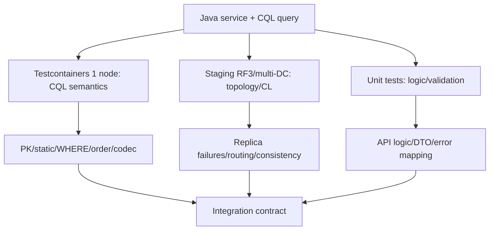

# Testing Primary Keys, Static Columns, and SELECT Predicates in Cassandra from Java

## 1. Goal: Test Real CQL Semantics, Not Just Mocked Repositories

Apache Cassandra is a **distributed wide-column** database: the **partition key** determines logical partitioning and replica selection; **clustering columns** determine row identity and ordering within a partition; **replication factor (RF)** and **consistency level (CL)** determine how many replicas must respond on reads/writes. Designing tables around queries is necessary, but Java applications also need **integration tests** to guarantee CQL queries are genuinely valid and return the right rows.

Consider a table storing events by tenant/day with:

- Composite partition key `(tenant_id, event_day)`.
- Clustering key `(occurred_at, event_id)`.
- Column `partition_note static` as **partition-level metadata**, not per-event data.
- Column `event_type` as a per-row regular column.

A unit test mocking `CassandraRepository` might let invalid queries slip through—such as “filtering by unindexed `event_type`” or “passing only half of a composite partition key”. Real Cassandra will reject them during prepare/execute. Conversely, a test checking only “no exception thrown” can miss that two rows in the same partition **share a static value** or that `INSERT`ing the same full primary key is actually an upsert.

**Objective:** build an integration test suite against real Cassandra (e.g., Testcontainers) verifying **primary keys, static columns, `SELECT WHERE` predicates, result ordering, and rejected queries**, while understanding the limits of a single-node test cluster relative to production RF/CL.

### Learning Outcomes

After this lesson, you should be able to:

1. Read `PRIMARY KEY ((a,b), c,d)` accurately and distinguish partition keys from clustering keys.
2. Test uniqueness of the **full primary key**, partition boundaries, and clustering order.
3. Prove that static columns hold values **per partition**, even when a partition has no regular rows.
4. Write positive/negative tests for `WHERE` predicates and `ORDER BY` following Cassandra rules.
5. Wire JUnit 5 + Testcontainers + Java Driver 4.x to execute real CQL.
6. Design Spring Data mapping/repository tests without confusing unit tests with integration tests.
7. Avoid fake testing: `ALLOW FILTERING` hiding broken schemas, `COUNT(*)` on large tables, asserting arbitrary order, arbitrary sleeps, and claiming RF3 on one node.

> **Principle:** *When testing CQL, verify both correct results, proper rejection of invalid queries, and the guarantees actually supported by the test environment.* A test that “PASSES” via mocks or `ALLOW FILTERING` has not proven the schema is production-ready.

## 2. Unit Tests, Integration Tests, and Topology Tests: Three Distinct Tiers

| Tier | What Runs? | What It Verifies | What It Cannot Prove |
| --- | --- | --- | --- |
| Unit test | Mocked `CqlSession`/repository, no Cassandra | Validation, pure Java mapping logic, service authorization, method dispatch | CQL parser, primary key restrictions, static semantics, RF/CL |
| Single-node integration test | Real Cassandra in Testcontainers, real Java Driver | Schema, prepared/bound CQL, upserts, static columns, `SELECT WHERE`, codecs, and row mapping | RF3 rolling failures, 2/3 quorum, multi-DC, repair/streaming |
| Multi-node integration test | Multi-replica/DC/rack test cluster | Some CL behaviors, topology, failover, and driver routing | Full production network/disk/traffic representation |
| End-to-end/staging | Spring Boot, auth/TLS, migrations, near-real workload | API contracts, SLOs, RBAC, profiles, rollouts | Correctness under every concurrency schedule or failure |

**One real Cassandra node beats mocks for CQL**, yet cannot prove `LOCAL_QUORUM` will work when a replica goes Down under RF3. If tests set RF1, `LOCAL_QUORUM` still needs only one replica in that DC; that is not a fault-tolerance test.

### Test Responsibility Matrix



Assigning each test type a focused scope reduces flakiness and avoids spinning up hundreds of containers just to test DTO transformations.

## 3. Lab Schema: Composite Partition Key, Clustering, and Static Columns

The main examples use a test datacenter named `datacenter1`. In a single Cassandra container, choose **RF1** intentionally to test CQL semantics; production typically needs `NetworkTopologyStrategy` per DC and an appropriate RF such as RF3. Actual DC names must be read from the container/distribution topology.

```sql
CREATE KEYSPACE IF NOT EXISTS integration_lab
WITH replication = {
    'class': 'NetworkTopologyStrategy',
    'datacenter1': 1
}
AND durable_writes = true;

CREATE TABLE IF NOT EXISTS integration_lab.events_by_tenant_day (
    tenant_id text,
    event_day date,
    occurred_at timestamp,
    event_id uuid,
    partition_note text static,
    partition_owner text static,
    event_type text,
    payload text,
    PRIMARY KEY ((tenant_id, event_day), occurred_at, event_id)
) WITH CLUSTERING ORDER BY (
    occurred_at DESC,
    event_id ASC
);
```

**Key breakdown:**

| Component | Role | What to Test |
| --- | --- | --- |
| `tenant_id` | 1st component of composite partition key | Insufficient alone to locate a partition in normal queries |
| `event_day` | 2nd component of composite partition key | Same tenant on a different day is a **different partition** |
| `occurred_at` | 1st clustering column, `DESC` | Newer rows appear first within a partition |
| `event_id` | 2nd clustering column, `ASC` | Disambiguates events sharing a timestamp |
| `partition_note` | Static column | Shared within one partition; not bound to a single clustering row |
| `partition_owner` | Static column | Changes in one partition do not affect other partitions |
| `event_type` / `payload` | Regular columns | Per-row values; cannot be freely filtered in `WHERE` without an appropriate access path |

The **full primary key** is `(tenant_id, event_day, occurred_at, event_id)`—not just `event_id` and not just `(tenant_id, event_day)`. Two events sharing the same partition key with different clustering keys are **two distinct logical rows**.

### Visualizing with Two Partitions

```text
Partition P1 = ("tenant-A", 2026-11-20)
  static: partition_note="Promo day"
  row 1: occurred_at=10:00, event_id=U1, event_type=OPEN
  row 2: occurred_at=09:00, event_id=U2, event_type=CLICK

Partition P2 = ("tenant-A", 2026-11-21)
  static: partition_note="Regular day"
  row 1: occurred_at=08:00, event_id=U3, event_type=CLOSE

P1 and P2 are separate even though both belong to tenant-A.
There is no "tenant-wide" static value unless the schema is modeled for it.
```

Note: Cassandra has no “auto-increment primary key” like some RDBMSs. A `uuid` `event_id` is not time-ordered on its own, so ordering relies on `occurred_at` first and `event_id` as tie-breaker.

## 4. Primary Key Rules to Enforce in Integration Tests

### 4.1. Composite Partition Keys Must Be Fully Bound

Valid query targeting one partition:

```sql
SELECT occurred_at, event_id, event_type
FROM integration_lab.events_by_tenant_day
WHERE tenant_id = 'tenant-A'
  AND event_day = '2026-11-20';
```

Invalid query under this schema:

```sql
-- Missing event_day (part of the composite partition key).
SELECT event_id
FROM integration_lab.events_by_tenant_day
WHERE tenant_id = 'tenant-A';
```

Tests must expect an appropriate query error **when no index or approved scan path exists**—never add `ALLOW FILTERING` just to make a test pass.

### 4.2. Clustering Keys Follow Left-to-Right Prefix Order

Once the full partition key is bound, typical valid predicates include:

```sql
-- Fetch all rows in the partition.
SELECT event_id FROM integration_lab.events_by_tenant_day
WHERE tenant_id = 'tenant-A' AND event_day = '2026-11-20';

-- Fetch a single row by FULL primary key.
SELECT event_type FROM integration_lab.events_by_tenant_day
WHERE tenant_id = 'tenant-A' AND event_day = '2026-11-20'
  AND occurred_at = '2026-11-20T10:00:00Z'
  AND event_id = 11111111-1111-4111-8111-111111111111;

-- Range on the first clustering column.
SELECT event_id, occurred_at FROM integration_lab.events_by_tenant_day
WHERE tenant_id = 'tenant-A' AND event_day = '2026-11-20'
  AND occurred_at >= '2026-11-20T09:00:00Z';
```

Conversely, **you cannot skip a clustering prefix** and filter arbitrarily on `event_id`:

```sql
-- Intentionally invalid in a schema without an index:
SELECT event_type FROM integration_lab.events_by_tenant_day
WHERE tenant_id = 'tenant-A' AND event_day = '2026-11-20'
  AND event_id = 11111111-1111-4111-8111-111111111111;
```

**Do not confuse “full partition key provided” with “every trailing predicate is valid”.** Clustering predicates follow rules on prefixes, equality/ranges, `IN`, and ordering, whose details can vary by version. Indexes or SAI can create alternative access paths, yet this test **intentionally creates no index** to catch key-based query design errors.

### 4.3. Full Primary Key Identifies One Logical Row

Two `INSERT` statements with **identical values for all four key components** do not create two rows:

```sql
INSERT INTO integration_lab.events_by_tenant_day (
    tenant_id, event_day, occurred_at, event_id, event_type
) VALUES (
    'tenant-A', '2026-11-20', '2026-11-20T10:00:00Z',
    11111111-1111-4111-8111-111111111111, 'OPEN'
);

INSERT INTO integration_lab.events_by_tenant_day (
    tenant_id, event_day, occurred_at, event_id, event_type
) VALUES (
    'tenant-A', '2026-11-20', '2026-11-20T10:00:00Z',
    11111111-1111-4111-8111-111111111111, 'CLOSED'
);
```

When the later mutation has the winning write timestamp per Cassandra's conflict resolution rules, that logical row holds `event_type='CLOSED'`. Tests should assert **logical row count equals one**, and control ordering/timestamps if asserting the final value. Firing two mutations in the same microsecond from different coordinators and assuming “the second call always wins” makes a bad test.

### 4.4. Primary Keys Cannot Be Treated Like Regular Columns

Statements like “`UPDATE event_id = newId WHERE ...`” are not how keys change. Changing a primary key generally requires inserting a row under the new key and handling the old row per business rules, with atomicity/ordering risks to evaluate.

Tests must cover missing/null keys and wrong parameter types. Never pass `UNSET` for a primary key column expecting Cassandra to infer it.

## 5. Static Columns: What to Assert with Data

In Cassandra, a `static` column **belongs to the partition**, not an individual clustering row. A table declaring static columns must normally have clustering columns to distinguish regular rows within that partition.

### 5.1. Updating Static Columns Does Not Need the Full Clustering Key

```sql
UPDATE integration_lab.events_by_tenant_day
SET partition_note = 'End-of-day reconciliation finalized',
    partition_owner = 'worker-A'
WHERE tenant_id = 'tenant-A'
  AND event_day = '2026-11-20';
```

The `WHERE` clause for an operation **updating only static columns** requires the partition key, not `occurred_at` and `event_id`. This is **not** evidence that regular columns can also be updated without clustering keys.

Updating a regular column without clustering columns is invalid:

```sql
-- Intentionally invalid: regular column event_type requires the full row key.
UPDATE integration_lab.events_by_tenant_day
SET event_type = 'PAID'
WHERE tenant_id = 'tenant-A'
  AND event_day = '2026-11-20';
```

### 5.2. One Static Value Appears Alongside Multiple Regular Rows

If a partition holds two events, after updating `partition_note`, querying:

```sql
SELECT occurred_at, event_id, event_type, partition_note
FROM integration_lab.events_by_tenant_day
WHERE tenant_id = 'tenant-A'
  AND event_day = '2026-11-20';
```

returns the static value on each returned row of that partition. **Do not mistake this for Cassandra duplicating static cells into every clustering row.** It is a storage representation where SELECT projects static data alongside regular rows.

### 5.3. Static-Only Partitions

A partition can hold static data **even when no regular clustering rows exist**:

```sql
UPDATE integration_lab.events_by_tenant_day
SET partition_note = 'Period opened, no events yet'
WHERE tenant_id = 'tenant-empty'
  AND event_day = '2026-11-20';

SELECT tenant_id, event_day, occurred_at,
       event_id, partition_note, event_type
FROM integration_lab.events_by_tenant_day
WHERE tenant_id = 'tenant-empty'
  AND event_day = '2026-11-20';
```

When a static-only partition is queried appropriately, Cassandra returns a single placeholder row with **null clustering fields** and the static value populated. Tests must confirm **static data is readable without inferring a business event exists**.

If a Java mapper assumes `row.getInstant("occurred_at")` and `row.getUuid("event_id")` are always non-null, a static-only row can cause the application to emit a “phantom” event. That is a mapping/business bug, not a Cassandra bug.

### 5.4. Static Is Not “Global Config”

`partition_note` for `(tenant-A, day-20)` **does not affect** `(tenant-A, day-21)` or `(tenant-B, day-20)`. Test two separate partitions while updating only one to prove isolation.

### 5.5. Delete/TTL and Static Columns

`DELETE partition_note ... WHERE partition key` affects only the targeted static cell per CQL semantics, rather than deleting regular rows. Conversely, deleting the **entire partition** affects both static and regular data.

TTLs can cause static cells to expire at a different time than regular rows. When testing expiration, avoid `Thread.sleep(1000)` expecting changes at an exact millisecond; account for TTL granularity, clocks, and retries in the test environment. Complex/long TTL scenarios belong in a separate suite rather than basic primary-key tests.

## 6. `SELECT DISTINCT` with Static Columns: Useful Yet Easily Misunderstood

In Cassandra versions that support it, `SELECT DISTINCT` retrieves **partition keys and valid static columns**, not SQL-style “DISTINCT over any arbitrary expression”.

Example for **one partition**:

```sql
SELECT DISTINCT tenant_id, event_day,
       partition_note, partition_owner
FROM integration_lab.events_by_tenant_day
WHERE tenant_id = 'tenant-A'
  AND event_day = '2026-11-20';
```

Expect a single result row for the partition's metadata, even if the partition has many clustering rows.

Conversely, `SELECT DISTINCT event_type` is not a valid way to list “distinct event types” in this table; regular columns do not share static `DISTINCT` semantics. Never rely on `DISTINCT` to turn Cassandra into a `GROUP BY`/analytics engine without a matching table model.

### Why Not Use Full-Table `SELECT DISTINCT` to Count Tenants?

Unpartitioned queries may traverse huge numbers of token ranges and replicas. `DISTINCT` reduces returned rows, **not the read/routing cost**. If an API needs a list of tenants or active days, consider a **dedicated query table** rather than scanning the events table.

## 7. Categories of `SELECT WHERE` Conditions for Your Test Matrix

| Case | CQL Pattern | Expectation in Lab Schema |
| --- | --- | --- |
| Full partition key | `tenant_id=? AND event_day=?` | Valid; returns clustering rows in the partition |
| Full primary key | Full partition + `occurred_at=? AND event_id=?` | Valid; at most one logical row |
| Clustering prefix | Full partition + `occurred_at=?` | Valid; may return multiple rows on timestamp ties |
| Clustering range | Full partition + `occurred_at>=?` | Valid per clustering order; may return multiple rows |
| Half partition key | `tenant_id=?` | No valid access path in this unindexed schema |
| Skipped clustering prefix | Full partition + `event_id=?` | Rejected/invalid per clustering rules |
| Regular column filter | `event_type=?` without index | Not efficiently served by primary key; needs another model |
| Valid `ORDER BY` | Full partition key, valid clustering order | Valid within CQL constraints |
| `ORDER BY` regular column | `ORDER BY event_type` | Invalid on this table |
| `ALLOW FILTERING` | Forces scan outside keys/indexes | May run some scans, **never** counts as a sound query-design test |
| `SELECT DISTINCT` partition/static | Selects partition key, static columns | Valid in supporting versions |
| `SELECT DISTINCT` regular only | `DISTINCT event_type` | Not a valid general SQL DISTINCT query |

**Do not turn this matrix into a claim that every Cassandra version emits identical error text or treats every `IN`/index variant identically.** Tie tests to the target version, asserting appropriate exception categories rather than exact error strings.

### 7.1. “Few Rows Returned” Does Not Prove a Cheap Query

Example:

```sql
-- Anti-pattern example; do not run on large production tables:
SELECT event_id FROM integration_lab.events_by_tenant_day
WHERE event_type = 'LOGIN' ALLOW FILTERING;
```

Even if the query returns one row, the server may have scanned many partitions/cells before filtering. Integration tests should **reject this anti-pattern at the application/repository layer**, never adding `ALLOW FILTERING` in production just to make tests pass.

### 7.2. `SELECT IF` Is Not Conditional CQL Reading

In Cassandra, `IF` belongs to **conditional mutations** like `INSERT ... IF NOT EXISTS` or `UPDATE ... IF ...` (LWT), not SQL-style “`SELECT ... IF status='PAID'`”. Read filtering goes through `WHERE` along valid access paths. Tests should not confuse `SELECT` testing with Paxos/LWT testing.

## 8. Clustering Order, Tie-Breakers, and Assertion Stability

The table declares:

```sql
WITH CLUSTERING ORDER BY (
    occurred_at DESC,
    event_id ASC
)
```

Within a partition, if two rows have different timestamps, the higher timestamp appears first. On equal timestamps, `event_id ASC` breaks the tie. Two rows sharing both timestamp **and `event_id`** actually share the same full primary key—they are not two separate events.

### Tests Must Not Rely on Random UUIDs for Time Ordering

`UUID.randomUUID()` generates v4 UUIDs, so a smaller UUID does not mean it was created earlier. When business queries demand “newest first”, **the `occurred_at DESC` column** encodes chronological order in the schema.

### `ORDER BY` and Reversing Order

Within valid query predicates, Cassandra can read in reverse of the declared clustering order. For mixed ordering `DESC, ASC`, the valid reversal is `ASC, DESC`, **not** flipping one column arbitrarily while keeping the other:

```sql
SELECT occurred_at, event_id
FROM integration_lab.events_by_tenant_day
WHERE tenant_id = 'tenant-A'
  AND event_day = '2026-11-20'
ORDER BY occurred_at ASC, event_id DESC;
```

`ORDER BY` details, column constraints, and index support vary by version; verify against your target server. **Never expect global ordering across multiple partitions or when the app merges parallel queries.**

## 9. Why Use Testcontainers Instead of Mocking Cassandra?

Testcontainers boots real Cassandra in an isolated container so JUnit executes CQL via the real driver. You can verify:

- Server DDL parsing and schema creation.
- `PreparedStatement` and `BoundStatement` parameter type alignment.
- Primary key and clustering `WHERE` restrictions.
- Static cell sharing within a partition.
- `SELECT DISTINCT` on partition/static columns.
- Server validation errors for invalid CQL.
- Java codecs such as `Instant`, `LocalDate`, and `UUID`.
- Spring Data mapper interactions with CQL when combined with slice tests.

### Environment Prerequisites

1. Docker or a compatible container runtime ready on CI/local.
2. Testcontainers/JUnit Jupiter versions compatible with JDK/Spring Boot.
3. Cassandra image **intentionally pinned by version**; never use `latest`.
4. Adequate CPU/RAM/disk for Cassandra startup.
5. Tests do not require Internet access once images are cached, if CI is air-gapped.
6. Keyspaces/schemas created **before** repositories execute or contexts require the keyspace.
7. Each test uses isolated data/keys or controlled resets, never production data.

**Never run integration tests against a production cluster.** A misdirected `TRUNCATE` or `DROP KEYSPACE` can destroy live data; tests must create/acquire connections strictly from the test environment.

### Recommended Dependencies with Spring Boot BOM

Maven example; dependency versions are managed by the **project's chosen compatible BOM**:

```xml
<dependencies>
    <dependency>
        <groupId>org.springframework.boot</groupId>
        <artifactId>spring-boot-starter-data-cassandra</artifactId>
    </dependency>
    <dependency>
        <groupId>org.springframework.boot</groupId>
        <artifactId>spring-boot-starter-test</artifactId>
        <scope>test</scope>
    </dependency>
    <dependency>
        <groupId>org.testcontainers</groupId>
        <artifactId>cassandra</artifactId>
        <scope>test</scope>
    </dependency>
    <dependency>
        <groupId>org.testcontainers</groupId>
        <artifactId>junit-jupiter</artifactId>
        <scope>test</scope>
    </dependency>
</dependencies>
```

Testcontainers module/artifact names can change across major versions; on a branch using Testcontainers 1.x, the artifacts above are typical. For 2.x or newer BOMs, look up the exact coordinates provided by your pinned version. **Do not randomly override driver and Netty versions** just to silence dependency conflicts.

## 10. Test Data: Independent, Identifiable, and Easy to Reconcile

With a shared container inside a test class, avoid:

```text
Test A INSERTs tenant="test" into partition day-20.
Test B SELECTs tenant="test" assuming an empty partition.
Outcome depends on test execution order.
```

Instead, generate a **unique tenant per test**:

```java
String tenant = "it-" + java.util.UUID.randomUUID();
java.time.LocalDate day = java.time.LocalDate.of(2026, 11, 20);
```

Since both keys form the composite partition key, tests stay isolated without frequent `TRUNCATE` calls. Containers can be destroyed when the test class finishes, per CI cleanup policy. If deterministic replay is needed, derive unique IDs from test name + run ID while still avoiding collisions across parallel workers.

### Use Controlled Timestamps in Tests

Never use `Instant.now()` to predict ordering between two inserts microseconds apart; Cassandra `timestamp` stores **millisecond** precision, so two close calls can collapse to the same value. Use fixed values:

```java
Instant newer = Instant.parse("2026-11-20T10:00:00.000Z");
Instant older = Instant.parse("2026-11-20T09:00:00.000Z");
```

When testing write conflicts on the same full primary key, use **explicit write timestamps** with distinct microsecond `USING TIMESTAMP` values, avoiding collisions with other test writes. Never abuse explicit timestamps in production without a concurrency policy.

## 11. Both Positive and Negative Assertions Form the Contract

A thorough integration suite checks more than just happy-path rows:

**Positive path:**

- Full composite partition key returns the right partition.
- Full primary key returns the exact single event.
- Range on clustering prefix returns the right subset and order.
- Static update appears identically across multiple clustering rows.
- Static-only partition still returns the static value.
- Two partitions do not share static values.
- Valid `SELECT DISTINCT` returns only one partition's metadata.

**Negative path:**

- Missing `event_day` from composite partition key is rejected by the unindexed server schema.
- `WHERE event_id=?` skipping `occurred_at` is rejected.
- `UPDATE` of a regular column without the full key is rejected.
- `ORDER BY event_type` is rejected as an invalid clustering order.
- `DISTINCT` on a regular column is not valid SELECT syntax.
- Null/missing primary keys are rejected instead of creating phantom data.
- The app never injects `ALLOW FILTERING` to make an invalid query “work”.

**CQL error messages can vary across Cassandra versions.** Assert by exception category (e.g., `InvalidQueryException`) or a stable predicate rather than matching exact English phrasing line-for-line; also remember errors may be thrown at `prepare` time rather than `execute` time.

## 12. JUnit 5 + Testcontainers: Booting Real Cassandra

The code below is a **single test class** for Java 17+, JUnit Jupiter, Testcontainers Cassandra module (1.x API), and Java Driver 4.x. It uses the `cassandra:4.1` image for illustration; real projects should pin an exact compatible patch and test against the production server target.

Tests use keyspace `integration_lab` with RF1 in DC `datacenter1`. The DC name must match the image/config; if your Docker image or distribution exposes a different DC, update container config, driver local DC, and `NetworkTopologyStrategy` **together**.

```java
import static org.junit.jupiter.api.Assertions.*;

import java.net.InetSocketAddress;
import java.time.Instant;
import java.time.LocalDate;
import java.util.List;
import java.util.UUID;

import org.junit.jupiter.api.AfterAll;
import org.junit.jupiter.api.BeforeAll;
import org.junit.jupiter.api.Test;
import org.testcontainers.containers.CassandraContainer;
import org.testcontainers.junit.jupiter.Container;
import org.testcontainers.junit.jupiter.Testcontainers;
import org.testcontainers.utility.DockerImageName;

import com.datastax.oss.driver.api.core.CqlSession;
import com.datastax.oss.driver.api.core.cql.BoundStatement;
import com.datastax.oss.driver.api.core.cql.PreparedStatement;
import com.datastax.oss.driver.api.core.cql.Row;
import com.datastax.oss.driver.api.core.servererrors.InvalidQueryException;

@Testcontainers
public class PrimaryKeyAndStaticColumnIT {

    @Container
    static final CassandraContainer<?> CASSANDRA =
        new CassandraContainer<>(
            DockerImageName.parse("cassandra:4.1"))
            .withEnv("CASSANDRA_DC", "datacenter1");

    private static CqlSession session;
    private static PreparedStatement insertEvent;
    private static PreparedStatement selectPartition;
    private static PreparedStatement updateStatic;

    private static final LocalDate DAY =
        LocalDate.of(2026, 11, 20);

    private static final Instant T10 =
        Instant.parse("2026-11-20T10:00:00Z");
    private static final Instant T09 =
        Instant.parse("2026-11-20T09:00:00Z");

    @BeforeAll
    static void createSchema() {
        // Testcontainers starts the static @Container before @BeforeAll.
        session = CqlSession.builder()
            .addContactPoint(new InetSocketAddress(
                CASSANDRA.getHost(),
                CASSANDRA.getMappedPort(9042)))
            .withLocalDatacenter("datacenter1")
            .build();

        session.execute(
            "CREATE KEYSPACE IF NOT EXISTS integration_lab " +
            "WITH replication = {" +
            "'class':'NetworkTopologyStrategy'," +
            "'datacenter1':1}");

        session.execute(
            "CREATE TABLE IF NOT EXISTS " +
            "integration_lab.events_by_tenant_day (" +
            "tenant_id text, event_day date, " +
            "occurred_at timestamp, event_id uuid, " +
            "partition_note text static, " +
            "partition_owner text static, " +
            "event_type text, payload text, " +
            "PRIMARY KEY ((tenant_id, event_day)," +
            " occurred_at, event_id)) " +
            "WITH CLUSTERING ORDER BY " +
            "(occurred_at DESC, event_id ASC)");

        insertEvent = session.prepare(
            "INSERT INTO integration_lab.events_by_tenant_day " +
            "(tenant_id, event_day, occurred_at, event_id, " +
            "event_type, payload) VALUES (?, ?, ?, ?, ?, ?)");

        selectPartition = session.prepare(
            "SELECT tenant_id, event_day, occurred_at, " +
            "event_id, event_type, partition_note " +
            "FROM integration_lab.events_by_tenant_day " +
            "WHERE tenant_id = ? AND event_day = ?");

        updateStatic = session.prepare(
            "UPDATE integration_lab.events_by_tenant_day " +
            "SET partition_note = ? " +
            "WHERE tenant_id = ? AND event_day = ?");
    }

    @AfterAll
    static void closeSession() {
        if (session != null) {
            session.close();
        }
    }

    private static String newTenant() {
        return "it-" + UUID.randomUUID();
    }

    private static void put(
            String tenant, Instant when, UUID id, String type) {
        session.execute(insertEvent.bind(
            tenant, DAY, when, id, type, "test-payload"));
    }

    @Test
    void fullPrimaryKeyIdentifiesOneLogicalRow() {
        String tenant = newTenant();
        UUID eventId = UUID.randomUUID();
        put(tenant, T10, eventId, "OPEN");
        put(tenant, T10, eventId, "CLOSED");

        List<Row> rows = session.execute(
            selectPartition.bind(tenant, DAY)).all();

        // Upserting with the same full PK does not create a second row.
        assertEquals(1, rows.size());
        assertEquals(eventId, rows.get(0).getUuid("event_id"));
    }

    @Test
    void staticValueIsSharedWithinOnePartition() {
        String tenant = newTenant();
        put(tenant, T10, UUID.randomUUID(), "OPEN");
        put(tenant, T09, UUID.randomUUID(), "CLICK");

        session.execute(updateStatic.bind(
            "metadata-for-one-partition", tenant, DAY));

        List<Row> rows = session.execute(
            selectPartition.bind(tenant, DAY)).all();
        assertEquals(2, rows.size());
        assertTrue(rows.stream().allMatch(row ->
            "metadata-for-one-partition".equals(
                row.getString("partition_note"))));
        assertEquals(T10, rows.get(0).getInstant("occurred_at"));
        assertEquals(T09, rows.get(1).getInstant("occurred_at"));
    }

    @Test
    void staticOnlyPartitionDoesNotCreateBusinessEvent() {
        String tenant = newTenant();
        session.execute(updateStatic.bind(
            "opened-without-events", tenant, DAY));

        List<Row> rows = session.execute(
            selectPartition.bind(tenant, DAY)).all();
        assertEquals(1, rows.size());
        assertEquals("opened-without-events",
            rows.get(0).getString("partition_note"));
        assertTrue(rows.get(0).isNull("event_id"));
        assertTrue(rows.get(0).isNull("occurred_at"));
    }

    @Test
    void staticDataDoesNotLeakToAnotherPartition() {
        String tenant = newTenant();
        LocalDate anotherDay = DAY.plusDays(1);
        session.execute(updateStatic.bind("day-20", tenant, DAY));
        session.execute(updateStatic.bind(
            "day-21", tenant, anotherDay));

        Row first = session.execute(
            selectPartition.bind(tenant, DAY)).one();
        Row second = session.execute(
            selectPartition.bind(tenant, anotherDay)).one();
        assertNotNull(first);
        assertNotNull(second);
        assertEquals("day-20",
            first.getString("partition_note"));
        assertEquals("day-21",
            second.getString("partition_note"));
    }

    @Test
    void rangePredicateKeepsClusteringOrder() {
        String tenant = newTenant();
        put(tenant, T10, UUID.randomUUID(), "OPEN");
        put(tenant, T09, UUID.randomUUID(), "CLICK");
        put(tenant, T09.minusSeconds(3600),
            UUID.randomUUID(), "CLOSE");

        PreparedStatement range = session.prepare(
            "SELECT occurred_at, event_id " +
            "FROM integration_lab.events_by_tenant_day " +
            "WHERE tenant_id=? AND event_day=? " +
            "AND occurred_at >= ?");

        List<Row> rows = session.execute(
            range.bind(tenant, DAY, T09)).all();
        assertEquals(2, rows.size());
        assertEquals(T10, rows.get(0).getInstant("occurred_at"));
        assertEquals(T09, rows.get(1).getInstant("occurred_at"));
    }

    @Test
    void distinctReadsPartitionMetadataNotEveryEvent() {
        String tenant = newTenant();
        put(tenant, T10, UUID.randomUUID(), "OPEN");
        put(tenant, T09, UUID.randomUUID(), "CLICK");
        session.execute(updateStatic.bind("metadata", tenant, DAY));

        PreparedStatement distinct = session.prepare(
            "SELECT DISTINCT tenant_id, event_day, partition_note " +
            "FROM integration_lab.events_by_tenant_day " +
            "WHERE tenant_id=? AND event_day=?");

        List<Row> rows = session.execute(
            distinct.bind(tenant, DAY)).all();
        assertEquals(1, rows.size());
        assertEquals("metadata",
            rows.get(0).getString("partition_note"));
    }

    @Test
    void reversedClusteringOrderWorksInsideOnePartition() {
        String tenant = newTenant();
        put(tenant, T10, UUID.randomUUID(), "OPEN");
        put(tenant, T09, UUID.randomUUID(), "CLICK");

        PreparedStatement reverse = session.prepare(
            "SELECT occurred_at, event_id " +
            "FROM integration_lab.events_by_tenant_day " +
            "WHERE tenant_id=? AND event_day=? " +
            "ORDER BY occurred_at ASC, event_id DESC");

        List<Row> rows = session.execute(
            reverse.bind(tenant, DAY)).all();
        assertEquals(2, rows.size());
        assertEquals(T09, rows.get(0).getInstant("occurred_at"));
        assertEquals(T10, rows.get(1).getInstant("occurred_at"));
    }

    @Test
    void invalidWhereClausesAreRejectedAtPrepareTime() {
        assertThrows(InvalidQueryException.class, () ->
            session.prepare(
                "SELECT event_id " +
                "FROM integration_lab.events_by_tenant_day " +
                "WHERE tenant_id=?"));

        assertThrows(InvalidQueryException.class, () ->
            session.prepare(
                "SELECT event_id " +
                "FROM integration_lab.events_by_tenant_day " +
                "WHERE tenant_id=? AND event_day=? " +
                "AND event_id=?"));
    }

    @Test
    void regularColumnCannotBeUpdatedWithoutClusteringKey() {
        assertThrows(InvalidQueryException.class, () ->
            session.prepare(
                "UPDATE integration_lab.events_by_tenant_day " +
                "SET event_type=? " +
                "WHERE tenant_id=? AND event_day=?"));
    }
}
```

### Understanding the Test Suite

- `@Container` declares a real Cassandra instance managed by Testcontainers.
- `@BeforeAll` creates the schema and prepared statements **before** any test cases run.
- `newTenant()` gives each test its **own partition key**, avoiding execution-order coupling.
- `fullPrimaryKeyIdentifiesOneLogicalRow` asserts row count, **not** which writer wins when two mutations have close timestamps.
- `staticValueIsSharedWithinOnePartition` inserts two clustering rows and updates the static column once.
- `staticOnlyPartitionDoesNotCreateBusinessEvent` catches mappers treating virtual rows as real events.
- `rangePredicateKeepsClusteringOrder` verifies both range filtering and ordering, not just row count.
- `invalidWhereClausesAreRejectedAtPrepareTime` exercises the real server parser/planner, which mocks cannot replace.

**Another Testcontainers version may use a different package/artifact for `CassandraContainer`.** The sample targets the 1.x module API noted in Section 9; align compatible dependency management before compiling. Do not run Gradle/Python or create extra scratch files outside this worker assignment's scope.

### Limitations of This Suite

It runs on **one node with RF1**, testing neither 2/3 quorum nor node failures. Nor does it prove a query will be fast on multi-million-row partitions: **correctness integration tests ≠ load/performance tests**. Those require dedicated staging, topologies, and benchmarks.

## 13. Java Driver: Testing Boundary Conditions on SELECT Predicates

Beyond the baseline class, test boundary cases that silently break bindings:

| Boundary | Input | Recommended Assertion |
| --- | --- | --- |
| Date in composite PK | `LocalDate.of(2026,11,20)` and day 21 | No mixing between the two partitions |
| Exact millisecond timestamp | `2026-11-20T10:00:00.123Z` | Read back as `Instant` without timezone skew |
| Timestamps differing by ns within same ms | Two `Instant`s 1 ns apart | Do not assume they stay distinct clustering keys after CQL timestamp conversion |
| Two UUIDs at the same timestamp | Same `occurred_at`, different `event_id` | Two logical rows ordered by UUID tie-breaker |
| Duplicate full PK | Re-insert with identical four keys | No second row created |
| Null partition key | `tenant_id=null` or `event_day=null` | Mutation/query properly rejected |
| Missing static data | Insert regular row only | `partition_note` may be null |
| Static-only data | Update `partition_note` only | No phantom business event emitted |
| Null regular column | Insert without `payload` | Mapper does not silently convert null to empty string |

### Clustering Timestamps Must Be Normalized

CQL `timestamp` has millisecond resolution. Java `Instant` supports nanoseconds. If an application creates two events:

```java
Instant a = Instant.parse("2026-11-20T10:00:00.123000001Z");
Instant b = Instant.parse("2026-11-20T10:00:00.123000002Z");
```

they differ in Java, yet when bound to CQL `timestamp`, sub-millisecond parts are dropped. If `event_id` also matches, **the full PK collides**. In this model, `event_id` must be uniquely assigned per logical event; never rely on timestamp alone as the key for events within the same millisecond.

### Testing Range Boundaries

For `occurred_at >= T09`, seed at least three rows: **before boundary**, **on boundary**, and **after boundary**; expect two rows when placing one row at each point. Inserting only two rows that both match fails to prove the comparator works.

With reversed `ORDER BY`, also test multiple rows sharing a timestamp. Convert local times to `Instant` in the explicit timezone rather than comparing date/time strings using the JVM default.

## 14. Spring Data Cassandra: Test Mapping and Queries, Not Just Repository Names

Spring Boot/Spring Data can use `@PrimaryKeyClass` and `@PrimaryKeyColumn` to model composite partition/clustering keys. Below is a **mapping sketch** using common Spring Data Cassandra APIs:

```java
import java.io.Serializable;
import java.time.Instant;
import java.time.LocalDate;
import java.util.UUID;

import org.springframework.data.cassandra.core.cql.Ordering;
import org.springframework.data.cassandra.core.cql.PrimaryKeyType;
import org.springframework.data.cassandra.core.mapping.PrimaryKeyClass;
import org.springframework.data.cassandra.core.mapping.PrimaryKeyColumn;

@PrimaryKeyClass
public class EventKey implements Serializable {
    @PrimaryKeyColumn(
        name = "tenant_id", ordinal = 0,
        type = PrimaryKeyType.PARTITIONED)
    private String tenantId;

    @PrimaryKeyColumn(
        name = "event_day", ordinal = 1,
        type = PrimaryKeyType.PARTITIONED)
    private LocalDate eventDay;

    @PrimaryKeyColumn(
        name = "occurred_at", ordinal = 2,
        type = PrimaryKeyType.CLUSTERED,
        ordering = Ordering.DESCENDING)
    private Instant occurredAt;

    @PrimaryKeyColumn(
        name = "event_id", ordinal = 3,
        type = PrimaryKeyType.CLUSTERED,
        ordering = Ordering.ASCENDING)
    private UUID eventId;

    // Requires no-arg constructor, getters/setters,
    // equals/hashCode across all four fields, and
    // mapping strategy compatible with your Spring Data version.
}
```

**Do not copy this sketch verbatim as a complete production entity:** it omits constructors, accessors, `equals`, and `hashCode` to focus on key classification and ordering. In real code, composite keys must implement equality contracts and serialization/constructors expected by the repository.

The entity can look like:

```java
import org.springframework.data.cassandra.core.mapping.PrimaryKey;
import org.springframework.data.cassandra.core.mapping.Table;
import org.springframework.data.cassandra.core.mapping.Column;

@Table("events_by_tenant_day")
public class EventEntity {
    @PrimaryKey
    private EventKey key;

    @Column("event_type")
    private String eventType;

    @Column("payload")
    private String payload;

    // Constructors, getters, and setters or immutable mapping
    // configured per your Spring Data version.
}
```

These mapping classes **do not replace** CQL integration tests. Verify:

1. Spring Data reads/writes all four `EventKey` fields without swapping them.
2. `event_day` maps to `LocalDate` and `occurred_at` maps to `Instant`.
3. Generated repository queries match the exact composite partition key.
4. If mapping static columns on an entity, verify the **version-specific annotation/mapping API** and avoid treating static fields as per-row attributes.
5. Entities missing required fields are rejected or mapped to null cleanly rather than “succeeding” with malformed DTOs.

### `@DataCassandraTest` Needs the Schema Before the Spring Context Uses It

A Spring Boot slice test can use `@DataCassandraTest` to load repository/mapping components. Ensure:

- The container starts before the Spring `ApplicationContext` creates its session.
- **The default keyspace already exists** before Boot connects to it.
- `spring.cassandra.contact-points`, `local-datacenter`, keyspace, and port point to the test container.
- Schema init/migrations run at the right phase rather than asking the context to use nonexistent tables.
- Tests do not accidentally open two sessions targeting different clusters via fallback defaults.

Structural sketch (**pseudocode dependent on Boot version and actual schema bootstrap**):

```java
@DataCassandraTest
@Testcontainers
class SpringDataEventMappingIT {
    // @Container: Cassandra started for this test.
    // @DynamicPropertySource or @ServiceConnection:
    // maps contact points/local DC into Spring Boot.
    // Create the keyspace via bootstrap connection BEFORE
    // Boot's session requests keyspace-name.
    // Run controlled CQL schema scripts before repository tests.

    // @Autowired EventRepository repository;
    // @Test void mapsCompositeKeyAndStaticSemantics() { ... }
}
```

Do not drop an empty `@DynamicPropertySource` into a project assuming the keyspace already exists. This is a **lifecycle dependency** that must be tested for real, especially when context caching and parallel tests are enabled.

### Inspect Queries Generated by Spring Data

A method named `findByTenantIdAndEventDayAndEventType(...)` looks natural in repository naming, yet **is not a valid Cassandra access path** when `event_type` is an unindexed regular column without a backing table. Even if Spring Data derives a query from the method name, the server will reject it or require filtering; tests must execute the real query and inspect its query shape.

**Keep partition-key query design separate from API method names:** if a service needs lookup by `event_type`, create a query-driven table or an index fit for the workload—never slap on `@AllowFiltering` just to pass a test.

## 15. Connections, Sessions, CL, and Test Accuracy

### Reuse One `CqlSession` Across Tests in a Class

Create/close `CqlSession` aligned with the test lifecycle—**never open a new session per SELECT** unless explicitly testing startup/connection behavior. Testcontainers supplies host + mapped port; the Java Driver requires the exact local datacenter.

### Never Use the Wrong CL to “Test Cassandra Failing”

In an RF1 container, `LOCAL_QUORUM` has quorum size `floor(1/2)+1=1`. It **does not prove RF3+`LOCAL_QUORUM` requiring two replicas**. Thus:

| Test Goal | Suitable Environment |
| --- | --- |
| CQL parsing, primary keys, static columns, WHERE, codecs | Single-node RF1 Testcontainers |
| Behavior when one replica drops while CL still succeeds | Three-replica RF3 cluster with fault isolation |
| `LOCAL_QUORUM` across two DCs | Multi-DC with per-DC RF, proper coordinator/driver routing |
| Driver retry/failover | Topology test with controlled network/node faults |
| Hints/repair after downtime | Dedicated cluster test, separate from fast mapping suites |

Raising RF from 1 to 3 on a single container causes `LOCAL_QUORUM` queries to throw `Unavailable` due to missing replicas. That is **not** evidence of an invalid query predicate.

### Never Use `ONE` as a Consistency Shortcut

Syntax integration tests can use a simple CL on RF1, while production contracts must be tested **separately** under target RF/CL. Never downgrade `LOCAL_QUORUM` to `ONE` inside the app just to make tests pass against an under-provisioned topology.

## 16. Testing Errors, Negative Cases, and the Service–Cassandra Contract

### Error Tests Should Not Hardcode Verbatim Messages

Recommended:

```java
assertThrows(InvalidQueryException.class, () ->
    session.prepare(
        "SELECT event_id " +
        "FROM integration_lab.events_by_tenant_day " +
        "WHERE tenant_id=?"));
```

Avoid:

```java
// Fragile: server versions may reword or reformat errors.
assertEquals(
    "Some exact Cassandra English error text",
    capturedException.getMessage());
```

This is especially important when the driver wraps server errors inside an async exception such as an exceptional completion. When testing `executeAsync`, unwrap causes per the Java Driver/`CompletableFuture` API in use.

### Distinguishing CQL Errors from Topology Errors

| Error | Nature | How Tests Should Handle It |
| --- | --- | --- |
| `InvalidQueryException` | Predicate/schema/type rejected by server | Negative assertion for invalid queries |
| `SyntaxError`/CQL parse failure | Malformed CQL syntax | Fix the query; never retry hoping it “passes by luck” |
| `UnavailableException` | Insufficient replicas for RF/CL | Check test topology; do not blame primary keys |
| `ReadTimeoutException` | Replicas responded too late | Investigate disk/GC/network/CL; avoid arbitrary asserts |
| `AllNodesFailedException` | Driver failed reaching/completing on all tried nodes | Check container readiness, DC, port, auth/TLS |
| Connection/no-node-available errors | Startup/driver routing | Inspect Testcontainers lifecycle and driver root causes |
| Null mapper exception | App assumes no static-only rows exist | Fix `row.isNull` mapping and PK handling |

A valid `SELECT` can fail due to networking; an invalid `SELECT` can be rejected **before** touching data on disk. Never collapse all exceptions into a single “database is down” assertion.

### Keep Destructive Negative Tests Minimal

Use **dedicated fixtures** when testing `DELETE`, `TRUNCATE`, TTL, conditional writes, and schema migrations. Your primary key/static/SELECT suite should stay stable, low-churn, and parallel-friendly.

## 17. Testing Static-Only Result Handling in a Java Service

Suppose a repository fetches rows for a partition and the service maps every `Row` directly to `EventDto`:

```java
public record EventDto(
    java.time.Instant occurredAt,
    java.util.UUID eventId,
    String eventType) {}

public static EventDto toEvent(Row row) {
    return new EventDto(
        row.getInstant("occurred_at"),
        row.getUuid("event_id"),
        row.getString("event_type"));
}
```

If a static-only partition returns a row with null clustering fields, `toEvent` produces `EventDto(null,null,null)`. For an API returning **regular events only**, one strategy is:

```java
public static java.util.Optional<EventDto> toBusinessEvent(Row row) {
    if (row.isNull("occurred_at") || row.isNull("event_id")) {
        // Partition may contain only static metadata.
        return java.util.Optional.empty();
    }
    return java.util.Optional.of(new EventDto(
        row.getInstant("occurred_at"),
        row.getUuid("event_id"),
        row.getString("event_type")));
}
```

**Tests must clarify the contract:** a metadata endpoint might intentionally return static-only partitions, whereas `GET /events` must avoid turning static data into phantom events. Never “fix” this by deleting static data to avoid nulls; it is a mapping/semantics concern.

If the UI expects **day metadata plus an event list**, return:

```json
{
  "tenantId": "tenant-A",
  "eventDay": "2026-11-20",
  "partitionNote": "Period opened",
  "events": []
}
```

When a query returns many clustering rows, avoid duplicating partition metadata onto every item in the business layer when only one shared attribute is needed.

## 18. Concurrency Testing: Know What Cannot Be Promised

Cassandra reconciles concurrent writes using write timestamps and conflict-resolution rules rather than applying RDBMS-style snapshot transactions to every mutation. If two writers update the same full primary key:

```text
Writer A: event_type = OPEN, timestamp W_A
Writer B: event_type = CLOSED, timestamp W_B
Subsequent read: depends on which mutation wins resolution.
```

You cannot write a test asserting:

```text
Thread A starts before Thread B
→ Cassandra will definitely persist Thread B's value
```

because Java thread start order does not determine write timestamps or replication order. To test deterministic LWW, use **explicit write timestamps** with distinct microsecond `USING TIMESTAMP` values, avoiding collisions with other test writes. Never overuse explicit timestamps in production without a strict concurrency policy.

### Concurrent Static + Regular Updates

Static cells maintain their own write history/timestamps independent of regular cells; a static write from writer A and a regular-row write from writer B can interleave. **Observing a new static note is not proof that all regular rows were written at the same time.**

If business logic requires atomic state transitions across metadata and events in one partition, verify exact version-specific atomicity/batch/CAS limits—never assume “same partition” makes the whole workflow an SQL transaction.

## 19. Testing Pagination and `SELECT` Predicates on Larger Sets

When a partition spans more than one page, Java Driver 4.x provides:

- `BoundStatement.setPageSize(N)`.
- `session.executeAsync(stmt)`.
- `AsyncResultSet.currentPage()`.
- `AsyncResultSet.hasMorePages()` and `fetchNextPage()`.
- `getSafePagingState()` for driver-contract resumption.

A sound integration test:

1. Seeds 6–10 events with distinct timestamps/UUIDs in one partition.
2. Sets a small page size (e.g., 2) with the same CQL predicate.
3. Reads the first page and stores state **inside the test**.
4. Resumes using the **exact same CQL + bound values**, without altering partition/day/range.
5. Collects IDs and verifies zero duplicates or omissions over an **unchanged** dataset.
6. Tests invalidation when switching tenants or queries; REST APIs must reject tampered cursors via cursor envelopes and authorization.

**Page size is a target**, so never assert every page contains exactly N rows. Rely on `hasMorePages`, bound max pages/time/rows to prevent infinite loops, and remember deletes/TTLs between pages mean traversal **is not a snapshot**.

### `LIMIT` Is Not `OFFSET`

`LIMIT 100` caps total rows returned by one logical query; `setPageSize(20)` sets the fetch chunk size. Do not set `LIMIT 80` when resuming page two just because 20 rows were already read. You cannot pass `PageRequest.of(50,20)` expecting Cassandra to jump to page 50 without a cursor/keyset strategy.

### Small Counts in Tests, Not a Production Pattern

`SELECT COUNT(*)` on a **3-row lab partition** can illustrate counts, yet **counting whole production tables** is not a cheap verification pattern. Cassandra may scan vast rows/tombstones/SSTables; Spring Data `Slice` or cursor-based pagination usually fits better than `Page` requiring exact totals on every request.

## 20. Observability, CI, and Fixing Flaky Integration Tests

| Issue | Symptom | Remediation |
| --- | --- | --- |
| Slow Docker/Cassandra start | Container readiness timeout | Use proper wait strategy/runtime budget; cache images |
| Wrong local DC | Driver selects no node or startup fails | Match DC across image, driver, and RF config |
| RF3 on one container | `LOCAL_QUORUM` unavailable | Use RF1 for syntax tests; separate topology tests |
| Data contention across tests | Passes alone, fails in parallel | Unique partition keys; share no mutable state |
| Test expects LWW by call order | Final value varies intermittently | Explicit write timestamps or test right invariant |
| Test relies on `Instant.now()` | Rows “collide” on timestamp | Fixed timestamps, unique IDs, ms normalization |
| Test sleeps waiting for TTL | Flakes with clock/GC/load | Deadline-bounded await, no rigid ms asserts |
| `prepare` fails when test expects `execute` | Assertion catches at wrong site | Assert error at `prepare` or exact API call |
| Static-only row becomes an event | Null clustering PK in DTO | Separate metadata/static from regular events |
| Unexpected container reuse | Leftover test data breaks assertions | Unique keys, check reuse flags and cleanup |
| Tests always run `COUNT(*)` | CI crawls on larger datasets | Assert rows from small partition queries |
| Stale Spring context cache | Another test class hits wrong cluster/port | Manage `@DynamicPropertySource` and context lifecycle |

### Metrics to Record per Build

- Server image/version, JDK, Java Driver, Spring Boot/Spring Data versions.
- Container startup and schema migration duration.
- Passed/failed/skipped counts, runner retries, and test duration.
- Error classes for invalid CQL, without logging passwords/tokens.
- Query template names, tested partition sizes, row/assertion counts.
- For topology suites: DC/rack/RF/CL, fault scenarios, timeouts, and recovery timestamps.

**Never mask flaky tests with unlimited JUnit retries.** Runner retries can turn everything “green” while hiding race/clock/schema bugs. Fix test data, lifecycles, and assumptions first; if an external dependency genuinely requires retries, log every attempt and budget explicitly.

### Git/CI and Data Isolation

Never run tests with production credentials, and never fall back to production contact points when environment variables are missing. Tests should fail fast if an endpoint is not an approved container/test environment. Keep auth/TLS secrets dedicated to tests and managed via CI secret stores, never printing plaintext into test reports.

## 21. Self-Assessment Scenarios

### Scenario A — Two Events Differing Only in `event_id`

Two rows share tenant, day, and timestamp, differing only in `event_id`. A test expects just one row because “same timestamp”. Correct?

**Answer:** No. The full primary key includes `event_id`; two distinct UUIDs create two clustering rows. Tests must check tie-breaking when timestamps match.

### Scenario B — Same Full Primary Key, Two `INSERT`s

A developer runs two `INSERT`s with the same full key and sees one row, claiming Cassandra lost data.

**Answer:** No. CQL `INSERT` is an upsert on the same logical key; it does not create duplicate rows. To keep every event, assign a unique key per logical event.

### Scenario C — Static Update Shows on Both Rows

One `UPDATE partition_note` by partition key makes both rows returned by SELECT display the new note. Were both rows rewritten?

**Answer:** Not necessarily. Static cells belong to the partition and are projected alongside clustering rows; they are not regular cells stored per row.

### Scenario D — Static-Only Partition

After `UPDATE partition_note` with no regular events, a partition query still returns one row with `event_id=null`. Should an empty `EventDto` be emitted?

**Answer:** No, if the contract returns business events. Separate metadata from event rows and check `row.isNull` before mapping.

### Scenario E — WHERE on Half a Composite Key

A repository queries by `tenant_id` without `event_day`. Mock tests pass; real Cassandra rejects it.

**Answer:** The integration test caught an invalid access path. Supply the full partition key or design a matching table/index/query—never use `ALLOW FILTERING` as a shortcut.

### Scenario F — Filtering `event_type`

A developer runs `WHERE event_type='PAID'` on a table keyed only by tenant/day/time/id. Should `ALLOW FILTERING` be enabled in production?

**Answer:** Not by default. Model tables around queries or pick an index/SAI when suitable for the workload/version and benchmarked; tests must never hide multi-partition scans.

### Scenario G — `SELECT DISTINCT` on a Regular Column

A team runs `SELECT DISTINCT event_type` to count event types. Why does this differ from SQL?

**Answer:** Cassandra `DISTINCT` is restricted to partition keys/static columns, not arbitrary regular-column aggregation. Use projections/analytics or a dedicated query table.

### Scenario H — Single-Node Test Concluding RF3 Readiness

A container cluster has one node and RF1; a `LOCAL_QUORUM` query passes. The team concludes “RF3 survives losing one node”.

**Answer:** False. RF1 local quorum needs one replica and cannot test RF3's 2/3 quorum; you need a three-replica topology test.

### Scenario I — `SELECT` Returns Right Rows in Wrong Order

A test asserts the set of IDs while ignoring order; the newest-first UI occasionally flips. Why?

**Answer:** Tests must assert `occurred_at DESC` and tie-breaker `event_id ASC` within the right partition. Never sort arbitrarily on the client to mask query/schema bugs.

### Scenario J — Post-Upgrade Test Checks Verbatim Error Text

`InvalidQueryException` is still thrown, yet a few words in the message changed; CI turns red.

**Answer:** Assert on exception category and stable properties, not verbatim server text unless explicitly testing a message contract.

### Scenario K — Test Counts a 1-Million-Row Table

A test only needs to verify two inserts appeared, yet uses full-table `COUNT(*)` and frequently times out.

**Answer:** Query by **specific partition/full primary key**, run a bounded `SELECT`, and assert the seeded rows. Full-table counts are separate benchmarks/analytics, not minimal upsert assertions.

### Scenario L — Daily Static Metadata Mixed Up

A test uses one tenant and two days; updating `partition_owner` on day 20 also changes day 21.

**Answer:** This indicates the query did not bind the full composite partition key, or the mapper/fixture reused stale state. Assert independence across both partitions and audit the CQL/parameters.

## 22. Checklist for a Production-Ready Cassandra Integration Suite

**Environment**

- [ ] JDK, Java Driver, Testcontainers, and pinned Cassandra image verified for compatibility.
- [ ] CI provides Docker/container runtime, adequate RAM/disk, and appropriate startup timeouts.
- [ ] Lab keyspaces/roles completely isolated from production; no production host fallbacks.
- [ ] RF1 used intentionally for syntax/mapping tests; separate RF3 topology used for quorum/failover tests.
- [ ] Keyspace/schema/migrations exist before repositories/contexts need them.
- [ ] Each test owns its own partition key; no test-order coupling or `TRUNCATE` on shared DBs.

**Primary Key and Clustering**

- [ ] Tested full composite partition keys, full primary keys, and differing clustering rows in one partition.
- [ ] Tested two partitions (same tenant, different days) without cross-contamination.
- [ ] Tested `INSERT` with identical full PK creates no duplicate logical row.
- [ ] Tested range boundaries `>=`/`<` and tie-breaking on equal timestamps.
- [ ] Tested valid `ORDER BY` against clustering and default ordering.
- [ ] Tested null/missing/wrong-type keys are cleanly rejected.

**Static Columns**

- [ ] Tested static updates require only the partition key.
- [ ] Tested static cells appear alongside multiple regular rows in one partition.
- [ ] Tested static-only partitions never turn into phantom business events.
- [ ] Tested static values remain isolated between two partitions.
- [ ] Tested valid `SELECT DISTINCT` for partition/static columns.
- [ ] Tested static deletes/TTL per contract if those features are used.

**SELECT Predicates and Java**

- [ ] Positive tests cover full partition key, full PK, clustering prefix, and range queries.
- [ ] Negative tests cover missing composite partition key or skipped clustering prefix.
- [ ] Never used `ALLOW FILTERING` to force invalid query tests to pass.
- [ ] Error assertions check exception types, accounting for errors thrown at `prepare`.
- [ ] Spring Data entity/`@PrimaryKeyClass` mappings tested against real CQL, not mocks alone.
- [ ] Verified null/static-only handling and `LocalDate`/`Instant`/`UUID` codecs.
- [ ] Paging tested when datasets exceed one page, without assuming fixed row counts per page.

**Correctness and Operations**

- [ ] Never claimed a single-node Testcontainers instance proves RF3/`LOCAL_QUORUM` or multi-DC.
- [ ] Never treated `SELECT` across multiple requests as snapshot isolation.
- [ ] Tracked startup time, query p95/p99, failure categories, and CI resources.
- [ ] Never ran full-scan `COUNT(*)` just to assert a few rows.
- [ ] Never masked flaky tests with infinite sleeps/retries; fixed timing/schema/isolation.
- [ ] Dedicated tests exist for roles/TLS/CL, schema migrations, and repair/streaming when workload requires.

**Remember:** Cassandra integration tests must protect **data semantics**, not merely verify Java methods execute. The **full primary key** uniquely identifies a row; **static columns** belong to the partition and can exist without clustering rows; **`SELECT WHERE`** is constrained by partition/clustering keys and real access paths. Use **JUnit 5 + Testcontainers + Java Driver 4.x** to verify both valid queries and queries that must be rejected, while clearly separating RF1 syntax/mapping tests from RF3/multi-DC topology/consistency tests.
