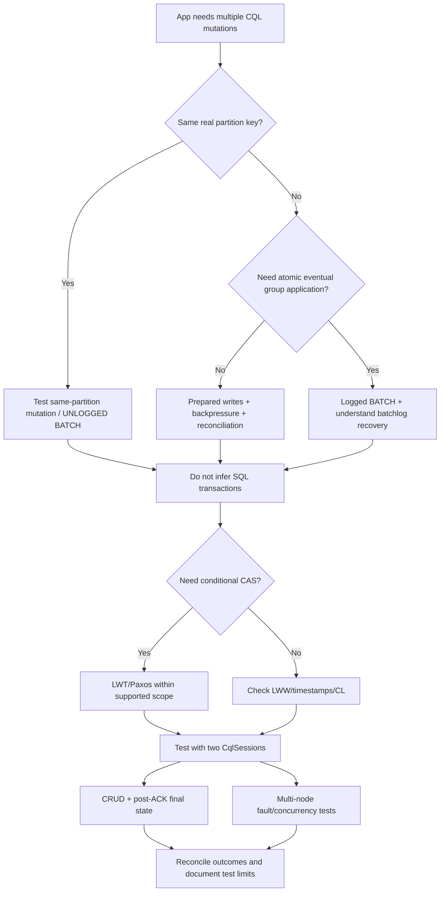

# Testing CRUD, BATCH, and Atomicity Boundaries with Multiple Sessions

> **Chapter:** Integration Testing  
> **Scope:** Apache Cassandra — a distributed *wide-column* database — along with CQL, partition keys, replication, consistency levels, and Java applications using **Cassandra Java Driver 4.x**. This lesson focuses on testing with **two or more independent `CqlSession` instances**, rather than inferring correctness solely from a single client writing and reading back its own data.
>
> **Learning Objectives:** Write CRUD tests against real Cassandra; understand that `INSERT`/`UPDATE` are upserts and `DELETE` creates tombstones; distinguish same-partition batches, multi-partition batches, logged/unlogged/counter batches; separate **atomicity, isolation, durability, consistency, and serializability**; observe data across two sessions and test LWT under contention; design fault injection; and define the limits of a single-node environment.

## 1. Why Test with Multiple Sessions?

A basic test typically only does:

```text
CqlSession A:
  INSERT a row
  SELECT that same row
  assert data matches
```

Such a test is useful for CQL/codecs, yet cannot answer:

- After one client's write succeeds, does **another client** see the value?
- Does `UPDATE` overwrite the intended cell or accidentally delete an omitted column?
- Does `DELETE` behave differently from “row never existed”?
- Do two statements in a `BATCH` apply to the same partition as intended?
- Does a multi-partition `BATCH` guarantee another client sees all changes simultaneously?
- On a write timeout, can another session observe a **partial mutation** or an applied outcome?
- When two clients concurrently run `INSERT ... IF NOT EXISTS`, **who wins**?

Using two `CqlSession` instances separates the **writer** from the **reader/contender**, simulating two application instances. However, **two sessions do not automatically mean two nodes**: if the lab has only one Cassandra container, both still talk to the same coordinator and replica.

**Goal:** every test must state clearly what it proves—at which consistency level, RF, and topology—and what remains unproven.

## 2. Five Properties Often Lumped Together as “Transactions”

| Property | Question | What to Remember in Cassandra |
| --- | --- | --- |
| **Atomicity** | Is a group of mutations applied in full or potentially partially? | Depends on partition scope, batch type, and recovery mechanisms |
| **Isolation** | Can concurrent readers observe intermediate states? | Never infer cross-partition isolation from `BATCH` |
| **Durability** | After ACK, how is data protected on disk/replicas? | Commit log, replicas, CL, and cluster configuration |
| **Consistency level** | How many replicas must respond? | `ONE`, `LOCAL_QUORUM`, etc.—not transaction locks |
| **Serializability/CAS** | Are two competing conditional operations ordered? | Use LWT/Paxos for supported requirements, not regular `BATCH` |

Saying “`BATCH` is atomic” **is insufficient to claim RDBMS-style ACID transactions**. You must specify **same-partition vs cross-partition**, logged vs unlogged, and whether observations happen during execution or after the coordinator ACKs.

### Vocabulary Used in This Lesson

- **Logical operation:** a business action, such as creating an order.
- **Mutation:** a Cassandra data update scoped by partition and timestamp.
- **Coordinator:** the node receiving the CQL request from the driver.
- **Replica:** a node holding a copy determined by partition key and replication strategy.
- **Session A/B:** two independent `CqlSession` clients, not two transactions.
- **Completion/ACK:** the moment the driver receives a success response; does not mean “all readers in all DCs see it instantaneously”.
- **Partial visibility:** a reader observing part of a multi-partition change during its transition window.

## 3. Behavior Reference Table Before Writing Tests

| CQL Operation | Typical Meaning | Testing Trap |
| --- | --- | --- |
| `INSERT` | Upsert by primary key; does not enforce RDBMS uniqueness | A second `INSERT` can overwrite |
| `SELECT` | Read by partition/clustering key, CL, and replica state | Missing full PK leads to invalid/rejected queries |
| `UPDATE` | Mutation/upsert; can create cells/rows even if absent prior | Never assume the row must already exist |
| `DELETE` | Writes deletion markers; does not immediately purge old SSTables | `SELECT` returning empty does not mean disk reclaimed |
| `BEGIN UNLOGGED BATCH` same partition | Efficiently groups same-partition mutations with partition-level guarantees | Never generalize into cross-partition transactions |
| `BEGIN BATCH` default logged | Uses batchlog for eventual atomic application across multi-partition mutations via recovery | Does **not** guarantee simultaneous visibility across partitions |
| `BEGIN UNLOGGED BATCH` multi-partition | Sends multiple mutations without batchlog cross-partition recovery | Never assume all-or-nothing |
| `BEGIN COUNTER BATCH` | Groups counter mutations under counter rules | Counters are non-idempotent; never mix with standard mutations |
| `INSERT ... IF NOT EXISTS` | Conditional LWT/CAS | Must test `[applied]` results and contention |
| `UPDATE ... IF ...` | Conditional mutation/LWT | Higher cost than normal writes; specific CQL scope and limits |

**Note:** Cassandra semantics depend on server release/distribution. In operational testing, check official docs and CQL support for **the running version** rather than guessing from the word “BATCH”.

## 4. Wide-Column Model: Partitions Define Critical Atomicity Boundaries

Create three test tables:

```cql
CREATE KEYSPACE IF NOT EXISTS it_lab
WITH replication = {
    'class': 'NetworkTopologyStrategy',
    'datacenter1': 1
};

CREATE TABLE IF NOT EXISTS it_lab.order_status_by_id (
    tenant_id text,
    order_id uuid,
    status text,
    note text,
    PRIMARY KEY ((tenant_id, order_id))
);

CREATE TABLE IF NOT EXISTS it_lab.order_lines_by_order (
    tenant_id text,
    order_id uuid,
    line_no int,
    sku text,
    quantity int,
    PRIMARY KEY ((tenant_id, order_id), line_no)
);

CREATE TABLE IF NOT EXISTS it_lab.order_status_by_customer (
    tenant_id text,
    customer_id uuid,
    order_id uuid,
    status text,
    PRIMARY KEY ((tenant_id, customer_id), order_id)
);
```

This is **single-node lab** DDL assuming actual datacenter `datacenter1` and RF=1. **Never copy RF=1 to multi-node production.** Target environments may use `dc1:3`/`dc2:3`.

### Identifying Partitions from Primary Keys

| Table | Partition Key | Clustering Key | Query Pattern |
| --- | --- | --- | --- |
| `order_status_by_id` | `(tenant_id, order_id)` | None | Status by ID |
| `order_lines_by_order` | `(tenant_id, order_id)` | `line_no` | All line items of an order |
| `order_status_by_customer` | `(tenant_id, customer_id)` | `order_id` | Orders by customer |

Two rows in `order_lines_by_order` sharing `tenant_id` and `order_id` live in **one partition**.

One row in `order_status_by_id` and one row in `order_status_by_customer`, though representing the same business order, have different partition keys; they are **two CQL partitions**. Cassandra has no implicit awareness that they belong to one “order transaction” to be read atomically.

### Why Design Tables Around Queries?

A table keyed by `(tenant_id, order_id)` optimizes single-order lookups; a table keyed by `(tenant_id, customer_id)` optimizes listing a customer's orders. This is standard denormalization. However, multiple business copies create a need for **synchronization and reconciliation**; `BATCH` does not turn those two tables into an isolated cross-partition database transaction.

## 5. Two `CqlSession`s: How Independent Are They?

In Java Driver 4.x, each `CqlSession` maintains its own connection context, driver metadata, host selection, prepared statements, and pools per config. Two sessions in one integration test simulate two application clients.

```text
Test runner
  |
  +-- CqlSession A --> driver connections --> coordinator
  |
  +-- CqlSession B --> driver connections --> coordinator
                                           |
                                    replica placement
```

Both point to the same node when the lab runs a single Cassandra container. On a three-node cluster, to verify **different coordinators**, control/inspect actual routing in execution metadata rather than claiming “two sessions = two coordinators”.

### Two Sessions Do Not Create Snapshots or Transactions

If A opens a session at 10:00 and B at 10:05, Cassandra **does not hold a snapshot of data as of session creation**. Each SELECT is an independent CQL request with its own consistency level, coordinator, and execution time.

Never treat a `CqlSession` like a JDBC `Connection` inside `BEGIN TRANSACTION` expecting SQL `COMMIT/ROLLBACK`.

## 6. CRUD in Cassandra: Expectations to Verify

### C — CREATE via `INSERT`

```cql
INSERT INTO it_lab.order_status_by_id
    (tenant_id, order_id, status, note)
VALUES (
    'tenant-a',
    11111111-1111-4111-8111-111111111111,
    'CREATED',
    'Newly created'
);
```

It does **not** enforce “row does not exist”. If data already exists under the same primary key, Cassandra performs upsert/timestamp reconciliation.

### R — READ by Full Partition Key

```cql
SELECT status, note
FROM it_lab.order_status_by_id
WHERE tenant_id = 'tenant-a'
  AND order_id = 11111111-1111-4111-8111-111111111111;
```

If `Row` is null, no live row was returned. If the row exists and `note` is null, that column has no live value; the two states are distinct.

### U — UPDATE

```cql
UPDATE it_lab.order_status_by_id
SET status = 'PAID'
WHERE tenant_id = 'tenant-a'
  AND order_id = 11111111-1111-4111-8111-111111111111;
```

`UPDATE` has upsert semantics; it does not reject missing rows by default. For PATCH clients, distinguish **CQL NULL** (deletes regular column / writes tombstone) from **UNSET** (leaves column untouched) using supported prepared bindings.

### D — DELETE

```cql
DELETE FROM it_lab.order_status_by_id
WHERE tenant_id = 'tenant-a'
  AND order_id = 11111111-1111-4111-8111-111111111111;
```

Cassandra writes tombstones to mask old data across replicas/SSTables. `SELECT` returning no row **does not prove SSTables containing old values have been reclaimed**. Compaction, `gc_grace_seconds`, and repair govern safe reclamation in multi-replica clusters.

### Test CRUD in Both Directions

- A writes, B reads.
- B updates, A reads.
- A deletes, B sees no row when consistency conditions are met.
- B updates a non-existent key, verifying upsert semantics if allowed by the domain.
- Client omitting primary key is rejected.
- NULL/UNSET and TTL have dedicated tests.

## 7. Avoid Over-Claiming from “A Writes, Then B Reads”

Suppose a single-node test with RF=1 and `LOCAL_ONE`:

```text
A INSERT -> receives ACK
B SELECT -> sees row
```

This result proves **two Java sessions** talk to **one Cassandra instance** with valid schema and codecs. It does **not** prove:

- RF=3 quorum intersection.
- Continued reads/writes when a replica drops.
- Low cross-DC replication lag.
- Batchlog replay after a coordinator crash.
- Consistency when one replica holds stale data.

With RF=3 in a local DC, `LOCAL_QUORUM` requires two local replicas; corresponding tests must run on an appropriate multi-node setup. Single-node tests with `LOCAL_QUORUM` and RF=1 still need only one local response—not equivalent to production.

## 8. What Is `BATCH` For, and What Is It Not For?

A `BATCH` bundles multiple CQL mutations into a single request subject to server rules. It is **not** a general-purpose SQL transaction mechanism.

### Three Batch Types to Distinguish

| Type | Syntax | Key Characteristic |
| --- | --- | --- |
| **Logged batch** | `BEGIN BATCH ... APPLY BATCH` | Default; uses batchlog to support eventual atomic application across partitions |
| **Unlogged batch** | `BEGIN UNLOGGED BATCH ... APPLY BATCH` | Skips batchlog cross-partition atomicity protection |
| **Counter batch** | `BEGIN COUNTER BATCH ... APPLY BATCH` | Dedicated to counter operations under counter rules; cannot mix with standard mutations |

**By default, `BEGIN BATCH` is a logged batch.** Documentation often calls it “logged batch”; you do not write a literal `BEGIN LOGGED BATCH` keyword in CQL.

### `BATCH` Is Not an Optimal Bulk-Loading Tool

Bundling 1,000 mutations across 1,000 partitions into one logged batch places heavier load on coordinators, batchlogs, and networks than bounded concurrent prepared writes.

When the goal is **ingestion throughput**, instead:

- Use prepared statements.
- Enforce in-flight and rate limits.
- Group by partition only where appropriate.
- Choose batches only when business semantics require them and the design is reviewed.
- Use proper bulk SSTable loading tools for massive datasets when appropriate.

**`BATCH` does not turn scattered multi-partition writes into a fast, isolated SQL transaction.**

## 9. Atomicity of Same-Partition Batches

Example of two order lines in the same partition:

```cql
BEGIN UNLOGGED BATCH
    INSERT INTO it_lab.order_lines_by_order
        (tenant_id, order_id, line_no, sku, quantity)
    VALUES (
        'tenant-a',
        11111111-1111-4111-8111-111111111111,
        1, 'BOOK', 2
    );

    INSERT INTO it_lab.order_lines_by_order
        (tenant_id, order_id, line_no, sku, quantity)
    VALUES (
        'tenant-a',
        11111111-1111-4111-8111-111111111111,
        2, 'PEN', 3
    );
APPLY BATCH;
```

Both mutations target **the same partition key**: `('tenant-a', order_id)`.

Cassandra provides per-partition guarantees for mutations within the same partition (including atomicity/isolation within supported operation bounds). A same-partition unlogged batch is typically preferable to a cross-partition logged batch when updating multiple clustering rows of one order.

**Separate two distinct claims:**

1. **After the batch ACKs cleanly** with no conflicting concurrent mutations, reading the partition at an appropriate CL sees both order lines.
2. **While the batch is in flight**, verifying readers never observe half-written state requires strict concurrency/fault-timing instrumentation. Never conclude from a **post-ACK** read test that full concurrency isolation was proven.

### Same Business Keys Across Tables Does Not Mean One Partition

`order_status_by_id` and `order_lines_by_order` may hold the same *business key values*, yet they are **two separate tables** and two separate partition spaces. Never assume Cassandra applies mutations atomically across both tables as one single mutation just because both share `tenant_id + order_id`.

If multiple fields/rows must be observed together atomically, place them in one physical partition matching the access pattern and verify exact semantics on your target server release.

## 10. Multi-Partition Batch: Eventual Atomicity Is Not Isolation

Example updating two projections:

```cql
BEGIN BATCH
    INSERT INTO it_lab.order_status_by_id
        (tenant_id, order_id, status)
    VALUES (
        'tenant-a',
        11111111-1111-4111-8111-111111111111,
        'PAID'
    );

    INSERT INTO it_lab.order_status_by_customer
        (tenant_id, customer_id, order_id, status)
    VALUES (
        'tenant-a',
        aaaaaaaa-aaaa-4aaa-8aaa-aaaaaaaaaaaa,
        11111111-1111-4111-8111-111111111111,
        'PAID'
    );
APPLY BATCH;
```

These two mutations target **different partition keys**. This is a **logged batch** because neither `UNLOGGED` nor `COUNTER` is specified.

Cassandra uses a **batchlog** to help ensure mutations in a logged batch are replayed/completed after failures per system recovery and availability rules.

However, **a client reading two partitions sequentially has no snapshot isolation across them**. While the batch is still reaching replicas—or during timeouts, failures, or replication lag—a reader can see projection A updated while projection B still holds the old value.

### Partial Visibility Timeline

```text
Time ->
Session A: BEGIN BATCH (P1=status_by_id, P2=by_customer)
             |
             +---------> P1 applied/visible
             |                       |
             |                       v
Session B:   |                  SELECT P1 -> PAID
             |                  SELECT P2 -> old value
             |
             +---------------------> P2 applied/visible
                                     |
                                     v
Session B:                       SELECT both -> PAID
```

This is a **possible scenario**, not a mandatory execution order where Cassandra always applies P1 before P2. Normal tests rarely hit this tiny window reliably without fault injection or controlled load orchestration.

### Logged Batch Is Not a Rollback Transaction

There is no general semantics like:

```text
BEGIN TRANSACTION
UPDATE table_A;
UPDATE table_B;
ROLLBACK if a client hits an error;
```

With logged batches, the mechanism prioritizes **eventual execution of all mutations per system guarantees**, never **rolling back already-visible mutations** if the app changes its mind. If the app times out, the outcome at failure time may be **unknown**.

## 11. Risks of Multi-Partition Unlogged Batches

```cql
BEGIN UNLOGGED BATCH
    UPDATE it_lab.order_status_by_id
    SET status = 'SHIPPED'
    WHERE tenant_id = 'tenant-a'
      AND order_id = 11111111-1111-4111-8111-111111111111;

    UPDATE it_lab.order_status_by_customer
    SET status = 'SHIPPED'
    WHERE tenant_id = 'tenant-a'
      AND customer_id = aaaaaaaa-aaaa-4aaa-8aaa-aaaaaaaaaaaa
      AND order_id = 11111111-1111-4111-8111-111111111111;
APPLY BATCH;
```

These are **two different partitions with no batchlog recovering the group**. If part applies before a failure, never assume the other projection will be repaired automatically via batchlog.

Tests must therefore distinguish:

- **Same-partition unlogged:** can be appropriate for mutations within one partition.
- **Cross-partition unlogged:** no cross-partition atomicity guarantee.
- **Cross-partition logged:** batchlog recovery exists, but no cross-partition snapshot isolation.

### When Should You Avoid Logged Batches?

If an app simply needs to ingest many independent events, multi-partition logged batches are usually wrong for performance. Use a write pipeline with backpressure and checkpoints—never treat the batchlog as a durable business queue.

## 12. Counter Batches and Non-Idempotency

Counters have additive semantics:

```cql
CREATE TABLE IF NOT EXISTS it_lab.page_views_by_id (
    page_id uuid PRIMARY KEY,
    views counter
);
```

```cql
BEGIN COUNTER BATCH
    UPDATE it_lab.page_views_by_id
    SET views = views + 1
    WHERE page_id = 11111111-1111-4111-8111-111111111111;
APPLY BATCH;
```

If the same operation is resent multiple times, the counter can increment multiple times. **Never call a counter batch an exactly-once transaction**, and never mix counter mutations with standard mutations.

Integration tests must verify **idempotency/duplicate delivery** at the business layer. For a “single page view” event where retries can occur, you may need event IDs/deduplication or a different write model.

**Never enable speculative execution on counter increments** just because an API wants lower tail latency.

## 13. Why Not Use `BATCH` to “Prevent All Races”?

Suppose two apps update `status` concurrently:

```text
Session A: UPDATE status='PAID'
Session B: UPDATE status='CANCELLED'
```

Cassandra does not enforce “PAID cannot transition to CANCELLED” merely from a batch. Cell updates reconcile via **write timestamps** and server tie-break rules.

A batch of regular UPDATEs **does not provide optimistic concurrency control** for domain invariants. When **compare-and-set** is required, use LWT.

### A Focused Timestamp Test

Have two sessions write the same key with **explicit microsecond timestamps**, e.g.:

```cql
UPDATE it_lab.order_status_by_id
USING TIMESTAMP 1800000000000000
SET status = 'PAID'
WHERE tenant_id = 'tenant-test'
  AND order_id = 11111111-1111-4111-8111-111111111111;

UPDATE it_lab.order_status_by_id
USING TIMESTAMP 1800000000000010
SET status = 'SHIPPED'
WHERE tenant_id = 'tenant-test'
  AND order_id = 11111111-1111-4111-8111-111111111111;
```

Provided this is a **fresh test key with no higher existing write timestamp**, once both mutations succeed, the winning value follows the higher timestamp: `SHIPPED`. HTTP arrival order does not dictate reconciliation order.

CQL `USING TIMESTAMP` uses **microseconds**, unlike `Instant`'s millisecond/nanosecond APIs. Never use illustrative numbers from this lesson as production timestamps.

## 14. Testcontainers Lab Setup: Runtime Prerequisites

The following example targets:

- **JDK 17**.
- **JUnit Jupiter (JUnit 5)**.
- **Testcontainers 1.x line** with the matching Cassandra module.
- **Apache Cassandra server image pinned by version/digest** via CI.
- **Cassandra Java Driver 4.x** matching the project's artifact.

Testcontainers APIs/packages can change in other major releases. If the project uses Spring Boot, ensure Spring Data Cassandra and driver dependency graphs are also compatible.

### Conceptual Maven Dependencies

```xml
<!-- Pull versions from an approved BOM/dependencyManagement. -->
<dependency>
    <groupId>org.testcontainers</groupId>
    <artifactId>cassandra</artifactId>
    <scope>test</scope>
</dependency>
<dependency>
    <groupId>org.testcontainers</groupId>
    <artifactId>junit-jupiter</artifactId>
    <scope>test</scope>
</dependency>
<dependency>
    <groupId>org.junit.jupiter</groupId>
    <artifactId>junit-jupiter</artifactId>
    <scope>test</scope>
</dependency>
```

Never guess a driver patch or Docker digest. CI must verify dependency resolution and the observed server version at runtime.

### Pinning the Image via System Property

Example project run command:

```bash
mvn test -Dit.cassandra.image='<approved-image-ref-with-verified-digest>'
```

This is a placeholder, not a valid image ref. Its goal is to make tests **fail fast if an approved image is missing**, rather than silently pulling `cassandra:latest`.

**Scope limit:** a single container only verifies basic CQL/codecs/semantics on one node. It does not test batchlog recovery across replicas when a coordinator or replica crashes.

## 15. Complete Two-Session Integration Test

The code below creates a schema in an isolated test container, opens two `CqlSession` instances, and runs CRUD, same-partition batch, multi-partition logged batch, and contending LWT tests. This is a **learning sample**; resolve exact APIs/dependencies against your release and CI before running.

```java
import static org.junit.jupiter.api.Assertions.*;

import java.net.InetSocketAddress;
import java.util.HashMap;
import java.util.Map;
import java.util.UUID;
import java.util.concurrent.Callable;
import java.util.concurrent.CountDownLatch;
import java.util.concurrent.ExecutorService;
import java.util.concurrent.Executors;
import java.util.concurrent.Future;
import java.util.concurrent.TimeUnit;

import org.junit.jupiter.api.AfterAll;
import org.junit.jupiter.api.BeforeAll;
import org.junit.jupiter.api.Test;
import org.testcontainers.containers.CassandraContainer;
import org.testcontainers.junit.jupiter.Container;
import org.testcontainers.junit.jupiter.Testcontainers;
import org.testcontainers.utility.DockerImageName;

import com.datastax.oss.driver.api.core.CqlSession;
import com.datastax.oss.driver.api.core.DefaultConsistencyLevel;
import com.datastax.oss.driver.api.core.cql.BatchStatement;
import com.datastax.oss.driver.api.core.cql.BoundStatement;
import com.datastax.oss.driver.api.core.cql.DefaultBatchType;
import com.datastax.oss.driver.api.core.cql.PreparedStatement;
import com.datastax.oss.driver.api.core.cql.Row;

@Testcontainers
class CassandraCrudBatchMultipleSessionsIT {

    private static String approvedImage() {
        String ref = System.getProperty("it.cassandra.image");
        if (ref == null || ref.isBlank()) {
            throw new IllegalStateException(
                "Set -Dit.cassandra.image to an approved pinned image");
        }
        return ref;
    }

    @Container
    static final CassandraContainer<?> cassandra =
        new CassandraContainer<>(
            DockerImageName.parse(approvedImage()));

    private static CqlSession a;
    private static CqlSession b;

    private static CqlSession openSession() {
        return CqlSession.builder()
            .addContactPoint(new InetSocketAddress(
                cassandra.getHost(),
                cassandra.getMappedPort(9042)))
            .withLocalDatacenter("datacenter1")
            .build();
    }

    @BeforeAll
    static void setUp() {
        a = openSession();
        b = openSession();

        Row local = a.execute(
            "SELECT data_center FROM system.local"
        ).one();
        assertNotNull(local);
        assertEquals("datacenter1",
                     local.getString("data_center"));

        a.execute(
            "CREATE KEYSPACE IF NOT EXISTS it_lab " +
            "WITH replication = {'class': " +
            "'NetworkTopologyStrategy', 'datacenter1': 1}"
        );

        a.execute(
            "CREATE TABLE IF NOT EXISTS " +
            "it_lab.order_status_by_id (" +
            "tenant_id text, order_id uuid, " +
            "status text, note text, " +
            "PRIMARY KEY ((tenant_id, order_id)))"
        );

        a.execute(
            "CREATE TABLE IF NOT EXISTS " +
            "it_lab.order_lines_by_order (" +
            "tenant_id text, order_id uuid, line_no int, " +
            "sku text, quantity int, " +
            "PRIMARY KEY ((tenant_id, order_id), line_no))"
        );

        a.execute(
            "CREATE TABLE IF NOT EXISTS " +
            "it_lab.order_status_by_customer (" +
            "tenant_id text, customer_id uuid, " +
            "order_id uuid, status text, " +
            "PRIMARY KEY ((tenant_id, customer_id), order_id))"
        );

        a.execute(
            "CREATE TABLE IF NOT EXISTS it_lab.claims_by_id (" +
            "claim_id uuid PRIMARY KEY, winner text)"
        );
    }

    @AfterAll
    static void tearDown() {
        if (b != null) b.close();
        if (a != null) a.close();
    }

    @Test
    void crudVisibleAcrossIndependentSessions() {
        UUID order = UUID.randomUUID();

        PreparedStatement insert = a.prepare(
            "INSERT INTO it_lab.order_status_by_id " +
            "(tenant_id, order_id, status, note) " +
            "VALUES (?, ?, ?, ?)"
        );
        a.execute(insert.bind(
            "tenant-test", order, "CREATED", "initial"
        ).setConsistencyLevel(
            DefaultConsistencyLevel.LOCAL_ONE));

        PreparedStatement select = b.prepare(
            "SELECT status, note " +
            "FROM it_lab.order_status_by_id " +
            "WHERE tenant_id = ? AND order_id = ?"
        );
        Row created = b.execute(
            select.bind("tenant-test", order)
                .setConsistencyLevel(
                    DefaultConsistencyLevel.LOCAL_ONE)
        ).one();
        assertNotNull(created);
        assertEquals("CREATED", created.getString("status"));
        assertEquals("initial", created.getString("note"));

        PreparedStatement update = b.prepare(
            "UPDATE it_lab.order_status_by_id " +
            "SET status = ? " +
            "WHERE tenant_id = ? AND order_id = ?"
        );
        b.execute(update.bind(
            "PAID", "tenant-test", order
        ).setConsistencyLevel(
            DefaultConsistencyLevel.LOCAL_ONE));

        Row updated = a.execute(
            a.prepare(
                "SELECT status FROM it_lab.order_status_by_id " +
                "WHERE tenant_id = ? AND order_id = ?"
            ).bind("tenant-test", order)
             .setConsistencyLevel(
                DefaultConsistencyLevel.LOCAL_ONE)
        ).one();
        assertNotNull(updated);
        assertEquals("PAID", updated.getString("status"));

        PreparedStatement delete = a.prepare(
            "DELETE FROM it_lab.order_status_by_id " +
            "WHERE tenant_id = ? AND order_id = ?"
        );
        a.execute(delete.bind(
            "tenant-test", order
        ).setConsistencyLevel(
            DefaultConsistencyLevel.LOCAL_ONE));

        Row deleted = b.execute(
            select.bind("tenant-test", order)
                .setConsistencyLevel(
                    DefaultConsistencyLevel.LOCAL_ONE)
        ).one();
        assertNull(deleted);
    }

    @Test
    void unloggedBatchWithinOnePartition() {
        UUID order = UUID.randomUUID();

        PreparedStatement insertLine = a.prepare(
            "INSERT INTO it_lab.order_lines_by_order " +
            "(tenant_id, order_id, line_no, sku, quantity) " +
            "VALUES (?, ?, ?, ?, ?)"
        );

        BatchStatement batch =
            BatchStatement.builder(DefaultBatchType.UNLOGGED)
                .addStatement(insertLine.bind(
                    "tenant-test", order, 1, "BOOK", 2))
                .addStatement(insertLine.bind(
                    "tenant-test", order, 2, "PEN", 3))
                .build()
                .setConsistencyLevel(
                    DefaultConsistencyLevel.LOCAL_ONE);

        a.execute(batch);

        PreparedStatement select = b.prepare(
            "SELECT line_no, sku " +
            "FROM it_lab.order_lines_by_order " +
            "WHERE tenant_id = ? AND order_id = ?"
        );

        Map<Integer, String> lines = new HashMap<>();
        for (Row row : b.execute(
            select.bind("tenant-test", order)
                .setConsistencyLevel(
                    DefaultConsistencyLevel.LOCAL_ONE))) {
            lines.put(
                row.getInt("line_no"),
                row.getString("sku"));
        }

        assertEquals(2, lines.size());
        assertEquals("BOOK", lines.get(1));
        assertEquals("PEN", lines.get(2));
    }

    @Test
    void loggedBatchAcrossTwoDifferentPartitions() {
        UUID order = UUID.randomUUID();
        UUID customer = UUID.randomUUID();

        PreparedStatement byId = a.prepare(
            "INSERT INTO it_lab.order_status_by_id " +
            "(tenant_id, order_id, status) VALUES (?, ?, ?)"
        );
        PreparedStatement byCustomer = a.prepare(
            "INSERT INTO it_lab.order_status_by_customer " +
            "(tenant_id, customer_id, order_id, status) " +
            "VALUES (?, ?, ?, ?)"
        );

        BatchStatement logged =
            BatchStatement.builder(DefaultBatchType.LOGGED)
                .addStatement(byId.bind(
                    "tenant-test", order, "PAID"))
                .addStatement(byCustomer.bind(
                    "tenant-test", customer, order, "PAID"))
                .build()
                .setConsistencyLevel(
                    DefaultConsistencyLevel.LOCAL_ONE);

        a.execute(logged);

        Row left = b.execute(
            b.prepare(
                "SELECT status FROM it_lab.order_status_by_id " +
                "WHERE tenant_id = ? AND order_id = ?"
            ).bind("tenant-test", order)
             .setConsistencyLevel(
                DefaultConsistencyLevel.LOCAL_ONE)
        ).one();

        Row right = b.execute(
            b.prepare(
                "SELECT status " +
                "FROM it_lab.order_status_by_customer " +
                "WHERE tenant_id = ? AND customer_id = ? " +
                "AND order_id = ?"
            ).bind("tenant-test", customer, order)
             .setConsistencyLevel(
                DefaultConsistencyLevel.LOCAL_ONE)
        ).one();

        assertNotNull(left);
        assertNotNull(right);
        assertEquals("PAID", left.getString("status"));
        assertEquals("PAID", right.getString("status"));

        // Only proves final state after ACK at RF=1.
        // Does NOT prove cross-partition isolation.
    }

    private static boolean tryClaim(
            CqlSession session,
            PreparedStatement prepared,
            UUID claimId,
            String actor,
            CountDownLatch ready,
            CountDownLatch start) throws Exception {

        ready.countDown();
        if (!start.await(10, TimeUnit.SECONDS)) {
            throw new IllegalStateException("Start barrier timed out");
        }

        BoundStatement statement = prepared
            .bind(claimId, actor)
            .setConsistencyLevel(
                DefaultConsistencyLevel.LOCAL_ONE)
            .setSerialConsistencyLevel(
                DefaultConsistencyLevel.LOCAL_SERIAL);

        Row result = session.execute(statement).one();
        assertNotNull(result);
        return result.getBoolean("[applied]");
    }

    @Test
    void concurrentLwtHasOneWinner() throws Exception {
        UUID claimId = UUID.randomUUID();
        String cql =
            "INSERT INTO it_lab.claims_by_id " +
            "(claim_id, winner) VALUES (?, ?) IF NOT EXISTS";

        PreparedStatement p1 = a.prepare(cql);
        PreparedStatement p2 = b.prepare(cql);

        CountDownLatch ready = new CountDownLatch(2);
        CountDownLatch start = new CountDownLatch(1);
        ExecutorService pool = Executors.newFixedThreadPool(2);

        try {
            Future<Boolean> f1 = pool.submit(() ->
                tryClaim(a, p1, claimId, "A", ready, start));
            Future<Boolean> f2 = pool.submit(() ->
                tryClaim(b, p2, claimId, "B", ready, start));

            assertTrue(ready.await(10, TimeUnit.SECONDS));
            start.countDown();

            boolean winA = f1.get(30, TimeUnit.SECONDS);
            boolean winB = f2.get(30, TimeUnit.SECONDS);
            assertEquals(1,
                (winA ? 1 : 0) + (winB ? 1 : 0));

            Row row = a.execute(
                a.prepare(
                    "SELECT winner FROM it_lab.claims_by_id " +
                    "WHERE claim_id = ?"
                ).bind(claimId)
                 .setConsistencyLevel(
                    DefaultConsistencyLevel.LOCAL_ONE)
            ).one();

            assertNotNull(row);
            assertEquals(winA ? "A" : "B",
                         row.getString("winner"));
        } finally {
            start.countDown();
            pool.shutdownNow();
        }
    }
}
```

### What This Example Proves

- Two real Java sessions execute CQL against a Cassandra container.
- `INSERT`, `SELECT`, `UPDATE`, and `DELETE` work across two sessions.
- Two statements in the same partition inside an unlogged batch yield the expected final state.
- A logged batch updating two partitions reaches the expected post-ACK final state.
- Competing LWT `IF NOT EXISTS` across two sessions produces exactly one applied winner when requests complete cleanly.

### What This Example Does **Not** Prove

- RF=3 quorum or single-replica failover.
- Batchlog replay after coordinator crash.
- Absence of partial visibility when reading two partitions **while** a logged batch is in progress.
- Cluster-wide transactional snapshots.
- Production throughput or p99 latency.
- TLS/RBAC/CA/SAN, because the example uses default lab config.
- Exactly-once business event processing under HTTP/Kafka retries.

**Version note:** the test code targets Java Driver 4.x and Testcontainers 1.x; verify exact classes/packages/APIs via project compilation and integration CI. The authoring STEP did not run Gradle/Maven or Content QA.

## 16. Why Use Unique Test Data Keys?

Every test generates fresh `UUID.randomUUID()` values for `orderId`, `customerId`, or `claimId` to avoid colliding with rows from prior tests.

If fixed keys are reused across runs:

- Old tombstones can mask new data depending on timestamps.
- Mutation timestamp ordering can produce unexpected results.
- Parallel CI workers writing to the same partition cause races.
- Subsequent batch tests inherit leftover rows from earlier tests.
- LWT `IF NOT EXISTS` returns `applied=false` on the very first call because the row already exists.

### Isolation Options

| Environment | Suitable Isolation Strategy |
| --- | --- |
| Ephemeral container per suite | Random keys; destroy container when done |
| Shared staging | Test-run ID/tenant prefix, explicit permissions, approved cleanup |
| Dedicated multi-node test | Isolated namespaces/keys and scheduled windows avoiding overlapping chaos |
| Performance test | Seeded dataset with fixed distribution, explicit reset/checkpoints |

Never run `TRUNCATE` on production or shared staging tables as a casual cleanup step. It has a wide blast radius and is not an SQL transaction rollback.

## 17. Real Tests Must Match Cassandra and Driver Versions

Before running samples, verify:

```cql
SELECT release_version, cql_version,
       native_protocol_version, data_center
FROM system.local;
```

And in authorized environments:

```bash
nodetool version
nodetool status
```

Across older releases or different distributions, metadata column names can vary; inspect actual schemas before assuming queries are universally portable.

Also record:

- Exact Cassandra server version/patch and image digest.
- Actual Java Driver group, artifact, and version.
- Testcontainers/JUnit/JDK versions.
- Keyspace NTS, per-DC RF, and CL.
- Retry/speculative policies and default idempotence.
- `BATCH` size limits and relevant server config.
- Schema revision, TTL/`gc_grace_seconds`, and compaction options when testing retention.

A green test on `cassandra:latest` is weak evidence for production running a fixed release.

## 18. Read-After-Write Across Two Sessions and Consistency Levels

In production RF=3 in `dc1`:

```text
R1, R2, R3 are the three replicas for partition P
LOCAL_QUORUM requires 2 local responses
```

If a `LOCAL_QUORUM` write succeeds followed by a `LOCAL_QUORUM` read in the same DC, the quorum sets intersect, giving stronger conditions to observe the newest mutation **absent concurrent writes/abnormal timeouts and per Cassandra's consistency semantics**.

However:

- `LOCAL_ONE` may hit a replica that has not received the mutation yet.
- Two `LOCAL_QUORUM` calls in **different DCs** do not inherently share replicas.
- Concurrent writes on the same key reconcile by timestamp, not HTTP arrival order.
- Multi-partition operations execute per-partition replica/quorum paths.
- `LOCAL_QUORUM` does not create a **snapshot transaction across two SELECTs**.

### Topology-Specific Tests

| Scenario | Setup | Expectation |
| --- | --- | --- |
| Single node | RF=1, `LOCAL_ONE` | CRUD/codecs/client behavior |
| Three local nodes | RF=3, `LOCAL_QUORUM` | 2/3 quorum and read-after-write |
| One replica lost | RF=3, `LOCAL_QUORUM` | Continues serving while two healthy replicas remain |
| Two replicas lost | RF=3, `LOCAL_QUORUM` | Insufficient quorum; verify error handling |
| Two DCs | RF=3 per DC, local CL | Replica lag and local routing |
| LWT | Appropriate RF, `LOCAL_SERIAL`/`SERIAL` per design | CAS contention and result semantics |

**Never lower production CL to “make tests pass”** when the domain requires quorum. Use the appropriate multi-node suite instead.

## 19. Snapshot Isolation Does Not Come Automatically from Sharing a Session

Suppose B reads two tables right after A starts a logged batch:

```text
B.SELECT order_status_by_id       -> 'PAID'
B.SELECT order_status_by_customer -> 'CREATED'
```

This can be an intermediate state across **two distinct partitions**, or caused by consistency, replication, or concurrent writes. It does not prove the batchlog “permanently lost data”.

Even when both SELECTs share the same `CqlSession`, Cassandra creates no transactional snapshot across them.

### If the Business Requires “Read Both or Neither”

Consider:

1. **Co-locating invariants in one partition matching the access pattern**, if cardinality and partition size allow.
2. **Canonical + versioned projection model:** a versioned canonical record where projections are trusted only when versions match.
3. **Event-driven reconciliation:** accept eventual consistency with checks, application repair, and convergence SLOs.
4. **LWT/CAS** for specific supported conditions, without pretending it spans arbitrary partitions.
5. **A different transactional store/protocol** if strict multi-entity/multi-partition ACID is truly mandatory.

**Never pick logged batches and ignore designing how readers handle transient skew.**

## 20. LWT: Properly Testing “Two Actors Competing for One Claim”

Using table:

```cql
CREATE TABLE IF NOT EXISTS it_lab.claims_by_id (
    claim_id uuid PRIMARY KEY,
    winner text
);
```

Two sessions send nearly concurrently:

```cql
INSERT INTO it_lab.claims_by_id (claim_id, winner)
VALUES (11111111-1111-4111-8111-111111111111, 'A')
IF NOT EXISTS;
```

and:

```cql
INSERT INTO it_lab.claims_by_id (claim_id, winner)
VALUES (11111111-1111-4111-8111-111111111111, 'B')
IF NOT EXISTS;
```

The `[applied]` flag is the proof of the **CAS condition** for each request.

Once both operations complete cleanly at the protocol level:

- One request returns `applied=true`.
- The other returns `applied=false`.
- The final row holds the `winner` matching whichever succeeded.
- Never assume session A always wins just because its thread was submitted first.

`CountDownLatch` helps both workers **start together**; it does not force the scheduler or Cassandra to receive both requests at the exact same instant. It tests the invariant, not a deterministic winner.

### False Claim: “LWT Is Just a Stronger Logged Batch”

LWT uses consensus/Paxos for conditional updates within supported conditions. Standard logged `BATCH` uses the batchlog to group mutations, **without** enforcing domain compare-and-set conditions.

If CAS across multiple rows is required, check your release's conditional-batch limits—especially single-partition constraints—rather than assuming general SQL transactions across hundreds of partitions.

## 21. Serial Consistency Level vs Normal Consistency Level

An LWT involves two consistency settings:

- **Serial consistency** for the Paxos/conditional phase, typically `SERIAL` or `LOCAL_SERIAL` per requirements and topology.
- **Regular consistency** for the mutation/read phase per statement configuration.

Java Driver 4.x example:

```java
BoundStatement claim = prepared
    .bind(claimId, "A")
    .setSerialConsistencyLevel(
        DefaultConsistencyLevel.LOCAL_SERIAL)
    .setConsistencyLevel(
        DefaultConsistencyLevel.LOCAL_QUORUM);
```

This example targets a **cluster with matching RF/DC**; the single-node JUnit sample uses `LOCAL_ONE` to avoid implying RF3 quorum was tested.

Verify:

- Serial CL supported by server/driver releases.
- RF/DC for conditional updates.
- Paxos contention and timeouts.
- `[applied]` and existing columns returned when conditions fail.
- Retry policy/idempotency for the full workflow.

Never carelessly enable speculative execution on LWTs, as it can amplify Paxos contention and confuse client outcomes.

## 22. A Batch of Multiple UPDATEs Is Not CAS

Suppose you transition an order from `PENDING` to `PAID` and update its projection:

```cql
BEGIN BATCH
    UPDATE it_lab.order_status_by_id
    SET status = 'PAID'
    WHERE tenant_id = 'tenant-a'
      AND order_id = 11111111-1111-4111-8111-111111111111;

    UPDATE it_lab.order_status_by_customer
    SET status = 'PAID'
    WHERE tenant_id = 'tenant-a'
      AND customer_id = aaaaaaaa-aaaa-4aaa-8aaa-aaaaaaaaaaaa
      AND order_id = 11111111-1111-4111-8111-111111111111;
APPLY BATCH;
```

If another session concurrently transitions the order to `CANCELLED`, a normal batch does not block concurrent writes. The final outcome depends on timestamps/tie-breakers, and the two projections can temporarily diverge.

Need business invariants? You can:

- Use a canonical row with LWT checking version/status.
- After CAS succeeds, emit events/projection updates with idempotency keys.
- Reconcile projections via event logs and versions.
- Surface eventual consistency clearly to users and APIs.

**Canonical-row LWT + eventual projections** still does not create cross-projection ACID atomicity; it serializes the decision and synchronizes replicas afterward.

## 23. Timeouts and Unknown Outcomes: Separate Errors from Ground Truth

A timed-out write request can follow this path:

```text
Client sends mutation
    |
    +-- Coordinator/replica receives and applies
    |        |
    |        +-- ACK delayed/lost
    |
    +-- Client timeout -> receives exception
```

The application **cannot infer** from the exception that the mutation did not happen.

With a multi-partition logged batch:

- Some mutations may already have applied.
- The batchlog may still need to replay the remainder.
- An immediate post-timeout read can observe differences across partitions/replicas.
- If the cluster is degraded, there is no fixed deadline guaranteeing immediate visibility of all mutations.
- Upon recovery, inspect state and batchlog/replica health before compensating.

### Don't Write Broken Integration Assertions

```java
// WRONG reasoning:
assertThrows(DriverTimeoutException.class,
    () -> session.execute(write));

// Cannot conclude solely from timeout:
assertNull(readFromAnotherSession());
```

A proper test accepts that a write timeout's outcome is **uncertain**, then:

1. Logs correlation/request ID and allowed mutation keys.
2. Reads to reconcile using an appropriate CL and topology.
3. Waits within a **bounded deadline** if expecting eventual convergence.
4. Checks both projections and event logs/versions if present.
5. Decides whether to retry/compensate per the idempotency contract.

## 24. Logged Batches and Batchlog Recovery: How to Test Meaningfully

To prove a logged batch does not lose a mutation when a coordinator crashes, **a single RF1 container is insufficient**. You need a **multi-node environment with real RF and active batchlog mechanics**.

A fault-injection test in lab/staging might:

1. Create keyspaces/tables with approved RF, DC, and CL.
2. Prepare two partitions across monitored token ranges.
3. Have session A submit a logged batch updating both.
4. On controlled runs, **inject a fault on the exact coordinator or network path** at an instrumented point, not via random sleeps.
5. Classify A's outcome: ACK success, timeout, or connection error.
6. Have sessions B/C read each partition at explicit CLs across multiple timestamps.
7. Observe batchlog replay, pending tasks, and node recovery.
8. Perform final reconciliation once the cluster stabilizes and replay/replicas recover.
9. If convergence fails, save evidence and inspect logs/metrics—never blame `BATCH` from a single SELECT.

**Note:** this is a **test plan**, not instructions to break production. Run fault injection only on approved, recoverable lab/staging clusters.

### What Can Fault Injection Prove?

- Exposes partial visibility during fault windows when conditions align.
- Exercises unknown-outcome handling and app reconciliation.
- Verifies batchlog recovery and convergence within the tested topology.
- Validates latency/error budgets and runbooks.

One passing test cannot prove “every failure at every scale recovers with zero data loss”.

## 25. Never Use `sleep` to “Prove” Isolation

A test like:

```java
writer.executeAsync(loggedBatch);
Thread.sleep(10);
assertBothOrNeither(reader);
```

has zero credibility for proving cross-partition isolation. A 10 ms delay depends on:

- Runner CPU scheduler.
- Driver event loops and networking.
- Cassandra coordinator scheduling.
- Caches/disks and row count.
- Replica messaging, GC, and compaction.
- Load balancer or Docker overhead.

On a fast machine, the whole batch finishes before the reader starts. On a slow machine, the reader sees varying intermediate states. Passing repeatedly **does not prove a property Cassandra does not guarantee**.

### Better Testing Techniques

- Use application barriers to synchronize **when requests are dispatched**.
- Instrument coordinators/networks in a lab to create controlled windows.
- Poll repeatedly within bounded deadlines, recording every observation rather than a single instant assertion.
- Never assert a specific intermediate ordering Cassandra does not promise.
- Assert final invariants post-convergence and alert if temporary skew exceeds business SLOs.
- Separate **deterministic unit tests** of compensation logic from **distributed chaos/integration tests**.

## 26. Timestamps and Tie-Breaks: Keep Concurrency Measurements Clean

Cassandra resolves multiple cell versions by timestamp. If two sessions send concurrent writes whose client/server timestamps land close together, outcomes vary with clocks and scheduling.

A deterministic version-resolution test can use:

```cql
UPDATE it_lab.order_status_by_id
USING TIMESTAMP 1800000000000000
SET status = 'PAID'
WHERE tenant_id = 'tenant-test'
  AND order_id = 22222222-2222-4222-8222-222222222222;

UPDATE it_lab.order_status_by_id
USING TIMESTAMP 1800000000000010
SET status = 'SHIPPED'
WHERE tenant_id = 'tenant-test'
  AND order_id = 22222222-2222-4222-8222-222222222222;
```

Use a **brand-new key** for this test so no older version holds a higher timestamp. Once both UPDATEs succeed with no concurrent writes, SELECT by PK sees the higher-timestamp value under proper CL/replica conditions.

### Separating Deterministic Tests from Production Timestamps

- Test timestamps must be intentional and controlled.
- Production timestamp policies must align across services with managed clock skew.
- A “far-future” timestamp write can shadow all subsequent writes.
- `DELETE`s/tombstones also carry timestamps; a high-timestamp tombstone can shadow later wall-clock writes.
- Equal-timestamp tie-breaking has specific rules; test against your release rather than extrapolating from one case.

**Never turn explicit `USING TIMESTAMP` into a “write lock” mechanism.** It does not replace LWT or business-level version checks.

## 27. CRUD and `NULL`/`UNSET` Across Two Sessions

Suppose a row has:

```text
status = "PAID"
note   = "Payment collected"
```

Session A executes:

```cql
UPDATE it_lab.order_status_by_id
SET note = null
WHERE tenant_id = 'tenant-test'
  AND order_id = 11111111-1111-4111-8111-111111111111;
```

B reads back `note = null` while `status` stays live. CQL `null` in a regular-column mutation means **delete cell** (creating a tombstone), not “leave field unchanged”.

With Java Driver 4.x:

```java
PreparedStatement p = a.prepare(
    "UPDATE it_lab.order_status_by_id " +
    "SET status = ?, note = ? " +
    "WHERE tenant_id = ? AND order_id = ?"
);

BoundStatement patchStatusOnly =
    p.boundStatementBuilder()
     .setString(0, "SHIPPED")
     .unset(1)                 // Do not touch note
     .setString(2, "tenant-test")
     .setUuid(3, orderId)
     .build();
```

**`UNSET` properly skips a bind variable** and is not stored as a readable state for SELECT. A thorough PATCH test verifies:

- Updating only `status` preserves the old `note`.
- Explicitly setting `note = null` causes B to read no live value for `note`.
- When a client omits `note`, mappers do not accidentally turn absence into CQL `null`.
- Primary keys cannot be null/unset.
- Never infer why a column is null from SELECT alone; TTLs, deletes, and never-written cells all appear null.

## 28. TTL and Tombstones Make “Row Vanished” Non-Trivial

TTL test:

```cql
UPDATE it_lab.order_status_by_id
USING TTL 30
SET note = 'temporary'
WHERE tenant_id = 'tenant-test'
  AND order_id = 11111111-1111-4111-8111-111111111111;
```

B reading before expiry sees `note`; after TTL, `note` has no live value while the row persists via `status`.

### Four Points to Verify

1. **TTL is per-cell/mutation semantics**, not the TTL of an SQL transaction.
2. `TTL(note)` on a non-TTL cell returns null; `TTL(note)=null` does not prove the cell was never written.
3. Tombstones remain in storage until compaction/GC safety conditions are satisfied.
4. A replica missing a delete/TTL without proper repair complicates recovery; never test repair on one node and claim cluster safety.

Never use `Thread.sleep(30_000)` as the sole boundary assertion. Poll with deadlines, generous margin, and pre/post-expiry checks.

## 29. `BATCH` + TTL/Timestamp: Do Not Assume Group-Wide Lifecycle

A batch can carry mutations with differing values and TTLs per release CQL rules.

If the business requires **all columns in a group to share one retention**, explicitly design and test:

- TTL written on every cell.
- Mutation timestamps.
- Behavior when some columns carry TTLs and others do not.
- State after TTL expires.
- Compaction/tombstones and read amplification.
- Whether denormalized copies in other tables share synchronized retention.

**Never assume `BATCH` acts as a single TTL expiration unit** merely because statements traveled in one request. Cassandra storage/recovery operates per partition/cell/SSTable, with no ACID “transaction object” managing lifespans.

## 30. Idempotency: Retrying a Batch Is Not Automatically Safe

A logged batch of two `INSERT`s with fixed primary keys and values may appear logically idempotent under certain conditions, yet you must still evaluate:

- Newer timestamps or differing values on retries.
- Refreshed TTLs on repeated writes.
- Concurrent writes from other sessions.
- Application side effects, CDC, or outbox emissions.
- Non-idempotent counter/list operations.
- Whether new event IDs are generated on every retry.

If A times out and the service retries the same batch:

```text
Attempt 1: P1 and P2 mutations may still be processing
Attempt 2: batch resent
Session B: reads state per timing/CL
```

Never assume “executed at most once”. **Enforce idempotency at the business layer** via stable event IDs, versions, compare-and-set, or reconciliation.

### Don't Blindly Enable Speculation for Logged Batches

Driver hedged speculative execution dispatches an extra request while the first is still running. On mutations not proven idempotent, this elevates risk. Configure `setIdempotent(...)` per statement and profile—never turn it on app-wide just to shave p99.

## 31. Test Failures: Classify Errors Instead of Catching Everything

An integration suite must distinguish:

| Error | Meaning | Response |
| --- | --- | --- |
| Invalid CQL/schema | Bad statement/type/table | Fix code/schema; do not retry blindly |
| Missing primary key | Invalid mutation | Validate before the driver |
| Unauthorized | Role lacks privileges | Check RBAC; never patch with superuser |
| Driver-side timeout | Client deadline expired | Outcome may be unknown |
| Server write timeout | Insufficient ACKs for CL | Never assume no replica wrote |
| Unavailable | Insufficient replicas for CL | Restore topology/capacity |
| Overloaded / batch too large | Server rejected / overloaded | Shrink batch size/rate; review query design |
| Connection/TLS failure | Client lacks secure server path | Check CA/SAN/auth/routing |
| LWT contention/timeouts | Paxos contention or error | Bounded retries, business decision |
| Partial projection visibility | Non-isolated multi-partition state | Reconcile/projection version/SLO |

### Proper Negative Tests

A negative test must state:

1. At **which layer** the error is expected: driver, server, or app validation?
2. Were any mutations sent or applied?
3. If the outcome is uncertain, what does the test reconcile?
4. Are retries allowed?
5. Could the error leak PII, credentials, or internal endpoints?

Never catch every exception and write `assertTrue(true)`. Such a suite turns “green” while testing nothing about Cassandra.

## 32. CQL `BATCH` Is Not a Multi-Partition Lock

A common misconception:

```text
Session A starts a logged batch updating P1, P2.
Session B reads P1, P2.
"Because logged batch is atomic, B must see old/old or new/new."
```

**This conclusion is false regarding cross-partition isolation.**

Logged batches help guarantee eventual mutation application via batchlog recovery; they do not turn two SELECTs in session B into a cluster-wide snapshot.

### Designing Accurate Observations

Separate two concepts:

- **Final convergence:** once the batch finishes processing/recovery, P1 and P2 hold expected values.
- **Intermediate visibility:** B can see temporary skew because two partitions share no isolation.

You need **two kinds of tests**:

- Deterministic integration tests for final convergence post-ACK or post-recovery deadline.
- Fault/concurrency tests confirming **the application handles transient skew cleanly**, not tests trying to “force Cassandra into always old/old or new/new”.

## 33. When Business Logic Needs Cross-Table Invariants

Suppose `order_status_by_id` is the canonical table and `order_status_by_customer` is a listing projection. If the projection lags, the API needs rules.

A workable pattern:

```text
Canonical order:
  order_id
  status
  version

Projection:
  customer_id + order_id
  status
  source_version

Reader:
  if source_version != expected_version
  -> show syncing state, bounded retry,
     or read canonical on demand
```

This is application design, **not an automatic Cassandra feature**. To prevent event reordering, enforce event ordering/version reconciliation; a low-timestamp `UPDATE` must not overwrite a higher version.

### When to Choose Another Transactional Technology?

If every reader must see synchronized state across hundreds of partitions with zero eventual-consistency window and no canonical-partition model works, evaluate a data store/transactional protocol offering those guarantees. Never force `BATCH` into something it does not provide.

## 34. Measuring p95/p99 and the Cost of Logged Batches

A multi-partition logged batch generates extra work compared to standalone CQL writes:

- Coordinator fans out mutations across multiple token ranges.
- Batchlog is written/maintained per server mechanics.
- Replica writes and confirmations at CL.
- Batchlog cleanup/replay if needed.
- Network fan-out, compaction, GC, and disk I/O.
- Retries/timeouts under heavy load.

In the lab, measure:

| Metric | Why Needed |
| --- | --- |
| Batch size in bytes / statement count | Detect oversized batches |
| Distinct partitions per batch | Reveals cross-partition fan-out |
| Client request p50/p95/p99 | API SLO |
| Write timeout/exception rate | Completion health |
| Batchlog pending/replay if exposed | Recovery diagnostics |
| Coordinator CPU/network | Batch coordination cost |
| Replica pending/dropped & disk await | Cluster load impact |
| Compaction backlog, SSTables, GC | Long-term write amplification |
| Application reconciliation lag | How fast projections converge |
| LWT applied/contended/timeouts | CAS cost and correctness |

Metric names and `nodetool` output change across Cassandra releases; never assume all metrics are exported by default or share identical names.

**Never use numbers from a weak Docker node** to estimate RF3/multi-DC production throughput.

## 35. Multi-Session Testing Does Not Mean “Multiple Sessions in One Process” Always Suffices

There are three levels:

1. **Two `CqlSession`s in one JVM:** separates client state/pools in tests; great for CRUD and LWT contention.
2. **Two independent apps/JVMs:** simulates differing deployments/configs, inter-service races, and API retries.
3. **Two clients across different coordinators/DCs:** requires a real multi-node/multi-DC cluster, observable host routing, and proper RF/CL.

Match the test level to the production risk:

- Shared driver session cache?
- Two application instances?
- Replica divergence?
- Cross-DC lag?
- Distinct certificates/roles?
- Coordinator crash after batchlog?

Pick **the tier high enough to reproduce the exact layer**.

### Don't Just Count Sessions

Inspect the actual host/coordinator in `ExecutionInfo`, configured local DC, and cluster metadata; two sessions hitting one node cannot prove node failover. When testing two-coordinator paths, verify routing via logs, tracing, or driver metadata.

## 36. Concrete Scenario: Writer ACKs While Reader Sees Stale Data

Suppose production RF3 with writer at `LOCAL_ONE` and reader at `LOCAL_ONE`:

```text
Replica R1: status='PAID'
Replica R2: status='CREATED'
Replica R3: status='CREATED'

A write LOCAL_ONE -> ACK from R1
B read LOCAL_ONE  -> may hit R2
```

This illustrates unconverged data, completely distinct from a Java mapper bug.

If business rules require stronger read-after-write, design overlapping write/read quorum CLs and proper coordinator/DC selection, while verifying LWW timestamps and concurrent writes.

**Never add `Thread.sleep` or infinite retries to fake consistency.** Tests must define deadlines/SLOs and log exact CL/replica topologies.

## 37. Concrete Scenario: Projection Drift After Timeout

A service writes:

1. Canonical row in `order_status_by_id`.
2. Projection row in `order_status_by_customer`.

If using a logged batch and the client times out, the workflow may see:

```text
P1 = PAID, P2 = CREATED    (transient)
P1 = PAID, P2 = PAID       (after convergence)
or needs investigation if recovery/replicas are unhealthy
```

Business options:

- Return `PROCESSING`/`PENDING_SYNC` and reconcile asynchronously.
- Attach stable request/event IDs.
- Run a reconciliation job comparing canonical vs projection by version.
- On retry, resend only evaluated idempotent mutations.
- Alert if divergence persists past threshold.
- Never emit “payment succeeded” merely because a timeout/exception was swallowed.

**The batchlog is not a payment transaction ledger.** It is part of Cassandra's batch execution machinery.

## 38. Anti-Pattern: Using `BATCH` as a Queue

Anti-pattern:

```cql
BEGIN BATCH
    INSERT INTO it_lab.order_status_by_id (...) VALUES (...);
    INSERT INTO it_lab.order_status_by_id (...) VALUES (...);
    -- thousands of mutations across thousands of partitions...
APPLY BATCH;
```

Even though bundling statements reduces round trips, it causes:

- Coordinator hotspots.
- Batch-too-large warnings/throttling.
- Batchlog/replica resource amplification.
- Timeouts and hard-to-reconcile unknown outcomes.
- Shifting producer backpressure onto the database.

To ingest many independent rows, use prepared writes with bounded concurrency/rate, grouped by partition/task, with idempotent retries and checkpoints. For exactly-once event effects, design deduplication outside `BATCH`.

## 39. Anti-Pattern: Using `DELETE` as an SQL Rollback

A test attempts:

```text
A: logged batch writes P1 and P2
A: upper API layer hits an error
A: sends DELETE P1 and DELETE P2 to "ROLLBACK"
```

In Cassandra, two `DELETE`s are **two brand-new mutations** with their own timestamps/tombstones and potential failures/timeouts. Concurrent readers may see intermediate states, and concurrent writes can be masked.

That is business-level **compensation**, not atomic rollback. Use events, versions, state machines, and retry/reconciliation to maintain correctness.

Never call it “rollback succeeded” simply because two `DELETE`s were issued.

## 40. Multi-Session CRUD/BATCH Test Matrix

| Case | Operation/Condition | Key Assertions | Suitable Tier |
| --- | --- | --- | --- |
| T1 | A INSERT, B SELECT | B sees row/columns | Single node |
| T2 | B UPDATE, A SELECT | A sees new value after ACK | Single node |
| T3 | A DELETE, B SELECT | No live row remains | Single node |
| T4 | UPDATE non-existent row | Expected upsert behavior | Single node |
| T5 | Re-INSERT same PK | No SQL-style duplicate row | Single node |
| T6 | Primary key NULL/UNSET | Rejected | Single node |
| T7 | Regular column NULL | Clears value / tombstone semantics | Single node |
| T8 | Regular column UNSET | Preserves old value | Single node |
| T9 | `note` TTL expires | Column reads null; rest of row lives | Single node |
| T10 | Two `CqlSession`s with separate pools | Independent configs; accurate read/write | Single node |
| T11 | Unlogged BATCH two lines same partition | Expected final state for both lines | Single node |
| T12 | Same-partition BATCH during concurrent read | Never infer isolation from post-ACK tests | Multi-node/concurrency suite |
| T13 | Logged BATCH two partitions | Post-ACK final state matches | Single-node smoke |
| T14 | Logged BATCH on coordinator crash | Track recovery/convergence | Multi-node chaos |
| T15 | Reader mid-flight on multi-partition batch | App tolerates partial visibility | Fault-injection |
| T16 | Failed multi-partition unlogged BATCH | Never assume all-or-nothing | Multi-node chaos |
| T17 | Re-sent counter batch | Evaluate duplicate increments | Dedicated counter suite |
| T18 | Two sessions concurrent `IF NOT EXISTS` | Exactly one `applied=true` | Single node |
| T19 | LWT contention with RF3 | Accurate CAS and serial CL | Multi-node |
| T20 | Contending plain UPDATEs | LWW timestamp rule holds | Single node |
| T21 | Write timeout | Never assume unwritten; reconcile | Multi-node faults |
| T22 | Read/write `CL=LOCAL_QUORUM` RF3 | Quorum/availability | Multi-node |
| T23 | Two DCs, local CL | Replica lag/convergence per target | Multi-DC |
| T24 | Oversized batch | App/DB handle rejection and shed load | Bounded staging |
| T25 | Retrying same logged batch | Idempotency and projection versions | App integration |
| T26 | Fault during batchlog replay | Recovery + metrics | Chaos staging |
| T27 | Different Auth/RBAC between A and B | Reader role blocked from writing | Security IT |
| T28 | Driver/TLS failure on one coordinator | Failover does not bypass security | Multi-node security |
| T29 | Schema migration with old/new apps | No wrong-table/type writes | Upgrade suite |
| T30 | Hot partition/compaction workload | SLO and amplification | Load/staging |
| T31 | A/B read same partition via different nodes | Routing/CL and data versions | Multi-node |
| T32 | App cancels request mid-batch | Unknown outcome/reconciliation | Failure injection |
| T33 | LWT timeout then retry | No duplicated business side effects | App/fault |
| T34 | Read after delete when replica missed delete | Repair/zombie risk evaluated | Multi-node chaos |
| T35 | Concurrency burst of 1,000 writes | Admission/backpressure protects cluster | Staging load |
| T36 | Destroy container post-test | Zero resource/data leaks | CI |

**A passing test at a lower tier never promotes conclusions to a higher tier.** Single-node T11 does not replace T14/T15; RF1 T18 does not replace RF3 T19.

## 41. How to Test Multiple Sessions Without Creating Flaky Tests

### A. Use Dedicated Keys

Give each test its own `orderId`/`claimId`; never share mutable rows unless explicitly testing contention.

### B. Use Barriers for Concurrency

For LWT, use `CountDownLatch` to align contention starts. Never assert A must always win.

### C. Define Clear Completion Criteria

Distinguish:

- After clean ACK.
- After an unknown-outcome exception.
- After a bounded convergence window.
- After schema agreement/repair.

### D. Poll Properly Where Eventual Convergence Applies

When awaiting convergence, poll with a **deadline** and record state per attempt—never use a fixed sleep followed by an assertion.

### E. Never Run Chaos on Production

Fault injection, killing coordinators, and network partitions belong strictly in authorized, recoverable environments. Never kill shared staging nodes while other teams rely on them.

### F. Record Versions and CL

A bug triggered only under RF3/`LOCAL_ONE` or a specific driver release needs metadata for reproduction. Never log PII, credentials, or raw paging state.

## 42. Observability Fields to Record in Test Reports

An integration test report:

```json
{
  "suite": "crud-batch-multi-session",
  "serverRelease": "<observed>",
  "serverImageDigest": "<verified>",
  "driverArtifact": "<resolved>",
  "javaRuntime": "<observed>",
  "keyspace": "it_lab",
  "rfByDc": {"datacenter1": 1},
  "consistency": "LOCAL_ONE",
  "serialConsistency": "LOCAL_SERIAL",
  "sessionCount": 2,
  "coordinatorCountProven": 1,
  "schemaRevision": "<hash>",
  "testScope": "single-node-contract",
  "faultInjection": false,
  "tlsEnabled": false
}
```

`coordinatorCountProven=1` explicitly states the single-node test **does not** claim multiple coordinators were exercised. Multi-node suites must record actual coordinators per attempt rather than assuming one per session.

Bracketed values are **placeholders**, not real run results or production config.

## 43. Runbook: When a Logged Batch Test Shows Projection Drift

### Detection

Session B observes:

```text
canonical.status = 'PAID'
projection.status = 'CREATED'
```

### Step-by-Step Handling

1. Confirm the two rows belong to separate partitions and check the batch type.
2. Record timestamp, RF/DC/CL, coordinator, and A's request outcome.
3. Check whether A received a clean ACK, timed out, or errored pre/post-send.
4. Inspect write timestamps and concurrent writers.
5. Compare states across multiple timestamps within a bounded convergence window.
6. Inspect node health, pending tasks, and batchlog/replay per release.
7. Verify schema, permissions, and confirm no tenant/customer mismatch.
8. If drift exceeds SLO, trigger business reconciliation from the canonical source.
9. If replica trouble is suspected, investigate repair/streaming per approved runbooks.
10. Never run cluster-wide `nodetool repair` or manually delete customer rows just to “make tests pass”.

### Accurate Conclusions

- **Transient skew:** may be normal cross-partition non-isolation; the app must tolerate it.
- **Persistent drift:** indicates writer, retry, timestamp, cluster health, or recovery bugs; investigate.
- **Skew seen immediately as the batch began:** insufficient evidence to fault Cassandra.

## 44. Runbook: Batch Timeouts in a Java Application

1. Classify `DriverTimeoutException`, server write timeouts, unavailables, and connection errors.
2. Log correlation ID, logical operation ID, non-sensitive partition keys, and CL.
3. Never retry **immediately** by default if the statement/business workflow is non-idempotent.
4. Inspect canonical/projection state via an independent session at proper CL.
5. For logged batches, check batchlog recovery/cluster health in an authorized environment.
6. Where event logs exist, reconcile events/versions to decide between resend and compensation.
7. Bound retries, backoff, and deadlines to prevent retry storms.
8. Monitor read/write p95/p99, pending requests, compaction, GC, and disk.
9. If filing an incident, capture Cassandra, driver, schema, and RF/DC metadata.
10. Close the incident only once business state and projections converge per policy, not merely when API timeouts stop.

**Never use `BATCH` as an exactly-once payment or audit-event mechanism.**

## 45. Runbook: Both LWTs Report Failure or Timeout

In an ideal test of two `INSERT ... IF NOT EXISTS` calls on an unused key, two clean completions yield one `[applied]=true`.

If not observed:

1. Confirm the test key was fresh and no row existed before both requests started.
2. Check whether both completed or one/both timed out.
3. Inspect exception types and per-host errors.
4. Check serial consistency, RF/DC, and Paxos contention.
5. Check whether retries or speculative execution altered attempt counts.
6. Read the final row and reconcile if outcomes were unknown.
7. Never assert “one true” when one request timed out with an unknown outcome.
8. Never coerce both failures into `applied=false`.
9. Retry on a supported cluster/driver release after fixing environment issues.
10. If external side effects exist outside Cassandra, use event IDs/deduplication instead of replaying the whole workflow.

## 46. Common Misconceptions

**“Two `CqlSession`s mean two Cassandra nodes.”** False. Both can connect to the same node.

**“Opening a session starts a transaction.”** False. Cassandra `CqlSession` does not open SQL transactions.

**“`INSERT` in Cassandra always rejects duplicate primary keys.”** False. `INSERT` is normally an upsert; use LWT `IF NOT EXISTS` for CAS.

**“`UPDATE` only modifies existing rows.”** False. `UPDATE` normally has upsert semantics.

**“`DELETE` immediately removes old values from SSTables.”** False. Tombstones and compaction/repair govern physical removal.

**“`BATCH` makes every query faster.”** False. Cross-partition logged batches in particular add coordinator/batchlog overhead.

**“`BEGIN BATCH` provides cluster-wide isolation.”** False. Logged multi-partition batches do not create snapshot isolation.

**“A logged batch timeout means all mutations rolled back.”** False. Outcomes are unknown, and recovery/replay may proceed.

**“Unlogged cross-partition batches still get repaired completely by the batchlog.”** False. They lack logged-batch cross-partition recovery guarantees.

**“Same `order_id` in two tables means one Cassandra partition.”** False. Partitions are defined by each table's primary key.

**“RF1/`LOCAL_QUORUM` tests equal RF3/`LOCAL_QUORUM`.”** False. Quorum sizes differ.

**“Two consecutive SELECTs in the same session see the same snapshot.”** False. There is no automatic transactional snapshot.

**“Retrying the same CQL always leaves at most one mutation effect.”** Not guaranteed; check idempotency, timestamps, and side effects.

**“Counter increments are safe on retry.”** False. They can over-count.

**“`BATCH` guarantees exactly-once for Kafka events.”** False. Deduplication/event IDs and workflow semantics are required.

**“To get CAS, just put two UPDATEs in a batch.”** False. Use LWT with supported conditions.

**“LWT and logged batch are two names for the same mechanism.”** False. LWT uses consensus for CAS; logged batches use the batchlog for recovery.

**“A post-ACK read test proves partial visibility never happens.”** False. It only proves the final state for that test run.

**“Sleeping 10 ms proves isolation.”** False. There is no synchronization with server execution points.

**“Lowering CL from QUORUM to ONE just speeds up tests.”** False. It alters the consistency contract.

**“A passing Docker container test proves recovery when a coordinator dies.”** False. Appropriate multi-node fault tests are required.

**“Running repair undoes an accidental `DELETE` or bad batch.”** False. Repair converges replicas; it does not roll back business operations.

## 47. Questions and Hands-On Exercises

1. Why use two `CqlSession` instances in CRUD integration tests?
2. Are two sessions enough to guarantee two coordinators? How do you verify?
3. Define atomicity, isolation, durability, CL, and serial consistency in Cassandra.
4. Why is `INSERT` considered an upsert?
5. Write a test for A INSERT, B SELECT, B UPDATE, A SELECT, A DELETE, B SELECT.
6. Distinguish a non-existent row from an existing row with a null regular column.
7. Why does `DELETE` create tombstones without immediately reclaiming SSTable data?
8. Give two mutations sharing a partition key in `order_lines_by_order`.
9. Do two tables both containing `order_id` form a single partition? Why?
10. Is `BEGIN BATCH` logged or unlogged by default?
11. When is `BEGIN UNLOGGED BATCH` appropriate?
12. What does a multi-partition logged batch guarantee, and what does it not guarantee?
13. Why can session B see new P1 alongside old P2 while a batch is in flight?
14. Why shouldn't logged batches be called SQL transactions?
15. When a logged batch times out, can you conclude it rolled back?
16. If a multi-partition unlogged batch fails, does the batchlog replay the group?
17. Why isn't `BATCH` a general-purpose bulk ingestion tool?
18. When can a counter batch produce duplicate side effects?
19. Write CQL `INSERT ... IF NOT EXISTS` and explain `[applied]`.
20. If two LWTs from A and B contend, what should the test assert?
21. Why shouldn't you assert A always wins?
22. Does LWT automatically allow CAS across arbitrary multiple partitions?
23. How does serial consistency differ from regular consistency?
24. With RF3 in `dc1`, how many replicas does `LOCAL_QUORUM` require?
25. Can RF1 in a container verify a 2/3 quorum?
26. What is an “unknown” outcome after a write timeout?
27. Why is asserting `assertThrows(timeout)` followed by `assertNull(read)` wrong?
28. How do you design bounded reconciliation after a timeout?
29. When retrying a logged batch, what idempotency aspects must be checked?
30. Does `setIdempotent(true)` automatically provide exactly-once?
31. Why generate a fresh UUID for each test case?
32. Why are CQL timestamps in microseconds and why must tests handle them carefully?
33. When two sessions write different statuses with different timestamps, predict the reconciliation result.
34. How do `UNSET` and `NULL` differ in a prepared UPDATE?
35. Why can TTL cause a projection to temporarily diverge from canonical state?
36. With a same-partition schema, does a post-ACK read prove concurrent isolation?
37. Why is `Thread.sleep(10)` unreliable for testing isolation?
38. What fault injection is needed to study batchlog replay?
39. Which metrics help investigate high-latency batches?
40. If one tenant has huge numbers of orders, where can batching create a hotspot?
41. When should a business operation split into events + projection reconciliation?
42. Why must `TRUNCATE` never run in production for test cleanup?
43. If old and new apps use different schemas, how must migrations be tested?
44. How do you verify `CqlSession` cannot accidentally connect to a production cluster?
45. Why do CQL roles/TLS need their own dedicated suite?
46. Name three things single-node Testcontainers can prove accurately.
47. Name three things requiring multi-node or staging environments.
48. Describe a runbook for handling a logged-batch timeout where two projections have not converged.
49. When should you consider a transactional database other than Cassandra?
50. Why must test conclusions record RF/DC/CL/server/driver versions?

## 48. Runbook for Implementing This Test Suite in a Real Project

### Phase A — Preparation

1. Inventory Cassandra releases/distributions, Java Driver/JDK, and Testcontainers versions.
2. Lock down real schemas aligned with query-first access patterns and migration versions.
3. Map goals to single-node, multi-node, security, and chaos tiers.
4. Pin image digests and dependency graphs; never use `latest`.
5. Provision dedicated keyspaces/tables with zero production secrets.
6. Set appropriate RF/DC/CL and document deviations from production.
7. Define canonical sources, projections, and business invariants.
8. Generate isolated data/test-run IDs per session/worker.
9. Write CRUD and same-partition batch tests first.
10. Add cross-partition batch, LWT contention, and unknown-outcome handling.
11. Add fail-fast guards blocking accidental production access before destructive operations.

### Phase B — CI Execution

12. Verify server version/DC and schema metadata before mutating data.
13. Run positive/negative CRUD tests across two `CqlSession`s.
14. Test both batches: same-partition unlogged and cross-partition logged.
15. Run LWT concurrency tests with barriers and bounded deadlines.
16. Never assert transient states the server does not guarantee.
17. Record exception classes, timeouts, retry counts, and request p95/p99.
18. Close both sessions and tear down containers cleanly per lifecycle.
19. Archive redacted reports with versions, RF/CL, schema hashes, and results.

### Phase C — Release/Staging

20. Run RF3/`LOCAL_QUORUM` tests on a multi-node cluster.
21. Drill controlled node down/restart, recovery, batchlog, and replica convergence.
22. Test TLS/RBAC, local DC routing, and per-session permissions.
23. Test dual-projection reconciliation under concurrent writes.
24. Exercise deadlines/timeouts and application unknown-outcome handling.
25. Measure compaction/repair/tombstone costs with near-real data.
26. Run migration/upgrade regressions when changing server/driver versions.
27. Evaluate feature flags/rollbacks if batches elevate p99 or cluster pressure.
28. Claim guarantees strictly within the verified scope.

## 49. Summary Diagram



**Remember:** **Cassandra `BATCH` is not a multi-partition SQL transaction.** A same-partition batch carries partition-scoped guarantees; a **logged batch** uses the batchlog to drive eventual mutation completion after failures, yet **provides no cross-partition snapshot isolation**; a **multi-partition unlogged batch** lacks that group recovery mechanism. Use **two `CqlSession` instances** to test CRUD, post-ACK final states, concurrent writes, and LWT `[applied]`; use **multi-node/fault-injection** suites to verify quorum, batchlog recovery, and partial visibility. Always separate **ACKs, unknown-outcome timeouts, convergence, retry idempotency, and business invariants**, while documenting server/driver/RF/DC/CL so a green single-node container test never turns into an over-promised guarantee.
